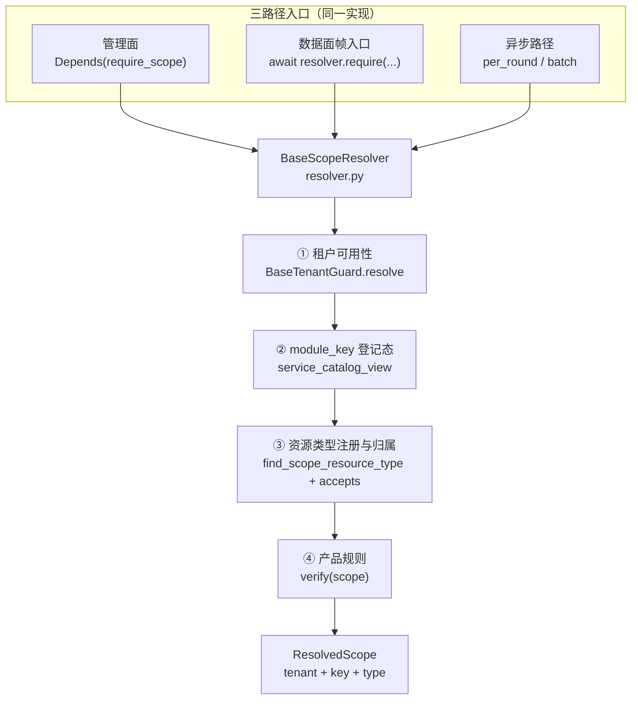

# 02 详细设计 · 通用三级作用域（工作项 01-2 作用域解析与校验）

> 产品租户与安全接入 · 任务 01 通用三级作用域 · 工作项 01-2 作用域解析与校验 · 详细设计（开发核心文档）

[文档首页](../../../../../文档首页.md) › [01 通用三级作用域](../01_通用三级作用域.md) › 设计

## 1. 目标与边界 <a id="scope"></a>

**目标**：把「租户 → 模块 → 资源」三级解析与四步校验做成**基座唯一实现**，管理面、数据面帧入口、异步路径三条路径共用同一函数与同一结论；未登记即拒（fail-closed），租户源不可达按 503 拒绝。

**范围内**：

1. `ResolvedScope` 值对象（租户上下文 + 三级标识 + 命中类型记录）；
2. 解析顺序与来源统一：`tenant_id` → `module_key` → `resource_key`；
3. 四步校验顺序：租户可用性 → 模块登记态 → 资源类型注册与归属 → 产品自定义规则；
4. 六类失败语义与四个新错误码（`82009` ~ `82012`）、租户两类沿用 `80001` / `80002`、租户源不可达沿用 `10007`；
5. 三路径接入：HTTP 依赖工厂、数据面帧入口调用契约、异步守卫三入口；
6. 产品扩展钩子 `verify(scope)` 与禁止清单。

**范围外**：

- 不可变作用域上下文（含产品扩展位）与三处注入、审计上下文字段、i18n 文案键 → `01_03`；
- 租户生命周期事件与资源清理 → `01_04`；
- 资源级 ACL 语义（产品授权模型）→ `02_01` / `02_05`；
- 数据面真实帧入口（msg h2 帧）→ `03_01` 接入，本期只在 bms 侧出契约与一致性用例；
- 数据范围（RBAC 行级过滤）→ `bms_core/scope/`，与本研究正交。

**交付物清单**：

| # | 交付物 | 落点 |
| --- | --- | --- |
| D1 | `ResolvedScope` 值对象、`BaseScopeResolver` 契约、`SourceScopeResolver` 默认实现与工厂 | `backend/libs/bms_core/src/bms_core/resource_scope/resolver.py`（新增） |
| D2 | `NullScopeResolver` 空实现（调用即 `ConfigError`，fail-closed） | `backend/libs/bms_core/src/bms_core/resource_scope/null.py`（新增） |
| D3 | 四个错误码与四个异常类 | `bms_core/core/error_codes.py`、`bms_core/core/exceptions.py` |
| D4 | 管理面依赖工厂 `require_scope()` | 同 D1 文件内导出 |
| D5 | 装配登记与配置项 `[scope_resolver].provider` | `bms_core/core/assembly.py`、`bms_core/core/config.py`、`config*.toml` |
| D6 | 插件键登记（crosscut 快照） | `backend/services/platform/tests/crosscut/test_plugin_registration.py` |
| D7 | 用例四组 | `libs/bms_core/tests/resource_scope/test_scope_resolver.py`（新增）等 |
| D8 | 详细设计 / 实施记录 / 测试记录 | 本目录 `设计/`、`实施/`、`测试/` |

## 2. 现状 <a id="current"></a>

| 项 | 现状事实（代码落点） |
| --- | --- |
| 管理面租户解析 | `TenantMiddleware`（`api/middleware.py`）→ `resolve_request_tenant()`（`db/tenant.py`，子域名 → `X-Tenant-ID` → token 租户位）；未知 / 停用就地转统一错误响应 |
| 异步租户守卫 | `BaseTenantGuard`（`tenant/guard.py`）：`require` / `per_round` / `batch` / `require_sync` 四入口共用 `resolve()`，`verify(context, scope)` 为产品钩子；`scope` 只是 `str`，装不下三级 |
| 数据面帧入口 | **bms 仓内不存在**（msg 的 h2 帧在 msg 仓，bms 侧只有 `msgclient` 客户端库） |
| `module_key` 登记态 | `service_catalog_view()`（`services/module_registry.py`）返回进程内 `ModuleRecord` 列表，含 `status`（`ModuleStatus`）；**无运行期校验入口** |
| 租户级模块开关 | `BaseTenantModuleGate`（`tenant_module/base.py`）：`sys_tenant_module` 状态，停用 / 未开通抛 `TenantModuleDisabledError`（82008 / 403）；回源失败 **fail-open + WARNING** |
| `resource_key` | `01-1` 已交付 `find_scope_resource_type(module_key, kind)` / `ScopeResourceTypeRecord.is_active()` / `accepts()` / `scope_resource_types_of()`（`resource_scope/base.py`），**尚无人调用** |
| 错误码 | `ErrorCode`（`core/error_codes.py`）：`80001` 租户不存在、`80002` 租户停用、`82007` 模块未注册或未启用（**两类合一**）、`82008` 租户模块停用；资源两类无码 |
| 插件装配 | `core/assembly.py` 第 481 行 `register_plugin("tenant_guard", "source", SourceTenantGuardFactory(app))`；插件键快照在 `services/platform/tests/crosscut/test_plugin_registration.py` |

## 3. 目标设计 <a id="design"></a>



### 3.1 返回值 `ResolvedScope` <a id="value"></a>

`@dataclass(frozen=True)`，`BaseValueObject`——**解析成功的事实凭证**：

| 字段 | 类型 | 说明 |
| --- | --- | --- |
| `tenant` | `TenantContext` | 已通过可用性判定的租户上下文（`tenant_id` / `code` / `db_key` / `status`） |
| `key` | `ResourceScopeKey` | 三级标识（`01-1` 已定稿的不可变值对象） |
| `resource_type` | `ScopeResourceTypeRecord \| None` | 命中的类型记录；模块级作用域（`resource_key is None`）为 `None` |

派生属性：`tenant_id` / `module_key` / `resource_key`（转取 `key`）、`effective_status`（无类型时恒 `enabled`，有类型时取 `resource_type.is_active()` 派生的 `enabled` / `disabled`——**已通过校验的值必为 `enabled`**，保留该属性是给 `01-3` 的上下文与审计取值，不另造第三种状态值）。

**为什么不在本期定义上下文**：`ResolvedScope` 只承载「解析已通过」这一事实；`01-3` 要在其上追加产品扩展位并做三处注入，届时以它为底座扩展，不另起一个上下文类型。

### 3.2 解析与校验契约 <a id="contract"></a>

`BaseScopeResolver`（插件键 `scope_resolver`）唯一判定方法：

```
resolve(
    target: TenantTarget | None,        # None = 取当前请求租户上下文（与 BaseTenantGuard 同口径）
    *,
    module_key: str,
    resource_type: str | None = None,   # 类型标识 {module_key}.{kind}
    resource_key: str | None = None,    # 资源标识；None = 模块级作用域
    owner_tenant_id: int | None = None, # 可选：调用方声明的资源归属租户
) -> ResolvedScope
```

语义入口（与 `BaseTenantGuard` 同名同序，全部委托 `resolve`，不复制判定）：

| 入口 | 用途 | 语义 |
| --- | --- | --- |
| `resolve(...)` | 唯一判定点 | 六步顺序执行，首个失败即抛；成功返回 `ResolvedScope` |
| `require(...)` | 单次校验 | 等价 `resolve`（语义显式，供数据面帧入口逐帧调用） |
| `per_round(...)` | 异步循环 | 每轮调用一次；结论与 `require` 相同 |
| `batch(...)` | 批处理前置 | `asynccontextmanager`，进入时校验一次、批内不重复回源 |
| `require_sync(...)` | 同步执行体 | 运行中事件循环内调用抛 `ConfigError`（不降级） |

**参数自洽**（形态层，归 `ParamError` 10001，不占六类码）：

- `resource_key` 非空而 `resource_type` 为空 ⇒ `ParamError`（无法定位类型，不得退化为「猜」）；
- `resource_type` 非空而 `resource_key` 为空 ⇒ 允许（模块级作用域可声明所关注类型，返回 `resource_type` 记录但 `key.resource_key` 为 `None`）。

### 3.3 解析顺序（第一步：来源与形态） <a id="parse"></a>

| 步 | 输入 | 来源 | 处理 |
| --- | --- | --- | --- |
| 1 | 租户定位 | 显式 `target`；缺省取 `get_tenant_context()`（要求含 `tenant_id`，拒演示兜底） | 交 `BaseTenantGuard.resolve()` 取数与判定（**不复制租户解析链**） |
| 2 | `module_key` | 调用方显式传入（产品不得从请求头自报） | 形态 `MODULE_KEY_RE`（复用 `01-1` 常量）；形态非法 ⇒ `ParamError` |
| 3 | `resource_type` | 调用方显式传入 | 形态 `RESOURCE_TYPE_KEY_RE`；两段拆分得 `kind` |
| 4 | `resource_key` | 调用方显式传入（管理面常来自路径 / 查询参数） | 形态 `RESOURCE_KEY_RE`（`01-1` 常量）；长度与 pattern 由类型记录的 `accepts()` 复核 |

**为什么三段显式**：`module_key` 与类型标识的前缀关系必须由调用方声明、由基座核对——否则「跨 `module_key` 的访问」在基座侧无法判定。`01-1` 已定类型标识为 `{module_key}.{kind}` 两段，本设计只是核对前缀相等。

### 3.4 校验顺序（第二至五步：四步固定） <a id="validate"></a>


| 步 | 判定 | 依据 | 失败 |
| --- | --- | --- | --- |
| ① | 租户存在且启用 | `BaseTenantGuard.resolve()`（租户源 + 全局版本戳，停用即时生效） | `TenantNotFoundError` / `TenantSuspendedError` / `ServiceUnavailableError` |
| ② | `module_key` 已登记且启用 | `service_catalog_view()` 中该键存在且 `status == enabled`（**登记态**，进程内视图，不回源） | `82009` / `82010` |
| ③ | 资源类型已注册且归属本模块 | 类型标识前缀 `== module_key`；`find_scope_resource_type(module_key, kind)` 命中；记录 `is_active()` 为真（声明态与运营态均为 `enabled`） | `82011` |
| ④ | `resource_key` 未越界 | 记录 `accepts(resource_key)`（pattern + `max_length`）；`owner_tenant_id` 传入时须等于当前 `tenant_id` | `82012` |
| ⑤ | 产品自定义规则 | `verify(scope)`（子类覆写，缺省空实现） | 产品自定义异常原样冒泡 |

**顺序不可调、不可跳**：`01-1` 已交付但无人调用的 `is_active()` / `accepts()` 在此接线；租户级模块开关（`tenant_module` 门禁，82008）**不在本链**——它由 `require_permission` 链路按权限码业务段判定，属「租户是否开通该产品」，与「模块键是否已登记」是两层，不重复判定（避免作用域判定依赖一个 fail-open 的远端契约）。

**②的登记态数据源**：`service_catalog_view()` 是进程内视图（平台常量 + 已装载产品行），与 `01-1` 请求期只读视图同口径；未装载产品清单的进程（如租户服务）调用本 resolver 时，产品模块键一律判为未登记（fail-closed），这是预期行为——该类服务本身不承载产品资源。

### 3.5 失败语义 <a id="fail"></a>

| 情形 | 异常类 | 码 / HTTP | 消息口径 |
| --- | --- | --- | --- |
| 租户不存在 | `TenantNotFoundError` | `80001` / 404 | 沿用既有 |
| 租户已停用 | `TenantSuspendedError` | `80002` / 403 | 沿用既有 |
| 租户源不可达 | `ServiceUnavailableError` | `10007` / 503 | fail-closed，不静默放行、不回退旧缓存 |
| `module_key` 未登记 | `ScopeModuleNotRegisteredError` | `82009` / 400 | 含模块键，不含产品清单内容 |
| `module_key` 未启用 | `ScopeModuleDisabledError` | `82010` / 403 | 含模块键与登记状态 |
| 资源类型未注册 | `ScopeResourceTypeNotRegisteredError` | `82011` / 400 | 含模块键与类型标识；**不区分「从未登记」与「已停用」** |
| `resource_key` 越界 | `ScopeResourceOutOfBoundsError` | `82012` / 403 | 含类型标识，**不回显登记的 pattern**（防探测） |

**不泄露存在性**：对外消息不出现「是否存在」的表述差异（如不写「该资源不存在」而写「作用域不可用」）；「类型已停用」与「类型未注册」同码同文案（决策 8），内部日志用 `scope_resource_type_inactive` 与 `scope_resource_type_unknown` 两个事件区分，供排障。

**对外状态码的既有事实**：`80001` / `80002` 已按「不存在 404 / 停用 403」区分（`04_02` 定稿口径），本设计不改；新增四码按「未登记 400 / 不可用 403」分组，不引入新的存在性泄露面。

### 3.6 错误码与异常类 <a id="codes"></a>

`ErrorCode` 新增（`82` 段开放 / 租户段内顺延，`82007` 保留原义「`sys_tenant_module` 引用校验」不动）：

| 常量 | 值 | 说明 |
| --- | --- | --- |
| `SCOPE_MODULE_NOT_REGISTERED` | `82009` | 作用域模块键未在模块注册中登记 |
| `SCOPE_MODULE_DISABLED` | `82010` | 作用域模块键已登记但未启用 |
| `SCOPE_RESOURCE_TYPE_NOT_REGISTERED` | `82011` | 资源类型未注册或已停用 |
| `SCOPE_RESOURCE_OUT_OF_BOUNDS` | `82012` | 资源取值越界或归属不符 |

四个异常类继承 `OpenTenantError`（`8xxxx` 段基类），与 `TenantModuleDisabledError` 同族；文案键与 i18n 登记交 `01_03`，本期异常消息为中文兜底（与既有异常一致）。

### 3.7 三路径接入 <a id="paths"></a>

| 路径 | 接入方式 | 本期交付 |
| --- | --- | --- |
| 管理面（HTTP） | 依赖工厂 `require_scope(module_key, resource_type, *, resource_from="path", resource_param="resource_key", owner=False)`，路由 `Depends(...)` 取 `ResolvedScope` | 完整实现 + 用例 |
| 数据面（帧入口） | 产品在帧入口 `await resolver.require(target, module_key=..., resource_type=..., resource_key=...)` | **契约 + 同结论用例**；真实帧入口由 `03_01` 接入 |
| 异步（消费 / 任务 / 批处理） | `per_round(...)` / `batch(...)` / `require_sync(...)` | 完整实现 + 用例 |

**管理面取参口径**：`resource_from` 只支持 `path` / `query`（缺省 `path`）；请求体里的资源标识**不由依赖工厂自动取**——依赖工厂读体会消费请求流，且 FastAPI 的 body 依赖与业务 DTO 解析顺序耦合；此类场景由业务处理函数直调 `resolver.require(...)`（仍走同一实现，不算第二套解析）。

**帧入口为什么不在 bms 侧写**：bms 仓内没有数据面帧实现（msg 的 h2 帧在 msg 仓），在此处造一个「通用帧入口」只能是空壳；本期把「同结论」以用例固定（同一组输入经 `require` / `per_round` / `batch` / HTTP 依赖四种调用方式断言 `ResolvedScope` 相等），`03_01` 接入时按用例口径断言。

### 3.8 产品扩展点 <a id="ext"></a>

`BaseScopeResolver.verify(scope: ResolvedScope) -> None`：前四步全部通过后调用，缺省空实现；产品继承 `SourceScopeResolver` 覆写并注册自有实现名（`register_plugin("scope_resolver", "<name>", ...)`），**不改基座文件**。

- 钩子只拿得到已通过的 `ResolvedScope`，拿不到租户源与视图句柄——产品无法借此绕过前四步；
- 抛出的异常原样冒泡（产品自定义码由 `02_02` 映射）；
- 与 `BaseTenantGuard.verify(context, scope)` 并存：租户级规则留在 `tenant_guard`，作用域级（模块 / 资源）规则写在这里，两者不互替。

### 3.9 空实现与装配 <a id="null"></a>

| 项 | 设计 |
| --- | --- |
| 插件键 / 实现名 | `scope_resolver` / `source`（默认）、`null`（空实现） |
| 空实现 | `NullScopeResolver`：`resolve` 调用即 `ConfigError`——占位恒放行会让「配置写错」变成「作用域全放行」，与 `NullTenantGuard` 同口径 |
| 装配 | `core/assembly.py`：`register_plugin("scope_resolver", SOURCE_SCOPE_RESOLVER, SourceScopeResolverFactory(app))` |
| 配置 | `[scope_resolver].provider = "source"`（`Settings` 增 `ScopeResolverSettings`）；放行取值 `source` / `null`，其余名装配期报错 |
| 依赖注入提供者 | `get_scope_resolver(request)` → `resolve_plugin("scope_resolver", settings.scope_resolver.provider, expected_version=...)` |
| 插件键登记 | `_EXPECTED_PLUGIN_KEYS` 增 `scope_resolver`（crosscut 快照用例同步；`NullScopeResolver` 继承 `BaseNullObject` 由快照自动收集，不另登记） |

### 3.10 禁止清单与护栏输入 <a id="forbid"></a>

进 `04_01` 护栏规则设计，本期只登记口径：

| 禁止 | 基座侧的对应保障 |
| --- | --- |
| 产品自建解析（自己读 `X-Tenant-ID` / 自己查 `sys_module`） | 本能力域是唯一实现；`01_1` 视图只读、`BaseTenantGuard` 唯一取数点 |
| 信任客户端自报头 | `EdgeGuardMiddleware` 在租户解析前无条件剥除伪造身份头（既有） |
| 自建状态缓存覆盖基座判定 | resolver 不缓存，每次判定走租户源与进程内视图 |
| 数据面用连接建立时的租户覆盖后续请求 | 帧入口要求逐帧 `require`（`03_01` 的评审项） |
| 在业务层拼 HTTP 响应 | 依赖工厂抛异常，由统一渲染单点转响应（渲染接线在 `02_02`） |

## 4. 影响面 <a id="impact"></a>

| 类别 | 对象 | 变更 |
| --- | --- | --- |
| 新增 | `resource_scope/resolver.py` | `ResolvedScope`、`BaseScopeResolver`、`SourceScopeResolver`、工厂、`require_scope`、`get_scope_resolver` |
| 新增 | `resource_scope/null.py` | `NullScopeResolver` |
| 修改 | `resource_scope/__init__.py` | 导出新增符号 |
| 修改 | `core/error_codes.py` | 四个码（`82009` ~ `82012`） |
| 修改 | `core/exceptions.py` | 四个异常类（`OpenTenantError` 子类） |
| 修改 | `core/assembly.py` | 登记 `scope_resolver:source` |
| 修改 | `core/config.py` | `ScopeResolverSettings` + `Settings.scope_resolver` |
| 修改 | `config.toml` 及 `config.{env}.toml` | `[scope_resolver].provider = "source"`（各环境同值，prod 也不得置 `null`） |
| 修改 | `services/platform/tests/crosscut/test_plugin_registration.py` | `_EXPECTED_PLUGIN_KEYS` 增键 |
| 新增 | `libs/bms_core/tests/resource_scope/test_scope_resolver.py` 等 | 用例（见 §5） |

**连带行为变更**（须在实施记录登记）：① 新增一个插件端口，装配缺失即 `PluginError`（不再静默）；② `config.toml` 增段 ⇒ 推送预检按「配置变更」退化全量（已知代价，一次提交消化）；③ `82009` ~ `82012` 进码表，撞码检测与码表快照随之变化。

## 5. 测试设计 <a id="test"></a>

用例编号在 Kiwi 登记后回填（本工作项**一条**用例，代码以 `@pytest.mark.kiwi_id(<编号>)` 标注；多条断言共用同一编号）。

| # | 用例 | 断言 | 验收映射 |
| --- | --- | --- | --- |
| 1 | 三段合法解析 | 返回 `ResolvedScope`，`key` 三字段与入参一致，`resource_type` 为命中记录 | 完成标准① |
| 2 | 模块级作用域 | `resource_key=None` ⇒ `key.resource_key is None`，`effective_status == "enabled"` | 完成标准① |
| 3 | `resource_key` 无 `resource_type` | `ParamError`（10001），不落六类码 | §3.2 |
| 4 | 模块键形态非法 | `ParamError` | §3.3 |
| 5 | 模块键未登记 | `ScopeModuleNotRegisteredError`（82009） | 完成标准② |
| 6 | 模块键已登记未启用 | `ScopeModuleDisabledError`（82010） | 完成标准② |
| 7 | 类型标识前缀 ≠ `module_key` | `ScopeResourceTypeNotRegisteredError`（82011），消息含两侧 | 完成标准② |
| 8 | 类型未注册 | `82011` | 完成标准② |
| 9 | 类型已停用（声明态 / 运营态） | `82011`；内部日志事件为 `scope_resource_type_inactive` | §3.5 |
| 10 | `resource_key` 不匹配 pattern | `ScopeResourceOutOfBoundsError`（82012） | 完成标准② |
| 11 | `resource_key` 超 `max_length` | `82012` | 完成标准② |
| 12 | `owner_tenant_id` 与当前租户不一致 | `82012`（跨租户拒绝） | 完成标准② |
| 13 | `owner_tenant_id` 一致 | 通过，`ResolvedScope` 正常返回 | 完成标准② |
| 14 | 租户不存在 / 已停用 | `80001` / `80002` 原样冒泡（不经 82 段改写） | 完成标准③ |
| 15 | 租户源不可达 | `ServiceUnavailableError`（10007 / 503），不返回 `ResolvedScope` | 完成标准③ |
| 16 | 三路径同结论 | 同一组输入经 `require` / `per_round` / `batch` / HTTP 依赖，`ResolvedScope.key` 与 `tenant_id` 全等 | 完成标准① |
| 17 | 产品规则钩子 | 覆写 `verify` 抛错 ⇒ 原样冒泡；不抛 ⇒ 正常返回；钩子收到已通过校验的 `ResolvedScope` | 完成标准④ |
| 18 | 空实现 fail-closed | `NullScopeResolver.resolve(...)` ⇒ `ConfigError` | §3.9 |
| 19 | 装配冒烟 | 未登记实现名 / 契约版本不符 ⇒ `PluginError`；默认配置可解析出 `SourceScopeResolver` | §3.9 |

**自动化落点**（同一 Kiwi 编号）：

| 文件 | 覆盖 |
| --- | --- |
| `backend/libs/bms_core/tests/resource_scope/test_scope_resolver.py` | 用例 1~15、17~19（纯逻辑：解析顺序、六类失败、钩子、空实现、装配） |
| `backend/libs/bms_core/tests/resource_scope/test_scope_resolver_paths.py` | 用例 16（三路径同结论 + HTTP 依赖工厂取参：path / query / 缺参） |

## 6. 风险与边界 <a id="risk"></a>

| 风险 | 处置 |
| --- | --- |
| 与 `tenant_module` 门禁重复判定、口径打架 | 明确两层分工（登记态 vs 租户开通态），resolver 只判登记态；门禁的 fail-open 不进入作用域链 |
| 产品进程未装载服务目录 ⇒ 模块键一律「未登记」 | 文档写明：调用 resolver 的进程必须已装载本产品清单；未装载进程本就不承载产品资源（`03_01` 装配检查项） |
| 依赖工厂自动读体导致请求流被消费 | 只支持 path / query；body 场景由业务层直调 `resolve`，同一实现 |
| `resource_key` 的 pattern 来自产品声明，恶意 pattern 拖慢 `accepts()` | 装载期已限长度、限量词、拒嵌套量词（`01-1` V5 / V6）；请求期只 `fullmatch` 已登记 pattern |
| 新增配置段导致推送预检退化全量 | 已知代价（约 19 分钟）；本任务一次提交消化，不因此改预检策略 |
| 「不泄露存在性」与既有 404/403 区分口径冲突 | 沿用既有租户口径不改；新增四码只按「未登记 / 不可用」分组，文案不写「是否存在」 |

## 7. 开放项 <a id="open"></a>

| # | 事项 | 归口 |
| --- | --- | --- |
| 1 | 数据面帧入口的真实接入与逐帧校验 | `03_01`（msg 数据面） |
| 2 | 产品自定义规则的批量注册（多规则顺序） | 出现第二个产品提同类规则时论证（`02_01`） |
| 3 | 作用域判定的指标（拒绝次数按码 / 模块） | `02_02` 错误码映射与监控接线 |
| 4 | `owner_tenant_id` 从资源记录自动派生（免调用方传） | 各产品资源表统一带 `tenant_id` 之后论证 |

## 8. 对齐记录 <a id="alignment"></a>

开工前逐项确认 12 项决策，据此定稿：

| # | 原设想 / 备选 | 定稿 | 理由 |
| --- | --- | --- | --- |
| 1 | 扩展 `tenant_guard` / 新建顶层包 | 新增 `scope_resolver` 能力域（同 `resource_scope` 包内 `resolver.py`） | 能力边界清晰；租户判定仍只有一处；`01_3` 上下文与 `02_01` 规则都挂同一端口 |
| 2 | 登记态 + 租户开关 / 只判租户开关 | **只判登记态**（`service_catalog_view`） | 与 `01_1` V3 同口径；模块门禁回源失败是 fail-open，不能进 fail-closed 链 |
| 3 | 只给 `resource_key` 自动匹配 / `kind:name` | **三段显式**（`module_key` + 类型标识 + `resource_key`） | 跨 `module_key` 越权才可判定；与 `01_1` 的 `find_scope_resource_type(module_key, kind)` 对齐 |
| 4 | 码留 `01_3` / 复用 82007 | **本期定六码 + 异常类** | 校验要抛可断言的具名异常；完成标准要求「映射到已登记错误码」 |
| 5 | `82007` + 两码 / 子段 | **新增 `82009` ~ `82012`** | 六类逐条有定义；`82007` 保留 `sys_tenant_module` 引用校验原义 |
| 6 | 独立 `BaseScopeRule` 多插件 / callable | **子类覆写 `verify(scope)`** | 与 `BaseTenantGuard.verify` 同型；本期只有 msg 一个消费者，多插件属提前抽象 |
| 7 | 基座加全局中间件 / `msgclient` 注入 | **基座只出契约 + 三入口** | bms 无数据面帧实现；中间件拿不到二三级；msgclient 方向相反 |
| 8 | 归「越界」/ 新增第七码 | **归 `82011`**，内部日志区分 | 对外不泄露存在性；不扩需求条目 |
| 9 | 只判形态 / 强制必填 | **可选 `owner_tenant_id`** | 能卡住「声明了归属但写错」，又不强迫无归属概念的场景 |
| 10 | 业务层直调 / 装饰器 | **FastAPI 依赖工厂 `require_scope`** | 与 `require_permission` 同型；路由一处声明，漏接可扫 |
| 11 | 返回元组 / 只返回 `ResourceScopeKey` | **新增 `ResolvedScope`** | 承载「已通过校验」的事实，`01_3` 直接以它为底座 |
| 12 | 新增专用 503 码 | **原样冒泡 `10007`** | 与 HTTP / 异步既有行为一字不差，监控口径不变 |

> 本文档依《[文档生成规范](../../../../../规范/文档生成规范.md)》与《[任务文档规范](../../../../../规范/任务文档规范.md)》编写
