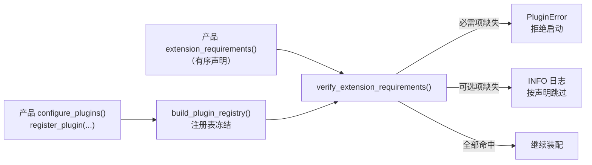
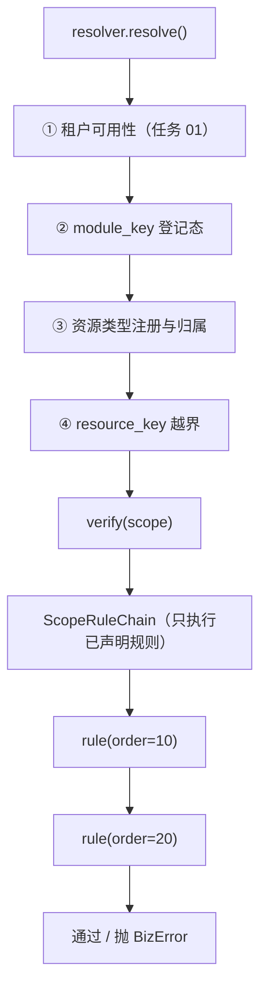
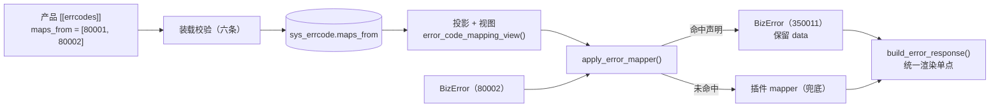
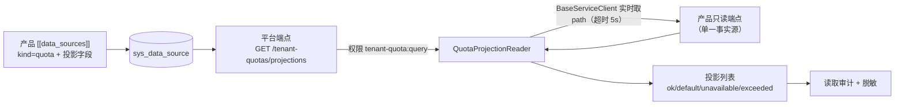
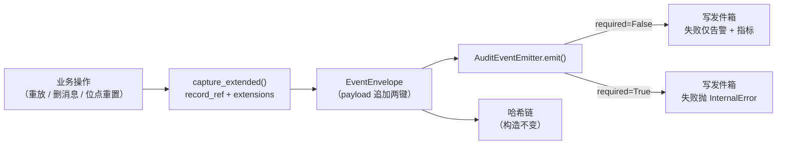
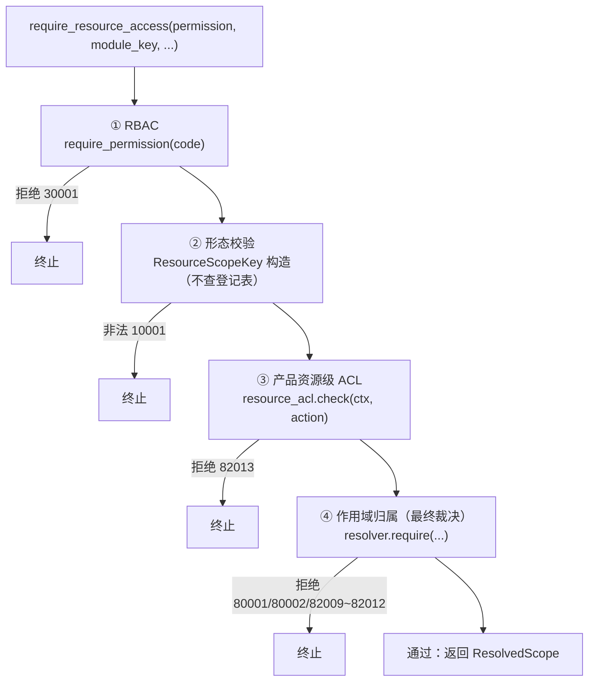

# 02 详细设计 · 标准扩展点

> 07D 任务 02 · 需求 02-1 ~ 02-5 · 详细设计（开发核心文档）

[文档首页](../../../../../文档首页.md) › [02 标准扩展点](../02_标准扩展点.md) › 设计

## 0. 分章导航 <a id="toc"></a>

本文档是**任务 02 的唯一详细设计**，按需求条目分章——一个任务一份设计，不按条目拆多份。

| 需求 | 章节 | 内容 | 状态 |
| --- | --- | --- | --- |
| 公共 | §1 | 扩展点声明与拒绝启动（装配期声明 + 基座校验） | 已定稿 |
| 02-1 作用域校验扩展点 | §2 | `scope_rule` 端口、规则链、三路径复用、fail-closed | 已定稿 |
| 02-2 错误码映射扩展点 | §3 | `maps_from` 声明、撞码与语义校验、渲染单点接线、反向对账 | 已定稿 |
| 02-3 配额只读回显扩展点 | §4 | 投影声明（`kind=quota`）、投影契约、四态、只读视图端点 | 已定稿 |
| 02-4 审计字段扩展点 | §5 | 扩展字段、`record_ref`、留痕类别、强审计失败处置 | 已定稿 |
| 02-5 资源级 ACL 接入约束 | §6 | `resource_acl` 端口、组合依赖、判定顺序、`82013` | 已定稿 |
| 交叉 | §7 ~ §11 | 影响面 / 测试设计 / 登记落点 / 风险与开放项 / 对齐记录 | 已定稿 |
| 附录 | A ~ D | 四份 msg 迁移对照表（本任务只出对照表，代码迁移归任务 03） | 已定稿 |

**任务级边界**：本文档只把「四类扩展点的契约、顺序与统一入口」及「资源级 ACL 的约束」落成基座可注册、可解析、可校验的契约；产品业务语义（主题 / 存储桶 / 组织树的含义）、msg 的真实改造代码（任务 03）、审计表列与写入落地（阶段六）、护栏规则实现（任务 04）均在范围外。

**接入次序固定**（本任务不可调换）：作用域校验 → 错误码映射 → 配额回显 → 审计字段；顺序变更须先回写任务文档 §2 再改代码。

## 1. 扩展点声明与拒绝启动（公共机制） <a id="assembly"></a>

### 1.1 目标与边界 <a id="assembly-scope"></a>

**目标**：把「产品声明需要哪些扩展点、哪个实现是必需的」变成**启动期可校验的契约**，使「必需扩展点未注册即拒启、可选未注册按声明跳过」不再依赖人工评审。

**范围内**：扩展点键常量、需求声明值对象、装配钩子、注册表冻结后的核对与失败语义。
**范围外**：扩展点自身的语义（§2 ~ §6）；插件注册表实现（`core/plugin.py` 既有）；产品声明清单落库（本任务**不新增声明段**，见对齐记录 #1）。

### 1.2 现状 <a id="assembly-current"></a>

| 项 | 现状事实（代码落点） |
| --- | --- |
| 插件注册与解析 | `core/plugin.py`：`register_plugin` / `resolve_plugin` / `build_plugin_registry` / `plugin_registry_snapshot()`（两级映射 `plugin_key → {plugin_name → 实现}`，构建后只读） |
| 装配顺序 | `application.py::BaseServiceApplicationFactory.create()`：`register_platform_plugins()` → `self.configure_plugins(app, settings)` → `build_plugin_registry()` → … → lifespan 内 `assemble_plugins()` |
| 缺省实现 | 未配置 provider 时解析 `null`；`PluginError` 仅在**解析时**抛——不解析的扩展点即使缺失也不报错 |
| 扩展点声明 | **无**。产品「需要哪个扩展点」只存在于代码注释与文档，缺实现时表现为「运行期某请求才 500」 |
| 插件清单接口 | `plugin_registry_snapshot()` 可读全量；`GET /api/v1/plugins`（platform 服务）已暴露只读清单 |

### 1.3 目标设计 <a id="assembly-design"></a>



#### 1.3.1 扩展点键常量 <a id="assembly-keys"></a>

`bms_core/extension/base.py`（新增能力域 `extension`）：

| 常量 | 值 | 语义 | 是否标准扩展点 |
| --- | --- | --- | --- |
| `SCOPE_RULE_KEY` | `scope_rule` | 作用域校验第四步规则（§2） | 是（02-1） |
| `ERROR_MAPPING_KEY` | `error_mapping` | 错误码映射（§3） | 是（02-2） |
| `QUOTA_PROJECTION_KEY` | `quota_projection` | 配额只读回显（§4） | 是（02-3） |
| `AUDIT_EXTENSION_KEY` | `audit_extension` | 审计字段扩展（§5） | 是（02-4） |
| `RESOURCE_ACL_KEY` | `resource_acl` | 资源级 ACL（§6） | **否**（产品特有扩展，同机制登记） |

**内建语义不走插件端口**：错误码映射由 `[[errcodes]].maps_from` 声明装载、配额投影由 `kind=quota` 数据源声明装载、审计类别由 `audit_classes()` 声明——三者的「注册要素」是声明数据本身，没有对应插件实现；`scope_rule` 与 `resource_acl` 才是真正的实现端口（`resource_acl` 无内建实现，未声明即不启用）。声明键 `error_mapping` / `quota_projection` / `audit_extension` 保留为**声明占位**（产品可显式声明「用基座内建语义」），其实现名 `declaration` 表示不解析插件。

#### 1.3.2 声明值对象 <a id="assembly-requirement"></a>

`ExtensionRequirement`（`@dataclass(frozen=True)`，`BaseValueObject`）：

| 字段 | 类型 | 约束 | 说明 |
| --- | --- | --- | --- |
| `plugin_key` | `str` | 必须是 §1.3.1 的五个键之一 | 扩展点键 |
| `plugin_name` | `str` | `^[a-z][a-z0-9_.]*$`，≤64 | 实现名（与 `register_plugin` 登记名一致） |
| `required` | `bool` | 默认 `True` | 必需 / 可选 |
| `order` | `int` | 默认 `100`，取值 `0~999` | 同键多实现的执行序（仅 `scope_rule` 生效） |

**有序**：声明列表的顺序即同 `order` 下的稳定次序（`scope_rule` 规则链按 `(order, 声明序)` 排序），不依赖注册表字典序。

#### 1.3.3 装配钩子与校验 <a id="assembly-hook"></a>

| 符号 | 落点 | 语义 |
| --- | --- | --- |
| `BaseServiceApplicationFactory.extension_requirements() -> list[ExtensionRequirement]` | `application.py` | 新增钩子，默认空列表；产品覆写 |
| `verify_extension_requirements(requirements, snapshot=None) -> list[ExtensionRequirement]` | `extension/base.py` | 按 `plugin_registry_snapshot()` 核对；返回**生效清单**（必需 + 已注册的可选） |
| 校验点 | `application.py::create()`，`build_plugin_registry()` 之后一行 | 必需缺失 → `PluginError`；可选缺失 → `INFO` 日志 `extension_skipped` 并剔除 |

**失败语义**：必需缺失一次性汇总全部缺失项后抛错（不在第一个缺失处中断，便于一次改完），消息含 `plugin_key:plugin_name` 与产品名。

**为什么不在产品自持声明里落库**：扩展点实现本身就是代码（`register_plugin` 是代码调用），声明落库会形成「代码注册 + 数据库声明」两份事实源，且换实现要同时改代码与清单；插件清单接口已能反查已注册实现，治理视图不缺。跨仓审计由装配期拒启 + 插件清单接口共同保证。

### 1.4 影响面 <a id="assembly-impact"></a>

| 类别 | 对象 | 变更 |
| --- | --- | --- |
| 新增 | `bms_core/extension/{__init__,base}.py` | 键常量、`ExtensionRequirement`、`verify_extension_requirements` |
| 修改 | `bms_core/application.py` | 钩子 `extension_requirements()` + 校验调用 |
| 新增 | `bms_core/tests/extension/test_extension_requirements.py` | 用例 |

**连带行为变更**：① 新增钩子默认空 → 既有服务行为逐字节不变；② 产品一旦声明必需扩展点，缺实现即拒启（fail-fast），不再等到运行期。

## 2. 需求 02-1 作用域校验扩展点 <a id="scope-rule"></a>

### 2.1 目标与边界 <a id="w021-scope"></a>

**目标**：把「产品在作用域校验第四步追加的资源归属规则」做成**可注册、可解析、可配置**的扩展点——基座固定前三步（租户可用性 / 模块登记 / 资源类型注册与越界），产品只注册第四步，三路径（管理面 / 数据面 / 异步）自动同口径。

**范围内**：`scope_rule` 端口契约、规则链、`verify()` 接线、失败语义、必需声明。
**范围外**：前三步判定（任务 01 已交付 `BaseScopeResolver`）；资源级 ACL（§6）；msg 真实迁移（任务 03，本任务只出附录 A 对照表）。

**交付物清单**：

| # | 交付物 | 落点 |
| --- | --- | --- |
| D1 | `BaseScopeRule` 端口 + `NullScopeRule` | `bms_core/resource_scope/rules.py`（新增） |
| D2 | `ScopeRuleChain`（有序链 + 只执行已声明规则） | 同文件 |
| D3 | `BaseScopeResolver.verify()` 改为调用规则链 | `bms_core/resource_scope/resolver.py`（修改） |
| D4 | 规则链装配（按 `extension_requirements()` 的 `scope_rule` 声明解析） | `bms_core/resource_scope/rules.py::build_scope_rule_chain` |
| D5 | 用例 | `bms_core/tests/resource_scope/test_scope_rules.py`（新增） |

### 2.2 现状 <a id="w021-current"></a>

| 项 | 现状事实（代码落点） |
| --- | --- |
| 四步校验 | `resource_scope/resolver.py::SourceScopeResolver.resolve()`：租户 → 模块登记态 → 资源类型注册 → 越界 → 调 `self.verify(scope)` |
| 产品钩子 | `BaseScopeResolver.verify(scope)` 缺省空实现；产品**必须继承 `SourceScopeResolver` 覆写**才能加规则 |
| 三路径 | `require` / `per_round` / `batch` / `frame` 全部经 `resolve()`，钩子天然复用于三路径 |
| 现存消费者 | msg 的命名空间校验**不在**这里，而在 `bms_msg/tenant_guard.py::MsgTenantGuard.verify(context, scope)`（租户级钩子） |
| 多规则 | 无：一个产品只能有一个覆写实现；规则顺序不可控、不可单点替换 |

### 2.3 目标设计 <a id="w021-design"></a>



#### 2.3.1 端口契约 <a id="w021-contract"></a>

`BaseScopeRule(BasePluggable, ABC)`，`key = plugin_key = "scope_rule"`，`contract_version = DEFAULT_CONTRACT_VERSION`：

| 成员 | 类型 | 语义 |
| --- | --- | --- |
| `plugin_name` | `str` | 实现名（产品声明引用此名） |
| `order` | `int`（类属性，默认 `100`） | 执行序（小者先）；同 `order` 按声明序 |
| `applies_to(scope) -> bool` | 方法，缺省 `True` | 规则适用范围（如仅 `resource_type == "msg.topic"` 时生效） |
| `verify(scope: ResolvedScope) -> None` | **抽象方法** | 判定；不通过抛 `BizError` |

**入参边界**：规则只拿得到**已通过前四步**的 `ResolvedScope`（含 `tenant` / `key` / `resource_type` / `extensions`），拿不到租户源、注册表、DB 会话——产品无法借此绕过前四步，也无法自建解析。

**禁止**：规则内重新解析租户 / 查 `sys_module` / 自建状态缓存（护栏输入，进任务 04）；规则内改 `scope` 字段（值对象 frozen，改了也会抛错）。

#### 2.3.2 规则链 <a id="w021-chain"></a>

`ScopeRuleChain`（不可变）：

| 成员 | 语义 |
| --- | --- |
| `rules: tuple[BaseScopeRule, ...]` | 已按 `(order, 声明序)` 排序的规则 |
| `verify(scope) -> None` | 依次执行；某条 `applies_to` 为假则跳过；任一抛错立即中断（后续规则不执行） |

**只执行已声明的规则**：解析来源是产品 `extension_requirements()` 中 `plugin_key == "scope_rule"` 的条目（按 `plugin_name` 从注册表解析）。**未声明的规则不执行**——避免平台内置规则对未声明产品意外生效。

**空链语义**：无声明 → 空链 → `verify()` 等价空实现（与现状一致，不改变任何既有产品行为）。

#### 2.3.3 接线 <a id="w021-wire"></a>

`BaseScopeResolver.verify()` 的**缺省实现**改为：

```
def verify(self, scope: ResolvedScope) -> None:
    for rule in self.rule_chain.rules:   # rule_chain 由工厂注入，缺省空链
        if rule.applies_to(scope):
            rule.verify(scope)
```

- **保留子类覆写**：产品若已覆写 `verify()`（如在 task 01 之前的老写法），覆写仍然生效；此时需在覆写内自行调 `super().verify(scope)` 才会执行规则链（设计写明，用例覆盖「覆写 + 调 super」与「覆写 + 不调 super」两种）。
- **三路径自动复用**：`require` / `per_round` / `batch` / `frame` 都经 `resolve()` → `verify()`，不新增入口。

#### 2.3.4 失败语义 <a id="w021-fail"></a>

| 情形 | 处置 |
| --- | --- |
| 规则抛 `BizError` | 原样冒泡（产品自定义码由 §3 映射；未声明映射时按产品码渲染） |
| 规则抛非 `BizError` | 包成 `InternalError`（10000 / 500）并记 `ERROR` 日志 `scope_rule_failed`（含规则名、模块键、异常类型）——**fail-closed**，不放行 |
| 规则解析失败（声明了但注册表无此名） | 装配期已由 §1.3.3 拒启；运行期解析失败 → `ConfigError`（不静默跳过） |
| 规则 `applies_to` 自身抛错 | 同「非 BizError」处理（fail-closed） |

#### 2.3.5 装配 <a id="w021-assembly"></a>

| 项 | 设计 |
| --- | --- |
| 规则链构造 | `build_scope_rule_chain(requirements)`：过滤 `scope_rule` 声明 → 按 `(order, 声明序)` 排序 → 逐条 `resolve_plugin("scope_rule", name, expected_version=BaseScopeRule.contract_version)` |
| 注入 | `SourceScopeResolverFactory.create()` 内构造链并传入 `SourceScopeResolver(rule_chain=...)`；缺省空链 |
| 配置 | **不新增配置段**：规则启用由产品声明驱动（多实现无法用单值 provider 表达） |
| 空实现 | `NullScopeRule`（`plugin_name = "null"`，`verify` 为 no-op）——仅用于开发期占位，产品声明它表示「显式不校验」，生产不得声明 |

### 2.4 影响面 <a id="w021-impact"></a>

| 类别 | 对象 | 变更 |
| --- | --- | --- |
| 新增 | `resource_scope/rules.py` | `BaseScopeRule` / `ScopeRuleChain` / `NullScopeRule` / `build_scope_rule_chain` |
| 修改 | `resource_scope/resolver.py` | `BaseScopeResolver.__init__` 增 `rule_chain`（缺省空链）；`verify()` 改为遍历链 |
| 修改 | `resource_scope/__init__.py` | 导出新增符号 |
| 新增 | `tests/resource_scope/test_scope_rules.py` | 用例 |

**连带行为变更**：`BaseScopeResolver` 构造签名多一个**带默认值**的关键字参数 → 既有子类与用例不传也能构造（向后兼容）；`verify()` 缺省实现从 `return None` 变为「遍历空链后返回」，对外不可观测。

### 2.5 测试设计 <a id="w021-test"></a>

用例编号在 Kiwi 登记后回填（本任务**一条**用例，代码以 `@pytest.mark.kiwi_id(<编号>)` 标注；多条断言共用同一编号）。

| # | 用例 | 断言 |
| --- | --- | --- |
| 1 | 规则通过 | 章程链执行后 `resolve()` 正常返回 `ResolvedScope` |
| 2 | 规则拒绝 | 抛 `BizError`（产品码）原样冒泡，`ResolvedScope` 不返回 |
| 3 | 规则抛非 BizError | 包成 `InternalError`（10000），日志事件 `scope_rule_failed`，**不放行** |
| 4 | 多规则顺序 | 按 `(order, 声明序)` 执行，顺序以执行记录断言；首个失败后续不执行 |
| 5 | `applies_to` 为假 | 该规则零调用 |
| 6 | 未声明的规则 | 注册了但未声明 → 零调用（平台内置规则不意外生效） |
| 7 | 三路径同结论 | 同一输入经 `require` / `per_round` / `batch` 得同一结论（通过或同一码） |
| 8 | 覆写 + 调 super | 子类覆写并调 `super().verify()` → 规则链执行 |
| 9 | 覆写 + 不调 super | 规则链不执行（向后兼容既有写法） |
| 10 | 空链 | 无声明 → 不改变 `resolve()` 结果 |
| 11 | 规则解析失败 | 声明了但注册表无此名 → `ConfigError` |

**自动化落点**：`backend/libs/bms_core/tests/resource_scope/test_scope_rules.py`（单文件覆盖 1~11）。

### 2.6 风险与边界 <a id="w021-risk"></a>

| 风险 | 处置 |
| --- | --- |
| 规则内做重活拖慢每次请求 | 入参只读、无 IO 句柄；规则宜只做内存判定，需要查库的判定属产品业务校验，不放这里 |
| 多规则顺序敏感 | `order` + 声明序双要素固定；顺序变更视为契约变更（文档回写） |
| 产品用规则替代前三步 | 规则拿不到租户源与注册表，无法替代；护栏规则进任务 04 |

### 2.7 开放项 <a id="w021-open"></a>

| # | 事项 | 归口 |
| --- | --- | --- |
| 1 | 规则级指标（按规则名统计拒绝次数） | 02-2 监控接线 |
| 2 | 规则热更新（改实现不重启） | 插件机制演进（不在本专项） |

### 2.8 对齐记录 <a id="w021-alignment"></a>

见 §11（全任务统一对齐记录表）。

## 3. 需求 02-2 错误码映射扩展点 <a id="error-mapping"></a>

### 3.1 目标与边界 <a id="w022-scope"></a>

**目标**：把「基座码 → 产品码」从**产品写 Python**改为**产品声明**，由基座装载、校验并在统一渲染单点生效；平台负责唯一性、撞码检测与契约反向对账。

**范围内**：`[[errcodes]]` 增 `maps_from` 字段、装载与校验（六条）、映射视图、渲染接线（声明优先 + 插件兜底）、反向对账。
**范围外**：产品码段与码级定义的既有机制（07B 已交付）；文案本体（在产品语言包）；msg 真实改造（任务 03，本任务只出附录 B）。

**交付物清单**：

| # | 交付物 | 落点 |
| --- | --- | --- |
| D1 | `ErrorCodeRecord.maps_from` + 映射视图 | `bms_core/services/module_registry.py` |
| D2 | `[[errcodes]]` 的 `maps_from` 解析与六条校验 | `bms_core/registry/products.py` |
| D3 | 声明映射装载与改写 | `bms_core/error_mapper/base.py`（`apply_error_mapper` 改造） |
| D4 | 声明载荷与落库（`sys_errcode.maps_from` 列） | `bms_core/registry/declarations.py`、`models/platform/declaration.py`、`data_sources` 同族仓储 |
| D5 | 数据表文件与总览登记变更 | `数据表设计/sys_errcode.md`（变更记录）、`01_数据库设计_总览.md` |
| D6 | 用例 | `bms_core/tests/error_mapper/test_declared_mapping.py`（新增）、`tests/registry/test_error_mappings.py`（新增） |

### 3.2 现状 <a id="w022-current"></a>

| 项 | 现状事实（代码落点） |
| --- | --- |
| 统一渲染单点 | `api/errors.py::build_error_response()`：先 `apply_error_mapper(exc, provider)` 再按 `error_code_view()` 取状态与文案 |
| 映射实现 | `error_mapper/base.py::BaseErrorMapper`（插件键 `error_mapper`）；缺省 `NullErrorMapper` 原样返回 |
| 现网消费者 | msg 的 `MsgErrorMapper.map()`：`TenantSuspendedError → 350011`、`TenantNotFoundError → 350012`（代码硬编码，两条） |
| 码级声明 | `[[errcodes]]` 已带 `code` / `domain` / `http_status` / `message_key` / `severity` / `description`；段位取自服务行 `errcode_segment` |
| 撞码检测 | `products.py::_validate_error_codes()`：平台码撞码 / 跨产品撞码 / 段位跨产品复用 |
| 契约反向对账 | `products.py::_check_contract_error_codes()`：契约声明的码必须已登记（强校验）+ 未声明端点只统计（软提示） |
| 映射可声明 | **否**：映射只能写代码，平台查不到「这个产品把 80002 改成了哪个码」 |

### 3.3 目标设计 <a id="w022-design"></a>



#### 3.3.1 声明格式 <a id="w022-declare"></a>

在既有 `[[errcodes]]` 记录上追加**一个可选字段**：

```toml
[[errcodes]]
code = 350011
domain = "msg"
http_status = 403
message_key = "msg.error.tenant_suspended"
severity = "warning"
description = "租户已停用（拒绝生产与消费，数据保留）"
maps_from = [80002]          # 新增：本码承接哪些基座码
```

| 字段 | 必填 | 说明 |
| --- | --- | --- |
| `maps_from` | 否 | 基座码整数数组（5 位平台码）；缺省空数组 = 不承接映射 |

**为什么挂在 `errcodes` 而不新增声明段**：映射的目标码必然是已登记的产品码，挂同一条记录可复用「撞码检测 / 段位归属 / 契约对账 / 落库投影 / 快照」全套既有机制，且天然不会出现「映射到未登记码」；新增声明段会引入第二条登记链与第二张表（对齐记录 #2）。

#### 3.3.2 装载校验（六条，fail-closed） <a id="w022-validate"></a>

校验入口：`products.py` 的清单解析（`inspect_product_manifests()`，装配期与 `ops.check_modules` 共用），逐条声明执行：

| # | 校验 | 判定 | 失败处置 |
| --- | --- | --- | --- |
| 校验一 | 源码形态 | 必须是 5 位平台码（`10000 ~ 99999`）且在 `ErrorCode` 枚举中已登记（产品码是 6 位，天然不会与源码混淆） | `CatalogError` 拒注册 |
| 校验二 | 非自映射 | 由形态天然排除（源码 5 位平台码、目标码 6 位产品码**不可能相等**），**不单独判定**——不留不可达分支 | — |
| 校验三 | 状态语义不变 | `target.http_status == ERROR_CODE_HTTP_STATUS[source]`（`404→404`、`403→403`、`429→429`…） | 拒注册（防「把 503 改成 400」这类语义漂移） |
| 校验四 | 禁止映射系统性失败 | 源码不得属禁止表：`10000`（内部）、`10006`（数据库不可用）、`10007`（租户源 / 服务不可达）、`10012`（Redis 不可用）、`10013`（事务不可用） | 拒注册 |
| 校验五 | 同源唯一 | 同一源码**全局**只允许被一个产品码承接（跨产品撞码检测的一部分） | 拒注册（含两侧产品键） |
| 校验六 | 目标码归属 | 目标码必须是**本清单已声明**的产品码（自己承接自己不允许；承接别人的码天然不成立） | 拒注册 |

校验五 的判定并入 `_validate_error_codes()`（与撞码检测同处，复用 `seen` 映射与跨清单遍历）；校验一 ~ 校验四 / 校验六 在 `_error_code_record()` 内完成单条校验。

#### 3.3.3 装载与渲染接线 <a id="w022-wire"></a>

| 符号 | 落点 | 语义 |
| --- | --- | --- |
| `ErrorCodeRecord.maps_from` | `services/module_registry.py` | `ConcurrentStableFrozenList[int]`，默认空 |
| `error_code_mapping_view()` | 同文件 | `source_code → target_code` 只读视图（每次返回新字典；同源异值抛 `CatalogError` 防御） |
| `apply_error_mapper(exc, provider)` | `error_mapper/base.py` | **先查声明映射**：命中 → 用目标码构造等效异常（保留 `data`，`message` 置空以走目标文案键）；未命中 → 走既有插件 mapper；两者都命中 → 以声明为准并记 `WARNING error_mapping_shadowed`（暴露冗余配置） |

**改写实现要点**：

1. 保留原始异常类型语义：用 `BizError(target_code, http_status=目标码声明状态, data=exc.data)`（不构造产品专属子类——渲染只需 `code` / `http_status` / `data`，产品专属子类的额外字段不参与渲染）；
2. **不吞错**：改写只发生在 `build_error_response()` 内（唯一渲染单点），业务代码仍拿到原始异常；
3. `message` 置空 → 渲染走 `error_code_view()[target].message_key`，对外文案由产品语言包提供（与 msg 现状一致：不透传基座文案）。

#### 3.3.4 反向对账 <a id="w022-reconcile"></a>

在 `_check_contract_error_codes()` 追加一条：**契约声明的码若被某条 `maps_from` 承接，则该源码必须出现在契约的公共错误响应里**（软提示级）——用于发现「声明了映射但契约没写」，不阻断（与既有「未声明端点只统计」同档）。

#### 3.3.5 落库与快照 <a id="w022-store"></a>

| 项 | 设计 |
| --- | --- |
| 表列 | `sys_errcode.maps_from`（TEXT，JSON 数组，可空） |
| 内容指纹 | `maps_from` **进**声明要素（改映射视为内容变更，`content_hash` 变 → 重写） |
| 声明协议 | `record_from_wire()` / `declaration_wire()` / `_ELEMENT_FIELDS` 增该字段（缺省空数组，旧产品清单不带即空，向后兼容） |
| 快照 | 声明快照自动带出（随 `errcodes` 段），不下发到 `GET /modules/snapshot`（该段本就无 errcodes） |

### 3.4 影响面 <a id="w022-impact"></a>

| 类别 | 对象 | 变更 |
| --- | --- | --- |
| 修改 | `services/module_registry.py` | `ErrorCodeRecord.maps_from`、`error_code_mapping_view()`、`register_error_code_records()` 维护映射视图、`reset_error_code_records()` 同步清空 |
| 修改 | `registry/products.py` | `maps_from` 解析 + 校验一~校验六 校验 + 对账软提示 |
| 修改 | `registry/declarations.py` | 声明要素与 wire 字段 |
| 修改 | `models/platform/declaration.py` | `SysErrcode.maps_from` 列 |
| 修改 | `error_mapper/base.py` | `apply_error_mapper` 声明优先 |
| 修改 | `数据表设计/sys_errcode.md` | 字段 + 变更记录 |
| 新增 | 用例两文件 | 见 §3.5 |

**连带行为变更**：① `sys_errcode` 加列（建表随平台链，历史库需重建或补列——本项目「表集经模型派生 + 删库重建」口径，无需迁移脚本）；② 声明映射生效后，产品不再需要 Python mapper（但保留插件兜底，不破坏既有 msg 部署）。

### 3.5 测试设计 <a id="w022-test"></a>

| # | 用例 | 断言 |
| --- | --- | --- |
| 1 | 合法映射声明 | 记录 `maps_from` 正确；映射视图含 `80002 → 350011` |
| 2 | 校验一 源码非平台码（6 位） | 拒注册（信息含源码） |
| 3 | 校验一 源码未在 `ErrorCode` 登记 | 拒注册 |
| 4 | 校验三 状态语义不一致（403 → 400） | 拒注册（信息含两侧状态） |
| 5 | 校验四 映射 `10007` / `10006` | 逐项拒注册 |
| 6 | 校验五 同源被两个产品码承接 | 拒注册（含两侧产品键） |
| 7 | 校验五 跨产品同源 | 拒注册 |
| 8 | 校验六 承接未声明目标码 | 拒注册 |
| 9 | 渲染改写 | `TenantSuspendedError`（80002）经 `build_error_response` 出 `350011` + 403，`data` 保留 |
| 10 | 声明优先于插件 | 同时配声明与 `error_mapper:msg` → 结果为声明目标码，记 `error_mapping_shadowed` |
| 11 | 未命中不改写 | 无映射的异常原样返回（码 / 状态 / 文案不变） |
| 12 | 内容指纹 | 改 `maps_from` → `content_hash` 变，版本 +1；不变则 `unchanged` |
| 13 | 管理面 / 数据面同码 | 同一失败在两入口均为目标码（管理面走 HTTP，数据面按 `exc.code` 回包） |

**自动化落点**：`libs/bms_core/tests/error_mapper/test_declared_mapping.py`（9~11）、`libs/bms_core/tests/registry/test_error_mappings.py`（1~8、12~13）。

### 3.6 风险与边界 <a id="w022-risk"></a>

| 风险 | 处置 |
| --- | --- |
| 声明与插件双写导致「改了声明没生效」 | 声明优先 + `error_mapping_shadowed` 告警；护栏后续禁止新增 Python mapper（任务 04） |
| 映射把系统性失败洗白 | 校验四 禁止表 + 校验三 状态语义强校验，两道都过不去 |
| 目标码文案缺失 | 走既有 `error_code_message_missing` 告警 + `description` 兜底（渲染层既有能力） |
| 源码被平台后续版本删除 | 校验一 在装载期强校验，平台删码会立即暴露 |

### 3.7 开放项 <a id="w022-open"></a>

| # | 事项 | 归口 |
| --- | --- | --- |
| 1 | 映射命中次数指标（按 源码×目标码） | 监控接线 |
| 2 | 映射的运营期启停（不发版改配置） | 出现需求时论证 |

## 4. 需求 02-3 配额只读回显扩展点 <a id="quota"></a>

### 4.1 目标与边界 <a id="w023-scope"></a>

**目标**：把产品自有配额（主题数 / 存储 / 吞吐 / 连接数…）的表达收敛为**统一投影契约**，平台按契约只读装载与展示，权限、脱敏、读取审计归平台；值与执行点始终在产品侧（不双写、不代执行）。

**范围内**：`[[data_sources]]` 的 `kind=quota` 与投影字段、装载校验、投影契约（四态）、跨服务实时取数、平台只读视图端点与权限、聚合口径。
**范围外**：产品配额值的存储与执行（产品仓）；平台通用配额（`sys_tenant_quota`，3 个通用维度）不动；msg 真实改造（任务 03，本任务只出附录 C）。

**交付物清单**：

| # | 交付物 | 落点 |
| --- | --- | --- |
| D1 | `DataSourceRecord` 配额字段 + `DataSourceKind.QUOTA` | `bms_core/datasource/registry.py` |
| D2 | `[[data_sources]]` 的 quota 字段解析与校验 | `bms_core/registry/products.py` |
| D3 | 投影契约 `QuotaProjectionItem` / `QuotaProjectionState` | `bms_core/quota/{__init__,schemas}.py`（新增） |
| D4 | 只读取数器 `QuotaProjectionReader`（经 `BaseServiceClient` 实时取） | `bms_core/quota/reader.py`（新增） |
| D5 | 平台只读视图端点 + 权限码 + 读取审计 | `services/platform/.../domains/platform_registry/api/tenant_quotas.py`（新增）+ 路由登记 |
| D6 | `sys_data_source` 加列 + 表文件变更记录 | `models/platform/declaration.py`、`数据表设计/sys_data_source.md` |
| D7 | 用例 | `bms_core/tests/quota/*`、`services/platform/tests/api/test_tenant_quotas.py`（新增） |

### 4.2 现状 <a id="w023-current"></a>

| 项 | 现状事实（代码落点） |
| --- | --- |
| 产品取数登记 | `[[data_sources]]` → `DataSourceRecord`（`data_source_key` / `kind` / `origin` / `product_key` / `path` / `allowlist` / `strategies`）→ 落 `sys_data_source`；msg 已声明 `msg_tenant_usage`（`kind=form`，`path=/tenant-usage`） |
| 平台通用配额 | `sys_tenant_quota`（`user_count` / `storage_bytes` / `open_calls`），平台服务库，产品维度**不得写入** |
| 平台侧视图 | **无端点**：租户管理页按 `data_source_key` 装载只读板块，前端经网关直取产品 `path` |
| 投影 schema | **无**：各产品自定返回结构，字段语义（限额 / 用量 / 单位 / 周期）不统一 |
| 三态 | **无**：取数失败与「用量为 0」无法区分 |
| 权限与审计 | **无平台侧**：权限由前端直取时缺失，读取无审计 |

### 4.3 目标设计 <a id="w023-design"></a>



#### 4.3.1 声明格式 <a id="w023-declare"></a>

`[[data_sources]]` 的 `kind` 新增取值 `quota`；`kind = "quota"` 时追加五个字段（`sys_data_source` 加列）：

| 字段 | 类型 | 必填 | 说明 |
| --- | --- | --- | --- |
| `quota_dimensions` | 数组 | 是 | 维度键列表（如 `["topic_count", "storage_bytes", "throughput", "connections"]`），每项 `^[a-z][a-z0-9_]*$`，≤16 项 |
| `quota_unit` | 字符串 | 是 | `count` / `bytes` / `qps` / `rpm` / `percent` |
| `quota_period` | 字符串 | 是 | `none`（瞬时）/ `hour` / `day` / `month` |
| `quota_soft_limit` | 整数 | 否 | 软限（告警线；可为空 = 产品侧未设） |
| `quota_hard_limit` | 整数 | 否 | 硬限（拒绝线；可为空 = 不限） |

`path` 在 `kind=quota` 时**必填且必须是内部公开契约完整路径**（从 `/api/v1` 起，如 `/api/v1/msg/tenant-usage`）——现状 msg 声明为 `/tenant-usage`（前端直取用），迁移时补全（附录 C 登记为任务 03 的改造项）。

**校验（装载期）**：`kind=quota` 时——`path` 以 `/api/v1/` 开头；`quota_dimensions` 非空且无重复；`quota_unit` / `quota_period` 取值合法；`quota_soft_limit ≥ 0`；两者同给时 `quota_soft_limit ≤ quota_hard_limit`；`origin` 必须为 `product`（平台不给自己登记产品配额投影）；`data_source` 首段必须等于 `product_key`（服务定位一致）。

#### 4.3.2 投影契约 <a id="w023-contract"></a>

`QuotaProjectionItem`（Pydantic，作为产品取数响应与平台视图的**同一形状**）：

| 字段 | 类型 | 说明 |
| --- | --- | --- |
| `quota_key` | `str` | 维度键（取自声明的 `quota_dimensions`） |
| `product_key` | `str` | 产品键 |
| `module_key` | `str` | 模块键（作用域第二级） |
| `resource_type` | `str \| None` | 资源类型标识（按资源聚合时给） |
| `resource_key` | `str \| None` | 资源标识（按资源聚合时给） |
| `limit` | `int \| None` | 限额（`None` = 不限） |
| `usage` | `int \| None` | 用量（`None` = 不可用，**不得用 0 冒充**） |
| `unit` | `str` | 单位（取自声明） |
| `period` | `str` | 周期（取自声明） |
| `soft_limit` | `int \| None` | 软限 |
| `hard_limit` | `int \| None` | 硬限 |
| `updated_at` | `datetime \| None` | 产品侧数据时间（UTC） |
| `source` | `str` | 来源标识（`data_source_key`，对外脱敏为产品键 + 维度） |
| `state` | `str` | 四态：`ok` / `default` / `unavailable` / `exceeded` |

**`state` 判定（基座统一，不由产品自报）**：

| 值 | 条件 |
| --- | --- |
| `ok` | 取数成功，有值，且未触硬限 |
| `default` | 产品未提供该维度（返回缺失）→ 按「缺省无限制」呈现（`limit = None`） |
| `unavailable` | 取数失败 / 超时 / 响应结构非法 |
| `exceeded` | `hard_limit` 非空且 `usage ≥ hard_limit`（`hard_limit` 为空时永不 `exceeded`） |

#### 4.3.3 取数 <a id="w023-reader"></a>

`QuotaProjectionReader`（`bms_core/quota/reader.py`）：

| 项 | 设计 |
| --- | --- |
| 输入 | `DataSourceRecord`（`kind=quota`）+ `tenant_id` |
| 调用 | `BaseServiceClient.call(ServiceRequest(service=<data_source 首段>, method="GET", path=<record.path>, query={"tenant_id": ...}))`，策略 `ServiceCallPolicy(timeout=5.0, max_retries=0)`（**不重试**：配额视图是运营展示，重试只会放大尾延迟） |
| 解析 | `response.payload()` → `{items: [...]}`；逐项做 schema 校验（Pydantic）；缺失维度补 `default` |
| 失败 | 超时 / 非 2xx / 结构非法 → 该数据源**全部维度** `unavailable`（不缓存、不落库、不返回旧值） |
| 不双写 | 平台不存值：每次请求实时取，取完即丢 |

#### 4.3.4 平台只读视图端点 <a id="w023-api"></a>

| 项 | 设计 |
| --- | --- |
| 路径 | `GET /api/v1/tenant-quotas/projections`（platform 服务，`platform_registry` 域） |
| 参数 | `tenant_id`（必填，雪花 id）；`module_key`（可选）；`resource_key`（可选） |
| 权限 | `require_permission("tenant-quota:query")`（新增权限码，平台运营角色） |
| 读取审计 | 端点声明 `scope["state"]["audit_read"] = True`（既有机制，读方法另记） |
| 响应 | 投影条目**数组**（与 `/scope-resource-types` 同风格；`ApiResponse.data` 直接为数组）；按 `module_key` / `resource_key` 过滤；**聚合 = 按响应字段分组**（不另设聚合接口） |
| 脱敏 | 不回显 `data_source` / `path` / 产品内部键；`source` 输出产品键；无内部地址与凭据 |
| 空态 | 产品未登记 `kind=quota` 数据源 → `items: []`（不是 404、不报错） |
| 失败 | 某产品不可达 → 该产品条目 `unavailable`（HTTP 仍 200，视图部分可用）；全部不可达也 200（运营视图不应因单产品故障整页失败） |

**为什么放 platform 服务**：`sys_data_source` 在平台库（platform 服务持有），放 tenant 服务会产生跨库读；放 platform 则「声明 → 视图」同库同进程。

#### 4.3.5 权限码与模块门禁 <a id="w023-perm"></a>

`tenant-quota:query` 的业务段 `tenant-quota` 不在 `sys_module` 中 → `module_for_business()` 返回 `None`，**不触发租户模块门禁**（与 `platform:manage` 同口径）。权限码**不落种子**：与 `scope-resource:query` 同口径，由运营在角色配置时授予。

### 4.4 影响面 <a id="w023-impact"></a>

| 类别 | 对象 | 变更 |
| --- | --- | --- |
| 修改 | `datasource/registry.py` | `DataSourceKind.QUOTA`、`DataSourceRecord` 五个配额字段、`DataSourceRegistry.validate()` 配额校验、`merge_data_source_records()` 透传 |
| 修改 | `registry/products.py` | `kind=quota` 字段解析与校验 |
| 修改 | `registry/declarations.py` | 声明要素新增五字段（`content_hash` 覆盖） |
| 修改 | `models/platform/declaration.py` | `SysDataSource` 五列 |
| 新增 | `quota/{__init__,schemas,reader}.py` | 契约、四态、取数器 |
| 新增 | `domains/platform_registry/api/tenant_quotas.py` + `services/tenant_quota.py` | 端点与聚合 |
| 修改 | `domains/platform_registry/api/__init__.py` / `router.py` | 路由登记 |
| 修改 | `数据表设计/sys_data_source.md` | 五字段 + 变更记录 |
| 新增 | 用例三文件 | 见 §4.5 |

**连带行为变更**：① `sys_data_source` 加 5 列；② 新增端点与权限码 → 契约快照变化（`oasdiff` 需重导出）；③ `kind` 取值集合扩大（前端按 `kind` 过滤的消费方需接受新值，缺省不返回 quota 类，除非显式过滤）。

### 4.5 测试设计 <a id="w023-test"></a>

| # | 用例 | 断言 |
| --- | --- | --- |
| 1 | 合法配额声明 | 记录五字段正确；`kind=quota` 进入视图 |
| 2 | `path` 不以 `/api/v1/` 开头 | 拒注册 |
| 3 | `quota_dimensions` 空 / 重复 / 非法形态 | 逐项拒注册 |
| 4 | `quota_unit` / `quota_period` 非法 | 拒注册 |
| 5 | `soft > hard` | 拒注册 |
| 6 | `origin=platform` 声明 quota | 拒注册 |
| 7 | 投影四态 | `ok` / `default`（维度缺失）/ `unavailable`（取数失败）/ `exceeded`（用量 ≥ 硬限）逐项断言 |
| 8 | 产品不可达 | 端点 200，该产品条目 `unavailable`，`usage is None`（不是 0） |
| 9 | 多维度 | 一个产品四个维度 → 四条投影；`module_key` 过滤生效 |
| 10 | 权限 | 无 `tenant-quota:query` → 30001 / 403 |
| 11 | 读取审计 | 端点被访问 → 操作日志事件带 `audit_read` 语义（读方法另记） |
| 12 | 脱敏 | 响应不含 `data_source` / `path` / 内部地址 |
| 13 | 无 quota 声明 | `items: []`（200，不 404） |
| 14 | 不双写 | 断言平台侧无配额写入（`sys_tenant_quota` 行数不变、无新表） |

**自动化落点**：`libs/bms_core/tests/quota/test_quota_projection.py`（1~7、14）、`libs/bms_core/tests/quota/test_quota_reader.py`（8）、`services/platform/tests/api/test_tenant_quotas.py`（7~13）。

### 4.6 风险与边界 <a id="w023-risk"></a>

| 风险 | 处置 |
| --- | --- |
| 平台视图拖慢产品（每次请求都打产品） | 端点只给运营页使用（低频），`timeout=5s` + 不重试；必要时由前端缓存 |
| 产品返回结构与契约不一致 | Pydantic 校验失败即整源 `unavailable`（不猜、不部分采信） |
| 用量缺省被误读为 0 | `state` 四态 + `usage=None` 双保险；用例 8 专测 |
| 产品把 `path` 写成前端路径 | 装载期强制 `/api/v1/` 开头 |
| 平台侧出现第二份值 | 不建表、不缓存；用例 14 断言 |

### 4.7 开放项 <a id="w023-open"></a>

| # | 事项 | 归口 |
| --- | --- | --- |
| 1 | 配额超限的告警与通知（软限触发） | 通知中心 / 监控接线 |
| 2 | 平台统一配额执行（当前明确不做） | 架构 41 §10，出现诉求时论证 |
| 3 | 投影结果短时缓存（如 30s） | 出现性能诉求时论证 |

## 5. 需求 02-4 审计字段扩展点 <a id="audit-ext"></a>

### 5.1 目标与边界 <a id="w024-scope"></a>

**目标**：在基座审计标准字段之上，给产品留**有契约的扩展位**（作用域、资源标识、记录级定位、自定义字段），并明确「哪些操作必须留痕、强审计失败怎么办」；同时保证哈希链构造与归档口径不变。

**范围内**：`record_ref` / `extensions` 的字段契约与校验、`capture_extended`、留痕类别声明与查询、强审计失败处置（`emit(required=True)`）、操作事件载荷扩展。
**范围外**：审计表列与写入落地（阶段六，`sys_operation_log` 无 `module_key` / `resource_key` 列，本期仍只写载荷）、哈希链算法（19 节点既定）、审计查询接口（既有）。

**交付物清单**：

| # | 交付物 | 落点 |
| --- | --- | --- |
| D1 | `RecordRef` 值对象 + 扩展字段校验 | `bms_core/audit/base.py`（修改） |
| D2 | `AuditCapturer.capture_extended()`（缺省实现，纯追加） | 同文件 |
| D3 | `build_operation_event(record_ref=..., extensions=...)` | `bms_core/audit/events.py`（修改） |
| D4 | 留痕类别 `AuditClass` / `DEFAULT_AUDIT_CLASSES` / `audit_class_for()` | `bms_core/audit/classes.py`（新增） |
| D5 | `AuditEventEmitter.emit(..., required=False)` + 失败指标 | `bms_core/audit/emit.py`（修改） |
| D6 | 钩子 `BaseServiceApplicationFactory.audit_classes()` | `bms_core/application.py`（修改） |
| D7 | 用例 | `tests/audit/test_audit_extensions.py`、`test_audit_classes.py`（新增） |

### 5.2 现状 <a id="w024-current"></a>

| 项 | 现状事实（代码落点） |
| --- | --- |
| 标准字段 | `build_operation_event()`：`module` / `action` / `method` / `path` / `status` / `tenant_id` / `module_key` / `resource_key` / `user_id` / `username` / `query` / `params` / `ip` / `user_agent` / `cost_time` / `error_msg`（任务 01 已补后两个作用域字段） |
| 字段级审计 | `AuditCapturer.capture(table, model_id, changes, actor)` → `EventEnvelope`；仅表 + 主键 + 字段变更 |
| 写入 | `AuditEventEmitter.emit(event)`：平台库短会话写 `sys_outbox`；**任何失败只告警返回 False**（不阻断业务） |
| 留痕粒度 | 中间件按 `[audit_log].record_methods` 记全部写方法；读方法需端点显式声明 → 无「操作类别」概念 |
| 记录级定位 | **无**：只能从 `table` + `model_id` 反查，操作类事件（重放某条消息）无法定位到记录 |
| 哈希链 | `audit/hashchain.py`（`record_hash = SHA256(prev_hash + 规范化记录内容)`）；本期不改 |
| 审计表 | `sys_operation_log` 无 `module_key` / `resource_key` / `record_ref` 列（阶段六随写入落地补） |

### 5.3 目标设计 <a id="w024-design"></a>



#### 5.3.1 字段契约 <a id="w024-fields"></a>

`RecordRef`（`@dataclass(frozen=True)`，`BaseValueObject`）：

| 字段 | 类型 | 约束 | 说明 |
| --- | --- | --- | --- |
| `type` | `str` | `^[a-z][a-z0-9_]*(\.[a-z][a-z0-9_]*)?$`，≤64 | 记录类型：资源类型标识（`msg.topic` / `msg.message`）或逻辑表名 |
| `id` | `str` | 非空，≤64，`^[A-Za-z0-9_:-]+$` | 记录主键（雪花十进制字符串） |

`extensions`（`Mapping[str, object]`，`__post_init__` 冻结为 `MappingProxyType`）：

| 约束 | 取值 |
| --- | --- |
| 键 | `^[a-z][a-z0-9_]*$`，≤32；总数 ≤16 |
| 值 | 标量：`str`（≤255）/ `int` / `float` / `bool` / `None`；**不接收集合与嵌套**（避免审计洪泛与结构漂移） |
| 保留键 | 不得使用标准字段名（`module` / `action` / `path` / `tenant_id` / `module_key` / `resource_key` / `record_ref` / `extensions` 等，共 16 个）——冲突即 `ParamError` |
| 脱敏 | 值经 `core.logging.mask_sensitive`？**不**：扩展值由产品提供且已声明为语义字段，不允许放敏感值；违规由评审与护栏拦（写入层不做二次脱敏，避免改变产品语义） |

#### 5.3.2 写入路径 <a id="w024-write"></a>

| 符号 | 语义 |
| --- | --- |
| `AuditCapturer.capture_extended(*, table, model_id, changes, actor=None, record_ref=None, extensions=None)` | **基类缺省方法**（非抽象）：先 `event = self.capture(...)`，再把 `record_ref` / `extensions` 追加进 `event.payload`，返回**新** `EventEnvelope`（原 `capture` 契约与全部既有实现零改动） |
| `build_operation_event(..., record_ref=None, extensions=None)` | 操作事件同样支持；`record_ref` 序列化为 `{"type": ..., "id": ...}`，`extensions` 平铺进 `payload["extensions"]` 子映射（不与标准字段混层） |
| 哈希链 | 不改：`hashchain` 对 `payload` 做规范化序列化，新增键自然参与；**不新增链算法分支、不改归档口径** |

**为什么用 `capture_extended` 而不是改 `capture` 签名**：`capture` 在平台与产品侧共有 8 处实现/桩（含用例），改抽象签名会波及全部实现；缺省方法纯追加，既有代码零改动。

#### 5.3.3 留痕类别 <a id="w024-classes"></a>

`AuditClass`（值对象）+ `DEFAULT_AUDIT_CLASSES`（基座默认，覆盖通用动词语义）：

| `class_key` | `strong` | `record_level` | 语义 |
| --- | --- | --- | --- |
| `write` | 否 | 否 | 普通写（新增 / 修改 / 删除）→ 走中间件普通留痕 |
| `sensitive` | 是 | 否 | 敏感配置 / 授权变更 → 强审计 |
| `record_operation` | 是 | 是 | 针对具体记录的操作（重放 / 位点重置 / 异常处置）→ 强审计 + `record_ref` |
| `read` | 否 | 否 | 普通读 → **不逐条留痕**，只做指标统计 |

产品声明：`BaseServiceApplicationFactory.audit_classes()` 返回 `{class_key: AuditClass}`（覆盖或追加）；基座提供 `audit_class_for(action) -> AuditClass`（缺省 `write`）。

**「普通读写不洪泛」的落地**：读操作默认只统计指标（`bms_audit_read_total`，端点声明 `audit_read` 时才落日志——沿用既有机制）；写操作按 `class.strong` 决定是否强制写成功。

#### 5.3.4 失败处置 <a id="w024-fail"></a>

`AuditEventEmitter.emit(event, *, required: bool = False) -> bool`：

| `required` | 失败行为 | 码 |
| --- | --- | --- |
| `False`（缺省） | 返回 `False`，记 `WARNING audit_emit_failed` + 指标 `bms_audit_emit_failed_total`；业务不受影响 | 无（不抛） |
| `True` | 记 `ERROR` 后抛 `InternalError`（10000 / 500）——业务失败即失败 | `10000` |

**口径**：哪些操作 `required=True` 由留痕类别决定（`class.strong == True`），调用方按 `audit_class_for(action)` 取值传入，**不硬编码在业务分支里**。

#### 5.3.5 msg 迁移对照（附录 D） <a id="w024-msg"></a>

msg 的 `log_id` 现状与迁移后形状见附录 D；本任务只出对照表，代码迁移归任务 03。

### 5.4 影响面 <a id="w024-impact"></a>

| 类别 | 对象 | 变更 |
| --- | --- | --- |
| 修改 | `audit/base.py` | `RecordRef`、扩展字段校验、`capture_extended` |
| 修改 | `audit/events.py` | `build_operation_event` 两个新参数（可选） |
| 新增 | `audit/classes.py` | `AuditClass` / `DEFAULT_AUDIT_CLASSES` / `audit_class_for` |
| 修改 | `audit/emit.py` | `emit(required=False)` + 失败指标 |
| 修改 | `application.py` | 钩子 `audit_classes()` |
| 修改 | `metrics` 名单 | 两个新指标名（若指标名集中登记） |
| 新增 | 用例两文件 | 见 §5.5 |

**连带行为变更**：① `build_operation_event` 增两个带默认值的关键字参数 → 既有调用零改动；② `emit()` 增带默认值参数 → 既有调用零改动；③ 新增指标名（无数据即不出现）。

### 5.5 测试设计 <a id="w024-test"></a>

| # | 用例 | 断言 |
| --- | --- | --- |
| 1 | `record_ref` 合法 | payload 含 `record_ref: {type, id}`；可从条目一次定位 |
| 2 | `record_ref` 非法（类型形态 / id 超长 / 空 id） | 逐项 `ParamError` |
| 3 | `extensions` 合法 | payload 含 `extensions` 子映射，标量值原样 |
| 4 | `extensions` 键非法 / 超过 16 个 / 值为集合 | 逐项 `ParamError` |
| 5 | 保留键冲突 | `ParamError`（含冲突键名） |
| 6 | `capture_extended` 不改原实现 | 既有 `capture` 桩零改动仍可用；返回新 envelope，原 envelope 未变 |
| 7 | 载荷只增不删 | 不传扩展位 → payload 不含两键（不是空对象 / null） |
| 8 | 哈希链不变 | 同一条记录（含扩展位）链哈希与「无扩展位」算法一致（构造不分支） |
| 9 | 留痕类别查询 | `audit_class_for("msg:replay")` → `record_operation`（强 + 记录级）；未声明动作 → `write` |
| 10 | 强审计失败 | `emit(required=True)` 且发件箱写失败 → 抛 `InternalError`（10000 / 500） |
| 11 | 普通审计失败 | `emit()` 失败 → 返回 `False`，不抛，指标 +1 |
| 12 | 普通读不洪泛 | 读端点未声明 `audit_read` → 不产生操作事件 |

**自动化落点**：`libs/bms_core/tests/audit/test_audit_extensions.py`（1~8）、`test_audit_classes.py`（9~12）。

### 5.6 风险与边界 <a id="w024-risk"></a>

| 风险 | 处置 |
| --- | --- |
| 产品用扩展位塞大量数据 → 审计洪泛 | 键 ≤16、值标量 ≤255、不接收集合；超限即 `ParamError` |
| 强审计把可用性拖死 | 只有 `class.strong` 的操作才 `required=True`；普通读写保持「失败不阻塞」 |
| 扩展字段改变链哈希 → 历史校验失败 | 构造不变（同一规范化算法），新增键只是被包含；用例 8 断言 |
| 审计列未落地导致按 `record_ref` 查不到 | 登记为开放项（阶段六补列与索引），当前可经载荷查询 |

### 5.7 开放项 <a id="w024-open"></a>

| # | 事项 | 归口 |
| --- | --- | --- |
| 1 | `sys_operation_log` 增 `module_key` / `resource_key` / `record_ref` 列与索引 | 审计写入落地（阶段六） |
| 2 | 扩展字段的索引与查询语法（`extensions.foo = x`） | 审计检索（阶段六后） |
| 3 | 留痕类别的平台运营视图（各产品声明了什么） | 运营平台（阶段十） |

## 6. 需求 02-5 资源级 ACL 接入约束 <a id="acl"></a>

### 6.1 目标与边界 <a id="w025-scope"></a>

**目标**：不建通用 ACL 引擎，只把「产品自建 ACL 必须满足什么」变成**可执行的契约**——判定顺序固定、单点可替换、跨租户/跨模块不因 ACL 放行、三路径同口径。

**范围内**：`resource_acl` 端口、组合依赖 `require_resource_access`（顺序 RBAC → ACL → 作用域归属）、`82013` 拒绝码、未注册语义、上收条件。
**范围外**：ACL 存储与规则语义（产品仓）；通用 ACL 引擎（明确不做，架构 41 §10）；产品仓护栏规则实现（任务 04）。

**交付物清单**：

| # | 交付物 | 落点 |
| --- | --- | --- |
| D1 | `BaseResourceAcl` 端口 + `AclContext` + `NullResourceAcl` | `bms_core/resource_scope/acl.py`（新增） |
| D2 | 组合依赖 `require_resource_access()` | 同文件 |
| D3 | `82013` 常量 + 异常 + 中英文案 | `core/error_codes.py`、`core/exceptions.py`、`i18n/error_seed.py` |
| D4 | 用例（顺序不可绕过 / 跨租户 / 跨模块 / 三路径） | `tests/resource_scope/test_resource_acl.py`（新增） |

### 6.2 现状 <a id="w025-current"></a>

| 项 | 现状事实（代码落点） |
| --- | --- |
| 功能级鉴权 | `permission/base.py::require_permission(code)`：检查器判定 + 租户模块门禁（82008） |
| 作用域判定 | `resource_scope/resolver.py`：四步 + 产品规则（§2） |
| 资源级 ACL | **无**：msg 的主题 ACL 在 msg 仓自建，判定顺序、失败语义、生效范围无统一约束 |
| 拒绝码 | `30001`（权限不足 / 403）；无「资源级拒绝」码 |

### 6.3 目标设计 <a id="w025-design"></a>



#### 6.3.1 判定顺序与理由 <a id="w025-order"></a>

| 步 | 判定 | 归属 | 失败码 |
| --- | --- | --- | --- |
| ① | 功能级 RBAC | 基座（既有） | `30001` / `82008` |
| ② | 三级标识**形态** | 基座（值对象构造） | `10001` |
| ③ | 产品资源级 ACL | 产品（经端口） | `82013` |
| ④ | 作用域归属（租户可用 / 模块登记 / 类型注册 / 越界） | 基座（任务 01） | `80001` / `80002` / `82009`~`82012` / `10007` |

- **ACL 不得前置**：②③ 之前必须先过 ①（未完成功能级鉴权就查资源会泄露资源存在性）；
- **作用域归属最后兜底**：即使 ACL 对跨租户资源返回「允许」，④ 仍拒绝——「不因 ACL 放行」由顺序天然保证，不需要 ACL 实现自觉；
- **② 只做形态、不查登记表**：避免在 ACL 之前暴露「资源是否登记 / 是否存在」（登记态判定全在 ④）。

#### 6.3.2 端口契约 <a id="w025-contract"></a>

`BaseResourceAcl(BasePluggable, ABC)`，`key = plugin_key = "resource_acl"`：

| 成员 | 语义 |
| --- | --- |
| `check(ctx: AclContext, *, action: str) -> None` | 抽象方法；允许即返回，拒绝抛 `ResourceAccessDeniedError`（82013）或产品自定义 `BizError`（不通过 §3 映射时按产品码出） |

`AclContext`（frozen 值对象）：

| 字段 | 类型 | 说明 |
| --- | --- | --- |
| `tenant_id` | `int` | 当前租户（已过 ① 的请求上下文） |
| `module_key` | `str` | 模块键 |
| `resource_type` | `str \| None` | 资源类型标识 |
| `resource_key` | `str \| None` | 资源标识 |
| `user_id` | `int \| None` | 操作人（服务身份为 `None`） |
| `roles` | `ConcurrentStableFrozenList[str]` | 角色键——**本期恒为空**（权限检查器未暴露角色集合）；保留字段供上收时注入，产品如需角色按 `user_id` 自取；不得据此替代 RBAC |

**禁止**：ACL 实现内自建 RBAC 判定（复制权限码体系）、写平台表、缓存判定结果跨请求复用、以 ACL 放行跨租户/跨模块。

#### 6.3.3 组合依赖 <a id="w025-dep"></a>

```
require_resource_access(
    permission: str,                 # 功能级权限码（必填）
    *,
    module_key: str,
    resource_type: str | None = None,
    action: str | None = None,       # ACL 动作（缺省取权限码动词）
    resource_from: str = "path",     # path / query
    resource_param: str = "resource_key",
    owner: bool = False,             # 是否校验 owner_tenant_id
)
```

返回 FastAPI 依赖：`Depends(require_resource_access("msg:consume", module_key="msg", resource_type="msg.topic", action="subscribe"))` → 值为 `ResolvedScope`。

实现顺序：内部 `await` 调用 ①（`require_permission` 依赖）→ ② 构造 `ResourceScopeKey`（形态）→ ③ 解析 `resource_acl` 实现并 `check` → ④ `resolver.require(...)`。

**未声明/未注册语义**：

| 情形 | 行为 |
| --- | --- |
| 产品未声明 `resource_acl` 扩展点 | 依赖可用，③ 跳过（多数产品无资源级 ACL 需求）——**不静默放行**：这是「产品声明没有资源级授权模型」，与「声明了但实现缺失」是两件事 |
| 声明为必需但实现未注册 | 装配期拒启（§1.3.3） |
| 声明了、运行期解析失败 | `ConfigError`（不跳过） |

> 说明：跳过 ③ 的前提是**产品明确未声明**；一旦声明（必需或可选）且实现存在，③ 必执行。可选声明 + 实现缺失 → 装配期记 `INFO` 并按声明跳过（§1.3.3），语义同「未声明」。

#### 6.3.4 拒绝码 <a id="w025-code"></a>

| 常量 | 值 | 异常 | HTTP | 中文 / 英文 |
| --- | --- | --- | --- | --- |
| `RESOURCE_ACCESS_DENIED` | `82013` | `ResourceAccessDeniedError`（`OpenTenantError` 子类） | 403 | 无权访问该资源 / Resource access denied |

**口径**：统一文案不区分「资源不存在」与「无权访问」——防探测（与 §2.3.5 的 82011 同口径）；内部日志按实际原因区分。

#### 6.3.5 上收条件与替换点 <a id="w025-upgrade"></a>

- 判定收敛为**单点**：产品所有资源级判定只经 `resource_acl` 端口（一个实现类），不在业务代码散落「是不是管理员」这类判定；
- 上收路径：第二个产品提出同类需求时，基座新增 `rbac_acl` 内置实现（把 ACL 存储升为平台能力），产品只需把 `[resource_acl].provider` 改为该实现名，业务代码零改动；
- 因此 ACL 实现**不得**把判定逻辑写进路由处理函数（护栏输入，任务 04）。

#### 6.3.6 配置 <a id="w025-config"></a>

| 项 | 设计 |
| --- | --- |
| 配置段 | `[resource_acl]`，`provider`（缺省 `null`） |
| 空实现 | `NullResourceAcl`：`check` 即 `ConfigError`（占位恒放行会让「配置写错」变成「资源级全放行」，与 `NullScopeResolver` 同口径） |
| 装配 | `PLUGIN_WIRINGS` 增 `PluginWiring("resource_acl", BaseResourceAcl, "resource_acl", "resource_acl")` |
| 插件键登记 | `_EXPECTED_PLUGIN_KEYS` 增 `resource_acl` |

### 6.4 影响面 <a id="w025-impact"></a>

| 类别 | 对象 | 变更 |
| --- | --- | --- |
| 新增 | `resource_scope/acl.py` | 端口 / 上下文 / 空实现 / 组合依赖 / 工厂 |
| 修改 | `resource_scope/__init__.py` | 导出 |
| 修改 | `core/error_codes.py` / `core/exceptions.py` / `i18n/error_seed.py` | `82013` 三处 |
| 修改 | `core/assembly.py` | wiring + `[resource_acl]` 装配 |
| 修改 | `core/config.py` + `config*.toml` | `ResourceAclSettings` |
| 修改 | `services/platform/tests/crosscut/test_plugin_registration.py` | `_EXPECTED_PLUGIN_KEYS` 增键 |
| 新增 | `tests/resource_scope/test_resource_acl.py` | 用例 |

**连带行为变更**：① 新增插件端口 → 装配缺失即 `PluginError`（缺省 `null` 实现已登记，不影响既有服务）；② `config.toml` 增段 → 推送预检退化全量（已知代价，一次提交消化）；③ `82013` 进码表 → 码表快照与 i18n 护栏用例随之变化。

### 6.5 测试设计 <a id="w025-test"></a>

| # | 用例 | 断言 |
| --- | --- | --- |
| 1 | 顺序不可绕过（RBAC 先） | RBAC 拒绝时 ACL 零调用（ACL 桩计数为 0），返回 `30001` |
| 2 | ACL 拒绝 | 抛 `82013` / 403，文案不区分存在性 |
| 3 | ACL 拒绝不泄露存在性 | 「资源不存在」与「无权」两条路径同码同文案 |
| 4 | ACL 放行但跨租户 | ④ 拒绝（`82012` 或 80002），返回值不成立 |
| 5 | ACL 放行但跨 module_key（类型前缀不符） | ④ 拒绝（82011） |
| 6 | 未声明 ACL | 依赖可用、`check` 零调用（不是「放行」而是「无该扩展点」） |
| 7 | 声明必需但未注册 | 装配期 `PluginError`（拒启） |
| 8 | 空实现 | `NullResourceAcl.check` → `ConfigError`（不放行） |
| 9 | 三路径同口径 | 管理面依赖 / `resolver.require` + ACL / 异步批次调用，同一输入同一结论 |
| 10 | 形态非法 | ② 抛 `10001`，ACL 零调用（未到第 3 步） |
| 11 | 单点可替换 | 换成另一实现名 → 行为随实现变化，业务代码零改动（断言只依赖端口） |
| 12 | 装配冒烟 | 平台与产品进程启动可解析 `resource_acl`（`null` 缺省）；`_EXPECTED_PLUGIN_KEYS` 快照一致 |

**自动化落点**：`libs/bms_core/tests/resource_scope/test_resource_acl.py`（1~11）、`services/platform/tests/crosscut/test_plugin_registration.py`（12）。

### 6.6 风险与边界 <a id="w025-risk"></a>

| 风险 | 处置 |
| --- | --- |
| ACL 与 RBAC 判定重复、口径打架 | 边界写死：RBAC 管「能不能用这个功能」，ACL 管「能不能动这条资源」；ACL 拿不到权限码体系 |
| 产品把 ACL 判定散落业务代码 | 端口是唯一入口；护栏规则（任务 04）扫「未经端口的资源判定」 |
| 第 ② 步与第 ④ 步都判形态（重复） | ② 是为「不让畸形 key 进 ACL 实现」，④ 是登记态与归属；两者语义不同，不合并 |
| 上收时产品改造量大 | 上收只换实现类 + 配置，不改路由——这正是「单点」的目的 |

### 6.7 开放项 <a id="w025-open"></a>

| # | 事项 | 归口 |
| --- | --- | --- |
| 1 | 资源级 ACL 通用化（第二个产品提出时上收） | 架构 41 §10 + 计划 §7 第 3 项 |
| 2 | ACL 判定的指标（按实现名 / 动作统计拒绝） | 监控接线 |
| 3 | 产品仓「自建 RBAC / 复制权限码」的机器护栏 | 任务 04（04-1） |

## 7. 影响面汇总 <a id="impact"></a>

| 类别 | 对象 | 变更 | 章节 |
| --- | --- | --- | --- |
| 新增 | `bms_core/extension/{__init__,base}.py` | 扩展点键、`ExtensionRequirement`、核对函数 | §1 |
| 新增 | `bms_core/resource_scope/rules.py` | `BaseScopeRule` / `ScopeRuleChain` / `NullScopeRule` | §2 |
| 新增 | `bms_core/quota/{__init__,schemas,reader}.py` | 投影契约 / 四态 / 取数器 | §4 |
| 新增 | `bms_core/audit/classes.py` | 留痕类别 | §5 |
| 新增 | `bms_core/resource_scope/acl.py` | ACL 端口 / 组合依赖 | §6 |
| 修改 | `application.py` | 两个钩子（`extension_requirements` / `audit_classes`）+ 校验 | §1、§5 |
| 修改 | `registry/products.py` | `maps_from` + quota 字段 + 校验 | §3、§4 |
| 修改 | `registry/declarations.py` | 声明要素（`sys_errcode.maps_from`、`sys_data_source` 五字段） | §3、§4 |
| 修改 | `services/module_registry.py` | `ErrorCodeRecord.maps_from` + 映射视图 | §3 |
| 修改 | `error_mapper/base.py` | 声明优先 | §3 |
| 修改 | `datasource/registry.py` | `kind=quota` + 五字段 + 校验 | §4 |
| 修改 | `models/platform/declaration.py` | 两表加列 | §3、§4 |
| 修改 | `audit/{base,events,emit}.py` | `RecordRef` / `capture_extended` / `emit(required)` | §5 |
| 修改 | `core/{error_codes,exceptions,config,assembly}.py`、`i18n/error_seed.py` | `82013` + `[resource_acl]` | §6 |
| 修改 | `config*.toml` | `[resource_acl]` 段 | §6 |
| 新增 | `services/platform/.../domains/platform_registry/api/tenant_quotas.py` | 配额只读视图 | §4 |
| 修改 | 数据表文件两份 + 总览 | 加列与变更记录 | §3、§4 |
| 新增 | 用例六文件 | 见各章测试设计 | §2 ~ §6 |

## 8. 测试设计（任务级） <a id="test"></a>

### 8.1 Kiwi 登记

已按《[KiwiTCMS 部署使用说明](../../../../../资料/开发服务器/linux/KiwiTCMS部署使用说明.md)》「用例约定」登记（编号见 §8.2），代码以 `@pytest.mark.kiwi_id(<编号>)` 标注；多条断言共用同一编号。

### 8.2 用例清单与验收映射

| 需求 | 用例文件 | 覆盖 | 验收映射（任务 §4） |
| --- | --- | --- | --- |
| 02-1（含 §1 公共机制） | `tests/extension/test_extension_requirements.py`、`tests/resource_scope/test_scope_rules.py` | 声明核对 / 拒启 / 规则链 / 三路径 | 02-1 全部 |
| 02-2 | `tests/error_mapper/test_declared_mapping.py`、`tests/registry/test_error_mappings.py` | 六条校验 / 渲染改写 / 同码 | 02-2 全部 |
| 02-3 | `tests/quota/test_quota_projection.py`、`tests/quota/test_quota_reader.py`、`services/platform/tests/api/test_tenant_quotas.py` | 声明校验 / 四态 / 端点 / 脱敏 / 不双写 | 02-3 全部 |
| 02-4 | `tests/audit/test_audit_extensions.py`、`tests/audit/test_audit_classes.py` | 字段契约 / 载荷 / 强审计 / 不洪泛 | 02-4 全部 |
| 02-5 | `tests/resource_scope/test_resource_acl.py`、`services/platform/tests/crosscut/test_plugin_registration.py` | 顺序 / 越权 / 单点 / 装配 | 02-5 全部 |

### 8.3 门禁

- 改动模块覆盖率 **100%（行 + 分支）**：`coverage_report.py --module bms_core.<各模块>`；
- 装配冒烟：`pytest services/*/tests -k "plugin_assembly or plugin_registration or storage or shape"`（新增端口与装配改动必跑）；
- 静态：`ruff` / `pyright` 改动文件；`check_pragma_reason.py`；
- 文档：`engkit links` / `check_docs_scope.py` / `engkit eol --fix`。

## 9. 登记落点与回写 <a id="registry-writeback"></a>

| 落点 | 内容 |
| --- | --- |
| 《[后端基类清单](../../../../../后端基类清单.md)》 | 新增端口三条：`scope_rule`（`resource_scope/rules.py`）、`resource_acl`（`resource_scope/acl.py`）、配额投影契约（`quota/`）；扩展点声明机制（`extension/`） |
| 《[后端开发规范](../../../../../规范/后端开发规范.md)》「后端基座体系」节 | 四类扩展点与 ACL 约束的强制口径引用（不重复细节） |
| 架构 41 §11 待定项 2 | 回填「四类扩展点契约细节见 07D 任务 02 详细设计」 |
| 数据表文件 | `sys_errcode.maps_from`、`sys_data_source` 五字段（含变更记录） |
| 数据库设计总览 | 两表状态与字段摘要（不复制字段清单） |
| 计划表 | 任务 02 状态 / 工作量 / 完成日期（唯一进度落点） |
| 任务文档 | 完成标准逐项对照（进度不写任务文档） |
| 消费方文档 | 任务 03/04 补「前置契约（已交付）」 |

## 10. 风险与开放项 <a id="risk"></a>

| 风险 | 影响 | 处置 |
| --- | --- | --- |
| 扩展点契约过宽变成第二套框架 | 产品接入成本上升 | 只出「契约 + 顺序 + 单点」，不承载业务语义；规则/A​CL 都只拿只读入参 |
| 产品在扩展点之外复制基座机制 | 两套判定、口径分叉 | §6.3.5 端口单点 + 任务 04 护栏规则输入（每章的「禁止清单」） |
| 声明式映射与 Python mapper 双写 | 改声明不生效 | 声明优先 + `error_mapping_shadowed` 告警 + 任务 04 禁止新增 mapper |
| 配额视图打爆产品端点 | 产品尾延迟上升 | 只给运营页（低频）、`timeout=5s`、不重试、失败降级 `unavailable` |
| `config.toml` 增段导致推送预检退化全量 | 一次约 19 分钟 | 已知代价，一个任务两次提交消化（`feat` / `docs`） |
| 两个表加列 | 建表口径与历史库 | 表集由模型派生 + 删库重建（本项目既有口径），不写迁移脚本 |

**任务级开放项**：

| # | 事项 | 归口 |
| --- | --- | --- |
| 1 | msg 四项迁移的真实代码改造与回归基线 | 任务 03（03-1） |
| 2 | 护栏规则（扩展点外复制 / 字面量硬编码 / 自建 RBAC） | 任务 04（04-1） |
| 3 | 审计表列与索引（`module_key` / `resource_key` / `record_ref`） | 审计写入落地（阶段六） |
| 4 | 配额投影短时缓存与告警 | 出现诉求时论证 |
| 5 | 资源级 ACL 通用化上收 | 架构 41 §10（第二个产品提出时） |

## 11. 对齐记录 <a id="alignment"></a>

开工前逐项确认 15 项决策（用户逐项拍板），据此定稿：

| # | 待决项 | 备选 | 定稿 | 理由 |
| --- | --- | --- | --- | --- |
| 1 | 扩展点声明形态 | 装配期声明 / 新增 `[[extension_points]]` / 配置段 | **装配期声明 + 基座校验** | 实现本身是代码，声明落库形成双事实源；插件清单接口已能反查；零新表 |
| 2 | 错误码映射声明 | `[[errcodes]].maps_from` / 新增声明段 / 保留 Python | **`maps_from`** | 目标码必是已登记产品码，挂同记录复用撞码/段位/对账/落库/快照全套；不新增登记链 |
| 3 | 配额投影登记 | 复用 `[[data_sources]]` / 新增声明段 / 不登记 | **复用 `kind=quota`** | 复用既有装载与前端直取；msg 已有声明，只需补字段 |
| 4 | 平台配额视图 | 新增端点 / 前端直取 / 扩 `/data-sources` | **新增 `/tenant-quotas/projections`** | 平台侧权限、脱敏、读取审计、四态都要落；不污染注册清单接口 |
| 5 | 作用域规则挂法 | 新增 `scope_rule` 端口 / 子类覆写 / 配置列实现 | **新增端口** | 多规则有序、可单点替换；`verify()` 内部改调链，兼容既有覆写 |
| 6 | ACL 落点 | 独立端口 + 组合依赖 / 挂 resolver / 只出文档 | **独立端口 + 组合依赖** | 顺序固定可断言；上收只换实现；不耦合作用域解析 |
| 7 | 审计扩展载体 | 扩参数不改表 / 扩展表 / 主表加 JSON 列 | **扩参数不改表** | 避免第二事实源与归档口径冲突；列随阶段六落地 |
| 8 | 记录级定位形状 | `record_ref{type,id}` / 扁平两字段 / 只 `record_id` | **`record_ref{type,id}`** | 语义自包含、一个字段可定位；扁平易写一半 |
| 9 | 留痕类别载体 | 装配期代码常量 / 声明段落库 / 按权限码推导 | **装配期代码常量** | 与扩展点声明同源；零新表；避免与普通写操作混淆 |
| 10 | 强审计失败 | `required` 开关 + 既有码 / 新增专用码 / 全部失败即失败 | **`required` 开关 + 既有码** | 审计链未落地前不能全量阻断；专用码待有消费方再加 |
| 11 | 配额取数时点 | 请求期实时 / 定时装载 / 手动刷新 | **请求期实时** | 无双写、无滞后；运营页低频可接受 |
| 12 | 配额状态 | 四态 / 三态 / 两态 | **四态 `ok/default/unavailable/exceeded`** | 需求三态 + 正常态；避免前端各自判超限 |
| 13 | ACL 未注册 | 按声明区分 / 空实现一律拒绝 / 空实现放行 | **按声明区分** | 多数产品无 ACL 需求；「未声明」不等于「放行」，声明了必执行 |
| 14 | ACL 拒绝码 | 新增 `82013` / 复用 30001 / 产品码 | **新增 `82013`** | 与功能级权限不足区分，便于监控与排障 |
| 15 | 配额视图权限 | 新增 `tenant-quota:query` / 复用 `tenant:query` / 登录即可 | **新增 `tenant-quota:query`** | 最小权限；运营角色与租户读取分离 |

**实施期对齐记录**（实施中如出现偏差，追加到下节）：

| # | 原设想 | 实际 | 原因 |
| --- | --- | --- | --- |
| 1 | 配额端点响应 `{items: [...]}` | 返回**数组** | `ApiResponse.data` 经 pydantic 序列化，`ConcurrentStableDict` 不可序列化；平台列表端点一律数组 |
| 2 | `AclContext.roles` 为已通过 RBAC 的角色键 | **恒为空**（保留字段） | 权限检查器未暴露角色集合 |
| 3 | 权限码随菜单种子登记 | **不落种子**，运营配置授予 | 与 `scope-resource:query` 同口径 |
| 4 | 四类扩展点内建实现名 `declaration` | 三类的内建语义走声明装载、无插件实现 | 声明即注册要素，插件端口只用于 `scope_rule` / `resource_acl` |
| 5 | 任务 01 的 `82009`~`82012` 未进 `ERROR_CODE_HTTP_STATUS` | 本任务补齐 82 段状态映射（含 `82013`） | 否则渲染出 200 并触发状态漂移告警（任务 01 遗留缺陷） |

> 详细实施过程与命令见《[实施记录](../实施/01_实施记录_02_标准扩展点.md)》。

## 附录 A ~ D：msg 迁移对照表（本任务只出对照表） <a id="appendix"></a>

> 四份对照表是任务 03（03-1）改造的输入与验收基线：**迁移前后行为必须一致**。表由本任务核定，改造与回归由任务 03 执行。

### 附录 A：命名空间校验迁移 <a id="appendix-a"></a>

| 项 | 迁移前（现状） | 迁移后（目标） | 行为不变判据 |
| --- | --- | --- | --- |
| 挂载点 | `bms_msg/tenant_guard.py::MsgTenantGuard.verify(context, scope)`（租户级钩子，`tenant_guard` 端口） | `scope_rule` 扩展点的 `msg.namespace` 规则（作用域校验第四步） | 同输入同结论 |
| 入参 | `context: TenantContext` + `scope: str \| None`（命名空间字符串） | `ResolvedScope`（`key.module_key` 即命名空间） | 命名空间取值来源一致 |
| 判定 | `ensure_namespace(scope, enabled_namespaces())`（须属服务目录已登记且启用的 `module_key`） | 同函数复用（基座前三步已判「模块键已登记且启用」，规则只需判「属于本产品允许的命名空间集合」） | 未登记 / 未启用 → `350010` |
| 失败码 | `MsgNamespaceInvalidError`（`350010` / 400） | 同（规则抛同一异常） | 码 / 状态 / 文案一致 |
| 三路径 | 数据面消费走 `MsgTenantGuard`；管理面部分路由**未覆盖** | 管理面 / 数据面 / 异步统一经 `resolver.verify()` | 新增覆盖不得改变既有路径的放行/拒绝结果 |
| 租户级规则 | `MsgTenantGuard` 只做命名空间判定（`context` 未用） | `tenant_guard` 回落基座默认（无产品租户级规则），命名空间判定下移 | `[tenant_guard].provider` 改回 `source` |
| 跨租户 | 由基座租户判定拒绝（80001 / 80002，映射为 350012 / 350011） | 同 | 同 |
| 停用 | 基座版本戳即时拒绝 | 同 | 同 |
| 回滚 | — | 保留 `tenant_guard:msg` 一个版本周期（两处判定并存会重复拒绝，故**先切规则、再摘 guard**） | 切档期间结论一致 |

### 附录 B：错误码映射迁移 <a id="appendix-b"></a>

| 项 | 迁移前（现状） | 迁移后（目标） | 行为不变判据 |
| --- | --- | --- | --- |
| 载体 | `bms_msg/errors.py::MsgErrorMapper.map()`（代码 if/isinstance） | `deploy/registry/msg.toml` 的 `[[errcodes]]`：`350011.maps_from = [80002]`、`350012.maps_from = [80001]` | 两码对外一致 |
| 生效点 | `build_error_response()` 经 `[error_mapper].provider = "msg"` | 同一渲染单点，声明优先；插件可保留至改造完成 | 管理面 / 数据面同码 |
| 状态语义 | `80002 → 350011`（403 → 403）、`80001 → 350012`（404 → 404） | 声明校验 校验三 要求状态一致 → 天然满足 | 状态码不变 |
| 文案 | 输出 `msg.error.*`（不透传基座文案） | 同（渲染取目标码 `message_key`） | 文案键一致 |
| 未命中 | 其余异常原样返回 | 同（未声明映射即不改写） | 无副作用 |
| 收尾 | `[error_mapper].provider = "msg"` | 迁移完成后置空（避免双重改写告警） | 置空后行为不变（用例 10 断言） |

### 附录 C：用量端点迁移 <a id="appendix-c"></a>

| 项 | 迁移前（现状） | 迁移后（目标） | 行为不变判据 |
| --- | --- | --- | --- |
| 声明 | `[[data_sources]] msg_tenant_usage`（`kind=form`，`path=/tenant-usage`） | `kind=quota` + `quota_dimensions`（主题数 / 存储 / 吞吐 / 连接数）+ `quota_unit` / `quota_period` / 软硬限；`path` 补全为内部公开路径 `/api/v1/msg/tenant-usage` | 前端直取路径仍可用（保留原 `path` 语义字段或网关兼容） |
| 返回结构 | msg 自定义（前端按需取） | `QuotaProjectionItem` 列表（`{items: [...]}`） | 前端字段映射由任务 03 同步 |
| 事实源 | `msg_quota`（msg 侧） | 同（平台不写、不双写） | 平台侧无新表 |
| 权限 | 前端直取（无平台侧权限） | 平台视图带 `tenant-quota:query` | 新增能力，不改变既有路径 |
| 四态 | 无 | `ok` / `default` / `unavailable` / `exceeded` | 前端可区分「0 用量」与「取不到」 |

### 附录 D：审计 `log_id` 迁移 <a id="appendix-d"></a>

| 项 | 迁移前（现状） | 迁移后（目标） | 行为不变判据 |
| --- | --- | --- | --- |
| 操作 | 重放 / 删消息 / 位点重置 / 延迟转投异常处置 | 同 | — |
| 定位字段 | 产品自行拼装审计事件（`log_id` 在自定义字段） | `record_ref = {type: "msg.message", id: str(log_id)}`（位点重置 `type="msg.offset"`、重放任务 `type="msg.replay"`） | 可按 id 一次定位到记录 |
| 写入 | `AuditCapturer.capture()` | `capture_extended(record_ref=...)` | 既有 `capture` 调用零改动 |
| 留痕类别 | 无 | `record_operation`（强审计 + 记录级）→ `emit(required=True)` | 强审计操作失败即失败 |
| 链口径 | 哈希链 | 不变（扩展字段进 payload） | 历史链校验不受影响 |

> 本文档依《[文档生成规范](../../../../../规范/文档生成规范.md)》与《[任务文档规范](../../../../../规范/任务文档规范.md)》编写
