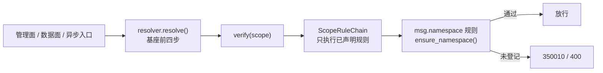

# 03 详细设计 · 产品接入改造

> 07D 任务 03 · 需求 03-1 · 详细设计（开发核心文档）

[文档首页](../../../../../文档首页.md) › [03 产品接入改造](../03_产品接入改造.md) › 设计

## 0. 分章导航 <a id="toc"></a>

本文档是**任务 03 的唯一详细设计**：一个任务一份设计，实施、测试与验收一律以其为准。

| 章 | 内容 | 状态 |
| --- | --- | --- |
| §1 | 任务级边界、确认结论与输入基线 | 已定稿 |
| §2 | 交付物清单 | 已定稿 |
| §3 | 现状核对结论与事实偏差（先于改造） | 已定稿 |
| §4 | 四项扩展点改造（附录 A / B / C / D） | 已定稿 |
| §5 | 数据面同口径核对 | 已定稿 |
| §6 | 改造前后行为基线 | 已定稿 |
| §7 | 测试设计与验收映射 | 已定稿 |
| §8 | 扩展项对账（唯一事实源） | 已定稿 |
| §9 | 登记落点与文档同步 | 已定稿 |
| §10 | 边界与开放项 | 已定稿 |
| §11 | 对齐记录 | 已定稿 |

## 1. 任务级边界与输入基线 <a id="scope"></a>

**本任务做什么**：把 07D 任务 01 / 02 交付的基座契约落到消息平台——msg 侧四项扩展点迁移、数据面同口径核对、扩展项对账、msg 文档定位同步；bms 侧按需求摘除结论回写文档链。

**不做什么**：不重写 msg 05 需求（已交付）、不动 mdm / biz 任何文档与代码、不改前端、不新建基座能力、不推送远程、不跑全量测试。

**权威依据**：《[架构设计 · 产品租户与安全接入](../../../../../设计/架构设计/41_架构设计_子系统_产品租户与安全接入.md)》「三层模型」「继承清单与产品接入流程」「失败语义与验收判据」节；[需求 03-1](../../../需求/03_需求_产品接入改造.md#r03-1)；《[02 详细设计 · 标准扩展点](../../02_标准扩展点/设计/01_详细设计_02_标准扩展点.md)》附录 A ~ D 与「扩展点声明与拒绝启动」「作用域校验扩展点」节；《[02 实施记录](../../02_标准扩展点/实施/01_实施记录_02_标准扩展点.md)》「关键实现说明」节给出的实际契约落点。

**依赖方向**：msg → bms 单向。msg 以 `bms-core` 跨仓 editable 路径依赖消费 `libs/bms_core`；基座不感知 msg。四项迁移一律「基座出契约、产品出实现」，不得把产品实现回写 bms。

**已确认口径**（本设计的决策基线）：

| # | 事项 | 结论 |
| --- | --- | --- |
| 1 | msg 05 需求基线 | 视为已交付，只复核 + 按改造结论增量修订，保留 `05-1` ~ `05-7` 编号与历史任务 / 记录 |
| 2 | 需求 03-1 的文档同步条 | 纳入，msg 设计 07 / 任务 05 / 规划 01 / 需求总览 00 同步 |
| 3 | h2 帧入口 | 纳入核对与回归，见 §3 事实偏差 |
| 4 | 继承层口径 | 字段权限 / 数据范围 / 权限码体系按架构 41 归继承层，不列产品扩展项 |
| 5 | 03-2 / 03-3 | 摘除，专项需求 14 → 12 条，mdm / biz 零改动 |
| 6 | 推送 | 全部攒着不推，只做本地验证；CI 结果待模块收尾推送后复核 |
| 7 | 附录 A | 一次切完并摘除 `tenant_guard:msg`，不保留并存窗口 |
| 8 | 附录 B | `maps_from` 声明接管，置空 provider 并删除 `MsgErrorMapper` |
| 9 | 附录 C | `form` 与 `quota` 两条数据源声明并存 |
| 10 | 附录 D | 四类记录级操作全量迁 `record_ref`，启用强审计 |
| 11 | 前端字段映射 | 撤回纳入，登记遗留；不触发界面原型红线 |
| 12 | Kiwi / 对账表 | 一条用例共用；本文档 §8 为对账唯一事实源 |

## 2. 交付物清单 <a id="deliverables"></a>

| # | 交付物 | 仓 | 落点 |
| --- | --- | --- | --- |
| D1 | 本详细设计（含扩展项对账节） | bms | 本文件 |
| D2 | `scope_rule` 规则实现 + 装配声明 | msg | `backend/services/msg/src/bms_msg/tenant/scope_rule.py`（新增） |
| D3 | 摘除 `MsgTenantGuard` | msg | 删 `bms_msg/tenant_guard.py`；改 `main.py`、`backend/config.toml`、`tests/test_tenant_guard.py` |
| D4 | 声明式错误码映射 | msg | `deploy/registry/msg.toml`、`backend/config.toml`、`bms_msg/errors.py`、`main.py` |
| D5 | `kind=quota` 数据源声明 + 最小取数端点 | msg | `deploy/registry/msg.toml`、`bms_msg/api/` 下新增只读端点 |
| D6 | `record_ref` 与强审计接线 | msg | `bms_msg/broker/replay.py`、`bms_msg/broker/offset.py` 及 `AuditSink` 协议 |
| D7 | 回归用例（共用一条 Kiwi 编号） | msg | `backend/services/msg/tests/` |
| D8 | msg 文档定位同步 | msg | 纯文本路径：`msg/msg文档/设计/架构设计/07_架构设计_多租户与安全.md`、`msg/msg文档/项目/08B_消息平台/{任务/05_多租户与安全/05_多租户与安全.md,规划/01_规划_消息平台.md,需求/00_需求_消息平台.md}` |
| D9 | bms 文档链回写 | bms | 需求总览 00、需求 03、任务 03、07D README、计划 |
| D10 | 实施记录 / 测试记录各一份 | bms | 本任务目录 `实施/`、`测试/` |

## 3. 现状核对结论与事实偏差 <a id="current"></a>

改造前逐条核对代码事实，与需求 / 附录字面不一致的按「不臆造、不生造」处置，并在实施记录登记偏差。

| # | 核对项 | 事实 | 本任务处置 |
| --- | --- | --- | --- |
| 1 | msg 05 需求 | 已重写为「继承基座 + 扩展项 05-1~05-7」，原「租户用量板块与表单登记」任务保留并归入 `05-7`；任务 05 已补齐 02~05 四条扩展项任务 | 03-1 前两条视为已交付；只做引用可达性复核与改造结论增量修订 |
| 2 | h2 帧入口 | `bms_msg/tenant/resolve.py::frame_tenant()` **已**复用基座 `resolve_request_tenant()`，且明确不采信 `Host` / `X-Tenant-ID`，只认已校验令牌的租户位 | **不改实现**，改做三路径核对与回归；附录 A「管理面部分路由未覆盖」由规则链自然补齐。登记为设计偏差 |
| 3 | 用量端点 | `GET /api/v1/msg/tenant-usage` 全仓无实现；`05-1 租户用量板块与表单登记` 只有一份任务文档、无设计 / 实施 / 测试记录，`msg.toml` 无 `[[seeds]]`；`msg_quota` 表亦不存在 | 本任务按 02-3 契约新增**最小只读端点**（结构合规、空用量），真实配额值不臆造；`05-1` 链路整体登记遗留 |
| 4 | 审计留痕点 | 全仓 `build_operation_event` 仅两处：`broker/replay.py`（重放）、`broker/offset.py`（位点重置）；删消息 / 延迟转投异常处置无对应留痕端点 | 两处落 `record_ref` + 强审计；另两类不生造端点，登记遗留 |
| 5 | 审计写入形态 | msg 走 `build_operation_event` + `AuditSink.emit(event)`，不是附录 D 字面的 `AuditCapturer.capture()` → `capture_extended()` | 形态适配：`build_operation_event(..., record_ref=...)` 已带扩展位参数，等效达成附录 D 目标；登记为设计偏差 |
| 6 | mdm / biz 需求 | 两仓均无「租户与安全」需求篇，仅各一句架构 41 继承引用；需求 03-2 / 03-3 举例的扩展项无对应文档与任务 | 摘除两条需求，两仓零改动 |
| 7 | 前端字段映射 | msg 仓无 `frontend/`、无 `.vue` / `.tsx`；02 详细设计附录 C 该句指向的前端一半未建、一半未接 | 不纳入，登记遗留 |

## 4. 四项扩展点改造 <a id="migration"></a>

### 4.1 作用域校验（附录 A） <a id="mig-scope"></a>

**目标**：命名空间判定从租户级钩子 `tenant_guard:msg` 下移到 `scope_rule` 规则链第四步，三路径（管理面 / 数据面 / 异步）统一经 `resolver.verify()`。

| 项 | 设计 |
| --- | --- |
| 新增规则 | `MsgNamespaceScopeRule(BaseScopeRule)`，`plugin_name = "msg.namespace"`，`order` 取缺省 `100` |
| 适用范围 | `applies_to()` 用缺省 `True`——msg 内所有资源类型都要判命名空间 |
| 判定 | `verify(scope)` 调 `ensure_namespace(str(scope.key.module_key), enabled_namespaces())`，复用 `bms_msg/tenant/context.py` 的同名单点 |
| 入参边界 | 只拿已通过基座前四步的 `ResolvedScope`；规则内不解析租户、不查 `sys_module`、不自建缓存、不改 frozen 值对象 |
| 失败码 | 未登记 / 未启用 → `MsgNamespaceInvalidError`（`350010` / 400）原样抛；`scope` 未指定范围时 `ensure_namespace` 跳过，语义不变 |
| 装配声明 | 覆写 `ApplicationFactory.extension_requirements()`，返回含 `ExtensionRequirement(plugin_key=SCOPE_RULE_KEY, plugin_name="msg.namespace", required=True)` 的有序清单 |
| 登记 | `configure_plugins()` 内 `register_plugin(SCOPE_RULE_KEY, "msg.namespace", ...)`，注册表冻结前完成 |
| 摘除 | 删 `bms_msg/tenant_guard.py`；`main.py` 去导入与 `register_msg_tenant_guard(app)`；`backend/config.toml` 的 `[tenant_guard].provider` 由 `"msg"` 回落 `"source"`；`tests/test_tenant_guard.py` 改为规则链用例 |

**失败分支**：规则抛非 `BizError` → 基座包成 `InternalError`（`10000`）并记 `scope_rule_failed`（fail-closed）；声明必需但未注册 → 装配期一次性汇总拒启；未声明的规则零调用。



### 4.2 错误码映射（附录 B） <a id="mig-error"></a>

| 项 | 设计 |
| --- | --- |
| 声明 | `deploy/registry/msg.toml`：`350011` 增 `maps_from = [80002]`（停用 403 → 403）、`350012` 增 `maps_from = [80001]`（不存在 404 → 404） |
| 生效点 | 基座统一错误渲染单点「声明优先」，管理面 / 数据面同码；`message` 置空走目标码文案键 `msg.error.*`，`data` 保留 |
| 收尾 | `backend/config.toml` 的 `[error_mapper].provider` 置空；删 `MsgErrorMapper` / `MSG_ERROR_MAPPER` / `register_msg_error_mapper()`，`main.py` 去导入与调用，`errors.py` 的 `__all__` 同步 |
| 保留 | `MsgTenantSuspendedError` / `MsgTenantNotFoundError` 保留——帧入口 `frame_tenant()` 直接抛这两个产品码，且 `[[errcodes]]` 码表对账需要 |
| 未命中 | 其余异常原样返回，不改 HTTP 状态语义、不吞错误、不把系统性失败改写成业务错误 |

**失败分支**：声明校验含「同源全局唯一」「状态语义一致」「禁止承接 `10000` / `10006` / `10007` / `10012` / `10013`」；置空 provider 后不再出现 `error_mapping_shadowed` 双重改写告警。

### 4.3 配额只读回显（附录 C） <a id="mig-quota"></a>

**两条声明并存**，各司其职，不互相取代：

| 声明 | 现状 / 目标 | 用途 |
| --- | --- | --- |
| `msg_tenant_usage`（`kind=form`，`path=/tenant-usage`） | **原样保留** | 05-7 表单 / 字段元数据与前端直取路径，已交付不动 |
| `msg_quota_projection`（新增，`kind=quota`） | `origin=product`、`product_key=msg`、`data_source=msg.msg.quota_projection`、`path=/api/v1/msg/tenant-usage` | 02-3 配额只读投影 |

新增声明字段：`quota_dimensions` 取附录 C 四维（主题数 / 存储 / 吞吐 / 连接数，键用 snake_case）、`quota_unit` 与 `quota_period` 取基座合法值（`count` / `bytes` / `qps` / `rpm` / `percent`；`none` / `hour` / `day` / `month`）、软硬限不臆造数值时留空（可选字段）。装载期校验：`path` 以 `/api/v1/` 开头、维度非空且唯一、单位与周期合法、软 ≤ 硬、`origin` 为 `product`、`data_source` 首段等于 `product_key`。

**最小取数端点**：`GET /api/v1/msg/tenant-usage` 返回 `{items: []}`，结构符合 `QuotaProjectionReader` 期望；平台侧对未提供的维度判 `default`，不写 0、不落第二份配额值。端点经基座认证，不新增权限码；真实用量随 `msg_quota` 与 05-1 链路落地。

**失败分支**：端点不可达 / 超时 / 非 2xx / 结构非法 → 整源 `unavailable`；`usage` 为 `None` 绝不写 0；平台侧只读、不重试、不缓存、不双写。

### 4.4 审计字段扩展（附录 D） <a id="mig-audit"></a>

| 项 | 设计 |
| --- | --- |
| 迁移范围 | 重放（建任务 / 终态）、位点重置两处既有留痕点；删消息 / 延迟转投异常处置无端点 → 登记遗留 |
| 定位字段 | `record_ref=RecordRef(type=..., id=str(log_id))`；类型取 `msg.message` / `msg.offset` / `msg.replay`，形态受 `RecordRef` 校验（类型 ≤64、主键非空 ≤64、仅字母数字与 `_:-`） |
| 写入形态 | `build_operation_event(..., record_ref=...)`（基座已带扩展位参数，等效于 `capture_extended`）；扩展字段只补语义，不改哈希链构造与归档口径 |
| 强审计 | `AuditSink` 协议的 `emit` 增 `required: bool = False`；记录级操作调 `emit(event, required=True)`，写入失败抛 `InternalError`（`10000`）使业务失败；普通失败仍告警 + 指标 |
| 留痕类别 | 覆写 `audit_classes()` 声明记录级类别，动作经 `audit_class_for()` 取 `record_operation`；普通读写仍不逐条留痕 |

**行为变化（单列基线）**：强审计写入失败从「只告警、业务继续」变为「业务失败」。这是用户拍板启用的新增行为，需在回归基线中单列一条并写入实施记录。

## 5. 数据面同口径核对 <a id="data-plane"></a>

现状 `frame_tenant()` 已满足「复用基座同一解析函数、只认令牌租户位、不采信 `Host` / `X-Tenant-ID`」，`management_tenant()` 只读中间件注入上下文、`FRAME_PATH` 不进豁免 / 延迟路径。本任务**不改实现**，只做四项核对并固化为回归：

1. 同一请求在管理面 / 数据面 / 异步解析出同一 `tenant_id`；
2. 自报头与 `Host` 不参与取值，跨租户订阅被拒；
3. 停用即时拒绝、租户不存在按 `350012` 拒绝、租户源不可达按 `10007` / 503 fail-closed；
4. 命名空间校验经 `scope_rule` 后，三路径结论一致（附录 A 的「管理面部分路由未覆盖」由此补齐，且不改变既有放行 / 拒绝结果）。

## 6. 改造前后行为基线 <a id="baseline"></a>

回归以本表为判据，**改造后与改造前一致**（强审计一条除外，已单列）。

| 场景 | 改造前 | 改造后 | 判据 |
| --- | --- | --- | --- |
| 跨租户访问 | 基座租户判定拒绝 → `350012` / `350011` | 同 | 码 / 状态 / 文案一致 |
| 租户停用 | 基座版本戳即时拒绝收发 | 同 | 管理面 / 数据面 / 异步均即时 |
| 未登记命名空间 | `MsgTenantGuard.verify` → `350010` / 400 | `scope_rule` 规则 → `350010` / 400 | 同输入同结论；管理面补齐覆盖 |
| 错误码映射 | `MsgErrorMapper` 在渲染单点改写 | `maps_from` 声明在渲染单点改写 | 两码对外一致，管理面 / 数据面同码 |
| 配额回显 | `msg_tenant_usage` 前端直取 `/tenant-usage` | 原声明保留 + 新增 `kind=quota` 只读投影 | 旧路径不变；平台侧无双写、无新表 |
| 记录级定位 | `log_id` 在产品自定义字段 | `record_ref` 扩展位 | 可按 id 一次定位；历史链校验不变 |
| 审计写入失败 | 只告警、业务继续 | 记录级操作**业务失败** | 已拍板的新增行为，单列回归 |

## 7. 测试设计与验收映射 <a id="testing"></a>

**用例登记**：先在 Kiwi TCMS 登记**一条**用例（Category「平台骨架」、Priority `P2`、状态 `CONFIRMED`、Tag「自动化」，`text` 写四项迁移覆盖范围与自动化文件路径），取得自增编号后再写用例代码，msg 仓全部新增 / 改造用例共用该 `kiwi_id` 标注；平台连不上即停下问，不挂空号、不复用既有编号。

| 用例组 | 覆盖 | 自动化落点 |
| --- | --- | --- |
| 装配与声明 | `extension_requirements()` 生效、必需规则缺失拒启、可选缺失跳过、插件清单可查 | `tests/` 新增装配用例 |
| 作用域规则 | 规则链只执行已声明规则、`350010`、三路径同结论、`scope=None` 跳过 | `tests/test_tenant_guard.py` 改造为规则链用例 |
| 错误码映射 | `maps_from` 声明与码表对账、渲染单点同码、未命中不改写、置空后无双重改写 | `tests/test_error_codes.py` |
| 配额投影 | 两条声明装载校验、最小端点结构、四态判定、`usage=None` 不写 0 | `tests/` 新增端点用例 |
| 审计扩展 | `record_ref` 形态与载荷、强审计失败即业务失败、普通失败仍告警 | 重放 / 位点既有用例扩展 |
| 数据面三路径 | 同租户、自报头不采信、停用即时、源不可达 503 | 帧入口既有用例回归 |
| 行为基线 | §6 七条逐条对比 | 回归汇总 |

**覆盖率**：口径见《[AI 开发规范](../../../../../规范/AI开发规范.md)》「覆盖率要求」节；本地跑满变更范围，全量测试只由 CI 复核。提交环判改动行、推送环与 CI 判模块级。

**验收映射**：

| 需求 03-1 完成标准 | 验证方式 |
| --- | --- |
| msg 05 只写扩展项、继承项引用可达 | 文档复核 + 链接校验 |
| 原 05-1 任务与记录保留、归入扩展项 | 文档复核 |
| 四项扩展点全部接入 | 装配声明 + 四组用例 + §8 对账表 |
| 跨租户 / 停用 / 未登记 / 错误码 / 配额 / 审计行为回归通过 | §6 行为基线七条 |
| msg 设计与任务文档口径一致 | D8 四份文档同步 + 链接校验 |

## 8. 扩展项对账（唯一事实源） <a id="reconcile"></a>

逐条核对「基座契约 + msg 任务」两段齐全；本任务只核对与接入，不新建产品任务、不把产品实现回写 bms。msg 任务 05 文档以纯文本路径引用本节。

| 扩展项 | 基座契约（bms 07D） | msg 任务（08B 05 域） | 本任务动作 |
| --- | --- | --- | --- |
| 配额 | `02-3` 出 `kind=quota` 投影契约与四态 | `05-3 配额` 出 `05_多租户与安全_02_消息维度配额`（配额自维护与执行点） | D5 接上投影声明与最小端点；不实现配额值 |
| 主题授权 | `02-5` 出 `resource_acl` 接入约束与 `82013` | `05-4 授权` 出 `05_多租户与安全_03_主题授权`（授权存储与判定） | 只核对两段齐全，本期不改授权代码 |
| 审计留痕 | `02-4` 出 `record_ref` / 扩展位 / 留痕类别契约 | `05-5 审计留痕` 出 `05_多租户与安全_04_审计留痕与记录级定位`（留痕类别与 `log_id` 定位） | D6 迁 `record_ref` + 强审计 |
| 生命周期 | `01-4` 出 `tenant.deleted` 事件与清理分工 | `05-6 租户生命周期` 出 `05_多租户与安全_05_租户生命周期资源清理`（资源清理；开通初始化由 `05-1` 第 7 条承接） | 只核对两段齐全，本期不改生命周期代码 |

## 9. 登记落点与文档同步 <a id="registry"></a>

**bms 仓（需求摘除链）**：需求总览 00 的计数与「需求域文档地图」、需求 03 删 03-2 / 03-3 两节并改标题、任务 03 删「mdm 文档对齐」「biz 文档对齐」两节及完成标准 / 交付物 / 风险表对应行、07D README 的需求与任务基线条计数、[计划](../../../计划/01_计划_产品租户与安全接入.md) 的需求条数、任务 03 行、「后续阶段待办」#2 归口与「偏差与遗留」列。任务 04 与专项验收门禁表核对是否引用 03-2 / 03-3。

**msg 仓（纯文本路径，bms 正文不写链接）**：

```text
msg/msg文档/设计/架构设计/07_架构设计_多租户与安全.md
msg/msg文档/项目/08B_消息平台/任务/05_多租户与安全/05_多租户与安全.md
msg/msg文档/规划/01_规划_消息平台.md
msg/msg文档/项目/08B_消息平台/需求/00_需求_消息平台.md
```

四份只做定位与引用同步：设计 07 的「解析与状态校验」「与 bms 租户体系对齐」节改指 `scope_rule` 与声明式映射，去掉 `MsgTenantGuard` / `MsgErrorMapper` 表述；任务 05 补「前置契约（已交付）」标注与对账表引用；规划 01、需求总览 00 同步四项扩展点的承接定位。编号与历史实施 / 测试记录原文一律保留。

**进度唯一落点**：计划表。需求、任务、详细设计均不承载进度。

## 10. 边界与开放项 <a id="open"></a>

| # | 事项 | 归口 |
| --- | --- | --- |
| 1 | mdm / biz 无租户与安全需求篇与扩展项清单 | 03-2 / 03-3 已摘除；架构 41「待定项」中「mdm / biz 的扩展项清单」保持悬空，待两仓出现真实需求再定 |
| 2 | 05-1「租户用量板块与表单登记」未实施，配额表与前端页面不存在 | 计划「后续阶段待办」+ 实施记录；本任务只交最小只读端点 |
| 3 | 02-3 投影端点无前端消费方、前端字段映射未同步 | 计划「后续阶段待办」+ 实施记录；本任务不改前端、不补原型 |
| 4 | 删消息 / 延迟转投异常处置无留痕端点 | 实施记录「偏差与遗留」；不生造业务端点 |
| 5 | 强审计写入失败使业务失败（行为变化） | 行为基线单列 + 实施记录 |
| 6 | 附录 D 写 `capture_extended`，msg 实际走 `build_operation_event` | 实施记录「与设计的偏差」；等效达成，不回改基座 |
| 7 | h2 帧入口已满足同口径，附录 A「管理面未覆盖」由规则链补齐 | 实施记录「与设计的偏差」+ 三路径回归 |
| 8 | 远程 `bms-core` 仍是旧版，msg 改造的 CI 结果本次无法验证 | 计划「偏差与遗留」；待 07D 模块收尾一次性推送后复核 |
| 9 | 本任务不推送远程 | 按已确认口径执行；推送需独立确认 |

## 11. 对齐记录 <a id="alignment"></a>

| # | 输入口径 | 本设计落点 |
| --- | --- | --- |
| 1 | 架构铁律「主体内建继承、二次开发组合、两轨同一登记与契约体系」 | 四项全部经基座扩展点契约接入，不在 msg 复制基座机制 |
| 2 | 架构 41「依赖方向」「红线六」「注册在先」 | `extension_requirements()` 声明即契约、未声明零调用、必需缺失拒启 |
| 3 | 需求 03-1「基座出契约、产品出任务」 | §8 对账表两段分列，本任务只做产品侧接入 |
| 4 | 02 详细设计附录 A ~ D「迁移前后行为必须一致」 | §6 行为基线七条，含强审计例外 |
| 5 | 02 实施记录「实际契约落点」 | §4 各项按实施后的真实符号与字段书写，不照抄设计原文 |
| 6 | 已确认 12 项决策 | §1 表格逐项登记，冲突项在 §3 / §10 写明偏差与归口 |

> 本文档依《[文档生成规范](../../../../../规范/文档生成规范.md)》与《[任务文档规范](../../../../../规范/任务文档规范.md)》编写 · 实施、测试与验收以其为准
