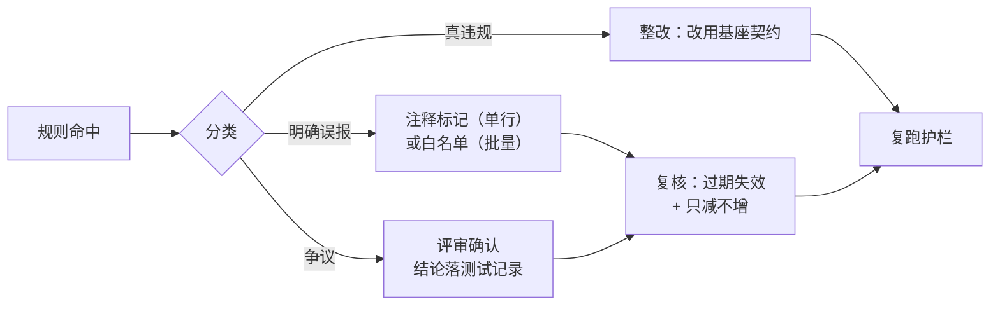

# 04 详细设计 · 护栏与阶段验收

> 07D 任务 04 · 禁止层护栏规则（本期只设计）+ 八条判据专项验收设计

[文档首页](../../../../../文档首页.md) › [07D 产品租户与安全接入](../../../README.md) › 任务 › [04 护栏与阶段验收](../04_护栏与阶段验收.md) › 详细设计　|　[需求 →](../../../需求/04_需求_护栏与阶段验收.md)　[实施记录 →](../实施/01_实施记录_04_护栏与阶段验收.md)　[测试记录 →](../测试/01_测试记录_04_护栏与阶段验收.md)

## 0. 分章导航 <a id="toc"></a>

| 章 | 内容 | 对应需求 |
| --- | --- | --- |
| §1 | 护栏规则设计：三类规则清单、判定方式、分级、误报处理、engkit 接入点 | 04-1 |
| §2 | 阶段验收设计：证据集、八条判据核对、12 条需求核对、结论口径 | 04-2 |
| §3 | 交付物、验证设计与登记落点 | 04-1 / 04-2 |

**本期边界（已确认）**：三类规则**只出设计**；实现经 2026-11-07 专项收尾拍板**明确不采纳**，禁止层维持文档约定与评审；本期零代码、零配置改动。规则清单仍细到「可据此直接实现」——判定信号、扫描面、误报通道、触发层与新增仓接入步骤全部在本节定稿，作为留档备查。

## 1. 护栏规则设计（需求 04-1） <a id="guard"></a>

### 1.1 目标与边界 <a id="guard-scope"></a>

把架构 41 §3「禁止靠双轨」与 §8 八条红线，从文档约定变成**可判定的机器规则**。护栏只针对**产品仓库**（msg / mdm / biz 等）的源码与声明，判定「产品是否复制了基座实现」，不改变基座语义、不拦截平台自身实现。

- **权威来源**：《[架构设计 · 产品租户与安全接入](../../../../../设计/架构设计/41_架构设计_子系统_产品租户与安全接入.md#rules)》§3（三层模型与三条判定规则）、§8（八条红线）、§10（护栏规则先设计、后续实现）。
- **规则输入**：任务 01 / 02 各章「禁止清单」与具象反例（见 §1.4），不与清单另起一套口径。
- **不做什么**：不实现校验器代码、不改各仓 `engkit.toml`、不新建白名单文件、不在 CI 新增判定逻辑；上述经收尾明确不采纳，禁止层维持文档约定 + 评审。
- **判定分层**：继承层复制、扩展点外复制为**阻断级**；字面量硬编码为**告警级**。


### 1.2 现状：engkit 既有护栏与方向差异 <a id="guard-current"></a>

| 既有能力 | 判定内容 | 当前方向 | 本任务关系 |
| --- | --- | --- | --- |
| `base product-literals` | 词边界 + 组合后缀字面量、注释与 docstring 一并判定、基线只减不增、`exempt_marker` 行级豁免、`--files-from` 增量 | bms 平台源码禁入产品标识（`[rules.product_literals].literals = ["mdm"]`） | **反向复用**：产品源码禁入平台标识，判定内核不变，只换仓配置的 `deny_globs` / `literals` / `allow_globs` |
| `base service-boundaries` | AST import 图、分层反向依赖黑名单、表声明与跨域引用、出口导出面、逐文件判据与全局判据分离 | 基座服务边界与域布局 | 复用其 AST 与分层黑名单承载 R1 / R2 的依赖与符号检查 |
| `base backend-base` | 基类清单、实现契约、源码面、直继承基线 | 基座继承链一致性 | 复用「直继承 / 平行实现」判定识别另起炉灶的继承层 |
| `[[devloop.steps]]` + `--files-from` | 文件局部判据的增量扫描（清单经标准输入管道喂入，不落盘） | 提交前开发环 | 告警级增量触发层 |
| `[[preflight.steps]]` / `[[preflight.self_tests]]` | 全量步骤、基线对账、单进程自测 runner | 推送环与 CI | 阻断级全量触发层 |
| `[guard]` / `checks` | 重命令与全量测试拦截、护栏单进程 runner | 全局 | 不改 |

**方向差异要点**：现有 `product-literals` 是「平台里不许写产品」，本任务 R3 是「产品里不许写平台」。两者共用同一判定实现（词边界、组合后缀、大小写敏感、注释判定、基线只减不增、豁免标记），差异只是**规则数据**：`deny_globs` 指向产品源码，`literals` 换成平台表名 / 服务标识 / 权限码 / 路径。因此不需要第二套字面量判定。

**配置现状（实测 2026-11-07）**：bms / msg / mdm / engkit 四仓已有仓根 `engkit.toml`；`biz/` 当前没有 `engkit.toml`，属「新增仓库接入」场景，步骤见 §1.5.4。四仓现有配置都没有本节三类规则段，本期不新增。

### 1.3 规则清单（三类 × 判定方式 × 分级） <a id="guard-rules"></a>

#### 1.3.1 编号与分级 <a id="guard-rule-id"></a>

| 规则类 | 编号段 | 分级 | 主要判定方式 | 对应红线 |
| --- | --- | --- | --- | --- |
| 继承层复制 | `R1.1` ~ `R1.5` | 阻断级 | 依赖检查 + 路径 / 符号检查 | 红线一 ~ 五 |
| 扩展点外复制 | `R2.1` ~ `R2.7` | 阻断级 | 依赖检查 + 路径 / 符号检查 + 声明对账 | 红线六 ~ 八 |
| 字面量硬编码 | `R3.1` ~ `R3.4` | 告警级 | 字面量检查 | 红线五、七 |

分级理由：R1 / R2 直接产生「第二套权威实现」，命中即为架构违规；R3 可能是测试夹具、声明文件或注释中的合规出现，先告警收敛误报再考虑升级。

#### 1.3.2 R1 继承层复制（阻断级） <a id="guard-r1"></a>

| 规则 | 禁止内容 | 判定信号 | 判定方式 |
| --- | --- | --- | --- |
| `R1.1` | 自建租户解析、信任客户端自报头、自建状态缓存、数据面用连接建立时的租户覆盖后续请求 | 读取租户请求头、直查平台租户表、自建 resolver 类、帧入口缺 `require` / `frame` 调用 | 依赖检查（未依赖基座租户与作用域契约）+ 符号检查（头名 / 表名 / 类形态） |
| `R1.2` | 自建用户 / 服务令牌、会话与密钥轮换，透传外部 access token 给内部服务 | 令牌签发与校验符号、密钥轮换实现、外部 token 直传内部调用 | 符号检查 + 依赖检查 |
| `R1.3` | 自建 RBAC 引擎、复制权限码体系、业务层逐处手写「是不是管理员」 | 权限判定函数、权限码字面量清单、角色权限表声明、自建 `permission/` 目录 | 路径 / 符号检查 + 字面量检查 |
| `R1.4` | 自建审计表或哈希链、绕过基座审计写入、删除审计记录 | 审计类表声明（`__tablename__` 含 `audit` / `log`）、哈希链构造符号、审计删除调用 | 路径 / 符号检查 + 字面量检查 |
| `R1.5` | 自建租户状态表 / 状态机、轮询基座租户表、删除事件处理器反向调用基座改租户状态 | 自建租户状态表声明、状态机常量、定时轮询平台租户表、`on_deleted` 内调用平台租户写接口 | 路径 / 符号检查 + 依赖检查（反向写） |

R1 的「依赖检查」是双向的：既判**出现了不该有的依赖**（如产品直连平台租户写服务），也判**缺少应有的依赖**（如管理接口只取认证上下文、不经基座作用域与权限契约）。后者是 R2.2 与 R1 的交叉面，实现时以「必需依赖签名清单」表达，避免两条规则重复报错。

#### 1.3.3 R2 扩展点外复制（阻断级） <a id="guard-r2"></a>

| 规则 | 禁止内容 | 判定信号 | 判定方式 |
| --- | --- | --- | --- |
| `R2.1` | ACL 前置、以 ACL 绕过基座 RBAC 与作用域归属 | ACL 端口调用出现在统一组合依赖之外；作用域 / RBAC 判定在 ACL 之后 | 符号检查 + 调用顺序检查 |
| `R2.2` | 管理接口只校验登录 | API 处理函数的依赖注入签名只有认证项，无 RBAC / 作用域项 | 依赖检查（必需依赖签名） |
| `R2.3` | 记录级操作无资源级校验（重放任意主题、删消息、位点重置、异常处置） | 操作名单内的入口缺 ACL / 作用域参数或调用 | 符号检查（操作名单 × 校验符号） |
| `R2.4` | 业务层自行拼装 HTTP 响应、绕过统一渲染、使用未登记码段 | 业务模块出现统一渲染单点之外的响应构造、未登记错误码字面量 | 符号检查 + 字面量检查 |
| `R2.5` | 在四类扩展点之外另起同类机制 | 与 `scope_rule` / `maps_from` / `kind=quota` / `record_ref` 同形的平行声明或平行目录 | 路径 / 符号检查 + 声明对账 |
| `R2.6` | 自建平行作用域上下文、跨请求复用上下文、扩展位存状态 | `ProductScope` 类平行值对象、模块级单例持有上下文、扩展位写入缓存语义 | 符号检查 |
| `R2.7` | 产品自行补齐基座缺漏并回写、在生命周期事件里反向改基座状态 | 事件处理器调用平台租户 / 权限写接口 | 依赖检查 |

`R2.1` 的调用顺序判定以静态 AST 为主，跨回调与动态分派的链条可能漏检，兜底写在 §1.7；02-5 的顺序不可绕过用例是同一判据的运行期证据，实现期两者并用。

#### 1.3.4 R3 字面量硬编码（告警级） <a id="guard-r3"></a>

| 规则 | 禁止内容 | 判定信号 | 判定方式 |
| --- | --- | --- | --- |
| `R3.1` | 硬编码平台表名 | `sys_tenant`、`sys_user`、`sys_operation_log`、`sys_module`、`sys_errcode` 等 | 字面量检查 |
| `R3.2` | 硬编码平台服务标识 | `bms_platform`、`bms_tenant`、`bms_identity` 等 | 字面量检查 |
| `R3.3` | 硬编码平台权限码 | 平台权限码字面量与码段常量 | 字面量检查 |
| `R3.4` | 硬编码平台路径 / 连接落点 | 平台接口路径、平台库文件路径、部署路径字面量 | 字面量检查 |

判定口径沿用 `product-literals`：词边界 + 组合后缀（`_` / `.` / `:` / `-`）、区分大小写、`include_comments = true` 时注释与 docstring 一并判；允许面（测试夹具、产品自持声明、契约级能力声明、文档）与排除面（生成物）由仓配置给出；存量以「路径 + 行内容指纹」基线豁免且只减不增。

#### 1.3.5 三种判定方式的实现口径 <a id="guard-method"></a>

| 判定方式 | 输入 | 实现要点 | 增量资格 |
| --- | --- | --- | --- |
| 依赖检查 | AST import 图 + 依赖注入签名 + 声明文件 | 「不该依赖」与「该依赖却缺」都要判；产品必须依赖基座契约，缺漏即违规 | 文件局部判据可 `--files-from`；声明对账与全局唯一性恒全量 |
| 路径与符号检查 | 路径 glob、顶层绑定、类名 / 函数名、`__tablename__`、装饰器、键常量 | 只认登记过的形态，不靠文件名猜测；跨文件归属由全局判据补 | 逐文件可增量；表声明索引等全局判据恒全量 |
| 字面量检查 | 源码文本 + 注释 / docstring | 词边界 + 组合后缀 + 大小写敏感；Python 走 `tokenize` + `ast`，TS / JS / Vue 走状态机，语法不可解析则降级全文扫描并告警 | 可增量；基线只减不增对账在增量下跳过、由全量档兜底 |

三类判据都遵循「**判定在包内、规则数据来自仓配置**」：路径、工程分组、符号清单、操作名单、字面量清单、白名单与基线路径一律写在各仓 `engkit.toml`，工具包内不出现仓名字面。

### 1.4 具象反例 → 规则映射 <a id="guard-examples"></a>

规则输入必须覆盖 01 / 02 禁止清单里的具象反例，不能只写通用三类。下表逐条给出检出信号与出处。

| # | 具象反例 | 出处 | 规则 | 检出信号 | 检出层 |
| --- | --- | --- | --- | --- | --- |
| 1 | 自建租户状态表 / 状态机 | [01 详细设计 §4.3.8](../../01_通用三级作用域/设计/01_详细设计_01_通用三级作用域.md#w014-ban) -1 | `R1.5` | 自建租户状态表声明、状态机常量 | 推送环全量 |
| 2 | 删除事件回调基座改状态 | [01 详细设计 §4.3.8](../../01_通用三级作用域/设计/01_详细设计_01_通用三级作用域.md#w014-ban) -2 | `R1.5` / `R2.7` | `on_deleted` 内反向写平台租户接口 | 推送环全量 |
| 3 | ACL 前置 | [02 详细设计 §6.3.1](../../02_标准扩展点/设计/01_详细设计_02_标准扩展点.md#w025-order) | `R2.1` | ACL 判定在 RBAC / 作用域之前 | 推送环全量 |
| 4 | 管理接口只校验登录 | [需求 02-5](../../../需求/02_需求_标准扩展点.md#r02-5) 内容第 4 条 | `R2.2` | 依赖注入签名缺 RBAC / 作用域 | 推送环全量 |
| 5 | 重放任意主题（记录级操作无资源级校验） | [需求 02-5](../../../需求/02_需求_标准扩展点.md#r02-5) 内容第 4 条 | `R2.3` | 操作名单入口缺资源级校验 | 推送环全量 |
| 6 | 自建 RBAC / 复制权限码体系 | [需求 02-5](../../../需求/02_需求_标准扩展点.md#r02-5) 禁止第 6 条 | `R1.3` | 权限引擎符号、权限码清单 | 推送环全量 |
| 7 | 信任客户端自报头 / 自建状态缓存 | [01 详细设计 §2.3.10](../../01_通用三级作用域/设计/01_详细设计_01_通用三级作用域.md#w012-forbid) | `R1.1` | 头读取、租户状态缓存 | 推送环全量 |
| 8 | 业务层拼 HTTP 响应 | [01 详细设计 §2.3.10](../../01_通用三级作用域/设计/01_详细设计_01_通用三级作用域.md#w012-forbid) | `R2.4` | 统一渲染之外的响应构造 | 推送环全量 |
| 9 | 数据面用连接建立时的租户覆盖后续请求 | [01 详细设计 §2.3.10](../../01_通用三级作用域/设计/01_详细设计_01_通用三级作用域.md#w012-forbid) | `R1.1` | 帧入口缺逐帧 `require` / `frame` | 推送环全量 |
| 10 | 不另造上下文类型 / 不用扩展位存状态 | [01 详细设计 §3.3.7](../../01_通用三级作用域/设计/01_详细设计_01_通用三级作用域.md#w013-ban) | `R2.6` | 平行值对象、全局单例、扩展位缓存 | 推送环全量 |
| 11 | 硬编码平台表名 / 服务标识 / 权限码 / 路径 | 架构 41 §8 红线五、七 | `R3.1` ~ `R3.4` | 字面量 + 组合后缀 | 提交环增量 + CI |

> 反例 1~10 均来自 01 / 02 已定稿的禁止清单；护栏把它们变成可判定信号，阶段验收（§2）把它们变成可核对证据，两者输入同源。

### 1.5 与 engkit 既有护栏的接入点 <a id="guard-integration"></a>

#### 1.5.1 判定实现分层 <a id="guard-integration-layer"></a>

| 规则类 | 复用的校验器 | 复用的判定能力 | 需要新增的**规则数据**（实现期落仓配置） |
| --- | --- | --- | --- |
| `R1` / `R2` | `base service-boundaries` | AST import 图、分层黑名单、逐文件 / 全局判据分离、`--files-from` 增量、表声明索引 | `[rules.inherit_guard]`：禁入面、允许面、排除面、禁用 import 与符号清单、必需依赖签名、记录级操作名单、白名单与基线路径 |
| `R1` | `base backend-base` | 直继承基线、源码面、实现契约 | 产品仓按需登记继承链锚点（无平台继承链时可留空） |
| `R3` | `base product-literals` | 词边界 + 组合后缀、注释判定、基线只减不增、行级豁免标记 | `[rules.platform_literals]`（或同一校验器的反向清单）：`literals` 为平台标识、`deny_globs` 为产品源码、`allow_globs` 为声明与夹具 |

**不新增第二套判定实现**：判定逻辑只在 engkit 包内一份，各仓只放规则数据；新增仓库只加配置、不改工具包代码。这同时满足 engkit「包内无仓名字面」与「单一来源」两条设计约束。

#### 1.5.2 规则数据段（字段草案） <a id="guard-integration-config"></a>

以下为**实现期**的字段草案，本期不写入任何仓的 `engkit.toml`；字段名以《工程化工具包说明》§4「配置字段全表」与 `config.py` 为准，实现时按该表校验，缺段 / 未知键即失败、不靠缺省值掩盖。

```toml
# 产品仓 engkit.toml（示意；本期不落盘）
[rules.inherit_guard]
scan_targets = ["backend/services"]
allow_globs = ["**/tests/**", "deploy/registry/**", "**/*.md"]
exclude_globs = ["**/node_modules/**", "**/.venv/**"]
banned_imports = ["<平台租户写接口模块>", "<平台认证写接口模块>"]
banned_symbols = ["TenantResolver", "TokenIssuer", "RbacEngine", "AuditChain", "TenantStateMachine"]
required_dependencies = ["require_resource_access", "require_scope"]
record_operations = ["replay", "delete_message", "offset_reset", "exception_handling"]
whitelist = "deploy/boundaries/inherit_guard_exemptions.json"
exempt_marker = "guard:allow:"
baseline = "deploy/boundaries/inherit_guard_baseline.json"

[rules.platform_literals]
enabled = true
deny_globs = ["backend/services/**/*.py"]
allow_globs = ["**/tests/**", "deploy/registry/**", "docs/**"]
exclude_globs = ["**/node_modules/**"]
literals = ["sys_tenant", "sys_user", "sys_operation_log", "sys_module", "bms_platform", "bms_tenant"]
combine_suffixes = ["_", ".", ":", "-"]
include_comments = true
exempt_marker = "guard:allow:R3"
```

`<...>` 占位在实现期由各仓按自身契约填真名；平台标识清单来自基座模块注册与表归属登记，不手抄第二份。

#### 1.5.3 触发层与 CI 时机 <a id="guard-integration-trigger"></a>

| 规则 | 提交前预检（增量） | 推送环（全量） | CI | 失败处置 |
| --- | --- | --- | --- | --- |
| `R1` / `R2` 阻断级 | 不挂（误报会卡住日常提交） | `[[preflight.steps]]` 全量 + 基线对账（`--no-cache` 口径） | 随 `base-integrity` job 复用同一份步骤表 | 退出码非 0，阻断推送 / 合入 |
| `R3` 告警级 | `[[devloop.steps]]`，带 `--files-from` 改动清单 | `[[preflight.steps]]` 全量（基线只减不增对账） | 同上 | 首轮只告警不阻断；存量入基线与白名单后再评估升级 |
| 自测 | — | `[[preflight.self_tests]]` 的 `--self-test` | 同上 | 失败即阻断 |

- **告警级先于阻断级**：接入顺序是先跑 `R3` 观察误报面，收敛规则数据与白名单，再启 `R1` / `R2` 阻断；本期只设计，不接入。
- **CI 触发时机**：CI 不另写判定，`base-integrity` 与推送入口读同一份 `[[preflight.steps]]`；新增仓库只需确认该仓流水线包含该 job。全量测试仍只由 CI 执行，护栏步骤属静态 / 结构判据，不触发用例执行。
- **增量清单口径**：`--files-from` 的清单一行一个仓根相对路径，经标准输入管道喂入、不落盘，避免 Windows 命令行长度上限；清单不可读即退 2，不静默退化全量。

#### 1.5.4 新增仓库接入步骤 <a id="guard-integration-newrepo"></a>

```text
新增产品仓接入（实现期执行，本期不执行）
├─ 1 仓根 engkit.toml：新增 [rules.inherit_guard] / [rules.platform_literals] 两段
│     # 扫描面 / 禁入面 / 允许面 / 排除面 / 符号清单 / 必需依赖 / 操作名单 / 字面量清单
├─ 2 新建两个仓内事实源文件（路径与规则段一致）
│     # deploy/boundaries/inherit_guard_exemptions.json（白名单，可空）
│     # deploy/boundaries/inherit_guard_baseline.json（存量基线，可空）
├─ 3 加三条触发声明
│     # [[preflight.steps]]：全量 + 基线对账
│     # [[devloop.steps]]：增量 --files-from
│     # [[preflight.self_tests]]：--self-test
├─ 4 CI 侧核对：该仓 base-integrity job 复用同一份步骤表，无需改判定逻辑
└─ 5 首轮以告警级跑一遍：真违规整改 / 误报入白名单并登记责任人与期限
      # 观察期结束、误报面收敛后再启阻断级
```

`biz/` 当前没有 `engkit.toml`，属本步骤的「从零接入」；bms / msg / mdm 已有配置，属「加规则段」。`mdm` / `biz` 本期零改动；接入与规则段随实现明确不采纳一并搁置，本步骤留档备查（见[计划](../../../计划/01_计划_产品租户与安全接入.md)「后续阶段待办」第 1 条）。

### 1.6 误报处理流程 <a id="guard-false-positive"></a>

#### 1.6.1 三种方式 <a id="guard-false-positive-ways"></a>

| 方式 | 粒度 | 适用 | 约束 |
| --- | --- | --- | --- |
| 白名单（清单） | 条目级，可跨文件 | 存量批量命中、跨模块的合规出现 | 每条必填 `owner`（责任人）与 `expires`（期限）；**过期自动失效**，不得长期豁免 |
| 注释标记 | 行级 | 单行的合规出现（如契约声明里的平台表名） | 固定 `# guard:allow:<规则号> <理由>`；只对该行生效，不得整文件豁免；理由不可空 |
| 评审确认 | 条目级，争议项 | 无法判定是真违规还是合规出现 | 结论落测试记录「误报评审」节，关联规则号、证据路径、结论与责任人；只影响该条目，不改判定实现 |

#### 1.6.2 白名单清单结构 <a id="guard-false-positive-whitelist"></a>

```json
{
  "version": 1,
  "exemptions": [
    {
      "id": "IG-001",
      "rule": "R1.1",
      "path": "backend/services/<工程>/<模块>.py",
      "symbol": "<符号或字面量>",
      "reason": "<为什么是合规出现>",
      "owner": "minjian",
      "expires": "2027-01-31",
      "review": "任务 04 测试记录「误报评审」节"
    }
  ]
}
```

- **期限机器可判**：校验器按当前日期比对 `expires`，过期条目不再豁免并计入告警；不设缺省期限，缺 `owner` / `expires` 即视为非法条目。
- **只减不增**：与 `product-literals` 的 `--baseline-ref` 同口径，新增条目或计数增长即失败；避免「先豁免、后遗忘」。
- **单一事实源**：白名单与基线都落在规则段声明的仓内文件，`--update-baseline` 写回的仍是该文件，不产生第二份数据。

#### 1.6.3 处置流程 <a id="guard-false-positive-flow"></a>



评审结论必须写清「哪条规则、哪条证据、为什么合规、谁负责、何时复核」；白名单条目与评审记录按 `id` 互相索引。三种方式都不放宽规则本身——产品不得自行调整 `deny_globs` 或删改字面量清单来消解命中。

### 1.7 边界与开放项 <a id="guard-open"></a>

| # | 边界 / 开放项 | 口径 / 归口 |
| --- | --- | --- |
| 1 | 三类规则的实现、规则数据段、白名单文件、CI 步骤本期都不落盘 | **明确不采纳**（2026-11-07 收尾拍板）：不再另立实现任务，禁止层维持文档约定 + 评审；规则设计留档，见[计划](../../../计划/01_计划_产品租户与安全接入.md)「后续阶段待办」第 1 条 |
| 2 | 动态 import / 字符串化 import 抓不到，调用顺序判据跨回调可能漏检 | 由 02-5 顺序不可绕过用例与人工评审兜底；与 engkit「已知边界」一致 |
| 3 | 全局判据（表名唯一、基线陈旧、出口导出面对账）不能增量 | 恒全量，由推送环与 CI 承担；增量只裁逐文件判据 |
| 4 | `biz/` 无 `engkit.toml`、`mdm` / `msg` 无本任务规则段 | 规则段与接入随实现明确不采纳一并搁置；本期两仓零改动，§1.5.4 步骤留档备查 |
| 5 | 告警级升级为阻断级的判据（误报率阈值、观察期长度） | 随实现明确不采纳一并搁置；规则设计不预设数值 |
| 6 | 资源级 ACL 通用化、配额统一执行等架构开放项 | 架构 41 §10 触发式论证，不属护栏范围 |

### 1.8 对齐记录 <a id="guard-alignment"></a>

| # | 确认事项 | 对齐结果 |
| --- | --- | --- |
| 1 | 需求 04-1 第 4 点「告警级可先接入」与第 5 点 / 任务 04 / 完成标准冲突 | 按「本期严格零代码」执行；需求 04-1 第 4 点已回写为「两类规则本期均只设计」 |
| 2 | 判定实现通道 | 复用 `base` 校验器族 + 新增规则数据段，不新增第二套判定实现（§1.5.1） |
| 3 | 误报处理形态 | 独立白名单清单（`owner` / `expires`）+ 注释标记 + 评审确认（§1.6） |
| 4 | 分级与触发 | 阻断级推送环全量 + CI；告警级提交环增量 + CI（§1.5.3） |
| 5 | 规则输入覆盖具象反例 | §1.4 十一条逐条映射到规则与检出层 |
| 6 | 收尾决定（2026-11-07） | 护栏实现明确不采纳，禁止层维持文档约定 + 评审，规则设计留档；架构 41 §3 / §10 / §11、需求 00 / 04、任务 04、计划、实施与测试记录口径已同步 |

## 2. 阶段验收设计（需求 04-2） <a id="accept"></a>

### 2.1 验收对象与证据集 <a id="accept-evidence"></a>

验收对象是 **07D 专项 12 条需求与架构 41 §7.2 八条判据**，不是单个代码模块。证据按六类归集，每条结论必须给出至少一条可定位证据：

| 证据类 | 落点 | 索引写法 |
| --- | --- | --- |
| 需求 | `需求/00` 总览 + `01` ~ `04` 域文档 | 需求编号 + 锚点 |
| 设计 | 任务 `设计/` 四份详细设计 | 文档名 + 节号 |
| 任务 | 任务 `任务/` 四份任务文档 | 任务编号 + 节号 |
| 实施 / 测试记录 | 任务 `实施/`、`测试/` 各四份 | 文档名 + 节号 / 表行 |
| 基座回归结果 | 01 / 02 测试记录（Kiwi 2445、2447、2448、2449、2450） | 用例编号 + 执行批次 |
| 产品回归结果 | 03 测试记录（Kiwi 2451，msg 仓） | 用例编号 + 执行批次 |

**证据不足即不得判达标**：只有文档声明而无用例 / 回归记录的，判「限定达标」或「不达标」并写归口。跨仓文档（msg / mdm / engkit）按纯文本路径引用，不写真链接。

### 2.2 八条判据的核对设计 <a id="accept-eight"></a>

| 判据 | 核对方式 | 必备证据 | 判定规则 |
| --- | --- | --- | --- |
| 同一性 | 三路径同结论用例 + msg 数据面帧入口回归 | 01-2 三路径用例、01-3 注入用例、03 行为基线六项 | 三路径同组三级标识且有回归记录即达标；仅设计声明无限定 |
| 越权拒绝 | 跨租户 / 跨模块 / 资源级三组拒绝用例 + 产品授权模型测试 | 01-2（82011 / 82012）、02-5（82013）、03 回归 | 三组均有拒绝用例与回归即达标 |
| 停用即时 | 版本戳生效测试 + 停用回归 + 异步路径 | 01-2 停用异常透传、01-4 动作路由、03 行为基线 | 数据面与异步路径均有拒绝证据即达标；仅 HTTP 中间件覆盖则限定 |
| 未登记拒绝 | 注册校验与解析用例 | 01-1 装载期校验、01-2（82009 / 82010 / 82011） | 模块键与资源类型未登记即拒的用例齐备即达标 |
| 审计可追溯 | 审计链查询 + 记录级定位测试 + 载荷字段核对 | 01-3 载荷与中间件集成、02-4（`record_ref` / 强审计）、03 两处留痕点 | 管理操作可查且记录级可一次定位即达标；字段只进载荷、表列未落则限定 |
| 配额可核对 | 投影对账 + 无双写检查 + 三态用例 | 02-3（26 + 7 例）、03 配额投影端点 | 平台只读可见且与产品侧一致、无双写即达标；端点空态 / 无消费方则限定 |
| 错误码一致 | 码表对账 + 管理面 / 数据面同码测试 | 01-3 同码用例、02-2 声明映射与撞码校验、03 `maps_from` 迁移 | 同语义同码、码在登记段内、无撞码即达标 |
| 无复制实现 | 产品仓库源码核对 + 禁止清单评审 + 护栏规则设计核对 | 01 / 02 各章禁止清单、03 迁移记录（删自建解析与映射实现）、本任务 §1 规则清单 | 有机器护栏拦截才判达标；本期护栏只设计、靠评审核对则限定 |

结论取值统一为「达标 / 限定达标 / 不达标」，逐条写结论、证据索引与限定原因；整体结论按 §2.4 汇总。

### 2.3 12 条需求核对设计 <a id="accept-twelve"></a>

核对表列固定为「需求 / 完成标准摘要 / 证据索引 / 结论 / 归口」，12 条逐条一行，来源为[需求总览](../../../需求/00_需求_产品租户与安全接入.md#list)：`01-1` ~ `01-4`、`02-1` ~ `02-5`、`03-1`、`04-1`、`04-2`。

- `04-1` / `04-2` 是本任务自身产出，证据索引指向本任务详细设计 §1、测试记录 §3 ~ §5，**不得因是自产文档就免证**。
- 结论为「限定达标」或「不达标」的行必须在「归口」列写明后续任务、其他专项或明确不采纳；无归口即视为未闭环。
- 归口统一汇入[计划](../../../计划/01_计划_产品租户与安全接入.md)「后续阶段待办」与已完成任务行的「偏差与遗留」列，不在需求 / 任务文档承载。

### 2.4 结论口径与未达标归口 <a id="accept-conclusion"></a>

| 取值 | 含义 |
| --- | --- |
| 达标 | 完成标准逐条有可定位证据，且无未闭环遗留影响该条结论 |
| 限定达标 | 核心能力已交付且有证据，但存在已登记归口的限定项（能力边界、跨仓复核、下游未落地等） |
| 不达标 | 完成标准缺证据，或关键路径未验证且无归口 |

**整体结论取最弱一条**：任一条判「不达标」，整体即不达标；存在「限定达标」且无「不达标」，整体为「限定达标」。本期已确认按「限定达标」口径收口，未闭环项逐条列归口，不静默带入下一专项。

### 2.5 专项测试报告结构 <a id="accept-report"></a>

专项测试报告作为**测试记录内的一节**落盘（任务 04 §3 指定落点），不另建阶段级报告文档。结构固定：

```text
专项测试报告
├─ 验收对象与证据集
├─ 八条判据核对表（验收点 / 核对方式 / 结论 / 证据索引 / 限定原因）
├─ 12 条需求核对表（需求 / 完成标准摘要 / 证据索引 / 结论 / 归口）
├─ 限定项与归口清单（编号 / 事项 / 证据 / 归口）
├─ 专项结论（达标 / 限定达标 / 不达标）
└─ 测试复盘（本次验收过程问题与改进项）
```

报告不承载进度类字段（口径见《[计划文档规范](../../../../../规范/计划文档规范.md)》）；界面原型对照结论为「不适用」（本专项无界面产物，01 ~ 03 测试记录同口径）。

### 2.6 边界与开放项 <a id="accept-open"></a>

| # | 边界 | 处置 |
| --- | --- | --- |
| 1 | 远程 CI 复核尚未执行（基座与 msg 改造的待推提交未推送） | 列为限定项并归口，不以本地门禁结果冒充远程复核 |
| 2 | 本期无新增自动化用例代码，不登记新 Kiwi 编号 | 引用 01 ~ 03 既有六个编号；验收点清单落在测试记录 |
| 3 | mdm / biz 两仓本期零改动 | 按「产品仓库不出现继承层实现」判定；两仓无对应需求篇，归口后续真实需求 |
| 4 | 八条判据中「无复制实现」的机器判定尚未实现 | 以禁止清单评审 + 03 迁移记录为证，判限定达标；实现经收尾明确不采纳 |
| 5 | 准出标准中的压测、三库方言、E2E 等阶段级判据 | 属阶段级验收（《[测试规范](../../../../../规范/测试规范.md#exit)》），不在本专项八条判据内重复判定 |

### 2.7 对齐记录 <a id="accept-alignment"></a>

| # | 确认事项 | 对齐结果 |
| --- | --- | --- |
| 1 | 验收结论口径 | 逐条严格按证据判定，整体「限定达标」，未闭环项列限定项与归口 |
| 2 | 推送与远程 CI 复核 | 本任务不推送；远程 CI 复核列为归口，不冒充已验证 |
| 3 | Kiwi 登记 | 本期零代码，不登记新编号，引用 01 ~ 03 既有编号 |
| 4 | 报告落点 | 测试记录内一节，不另建阶段级报告 |

## 3. 交付物、验证设计与登记落点 <a id="delivery"></a>

### 3.1 交付物清单 <a id="delivery-list"></a>

```text
任务 04 目录
├─ 设计/01_详细设计_04_护栏与阶段验收.md   # 本文：规则清单 + 验收设计
├─ 实施/01_实施记录_04_护栏与阶段验收.md   # 过程、命令、问题与处置、验证
├─ 测试/01_测试记录_04_护栏与阶段验收.md   # 用例索引 + 专项测试报告
└─ 04_护栏与阶段验收.md                    # 任务文档：交付物落点具体化
```

本期**无代码、无配置、无数据表、无契约快照、无前端类型**改动。

### 3.2 验证设计 <a id="delivery-verify"></a>

| 验证项 | 口径 |
| --- | --- |
| 文档相对链接与锚点 | `check_links.py`，断链 0 / 失效锚点 0 |
| 文档范围护栏 | `check_docs_scope.py`，违规 0（进度类字段只落计划表） |
| 行尾 | `engkit eol --fix`，应为 LF 的文件无 CRLF 残留 |
| 提交前预检 | 由 `git commit` 钩子自动触发；本期纯文档改动，后端测试 / lint / 类型检查 / 覆盖率门禁记为「本次改动不触及」 |
| 全量测试 | 只由 CI 执行，本地不跑 |

### 3.3 登记落点 <a id="delivery-registry"></a>

| 类别 | 落点 | 动作 |
| --- | --- | --- |
| 需求口径 | `需求/04_需求_护栏与阶段验收.md` §2 第 4 条 | 回写「两类规则本期均只设计」，消除冲突 |
| 任务文档 | `任务/04_护栏与阶段验收.md` §3 | 交付物落点由目录改为三份具体文档 |
| 架构节点 | 《[架构设计 · 产品租户与安全接入](../../../../../设计/架构设计/41_架构设计_子系统_产品租户与安全接入.md#tbd)》§3 判定规则 3、§10、§11 待定项第 3 条 | 标「已回填（规则设计）」并指向本文 §1；收尾追加「实现明确不采纳」注记（双轨退为文档单轨，属已知取舍） |
| 进度 | `计划/01_计划_产品租户与安全接入.md` | 04 行移入已完成表，同步头部计数、偏差与遗留、后续阶段待办归口 |
| 07D 项目 README | 不动 | 任务基线已列 04，本期不新增文档 |

> 本文档依《[文档生成规范](../../../../../规范/文档生成规范.md)》与《[任务文档规范](../../../../../规范/任务文档规范.md)》编写 · 验收结论见[测试记录](../测试/01_测试记录_04_护栏与阶段验收.md)
