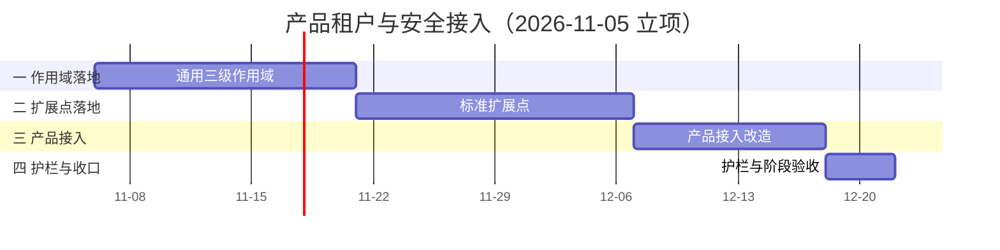

# 产品租户与安全接入计划

[文档首页](../../../文档首页.md) › [07D 产品租户与安全接入](../README.md) › 计划　|　[需求基线 →](../需求/00_需求_产品租户与安全接入.md)　[任务基线 →](../任务/01_通用三级作用域/01_通用三级作用域.md)

> 进度唯一落点（本文档）：**已完成 0 / 4 项，任务 01 进行中**（专项于 2026-11-05 立项；2026-11-06 补 `01-4` / `02-5` 两条承接需求，同日撤销原域 01 并顺次重排编号；2026-11-07 任务由 14 条收敛为 4 条，工作项并入任务正文；门禁见 §5，风险见 §6，后续待办见 §7）

## 1. 计划说明 

- **排期对象**：专项 14 条需求、**4 个任务**（任务 01 含 01-1 ~ 01-4 四个工作项 / 任务 02 含 02-1 ~ 02-5 五个工作项 / 任务 03 含 03-1 ~ 03-3 三个工作项 / 任务 04 含 04-1 ~ 04-2 两个工作项）。工作项不单列计划行，工时与状态并入所属任务。
- **排期口径**：自 2026-11-06 起串行排期（单人兼职，接 07C 收口之后），窗口按实际滚动调整。
- **工时**：初估合计 **162h**（按 §3 逐项合计；立项初估 166h，2026-11-06 补入 `01-4` 8h 与 `02-5` 6h 后为 178h，撤销原域 01 两条 16h 后校正为 162h；实施时按实际调整）。
- **里程碑锚点**：M7D = 三级作用域与标准扩展点可用——产品按统一作用域与扩展点接入，禁止层有规则可依。
- **负责人**：minjian（兼职，单人）。
- **前置**：架构 41 节点已定稿；msg 现有 05 需求与 `01_1_1 租户接入` 任务作为任务 03 的输入。
- **四域推进次序**：
  | 阶段 | 目标 | 任务 | 工作项 |
  | --- | --- | --- | --- |
  | 一 作用域落地 | 三级作用域模型、注册、解析、上下文与错误码、生命周期清理 | `01` | `01-1` ~ `01-4` |
  | 二 扩展点落地 | 作用域校验、错误码映射、配额回显、审计字段、资源级 ACL 约束 | `02` | `02-1` ~ `02-5` |
  | 三 产品接入 | msg 先行；mdm / biz 现有文档对齐 | `03` | `03-1` ~ `03-3` |
  | 四 护栏与收口 | 护栏规则设计、阶段验收 | `04` | `04-1` ~ `04-2` |

## 2. 已完成任务 

| 编号 | 任务 | 工时（重估） | 完成日期 | 任务文件 | 偏差与遗留 |
| --- | --- | --- | --- | --- | --- |
| — | 暂无已完成任务 | — | — | — | 任务 `01` 的工作项 `01-1` 已交付，整体未完成，见 §3 |

## 3. 剩余任务排期 

| 编号 | 任务 | 状态 | 工时 | 依赖 | 排期窗口 | 备注 | 偏差与遗留 |
| --- | --- | --- | --- | --- | --- | --- | --- |
| 01 | [通用三级作用域](../任务/01_通用三级作用域/01_通用三级作用域.md) | 进行中 | 56h | 无 | 2026-11-06 ~ 2026-11-20 | 工作项 `01-1` 已交付；`01-2` 解析与校验 / `01-3` 上下文与错误码 / `01-4` 生命周期清理待做 | 工作项 `01-1` 偏差：值对象目录改落 `bms_core/resource_scope/`（`scope/` 已被数据权限占用）、快照段改「声明态 + 运营态分列」、模块级覆盖率交推送环（详见其实施记录 §6） |
| 02 | [标准扩展点](../任务/02_标准扩展点/02_标准扩展点.md) | 未开始 | 54h | 01 | 2026-11-21 ~ 2026-12-06 | 五类扩展点按「校验 → 错误码 → 配额 → 审计 → ACL 约束」接入 | 无 |
| 03 | [产品接入改造](../任务/03_产品接入改造/03_产品接入改造.md) | 未开始 | 36h | 02 | 2026-12-07 ~ 2026-12-17 | msg 先行（`03-1` 重写 05 需求并落四项扩展点）；mdm / biz 只对齐文档 | 无 |
| 04 | [护栏与阶段验收](../任务/04_护栏与阶段验收/04_护栏与阶段验收.md) | 未开始 | 16h | 03 | 2026-12-18 ~ 2026-12-21 | 护栏规则只设计不实现；验收按八条判据收口 | 无 |

> 工时与窗口为初估，按实际滚动调整；进度以本表为唯一落点。

## 4. 排期甘特图 

## 5. 专项验收门禁 

> 验收在任务 `04` 的工作项 `04-2` 执行；本节只列判据与达成路径，结论与证据在专项测试报告与测试记录中维护，不在本表提前判「达标」。

| 验收点 | 对应任务（工作项） | 达成路径 |
| --- | --- | --- |
| 同一性：三类入口解析出同一组三级标识 | 01（01-2）/ 03（03-1） | 三路径一致性用例 + msg 数据面回归 |
| 越权拒绝：跨租户 / 跨 module_key / 资源级越权被拒 | 01（01-2）/ 02（02-1、02-5）/ 03（03-1） | 越权用例 + 产品授权模型测试 |
| 停用即时：数据面与异步任务同样拒绝 | 01（01-2、01-4）/ 03（03-1） | 版本戳生效测试 + 停用回归 |
| 未登记拒绝：module_key / resource_key 未登记即拒 | 01（01-1、01-2） | 注册校验用例 |
| 审计可追溯：管理操作可查、记录级可按 log_id 定位 | 02（02-4、02-5）/ 03（03-1） | 审计链查询 + 记录级定位测试 |
| 配额可核对：平台只读可见且与产品一致 | 02（02-3）/ 03（03-1） | 投影对账 + 无双写检查 |
| 错误码一致：管理面 / 数据面同码、无撞码 | 02（02-2）/ 03（03-1） | 码表对账 + 同码测试 |
| 无复制实现：产品仓库无继承层实现 | 04（04-1）/ 01（01-4）/ 02（02-5）/ 03（03-1） | 护栏规则 + 评审 |

## 6. 风险与对策 

| 风险 | 影响 | 对策 |
| --- | --- | --- |
| 三级作用域与 module_key / 业务域语义混淆 | 产品接入时两套命名、两次校验 | 架构 41 §4.3 已区分；任务 01 用示例固化 |
| msg 五项扩展点一次改完回归面大 | 行为漂移、上线风险 | 先文档后代码；按扩展点分批回归；行为对比基线 |
| 跨仓文档引用断链 | CI 校验失败、读者跳转失败 | 跨仓引用用纯文本路径；改完跑 links |
| 其他产品文档范围失控 | 工时超估、改动无关内容 | 只改需求篇，设计 / 任务按需最小同步 |
| 产品把基座缺漏自行补齐并回写 | 两套实现、口径分叉 | 缺漏回 bms 补（提需求或缺陷）；护栏规则拦截复制实现 |
| 护栏规则误报 | 影响产品正常开发 | 规则先设计；白名单有期限与责任人；告警级先于阻断级 |
| 工时为初估 | 排期偏差 | 实施时按实际滚动调整；偏差记入本表 |

## 7. 后续阶段待办 

| # | 事项 | 来源 | 归口 |
| --- | --- | --- | --- |
| 1 | 护栏规则实现（继承层复制 / 扩展点外复制 / 字面量硬编码） | 任务 04 的 `04-1` 设计 | 另立任务或后续排期 |
| 2 | mdm / biz 代码改造（本期只对齐现有文档） | 任务 03 的 `03-2`、`03-3` | 各产品按自身节奏排期 |
| 3 | 资源级 ACL 通用化评估 | 架构 41 §10 | 第二个产品提出同类需求时论证 |
| 4 | 配额统一执行评估 | 架构 41 §10 | 出现平台统一执行诉求时论证 |
| 5 | 第四级作用域（业务域 / 部署单元）评估 | 架构 41 §10 | 出现普遍隔离需求时论证 |
| 6 | 跨产品作用域共享机制 | 架构 41 §10 | 走 38 能力分配与显式授权，不放开边界 |
| 7 | **推送环耗时治理**：步骤结果复用（按 tree hash + 步骤命令指纹跳过「同输入已通过」步骤）、慢步骤拆分；本专项实测单次推送 ≈ 9 分钟且重跑提交环内容 | 2026-11-07 时间成本复盘（工作项 `01-1` 两次推送尝试） | engkit 工具包专项（另立任务，不占本专项工时） |
| 8 | 覆盖率判定单元（整文件 vs 改动行所在函数 vs 既有文件历史缺口基线） | 2026-11-07 复盘 | 与第 7 项同批评估（改引擎，需拍板） |

> 本文档依《[计划文档规范](../../../规范/计划文档规范.md)》编写 · 进度以本表为唯一落点
