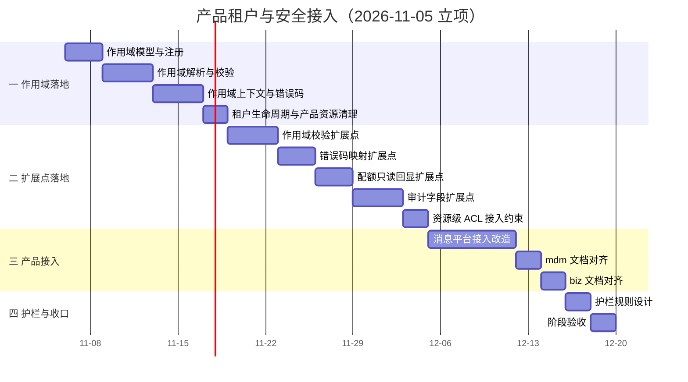

# 产品租户与安全接入计划

[文档首页](../../../文档首页.md) › [07D 产品租户与安全接入](../README.md) › 计划　|　[需求基线 →](../需求/00_需求_产品租户与安全接入.md)　[任务基线 →](../任务/01_通用三级作用域/01_通用三级作用域.md)

> 进度唯一落点（本文档）：**已完成 1 项，剩余 13 项**（专项于 2026-11-05 立项；2026-11-06 补 `01-4` / `02-5` 两条承接需求与任务，同日撤销原域 01 并顺次重排编号；门禁见 §5，风险见 §6，后续待办见 §7）

## 1. 计划说明 

- **排期对象**：专项 14 条需求、14 个子任务（域 01 四条 / 域 02 五条 / 域 03 三条 / 域 04 两条）。
- **排期口径**：自 2026-11-06 起串行排期（单人兼职，接 07C 收口之后），窗口按实际滚动调整。
- **工时**：初估合计 **162h**（按 §3 逐项合计；立项初估 166h，2026-11-06 补入 `01_04` 8h 与 `02_05` 6h 后为 178h，撤销原域 01 两条 16h 后校正为 162h；实施时按实际调整）。
- **里程碑锚点**：M7D = 三级作用域与标准扩展点可用——产品按统一作用域与扩展点接入，禁止层有规则可依。
- **负责人**：minjian（兼职，单人）。
- **前置**：架构 41 节点已定稿；msg 现有 05 需求与 01-1-1 租户接入任务作为 03-1 的输入。
- **四域推进次序**：
  | 阶段 | 目标 | 任务 |
  | --- | --- | --- |
  | 一 作用域落地 | 三级作用域模型、注册、解析、上下文与错误码、生命周期清理 | `01_01`、`01_02`、`01_03`、`01_04` |
  | 二 扩展点落地 | 作用域校验、错误码映射、配额回显、审计字段、资源级 ACL 约束 | `02_01`、`02_02`、`02_03`、`02_04`、`02_05` |
  | 三 产品接入 | msg 先行；mdm / biz 现有文档对齐 | `03_01`、`03_02`、`03_03` |
  | 四 护栏与收口 | 护栏规则设计、阶段验收 | `04_01`、`04_02` |

## 2. 已完成任务 

| 编号 | 任务 | 工时（重估） | 完成日期 | 任务文件 | 偏差与遗留 |
| --- | --- | --- | --- | --- | --- |
| 01_01 | 作用域模型与注册 | 16h | 2026-11-07 | [01_通用三级作用域_01_作用域模型与注册](../任务/01_通用三级作用域/01_通用三级作用域_01_作用域模型与注册/01_通用三级作用域_01_作用域模型与注册.md) | ① **值对象目录实施期改名**：`bms_core/scope/` 已被数据范围（RBAC）占用，改落 `bms_core/resource_scope/`（架构 41 §4.2-1 作用域与数据权限正交），设计已回写；② 快照段 `status` 改「声明态 + 运营态分列下发」、运营面响应收敛为业务字段 + `effective_status`（停用人与时间查审计链）；③ **模块级覆盖率交推送环**（本任务只提交不推送；`resource_scope.base` 无同名测试，提交环按设计不判）；④ 运营期停用跨进程即时生效不引推送通道，登记为设计开放项 2；⑤ 下游 01-2 / 01-3 可直接消费 `find_scope_resource_type()` 与 `is_active()`，拒绝码归 01-3 |

## 3. 剩余任务排期 

| 编号 | 任务 | 状态 | 工时 | 依赖 | 排期窗口 | 备注 | 偏差与遗留 |
| --- | --- | --- | --- | --- | --- | --- | --- |
| 01_02 | 作用域解析与校验 | 未开始 | 20h | 01_01 | 2026-11-11 ~ 2026-11-14 | 三路径同口径、失败语义、越权测试 | 无 |
| 01_03 | 作用域上下文与错误码 | 未开始 | 12h | 01_02 | 2026-11-15 ~ 2026-11-18 | 不可变上下文、六类错误码、审计字段 | 无 |
| 01_04 | 租户生命周期与产品资源清理 | 未开始 | 8h | 01_01 / 01_02 / 01_03 | 2026-11-19 ~ 2026-11-20 | 四类事件、状态动作矩阵、失败与死信、反例清单 | 无 |
| 02_01 | 作用域校验扩展点 | 未开始 | 16h | 01_02 / 01_03 / 01_04 | 2026-11-21 ~ 2026-11-24 | 扩展点契约、顺序固定、三路径复用 | 无 |
| 02_02 | 错误码映射扩展点 | 未开始 | 8h | 01_03 / 02_01 | 2026-11-25 ~ 2026-11-27 | 映射声明、撞码检测、统一渲染 | 无 |
| 02_03 | 配额只读回显扩展点 | 未开始 | 12h | 01_01 / 02_01 | 2026-11-28 ~ 2026-11-30 | 投影契约、只读不双写、msg 改造 | 无 |
| 02_04 | 审计字段扩展点 | 未开始 | 12h | 01_03 | 2026-12-01 ~ 2026-12-04 | 扩展字段、操作类别、`log_id` | 无 |
| 02_05 | 资源级 ACL 接入约束 | 未开始 | 6h | 01_02 / 01_03 / 02_04 | 2026-12-05 ~ 2026-12-06 | 判定顺序、单点可上收、三处反例 | 无 |
| 03_01 | 消息平台接入改造 | 未开始 | 24h | 01_04 / 02_01 ~ 02_05 | 2026-12-07 ~ 2026-12-13 | msg 05 重写、五项扩展点、扩展项对账 | 无 |
| 03_02 | mdm 文档对齐 | 未开始 | 6h | 无 | 2026-12-14 ~ 2026-12-15 | 需求篇改写、设计任务按需 | 无 |
| 03_03 | biz 文档对齐 | 未开始 | 6h | 无 | 2026-12-16 ~ 2026-12-17 | 现有文档对齐、设计任务按需 | 无 |
| 04_01 | 护栏规则设计 | 未开始 | 8h | 01_04 / 02_01 ~ 02_05 | 2026-12-18 ~ 2026-12-19 | 三类规则、具象反例、误报处理、engkit 接入点 | 无 |
| 04_02 | 阶段验收 | 未开始 | 8h | 01_01 ~ 03_03 / 04_01 | 2026-12-20 ~ 2026-12-21 | 八条判据、14 条需求核对、测试报告 | 无 |

> 工时与窗口为初估，按实际滚动调整；进度以本表为唯一落点。

## 4. 排期甘特图 

## 5. 专项验收门禁 

> 验收在 `04_02` 执行；本节只列判据与达成路径，结论与证据在专项测试报告与 `04_02` 测试记录中维护，不在本表提前判「达标」。

| 验收点 | 对应任务 | 达成路径 |
| --- | --- | --- |
| 同一性：三类入口解析出同一组三级标识 | 01_02 / 03_01 | 三路径一致性用例 + msg 数据面回归 |
| 越权拒绝：跨租户 / 跨 module_key / 资源级越权被拒 | 01_02 / 02_01 / 02_05 / 03_01 | 越权用例 + 产品授权模型测试 |
| 停用即时：数据面与异步任务同样拒绝 | 01_02 / 01_04 / 03_01 | 版本戳生效测试 + 停用回归 |
| 未登记拒绝：module_key / resource_key 未登记即拒 | 01_01 / 01_02 | 注册校验用例 |
| 审计可追溯：管理操作可查、记录级可按 log_id 定位 | 02_04 / 02_05 / 03_01 | 审计链查询 + 记录级定位测试 |
| 配额可核对：平台只读可见且与产品一致 | 02_03 / 03_01 | 投影对账 + 无双写检查 |
| 错误码一致：管理面 / 数据面同码、无撞码 | 02_02 / 03_01 | 码表对账 + 同码测试 |
| 无复制实现：产品仓库无继承层实现 | 04_01 / 01_04 / 02_05 / 03_01 | 护栏规则 + 评审 |

## 6. 风险与对策 

| 风险 | 影响 | 对策 |
| --- | --- | --- |
| 三级作用域与 module_key / 业务域语义混淆 | 产品接入时两套命名、两次校验 | 架构 41 §4.3 已区分；01_01 再用示例固化 |
| msg 五项扩展点一次改完回归面大 | 行为漂移、上线风险 | 先文档后代码；按扩展点分批回归；行为对比基线 |
| 跨仓文档引用断链 | CI 校验失败、读者跳转失败 | 跨仓引用用纯文本路径；改完跑 links |
| 其他产品文档范围失控 | 工时超估、改动无关内容 | 只改需求篇，设计 / 任务按需最小同步 |
| 产品把基座缺漏自行补齐并回写 | 两套实现、口径分叉 | 缺漏回 bms 补（提需求或缺陷）；护栏规则拦截复制实现 |
| 护栏规则误报 | 影响产品正常开发 | 规则先设计；白名单有期限与责任人；告警级先于阻断级 |
| 工时为初估 | 排期偏差 | 实施时按实际滚动调整；偏差记入本表 |

## 7. 后续阶段待办 

| # | 事项 | 来源 | 归口 |
| --- | --- | --- | --- |
| 1 | 护栏规则实现（继承层复制 / 扩展点外复制 / 字面量硬编码） | 04_01 设计 | 另立任务或后续排期 |
| 2 | mdm / biz 代码改造（本期只对齐现有文档） | 03_02 ~ 03_03 | 各产品按自身节奏排期 |
| 3 | 资源级 ACL 通用化评估 | 架构 41 §10 | 第二个产品提出同类需求时论证 |
| 4 | 配额统一执行评估 | 架构 41 §10 | 出现平台统一执行诉求时论证 |
| 5 | 第四级作用域（业务域 / 部署单元）评估 | 架构 41 §10 | 出现普遍隔离需求时论证 |
| 6 | 跨产品作用域共享机制 | 架构 41 §10 | 走 38 能力分配与显式授权，不放开边界 |

> 本文档依《[计划文档规范](../../../规范/计划文档规范.md)》编写 · 进度以本表为唯一落点
