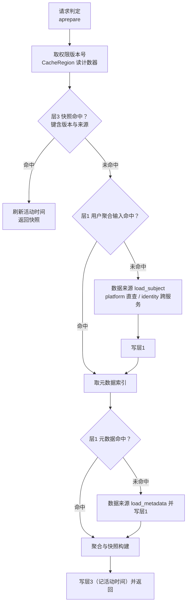
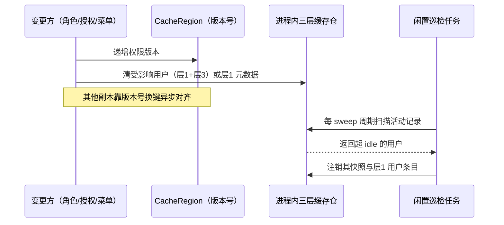

# 02 三层缓存与版本对齐 详细设计

> RBAC 基础模块 · 02 用户与角色 · 02_04 嵌套子任务 02（需求 07-16）· 详细设计 · **定稿（12 项决策已确认）**

[文档首页](../../../../../../../文档首页.md) › [02 用户与角色](../../../02_用户与角色.md) › [04 主体链权限计算引擎](../../02_用户与角色_04_主体链权限计算引擎.md) › [任务](../02_用户与角色_04_主体链权限计算引擎_02_三层缓存与版本对齐.md) › 详细设计　|　[需求 07-16](../../../../../需求/02_需求_用户与角色.md#r07-16)　|　[计划](../../../../../计划/01_计划_RBAC基础模块.md)　|　[实施记录 →](../实施/01_实施记录_02_三层缓存与版本对齐.md) · [测试记录 →](../测试/01_测试记录_02_三层缓存与版本对齐.md)

## 1. 背景与目标 <a id="goal"></a>

[`04-1` 接缝与算法下沉](../../02_用户与角色_04_主体链权限计算引擎_01_接缝与算法下沉/02_用户与角色_04_主体链权限计算引擎_01_接缝与算法下沉.md) 已把「判定 + 计算」下沉共享基座 `bms_core`，platform 与 identity 两服务的 `require_permission` 由恒放行转为真实判定。但缓存仍是下沉前的单层形态，留下四处结构性问题：

1. **快照走共享缓存**：`PermissionEngine.snapshot_for` 把快照写进 `CacheRegion`（生产为 Redis），每次判定都要序列化 / 反序列化一份含码集、入口集、规则行、字段收窄的载荷——判定是每个接口、每次数据增删改查的必经路径，这部分开销与需求「判定在进程内」的口径相悖；
2. **基础数据无缓存**：`load_subject` / `load_metadata` 每次请求各调一次；identity 侧每次都要跨服务往返一次平台契约（`04-1` 遗留 6），同一用户在 TTL 内重复付同样的代价；
3. **数据范围规则每次重算**：`RbacDataScope._conditions` 每读一次就把四策略求值重跑一遍，同一规则被 N 个用户命中就重算 N 次；
4. **变更失效只覆盖一半**：菜单 / 表单 / 按钮 / 字段 / 权限码变更只递增菜单版本，**不碰权限版本**，已缓存的码集与入口集要等 TTL 过期才更新。

本任务把缓存改为**三层进程内单份 + 版本号异步对齐**，并补上活动用户注销与容量护栏。

**目标**：

1. **三层缓存仓**：基础数据（用户聚合输入 + 元数据索引）/ 规则物化结果 / 用户快照三层各自在**进程内单份**，按版本键控、按层限额、按层 TTL；
2. **不落 Redis**：三层全部进程内，Redis 只承载权限版本号计数器（序列化与网络延迟不可接受）；
3. **版本对齐**：使用前查最新版本号，版本变更换键即失效；元数据变更一并递增权限版本，消除「元数据已新、快照仍旧」的错位；
4. **活动用户注销**：记录用户最近活动时间，后台轮询任务注销 30 分钟不活动的快照，再次访问即时重算并回填；
5. **容量护栏**：三层各自条目上限 + 规则层元素总量预算，防内存被单条大集合或长期累积撑爆。

**边界（不在本任务）**：

- **集合按规则共享的引用计数淘汰、大集合 SQL 形态、内存度量指标**归 [`04-3` 数据权限集合物化](../../02_用户与角色_04_主体链权限计算引擎_03_数据权限集合物化/02_用户与角色_04_主体链权限计算引擎_03_数据权限集合物化.md)。本任务只交付**载体**（规则键 + 条目限额 + 元素预算），不改四策略求值语义。
- **四策略与 `sys_data_scope` 表文件口径收口**归 [`04-4` 四策略口径修正](../../02_用户与角色_04_主体链权限计算引擎_04_四策略口径修正/02_用户与角色_04_主体链权限计算引擎_04_四策略口径修正.md)。本任务对求值器**零改动**。
- **跨副本同步清理**（事件广播）不在本任务：跨副本一致性由版本号异步对齐承担（需求口径）。
- **数据库**：不新增表 / 列 / 索引 / 迁移；`TABLE_OWNERSHIP` 零变更。
- **前端**：无改动（权限概要接口与载荷不变）。

## 2. 现状实测 <a id="status"></a>

> 实测时点 2026-10-20；取证落点为当前工作区源码。

| 项 | 实测结论 | 取证落点 |
| --- | --- | --- |
| 快照缓存现状 | `snapshot_for` 读 `CacheRegion`，键 `bms:{租户}:perm:{用户}:{版本}`，TTL `snapshot_ttl_seconds`（缺省 300s）；未命中即 `compute` 回填 | `libs/bms_core/src/bms_core/permission/engine.py`（`snapshot_for` / `DEFAULT_SNAPSHOT_TTL`） |
| 版本号现状 | 租户级计数器键 `bms:{租户}:permission:version`，经 `CacheRegion.aincrease` 递增；读失败按 0 处理 | `permission/version.py`、`cache/base.py::aincrease` |
| 基础数据现状 | `load_subject` / `load_metadata` 每次计算各调一次，无进程内缓存；identity 侧为跨服务往返 | `permission/engine.py::compute`、`services/identity/src/bms_identity/permission/source.py` |
| 数据范围现状 | `RbacDataScope._conditions` 逐条 `policy(rows)` 现算，无任何缓存；多用户命中同一规则时各自重算 | `libs/bms_core/src/bms_core/scope/rbac.py` |
| 校验器生命周期 | `RbacPermissionChecker` → `BasePermissionChecker` → `BasePluggable` → `BaseAsyncResource`；`setup()` / `aclose()` 默认空实现，装配期由 `assemble_plugins` 调用 `setup()` 并登记 `ResourceManager`（关闭时逆序 `aclose`） | `core/plugin.py::BasePluggable`、`core/assembly.py`（`assemble_plugins` 的 `_setup_or_reject` 与 `resources.register`） |
| 元数据失效现状 | `MenuService.invalidate` 只递增 `bms:global:menu:version` 并删当前语言旧键，**不递增权限版本** → 元数据变更后已缓存的码集 / 入口集最长滞后一个快照 TTL | `services/platform/src/bms_platform/services/menu.py`（`invalidate`） |
| 配置现状 | `[permission]` 为 `PermissionSettings(PluginSelection)`：`provider` / `profile` / `options`（自由字典）；工厂读取 `snapshot_ttl_seconds` / `exempt_role_types` / `locale` | `core/config.py::PermissionSettings`、`permission/rbac.py::RbacPermissionCheckerFactory.create` |
| 进程级单例范式 | 数据来源注册表、插件注册表均为模块级注册表 + `reset_*` 供用例隔离 | `permission/sources.py`、`core/plugin.py` |
| 测试基座现状 | 公共夹具已隔离配置（`BMS_PERMISSION__PROVIDER` / `BMS_DATA_SCOPE__PROVIDER` 置空），用于消除进程级单例跨套件污染 | `testing/fixtures.py` |
| 共享底座影响面 | 改 `libs/bms_core/` 任意文件 → 定向选测退化全量（三套件） | 《[测试规范](../../../../../../../规范/测试规范.md)》§2.1.3 |
| 数据库 / 原型 | 无表结构变更；纯后端任务，无界面改动 → 无原型对照 | — |

## 3. 交付物清单 <a id="deliver"></a>

### 3.1 数据库设计

**无**（不新增表 / 列 / 索引 / 迁移；三层缓存全部在进程内存）。

### 3.2 后端

```text
bms/backend/libs/bms_core/src/bms_core/
├── permission/
│   ├── cache.py                                     # 新增：三层进程内缓存仓（限额 / TTL / 活动时间 / 元素预算 / 注销扫描）
│   ├── version.py                                   # 改：补层级键构造函数（subject / metadata / rule 指纹）
│   ├── engine.py                                    # 改：层1 读写 + 层3 改走缓存仓 + 失效时清本进程条目
│   └── rbac.py                                      # 改：读缓存选项建仓、setup/aclose 起停闲置注销轮询任务
└── scope/
    └── rbac.py                                      # 改：层2 规则结果按指纹缓存（求值语义零变化）

bms/backend/services/platform/src/bms_platform/
└── services/menu.py                                 # 改：元数据写路径同时递增权限版本并清层1 元数据

bms/backend/libs/bms_core/src/bms_core/testing/
└── fixtures.py                                      # 改：每例复位三层缓存仓（消除进程级单例跨套件污染）

bms/backend/libs/bms_core/tests/permission/
├── test_cache.py                                    # 新增：三层限额 / TTL / 活动时间 / 注销 / 元素预算 / 复位
├── test_engine.py                                   # 扩展：层1 命中与版本换键 / 快照不再落 CacheRegion / 失效清本进程
└── ...（既有用例按签名调整）

bms/backend/libs/bms_core/tests/scope/
└── test_rbac_scope_layer2.py                        # 新增：规则结果按指纹复用 / 求值语义不变 / 元素预算触发淘汰
```

任务附属三件套（本目录）：`设计/01_详细设计_02_三层缓存与版本对齐.md`（本文件）、`实施/01_实施记录_02_三层缓存与版本对齐.md`、`测试/01_测试记录_02_三层缓存与版本对齐.md`。

### 3.3 前端

**无**（无页面 / 组件 / store 改动；契约与类型零变更，`CONTRACT_VERSION` 不升）。

## 4. 数据设计要点 <a id="data"></a>

不新增表。三层均为**进程内中性结构**，不引用任何服务侧模型（保持 `04-1` 的下沉边界）：

| 层 | 承载内容 | 键维度 | 缺省上限 | TTL |
| --- | --- | --- | --- | --- |
| 层1 基础数据·用户 | `PermissionSubjectData`（角色 / 类型 / 授权行 / 数据范围规则 / 字段收窄） | 数据来源 + 租户 + 用户 + 权限版本 | 2000 条 | `snapshot_ttl_seconds`（300s） |
| 层1 基础数据·元数据 | `PermissionMetadata`（菜单→表单、权限码 id→码） | 数据来源 + locale + 权限版本 | 16 条 | 3600s |
| 层2 规则物化 | 规则求值结果（`ConcurrentStableList[ScopeCondition]`） | 数据来源 + 字典类型 + 策略 + `config` 内容指纹 | 1000 条 / 20 万元素 | `snapshot_ttl_seconds`（300s） |
| 层3 用户快照 | `PermissionSnapshot` | 数据来源 + 租户 + 用户 + 权限版本 | 5000 条 | `snapshot_ttl_seconds`（300s） |

**容量估算**（按「一个活跃用户约 25 KB（层1 + 快照）」折算）：500 活跃用户约 12 MB；上限态（快照 5000 + 层1 2000）约 200 MB 量级，规则层由元素预算另限约 12 MB。TTL 只决定条目存活时长，不改单条体积。

**键形态（进程内，不复用共享缓存的 `bms:` 前缀——避免与 Redis 键空间混淆）**：

```text
{source}|subject|{tenant}|{user}|{version}
{source}|meta|{locale}|{version}
{source}|rule|{data_source_key}|{policy_type}|{fingerprint}
{source}|snapshot|{tenant}|{user}|{version}
```

`{source}` 为数据来源实现标识（`BasePermissionDataSource.key`），使同进程多实现并存时不串味、用例天然隔离。

**规则指纹**：`data_source_key` + `policy_type` + `config` 的规范化 JSON（键排序、集合转有序列表、不可序列化值转 `str`）取 SHA-1 前 16 位；规范化失败（含不可序列化对象）即**不缓存**、直接求值。

## 5. 接口设计 <a id="api"></a>

### 5.1 缓存仓契约（新增 `permission/cache.py`）

```python
DEFAULT_SNAPSHOT_CACHE_MAX_ITEMS = 5000
DEFAULT_SUBJECT_CACHE_MAX_ITEMS = 2000
DEFAULT_METADATA_CACHE_MAX_ITEMS = 16
DEFAULT_RULE_CACHE_MAX_ITEMS = 1000
DEFAULT_RULE_CACHE_MAX_ELEMENTS = 200_000
DEFAULT_METADATA_CACHE_TTL = 3600
DEFAULT_IDLE_TIMEOUT = 1800
DEFAULT_IDLE_SWEEP_INTERVAL = 60

class PermissionCacheStore(BaseFrameworkObject):
    """三层进程内缓存仓（限额 / TTL / 活动时间 / 元素预算）。"""

    def __init__(self, *, snapshot_ttl: int = ..., subject_max_items: int = ..., ...) -> None: ...

    # 层1
    def get_subject(self, *, source: str, tenant_id, user_id: int, version: int) -> PermissionSubjectData | None: ...
    def set_subject(self, *, source: str, tenant_id, user_id: int, version: int, value: PermissionSubjectData) -> None: ...
    def get_metadata(self, *, source: str, locale: str, version: int) -> PermissionMetadata | None: ...
    def set_metadata(self, *, source: str, locale: str, version: int, value: PermissionMetadata) -> None: ...

    # 层2
    def get_rule(self, *, source: str, rule_key: str) -> list[ScopeCondition] | None: ...
    def set_rule(self, *, source: str, rule_key: str, value: list[ScopeCondition]) -> None: ...

    # 层3
    def get_snapshot(self, *, source: str, tenant_id, user_id: int, version: int) -> PermissionSnapshot | None: ...
    def set_snapshot(self, *, source: str, tenant_id, user_id: int, version: int, value: PermissionSnapshot) -> None: ...

    # 维护
    def invalidate_user(self, *, source: str, tenant_id, user_id: int) -> int: ...   # 清该用户层1 + 层3
    def invalidate_metadata(self) -> int: ...                                        # 清层1 元数据（全 locale / 版本）
    def sweep_idle(self, idle_seconds: int, *, now: float | None = None) -> int: ...  # 注销闲置用户，返回注销人数
    def stats(self) -> ConcurrentStableDict[str, int]: ...                            # 各层条目数 / 规则元素数
    def reset(self) -> None: ...                                                      # 用例隔离

def current_permission_cache_store() -> PermissionCacheStore: ...
def configure_permission_cache_store(options: Mapping[str, object], *, snapshot_ttl: int) -> PermissionCacheStore: ...
def reset_permission_cache_store() -> None: ...
```

**单份语义**：`current_permission_cache_store()` 返回进程内唯一实例（模块级，惰性创建；与数据来源注册表、插件注册表同构）；`configure_permission_cache_store` 幂等按选项重建容量与 TTL（供校验器装配期调用），`reset_permission_cache_store` 清空并复位缺省配置（供 `testing/fixtures.py` 的每例隔离）。

**活动时间**：`get_snapshot` / `set_snapshot` 均刷新该用户（来源 + 租户 + 用户）的 `last_active`；`sweep_idle` 按 `now - last_active >= idle_seconds` 注销该用户的快照与层1 用户条目，并删除活动记录。内部维护「用户 → 快照键」索引，避免零散扫描。

**淘汰口径**：三层均 LRU（`OrderedDict`，命中即移到末尾）；层2 额外维护元素计数，写入后若超元素预算，从最久未用的规则开始淘汰直至回落，并通过 `logging.warning` 上报；每次写入/淘汰后更新计数。

### 5.2 引擎改造（`permission/engine.py`）

```python
class PermissionEngine(BaseFrameworkObject):
    def __init__(
        self, *, source: BasePermissionDataSource, cache: CacheRegion,
        store: PermissionCacheStore | None = None,          # 新增：缺省取进程级单份
        profile: str = DEFAULT_PROFILE, ttl: int = DEFAULT_SNAPSHOT_TTL,
        exempt_role_types: tuple[str, ...] = (ROLE_TYPE_SYSTEM,), locale: str = DEFAULT_LOCALE,
    ) -> None: ...
```

读取路径（`snapshot_for`）：



要点：

1. **版本号仍是唯一失效依据**：`current_version` 保持现有实现（读 `CacheRegion`，失败按 0）；版本 +1 后键变化，旧条目靠 LRU / TTL 退出。
2. **快照不再写 `CacheRegion`**：`snapshot_for` 的缓存读写改走 `store`；`compute` 语义不变（不读缓存、直接回源），供用例与回填复用。
3. **层1 命中即免取数**：`load_subject` / `load_metadata` 只在层1 未命中时调用；identity 跨服务往返随之收敛到「每用户每版本一次」。
4. **失效清本进程**：`PermissionEngine.invalidate` / `invalidate_permission_cache` 在版本 +1 后，对本进程 `invalidate_user`（给定时）或清空层3（未给定时，版本已换键故只需释放内存）。
5. **无用户上下文**（平台运营 / 服务身份请求）仍是 `platform_admin` 快照，不进层3（无用户键，也无需缓存）。

### 5.3 数据范围层2 接入（`scope/rbac.py`）

`RbacDataScope._conditions` 由「逐条现算」改为「按规则指纹查层2，未命中即求值回填」：

| 项 | 口径 |
| --- | --- |
| 缓存键 | `{source}|rule|{data_source_key}|{policy_type}|{fingerprint}`（`{source}` 取数据范围实现标识 `rbac`） |
| 命中 | 直接取回 `ConcurrentStableList[ScopeCondition]`，并入该字典类型的条件桶 |
| 未命中 | 调策略求值器（求值器**零改动**，含非法规则退化为永假并上报），结果写层2 |
| 指纹不可算 | 不读写层2，直接求值（不影响正确性） |
| 共享性 | 同一规则被 N 个用户命中只有一份条目（键不含用户） |
| 元素预算 | 一旦超预算，最久未用规则被淘汰并上报；后续命中重新求值 |

> **执行期修正（2026-10-20，用户确认）**：`_conditions` 原按 `isinstance(item, dict)` 判定规则行，
> 而引擎产出的是 `ConcurrentStableDict`（`Mapping` 而非 `dict` 子类），**真实链路规则行被静默丢弃**
> ——读过滤与写校验形同虚设（既有用例因测试侧用 `dict(...)` 构造而全部通过）。本轮改为按
> `Sequence` / `Mapping` **协议**判定（与 `04-1` 实施记录 §3.4 同源处置），并补「真实行形态」回归用例；
> 四策略求值器本身仍零改动。

### 5.4 校验器与服务侧装配（`permission/rbac.py`、`services/menu.py`）

1. **装配期建仓**：`RbacPermissionCheckerFactory.create()` 读 `[permission].options` 的缓存键，调 `configure_permission_cache_store(...)` 建/复配三层缓存仓；校验器持有 `store` 与 `idle_timeout` / `sweep_interval`。
2. **生命周期起停轮询任务**：`RbacPermissionChecker.setup()` 起 `asyncio` 周期任务（每 `idle_sweep_seconds` 调 `store.sweep_idle(idle_timeout)`，异常只记日志不退出循环）；`aclose()` 取消任务。巡检已在 `assemble_plugins` 装配期调用 `setup()` 并登记 `ResourceManager`，关闭时逆序 `aclose()`——无需改装配入口。
3. **元数据写路径失效**：`MenuService.invalidate` 在递增菜单版本、删当前语言旧键之外，一并递增 `permission_version_key(tenant_id)` 并 `current_permission_cache_store().invalidate_metadata()`——元数据变更即时反映到码集与入口集。

**配置项**（全部落在 `[permission].options`，不改 `Settings` 模型与四份 `config*.toml`；键名按《[命名规范](../../../../../../../规范/命名规范.md)》小写下划线）：

| 键 | 缺省 | 含义 |
| --- | --- | --- |
| `snapshot_ttl_seconds` | 300 | 层3 与层1 用户条目 TTL（既有键，沿用） |
| `metadata_cache_ttl_seconds` | 3600 | 层1 元数据索引 TTL |
| `snapshot_cache_max_items` | 5000 | 层3 条目上限 |
| `subject_cache_max_items` | 2000 | 层1 用户条目上限 |
| `metadata_cache_max_items` | 16 | 层1 元数据条目上限（按 locale 各一份） |
| `rule_cache_max_items` | 1000 | 层2 规则条目上限 |
| `rule_cache_max_elements` | 200000 | 层2 元素总量预算 |
| `idle_timeout_seconds` | 1800 | 闲置注销阈值（活动用户口径） |
| `idle_sweep_seconds` | 60 | 闲置注销轮询周期 |
| `exempt_role_types` / `locale` | 既有 | 不变 |

失效与注销两条链路：



## 6. 失败分支与边界 <a id="edge"></a>

| 场景 | 处置 | 表现 |
| --- | --- | --- |
| 版本号读失败（Redis 不可用） | 按 0 处理（既有口径）；键仍稳定，层3 承载命中 | 请求正确，仅换版本时失效退化为 TTL |
| 层1 取数失败（platform 查库 / identity 契约不可达） | 异常上抛，`aprepare` 失败 | fail-closed（不缓存失败结果、不放行为空权限） |
| 快照反序列化 / 结构异常 | 层3 为进程内对象，无序列化环节；命中即返回 | — |
| 层2 指纹计算失败 | 跳过层2，直接求值 | 结果正确，仅失去共享 |
| 层2 元素超预算 | 淘汰最久未用规则并 `warning` 上报 | 后续命中重新求值，不 OOM |
| 三层达条目上限 | LRU 淘汰最久未用条目 | 命中率下降，功能正确 |
| 闲置再访问 | 快照已被注销 → 版本不变、层3 未命中 → 层1 命中则仅重建快照（不跨服务取数）；层1 也已过期则全量重算并回填 | 即时重算、无空窗 |
| 巡检任务异常（单轮抛错） | 记日志并继续下一轮 | 注销暂停但判定不受影响（`aclose` 可取消） |
| 巡检周期配置为 0 / 负数 | 视为「不启用后台注销」，仅保留 TTL 与容量淘汰 | 功能可用，内存治理弱化 |
| 多副本 | 各副本独立三层缓存；版本 +1 后各自换键 | 异步对齐（需求明确不要求同步时刻一致） |
| 无用例上下文的平台运营请求 | `platform_admin` 快照，不进缓存 | 与既有口径一致 |

## 7. 测试设计与验收映射 <a id="test"></a>

| 验收点（任务完成标准） | 用例 |
| --- | --- |
| 三层均按「进程内单份 + 版本号对齐」工作 | `libs/bms_core/tests/permission/test_cache.py`：同一键两次读写返回同一对象（单份）；版本变化后旧键不可见 |
| 快照不依赖 Redis 共享 | `test_engine.py`：注入 `CacheRegion` 后断言 `perm:*` 键在 `CacheRegion` 中不产生（仅版本号键存在）；快照命中来自缓存仓 |
| 版本变更后下一次使用即取到新版本 | `test_engine.py`：`invalidate` 后 `snapshot_for` 触发重算、`version` 为新值；`test_cache.py` 断言旧版本键被清理 |
| 层1 命中即不取数（identity 跨服务往返收敛） | `test_engine.py`：计数器型数据来源断言 `load_subject` / `load_metadata` 在 TTL 内各只调一次 |
| 元数据变更即时生效 | `services/platform/tests/**`：菜单 / 表单 / 按钮 / 字段写后 `permission_version_key` +1，且层1 元数据被清 |
| 活动用户 30 分钟不活动后快照注销、再访问即时重算 | `test_cache.py`：注入 `now` 推进 `sweep_idle` 断言注销计数与条目消失；`test_engine.py`：注销后 `snapshot_for` 重算并回填 |
| 三层容量上限生效且可配置 | `test_cache.py`：各层超限即 LRU 淘汰；`configure_permission_cache_store` 按选项生效；层2 元素预算触发淘汰并上报 |
| 层2 按规则共享、求值语义不变 | `test_rbac_scope_layer2.py`：同规则两用户只求值一次；非法规则仍永假；指纹不可算时退化为直接求值 |
| 既有权限用例全绿 | `services/platform/tests/permission/**`、`services/identity/tests/permission/**`、`libs/bms_core/tests/permission/**` 全量 |
| 覆盖率 | 变更模块行 + 分支 **100%**（口径见《[AI开发规范](../../../../../../../规范/AI开发规范.md#coverage)》「覆盖率要求」节） |
| 门禁 | `ruff check` / `ruff format --check`、`pyright` 0 error、`check-backend-base.py`、`preflight --fast` 全绿 |
| Kiwi | **先登记取号**（一任务一条），再回填代码标注 |

**执行范围**（沿用 `04-1` 决策 10）：改共享底座按《[测试规范](../../../../../../../规范/测试规范.md)》§2.1.3 退化全量，本地跑三套件——`libs/bms_core/tests`、`services/platform/tests`、`services/identity/tests`，变更模块覆盖率 100%，并做一次混跑确认无跨套件污染。

**前端**：无改动 → 测试记录写「原型对照：不适用（纯后端缓存改造，无界面变更）」+ 理由。

## 8. 登记落点 <a id="register"></a>

| 内容 | 落点 |
| --- | --- |
| 新增基座文件 `permission/cache.py` 与三层缓存语义 | 《[后端基类清单](../../../../../../../后端基类清单.md)》§9 补行（能力域 `permission`） |
| 架构 15 §3「权限计算与缓存」实现事实 | 《[架构设计 · 权限计算引擎](../../../../../../../设计/架构设计/15_架构设计_子系统_权限计算引擎.md)》（三层缓存 + 版本对齐 + 闲置注销 + 元数据同源失效） |
| 配置键（`[permission].options` 九个键） | 本详细设计 §5.4 + 实施记录（不改 `config*.toml`） |
| 计划 / 需求 / 任务状态 | `项目/07_RBAC基础模块/{计划,需求,任务}/**`（**唯一进度落点**） |
| 三件套 | 本目录 `设计/`、`实施/01_实施记录_02_三层缓存与版本对齐.md`、`测试/01_测试记录_02_三层缓存与版本对齐.md` |

## 9. 决策确认 <a id="decide"></a>

| # | 事项 | 结论 |
| --- | --- | --- |
| 1 | 三层缓存载体落点 | **基座进程级缓存仓** `bms_core/permission/cache.py`（模块级单份 + `reset_*` 隔离）；层2 由同步的数据范围 provider 直接消费，无需请求态 |
| 2 | Redis 边界 | **三层全进程内**，Redis 只承载权限版本号计数器（严格按需求 07-16 第 3 点） |
| 3 | 元数据失效 | platform 元数据写路径（`MenuService.invalidate`）**同时递增权限版本**并清层1 元数据 → 码集 / 入口集即时生效 |
| 4 | 层1 内容与键 | 用户聚合输入（来源 + 租户 + 用户 + 版本）+ 元数据索引（来源 + locale + 版本） |
| 5 | 层2 求值入口 | `RbacDataScope._conditions` 内**惰性求值回填**，按「字典类型 + 策略 + `config` 指纹」键控；求值语义零变化 |
| 6 | 闲置注销 | 校验器 `setup()` / `aclose()` 起停后台轮询任务，`idle_timeout_seconds`（1800s）/ `idle_sweep_seconds`（60s） |
| 7 | 容量缺省 | 快照 5000 / 层1 用户 2000 / 层1 元数据 16 / 规则 1000 条 + 规则 20 万元素预算（LRU 淘汰） |
| 8 | 失效清理 | 版本 +1 同时清本进程受影响条目；跨副本靠版本号异步对齐 |
| 9 | 快照 TTL | 保留 `snapshot_ttl_seconds`（300s）作版本对齐之外的第二道防线 |
| 10 | 层1 TTL | 用户条目同快照 TTL；元数据索引 3600s（已由版本换键 + 主动清理兼底） |
| 11 | 层2 元素预算 | **加**（20 万元素）：单条大集合不再能撑爆内存；引用计数与指标留 `04-3` |
| 12 | 验证与登记 | 三套件全量 + 变更模块行 / 分支 100% + `preflight --fast`；Kiwi 一任务一条先登记 |
| 13 | 存量缺陷处置（执行期新增，用户确认） | `_conditions` 的行判定改为按 `Mapping` 协议（修掉「真实规则行被静默丢弃 → 读写校验失效」），补真实行形态用例；求值器零改动 |

## 10. 实施步骤 <a id="steps"></a>

1. **Kiwi 登记**：一任务一条策展用例，回读平台编号。
2. **缓存仓**：新增 `permission/cache.py`（三层 LRU + TTL + 活动时间 + 元素预算 + 注销扫描 + 单例与复位）。
3. **键构造**：`permission/version.py` 补层级键（subject / meta / rule 指纹），保留既有版本键与用户键。
4. **引擎接入**：`permission/engine.py` 层1 读写、层3 改走缓存仓、失效清本进程条目。
5. **层2 接入**：`scope/rbac.py` 按指纹缓存求值结果（求值器零改动）。
6. **校验器**：`permission/rbac.py` 读选项建仓、`setup`/`aclose` 起停巡检任务、`aprepare` 传 `store`。
7. **元数据失效**：`services/menu.py::invalidate` 递增权限版本并清层1 元数据。
8. **测试隔离**：`testing/fixtures.py` 每例复位缓存仓；既有用例按签名调整。
9. **用例**：新增 `test_cache.py` / `test_rbac_scope_layer2.py`，扩展 `test_engine.py` 与 platform 菜单失效用例。
10. **门禁**：三套件全量 + 变更模块覆盖率 100% + 混跑一次 + `preflight --fast`。
11. **回写与记录**：按 §8 回写，产出实施记录与测试记录，分次提交。

## 11. 边界与开放项 <a id="open"></a>

| # | 事项 | 归口 |
| --- | --- | --- |
| 1 | 集合按规则共享的引用计数淘汰、大集合 SQL 形态、物化层内存度量指标 | [`04-3`](../../02_用户与角色_04_主体链权限计算引擎_03_数据权限集合物化/02_用户与角色_04_主体链权限计算引擎_03_数据权限集合物化.md) |
| 2 | 四策略求值语义与 `sys_data_scope` 表文件口径收口 | [`04-4`](../../02_用户与角色_04_主体链权限计算引擎_04_四策略口径修正/02_用户与角色_04_主体链权限计算引擎_04_四策略口径修正.md) |
| 3 | 跨副本同步清理（事件广播 / 广播失效端点） | 事件总线接入（后续阶段）；本轮靠版本号异步对齐 |
| 4 | mdm 岗位 / 部门变更的事件订阅式版本 +1 | 事件总线接入（后续阶段）；本轮仍是内部失效端点先行 |
| 5 | 其余服务（tenant / file / txn 等）接入真实权限校验后的三层缓存 | 各服务按需接入，缓存随基座自动生效 |
| 6 | 字段权限 provider 仍在服务侧（依赖两库会话），层1 缓存的是其结果 | 本任务边界（`04-1` §3.2）；形态变化时随之评估 |

## 12. 参考文档 <a id="ref"></a>

- [需求 07-16](../../../../../需求/02_需求_用户与角色.md#r07-16)、[任务文档](../02_用户与角色_04_主体链权限计算引擎_02_三层缓存与版本对齐.md)、[父任务](../../02_用户与角色_04_主体链权限计算引擎.md)
- 《[架构设计 · 权限计算引擎](../../../../../../../设计/架构设计/15_架构设计_子系统_权限计算引擎.md)》「权限计算与缓存」「下沉共享基座」节
- 《[架构设计 · 数据架构](../../../../../../../设计/架构设计/07_架构设计_数据架构.md)》缓存架构节
- 兄弟子任务：[`04-1` 接缝与算法下沉](../../02_用户与角色_04_主体链权限计算引擎_01_接缝与算法下沉/02_用户与角色_04_主体链权限计算引擎_01_接缝与算法下沉.md)（含[详细设计](../../02_用户与角色_04_主体链权限计算引擎_01_接缝与算法下沉/设计/01_详细设计_01_接缝与算法下沉.md)）、[`04-3`](../../02_用户与角色_04_主体链权限计算引擎_03_数据权限集合物化/02_用户与角色_04_主体链权限计算引擎_03_数据权限集合物化.md)、[`04-4`](../../02_用户与角色_04_主体链权限计算引擎_04_四策略口径修正/02_用户与角色_04_主体链权限计算引擎_04_四策略口径修正.md)
- 《[后端开发规范](../../../../../../../规范/后端开发规范.md)》、《[后端基类清单](../../../../../../../后端基类清单.md)》、《[测试规范](../../../../../../../规范/测试规范.md)》

> 本文档依《[文档生成规范](../../../../../../../规范/文档生成规范.md)》与《[AI开发规范](../../../../../../../规范/AI开发规范.md)》编写 · 关键决策逐项确认
