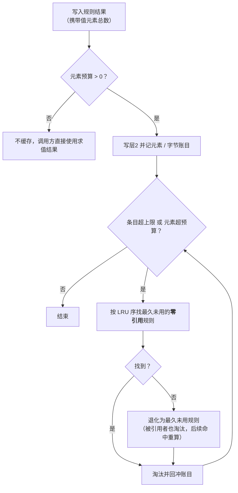
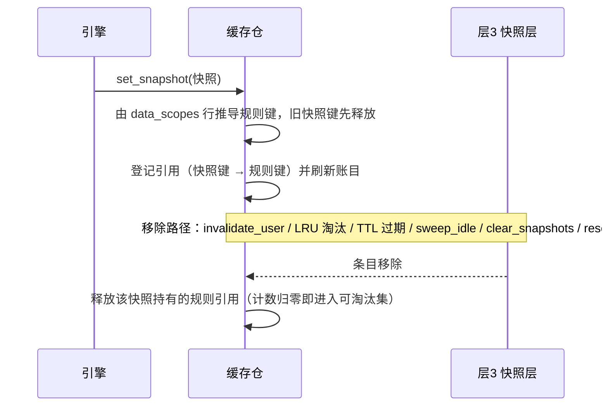
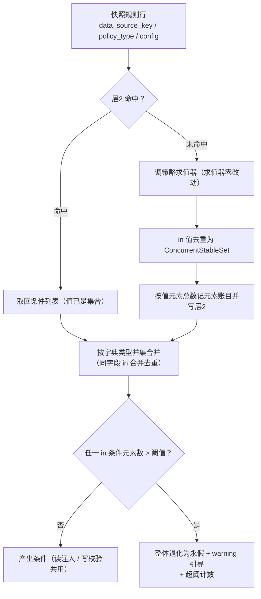

# 03 数据权限集合物化 详细设计

> RBAC 基础模块 · 02 用户与角色 · 02_04 嵌套子任务 03（需求 07-16）· 详细设计 · **定稿（13 项决策已确认）**

[文档首页](../../../../../../../文档首页.md) › [02 用户与角色](../../../02_用户与角色.md) › [04 主体链权限计算引擎](../../02_用户与角色_04_主体链权限计算引擎.md) › [任务](../02_用户与角色_04_主体链权限计算引擎_03_数据权限集合物化.md) › 详细设计　|　[需求 07-16](../../../../../需求/02_需求_用户与角色.md#r07-16)　|　[计划](../../../../../计划/01_计划_RBAC基础模块.md)　|　[实施记录 →](../实施/01_实施记录_03_数据权限集合物化.md) · [测试记录 →](../测试/01_测试记录_03_数据权限集合物化.md)

## 1. 背景与目标 <a id="goal"></a>

[`04-2` 三层缓存与版本对齐](../../02_用户与角色_04_主体链权限计算引擎_02_三层缓存与版本对齐/02_用户与角色_04_主体链权限计算引擎_02_三层缓存与版本对齐.md) 已交付层2 规则物化载体（规则指纹键控、条目上限、元素预算、`stats()`），但**集合本身**仍是「按规则存一份求值结果」的朴素形态，离需求「集合按规则共享 + 容量淘汰 + 大集合可承受 + 内存可观测」还差四件事：

1. **集合未真正物化**：`select` 的值仍以内建 `list` 承载，同值重复、元素数与内存占用无法准确计量；「元素预算」按**条件条数**计——一条含 10 万值的 `select` 只算 1 个元素，预算对最需要防的大集合完全失效；
2. **无引用视图**：规则条目只有 LRU，没有「被几个用户快照持有」的信息，淘汰可能把正在被大量用户命中的规则挤掉，造成求值抖动；
3. **大集合直落 SQL**：`select` 求出值列表 → 仓储 `_build_in` 直接拼 `IN (...)`，百万级可见集合会让 SQL 语句与解析开销爆炸（需求 07-16 立项的两条根因之一）；
4. **内存不可观测**：`stats()` 只有条目数与（失真的）元素数，运维拿不到「离上限还有多远」的依据。

本任务在**不改键控口径、不改四策略求值语义**的前提下补齐这四件事。

**目标**：

1. **集合去重物化**：规则结果里的 `in` 值物化为 `ConcurrentStableSet`，条件表达式其余不变；元素数 / 估算内存按**值元素总数**计量；
2. **按规则共享 + 引用计数**：同一规则被 N 个用户命中只有一份；进程内按「快照 → 规则指纹」登记引用，层3 条目在**失效 / LRU 淘汰 / TTL 过期 / 闲置注销 / 清空**任一路径移除时释放；
3. **零引用优先淘汰**：层2 超条目上限或超元素预算时，先淘汰最久未用的**零引用**规则；全部被引用时退化为最久未用（后续命中重算，不返回空）；
4. **大集合 SQL 形态**：并集合并后统一校验——任一 `in` 条件元素数超阈即整体退化为**永假**并上报引导（改用区域 / 匹配 / 扩展策略）；`region` / `match` 仍以 `between` / `like` 原生算子表达、不参与判定；
5. **内存度量**：`stats()` 输出集合条数 / 值元素总数 / 估算字节 / 被引用规则数 / 淘汰与超阈计数 / 各层上限。

**边界（不在本任务）**：

- **四策略求值语义与 `sys_data_scope` 表文件口径收口**（`select` / `region` 不再额外要求字段名、`extension` 直接返回集合、配置期超阈引导与错误码）归 [`04-4`](../../02_用户与角色_04_主体链权限计算引擎_04_四策略口径修正/02_用户与角色_04_主体链权限计算引擎_04_四策略口径修正.md)。本任务**对 `scope/policies_rbac.py` 零改动**。
- **观测出口**：不新增 HTTP 端点、不注册 Prometheus 指标（`metrics` 域当前为 null 占位），指标只经 `stats()` + 装配期日志输出，长期由可观测性阶段的 `metrics` 域统一接入。
- **跨副本**：各副本独立维护自己的引用计数与集合，一致性仍靠权限版本号异步对齐（需求口径，不要求同步时刻一致）。
- **数据库**：不新增表 / 列 / 索引 / 迁移；`TABLE_OWNERSHIP` 零变更。
- **前端**：无改动（快照载荷与接口不变）。

## 2. 现状实测 <a id="status"></a>

> 实测时点 2026-10-20；取证落点为当前工作区源码。

| 项 | 实测结论 | 取证落点 |
| --- | --- | --- |
| 层2 载体 | 键 `{source}\|rule\|{字典类型}\|{策略}\|{指纹}`、值 `ConcurrentStableList[ScopeCondition]`；条目上限 `rule_cache_max_items`（1000）+ 元素预算 `rule_cache_max_elements`（20 万），超限 LRU 淘汰 | `libs/bms_core/src/bms_core/permission/cache.py`（`get_rule` / `set_rule`） |
| 元素计量 | `set_rule` 取 `len(value)` = **条件条数**：一条含 N 个值的 `select` 只计 1，预算对大集合失效 | 同上 |
| 账目回冲 | `_Layer.get` 命中 TTL 过期即删条目，但**不回冲** `_rule_elements` / `_rule_total` → 过期规则的元素数长期占预算 | 同上（`_Layer.get`） |
| 引用视图 | 无：层2 只有 LRU，没有「被多少快照持有」；层3 无「持有哪些规则」的索引 | 同上 |
| 快照结构 | `PermissionSnapshot.data_scopes` 持规则行（`data_source_key` / `policy_type` / `config`），**不持集合内容**——引用关系可由快照行推导 | `permission/snapshot.py`、`permission/engine.py::_data_scope_rules` |
| 集合形态 | `resolve_select` 产 `ScopeCondition(field, "in", list(values))`；`region` → `between`、`match` → `like`（已是 SQL 原生算子） | `scope/policies_rbac.py` |
| SQL 形态 | `_build_in` 直接 `column.in_(members)`——值列表多大，SQL 就多大；`in` 值只认内建 `list / tuple / set / frozenset` | `repositories/base_db_repository.py`（`_build_in`） |
| 内存基线 | `_match` 的 `in` 同样只认内建类型；`RbacDataScope._matches_value` 亦然 | `repositories/base_scoped_repository.py`、`scope/rbac.py` |
| 并集合并 | `_union` 只把 `list \| tuple` 值当可合并集合，其余退化为合取并上报 | `scope/rbac.py::_union` |
| 写校验 | 永假条件（`id ∈ ∅`）在 `allow_write` 里因「字段不在待写值中」被**跳过** → 非法规则用户仍可写 | `scope/rbac.py::allow_write` |
| 配置现状 | `[data_scope]` 为 `PluginSelection`（`provider` + `options`）；provider 构造已收 `Settings` 但直接 `del settings` | `core/config.py`、`scope/rbac.py::RbacDataScope.__init__` |
| 观测现状 | `stats()` 输出 `subject_items` / `metadata_items` / `rule_items` / `rule_elements` / `snapshot_items` / `active_users`，无字节估算 | `permission/cache.py::stats` |
| 测试基座 | 公共夹具每例复位进程级三层缓存仓 | `testing/fixtures.py` |
| 共享底座影响面 | 改 `libs/bms_core/` 任意文件 → 定向选测退化全量（三套件） | 《[测试规范](../../../../../../../规范/测试规范.md)》§2.1.3 |
| 数据库 / 原型 | 无表结构变更；纯后端任务，无界面改动 → 无原型对照 | — |

## 3. 交付物清单 <a id="deliver"></a>

### 3.1 数据库设计

**无**（不新增表 / 列 / 索引 / 迁移；物化全部在进程内存）。

### 3.2 后端

```text
bms/backend/libs/bms_core/src/bms_core/
├── permission/
│   └── cache.py                          # 改：规则引用计数簿记 / 零引用优先淘汰 / 值元素与字节账目
│                                         #     / TTL 过期回冲 / 超阈计数 / stats 扩充
├── scope/
│   └── rbac.py                           # 改：in 值集合去重物化 / 元素权重回传层2 / 大集合阈护栏
│                                         #     / 写校验永假即拒 / 并集合并适配集合值
└── repositories/
    ├── base_scoped_repository.py         # 改：内存基线 in 条件认 collections.abc.Set 协议
    └── base_db_repository.py             # 改：_build_in 认 collections.abc.Set 协议

bms/backend/libs/bms_core/tests/
├── permission/
│   └── test_cache.py                     # 扩展：引用计数 / 零引用优先淘汰 / 值元素账目 / 过期回冲
│                                         #     / 字节估算 / 超阈计数 / stats 新键
├── scope/
│   └── test_rbac_scope_layer3.py         # 新增：集合去重物化 / 按规则共享不随用户放大 / 超阈退化
│                                         #     / 区域与匹配不参与判定 / 合并后超阈 / 写校验永假即拒
└── repositories/
    ├── test_scoped_repository.py         # 扩展：集合值 in 条件在内存基线生效
    └── test_db_repository.py             # 扩展：集合值 in 条件在 SQL 路径生效（与内存基线同义）
```

任务附属三件套（本目录）：`设计/01_详细设计_03_数据权限集合物化.md`（本文件）、`实施/01_实施记录_03_数据权限集合物化.md`、`测试/01_测试记录_03_数据权限集合物化.md`。

### 3.3 前端

**无**（无页面 / 组件 / store 改动；快照载荷 `data_scopes` 结构与接口不变，`CONTRACT_VERSION` 不升）。

## 4. 数据设计要点 <a id="data"></a>

不新增表。层2 在 04-2 的载体上加四张**旁挂账目**（与既有 `_rule_elements` 同构，`ConcurrentStableDict` / `ConcurrentStableSet`）：

| 账目 | 内容 | 键 | 用途 |
| --- | --- | --- | --- |
| `_rule_elements` | 规则结果的**值元素总数**（`in` 集合大小 / `between` 计 2 / 标量计 1） | 规则键 | 元素预算与指标 |
| `_rule_bytes` | 估算字节 = `RULE_ENTRY_OVERHEAD_BYTES` + 元素数 × `RULE_ELEMENT_BYTES` | 规则键 | 内存度量 |
| `_rule_refs` | 该规则当前被多少个层3 快照持有 | 规则键 | 淘汰优先级与指标 |
| `_snapshot_rules` | 该快照持有哪些规则键 | 快照键 | 快照移除时精确释放引用 |

累计量：`_rule_total`（元素总和）、`_rule_bytes_total`（字节总和）、`_rule_evicted_total`（淘汰条数）、`_oversized_rejections`（超阈拒绝次数）。

**估算系数**（常量，口径稳定可断言；只求量级、不追求真实对象尺寸）：

| 常量 | 缺省 | 含义 |
| --- | --- | --- |
| `RULE_ENTRY_OVERHEAD_BYTES` | 256 | 每条规则条目的固定开销（键 + 条件对象 + 账目槽位） |
| `RULE_ELEMENT_BYTES` | 48 | 每个值元素的估算字节（字符串 / 整数均摊 + 集合槽位） |

**引用关系（键与去重口径）**：

```text
快照键  {来源}|snapshot|{租户|global}|{用户}|{版本}
规则键  由快照行推导：permission_rule_key(data_source_key, policy_type, config)
        = {字典类型}|{策略}|{SHA-1 前 16 位}
内部键  {来源}|rule|{规则键}
```

- 引用计数以**规则键（指纹）** 为单位，跨来源同指纹合并计数——只影响淘汰优先级，不影响正确性（详设 §9 决策 2）；
- 快照行缺字段 / `config` 不可规范化（指纹不可算）时**跳过该行**，不登记引用（该规则本就不进层2）；
- 同一快照内同指纹只登记一次。

## 5. 接口设计 <a id="api"></a>

### 5.1 缓存仓（`permission/cache.py`）

```python
DEFAULT_MAX_IN_VALUES = 1000
"""单条 `in` 条件允许的值元素上限（超出即退化为永假；<= 0 表示不限制）。"""

RULE_ENTRY_OVERHEAD_BYTES = 256
"""每条规则条目的估算固定开销（字节）。"""

RULE_ELEMENT_BYTES = 48
"""每个值元素的估算字节。"""

class PermissionCacheStore(BaseFrameworkObject):
    def set_rule(self, *, source: str, rule_key: str, value: object, elements: int | None = None) -> None: ...
    """改写：`elements` 为值元素总数（None 退化为 `len(value)`，供既有调用方与用例使用）；
    超条目上限或元素预算时按「零引用优先」淘汰。"""

    def record_oversized_rule(self) -> None:
        """累计一次「大集合超阈拒绝」（供 stats 观测）。"""

    def stats(self) -> ConcurrentStableDict[str, int]:
        """扩充键：rule_estimated_bytes / rule_refs / rule_evicted_total / oversized_rejections
        + 各层上限（rule_max_items / rule_max_elements / snapshot_max_items /
        subject_max_items / metadata_max_items）。"""
```

**淘汰口径**（写入与元素预算共用一条收敛路径）：



**引用生命周期**：



要点：

1. **单份语义不变**：`current_permission_cache_store()` / `configure_permission_cache_store()` / `reset_permission_cache_store()` 的对外行为不变；`reset()` 一并清空四张账目与累计量；
2. **不回写快照**：引用登记只动账目，`PermissionSnapshot` 结构与其载荷零变化（`to_payload` / `from_payload` 不感知引用）；
3. **TTL 过期回冲**：层2 与层3 命中过期条目时必须同步回冲账目（修 04-2 的元素账目遗漏）；
4. **被引用不影响正确性**：规则被淘汰后，下一次命中按指纹重新求值回填，与「未命中」路径完全一致。

### 5.2 数据范围 provider（`scope/rbac.py`）

**配置**（`[data_scope].options`，不改 `Settings` 模型、不改四份 `config*.toml`；装配期定型，改配置需重启）：

| 键 | 缺省 | 含义 |
| --- | --- | --- |
| `max_in_values` | 1000 | 单条 `in` 条件的值元素上限（<= 0 表示不限制） |

**读取路径**（规则求值 → 集合物化 → 并集合并 → 大集合护栏）：



| 项 | 口径 |
| --- | --- |
| 集合物化 | `in` 条件的值在**产出时**去重为 `ConcurrentStableSet`（层2 命中的值已是集合，形态一致）；条件其余字段不变 |
| 值元素总数 | `in` 集合大小 / `between` 计 2 / 其余标量计 1，求和后随 `set_rule(elements=…)` 记账 |
| 并集合并 | 同字典类型内同字段同操作符 `in` 合并为一个 `in`，值并入集合（天然去重）；不同字段 / 操作符仍退化为合取并上报（既有口径） |
| 大集合判定 | 并集合并**之后**统一校验：任一 `in` 条件元素数 > `max_in_values` → 该次产出整体退化为永假（单条 `DENY_ALL_CONDITION`） |
| 引导 | `logging.warning` 明确提示「`in` 值数 N 超阈值 M，已退化为永假；请改用区域 / 匹配 / 扩展策略」，并累加 `oversized_rejections` |
| 超阈结果缓存 | **进层2**（永假结果极小，避免每次请求重扫巨型值列表）；阈值改动需重启并重建缓存仓（`configure_permission_cache_store`），无陈旧键风险 |
| 区域 / 匹配 | 不参与判定：仍以 `between` / `like` 原生算子表达，不枚举值 |
| 写校验 | 与读共用同一批条件；**任一条件为永假即 `allow_write` 返回 False**（读写一致，堵住「非法规则仍可写」） |
| 阈值关闭 | `max_in_values <= 0` 视为运维显式放开，不拦截（仍记元素数与字节） |

### 5.3 仓储条件翻译（`repositories/*`）

`in` 条件的值由内建 `list` 变为基座集合类后，两处取值判定改为按 **`collections.abc.Set` 协议**（`ConcurrentStableSet` 实现该协议，非内建 `set` 子类）：

| 落点 | 改动 |
| --- | --- |
| `base_scoped_repository._match` | `in` 分支认 `Sequence \| Set`（排除 `str` / `bytes`），内存基线与 SQL 同义 |
| `base_db_repository._build_in` | 契约校验认 `Sequence \| Set`，`list(value)` 后 `column.in_(…)`（空集合仍恒假） |

> 两者都只是**放宽可接受的容器类型**，不改变任何操作符的 SQL 语义；`str` / `bytes` 仍不算集合值（避免把字符串当字符序列拼进 `IN`）。

## 6. 失败分支与边界 <a id="edge"></a>

| 场景 | 处置 | 表现 |
| --- | --- | --- |
| 规则指纹不可算（`config` 含不可序列化值） | 层2 不缓存、引用不登记（直接求值） | 结果正确，仅失去共享与预算计量 |
| 快照行非映射 / 缺 `data_source_key` | 跳过该行引用登记 | 其他规则引用照常；该规则按「未命中」重算 |
| 单条 `in` 超阈 | 整体退化为永假 + `warning` 引导 + 计数（结果进层2） | 该次读写均不放行（从严、零泄漏），运维据日志改用区域 / 匹配 / 扩展 |
| `max_in_values <= 0` | 视为不限制 | 与改造前一致（仍有元素与字节度量） |
| 规则超元素预算 | 先淘汰零引用规则；全部被引用时淘汰最久未用并上报 | 不 OOM；被淘汰规则下次命中重算 |
| 层3 条目 LRU 淘汰 / TTL 过期 | 释放该快照持有的规则引用 | 引用数不虚高，零引用规则可被及时回收 |
| 用户失效 / 闲置注销 / 清空快照 | `_drop_user` / `sweep_idle` / `clear_snapshots` 统一释放引用 | 同用户多版本快照各自释放 |
| 同键重复写快照（版本回退 / 覆盖） | 先释放旧引用再登记新引用 | 计数不重复累加 |
| 跨来源同指纹规则 | 引用合并计数 | 只延后淘汰，不影响正确性 |
| 层2 命中值形态异常（非集合 / 非条件列表） | 视作未命中，重新求值回填 | 自愈，不抛错 |
| 无用户上下文的平台运营请求 | 不进层3，不登记引用 | 与既有口径一致 |

## 7. 测试设计与验收映射 <a id="test"></a>

| 验收点（任务完成标准） | 用例 |
| --- | --- |
| N 个用户共用一条规则时集合只有一份、内存不随用户数线性增长 | `test_cache.py`：三层/层2 账目在 3 个快照命中同一规则后 `rule_items == 1` 且 `rule_estimated_bytes` 不随快照数增长 |
| 用户快照只持规则引用 | `test_rbac_scope_layer3.py`：快照 `data_scopes` 仍是规则行；层2 命中返回**同一对象**（`is`），未复制集合 |
| 引用计数登记与释放 | `test_cache.py`：`set_snapshot` 后 `rule_refs` 递增；`invalidate_user` / `clear_snapshots` / TTL 过期 / `sweep_idle` 后回落 |
| 零引用优先淘汰 | `test_cache.py`：两条规则（一条被快照引用、一条零引用）超条目上限 → 淘汰零引用者；全部被引用 → 淘汰最久未用且下次命中重算 |
| 元素预算按值元素总数计量 | `test_cache.py`：一条含 N 个值的规则按 N 计；超预算即不缓存；同键覆盖不重复记账 |
| TTL 过期回冲账目 | `test_cache.py`：推进时钟令规则过期，`rule_elements` / `rule_estimated_bytes` 归零 |
| 大集合不出现巨型 `IN` | `test_rbac_scope_layer3.py`：值数超阈 → 产出单条永假；阈值内 → 正常 `in`；`region` / `match` 不受阈值影响；两规则合并后超阈 → 永假 |
| 超阈引导与计数 | `test_rbac_scope_layer3.py`：`caplog` 断言引导文案；`stats()["oversized_rejections"]` 累加 |
| 超阈结果进层2 | `test_rbac_scope_layer3.py`：连续两次读只求值一次（计数求值器） |
| 写校验永假即拒 | `test_rbac_scope_layer3.py`：非法规则 / 超阈后 `allow_write` 返回 False（任意字段） |
| 集合值在内存基线与 SQL 两路同义 | `test_scoped_repository.py` / `test_db_repository.py`：集合值 `in` 条件分别过滤出同一批记录；`str` 值不被当集合 |
| 既有权限用例全绿 | `libs/bms_core/tests/**`、`services/platform/tests/**`、`services/identity/tests/**` 全量 |
| 覆盖率 | 变更模块行 + 分支 **100%**（口径见《[AI开发规范](../../../../../../../规范/AI开发规范.md#coverage)》「覆盖率要求」节） |
| 门禁 | `ruff check` / `ruff format --check`、`pyright` 0 error、`check-backend-base.py`、`preflight --fast` 全绿 |
| Kiwi | **先登记取号**（一任务一条），再回填代码标注 |

**执行范围**（沿用 `04-1` 决策 10）：改共享底座按《[测试规范](../../../../../../../规范/测试规范.md)》§2.1.3 退化全量，本地跑三套件——`libs/bms_core/tests`、`services/platform/tests`、`services/identity/tests`，变更模块覆盖率 100%，并做一次混跑确认无跨套件污染。

**前端**：无改动 → 测试记录写「原型对照：不适用（纯后端集合物化改造，无界面变更）」+ 理由。

## 8. 登记落点 <a id="register"></a>

| 内容 | 落点 |
| --- | --- |
| 层2 集合物化语义（引用计数 / 零引用优先淘汰 / 元素与字节账目 / 大集合护栏） | 《[后端基类清单](../../../../../../../后端基类清单.md)》§9 `permission/cache.py` 行补述 |
| 架构 15 §6「数据权限」实现事实（集合按规则共享 + 引用计数 + 大集合 SQL 形态） | 《[架构设计 · 权限计算引擎](../../../../../../../设计/架构设计/15_架构设计_子系统_权限计算引擎.md)》 |
| 配置键 `[data_scope].options.max_in_values` | 本详细设计 §5.2 + 实施记录（不改 `config*.toml`） |
| 计划 / 需求 / 任务状态 | `项目/07_RBAC基础模块/{计划,需求,任务}/**`（**唯一进度落点**） |
| 三件套 | 本目录 `设计/`、`实施/01_实施记录_03_数据权限集合物化.md`、`测试/01_测试记录_03_数据权限集合物化.md` |

## 9. 决策确认 <a id="decide"></a>

| # | 事项 | 结论 |
| --- | --- | --- |
| 1 | 集合物化载体形态 | **`in` 值去重物化为 `ConcurrentStableSet`**（求值器零改动，转换在产出条件时做；`_union` 与写校验同步适配集合值） |
| 2 | 引用计数簿记 | **快照侧推导登记**：缓存仓在写层3 时按 `data_scopes` 行推导规则指纹并登记引用，五条移除路径释放；跨来源同指纹合并只影响淘汰优先级 |
| 3 | 淘汰优先级 | **先零引用再 LRU**：先淘汰最久未用的零引用规则，无可淘汰时按 LRU 淘汰被引用者（后续命中重算） |
| 4 | 超阈处置 | **整体退化为永假**（并集合并后统一校验，任一 `in` 超阈即永假）+ `warning` 引导 + 计数 |
| 5 | 阈值缺省 | **1000**（勾选式承载少量值的定位；经配置可调） |
| 6 | 阈值配置落点 | **`[data_scope].options.max_in_values`**（数据范围域自有，provider 装配期读；改配置需重启） |
| 7 | 超阈结果缓存 | **进层2**（避免每次请求重扫巨型值列表；阈值改动需重启并重建缓存仓） |
| 8 | 内存度量输出 | **扩充 `stats()` + 装配期日志**（不新增端点、不接 Prometheus；长期由 `metrics` 域统一接入） |
| 9 | 物化对象载体 | **旁挂账目**（层2 值仍为条件列表，元素 / 引用 / 字节 / 上限各一张账；消费方零解包） |
| 10 | 估算内存算法 | **常量系数线性估算**（每规则固定开销 + 每元素固定字节；写入 / 淘汰 O(1) 记账） |
| 11 | 大集合判定基准 | **单条 `in` 条件的元素数**（直指 SQL 绑定参数风险源；`region` / `match` 不参与） |
| 12 | 写校验遇永假 | **拒绝全部写**（`allow_write` 返回 False；顺带堵住「非法规则只拦 `id` 字段」的存量漏洞） |
| 13 | 元素计量口径 | **按值元素总数**（`in` 集合大小 / `between` 计 2 / 标量计 1；修 04-2「按条件条数计」的失真） |

## 10. 实施步骤 <a id="steps"></a>

1. **Kiwi 登记**：一任务一条策展用例，回读平台编号。
2. **账目层**：`permission/cache.py` 加 `_rule_bytes` / `_rule_refs` / `_snapshot_rules` / 累计量；`set_rule` 收 `elements` 并按「零引用优先」收敛；TTL 过期回冲账目。
3. **引用生命周期**：`set_snapshot` 推导并登记引用；层3 五条移除路径（失效 / LRU / TTL / 闲置注销 / 清空）释放；`reset` 清零。
4. **指标**：`stats()` 扩充字节 / 引用 / 淘汰 / 超阈 / 上限键；校验器装配期输出一条容量与上限日志。
5. **集合物化**：`scope/rbac.py` 的 `_resolve` 把 `in` 值去重为 `ConcurrentStableSet` 并按值元素总数记账；`_union` 适配集合值。
6. **大集合护栏**：`scope/rbac.py` 读 `max_in_values`、在并集合并后统一校验、超阈永假 + 引导 + 计数。
7. **写校验一致性**：`allow_write` 遇永假条件直接拒。
8. **仓储适配**：内存基线与 DB 翻译的 `in` 取值改按 `Sequence | Set` 协议。
9. **用例**：新增 `test_rbac_scope_layer3.py`，扩展 `test_cache.py` 与两个仓储测试，平台 `test_scope.py` 断言改为集合形态。
10. **门禁**：三套件全量 + 变更模块覆盖率 100% + 混跑一次 + `preflight --fast`。
11. **回写与记录**：按 §8 回写，产出实施记录与测试记录，分次提交。

## 11. 边界与开放项 <a id="open"></a>

| # | 事项 | 归口 |
| --- | --- | --- |
| 1 | 四策略求值语义与表文件口径收口（`select` / `region` 不再要字段名、`extension` 直接返回集合、**配置期**超阈引导与错误码） | [`04-4`](../../02_用户与角色_04_主体链权限计算引擎_04_四策略口径修正/02_用户与角色_04_主体链权限计算引擎_04_四策略口径修正.md) |
| 2 | 内存指标 HTTP / Prometheus 出口 | 可观测性阶段（`metrics` 域真实实现回补） |
| 3 | 跨副本引用计数与集合各自独立 | 设计口径（版本号异步对齐），无遗留 |
| 4 | 集合去重后 `IN` 值顺序不保证 | SQL `IN` 无语义顺序，无遗留 |
| 5 | 规则指纹不含 `max_in_values`（阈值改动需重启并重建缓存仓） | 设计口径（决策 7） |

## 12. 参考文档 <a id="ref"></a>

- [需求 07-16](../../../../../需求/02_需求_用户与角色.md#r07-16)、[任务文档](../02_用户与角色_04_主体链权限计算引擎_03_数据权限集合物化.md)、[父任务](../../02_用户与角色_04_主体链权限计算引擎.md)
- 《[架构设计 · 权限计算引擎](../../../../../../../设计/架构设计/15_架构设计_子系统_权限计算引擎.md)》§6「数据权限」
- 《[数据库设计 · sys_data_scope](../../../../../../../设计/数据库设计/数据表设计/sys_data_scope.md)》§3「索引与约束」（四策略 `config` 结构与并集兜底口径）
- 兄弟子任务：[`04-1` 接缝与算法下沉](../../02_用户与角色_04_主体链权限计算引擎_01_接缝与算法下沉/02_用户与角色_04_主体链权限计算引擎_01_接缝与算法下沉.md)、[`04-2` 三层缓存与版本对齐](../../02_用户与角色_04_主体链权限计算引擎_02_三层缓存与版本对齐/02_用户与角色_04_主体链权限计算引擎_02_三层缓存与版本对齐.md)（含[详细设计](../../02_用户与角色_04_主体链权限计算引擎_02_三层缓存与版本对齐/设计/01_详细设计_02_三层缓存与版本对齐.md)）、[`04-4` 四策略口径修正](../../02_用户与角色_04_主体链权限计算引擎_04_四策略口径修正/02_用户与角色_04_主体链权限计算引擎_04_四策略口径修正.md)
- 《[后端开发规范](../../../../../../../规范/后端开发规范.md)》、《[后端基类清单](../../../../../../../后端基类清单.md)》、《[测试规范](../../../../../../../规范/测试规范.md)》

> 本文档依《[文档生成规范](../../../../../../../规范/文档生成规范.md)》与《[AI开发规范](../../../../../../../规范/AI开发规范.md)》编写 · 关键决策逐项确认
