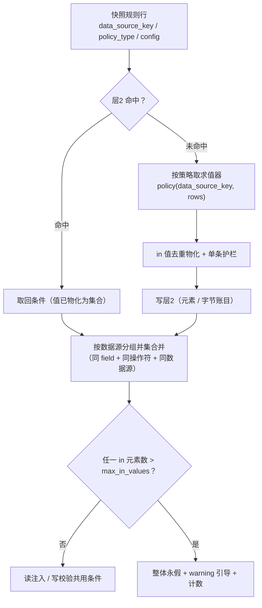

# 04 四策略口径修正 详细设计

> RBAC 基础模块 · 02 用户与角色 · 02_04 嵌套子任务 04（需求 07-16）· 详细设计 · **定稿（16 项决策已确认）**

[文档首页](../../../../../../../文档首页.md) › [02 用户与角色](../../../02_用户与角色.md) › [04 主体链权限计算引擎](../../02_用户与角色_04_主体链权限计算引擎.md) › [任务](../02_用户与角色_04_主体链权限计算引擎_04_四策略口径修正.md) › 详细设计　|　[需求 07-16](../../../../../需求/02_需求_用户与角色.md#r07-16)　|　[计划](../../../../../计划/01_计划_RBAC基础模块.md)　|　[实施记录 →](../实施/01_实施记录_04_四策略口径修正.md) · [测试记录 →](../测试/01_测试记录_04_四策略口径修正.md)

## 1. 背景与目标 <a id="goal"></a>

[`04-1` 接缝与算法下沉](../../02_用户与角色_04_主体链权限计算引擎_01_接缝与算法下沉/02_用户与角色_04_主体链权限计算引擎_01_接缝与算法下沉.md) 把四策略求值器「逐行搬迁」进共享基座、[`04-3` 集合物化](../../02_用户与角色_04_主体链权限计算引擎_03_数据权限集合物化/02_用户与角色_04_主体链权限计算引擎_03_数据权限集合物化.md) 把 `in` 值物化为集合并加大集合护栏，**两轮都刻意不动求值语义**。由此留下一个结构性不一致：

**求值器要求 `config` 带「字段名」，而事实源（《数据库设计 · `sys_data_scope`》）没有这个字段。** 后果是真实链路下的 `select` / `region` 规则**永远退化为永假**（取不到 `field` 即 `_deny`），而前端与平台写入口都不会写这个字段——即「配了等于没配」，且没有任何报错指向根因。

本任务按表文件口径收口四策略：

1. **`select` 勾选式**：`config` 行按表文件为 `{"item_code": …}`，产出「该数据源的勾选值集合」（数据源维度条件），不再额外要求字段名；勾选值数量超阈给出引导，不静默退化为巨型值列表；
2. **`region` 区域式**：`config` 行为 `{"start": …, "end": …}`，以 `between` 原生算子表达（不枚举），起止倒置 / 缺项即永假；
3. **`match` 匹配式**：保留表文件的 `field` + `pattern`（用于配置期白名单校验与运行期匹配语义），以 `like` 原生算子表达，允许集与既有校验口径一致；
4. **`extension` 扩展式**：二开注册的求值器**按扩展键聚合一次调用、直接返回条件集合**；未注册 / 返回空即永假（从严）；
5. **四类并集 + 永假兜底**：并集整理沿用既有口径，非法 / 未注册规则退化为永假并**可观测**（日志 + 计数），不放大范围；
6. **条件落到实体列**：数据源维度条件由**消费方**声明「数据源 → 实体列」映射后翻译；未声明即永假（read 与 write 同一套映射）。

**边界（不在本任务）**：

- 数据范围**消费侧接线**（业务仓储 / 写入口实际调用）仍随业务模块落地，本任务只提供翻译与校验能力；
- 大集合 SQL 形态与内存度量归 [`04-3`](../../02_用户与角色_04_主体链权限计算引擎_03_数据权限集合物化/02_用户与角色_04_主体链权限计算引擎_03_数据权限集合物化.md)（本任务不改护栏口径，只把「产出条件」的口径对齐表文件）；
- 表结构零变更（`sys_data_scope` 只改 `config` 语义说明，不改列）；
- 不新增 HTTP 端点、不改服务间契约（快照载荷与内部只读契约的 `config` 原样传递，不转键）。

## 2. 现状实测 <a id="status"></a>

> 实测时点 2026-10-20；取证落点为当前工作区源码。

| 项 | 实测结论 | 取证落点 |
| --- | --- | --- |
| `select` 求值 | 读 `{"field": 列, "values": [...]}`；`field` 非标识符即 `_deny` → 表文件口径的 `{"item_code": …}` 规则**恒永假** | `libs/bms_core/src/bms_core/scope/policies_rbac.py::resolve_select` |
| `region` 求值 | 读 `{"field", "start", "end"}`；缺 `field` 即 `_deny` → 表文件口径的 `{"start", "end"}` **恒永假** | 同上 `resolve_region` |
| `match` 求值 | 读 `{"field", "pattern"}`，`field` 作条件字段、`like` 值由 `*`→`%`、`?`→`_` | 同上 `resolve_match` |
| `extension` 求值 | 逐行取 `key`、逐行调求值器，空结果即 `_deny` | 同上 `resolve_extension` |
| 事实源口径 | `config` 按策略分结构：`select` `{"item_code"}`、`region` `{"start","end"}`、`match` `{"field","pattern"}`、`extension` `{"key","params"}`；四类并集兜底、**按数据源维度产出集合** | `设计/数据库设计/数据表设计/sys_data_scope.md` §3 |
| 前端实际写入 | `DataScopePanel` 提交 `{"itemCode": …}`（select）/ `{"start","end"}` / `{"field","pattern"}` / `{"key","params"}`；`core` 的载荷仍为 camel | `frontend/packages/ui_ep/src/components/interaction/DataScopePanel.vue`、`frontend/packages/core/src/domain/permission-config.ts` |
| 平台落库口径 | `PUT /roles/{id}/data-permissions` 的 `config` 原样落 `StableJson`，**不做键名转换** → 真实数据键名是 `itemCode` | `bms_platform/api/role.py::replace_data_scopes`、`bms_platform/services/role_grant.py::replace_data_scopes` |
| 配置期校验 | 只校验 `match`（字段白名单 + 通配符）与 `extension`（`key` 是否注册）；`select` / `region` **无任何校验** | `bms_platform/services/role_grant.py::_validate_data_scopes` |
| 条件消费 | `BaseScopedRepository._scope_conditions` 直接采用 `ScopeCondition`，`_match` 按 `getattr(item, condition.field)` 取值；DB 侧 `_condition_expression` 按 `_column(field)` 翻译（字段不存在即 `ConfigError`） | `libs/bms_core/src/bms_core/repositories/{base_scoped_repository,base_db_repository}.py` |
| 数据源 → 列映射 | **不存在**：`DataSourceRecord` 只有 `data_source_key` / `allowlist` / `strategies`，不含业务列；条件字段此前全靠配置里的 `field` | `libs/bms_core/src/bms_core/datasource/registry.py` |
| 写校验 | `allow_write(values)` 按「条件字段不在 `values` 即跳过」判定——数据源维度条件（字段名为空）会被静默跳过 | `libs/bms_core/src/bms_core/scope/rbac.py::allow_write` |
| 超阈口径 | 运行期护栏 `[data_scope].options.max_in_values`（缺省 1000）已就位；**配置期无拦截** | 同 `04-3` 实施记录 |
| 阈值读取 | 仅 `RbacDataScope.__init__` 读一次，无公共读取入口 | `libs/bms_core/src/bms_core/scope/rbac.py` |
| 观测口径 | `stats()` 有 `oversized_rejections`，无「非法规则拒绝」计数 | `libs/bms_core/src/bms_core/permission/cache.py::stats` |
| 消费侧接线 | `_apply_data_scope` 全仓无调用方（`04-1` 遗留 1）——本任务的映射与类型归一先备好能力，接线随业务模块 | `04-1` 实施记录 §6 |
| 共享底座影响面 | 改 `libs/bms_core/` 任意文件 → 定向选测退化全量（三套件） | 《[测试规范](../../../../../../../规范/测试规范.md)》§2.1.3 |
| 数据库 / 原型 | 无表结构变更；纯后端 + 前端载荷键名，无界面形态改动 → 无原型对照 | — |

## 3. 交付物清单 <a id="deliver"></a>

### 3.1 数据库设计

**无表结构变更**（不新增表 / 列 / 索引 / 迁移；`TABLE_OWNERSHIP` 零变更）。`sys_data_scope` 表文件只改 §3「`config` 结构」的文字说明并追加变更记录 v6（决策 15）。

### 3.2 后端

```text
bms/backend/libs/bms_core/src/bms_core/
├── scope/
│   ├── base.py                          # 改：ScopeCondition 增可选 data_source_key；永假条件常量下沉至此
│   ├── limits.py                        # 新增：数据范围阈值读取（配置期与运行期同源）
│   ├── policies.py                      # 改：策略求值器签名加数据源标识
│   ├── extensions.py                    # 改：扩展求值器签名加数据源标识（按 key 聚合调用）
│   ├── policies_rbac.py                 # 改：四策略按表文件 config 口径求值 + 数据源维度条件
│   └── rbac.py                          # 改：求值器入参 / allow_write 收列映射 / 并集按数据源合并
├── permission/
│   └── cache.py                         # 改：非法规则拒绝计数（record_invalid_rule + stats 键）
└── repositories/
    ├── base_scoped_repository.py        # 改：scope_columns 声明 + 数据源条件翻译 + 未声明即永假 + 类型归一
    └── base_db_repository.py            # 改：数据源条件翻译（同映射）+ 按列类型归一 + 转换失败永假

bms/backend/services/platform/src/bms_platform/
└── services/role_grant.py               # 改：配置期校验 select（键名 / 超阈引导）与 region（起止可比）

bms/backend/libs/bms_core/tests/         # 扩展：四策略、层2/层3、仓储翻译与类型归一、缓存计数
bms/backend/services/platform/tests/     # 扩展：provider 端到端、配置期校验
```

### 3.3 前端

```text
bms/frontend/packages/core/src/
├── domain/permission-config.ts          # 改：数据权限提交载荷（API 形态，itemCode → item_code）
├── capabilities/permission-config.ts    # 改：DataScopeSubmitHandler 载荷类型 + dataScopePayload 走 API 形态
└── index.ts                             # 改：导出新增类型与打包函数

bms/frontend/packages/core/testing/index.ts   # 改：契约面 payloadDataScopes 断言形态
bms/frontend/apps/desktop/src/views/system/role/RolePermissionConfig.vue   # 改：提交载荷直传（不再就地转键）
bms/frontend/apps/desktop/tests/{role-permission-config,role-api}.spec.ts  # 改：载荷断言
```

任务附属三件套（本目录）：`设计/01_详细设计_04_四策略口径修正.md`（本文件）、`实施/01_实施记录_04_四策略口径修正.md`、`测试/01_测试记录_04_四策略口径修正.md`。

## 4. 数据设计要点 <a id="data"></a>

不新增表。`config` 的**结构语义**按事实源收口，四策略「配置行 → 条件」映射如下（`数据源标识` 指规则行的 `data_source_key`）：

| 策略 | `config` 行（事实源口径） | 产出条件 | 说明 |
| --- | --- | --- | --- |
| `select` | `{"item_code": "<条目 value>"}` | `in`（值集合，`field` 留空，带数据源标识） | 值去重后物化为集合；数量超阈由配置期与运行期双重拦 |
| `region` | `{"start": …, "end": …}` | `between`（起止二元组，`field` 留空，带数据源标识） | 起 > 止 / 缺项 / 不可比即永假 |
| `match` | `{"field": "<数据源白名单字段>", "pattern": "<通配符>"}` | `like`（`field` = 白名单字段，带数据源标识） | `*`→`%`、`?`→`_`；越界字符即永假 |
| `extension` | `{"key": "<扩展键>", "params": {…}}` | 求值器返回的条件集合（原样并入） | 同一 `key` 聚合一次调用；未注册 / 空结果即永假 |

**读入键名**：`select` 行读 `item_code`，**兼容** `itemCode`（前端历史数据兜底，决策 3）；两者都缺 → 永假 + 上报。前端提交自本次起统一为 `item_code`。

**取值语义**：`item_code` 承载字典项 `value`（条目标识，业务列实际存的值），不是条目 `code`（决策 4）。

**条件载荷形态**（决策 1 / 5）：

```text
ScopeCondition(field, operator, value, data_source_key?)
├── field             实体列名（数据源维度条件为空串）
├── operator          eq / ne / in / like / between / gt / gte / lt / lte / is_null / is_not_null
├── value             条件值（in 为集合，between 为二元组）
└── data_source_key   数据源标识（None = 非数据源维度：软删 / 租户 / extension 自有条件）
```

## 5. 接口设计 <a id="api"></a>

### 5.1 条件契约（`scope/base.py`）

```python
DENY_ALL_CONDITION = ScopeCondition("id", "in", [])
"""永假条件（「该条不产生放行」的载体：`id ∈ ∅`），语义与 `04-3` 一致。"""

@dataclass(frozen=True)
class ScopeCondition(BaseFieldRuleContract):
    field: str
    operator: str = "eq"
    value: object = None
    data_source_key: str | None = None
```

- `DENY_ALL_CONDITION` 由 `scope/policies_rbac.py` 迁到 `scope/base.py` 并**继续对外可见**（`policies_rbac.DENY_ALL_CONDITION` 改为再导出，既有引用与用例不受影响）；
- 新增字段**带缺省值、置于末尾**：既有构造点（软删 / 租户 / 扩展求值器 / 用例）零改动；`==` 语义不变（永假判定口径不变）。

### 5.2 策略注册表与求值器签名（`scope/policies.py`、`scope/extensions.py`）

```python
ScopePolicy = Callable[[str, ConcurrentStableList[ConcurrentStableDict[str, object]]], ConcurrentStableList[ScopeCondition]]
"""策略求值器：`(数据源标识, config 行) → 条件列表`。"""

ScopeExtensionResolver = Callable[[str, ConcurrentStableList[ConcurrentStableDict[str, object]]], ConcurrentStableList[ScopeCondition]]
"""扩展求值器：`(数据源标识, 该扩展键的全部 config 行) → 条件列表`（返回空即永假）。"""
```

- 首参统一为**数据源标识**，求值器据此产出数据源维度条件；
- 扩展求值器改为**按 `key` 聚合一次调用**（决策 9）：调用方先按 `key` 分组，组内行序保持插入序；
- 注册表本身（`register_scope_policy` / `scope_policy` / `register_scope_extension_resolver` / `scope_extension_resolver`）**接口不变**，仅登记的函数类型变化。

### 5.3 四策略求值器（`scope/policies_rbac.py`）

```python
def resolve_select(data_source_key: str, config: …) -> ConcurrentStableList[ScopeCondition]: ...
def resolve_region(data_source_key: str, config: …) -> ConcurrentStableList[ScopeCondition]: ...
def resolve_match(data_source_key: str, config: …) -> ConcurrentStableList[ScopeCondition]: ...
def resolve_extension(data_source_key: str, config: …) -> ConcurrentStableList[ScopeCondition]: ...
```

| 策略 | 求值规则 | 永假条件 |
| --- | --- | --- |
| `select` | 逐行取 `item_code`（缺则 `itemCode`）→ 非字符串 / 空串即拒；值去重入 `ConcurrentStableSet`；产出 `ScopeCondition("", "in", 集合, data_source_key)` | 任一行非法、或全空 |
| `region` | 逐行取 `start` / `end` → 缺项即拒；`start > end`（`TypeError` 视为不可比）即拒；产出 `ScopeCondition("", "between", (start, end), data_source_key)` | 任一行非法 |
| `match` | 逐行取 `field`（标识符形态）与 `pattern`（非空字符串、允许集校验）→ 产出 `ScopeCondition(field, "like", 模式转换, data_source_key)` | 任一行非法 |
| `extension` | 按 `key` 分组（缺 `key` / 非字符串即拒）→ 逐组取求值器（未注册即拒）→ 调 `resolver(data_source_key, 组内行)`；返回空即拒 | 任一组非法 / 未注册 / 空结果 |

> 四策略均**逐行全量校验**（不部分放行）：任一行非法即整条规则永假——与既有「该条不产生放行」口径一致，避免「配错的几行被静默忽略」。
>
> 非法原因一律经 `_deny(reason)` 记 `logging.warning` 并累加非法规则计数（决策 10）。

### 5.4 数据范围 provider（`scope/rbac.py`）

```python
def read_predicate(self) -> object: ...            # 不变：条件列表 / None
def allow_write(self, values: ConcurrentStableDict[str, object], *, scope_columns: Mapping[str, str] | None = None) -> bool: ...
```

**求值链路**（在 `04-3` 的物化 / 护栏之上，只改「求值器入参」与「并集合并键」）：



| 项 | 口径 |
| --- | --- |
| 求值器入参 | `policy(data_source_key, rows)`（决策 8） |
| 并集合并键 | `(field, operator, data_source_key)` 三者一致才合并；同数据源的多条 `select` 天然合并为一条 `in` |
| 跨策略同数据源 | `select`（`in`，`field` 空）与 `match`（`like`，带字段）操作符不同 → 仍退化为合取并上报（既有从严口径，登记开放项） |
| 写校验（决策 11） | 数据源维度条件：取 `scope_columns[data_source_key]` 作列名；映射缺失且 `field` 为空 → **拒绝写入** + 上报 + 计数；`field` 非空（`match`）→ 回落 `field` 原名 |
| 未涉及字段 | 翻译后的列名不在 `values` 中 → 跳过（沿用现状语义） |
| 永假条件 | 含永假即整体拒绝写入（`04-3` 决策 12 不变） |

### 5.5 阈值读取（`scope/limits.py`，新增）

```python
DEFAULT_MAX_IN_VALUES = 1000
"""单条 `in` 条件允许的值元素上限（超出即永假；<= 0 表示不限制）。"""

OPTION_MAX_IN_VALUES = "max_in_values"
"""`[data_scope].options` 的阈值键名（装配期定型，改配置需重启）。"""

def data_scope_max_in_values(settings: Settings) -> int: ...
```

- `RbacDataScope` 与 platform 写入口**同源读取**（决策 6），`DEFAULT_MAX_IN_VALUES` / `OPTION_MAX_IN_VALUES` 迁到本模块后由 `scope/rbac.py` 再导出（既有引用不变）；
- 阈值仍**不进规则指纹**（改配置需重启并重建缓存仓，`04-3` 决策 7 不变）。

### 5.6 消费侧翻译（`repositories/base_scoped_repository.py`）

```python
class BaseScopedRepository[ModelT](BaseRepository[ModelT], ABC):
    scope_columns: Mapping[str, str] = {}
    """数据源标识 → 本表实体列名（数据范围条件翻译用；空表示未声明）。"""
```

翻译规则（`_scope_conditions` 内、租户条件之前）：

| 条件形态 | 处置 |
| --- | --- |
| `data_source_key is None` | 原样使用 `field`（软删 / 租户 / extension 自有条件） |
| 带数据源标识且已声明映射 | `field` 替换为映射列（`match` 的 `field` 一并被覆盖——映射优先） |
| 带数据源标识、未声明映射、`field` 非空 | 回落 `field` 原名（`match` 的白名单字段可直接对应实体列） |
| 带数据源标识、未声明映射、`field` 为空 | **退回单条永假条件** + `logging.warning` + 非法规则计数（决策 2 / 9） |

**类型归一**（决策 12）：翻译阶段按目标列类型把集合值 / 区间值转为对应类型——

| 侧 | 归一方式 |
| --- | --- |
| SQL（`base_db_repository`） | 取列 `python_type`（`int` → `int(value)`；`str` → 不变；其余不转），任一值转换失败 → 该条件整体译为 `false()`（永假），并上报 + 计数 |
| 内存基线（`base_scoped_repository`） | `in` / `between` 比较时按实体值类型对齐（整型值 vs 字符串成员、字符串值 vs 整型成员互为等价），无法对齐即不命中（等价于该值不在集合内） |

### 5.7 非法规则计数（`permission/cache.py`）

```python
def record_invalid_rule(self) -> None:
    """累计一次「非法 / 未注册规则退化为永假」（数据范围 provider 与仓储翻译调用）。"""

# stats() 新增键
# invalid_rule_rejections: 非法规则拒绝次数（与 oversized_rejections 并列）
```

### 5.8 配置期校验（`bms_platform/services/role_grant.py`）

`RoleGrantService.__init__` 增可选 `settings: Settings | None = None`（缺省取 `get_settings()`；既有构造点零改动，用例可注入阈值）。

`_validate_data_scopes` 增两类校验（失败一律 `RoleScopeValueInvalidError` / **30047**）：

| 策略 | 校验 |
| --- | --- |
| `select` | 每行 `item_code`（兼容 `itemCode`）须为非空字符串；**行数超 `max_in_values`** → 拒并提示「请改用数据区域 / 数据匹配 / 扩展权限」 |
| `region` | `start` / `end` 均须存在且可比、`start <= end` → 否则拒 |
| `match` / `extension` | 维持现状（字段白名单 + 通配符；`key` 是否注册） |

> 提示文案只透出后端错误文案，前端不预校验（决策 13）；`30047` 在前端已映射到「数据权限」页签的失败定位。

### 5.9 前端提交载荷（`packages/core`）

```ts
/** 数据权限提交条目（API 形态：键名 snake）。 */
export interface DataScopeSubmitEntry {
  /** 字典类型 id。 */
  data_source_key: string
  /** 策略类型。 */
  policy_type: DataScopePolicyType
  /** 结构化配置（select 行已转 `item_code`）。 */
  config: Record<string, unknown>[]
}

/** 数据权限提交载荷。 */
export interface DataScopeSubmitPayload {
  /** 数据权限条目。 */
  entries: DataScopeSubmitEntry[]
}

/** 收集数据权限提交载荷（域内 camel → API snake；丢空 config、排序）。 */
export function collectDataScopeSubmitPayload(entries: readonly DataScopeEntry[]): DataScopeSubmitPayload;
```

- 转换口径：`select` 行 `{ itemCode }` → `{ item_code }`；`region` / `match` / `extension` 行键名本身即 snake，原样透传；
- `DataScopeSubmitHandler.payload` 类型改 `DataScopeSubmitPayload`；`BasePermissionConfig.dataScopePayload` 改走该函数；
- 域内状态与脏基线（`payloadKey`）仍用 camel 形态，**脏数据判定语义不变**；
- app 页 `submitDataScopes` 改为直传（不再就地转键），与后端 `PUT /roles/{id}/data-permissions` 契约一致。

## 6. 失败分支与边界 <a id="edge"></a>

| 场景 | 处置 | 表现 |
| --- | --- | --- |
| `select` 行缺 `item_code` / 非字符串 / 空串 | 整条规则永假 + warning + 计数 | 该数据源不放行（从严），日志可定位 |
| `select` 只写 `itemCode`（前端历史数据） | 兼容读入，行为等同 `item_code` | 无需重配 |
| `select` 勾选数超阈（配置期） | 拒绝写入（`30047` + 引导改用区域 / 匹配 / 扩展） | 保存失败，提示定位到数据权限页签 |
| `select` 勾选数超阈（运行期，历史数据） | 整体退化为永假 + 引导 + 超阈计数（`04-3` 口径） | 读不到数据、写全拒 |
| `region` 缺起止 / 起 > 止 / 不可比 | 配置期拒（`30047`）；运行期永假 + 计数 | 同上 |
| `match` 通配符越界 / 字段不在白名单 | 配置期拒（`30047`，现状）；运行期永假 | 同现状 |
| `extension` 未注册 / 空结果 | 配置期拒（`30047`）；运行期永假 + 计数 | 该扩展不放行 |
| 数据源维度条件、消费方未声明映射且无 `field` | 该条件退回永假 + warning + 计数 | 该表查不到数据（读）/ 写全拒（写），不自放大范围 |
| 数据源维度条件、消费方已声明映射 | 翻译为实体列条件 | 正常过滤 |
| `scope_columns` 声明了不存在的列 | DB 侧 `_column` 抛 `ConfigError`（既有快速失败） | 请求 500（配置缺陷，暴露优先） |
| 集合值与列类型不兼容（如 `"abc"` → INT 列） | SQL 侧该条件译 `false()` + 计数；内存侧不命中 | 不越权；日志可定位 |
| 同数据源 `select` + `match` 并存 | 操作符不同 → 退化合取并上报（既有从严口径） | 可见范围收窄（不越权），登记开放项 |
| 无用户上下文 / 豁免层级 / 无规则 | 不过滤、恒允许（不变） | — |
| 跨租户 | 条件不含 `tenant_id`，租户过滤强制叠加（不变） | 拒 / 空结果 |

## 7. 测试设计与验收映射 <a id="test"></a>

| 验收点（任务完成标准） | 用例 |
| --- | --- |
| `select` 按表文件口径产出集合（`item_code`；兼容 `itemCode`） | `libs/bms_core/tests/scope/test_policies_rbac.py`：两种键名、去重、空 / 非法行永假 |
| `region` 经 `between` 表达、不枚举 | 同文件：起止条件生成、缺项 / 倒置 / 不可比永假 |
| `match` 经 `like` 表达、允许集一致、带数据源标识 | 同文件：`*`→`%`、`?`→`_`、越界永假、条件携带数据源标识 |
| `extension` 直接返回集合、按 key 聚合、未注册即不放行 | 同文件：多行同 key 一次调用、多 key 分组、未注册 / 空结果永假 |
| 四类并集与永假兜底 | 同文件 + `test_rbac_scope_layer2.py`：同数据源多 `in` 合并、跨策略合取上报、未注册策略永假 |
| 非法规则可观测 | `test_policies_rbac.py` + `permission/test_cache.py`：`invalid_rule_rejections` 累加、`reset()` 归零 |
| 数据源维度条件在仓储侧翻译 | `repositories/test_scoped_repository.py`：已声明映射命中、未声明且无字段即永假、`match` 回落原名 |
| 集合值与列类型归一 | `repositories/test_scoped_repository.py`（内存等价）+ `repositories/test_db_repository.py`（整型列转 int、转换失败永假） |
| 写校验双向生效 | `scope/test_policies_rbac.py` + `services/platform/tests/permission/test_scope.py`：传映射放行 / 越界拒 / 未传映射且有数据源维度条件即拒 |
| 配置期拦截（超阈 / 起止倒置 / 非法值） | `services/platform/tests/role/test_role_grant.py`：`30047` 与引导文案 |
| 前端载荷键名统一 | `frontend/packages/core/tests/domain-permission-config.spec.ts`、`packages/core/testing/index.ts` 契约用例、`apps/desktop/tests/role-permission-config.spec.ts` |
| 既有权限用例全绿 | `libs/bms_core/tests/**`、`services/platform/tests/**`、`services/identity/tests/**` 全量 |
| 覆盖率 | 变更模块行 + 分支 **100%**（口径见《[AI开发规范](../../../../../../../规范/AI开发规范.md#coverage)》「覆盖率要求」节） |
| 门禁 | `ruff check` / `ruff format --check`、`pyright` 0 error、`check_backend_base.py`、`preflight --fast` 全绿 |
| Kiwi | **先登记取号**（一任务一条，决策 16），再回填代码标注 |

**执行范围**（沿用 `04-1` 决策 10）：改共享底座按《[测试规范](../../../../../../../规范/测试规范.md)》§2.1.3 退化全量，本地跑三套件——`libs/bms_core/tests`、`services/platform/tests`、`services/identity/tests`，变更模块覆盖率 100%；前端跑 `packages/core` 与 `apps/desktop` 受影响用例 + 覆盖率门禁。

**前端原型对照**：无界面形态 / 布局改动（仅载荷键名与类型），测试记录写「原型对照：不适用（纯载荷口径与求值语义，无界面变更）」+ 理由。

## 8. 登记落点 <a id="register"></a>

| 内容 | 落点 |
| --- | --- |
| `sys_data_scope.config` 结构与条件形态说明 + 变更记录 v6 | 《[数据库设计 · sys_data_scope](../../../../../../../设计/数据库设计/数据表设计/sys_data_scope.md)》§3、§5 |
| 架构 15 §6「数据权限」实现事实（数据源维度条件 / 消费侧映射 / 配置期超阈） | 《[架构设计 · 权限计算引擎](../../../../../../../设计/架构设计/15_架构设计_子系统_权限计算引擎.md)》 |
| 02_04 详设 §5.6 实现口径（求值语义与条件形态对齐） | [02_04 详细设计](../../设计/01_详细设计_04_主体链权限计算引擎.md#scope) |
| 基座新增/变更契约（`ScopeCondition.data_source_key`、求值器签名、`scope_columns`、`allow_write`、阈值帮助函数、非法规则计数） | 《[后端基类清单](../../../../../../../后端基类清单.md)》§9 `scope` / `repositories` / `permission/cache` 行 |
| 配置键 `[data_scope].options.max_in_values`（配置期与运行期同源） | 本详细设计 §5.5 + 实施记录（不改 `config*.toml`） |
| 计划 / 需求 / 任务状态 | `项目/07_RBAC基础模块/{计划,需求,任务}/**`（**唯一进度落点**） |
| 三件套 | 本目录 `设计/`、`实施/01_实施记录_04_四策略口径修正.md`、`测试/01_测试记录_04_四策略口径修正.md` |

## 9. 决策确认 <a id="decide"></a>

| # | 事项 | 结论 |
| --- | --- | --- |
| 1 | 条件载荷形态 | **`ScopeCondition` 增可选 `data_source_key`**（数据源维度与实体列名不混用）；`select` / `region` 的 `field` 留空 |
| 2 | 条件落到实体列 | **消费方声明映射**（`BaseScopedRepository.scope_columns` 类属性）；未声明且无 `field` 即永假 |
| 3 | `select` 值键名 | **以表文件 `item_code` 为准**，读入兼容 `itemCode`；前端提交统一转 `item_code` |
| 4 | `item_code` 语义 | **字典项 `value`**（条目标识，业务列实际存的值） |
| 5 | 勾选超阈 | **复用 `max_in_values`**（缺省 1000），配置期拒绝写入 + 引导改用区域 / 匹配 / 扩展 |
| 6 | 阈值同源 | **基座统一读取帮助函数**（`scope/limits.py`），引擎与 platform 写校验共用 |
| 7 | `match` 条件形态 | **保留 `field` + 附数据源标识**；有映射则翻译，无映射回落 `field` 原名 |
| 8 | 求值器签名 | **首参加数据源标识**（`policy(data_source_key, rows)`） |
| 9 | `extension` 调用形态 | **按 key 聚合一次调用**，直接返回条件集合；未注册 / 空结果即永假 |
| 10 | 非法规则上报 | **日志 warning + `stats()` 计数**（`invalid_rule_rejections`） |
| 11 | 写校验取映射 | **`allow_write(values, *, scope_columns=None)`**；未传映射且存在数据源维度条件即拒（从严） |
| 12 | 值类型不一致 | **消费侧按目标列类型归一**，转换失败即永假 + 计数（内存基线与 SQL 同义） |
| 13 | 超阈提示呈现 | **仅后端拦截 + 文案透出**（前端不预校验，阈值单一来源） |
| 14 | 前端转换落点 | **`packages/core` 提交打包处**（所有入口一次收口） |
| 15 | 文档回写范围 | **表文件 + 架构 15 + 02_04 详设三处** |
| 16 | Kiwi 粒度 | **一任务一条**（沿用 `04-1/2/3` 惯例） |

## 10. 实施步骤 <a id="steps"></a>

1. **Kiwi 登记**：一任务一条策展用例，回读平台编号。
2. **契约层**：`scope/base.py`（`data_source_key` + 永假常量）、`scope/limits.py`（阈值读取）、`cache.py`（非法规则计数）。
3. **求值层**：`policies.py` / `extensions.py` 签名；`policies_rbac.py` 四策略按表文件 `config` 口径重写求值；`rbac.py` 传参与并集合并键。
4. **消费层**：`base_scoped_repository.py`（`scope_columns` + 翻译 + 未声明永假 + 类型归一）、`base_db_repository.py`（映射翻译与类型归一，失败译 `false()`）。
5. **写校验**：`rbac.py::allow_write` 收 `scope_columns`，未传即拒。
6. **配置期**：platform `role_grant.py` 增 `select` / `region` 校验与超阈引导（30047）。
7. **前端**：core 提交载荷 API 形态 + 类型导出；app 页直传；同步用例。
8. **用例**：按 §7 扩展三套件与前端用例，回填 Kiwi 编号标注。
9. **门禁**：三套件全量 + 变更模块覆盖率 100% + 前端受影响用例与覆盖率 + `preflight --fast`。
10. **回写与记录**：按 §8 回写表文件 / 架构 / 详设 / 基类清单 / 计划 / 需求 / 任务，产出实施记录与测试记录，分次提交。

## 11. 边界与开放项 <a id="open"></a>

| # | 事项 | 归口 |
| --- | --- | --- |
| 1 | 数据范围**消费侧接线**（业务仓储与写入口实际传 `scope_columns` / 调用 `allow_write`） | 各业务模块落地（`04-1` 遗留 1 同口径） |
| 2 | 同数据源 `select`（`in`）与 `match`（`like`）并存时退化为合取（从严，会收窄可见范围） | 后续如需真并集，需引入表达式树 / 子查询（另立任务） |
| 3 | 数据源维度条件的**子查询化**（`IN (SELECT …)` 免枚举） | 大集合演进的后续方向（`04-3` 已用超阈永假兜底） |
| 4 | 配置期无法校验「`item_code` 是否真属该数据源」 | 需配置期经数据源出口逐项核对（成本高，暂以运行期集合命中体现） |
| 5 | 存量 `itemCode` 数据 | 读入兼容（决策 3），下次保存即写为 `item_code`；不做批量迁移 |
| 6 | 阈值改动需重启并重建缓存仓（不入规则指纹） | 设计口径（`04-3` 决策 7） |

## 12. 参考文档 <a id="ref"></a>

- [需求 07-16](../../../../../需求/02_需求_用户与角色.md#r07-16)、[任务文档](../02_用户与角色_04_主体链权限计算引擎_04_四策略口径修正.md)、[父任务](../../02_用户与角色_04_主体链权限计算引擎.md)
- 《[数据库设计 · sys_data_scope](../../../../../../../设计/数据库设计/数据表设计/sys_data_scope.md)》§3「索引与约束」（`config` 结构与四类并集兜底）
- 《[架构设计 · 权限计算引擎](../../../../../../../设计/架构设计/15_架构设计_子系统_权限计算引擎.md)》§6「数据权限」
- [02_04 详细设计](../../设计/01_详细设计_04_主体链权限计算引擎.md#scope) §5.6、§11.2「扩展接缝」
- 兄弟子任务：[`04-1` 接缝与算法下沉](../../02_用户与角色_04_主体链权限计算引擎_01_接缝与算法下沉/02_用户与角色_04_主体链权限计算引擎_01_接缝与算法下沉.md)、[`04-2` 三层缓存与版本对齐](../../02_用户与角色_04_主体链权限计算引擎_02_三层缓存与版本对齐/02_用户与角色_04_主体链权限计算引擎_02_三层缓存与版本对齐.md)、[`04-3` 集合物化](../../02_用户与角色_04_主体链权限计算引擎_03_数据权限集合物化/02_用户与角色_04_主体链权限计算引擎_03_数据权限集合物化.md)（含[详细设计](../../02_用户与角色_04_主体链权限计算引擎_03_数据权限集合物化/设计/01_详细设计_03_数据权限集合物化.md)）
- 《[数据库开发规范](../../../../../../../规范/数据库开发规范.md)》§2、《[后端开发规范](../../../../../../../规范/后端开发规范.md)》、《[后端基类清单](../../../../../../../后端基类清单.md)》、《[测试规范](../../../../../../../规范/测试规范.md)》

> 本文档依《[文档生成规范](../../../../../../../规范/文档生成规范.md)》与《[AI开发规范](../../../../../../../规范/AI开发规范.md)》编写 · 关键决策逐项确认
