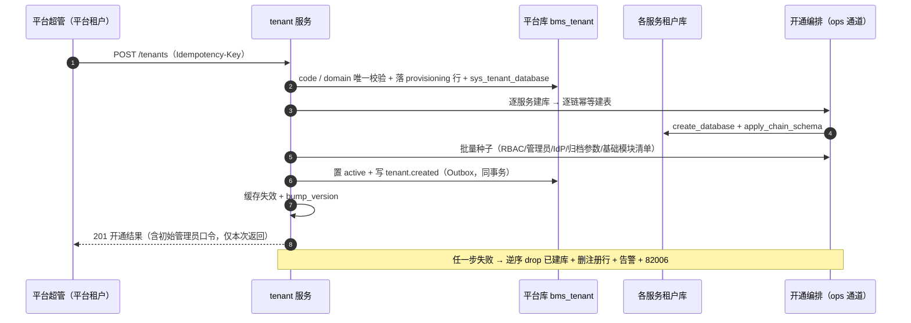
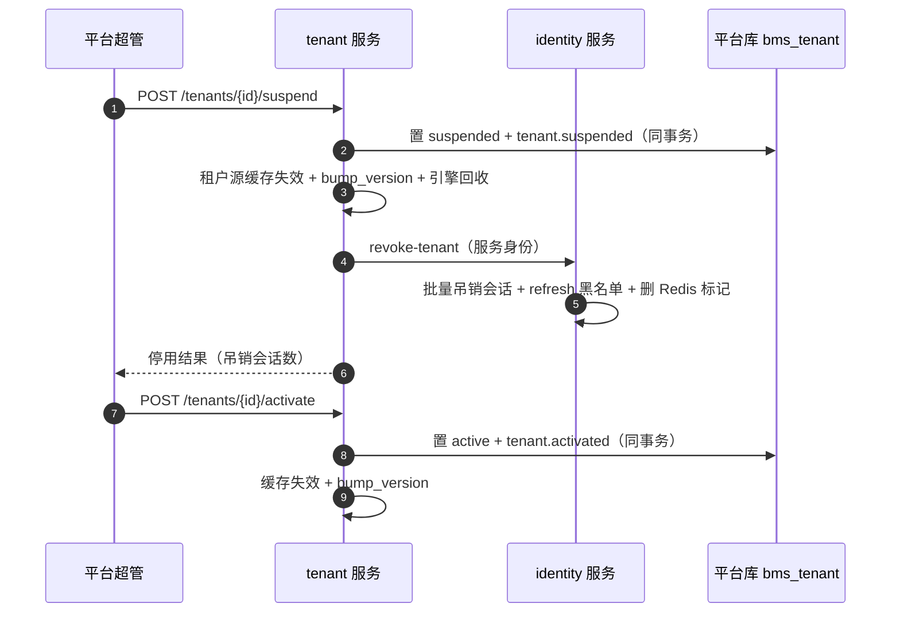
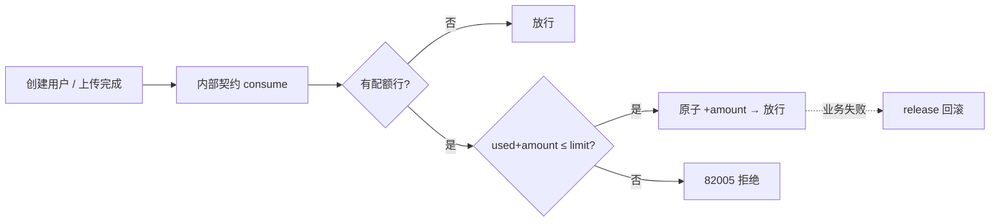
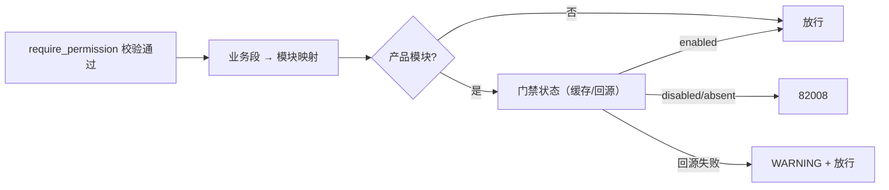

# 01 租户管理与平台超管 详细设计

> RBAC 基础模块 · 04 租户与平台超管 · 子任务 01（需求 07-7）· 状态：**定稿（2026-10-20，共 26 项决策已确认）**

[文档首页](../../../../../../文档首页.md) › [04 租户与平台超管](../../04_租户与平台超管.md) › [01 租户管理与平台超管](../04_租户与平台超管_01_租户管理与平台超管.md) › 详细设计　|　[需求 07-7](../../../../需求/04_需求_租户与平台超管.md#r07-7)　|　[计划](../../../../计划/01_计划_RBAC基础模块.md)

## 1. 背景与目标 <a id="goal"></a>

BMS 为 SaaS 多租户独立库形态（每服务 × 每租户一库）。阶段七此前已交付角色、授权、权限计算与三权分立，但**租户生命周期治理完全缺失**：`sys_tenant` 只有只读注册契约与自助切换，没有开通、停用、域名、配额与模块开关；平台侧也没有可登录的运营账号，`sys_admin` 仅有一行 `PLANNED` 表归属登记。

本任务补齐「平台运营面 + 租户生命周期」整条链：租户开通（建库 + 幂等建表 + 批量种子）、停用/启用（引擎回收 + 会话失效 + 登录拦截）、域名、配额超限拦截、租户模块开通与开关、事件发布，以及可真实登录的平台超管。

**目标**：

1. **租户 CRUD 与开通全流程可用**：同步开通（建库 → 逐服务幂等建表 → 批量种子 → 注册 → 模块清单），支持 `Idempotency-Key`；任一步失败清理已建库并告警。
2. **停用 / 启用即时生效**：引擎回收 + 按租户撤销全部会话 + 登录拦截（租户源非 `active` 即拒）+ 事件。
3. **域名唯一与冲突拒绝**（`82004`）、**配额超限拦截**（`82005`，用户数 + 存储两处真实接线、实时计数）。
4. **租户模块开通与开关**：`sys_tenant_module` 落开通清单（未勾选不开通）；停用后菜单不出现、接口 `82008`、不可新建、存量可查、重开恢复；引用未注册/未启用模块拒绝 `82007`。
5. **平台运营面统一模型**：**默认平台租户**（`sys_tenant.kind = platform`）+ 平台超管角色类型（`role_type = platform_admin`）。平台超管就是平台租户里的 `sys_user`，登录、会话、权限、菜单全走既有租户链路，全系统一套模型。
6. **开通种子完整**：三类内置管理员角色与互斥预授（复用 `BUILTIN_ADMIN_ROLES`）、初始系统管理员账号（随机口令一次性打印 + 首登强制改密）、默认 IdP 占位（`disabled`）、四类审计日志 90 天归档策略（`sys_config`）。
7. **前端租户管理页**：列表 + 记录页签（基本信息 / 配额与模块 / 系统信息），开通向导与模块开关按《原型设计 · 05 租户管理》对齐；登录页增加「平台超管登录」，新增强制改密拦截。
8. **事件与错误码**：`tenant.created/suspended/activated` 经 Outbox 发布；错误码 82001~82008 落地。

**边界（不在本任务）**：

- **租户删除**不提供（原型口径：仅停用，数据保留）。
- **异步开通任务 / 开通进度轮询**不做：本期同步开通（§13 决策 5），后续转异步只换执行器。
- **开放接口调用量配额**（`open_calls`）只落配置与展示，真实拦截随开放接口平台（本仓尚无开放接口服务），登记遗留。
- **批量迁移真库演练**（MySQL / PostgreSQL / 达梦）随部署窗口，本期以用例 + `--dry-run` 验证。
- **平台侧账号管理页**不做：平台租户的账号/角色沿用既有用户管理、角色管理页（平台超管在自有租户内维护），本期只交付引导种子（超管 + 运维只读角色）。
- **模块门禁的产品模块实际接入**：本期交付基座门禁与菜单过滤，`pur/pay/sup/sale/wh/cw` 仍为 `planned`、无运行服务，接线随产品模块交付。

## 2. 现状实测 <a id="status"></a>

| 项 | 实测结论 |
| --- | --- |
| 租户注册 | `bms_tenant/models/tenant.py::SysTenant`：`code/name/domain/status/expire_at`，`domain` **仅普通索引**（`idx_sys_tenant_domain`），`status` 取值仅 `active/suspended`；`db_key` 已废弃 |
| 租户服务端点 | 仅 `tenant-registry`（只读注册快照 / 唯一启用租户）、`/tenants/{mine,switch,brand}`、`/tenant/internal/memberships`；**无管理面端点** |
| 仓储能力 | `TenantRegistryRepository` 已有 `create`（同事务写 `sys_tenant` + `sys_tenant_database`）与 `update_status`，开通雏形就位 |
| 租户源 | `LocalTenantSource`：`by_code/by_domain/by_id` + `single_active`（0→None，≥2→`80004`）+ `invalidate/bump_version`；非 `active` 即 `TenantSuspendedError(80002)` 并强制回收引擎 |
| 引擎回收 | `EngineRegistry.release(db_key)` 只对租户键生效（停用回收现成） |
| 会话失效 | `BaseSessionStore` 只有单会话维度；identity 有 `revoke_user_sessions`（按用户）与内部端点 `/identity/internal/sessions/revoke-user`；**无按租户撤销** |
| 模块目录 | `bms_core/services/module_registry.py::SERVICE_CATALOG`：`sys/identity/tenant/txn` 基础、`file/notification/search/ai/rpt/wf` 能力、`org/pur/pay/sale/wh/sup/cw` 产品；**`pur/pay/sale/wh/sup/cw` 均 `planned`**，仅 `org` 为 `enabled` 产品模块 |
| 租户模块表 | `sys_tenant_module` / `sys_tenant_quota`：`TABLE_OWNERSHIP` 仅 `PLANNED` 登记，无模型 / 无表文件 / 无接口 |
| 平台超管 | `sys_admin` 仅 `PLANNED` 表归属（owner=identity），无模型 / 无表 / 无认证；权限引擎 `TIER_PLATFORM_ADMIN` 仅由 `user_id is None` 产生（内部通道），**不是可登录账号** |
| 平台租户 | 不存在「平台租户」概念；`sys_tenant` 无类型列；`single_active` 会把任意唯一启用租户当兜底 |
| 错误码 | 8 段最大 `80113`，**820xx 空闲**；`OpenTenantError` 段位下已有 `80001~80004` |
| 事件契约 | `tenant.created/suspended/activated` 已在 `platform_events.py` 登记（v2.0.0，载荷 `tenant_id/db_key/status`）并有快照，**全仓无发布点** |
| 幂等基座 | `IdempotencyStore.begin/load/save`（Redis SETNX 语义）已就位，租户自助切换有用法样板；**无 abort/delete** |
| 种子 | `ops/seed_rbac.py` 已固化 `BUILTIN_ADMIN_ROLES`（三权单一来源）与互斥预授；`seed_user` 随机口令一次性打印；`seed_sso` 播 **enabled** Keycloak 行；**归档策略无表无种子** |
| 菜单种子 | `ops/seed_menu.py` 已有业务 `tenant`、权限码 `tenant:query/create/update/quota`、菜单 `/platform/tenants`、3 个按钮、4 个字段；**无 `tenant:manage`** |
| 角色契约 | `RoleCreateRequest` **不透出 `role_type`**（新角色恒 `custom`）→ 租户侧无法自造 `platform_admin` 角色；`RoleType` Literal 仅 `custom/system/security/audit` |
| 权限豁免 | `[permission].options.exempt_role_types` 缺省 `("system",)`（`bms_core/permission/rbac.py:302`）；豁免快照在 `my_menu` 中可见全部菜单、字段全开 |
| 前端 | 无租户管理页；无平台登录入口；`LoginView` 对 `must_change_password` **只提示不拦截**；无自助改密端点；`router/page-route.ts` 用 `formKey` 声明表单页；`tenant` 表单 / 数据源已在清单 |
| 原型 | `设计/原型设计/05_租户管理/`：设计说明 + 列表页 / 开通页 / 模块开关页 / 表单页（4 个可交互页） |
| 开通库/建表基座 | `ops/provision_tenant.py`（按服务×租户建库，幂等）、`ops/init_schema.py` / `bms_core/db/bootstrap.apply_chain_schema`（按链表集幂等建表）、`ops/migrate_tenants.py`（Alembic 批量，脚本目录当前为空） |
| 服务边界 | `check_service_boundaries.py`：服务包之间不得互相 import；`ops/` 为运维通道（可跨服务） |

## 3. 交付物清单 <a id="deliver"></a>

### 3.1 数据库设计

| 表 | 归属库 | 变更 |
| --- | --- | --- |
| `sys_tenant` | 平台服务库 `bms_tenant` | **改**：增 `kind`（`business` / `platform`）；`status` 取值增 `provisioning`；`domain` 索引改 `(domain, deleted_at)` 复合唯一 |
| `sys_tenant_module` | 平台服务库 `bms_tenant` | **新建**（关联表）：`tenant_id` + `module_key` 唯一，`status` / `opened_by` / `opened_at` / `closed_at` |
| `sys_tenant_quota` | 平台服务库 `bms_tenant` | **新建**（明细表）：`tenant_id` + `quota_key` 唯一，`limit_value` / `used_value` |
| `sys_admin` | — | **不采用**：平台超管改为平台租户 `sys_user`；删除表归属登记、总览登记与 `03_02` 边界断言中的该项，需求 07-7 第 7 条与概要 25 回写 |

表文件（`数据库设计/数据表设计/`）：新建 `sys_tenant_module.md`、`sys_tenant_quota.md`；改 `sys_tenant.md`（含变更记录 v6）。新增模块节点 `数据库设计/26_数据库设计_租户管理.md`（总览 §7.2 已列、文件缺失）。

### 3.2 后端

```text
bms/backend/libs/bms_core/src/bms_core/
├── core/error_codes.py                     # 82001~82008
├── core/exceptions.py                      # 8 个租户管理异常（OpenTenantError 段）
├── services/module_registry.py             # TENANT_BASE_MODULE_KEYS / TENANT_OPTIONAL_MODULE_KEYS / module_for_business
├── permission/base.py                      # require_permission 后置模块门禁（82008）
└── tenant_module/                          # 新增能力域（模块门禁）
    ├── __init__.py
    ├── base.py                             # BaseTenantModuleGate / TenantModuleState / get_tenant_module_gate
    ├── null.py                             # 全部放行（占位）
    └── remote.py                           # 经 service_client 调 tenant 内部契约 + 版本缓存 + fail-open
├── core/assembly.py                        # PLUGIN_WIRINGS + register_platform_plugins 登记 tenant_module
├── core/config.py                          # TenantModuleSettings / PlatformTenantSettings / TenantQuotaSettings
└── api/deps.py                             # get_tenant_module_gate 导出

bms/backend/services/tenant/src/bms_tenant/
├── models/tenant.py                        # + kind
├── models/tenant_module.py                 # 新增 SysTenantModule
├── models/tenant_quota.py                  # 新增 SysTenantQuota
├── models/__init__.py                      # MODEL_MODULES 登记两张新表
├── schemas/tenant_admin.py                 # 管理面请求 / 响应契约
├── repositories/tenant_registry.py         # 分页 / 按类型过滤 / 更新 / kind 判定
├── repositories/tenant_module.py           # 模块清单 upsert / 开关 / 按租户取状态
├── repositories/tenant_quota.py            # 配额读写 / 原子占用与释放
├── services/tenant_admin.py                # 列表 / 详情 / 更新 / 停用 / 启用
├── services/provisioning.py                # 开通编排（调 ops 运维通道）+ 失败清理
├── services/tenant_module.py               # 目录校验（platform 快照）+ 开通清单 + 开关
├── services/tenant_quota.py                # 配额默认值 / 校验 / 占用 / 释放
├── services/platform_tenant.py             # 平台租户引导（幂等）
├── api/tenant_admin.py                     # 管理面 10 端点（平台租户身份 + tenant:* 权限码）
├── api/tenant_internal.py                  # 内部契约：模块状态 / 配额 check·consume·release
├── api/router.py                           # 路由登记
└── sources/tenant_source.py                # 非 active 拒绝 / 缓存失效（口径补充）

bms/backend/services/identity/src/bms_identity/
├── api/auth.py                             # + POST /auth/change-password、GET /auth/platform-tenant
├── api/internal_sessions.py                # + POST /identity/internal/sessions/revoke-tenant
├── models/session.py                       # 无结构变更（按租户批量吊销走仓储）
└── services/session.py                     # revoke_all_for_tenant

bms/backend/services/platform/src/bms_platform/
├── models/role.py                          # + ROLE_TYPE_PLATFORM_ADMIN（ROLE_TYPES 追加）
├── schemas/role.py                         # RoleType Literal 追加 platform_admin（响应展示）
├── services/my_menu.py                     # 菜单按租户模块状态过滤
├── services/tenant_quota.py                # 配额消费客户端（用户建 / 删）
├── api/users.py                            # create_user 先占用、失败释放；delete_user 释放
├── api/menu.py                             # my_menu 注入模块门禁
└── main.py                                 # exempt_role_types 追加 platform_admin

bms/backend/services/file/src/bms_file/
└── api/file.py                             # complete_upload 占存储配额（失败释放）

bms/backend/ops/
├── tenant_provisioning.py                  # 开通编排内核（建库 / 建表 / 种子 / 清理；CLI + 服务内调用）
├── seed_platform.py                        # 平台租户 RBAC（platform_admin + platform_ops）+ 初始超管账号
├── bootstrap_platform.py                   # 平台租户引导入口（CLI）
├── seed_menu.py                            # + tenant:manage 权限码与按钮
├── seed_sso.py                             # + status 参数（disabled 占位）
└── seed_rbac.py                            # 不改（复用 BUILTIN_ADMIN_ROLES 与互斥判定）
```

### 3.3 前端

```text
bms/frontend/apps/desktop/src/
├── api/tenantAdmin.ts                      # 租户管理 10 端点（服务键 tenant）
├── api/auth.ts                             # + platformTenantCode / changePassword
├── views/platform/TenantView.vue           # 列表页（原型 02）
├── views/platform/TenantRecordTab.vue      # 记录页（原型 05：基本信息 / 配额与模块 / 系统信息）
├── views/platform/TenantModuleTab.vue      # 记录页签名「租户模块」（原型 04）
├── views/platform/TenantOpenTab.vue        # 新增态记录页（原型 03：基本信息 + 模块勾选）
├── views/ChangePasswordView.vue            # 强制改密页（新增原型 06）
├── views/LoginView.vue                     # + 「平台超管登录」切换
├── router/page-route.ts                    # + formKey=tenant → /platform/tenants
├── router/index.ts                         # + /change-password
├── router/guard.ts                         # 强制改密拦截（must_change_password）
└── stores/session.ts                       # + mustChangePassword 标记与清除
```

### 3.4 文档与原型

- 原型：新增 `设计/原型设计/05_租户管理/06_平台登录与强制改密.html`，并更新 `01_设计说明.html` 界面清单（登录入口 + 强制改密）。
- 需求：`需求/04_需求_租户与平台超管.md` 第 7 条回写（`sys_admin` → 平台租户 + `platform_admin` 角色）。
- 概要：`设计/概要设计/25_概要设计_租户管理.md` §4.1 / §6.1 / §6.3 回写。
- 任务三件套：本目录 `设计/`（本文件）、`实施/01_实施记录_01_租户管理与平台超管.md`、`测试/01_测试记录_01_租户管理与平台超管.md`。

## 4. 数据设计要点 <a id="data"></a>

### 4.1 `sys_tenant` 变更

| 字段 | 类型 | 可空 | 约束 / 默认 | 说明 |
| --- | --- | --- | --- | --- |
| `kind` | VARCHAR(16) | 否 | 默认 `business` | 租户类型（`business` 业务租户 / `platform` 平台租户；平台租户全局唯一一条） |
| `status` | VARCHAR(16) | 否 | 默认 `active` | 状态：`provisioning`（开通中）/ `active`（启用）/ `suspended`（停用） |
| `domain` | VARCHAR(255) | 是 | `uq_sys_tenant_domain_deleted_at (domain, deleted_at)` | 子域名；由普通索引改复合唯一 |

- 平台租户 `code` 取配置 `[platform_tenant].code`（缺省 `platform`），由引导创建，**不经开通向导**。
- 业务租户列表、唯一启用租户兜底、租户切换 / 我的租户**一律排除 `kind = platform`**（`single_active` 按 `kind = business` 过滤）。

### 4.2 `sys_tenant_module`（关联表）

| 字段 | 类型 | 可空 | 约束 / 默认 | 说明 |
| --- | --- | --- | --- | --- |
| `id` | BIGINT | 否 | 主键 | 雪花 ID |
| `tenant_id` | BIGINT | 否 | `uq_sys_tenant_module (tenant_id, module_key, deleted_at)` | 租户主键（同库逻辑外键 → `sys_tenant.id`） |
| `module_key` | VARCHAR(32) | 否 | 同上 | 模块标识（跨库逻辑外键 → `sys_module.code`，只持值） |
| `status` | VARCHAR(16) | 否 | 默认 `enabled` | `enabled` / `disabled` |
| `opened_by` | BIGINT | 是 | — | 开通操作人（平台超管用户 id） |
| `opened_at` | DATETIME | 是 | — | 最近开通时间（UTC） |
| `closed_at` | DATETIME | 是 | — | 最近停用时间（UTC） |
| `created_at` / `created_by` / `updated_at` / `updated_by` / `deleted_at` / `version` | — | — | 公共字段 | 继承 `BaseModel` |

- 关联表口径：**不落 `form_key` / `parent_id`**（《数据库开发规范》§3.1 关联表判定）。
- 语义：基础模块（foundation + capability）开通时自动写 `enabled` 行；产品模块仅勾选才写；`PUT` 开关只切 `enabled/disabled` 并更新 `opened_at` / `closed_at`，**不物理删行**。

### 4.3 `sys_tenant_quota`（明细表）

| 字段 | 类型 | 可空 | 约束 / 默认 | 说明 |
| --- | --- | --- | --- | --- |
| `id` | BIGINT | 否 | 主键 | 雪花 ID |
| `tenant_id` | BIGINT | 否 | `uq_sys_tenant_quota (tenant_id, quota_key, deleted_at)` | 租户主键（同库逻辑外键 → `sys_tenant.id`） |
| `quota_key` | VARCHAR(32) | 否 | 同上 | 配额维度：`user_count` / `storage_bytes` / `open_calls` |
| `limit_value` | BIGINT | 否 | — | 限额（`open_calls` 为日限额） |
| `used_value` | BIGINT | 否 | 默认 0 | 已用量（实时增量；`user_count` 为用户数、`storage_bytes` 为字节、`open_calls` 为当日调用量） |
| `parent_id` | BIGINT | 是 | — | 上级明细 ID（自引用；本表无层级，按明细系统字段口径保留） |
| 公共字段 | — | — | — | 同 `BaseModel` |

- 默认值（`[tenant_quota]`）：`user_count = 500`、`storage_bytes = 107374182400`（100 GiB）、`open_calls = 10000`；开通时按配置播种。
- 无配额行 = 不限制（平台租户不播种配额行）。
- `open_calls` 的日重置随开放接口平台（本期 used 恒 0）；登记遗留。

### 4.4 平台租户与平台 RBAC 种子

| 项 | 内容 |
| --- | --- |
| 平台租户 | `sys_tenant(kind=platform, code=[platform_tenant].code, name=平台管理, status=active)` + `sys_tenant_database(db_basis=platform)` |
| 平台超管角色 | `sys_role(code=platform_admin, role_type=platform_admin, 名称=平台超级管理员)`，受保护（禁删/禁停用/禁改类型） |
| 平台运维角色 | `sys_role(code=platform_ops, role_type=custom, 名称=平台运维员)`，只读：`tenant:query` / `sys:query` / `menu:query` / `business:query` / `action:query` / `permission:query` |
| 初始超管账号 | 平台租户库 `sys_user(username=admin, pwd_reset_required=true)`，随机口令一次性打印；绑定 `platform_admin` |
| 角色类型豁免 | `[permission].options.exempt_role_types = ["system", "platform_admin"]`（`platform_admin` 仅由种子写入，租户侧创建接口不透出 `role_type`，无提权面） |
| 平台菜单 | 平台租户的超管为豁免层级 → `/menus/my` 返回全部菜单；「租户管理」菜单与表单种子已在 `seed_menu.py` |

> 平台超管「全权限放行」通过角色类型豁免实现（与系统管理员同口径），低权限平台角色走正常授权集合；两者都在**平台租户库**内，与业务租户库物理隔离。

### 4.5 达梦差异（登记，不阻断）

- `(x_id, deleted_at)` 复合唯一在达梦将 `NULL` 视为相等 → 第二条未删行冲突；`sys_tenant_module` / `sys_tenant_quota` / `sys_tenant.domain` 沿用现状口径，兜底归信创适配阶段（《数据库开发规范》§4 同口径）。

## 5. 接口设计 <a id="api"></a>

### 5.1 管理面端点（tenant 服务，平台租户身份 + 权限码）

| 方法 | 路径 | 权限码 | 说明 |
| --- | --- | --- | --- |
| GET | `/api/v1/tenants` | `tenant:query` | 业务租户分页（`code` / `name` / `status` 筛选；**不含 `kind=platform`**） |
| GET | `/api/v1/tenants/module-options` | `tenant:query` | 开通向导模块清单（目录快照；`optional` / `status` / 名称 / 表前缀 / 错误码段） |
| GET | `/api/v1/tenants/{tenant_id}` | `tenant:query` | 租户详情（含配额用量与已开通模块摘要） |
| POST | `/api/v1/tenants` | `tenant:create` | 开通（body：`code` / `name` / `domain` / `expire_at` / `modules[]`；`Idempotency-Key` 可选） |
| PUT | `/api/v1/tenants/{tenant_id}` | `tenant:update` | 修改名称 / 域名 / 到期时间（`code` 不可改） |
| POST | `/api/v1/tenants/{tenant_id}/suspend` | `tenant:manage` | 停用（引擎回收 + 按租户撤销会话 + 事件） |
| POST | `/api/v1/tenants/{tenant_id}/activate` | `tenant:manage` | 启用（事件） |
| GET | `/api/v1/tenants/{tenant_id}/quotas` | `tenant:query` | 配额与用量（三项） |
| PUT | `/api/v1/tenants/{tenant_id}/quotas` | `tenant:quota` | 配额配置（`limit_value`；`used_value` 只读） |
| GET | `/api/v1/tenants/{tenant_id}/modules` | `tenant:query` | 模块清单（目录全量 × 开通行 → `enabled` / `disabled` / `not_opened`） |
| PUT | `/api/v1/tenants/{tenant_id}/modules/{module_key}` | `tenant:manage` | 模块开关（body `status`；校验目录 `enabled`，否则 `82007`） |

- **路径顺序**：静态段（`/module-options`、`/mine`、`/switch`、`/brand`）必须先于 `/{tenant_id}` 注册（FastAPI 按声明序匹配）。
- **数据访问**：`sys_tenant*` 一律经 `get_platform_read_db` / `get_platform_uow`（tenant 服务平台库），**不读请求租户库**。
- **权限码口径**：新增 `tenant:manage`（需求 / 概要口径）；保留 `tenant:query/create/update/quota` 供按钮粒度使用（§13 决策 4）。
- **`PUT /tenants/{id}`**：`domain` 冲突 → `82004`；`status != active/provisioning` 时按 `82003` 拒（停用租户只可 activate）。
- **停用前置**：禁止停用平台租户（平台租户只经引导维护）。

### 5.2 内部契约（服务间，`require_service`）

| 方法 | 路径 | 调用方 | 说明 |
| --- | --- | --- | --- |
| GET | `/api/v1/tenant/internal/modules/status` | 各服务（模块门禁） | 入参 `tenant_id`；返回 `{enabled: [...], disabled: [...], version}`（不含未开通模块） |
| POST | `/api/v1/tenant/internal/quotas/check` | platform / file | 入参 `{tenant_id, quota_key, amount}`；超限 `82005`，不写 |
| POST | `/api/v1/tenant/internal/quotas/consume` | platform / file | 原子条件占用（`used_value + amount <= limit_value`），超限 `82005` |
| POST | `/api/v1/tenant/internal/quotas/release` | platform / file | 释放（`max(0, used_value - amount)`） |

- 无配额行 → check/consume 直接放行（平台租户与未配置租户）。
- 会话撤销（identity 服务）：

| 方法 | 路径 | 调用方 | 说明 |
| --- | --- | --- | --- |
| POST | `/api/v1/identity/internal/sessions/revoke-tenant` | tenant | 入参 `{tenant_code}`；按租户库批量吊销未撤销会话（落 `revoked_at` + refresh 黑名单 + 删 Redis 标记），返回吊销数 |

### 5.3 认证新增端点（identity 服务）

| 方法 | 路径 | 鉴权 | 说明 |
| --- | --- | --- | --- |
| GET | `/api/v1/auth/platform-tenant` | 免登录 | 返回 `{code}`（`[platform_tenant].code`），供登录页「平台超管登录」填充租户 |
| POST | `/api/v1/auth/change-password` | `require_auth` | 自助改密：旧口令校验 + 密码策略 + 清 `pwd_reset_required` + 其它会话失效；成功返回 `{changed: true}` |

- 平台超管登录**复用** `POST /api/v1/auth/login`（`tenant = 平台租户编码`），响应同结构（`must_change_password` 已存在）。
- 强制改密：登录响应 `must_change_password=true` → 前端锁路由至 `/change-password`；后端不额外拦截（改密端点自身要求登录态），避免既有令牌全量失效。

### 5.4 错误码与拒绝语义

| 码 | 异常类（`OpenTenantError` 段） | HTTP | 场景 |
| --- | --- | --- | --- |
| 82001 | `TenantCodeExistsError` | 409 | 租户 code 已存在 |
| 82002 | `TenantAdminNotFoundError` | 404 | 租户不存在或已删除（管理面） |
| 82003 | `TenantStateConflictError` | 409 | 状态不允许当前操作（开通中 / 已停用 / 重复开通进行中） |
| 82004 | `TenantDomainConflictError` | 409 | 域名冲突 |
| 82005 | `TenantQuotaExceededError` | 409 | 配额超限（`data` 带 `quota_key` / `limit` / `used`） |
| 82006 | `TenantProvisionFailedError` | 500 | 建库 / 建表 / 种子失败（已清理，需人工介入） |
| 82007 | `TenantModuleUnavailableError` | 400 | 模块未注册 / 未启用（目录校验失败） |
| 82008 | `TenantModuleDisabledError` | 403 | 停用模块的接口 / 入口被拒 |

- 82001~82008 在 `core/error_codes.py` 的 `ErrorCode` 枚举追加；异常类加到 `OpenTenantError` 段位下（`80001~80004` 之后）。
- 「停用租户登录拦截」沿用租户源 `TenantSuspendedError`（`80002` / 403），不新增码。

### 5.5 事件（Outbox）

| 事件 | 触发 | 载荷（契约 v2.0.0） |
| --- | --- | --- |
| `tenant.created` | 开通成功（状态置 `active` 同事务） | `tenant_id`（字符串）/ `db_key`（库名基 `db_basis`）/ `status=active` |
| `tenant.suspended` | 停用成功 | 同上，`status=suspended` |
| `tenant.activated` | 启用成功 | 同上，`status=active` |

- 经 `BaseOutboxStore.enqueue(platform_session, EventEnvelope(...))` 与状态更新**同事务**提交；`aggregate_key = code`。
- `db_key` 字段承载**库名基 `db_basis`**（服务化后跨服务库键由「服务 + 库名基」派生，单一值即库名基），在实施记录登记该语义。

### 5.6 幂等与并发

- `POST /tenants` 读 `Idempotency-Key`：`begin` 失败且已有成功载荷 → **回放首次响应**；已有 `failed` 标记 → 允许重试；**进行中**（无载荷）→ `82003`。
- 失败时 `save(key, {"status": "failed"})`（基座无 delete），成功时 `save(key, 响应载荷)`。
- 并发兜底：`code` 唯一约束（`provisioning` 行先落库）+ `domain` 唯一约束。

### 5.7 模块门禁与菜单过滤

- **判定位置**：`bms_core.permission.base.require_permission` 在权限码校验通过后，取权限码业务段（`code.split(":")[0]`）→ `module_for_business(business)`；命中产品模块则查门禁，`disabled/absent` → `82008`。
- **基础模块**：`TENANT_BASE_MODULE_KEYS`（foundation + capability + `org`）恒放行；`TENANT_OPTIONAL_MODULE_KEYS = {pur, pay, sale, wh, sup, cw}`（与产品目录一致，新增产品模块时同步该清单）。
- **回源与缓存**：`remote.TenantModuleGate` 经 `service_client` 调内部契约，`CacheRegion` 按 `tenant + version` 缓存（TTL 60s，写开关时递增版本键）；**回源失败 fail-open + WARNING**（§13 决策 18）。
- **菜单过滤**：`bms_platform/services/my_menu.py` 对「表单业务码 → 产品模块」命中且门禁非 `enabled` 的菜单剔除（豁免层级仍按全量；平台租户全为基础模块，不受影响）。
- **前端**：菜单不出现 + 按钮权限码缺失即隐藏；后端接口 82008 为最终边界（不做「仅前端拦」）。

### 5.8 平台租户引导（幂等）

1. 读 `[platform_tenant].code`（缺省 `platform`），查 `sys_tenant(code, kind=platform)`；已存在且 `active` → 跳过。
2. 复用开通编排（建库 + 建表 + 基础模块清单），**不播种配额**、**不消费开通幂等键**。
3. 种子：平台 RBAC（`platform_admin` / `platform_ops` + 授权）、初始超管账号（随机口令一次性打印）、默认 IdP 占位、归档策略参数。
4. 触发：tenant 服务启动时执行（`[platform_tenant].auto_bootstrap`，dev/test 默认 true、prod 默认 false）；生产由 `python -m ops.bootstrap_platform` 显式执行。失败仅告警、不阻断启动（登录不可用时由运维重跑）。

## 6. 关键流程 <a id="flow"></a>

### 6.1 开通



### 6.2 停用 / 启用



- 引擎回收在 api 侧经 `app.state.engine_registry.release("tenant_{service}_{db_basis}")` 逐启用服务执行；租户源解析时也会对非 active 再兜底回收。

### 6.3 配额占用（用户 / 文件）



### 6.4 模块门禁



## 7. 前端设计 <a id="frontend"></a>

### 7.1 路由与页面

| 路由 | 页面 | 说明 |
| --- | --- | --- |
| `/platform/tenants` | `TenantView` | 列表（筛选 / 分页 / 双击开记录页签 / 操作列「模块开关」直达模块页签 / 工具栏「开通」） |
| `/change-password` | `ChangePasswordView` | 强制改密（`must_change_password=true` 时守卫只放行本页） |

- `/platform/tenants` 经 `FORM_PAGE_DECLARATIONS` 声明（`formKey: 'tenant'`，`meta.keepAlive`），与角色 / 用户页同构；菜单由 `/menus/my` 下发（平台超管豁免 → 全量菜单，租户管理可见）。
- 记录页签：`record:<id>` / `record:new`（开通）；模块开关为记录页内子页签 `record:<id>:modules`，列表操作列直达。
- 平台登录：登录页增加「平台超管登录」切换——隐藏租户输入、自动 `GET /auth/platform-tenant` 取编码后按普通登录提交；成功后进入 `/platform/tenants`。
- 强制改密：`session.mustChangePassword` 由登录响应写入；`router/guard.ts` 在非改密路由上重定向 `/change-password`；改密成功后清除标记并回跳。

### 7.2 权限码消费

- 工具栏 / 行内按钮按 `session.codes` 判定：`tenant:create`（开通）、`tenant:update`（修改）、`tenant:manage`（停用 / 启用 / 模块开关）、`tenant:quota`（配额保存）。
- 模块开关页按 `tenant:manage` 控制停用 / 重新开通按钮；配额区按 `tenant:quota` 控制编辑。

### 7.3 数据与交互要点

- 列表列：租户 code / 名称 / 域名 / 状态（tag）/ 已开通模块 / 操作（模块开关）；空态「未找到匹配租户」。
- 记录页：基本信息三列（code 锁定 / 名称 / 域名）+ 状态开关（停用确认，写明引擎回收 / 会话失效 / 登录拦截）+ 到期时间；配额三项进度条（用户数 / 存储 / 开放接口调用量）；已开通模块标签 + 模块开关入口。
- 开通页：code / 名称 / 域名必填 + 模块勾选（`module-options` 返回；`planned` 置灰标注「规划中（未交付）」；基础能力恒开通提示）。
- 所有接口经契约类型消费（`@bms/api_types` 生成），不手写结构。

## 8. 原型依据 <a id="prototype"></a>

| 页面 | 原型 | 对照要点 |
| --- | --- | --- |
| 租户列表页 | `设计/原型设计/05_租户管理/02_租户列表页.html` | 筛选一行三条件、工具栏「开通 / 刷新 / 关闭」、表格列与「模块开关」操作列、分页与明细工具栏、空态文案 |
| 租户开通页 | `同目录/03_租户开通页.html` | 三列基本信息、模块勾选（规划中置灰）、基础能力恒开通提示、开通 / 取消 |
| 租户模块开关 | `同目录/04_租户模块开关.html` | 模块列（简称 / 名称 / 表前缀 / 错误码段 / 状态 / 开通时间）、行内停用 / 重新开通、停用影响提示 |
| 租户表单页 | `同目录/05_租户表单页.html` | 只读↔编辑分态（无删除）、code 锁定、状态开关确认、配额进度、已开通模块标签 + 模块开关 |
| 平台登录 + 强制改密 | `同目录/06_平台登录与强制改密.html`（**本任务新增**） | 登录页平台切换、改密表单（旧口令 / 新口令 / 确认）、强制拦截提示 |

> 原型与《布局设计》冲突时以布局设计为准；实施后按《原型审查规范》§4.9 出「原型对照结论」并截图留证。

## 9. 测试设计 <a id="test"></a>

### 9.1 用例与覆盖映射

| 用例文件 | 覆盖点 |
| --- | --- |
| `services/tenant/tests/tenant/test_tenant_admin.py` | 列表分页与筛选、平台租户排除、详情、更新（名称 / 域名 / 到期）、域名冲突 `82004`、code 不可改、状态冲突 `82003` |
| `services/tenant/tests/tenant/test_tenant_provisioning.py` | 开通成功（注册行 + 库名对照 + 基础模块清单 + 种子 + `tenant.created`）、code 重复 `82001`、模块未启用 `82007`、失败清理（建表/种子失败 → 库已清 + 注册行删除 + `82006`）、幂等键回放 / 失败重试 / 进行中 `82003`、`provisioning` 行不可见为业务租户 |
| `services/tenant/tests/tenant/test_tenant_lifecycle.py` | 停用（状态 / 事件 / 引擎回收 / 撤销会话调用）、启用（状态 / 事件）、平台租户禁止停用、停用后租户源 `80002`、缓存失效 |
| `services/tenant/tests/tenant/test_tenant_quota.py` | 三个配额键读写、默认值播种、check/consume/release、超限 `82005`、无配额行放行、原子并发不超限、释放下限 0 |
| `services/tenant/tests/tenant/test_tenant_module.py` | 模块清单（目录 × 行 → 三态）、开关幂等、未注册 `82007`、目录快照不可达降级、基础模块恒开通、内部状态契约（enabled/disabled/version） |
| `services/tenant/tests/tenant/test_platform_tenant.py` | 平台租户引导幂等（已存在跳过）、kind=platform、单启用兜底排除、平台 RBAC 种子（两角色 + 授权 + 超管绑定） |
| `bms_core/tests/tenant_module/test_gate.py` | 门禁：非产品业务放行、基础模块放行、产品模块 enabled 放行、disabled/absent `82008`、回源失败 fail-open + WARNING、缓存命中与版本失效 |
| `bms_core/tests/permission/test_require_module_gate.py` | `require_permission` 集成：命中模块停用 `82008`、权限码不通过先 `30001`（顺序）、平台租户请求不受影响 |
| `services/platform/tests/menu/test_my_menu_module_filter.py` | 菜单过滤：产品模块停用菜单剔除、基础模块保留、豁免层级全量 |
| `services/platform/tests/users/test_user_quota.py` | 创建用户先占用、创建失败释放、删除释放、超限 `82005` |
| `services/file/tests/test_upload_quota.py` | 完成上传占存储、失败释放、超限 `82005` |
| `services/identity/tests/api/test_change_password.py` | 自助改密：旧口令错拒绝、策略违规拒绝、成功清标记、其它会话失效 |
| `services/identity/tests/api/test_revoke_tenant.py` | 按租户批量吊销：仅本租户、已撤销跳过、返回计数、非 identity 服务身份拒 |
| `services/identity/tests/api/test_platform_tenant_code.py` | 平台租户编码端点免登录、返回配置值 |
| `services/platform/tests/boundary/test_separation_guard.py`（改） | `sys_admin` 断言移除；改为「平台租户 + `platform_admin` 角色」边界：`platform_admin` 仅由种子写入、平台租户 `kind=platform` 唯一、平台超管不在业务租户列表 |
| `scripts/tools/base_check/check_base.py` / `check_system_fields.py` | 新表文件与总览登记一致、`sys_admin` 移除后无悬挂登记 |
| 前端 `apps/desktop/tests/tenant-*.spec.ts` | 列表 / 记录 / 开通 / 模块开关 / 配额编辑 / 权限码显隐 / 登录页平台切换 / 强制改密拦截 |
| 前端 `apps/desktop/tests/page-route-declaration.spec.ts`（既有） | 自动覆盖租户页声明可解析 |
| 前端 `packages/ui_ep` | 无新增组件（复用 `DictRecordLayout` / `FormFrame` / `SysInfoPanel`） |

**覆盖率**：新增 / 变更模块（`bms_core/tenant_module/*`、`bms_core/permission/base.py`、`bms_core/services/module_registry.py`、`core/error_codes.py`、`core/exceptions.py`、tenant 服务全部新增文件、identity 改密与撤销、platform 配额与菜单过滤、file 配额）行 + 分支 **100%**，本地跑满再推送（口径见《AI开发规范》「覆盖率要求」）。

**门禁**：

- 后端：`pytest`（定向）、`ruff check .`、`ruff format --check .`、`pyright`。
- 基座：`check_base.py`、`check_system_fields.py`（含 `--self-test`）、`check_backend_base.py`、`check_service_boundaries.py`、`ops.check_tables --offline`、`ops.contract_snapshot check`、`ops.event_contracts check`。
- 前端：`pnpm run api_types:gen:check`、`core:check` / `ui_ep:check`、宿主 `test:cov`（四项 100%）、`lint`、`build`（类型）。
- 预检：`scripts/tools/preflight/check_preflight.py`（缺省定向档）。

### 9.2 Kiwi 用例登记

先登记后编码：本任务**一条**策展用例（分类「平台骨架」、优先级 P2、状态 `CONFIRMED`、标签「自动化」），文本列覆盖范围与自动化文件路径；登记落 `test/scripts/kiwi/cases/2026-10-20_阶段七04-01_租户管理与平台超管.json`，回读编号后回填代码 `kiwi_id` 与测试记录 §1。

## 10. 登记落点 <a id="register"></a>

| 落点 | 内容 |
| --- | --- |
| 错误码 | `core/error_codes.py` 追加 82001~82008；异常类入 `OpenTenantError` 段 |
| 数据库设计 | `sys_tenant.md`（v6）、`sys_tenant_module.md`、`sys_tenant_quota.md`；`26_数据库设计_租户管理.md` 新建；总览「核心表清单」与「已设计数据表登记」同步（含移除 `sys_admin`） |
| 表归属 | `TABLE_OWNERSHIP`：`sys_tenant_module` / `sys_tenant_quota` 转 `ENABLED`；移除 `sys_admin`；`sys_tenant` 无归属变化 |
| 模块目录 | `TENANT_BASE_MODULE_KEYS` / `TENANT_OPTIONAL_MODULE_KEYS` / `module_for_business` 单一来源 |
| 种子 | `seed_menu.py` 增 `tenant:manage` + 按钮；`seed_sso.py` 增 `status` 参数；`seed_platform.py` 平台 RBAC；`ops/bootstrap_platform.py` 引导入口 |
| 配置 | `config.toml` 新增 `[tenant_module]` / `[platform_tenant]` / `[tenant_quota]`；`[permission].options.exempt_role_types` 追加 `platform_admin` |
| 契约 | `deploy/contracts/{tenant,identity,platform}.json` 重导出 + `api-types` 重生成（零漂移） |
| 事件 | 无契约变更（三事件已登记）；发布点新增于开通 / 停用 / 启用 |
| 计划 | **唯一进度落点**：`04_01` 行状态 / 完成日期 / 偏差遗留；阶段门禁表「配额超限拦截」「租户模块开关」「三权互斥（`04_01` 侧）」填结论 |
| 需求 | 07-7 第 7 条回写（平台超管 → 平台租户 + `platform_admin`）；完成情况标注 |
| 概要设计 | 25 §4.1 表清单（去掉 `sys_admin`）、§6.1 权限码（`tenant:manage`）、§6.3 种子（平台租户） |
| 任务 | 本任务文档完成标准核对；父任务子任务状态 |
| 三件套 | `设计/`（本文件）、`实施/01_实施记录_01_租户管理与平台超管.md`、`测试/01_测试记录_01_租户管理与平台超管.md` |

## 11. 实施步骤 <a id="steps"></a>

1. **数据库先行**：表文件（`sys_tenant` 变更 + 两新表 + 模块节点）→ 总览登记 → 模型 → 表归属 `ENABLED` → `ops.seed_tables`。
2. **基座**：错误码 / 异常 → 模块清单单一来源 → `tenant_module` 能力域（base/null/remote + 装配）→ `require_permission` 门禁 → `deps` 导出。
3. **tenant 服务**：模型 / 仓储 / 服务 / 管理面端点 / 内部契约；开通编排（`ops/tenant_provisioning.py`）与失败清理；事件 Outbox。
4. **identity 服务**：按租户撤销会话内部端点；自助改密；平台租户编码端点。
5. **platform 服务**：`platform_admin` 角色类型 + 豁免配置；菜单过滤；用户配额接线。
6. **file 服务**：存储配额接线。
7. **种子与引导**：`seed_menu`（manage + 按钮）、`seed_sso`（status）、`seed_platform`（平台 RBAC + 超管）、`bootstrap_platform` + 启动引导开关。
8. **契约**：`contract_snapshot export` → `api_types:gen` → `check`。
9. **前端**：api 层 → 列表 / 记录 / 开通 / 模块开关 → 登录页平台切换 + 强制改密页与守卫 → 测试。
10. **原型**：新增 06 原型并更新设计说明（先原型后界面）。
11. **Kiwi**：先登记取得编号，再编码测试并回填 `kiwi_id`。
12. **验证**：按 §9.1 门禁全绿；覆盖率 100%。
13. **回写与记录**：按 §10 回写计划 / 需求 / 概要 / 任务，产出实施与测试记录。
14. **提交**：`docs`（设计 / 原型 / 回写）与 `feat`（代码 / 种子）分开提交。

## 12. 边界与开放项 <a id="open"></a>

| # | 事项 | 归口 |
| --- | --- | --- |
| 1 | 开放接口调用量配额真实拦截（`open_calls`）与日重置 | 开放接口 / Webhook 平台（未进项目阶段） |
| 2 | 三库（MySQL / PostgreSQL / 达梦）真库建库 / 批量迁移演练 | 部署窗口 / CI 集成档 |
| 3 | 开通编排在服务进程内经 `ops` 运维通道执行（服务不静态依赖他服务包） | 演进为独立开通任务 / 各服务自建库端点，本次登记 |
| 4 | 配额消费跨服务无分布式事务（消费先行、失败释放） | 极端并发下可能短暂少计/多计；随 `02_02` 的 TM + XA 编排模式演进 |
| 5 | 归档策略以 `sys_config` 键值承载（四类审计日志 90 天） | 审计合规模块建表后迁移为策略表 |
| 6 | 平台侧账号 / 角色管理页沿用租户侧既有页面（平台租户内）；平台专属运营页 | 后续平台运营任务 |
| 7 | `platform_admin` 角色类型的租户侧防伪 | 已由「创建接口不透出 role_type」保证；若后续开放类型设置须补校验 |
| 8 | `db_key` 事件字段语义改为库名基 | 实施记录登记；契约字段名不变 |
| 9 | 达梦复合唯一 NULL 语义差异 | 信创适配阶段 |
| 10 | 租户开通/停用审计落库（`AuditCapturer` 已接、Null 实现） | 审计合规模块 |

## 13. 决策确认 <a id="decide"></a>

| # | 事项 | 结论 |
| --- | --- | --- |
| 1 | 平台超管身份载体 | **平台租户 + 角色类型**：默认平台租户（`sys_tenant.kind=platform`）承载平台账号 / 角色 / 会话，`role_type=platform_admin` 为平台超管类型；不新建 `sys_admin` / 独立会话表 |
| 2 | `sys_admin` 表 | 不采用；删除表归属登记、总览登记与 `03_02` 边界断言中的该项，回写需求 07-7 / 概要 25 |
| 3 | 平台租户创建 | `code` 取 `[platform_tenant].code`（缺省 `platform`）；首次启动幂等引导（dev/test 默认开），生产用 `ops.bootstrap_platform` |
| 4 | 权限码口径 | 新增 `tenant:manage`（需求 / 概要口径）；保留 `query/create/update/quota` 供按钮粒度 |
| 5 | 开通模式 | 同步 + `Idempotency-Key` |
| 6 | 开通状态与失败 | `provisioning` 行先落 → `active`；失败清理已建库 + 删注册行 + 告警 + `82006` |
| 7 | 建库 / 建表 | 复用 `ops.provision_tenant` 建库内核 + `apply_chain_schema` 幂等建表（Alembic 脚本目录为空，机制保留） |
| 8 | 按租户会话失效 | identity 新增 `revoke-tenant` 内部端点（落库吊销 + 黑名单 + 删 Redis） |
| 9 | 模块门禁 | `require_permission` 自动按「权限码业务段 → 模块」判定 + 菜单过滤 |
| 10 | 模块校验取数 | platform `GET /modules/snapshot`（服务身份）+ 本地缓存 |
| 11 | 配额接线 | 用户创建 / 删除 + 文件上传完成两处；开放接口留遗留 |
| 12 | 用量计数 | 实时增量（原子条件更新） |
| 13 | 归档策略 | `sys_config` 键值 + 遗留 |
| 14 | 初始管理员口令 | 随机生成、一次性打印、首登强制改密 |
| 15 | 默认 IdP | `disabled` 占位（`seed_sso --status disabled`） |
| 16 | 前端形态 | 列表 + 记录页签（基本信息 / 配额与模块 / 系统信息） |
| 17 | 独立库隔离验证 | 用例 + 批量迁移 `--dry-run`；真库演练留部署窗口 |
| 18 | 门禁回源失败 | fail-open + WARNING |
| 19 | 平台登录入口 | 登录页「平台超管登录」切换（复用 `/auth/login`，租户取平台租户编码） |
| 20 | 强制改密 | 新增 `POST /auth/change-password` + 前端守卫拦截 |
| 21 | 平台内置角色 | `platform_admin`（豁免全权限）+ `platform_ops`（只读运维）+ 初始超管绑定超管角色 |
| 22 | 平台租户可见性 | 业务租户列表 / 唯一启用兜底 / 租户切换均排除 |
| 23 | 域名唯一 | `sys_tenant.domain` 补 `(domain, deleted_at)` 复合唯一 |
| 24 | `sys_tenant.kind` | `business`（缺省）/ `platform` |
| 25 | 平台租户登录链路 | 复用普通登录（租户编码由公共端点提供），会话 / 令牌 / 权限 / 菜单全同构 |
| 26 | 服务实现边界 | 开通编排落 `ops/tenant_provisioning.py`，tenant 服务经运维通道调用（登记开放项 3） |

## 14. 对齐记录 <a id="align"></a>

| # | 事项 | 结论 |
| --- | --- | --- |
| — | 实施期偏差登记 | 随实施记录回写 |

> 本文档依《[文档生成规范](../../../../../../规范/文档生成规范.md)》与《[AI开发规范](../../../../../../规范/AI开发规范.md)》编写 · 关键决策逐项确认
