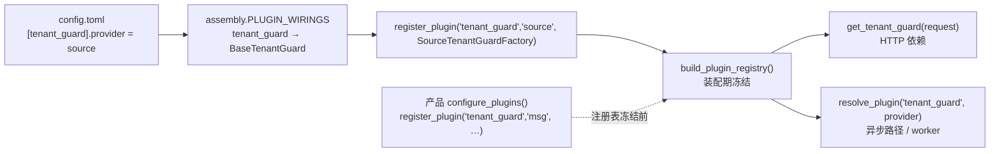

# 租户可用性基类详细设计（三入口一套判定 + 产品继承扩展）

> RBAC 基础模块 · 04 租户与平台超管 · 02 租户可用性基类 · 详细设计

[文档首页](../../../../../../文档首页.md) › [RBAC 基础模块](../../../../README.md) › [04 租户与平台超管](../../04_租户与平台超管.md) › [02 租户可用性基类](../04_租户与平台超管_02_租户可用性基类.md) › 详细设计　|　[需求 07-7](../../../../需求/04_需求_租户与平台超管.md#r07-7) · [阶段计划](../../../../计划/01_计划_RBAC基础模块.md) · [基类实现契约](../../../../../../设计/基类体系/后端基类实现契约.md)

## 1. 概述 <a id="overview"></a>

- **目标**：把「停用租户只拦 HTTP / RPC」补成**三种入口一套判定**——HTTP 沿用中间件，异步消费 / 任务循环与批处理前置经本基类，三条路径得出**同一个结论、同一套错误码**，不再出现「HTTP 403、异步静默继续」。

  1. **基类**：`BaseTenantGuard`（能力域 `tenant_guard`，`BasePluggable` 端口）——单原语 `require` 完成「解析 → 状态判定 → 扩展校验」，另给 `batch`（批处理进入时校验一次）与 `per_round`（异步循环每轮校验）两个语义入口，判定逻辑**只有一份**；`require_sync` 供同步执行体（`BaseTask.run` 形态）使用，检测到运行中事件循环即显式报错。
  2. **默认实现**：`SourceTenantGuard` 复用既有 `TenantLookup`（`by_id` / `by_code` / `by_domain`）——即 `RemoteTenantSource` / `LocalTenantSource`，其全局版本戳 `bms:global:tenant:version` 已保证停用**即时生效**，**不新建缓存、不新建状态判断**。
  3. **空实现**：`NullTenantGuard` **调用即 `ConfigError`**（fail-closed），杜绝「provider 未配置 / 写错 → 异步路径全放行」；`[tenant_guard].provider` 缺省 `source`，开箱可用。
  4. **扩展点**：模板方法 `verify(context)`（缺省空实现），产品子类覆写即可补自有规则（msg 补命名空间校验），**不改基类代码**。
  5. **分支语义与 HTTP 一致**：未知租户 `80001` / 404、已停用 `80002` / 403、租户源不可达 `10007` / 503（fail-closed，不提供 `fail_open` 开关）。

- **依据**：任务 [04-02](../04_租户与平台超管_02_租户可用性基类.md) 第 2、3 节；需求 [07-7](../../../../需求/04_需求_租户与平台超管.md#r07-7) 第 3 条；《[架构设计 · 多租户路由](../../../../../../设计/架构设计/12_架构设计_子系统_多租户路由.md)》§2 / §4；《[后端基类实现契约](../../../../../../设计/基类体系/后端基类实现契约.md)》§4 / §6；msg 侧 `msg/msg文档/设计/架构设计/07_架构设计_多租户与安全.md` §4.2、`msg/msg文档/项目/08B_消息平台/任务/01_消息模型与投递/01_消息模型与投递_01_主题与分区模型/01_消息模型与投递_01_主题与分区模型_01_租户接入/设计/01_详细设计_01_租户接入.md` §3.2（跨仓纯文本路径，不写相对链接）。
- **范围**：基座 `bms_core/tenant/guard.py`（新建）、`bms_core/tenant/null.py`（补空实现）、`core/config.py`（`[tenant_guard]` 段）、`core/assembly.py`（接线 + 工厂登记）、`api/deps.py`（依赖出口）；产品侧 msg `bms_msg/tenant_guard.py`（继承示例）+ 单测；四份基类文档登记 + msg 两层文档回写。
- **不含（归口见 §9）**：bms 自身 `jobs` worker / 事件消费组 / 任务调度运行时的接线（改运行期行为、需先定「停用后作业如何处置」，另立任务）；msg 消费循环本体（8B_01_01 租户接入）；前端与任何界面；新增错误码段。

## 2. 现状与差距（设计 vs 代码对账） <a id="gap"></a>

> 动手前逐项对账，结论均来自本次实测（`rg` + 读实现）。

| # | 关注点 | 要求 | 代码现状 | 处置 |
| --- | --- | --- | --- | --- |
| 1 | 停用校验覆盖面 | 异步路径也拦 | 仅 `TenantMiddleware`（HTTP）与 `RemoteTenantSource` 解析时抛；`jobs/` `events/` `tasks/` **零校验**（`rg tenant_source` 仅命中 `jobs/keys.py` 的常量引用） | **本段建**：守卫基类 + 默认实现，异步路径有统一入口 |
| 2 | 取数来源 | 复用租户源、不建第二套缓存 | `TenantLookup` 四方法全异步；`RemoteTenantSource` 已带版本键 + 快照缓存（TTL `[tenant].resolve_cache_ttl`） | **本段做**：守卫只封装取数 + 判定，不持缓存 |
| 3 | 状态判定位置 | 与 HTTP 同源 | 状态判定在租户源内部（`status != active` 抛 `TenantSuspendedError`，并回收引擎） | **本段复用**：守卫不重复判定状态字段 |
| 4 | 错误码 | 与 HTTP 一致 | `80001` / `80002` / `10007` 已就绪 | **本段复用**：不新增码段 |
| 5 | 插件体系 | 横切能力须登记 | `PLUGIN_WIRINGS` 已有 `tenant_module` 先例（`assembly.py:359` / `:461`） | **本段登记**：`tenant_guard` 一条 wiring + `source` 工厂 |
| 6 | 空实现语义 | 不得静默放行 | `NullTenantModuleGate` 恒 `enabled`（fail-open，仅适合模块拦截）；`NullUserTokenIssuer` 为 fail-closed 先例 | **本段对齐后者**：`NullTenantGuard` 调用即 `ConfigError` |
| 7 | 产品扩展通道 | 产品继承且不改基座 | `configure_plugins(app, settings)` 钩子已存在（注册表冻结前唯一登记点，且可置分区缺省 provider） | **本段用**：msg 在此登记 `msg` 实现 |
| 8 | 配置段 | 能力可配置 | 无 `[tenant_guard]` | **本段建**：`TenantGuardSettings`（缺省 `provider = "source"`） |
| 9 | 基类登记 | 清单 / 契约 / 台账 / 说明四处 | 均无 `tenant_guard` | **本段回写**：§7 登记落点 |
| 10 | 用例编号 | 先取号再编码 | 阶段七最近用号 2404 | **本段首步**：Kiwi 容器内登记取号 |

## 3. 交付物清单 <a id="deliver"></a>

```text
bms/backend/
├── config.toml                                          # 改：[tenant_guard] 段（provider = "source"）
├── libs/bms_core/src/bms_core/
│   ├── core/config.py                                   # 改：TenantGuardSettings + Settings.tenant_guard
│   ├── core/assembly.py                                 # 改：PLUGIN_WIRINGS 增 tenant_guard；登记 source 工厂
│   ├── tenant/guard.py                                  # 新建：TenantTarget / BaseTenantGuard / SourceTenantGuard / 工厂 / get_tenant_guard
│   ├── tenant/null.py                                   # 改：NullTenantGuard（调用即 ConfigError）
│   └── api/deps.py                                      # 改：导出 get_tenant_guard / TenantTarget
├── libs/bms_core/tests/tenant/test_guard.py             # 新建：三入口 / 同步入口 / 三分支 / 钩子 / 空实现
└── (文档) bms文档/…四份基类文档 + 计划表                  # 回写：§7

msg/backend/
├── services/msg/src/bms_msg/tenant_guard.py             # 新建：MsgTenantGuard（覆写 verify 补命名空间校验）+ 工厂
├── services/msg/src/bms_msg/main.py                     # 改：configure_plugins 登记 msg 实现
├── services/msg/tests/test_tenant_guard.py              # 新建：继承示例可运行
└── config.toml                                          # 改：[tenant_guard].provider = "msg"（与钩子缺省同值）
```

## 4. 契约设计 <a id="contract"></a>

### 4.1 `TenantTarget`（值对象） <a id="target"></a>

| 项 | 口径 |
| --- | --- |
| 载荷 | `tenant_id: str \| None`（雪花 id 十进制串）/ `code: str \| None`（租户编码）/ `domain: str \| None`（子域名） |
| 不变式 | 三者**恰好一个**非空（`ParamError` 10001）；形态校验复用 `db/tenant.py` 的 `is_tenant_id` / `is_tenant_code` / `is_tenant_domain`（形态非法即 `ParamError`，不送租户源） |
| 体系归属 | `BaseValueObject`（`@dataclass(frozen=True)`），与 `TenantContext` 同域 |
| 工厂 | `TenantTarget.from_context(context: TenantContext)`：由完整上下文派生（`tenant_id` 优先，缺失回落 `code`），供「未显式传参」路径复用 |

> 形态先于取数：与解析链（06_04）同一纪律——非法取值等同参数错误，不派生出库键、不冒泡 5xx。

### 4.2 `BaseTenantGuard`（端口 + 模板方法） <a id="base"></a>

```text
BaseTenantGuard(BasePluggable)
├── key / plugin_key = "tenant_guard"；plugin_name = null；contract_version = DEFAULT_CONTRACT_VERSION
├── async require(target=None, *, scope=None) -> TenantContext    # 单原语：解析 → 状态 → verify
├── async per_round(target=None, *, scope=None) -> TenantContext  # 异步循环每轮（语义入口，复用 require）
├── async with batch(target=None, *, scope=None) -> TenantContext # 批处理：进入校验一次，批内复用上下文
├── require_sync(target=None, *, scope=None) -> TenantContext     # 同步包装（无运行循环时 asyncio.run）
├── verify(context, scope=None) -> None                           # 扩展钩子（缺省空实现，产品覆写）
└── abstract async resolve(target: TenantTarget) -> TenantContext  # 唯一取数判定点
```

| 方法 | 语义 | 失败分支 |
| --- | --- | --- |
| `require` | 一次校验并回到 `TenantContext`；`target=None` 时取**完整**请求上下文（`get_tenant_context()`；无主键的演示兜底一律拒，避免「校验了演示租户」的假通过） | 见 §4.6 三分支 + `ConfigError`（无 target 且无上下文） |
| `per_round` | 循环守卫每轮调用；与 `require` 同判定，独立命名使「每轮重新校验」在调用点可读、可检索 | 同上 |
| `batch` | 异步上下文管理器：进入时校验一次并 `yield` 上下文，批内**不再重复回源**（一批一次，符合任务第 3 条） | 进入阶段同上 |
| `require_sync` | 同步执行体入口；`asyncio.run` 承载异步判定 | 已在运行的事件循环 → `ConfigError`（明确提示改用 `await require(...)`），不降级、不放行 |
| `scope` | 业务范围标识（产品自定义语义，如消息平台的命名空间）：四个入口原样转交 `verify`，**基座不解释**（`None` 表示调用方未指定） | — |
| `verify` | 产品扩展点；抛出的业务异常原样冒泡（基类不吞、不转换） | 由产品定义 |

### 4.3 `SourceTenantGuard`（默认实现） <a id="source-impl"></a>

| 项 | 口径 |
| --- | --- |
| 依赖 | `source_provider: Callable[[], TenantLookup]`（**惰性取**，装配期注入 `lambda: app.state.tenant_source`）——避免工厂捕获旧应用实例（与 `RemoteTenantModuleGateFactory` 同一条纪律） |
| `resolve` | `tenant_id` → `by_id`；`code` → `by_code`；`domain` → `by_domain`（三者互斥，由 `TenantTarget` 保证） |
| 状态 | 不在本层判 `status`：租户源已按注册状态抛 `TenantSuspendedError` 并回收引擎——**单一判定点**，本层不复制 |
| 观测 | 命中停用 / 未知时打结构化 `WARNING`（`tenant_guard_blocked` / `tenant_guard_unknown`，带 `tenant` / `mode`），供审计与告警聚合（msg《多租户与安全》§9 要求「停用租户访问」留痕） |
| 缓存 | 无；租户源的快照缓存与版本键即唯一缓存 |

### 4.4 `NullTenantGuard`（空实现，fail-closed） <a id="null-impl"></a>

- 继承 `BaseTenantGuard` + `BaseNullObject`；`resolve` 直接抛 `ConfigError`（「租户可用性守卫未启用（provider 为空或未配置），请设置 `[tenant_guard].provider = "source"`」）。
- 理由：`assembly.py:1831` 对每条 wiring 无条件解析 `provider or null`，空实现**必然存在**；若照抄 `tenant_module` 的恒放行，则「配置写错 = 异步路径全放行」，正好是本任务要堵的洞。

### 4.5 装配与取用 <a id="wire"></a>



| 落点 | 改动 |
| --- | --- |
| `core/config.py` | `TenantGuardSettings(PluginSelection)`：`provider: str = "source"`；`Settings.tenant_guard` 字段 |
| `core/assembly.py` | `PLUGIN_WIRINGS` 增 `PluginWiring("tenant_guard", BaseTenantGuard, "tenant_guard", "tenant_guard")`；`register_platform_plugins` 增 `register_plugin("tenant_guard", "source", SourceTenantGuardFactory(settings, app))` |
| `tenant/guard.py` | `SourceTenantGuardFactory(BasePluginFactory[SourceTenantGuard])`（持 `settings` + `app`，`create()` 注入惰性 source 提供者） |
| `api/deps.py` | `get_tenant_guard(request)`（`resolve_plugin` + 契约版本校验，与 `get_tenant_module_gate` 同构）；导出 `BaseTenantGuard` / `TenantTarget` |

## 5. 三种使用形态 <a id="usage"></a>

| 形态 | 入口 | 判定时机 | 落地 |
| --- | --- | --- | --- |
| HTTP / RPC | `TenantMiddleware`（**不变**） | 请求进入即判 | 现有实现，本段不改 |
| 异步循环守卫 | `per_round`（每次循环调一次） | 每轮重新校验（版本键即时生效） | 消费 / 任务循环入口 |
| 批处理前置检查 | `batch`（进入一次） | 整批开头一次、批内复用 | 批量导入 / 批量迁移 / 重放 |

```python
# 形态二：消息消费循环（msg 侧，示意；消费本体归 8B_01_01）
while not stopping:
    await guard.per_round(TenantTarget(tenant_id=envelope.tenant_id), scope=envelope.namespace)
    await consume_batch()

# 形态三：批处理
async with guard.batch(TenantTarget(code="acme")) as tenant:
    await process_all(tenant)
```

**产品扩展（msg 示例）**：`MsgTenantGuard(SourceTenantGuard)` 覆写 `verify(context, scope)`——`scope` 即消费入口传来的 `namespace`，须属服务目录**已登记且启用**的 `module_key`（`service_catalog_view()` + `ModuleStatus.ENABLED` 口径），违者抛参数错误；`verify` 之外不改基类任一行为，改名空间校验口径只需改子类。登记方式：msg `ApplicationFactory.configure_plugins()` 内 `register_plugin("tenant_guard", "msg", MsgTenantGuardFactory(app))`，并在钩子里把 `settings.tenant_guard.provider` 缺省置 `msg`（产品配置可显式覆盖）。

## 6. 测试设计 <a id="test"></a>

| 层 | 文件 | 用例 |
| --- | --- | --- |
| 值对象 | `libs/bms_core/tests/tenant/test_guard.py` | 三选一互斥（零个 / 两个 → `ParamError`）；形态非法（`tenant_id` 非数字、`code` 带连字符、`domain` 单段）→ `ParamError`；`from_context` 主键优先、缺主键回落编码、两者皆无 → `ParamError` |
| 三入口 | 同上 | `require` 按 `tenant_id` / `code` / `domain` 分别命中正确方法；`per_round` 与 `require` 结论一致；`batch` 进入校验一次、批内**不再回源**（源调用计数 = 1）；`batch` 内抛错向外冒泡 |
| 同步入口 | 同上 | 无运行循环 → 正常返回；运行中循环内调用 → `ConfigError` |
| 分支语义 | 同上 | 未知 → `TenantNotFoundError`（404 / 80001）；停用 → `TenantSuspendedError`（403 / 80002）；源不可达 → `ServiceUnavailableError`（503 / 10007），三者 `http_status` 与 `code` 逐一断言 |
| 上下文兜底 | 同上 | `target=None` + 完整上下文 → 用上下文主键；`target=None` + 无上下文 → `ConfigError`；`target=None` + 演示兜底（`tenant_id=None`）→ `ConfigError` |
| 扩展点 | 同上 | `verify` 缺省不拦；子类覆写抛错原样冒泡；`verify` 在 `resolve` 之后、返回之前调用（顺序断言）；`scope` 经 `require` / `per_round` / `batch` / `require_sync` 四入口原样转交 |
| 空实现 | 同上 | `NullTenantGuard.resolve` / `require` → `ConfigError`；`plugin_name == "null"` |
| 装配 | 同上 | `PLUGIN_WIRINGS` 含 `tenant_guard` 且 `port is BaseTenantGuard`、`settings_section == "tenant_guard"`、`state_attr == "tenant_guard"`；`get_tenant_guard` 在 `provider="source"` 下返回 `SourceTenantGuard`、在 `provider="null"` 下返回 `NullTenantGuard`；未登记实现名 → `PluginError` |
| 产品示例 | `msg/backend/services/msg/tests/test_tenant_guard.py` | 子类可实例化、`verify` 命中与不命中两分支、未改基类（基类 `require` 仍按 `resolve` 判定）、`configure_plugins` 登记后 `provider` 缺省为 `msg` |

- **覆盖率**：变更模块行 + 分支 100%（口径见《[AI开发规范](../../../../../../规范/AI开发规范.md)「覆盖率要求」节）；`bms_core/tenant/guard.py` / `tenant/null.py` 全量，`core/config.py` / `core/assembly.py` / `api/deps.py` 判改动行（提交环）与模块级（推送环）。
- **Kiwi**：一条用例覆盖上表全部条目（一条任务一条用例，多条断言共用编号），代码以 `@pytest.mark.kiwi_id(<编号>)` 标注。
- **验收映射**：完成标准 1 ↔ 形态二 / 三用例；2 ↔ 「无缓存」实现（代码检索 + 源调用计数）；3 ↔ msg 示例用例；4 ↔ 分支语义用例；5 ↔ §7 登记落点 + 文档同步。

## 7. 登记落点 <a id="register"></a>

| 文档 | 改动 |
| --- | --- |
| 《[后端基类清单](../../../../../../后端基类清单.md)》 | §8「数据访问与多租户基座」增 `BaseTenantGuard` 行；§9「跨阶段基座与能力域横切」增 `tenant_guard` 代码位置行；§2 分层总览「多租户」行补守卫 |
| 《[后端基类实现契约](../../../../../../设计/基类体系/后端基类实现契约.md)》 | §4 增「租户可用性守卫」行；§6 增能力域横切条目（`BaseTenantGuard` / 默认实现 / 空实现 / 工厂 / 依赖出口 / 配置节） |
| 《[后端基类治理台账](../../../../../../设计/基类体系/后端基类治理台账.md)》 | §3 跨阶段基座 ↔ 需求号对照补「租户可用性 `07-7`」 |
| 《[后端基类体系说明](../../../../../../设计/基类体系/后端基类体系说明.md)》 | §6「扩展与演进」增「租户可用性守卫」作为横切基类示例（插层位置说明） |
| 《[计划 · RBAC 基础模块](../../../../计划/01_计划_RBAC基础模块.md)》 | 剩余任务表 `04_02` 行的进度列回写（唯一落点）；§3.1 偏差与遗留登记「bms 异步执行体接线」 |
| 任务文档 | 内容 / 完成标准不变（无范围变更） |

## 8. 实施步骤 <a id="steps"></a>

| 步 | 内容 |
| --- | --- |
| 1 | Kiwi 登记取号（本任务 1 条） |
| 2 | `TenantTarget` + `BaseTenantGuard` + `SourceTenantGuard` + `SourceTenantGuardFactory` |
| 3 | `NullTenantGuard`（fail-closed） |
| 4 | 配置节 `[tenant_guard]` + `PLUGIN_WIRINGS` + `register_plugin` + `deps` 出口 |
| 5 | bms 单测（八组用例；标注 Kiwi 编号） |
| 6 | msg 子类 + `configure_plugins` 登记 + msg 单测 |
| 7 | 验证（单文件 pytest / ruff / pyright / 覆盖率缺口 / 文档三项校验） |
| 8 | 四份基类文档 + 计划表回写；实施记录 / 测试记录；两仓分别提交 |

## 9. 边界与开放项 <a id="open"></a>

| # | 项 | 处置 / 归口 |
| --- | --- | --- |
| 1 | bms 自身 `jobs` worker / 事件消费组 / 任务调度接线 | 不在本期（需先定「停用后作业如何处置：丢弃 / 退避 / 重排」）；计划 §3.1 偏差与遗留登记，后续另立任务 |
| 2 | msg 消费循环接入（每轮 `per_round`、停用后的暂停策略） | 归 msg `8B_01_01 租户接入`；本期只交可在其内直接使用的子类 |
| 3 | msg 错误码映射（`35011` / `35012`） | 归 msg 侧；基座只抛 `80001` / `80002` / `10007`，产品在消费入口自行映射 |
| 4 | 守卫是否也校「租户到期时间」 | 不做：与解析链一致（`status == active` 且未软删，不判 `expire_at`），口径变更须先改租户源 |
| 5 | 跨服务调用方（被调方）的租户传递 | 由边缘信任 + 解析链负责，守卫不重复；msg 数据面按 `resolve_request_tenant` 复用同一套 |
| 6 | 覆盖率对 `core/assembly.py` / `core/config.py` 的影响 | 新增行由装配与配置用例覆盖；如出现缺口按 `coverage_report.py` 输出逐行补，不用 `pragma: no cover` 掩盖 |

## 10. 决策确认 <a id="decide"></a>

| # | 待决项 | 结论 |
| --- | --- | --- |
| 1 | 代码落点 | `bms_core/tenant/guard.py`（与租户自助同域） |
| 2 | 继承形态 | `BasePluggable` 可插拔端口 + 默认实现（对齐 `tenant_module` 口径） |
| 3 | 校验入口 | 异步 `require` 为主 + `require_sync`（`asyncio.run`，运行中循环即 `ConfigError`） |
| 4 | API 形态 | `require` / `batch` / `per_round` 三入口，判定逻辑唯一 |
| 5 | 租户标识 | `TenantTarget` 值对象（三选一，缺省取完整上下文） |
| 6 | 错误码 | 复用 `80001` / `80002` / `10007`，不新增码段 |
| 7 | 源不可达 | fail-closed（503），不提供 `fail_open` 开关 |
| 8 | 扩展点 | 模板方法 `verify(context)` |
| 9 | null 语义 | 调用即 `ConfigError`；`[tenant_guard].provider` 缺省 `source` |
| 10 | 产品接入 | msg 覆写 `configure_plugins()` 登记 + 置分区缺省 provider |
| 11 | 示例落点 | msg 仓 `bms_msg/tenant_guard.py` + 单测 |
| 12 | 登记落点 | 清单 §8/§9 + 契约 §4/§6 + 台账 §3 + 体系说明 §6 |
| 13 | 本期范围 | 不改 bms 自身异步执行体，登记为后续待办 |
| 14 | msg 文档 | 同步回写 01_1_1 详细设计与架构 07 §4.2 |
| 15 | 进度回写 | 进度列只在计划表回写（窗口按 2026-11-04 起，见计划表 `04_02` 行） |

## 11. 对齐记录 <a id="align"></a>

| # | 事项 | 结论 |
| --- | --- | --- |
| 1 | 状态判定归属 | 只认租户源（`status != active` 抛 `TenantSuspendedError`），守卫不复制状态字段判定 |
| 2 | 缓存 | 不新建；租户源快照 + 全局版本键即唯一缓存，停用即时生效 |
| 3 | 错误码 | 与 HTTP 入口逐字一致，产品级业务码由产品映射 |
| 4 | 空实现 | fail-closed（与 `NullUserTokenIssuer` 同口径），与 `NullTenantModuleGate` 的 fail-open 差异在 §4.4 写明理由 |
| 5 | 与 msg 的分工 | msg 只继承 + 补 `verify`，不重写解析、不自建缓存（msg 架构 07 §4.2 / 01_1_1 §3.2 同口径） |
| 6 | 文档一致性 | 任务书「登记到治理台账」与台账「基类登记表见清单」按其自身口径分工：清单主登记、台账记需求号归属 |
| 7 | `verify` 入参（实施期修正） | 原设计 `verify(context)` 无法承载产品的「命名空间校验」（需业务范围标识）→ 增可选 `scope` 参数：四个入口透传、基类不解释其语义、缺省 `None`；§4.2 / §5 已回写，用例补「三入口 + 同步入口转交 scope」断言 |

---

> 依《[文档生成规范](../../../../../../规范/文档生成规范.md)》与《[任务文档规范](../../../../../../规范/任务文档规范.md)》编写 · 关键决策逐项确认（见 §10）
