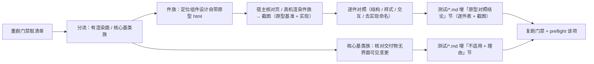

# 01 详细设计 · 组件类记录「原型对照结论」补齐

> 任务 `07_02` · 需求 07-13 · 补充需求

[文档首页](../../../../../../文档首页.md) › [07 原型对照结论补齐](../../07_原型对照结论补齐.md) › [02 组件类记录](../07_原型对照结论补齐_02_组件类记录.md) › 详细设计　|　[← 任务文档](../07_原型对照结论补齐_02_组件类记录.md)　[需求 →](../../../../需求/07_需求_原型对照结论补齐.md#r07-13)

## 1. 设计目标与范围 <a id="goal"></a>

为门禁命中的**件族类**历史测试记录补写「原型对照结论」节：以《[组件设计](../../../../../../设计/组件设计/)》**自带原型**（`设计/组件设计/` 下各件族 `NN_原型设计_XXX.html`）为基准，按件族粒度逐件对照 + 件族渲染截图。

- **范围内**：门禁命中清单中判定为**件族交付**的记录（2026-10-12 基线 **10 份**，见 §3）。
- **范围外**：页面类（`07_03`）；件族实现代码（只登记偏离修复项，不在本任务改）。

## 2. 判定口径与依据 <a id="rule"></a>

**判定为「组件类」的条件**：该记录所属任务的交付物为 `ui-ep` **件族**（基础组件类 / 布局组件类 / 交互类面板与工具等），其对照基准取**组件设计自带原型**（§4.9：「件族任务用后者」）。

**原型依据定位**：件族原型位于 `设计/组件设计/<族>/<子族>/<NN_组件设计_XXX>/<NN_原型设计_XXX.html>`（共 123 份可选项，2026-10-12 实测）；逐份按件族归属定位（如 `02_基础组件类/01_机制基类/01_组件设计_根系基类/01_原型设计_根系基类.html`）。

**例外（2026-10-12 逐项确认，见 §7 决策记录）**：任务交付物为**框架无关纯 TS 基类**（`frontend/packages/core`：无 DOM、无渲染面、不产界面可见变更）者，虽在《组件设计》下有对应设计节点，仍按 §4.9「纯逻辑改动可写**不适用**并给理由」处理——**改判为非界面类**，从组件类清单移出（清单见 §3.2）。

## 3. 待补清单（2026-10-12 执行期门禁刷新） <a id="list"></a>

> 路径相对 `bms文档/项目/`；**命中集合随 `origin/main` 前移而收敛**，每次执行前须重跑门禁刷新。2026-10-12 执行时 `check_prototype_review.py . --changed` 实跑命中 **19 份**。

**归类结果**：19 份 = **件族 · 有渲染面（本任务按 §4 逐件对照）4 份** + **核心基类族 · 改判非界面类（「不适用 + 理由」）7 份**（§3.2）+ 页面类 8 份（`07_03`）。

### 3.1 组件类 · 有渲染面（4 份） <a id="list-renderable"></a>

| # | 待补测试记录 | 组件设计原型依据 | 实现渲染载体 |
| --- | --- | --- | --- |
| 1 | 04_前端组件库/任务/03_布局组件类/03_布局组件类_01_弹窗抽屉表单/测试/01_测试_01_弹窗抽屉表单.md | `设计/组件设计/04_容器组件类/01_组件设计_弹窗抽屉表单/01_原型设计_弹窗抽屉表单.html` | **无核对页**（弹窗族未被任何宿主视图 / 核对页消费）→ 组件设计原型渲染 + 用例契约证据；缺口按 §6 登记开放项 |
| 2 | 04_前端组件库/任务/03_布局组件类/03_布局组件类_02_异常与空状态/测试/02_测试_01_异常与空状态.md | `设计/组件设计/07_展示类/05_组件设计_异常与空状态/05_原型设计_异常与空状态.html` | 宿主真机（公开路由 `/403`、`/404`、`/500`） |
| 3 | 04_前端组件库/任务/08_交互类/08_交互类_03_面板与工具/08_交互类_03_面板与工具_01_向导与偏好设置/测试/01_测试_01_向导与偏好设置.md | `设计/组件设计/08_交互类/14_组件设计_向导与步骤/14_原型设计_向导与步骤.html`、`设计/组件设计/08_交互类/15_组件设计_偏好设置面板/15_原型设计_偏好设置面板.html` | 宿主开发态核对页 `wizard-preference-check.html`（真机） |
| 4 | 05_前端插件化/任务/01_扩展点与装配/01_扩展点与装配_02_宿主加载器运行时化与模块契约远端对接/测试/01_测试_01_扩展点与装配_02_宿主加载器运行时化与模块契约远端对接.md | `设计/组件设计/03_布局组件类/12_组件设计_模块区域插槽/12_原型设计_模块区域插槽.html` | 宿主真机（主框架 `header-right` 区域插槽渲染演示模块项） |

### 3.2 组件类 · 核心基类族改判非界面类（7 份，「不适用 + 理由」） <a id="list-na"></a>

> 判据变更见 §2「例外」与 §7 决策记录；这 7 份交付物为 `frontend/packages/core` 下**框架无关纯 TS 基类**（无 DOM、无渲染面），不产界面可见变更 ⇒ 按 §4.9 写「不适用 + 理由」。**执行归口仍在本任务**（`07_01` 已收口，不返工重开）。

| # | 待补测试记录 | 对应组件设计节点（语义对账依据） |
| --- | --- | --- |
| 1 | 04_前端组件库/任务/02_基础组件类/02_基础组件类_01_总基类与固定三段/测试/01_测试_01_总基类与固定三段.md | 组件设计 · 总基类（`01_机制基类/01_组件设计_根系基类`）/ 能力机制 |
| 2 | 04_前端组件库/任务/02_基础组件类/02_基础组件类_02_组件根/测试/02_测试_01_组件根.md | 组件设计 · 组件根基类（`01_机制基类/02_组件设计_组件根基类`） |
| 3 | 04_前端组件库/任务/02_基础组件类/02_基础组件类_03_能力基类族/测试/03_测试_01_能力基类族.md | 组件设计 · 能力类（`02_能力类/` 下 31 节点） |
| 4 | 04_前端组件库/任务/02_基础组件类/02_基础组件类_04_组件基类族/测试/04_测试_01_组件基类族.md | 组件设计 · 域基类（`03_域基类/` 下 5 节点） |
| 5 | 04_前端组件库/任务/02_基础组件类/02_基础组件类_05_体系机制/测试/05_测试_01_体系机制.md | 组件设计 · 机制基类（能力机制 / 占位 / 异步资源 / 注册表 / 错误 / 订阅） |
| 6 | 04_前端组件库/任务/02_基础组件类/02_基础组件类_06_基础类横切底座/测试/06_测试_01_基础类横切底座.md | 组件设计 · 基础类（请求封装 / 权限指令 / 格式化工具） |
| 7 | 04_前端组件库/任务/02_基础组件类/02_基础组件类_07_框架无关核心工程与契约保障/测试/07_测试_01_框架无关核心工程与契约保障.md | 核心工程与契约保障（无对应可视节点） |

### 3.3 归属说明 <a id="list-owner"></a>

- **移出本任务**：8 份页面类 → `07_03`（清单见其详细设计 §3），本任务不代做。
- **本任务移出「组件类」**：§3.2 的 7 份核心基类族改判非界面类，仍在本任务内补节（`07_01` 已交付收口，不返工重开）。
- **由 `07_01` 移入且保留**：`05_前端插件化/…/01_扩展点与装配_02`（§3.1 第 4 项）——该任务交付 `ui-ep` 布局件族 `ModuleAreaOutlet.vue`（模块区域插槽）并在详细设计登记了组件设计原型，故按件族类对照。
- **`07_01` 遗留措辞修正**：`07_01` 实施 / 测试记录中以 `设计/组件设计/` 下 `**` 通配写法举例（`NN_原型设计_XXX.html` 一类，3 处）被门禁正则当作「真实引用」而报「原型引用文件不存在」，本任务顺带改为等效的无歧义表述（见 §7 决策记录第 4 项），使门禁整体可转绿。

## 4. 逐件对照与补写步骤 <a id="steps"></a>



**A. 组件类 · 有渲染面（§3.1，4 份）**：

1. **定位原型**：逐份定位 `设计/组件设计/` 下对应的件族原型 `NN_原型设计_XXX.html`（件族任务原型依据落此处），在记录内以相对链接引用（文件须存在）。
2. **渲染与截图**：以宿主开发态核对页（`frontend/apps/desktop/*-check.html`）或宿主真机渲染件族；**依赖外置态下 `pnpm run` 不可直用**，按《[开发机部署使用说明总览](../../../../../../资料/开发机/linux/开发机部署使用说明总览.md)》执行；无渲染入口的件族（弹窗族）**补开发态核对页**（只加核对项、不改组件实现、不进构建产物——本批新增 `modal-check.html`）。截图落 `测试/资源/<记录名>/`，命名 `原型-*.png` / `实现-*.png`。
3. **逐件对照表**：节内建表，列固定 `# / 对照项 / 原型依据 / 实现实测 / 结论`，**逐件落行**；结论取「对齐 / 偏离（**已修复** / 附处置依据）」。
4. **真机行为核对**：件族行为点（关闭规则 / 禁用态 / 尺寸档位 / 标题三态）经核对页或页面**真机实测**，断言用**可见性**（`offsetParent !== null`）而非「元素存在」——Element Plus 关闭后 DOM 仍在（仅 `v-show`），存在性断言会把「已关闭」误判为「仍打开」。
5. **偏离就地修复**：核对发现的偏离**当批修复**（件级配置 / 拦截逻辑 + 补用例 + 真机复验），并回写该件族记录「偏离项」为**已修复**；**不得以「归口他任务」收尾**（例外：确属编排层 / 其他任务职责者，须在记录中写明依据）。
6. **去实现命名**：核对件族可见文本无类名 / 函数名 / 能力键 / 路径 / 包名。

**B. 组件类 · 核心基类族改判非界面类（§3.2，7 份）**：

7. **再核交付物**：确认该记录所属任务的交付物落在 `frontend/packages/core`（纯 TS、无 DOM / 模板 / 样式），不产界面可见变更。
8. **补「不适用 + 理由」节**：在该历史任务**自身**的 `测试/*.md` 尾部新增 `## 原型对照结论`，内容为 `不适用：<逐份按任务性质说明为何无界面可见变更（≥10 字）>。`；节内不得出现未完成词。

**C. 收口**：

9. **顺带修正 `07_01` 遗留**：把 `07_01` 实施 / 测试记录中 `设计/组件设计/` 下 `**` 通配写法（`NN_原型设计_XXX.html` 一类）改为无歧义等效表述（见 §7 决策记录第 4 项）。
10. **门禁复跑**：见 §5。

## 5. 门禁与验证 <a id="verify"></a>

```bash
cd bms
python3 scripts/tools/base_check/check_prototype_review.py . --changed   # 期望：本批记录零命中
python3 scripts/tools/preflight/check_preflight.py --fast               # 期望：「界面：check_prototype_review」通过
```

节内须同时满足（**件族 4 份**）：标题含「原型」、表头含「结论」、≥1 行数据、≥1 张**存在**的 `.png` 引用（相对 `测试/` 目录）、无未完成词、有组件设计原型引用；**核心基类族 7 份**为「不适用 + 理由（≥10 字）」分支，不要求表与截图。

## 6. 边界与开放项 <a id="boundary"></a>

- **核对页缺失时**：若某件族无对应核对页，**只补核对项、不改组件实现**（本次为弹窗抽屉表单族新增 `modal-check.html`，缺口收口）；确无渲染入口者方以组件设计原型渲染 + 用例 / 契约证据对照并登记开放项。
- **件族粒度**：一件一族内多件时按**件**逐行对照，不得以单行概括整族。
- **偏离处置**：发现组件偏离原型（如关闭规则、禁用态、样式缺失、裸骨架）的，**当批就地修复**（件级配置 / 拦截逻辑 + 用例 + 真机复验）并回写该件族记录为「已修复」；**不得以「归口他任务」收尾**。§4.9 明令「不得出现结构到位但无样式」的裸骨架。
- **改判后节内样式**：核心基类族 7 份按「不适用 + 理由」补节，理由须**如实说明该任务为何无界面可见变更**（纯 TS 框架无关基类 / 门禁护栏 / 契约工厂），不得以模板套话批量填充。
- **截图真实性**：`.png` 必须为实际渲染结果（宿主真机 / 核对页 / 组件设计原型页渲染）；不得以占位图或手绘框图充数；门禁只校验「存在」，真实性与识图比对由本任务把关。

## 7. 决策记录（2026-10-12 逐项确认） <a id="decision"></a>

| # | 决策项 | 结论 |
| --- | --- | --- |
| 1 | 核心基类族（`02_基础组件类` 01~07，7 份）对照口径 | **改判非界面类**：交付物为框架无关纯 TS 基类（无渲染面），按「**不适用 + 理由**」补节并从组件类清单移出；不新建核心核对页（不引入新机制） |
| 2 | 有渲染面但无开发态核对页的件族（弹窗族） | **真机优先**：有核对页 / 宿主视图的走真机渲染；确无入口者以组件设计原型渲染 + 既有用例 / 契约证据对照，并把「核对页缺口」登记为开放项 |
| 3 | 截图落点与命名 | 落 `测试/资源/<记录名>/`，命名 `原型-*.png`（原型基准）与 `实现-*.png`（实现渲染）双份；无可真机渲染者只出 `原型-*.png`（沿用 `06_字段类_04_验证码字段` 先例） |
| 4 | `07_01` 自身记录里触发门禁误报的占位写法 | **顺带修正**：`07_01` 实施 / 测试记录中 `设计/组件设计/`（或 `设计/原型设计/`）下 `**` 通配写法共 3 类改为无歧义等效表述（不含 `**` 紧邻 `.html`），使 `check_prototype_review.py . --changed` 与 `preflight --fast` 该项整体转绿；仅措辞变更、语义不变 |
| 5 | 改判 7 份的执行归口 | **仍在本任务**（`07_02`）内补节：`07_01` 已交付收口，移回会重开已完成任务；本决策已在设计 §3.2 / §3.3 显式登记 |

## 8. 参考文档 <a id="ref"></a>

- 《[原型审查规范](../../../../../../规范/原型审查规范.md)》§4.9「实现 ↔ 原型 / 布局 核对（界面类交付验收）」与 §6.2「验证手段」
- 《[任务文档规范](../../../../../../规范/任务文档规范.md)》「测试文档（任务测试记录）」节
- 《[文档生成规范](../../../../../../规范/文档生成规范.md)》8.5「去实现命名」与「资源文件管理」节
- 门禁脚本 `scripts/tools/base_check/check_prototype_review.py`（`--changed [base]` 缺省基准 `origin/main`）
- 需求文档 [07_需求_原型对照结论补齐](../../../../需求/07_需求_原型对照结论补齐.md)
