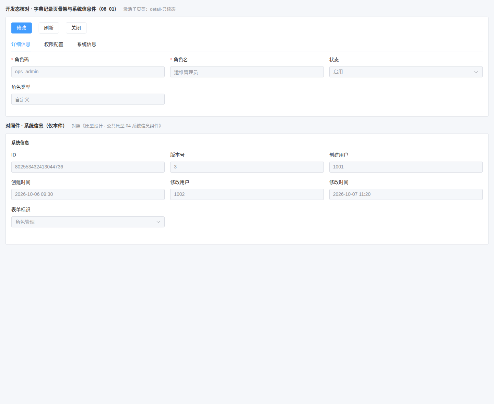
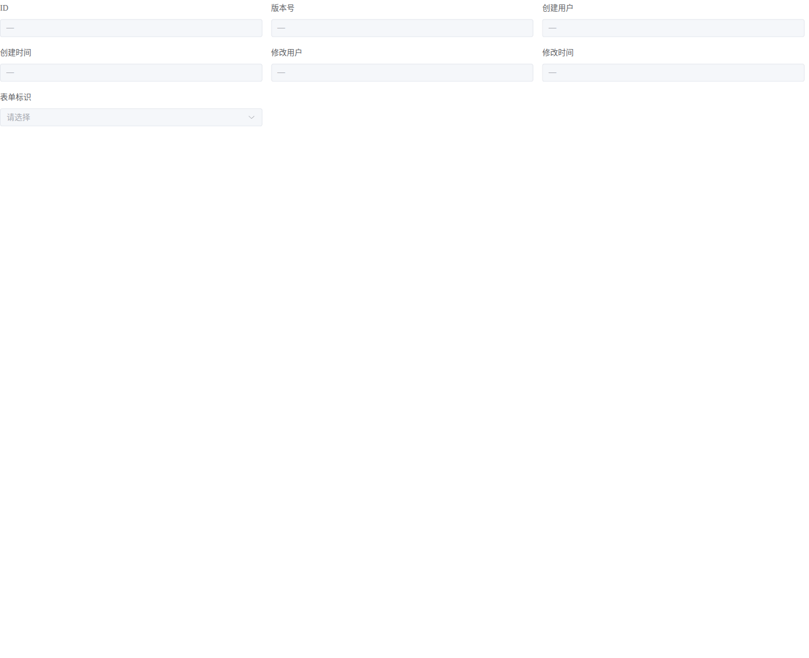
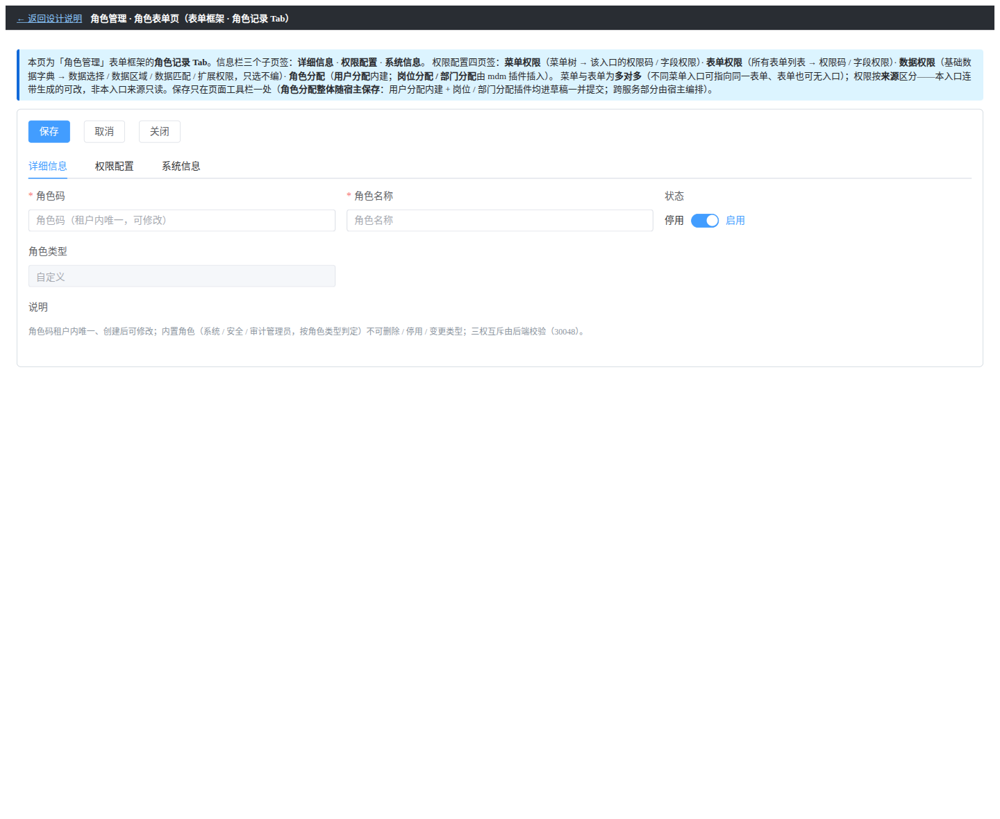

# 01 测试记录 · 清单显式 kind 与前端按 kind 套骨架

> 任务 `08_01` · 需求 07-15 · 补充需求

[文档首页](../../../../../../文档首页.md) › [08 字典页布局对齐](../../08_字典页布局对齐.md) › [01 清单显式 kind 与前端套骨架](../08_字典页布局对齐_01_清单显式kind与前端套骨架.md) › 测试记录　|　[详细设计 →](../设计/01_详细设计_01_清单显式kind与前端套骨架.md)　[实施记录 →](../实施/01_实施记录_01_清单显式kind与前端套骨架.md)

## 1. 测试信息 <a id="meta"></a>

| 项 | 值 |
| --- | --- |
| 任务 | [01 清单显式 kind 与前端套骨架](../08_字典页布局对齐_01_清单显式kind与前端套骨架.md)（需求 [07-15](../../../../需求/08_需求_字典页布局对齐.md#r07-15)） |
| 详细设计 | [01 详细设计_01 清单显式 kind 与前端套骨架](../设计/01_详细设计_01_清单显式kind与前端套骨架.md) |
| 实施记录 | [01 实施记录_01 清单显式 kind 与前端套骨架](../实施/01_实施记录_01_清单显式kind与前端套骨架.md) |
| 测试日期 | 2026-10-13 |
| 测试人 | minjian |
| 被测物 | 后端两份构建期清单与清单接口（`is_dict`）、基座校验脚本、前端 `core` 判定与归一、`ui-ep` 系统信息件与骨架件、开发态核对页 |
| Kiwi 用例 | **2293**（平台自增编号，登记后回填；用例标注见各测试文件首行注释） |
| 结论 | 后端定向用例 8 passed、基座脚本自检 12 项通过；前端 `core` 109 文件 / 1317 用例、`ui-ep` 70 文件 / 986 用例全通过，宿主覆盖率四项 **100%**（77 文件 / 628 用例）；文档门禁与 `preflight --fast` 全绿；真机对照见 §6 |

## 2. 测试范围与判据 <a id="scope"></a>

按《[测试规范](../../../../../../规范/测试规范.md)》「受变更影响定向用例 + 覆盖率门禁」口径执行（全量 / 集成交 CI 按需触发）：

- **后端**：`services/platform/tests/api/test_form_keys_api.py`、`test_data_sources_api.py`（清单接口契约与派生字段）；`check-system-fields.py --self-test` 与实跑（清单 `kind` 显式声明）。
- **前端**：`packages/core/tests/page-route-dict-kind.spec.ts`（新增）与 `page-route.spec.ts`；`packages/ui-ep/tests/sys-info-panel.spec.ts`（重写）、`dict-record-layout.spec.ts`（新增）、`layout-style.spec.ts`（护栏范围）；`apps/desktop` 全量 + 覆盖率门禁。
- **文档 / 门禁**：`check-links` / `check-docs-scope` / `check-status --strict` / `check-prototype-review`（`--changed`）/ `preflight --fast`。
- **覆盖率判据**：口径见《[AI开发规范](../../../../../../规范/AI开发规范.md)》「覆盖率要求」节。

## 3. 用例与断言 <a id="cases"></a>

| 验收点 | 用例落点 | 断言要点 | 结果 |
| --- | --- | --- | --- |
| 两份清单逐条显式 `kind` 且取值合法 | `check-system-fields.py --self-test`（12 项）+ 实跑 | 缺 `kind` / 取值非法 / 取值无法解析各命中；实跑 0 问题 | 通过 |
| 清单接口派生 `is_dict` | `test_form_keys_api.py` / `test_data_sources_api.py` | 响应字段集 = 声明字段 ∪ 计算字段；`is_dict` 与 `kind` 同源；`kind=form` 项 `is_dict=False`；JSON Schema `is_dict` 为 `boolean` | 8 passed |
| 唯一判定与归一 | `packages/core/tests/page-route-dict-kind.spec.ts` | `isDictKind` 真值表（`dict` 真 / 其余假）；`is_dict` 直取、缺省回落 `kind`、非布尔值回落、camelCase 兼容 | 通过 |
| 能力层消费位 | 同上 | 未装载 → `false`；装载后字典项 `true`、非字典与未命中 `false` | 通过 |
| 系统信息件七项与形态 | `packages/ui-ep/tests/sys-info-panel.spec.ts` | 七项顺序与文案；`label-position=top`；三列等宽（`span=8`）；第 7 项禁用下拉框（值 `form_key`、显示表单名）；时间 `yyyy-MM-dd HH:mm`（按传入时区、无后缀）；不可解析 / 非法时区原样输出；缺失占位；列数可配 | 通过 |
| 骨架件契约 | `packages/ui-ep/tests/dict-record-layout.spec.ts` | 工具栏 / 首行 / 其余字段 / 业务 Tab 插槽就位；Tab 顺序「详细信息 → 业务 Tab → 系统信息」；系统信息内置且 `info` / `timezone` 透传；`disabled` 绑定详情区表单；受控回写 `update:modelValue` | 通过 |
| 布局族护栏 | `packages/ui-ep/tests/layout-style.spec.ts` | 布局族 20 件齐备、样式非空、无硬编码色值 | 通过 |
| 宿主回归 | `apps/desktop` 全量 + 覆盖率 | 77 文件 / 628 用例；覆盖率四项 100% | 通过 |

## 4. 门禁与文档校验 <a id="gates"></a>

```bash
cd bms
python3 scripts/tools/base-check/check-links.py .
python3 scripts/tools/base-check/check-docs-scope.py .
python3 scripts/tools/check-docs/check-status.py --stage 07_RBAC基础模块 --strict
python3 scripts/tools/base-check/check-system-fields.py --self-test && python3 scripts/tools/base-check/check-system-fields.py .
python3 scripts/tools/preflight/check-preflight.py --fast
```

| 门禁 | 结果 |
| --- | --- |
| `check-links` | 全库断链 0 / 失效锚点 0 |
| `check-docs-scope` | 违规 0 |
| `check-status --stage 07_RBAC基础模块 --strict` | 硬规则 0 不合规（图表与剩余表一致、计划头计数与明细一致） |
| `check-system-fields` | 自检 12 项通过；实跑通过 |
| `preflight --fast` | 见 §6 结论，界面门禁（`check-prototype-review`）零命中 |

## 5. 偏离与遗留 <a id="deviations"></a>

| # | 项 | 处置 |
| --- | --- | --- |
| 1 | 开发态样例的「状态」用下拉框，而既有页面原型首行第三字段用开关 | **非偏离**：《布局设计 · 字典页》§3 明确 State 的控件形态按需求（开关 / 下拉 / 只读标签三选），骨架件不强制控件形态（由页面插槽决定），`08_02` 对齐现有页时统一 |
| 2 | 开发态样例的「说明」区未复刻 | **非偏离**：17 §2.3「其余字段不受限」，样例只演示首行三字段与其余字段栏位 |
| 3 | 现有记录页（`RoleRecordTab` / `UserRecordTab`）尚未套用骨架件 | **归口本域 `08_02`**（其交付面即为两页对齐）；前置件已就位 |
| 4 | 字典条目预览（明细区）未涉及 | 属登记项记录页职责（《布局设计 · 字典页》§2.4），不在本任务交付面 |

## 6. 原型对照结论 <a id="prototype-review"></a>

**原型依据**（均为仓库内既有可渲染界面，文件存在）：《[布局设计 · 字典页](../../../../../../设计/布局设计/17_布局设计_字典页.html)》§2 / §2.2 / §2.5（界面权威）、《[原型设计 · 公共原型 04 系统信息组件](../../../../../../设计/原型设计/02_公共原型/04_系统信息组件.html)》、《[原型设计 · 09 角色管理 03 角色表单页](../../../../../../设计/原型设计/09_角色管理/03_角色表单页.html)》。

**对照手段**：开发态核对页 `frontend/apps/desktop/dict-record-check.html` 真实组装骨架件与系统信息件，经无头 Chrome 真机渲染（宿主 dev server 5173）；截图双份落 `测试/资源/01_测试记录_01_清单显式kind与前端套骨架/`。

| # | 对照项 | 原型依据 | 实现实测（真机） | 结论 |
| --- | --- | --- | --- | --- |
| 1 | 记录页骨架：工具栏 + 信息栏（详细信息 / 系统信息两 Tab） | 《布局设计 · 字典页》§2 页面结构 | 工具栏渲染「修改 / 刷新 / 关闭」（只读态）；Tab 依次「详细信息 / 权限配置 / 系统信息」—— 业务 Tab 插在两固定 Tab 之间 | 对齐 |
| 2 | 详细信息首行三字段（Code / Name / State，三列等宽、顺序固定） | 《布局设计 · 字典页》§2.2 | 首行依序「角色码 / 角色名 / 状态」，三列实测等宽（463 / 463 / 463 px）；其余字段（角色类型）排在首行之后 | 对齐 |
| 3 | 系统信息七项与第 7 项形态 | 《布局设计 · 字典页》§2.5、《原型设计 · 04 系统信息组件》 | 七项依序 `ID` / `版本号` / `创建用户` / `创建时间` / `修改用户` / `修改时间` / `表单标识`；label 在字段上方、三列只读栅格；第 7 项为禁用下拉框（显示「角色管理」） | 对齐 |
| 4 | 系统信息时间显示口径 | 《布局设计 · 字典页》§2.5（按租户时区、无时区后缀） | 创建时间 `2026-10-06 09:30`、修改时间 `2026-10-07 11:20`（入参为 UTC，按租户时区呈现）；无时区后缀 | 对齐 |
| 5 | 只读 / 编辑分态 | 《布局设计 · 字典页》§4 | 只读态全件禁用（7 项禁用输入 / 下拉）；点「修改」后工具栏切换为「保存 / 撤销」且首行字段可编辑 | 对齐 |
| 6 | 去实现命名 | 《文档生成规范》8.5 | 界面可见文本为业务用语（角色码 / 角色名 / 状态 / 表单标识），无类名、函数名、能力键、文件路径与包名 | 对齐 |

**结论**：字典记录页骨架与系统信息件在结构、字段顺序与列宽、只读分态、时间口径与命名上均与《布局设计 · 字典页》及公共原型一致；**无未修复偏离**（§5 中两项控件形态与字段范围的差异属「按需求不受限」，已登记依据）。

**截图**：

| 图 | 说明 |
| --- | --- |
|  | 实现（只读态）：骨架 + 首行三字段 + 对照件系统信息 |
|  | 实现（编辑态）：工具栏切「保存 / 撤销」、首行字段可编辑 |
|  | 原型基准：公共原型 04 系统信息组件 |
|  | 原型基准：09 角色管理 03 角色表单页（记录页骨架与首行三字段） |

真机断言以**可见性**为准（`offsetParent !== null`），不以「元素存在」代替；控制台仅 favicon 404（预期）。

> 本文档依《[文档生成规范](../../../../../../规范/文档生成规范.md)》编写 · 按《任务文档规范》「测试文档（任务测试记录）」节组织
