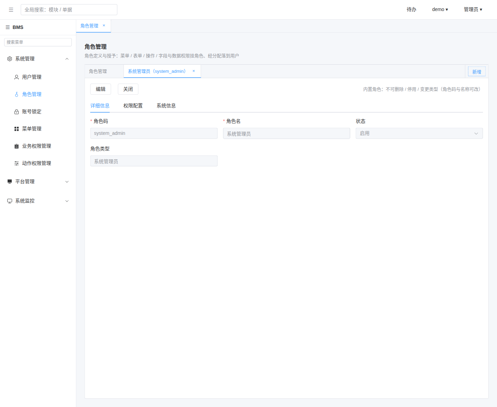
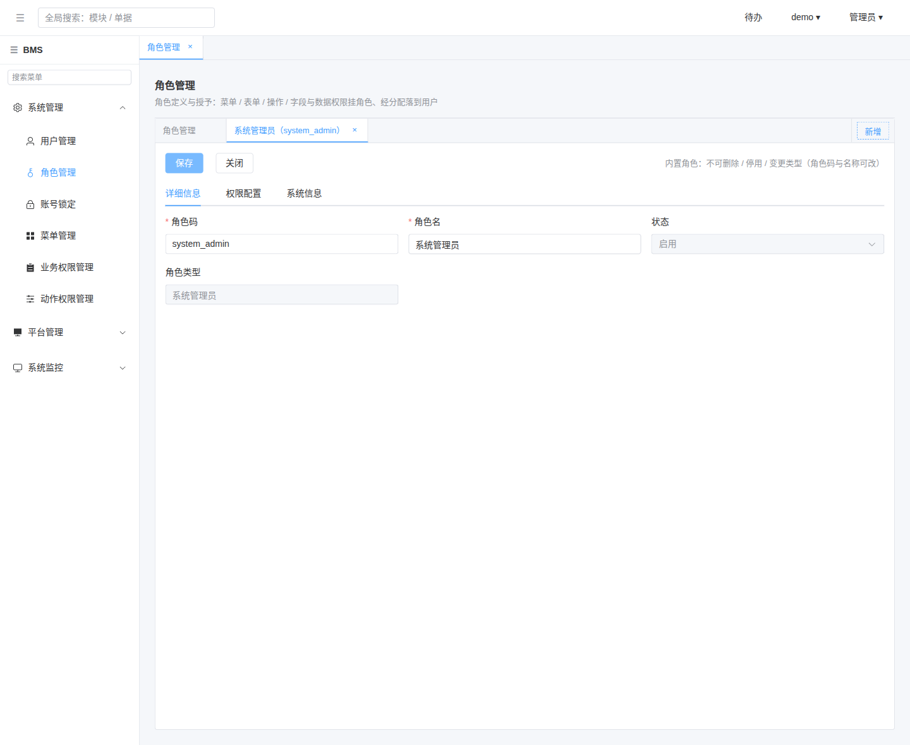
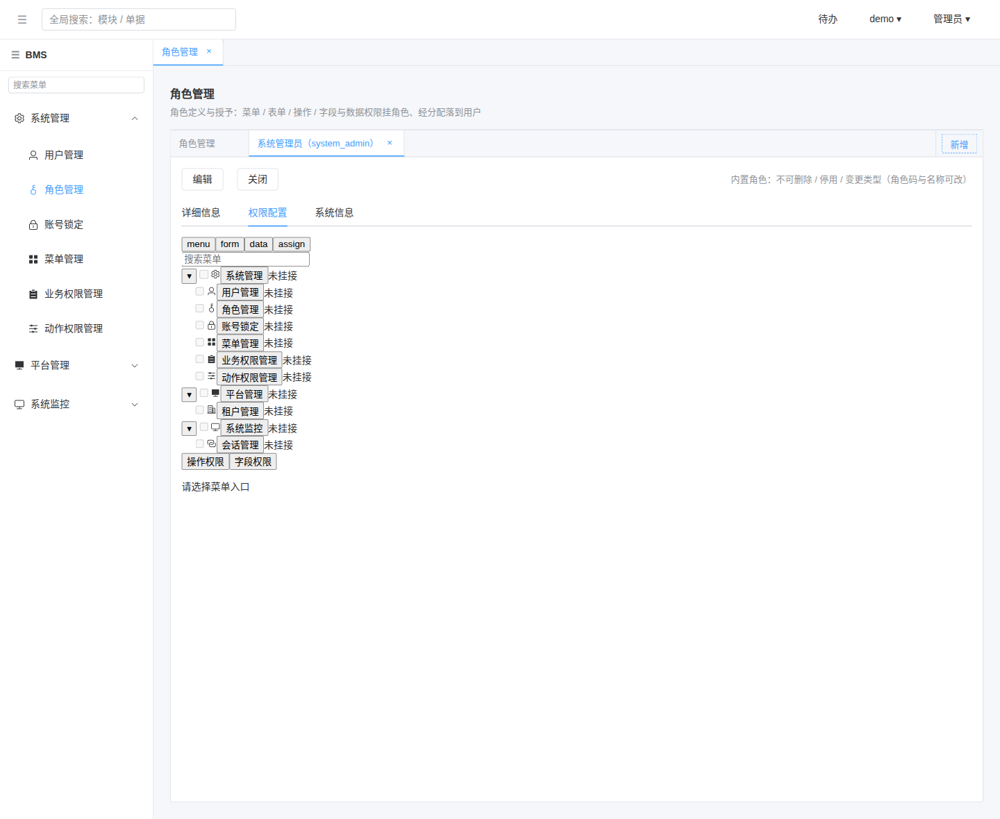
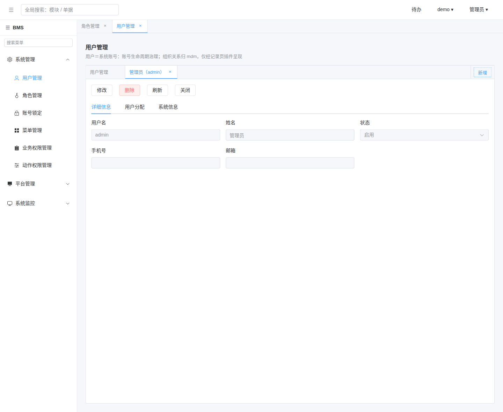
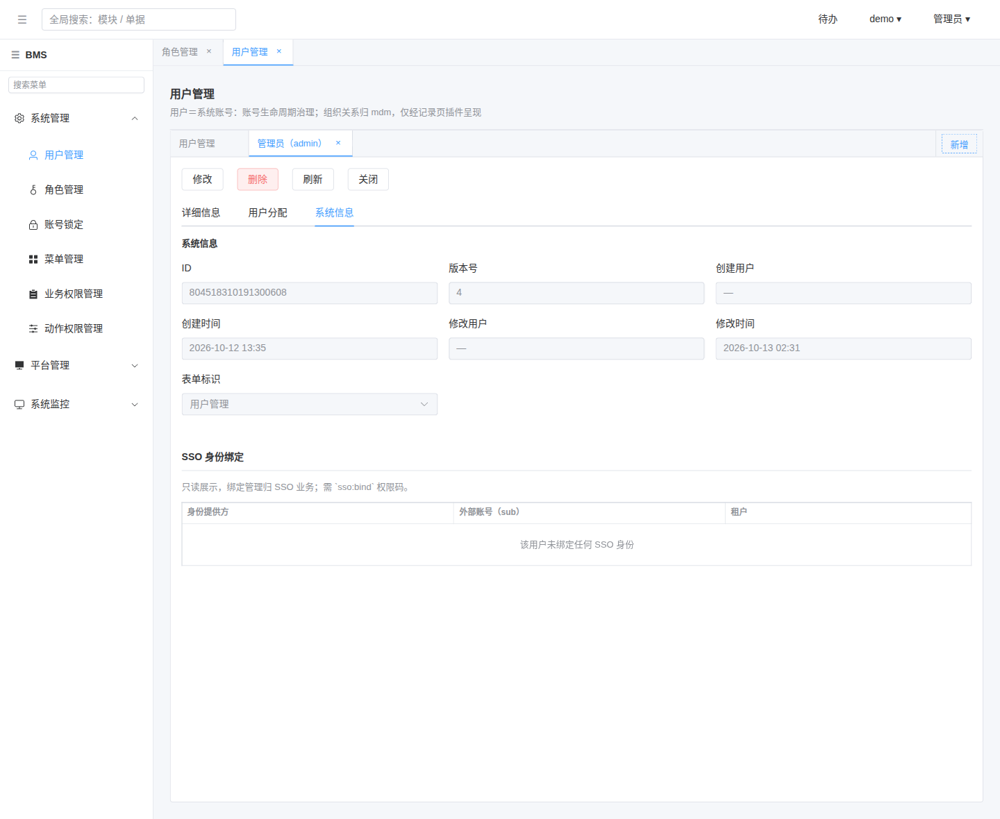
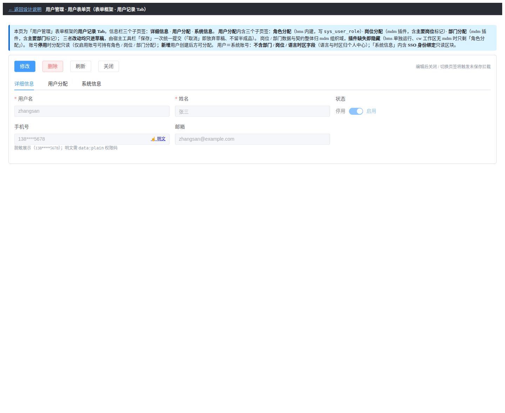

# 01 测试记录 · 现有记录页对齐

> 任务 `08_02` · 需求 07-15 · 补充需求

[文档首页](../../../../../../文档首页.md) › [08 字典页布局对齐](../../08_字典页布局对齐.md) › [02 现有记录页对齐](../08_字典页布局对齐_02_现有记录页对齐.md) › 测试记录　|　[详细设计 →](../设计/01_详细设计_02_现有记录页对齐.md)　[实施记录 →](../实施/01_实施记录_02_现有记录页对齐.md)

## 1. 测试信息 <a id="meta"></a>

| 项 | 值 |
| --- | --- |
| 任务 | [02 现有记录页对齐](../08_字典页布局对齐_02_现有记录页对齐.md)（需求 [07-15](../../../../需求/08_需求_字典页布局对齐.md#r07-15)） |
| 详细设计 | [01 详细设计_02 现有记录页对齐](../设计/01_详细设计_02_现有记录页对齐.md) |
| 实施记录 | [01 实施记录_02 现有记录页对齐](../实施/01_实施记录_02_现有记录页对齐.md) |
| 测试日期 | 2026-10-13 |
| 测试人 | minjian |
| 被测物 | `ui-ep` 骨架件 `DictRecordLayout`（`sys-extra` 插槽）、`RoleRecordTab`、`UserRecordTab` |
| Kiwi 用例 | **2294**（平台自增编号，登记后回填；用例标注见各测试文件首行注释） |
| 结论 | 骨架件与两页定向用例全通过；宿主覆盖率四项 **100%**（77 文件 / 634 用例）、`ui-ep` 70 文件 / 987 用例全通过；文档门禁与完整预检全绿；真机逐页对照见 §6 |

## 2. 测试范围与判据 <a id="scope"></a>

按《[测试规范](../../../../../../规范/测试规范.md)》「受变更影响定向用例 + 覆盖率门禁」口径执行（全量 / 集成交 CI 按需触发）：

- **前端 · 件级**：`packages/ui-ep/tests/dict-record-layout.spec.ts`（`sys-extra` 渲染位与顺序、不传即不渲染）、`layout-style.spec.ts`（布局族仍 20 件）。
- **前端 · 宿主**：`apps/desktop/tests/role-record-tab.spec.ts`、`tests/user-record-tab.spec.ts`（骨架承载、首行三字段顺序与列宽、系统信息侧承载与 SSO 落位）、`tests/user-assign-slot.spec.ts`（用户分配挂接位不受影响）、`role-view.spec.ts` / `user-view.spec.ts`（宿主回归）、`apps/desktop` 全量 + 覆盖率门禁。
- **界面**：真机（本地全套 + 宿主 5173）逐页对照《布局设计 · 字典页》与既有页面原型（§6）。
- **文档 / 门禁**：`check-links` / `check-docs-scope` / `check-status --strict` / `check-prototype-review`（`--changed`）/ `check-preflight.py`。
- **覆盖率判据**：口径见《[AI开发规范](../../../../../../规范/AI开发规范.md)》“覆盖率要求”节。

## 3. 用例与断言 <a id="cases"></a>

| 验收点 | 用例落点 | 断言要点 | 结果 |
| --- | --- | --- | --- |
| 骨架件 `sys-extra` 渲染位与顺序 | `packages/ui-ep/tests/dict-record-layout.spec.ts` | 扩展位渲染于「系统信息」页签内、内置系统信息件之后；不传插槽时该页签仅内置件（无空容器） | 通过 |
| 角色记录页骨架对齐 | `apps/desktop/tests/role-record-tab.spec.ts` | 页签依序「详细信息 / 权限配置 / 系统信息」；首行依序「角色码 / 角色名 / 状态」且三列 `el-col-8`；角色类型排首行之后；系统信息经内置件渲染；工具栏 `data-test` 与保存 / 撤销 / 编辑 / 关闭行为不变 | 通过 |
| 用户记录页骨架对齐 | `apps/desktop/tests/user-record-tab.spec.ts` | 页签依序「详细信息 / 用户分配 / 系统信息」；首行依序「用户名 / 姓名 / 状态」且三列 `el-col-8`；手机号 / 邮箱排首行之后；SSO 身份表与系统信息件同处 `#pane-sys` 且内置件在前 | 通过 |
| 用户分配挂接不受影响 | `apps/desktop/tests/user-assign-slot.spec.ts` | 挂接位仍为单个 `ModuleAreaOutlet`（`variant=tabs` / `tabType=card` / `area=sys.user.detail.tabs`）；停用只读提示、权限缺省空态、新增态提示不变 | 通过 |
| 宿主回归（列表 / 宿主页） | `apps/desktop/tests/role-view.spec.ts` / `user-view.spec.ts` | 记录页根 `data-test="role-record"` 承接、页签与事件通道不变 | 通过 |
| 布局族护栏 | `packages/ui-ep/tests/layout-style.spec.ts` | 布局族 20 件齐备、样式非空、无硬编码色值（本次不新增件） | 通过 |
| 宿主全量 + 覆盖率 | `apps/desktop` 全量 | 77 文件 / 634 用例；覆盖率四项 100% | 通过 |

## 4. 门禁与文档校验 <a id="gates"></a>

```bash
cd bms
python3 scripts/tools/base-check/check-links.py .
python3 scripts/tools/base-check/check-docs-scope.py .
python3 scripts/tools/check-docs/check-status.py --stage 07_RBAC基础模块 --strict
python3 scripts/tools/base-check/check-prototype-review.py . --changed origin/main
python3 scripts/tools/preflight/check-preflight.py
```

| 门禁 | 结果 |
| --- | --- |
| `check-links` | 待记（见下方「执行结果」） |
| `check-docs-scope` | 待记 |
| `check-status --stage 07_RBAC基础模块 --strict` | 待记 |
| `check-prototype-review --changed origin/main` | 待记 |
| `check-preflight.py`（完整预检） | 待记 |

## 5. 偏离与遗留 <a id="deviations"></a>

| # | 项 | 处置 |
| --- | --- | --- |
| 1 | 首行 `State` 控件：实现为下拉、页面原型为开关 | **非偏离**：17 §3 明确 `State` 形态按需求三选（开关 / 下拉 / 只读标签）且同模块内一致；本次经用户确认沿用下拉（与列表页状态筛选、后端 `enabled/disabled` 口径一致），已登记 §6 |
| 2 | 首行列标题文案：实现「角色名」、原型「角色名称」 | **非偏离**：17 §2.2 明确界面上显示的是**列标题**、按需求显示（标识恒为 `Code` / `Name` / `State`）；本任务任务内容即定「角色码 / 角色名 / 状态」 |
| 3 | 角色原型含「说明」区块，实现未复刻 | **非偏离**：17 §2.3「其余字段不受限」，说明类文本非骨架必选项 |
| 4 | 用户页「手机号」未脱敏（原型含掩码 + 明文切换） | **非本任务引入**：脱敏策略注册未落地（`[masking].options.rules = {}`），归脱敏消费面；本任务只做骨架与系统信息对齐（归口见[实施记录 §6](../实施/01_实施记录_02_现有记录页对齐.md)） |
| 5 | 本机外置依赖错链（ui-ep 指向 mdm 仓存储）导致单测 32 例失败 | **环境问题，已治本修复**（重建前端外置依赖），非本任务代码缺陷；详见[实施记录 §4](../实施/01_实施记录_02_现有记录页对齐.md) 第 1 项 |

## 6. 原型对照结论 <a id="prototype-review"></a>

**原型依据**（均为仓库内既有可渲染界面，文件存在）：《[布局设计 · 字典页](../../../../../../设计/布局设计/17_布局设计_字典页.html)》§2 / §2.1 / §2.2 / §2.3 / §2.5 / §3 / §4（界面权威）、《[原型设计 · 09 角色管理 03 角色表单页](../../../../../../设计/原型设计/09_角色管理/03_角色表单页.html)》、《[原型设计 · 08 用户管理 03 用户表单页](../../../../../../设计/原型设计/08_用户管理/03_用户表单页.html)》；系统信息区另对照《[原型设计 · 公共原型 04 系统信息组件](../../../../../../设计/原型设计/02_公共原型/04_系统信息组件.html)》（两份页面原型的系统信息页签即以该件承载）。

**对照手段**：本地全套（tenant / platform / identity）启动并 `seed` 后，宿主 5173 经 Playwright 真机登录（demo 租户）进 `/sys/roles`、`/sys/users`，双击列表行打开记录页签，逐页截图并读取真机结构（页签文案、三列实际像素宽、字段 DOM 顺序、系统信息七项与第 7 项取值）；原型经静态服务（8899）另截图。截图落 `测试/资源/01_测试记录_02_现有记录页对齐/`。

| # | 对照项 | 原型依据 | 实现实测（真机） | 结论 |
| --- | --- | --- | --- | --- |
| 1 | 记录页骨架：工具栏 + 信息栏「详细信息 / …业务页签… / 系统信息」 | 09 角色表单页、08 用户表单页（两原型均为此结构） | 角色：`详细信息 / 权限配置 / 系统信息`；用户：`详细信息 / 用户分配 / 系统信息`——业务页签均插在两固定页签之间（骨架件承载，页内不再自建页签） | 对齐 |
| 2 | 详细信息首行三字段（`Code` / `Name` / `State`，三列等宽、顺序固定） | 《布局设计 · 字典页》§2.2、两原型首行 | 角色依序「角色码 / 角色名 / 状态」、用户依序「用户名 / 姓名 / 状态」；三列实测等宽（各 385 px，`el-col :span="8"`） | 对齐 |
| 3 | 其余字段一律排首行之后 | 《布局设计 · 字典页》§2.3 | 角色「角色类型」、用户「手机号 / 邮箱」均排在首行之后（DOM 顺序实测：首行三字段 → 其余字段） | 对齐 |
| 4 | 系统信息七项与第 7 项形态 | 《布局设计 · 字典页》§2.5、《公共原型 04 系统信息组件》（页面原型经 iframe 引用） | 两页七项依序 `ID` / `版本号` / `创建用户` / `创建时间` / `修改用户` / `修改时间` / `表单标识`；label 上方、三列只读栅格；第 7 项为禁用下拉框（角色显示「角色管理」、用户显示「用户管理」）；时间按件内时区口径呈现、无时区后缀 | 对齐 |
| 5 | 系统信息侧扩展内容（用户页 SSO 身份绑定） | 08 用户表单页（「系统信息」内 SSO 身份绑定只读区块） | SSO 区块位于「系统信息」页签内、内置系统信息件之后（真机结构断言 `#pane-sys` 内两者先后成立），未挤占详细信息与用户分配页签 | 对齐 |
| 6 | 只读 / 编辑分态 | 《布局设计 · 字典页》§4、两原型 | 只读态字段全禁用；点「编辑 / 修改」后工具栏切「保存」（脏后现「撤销」）、首行字段可编辑 | 对齐 |
| 7 | 首行 `State` 控件形态 | 《布局设计 · 字典页》§3（三选） vs 两原型（开关） | 实现为 `el-select`（禁用态回显「启用」）——符合 §3 口径② 且同模块内一致（详见 §5 第 1 项） | 对齐（依据 §3，非偏离） |
| 8 | 去实现命名 | 《文档生成规范》8.5 | 界面可见文本为业务用语（角色码 / 角色名 / 状态 / 用户名 / 姓名 / 表单标识 / SSO 身份绑定），无类名、函数名、能力键、文件路径与包名 | 对齐 |

**结论**：两记录页在**骨架结构、首行三字段顺序与列宽、其余字段位置、系统信息区（含用户页 SSO 扩展区块）与只读 / 编辑分态**上均与《布局设计 · 字典页》及两份既有页面原型一致；**无未修复偏离**（§5 中控件形态与文案差异均属「按需求不受限」并已登记依据，脱敏差异非本任务引入且已归口）。

**截图**：

| 图 | 说明 |
| --- | --- |
|  | 实现（角色 · 只读态）：工具栏 + 三页签 + 首行三字段等宽 + 角色类型居后 |
|  | 实现（角色 · 编辑态）：工具栏切「保存」、首行字段可编辑 |
|  | 实现（角色 · 系统信息）：七项三列只读栅格、第 7 项「角色管理」禁用下拉框 |
|  | 实现（用户 · 只读态）：首行用户名 / 姓名 / 状态，手机号 / 邮箱居后 |
|  | 实现（用户 · 系统信息）：七项 + 第 7 项「用户管理」；SSO 身份绑定区块落系统信息侧 |
|  | 原型基准：09 角色管理 03 角色表单页 |
|  | 原型基准：08 用户管理 03 用户表单页 |

真机断言以**可见性**为准（`offsetParent !== null` / 元素实际渲染），不以「元素存在」代替；控制台仅预期错误（模块宿主未起 `remoteEntry` 拒连、登录前 401 刷新、favicon 404）。

> 本文档依《[文档生成规范](../../../../../../规范/文档生成规范.md)》编写 · 按《任务文档规范》「测试文档（任务测试记录）」节组织
