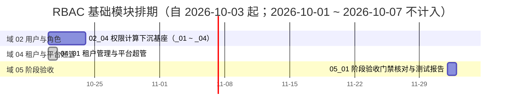

# RBAC 基础模块计划

> BMS 基础管理系统 · 阶段七（RBAC 基础模块）排期计划：**已完成 17 项，剩余 1 项**（域 05 阶段验收 1 项 / 8h；域 03 `03_03` 112h 已于 2026-10-21 交付；域 03 `03_01` 48h、域 06 布局样式 1 项 / 24h、域 02 `02_05` 16h、`02_06` 8h、`02_02` 72h（自有 32h ＋ `07-11` 追加子任务 `_01` 16h 与 `_02` 24h）与 `02_01` 44h（自有 40h ＋ `07-11` 追加子任务 `_01` 4h）**与 `02_03` 88h（自有 56h ＋ 追加子任务 `_01` 16h 与 `_02` 16h）** 已于 2026-10-09 交付，合计 12 项 / **440h**（含 bms `07-11` 追加子任务 60h）；**另 `08_01` 9h 与 `08_02` 7h 已于 2026-10-13 交付**）；**已完成 644h；剩余 8h；阶段合计 652h**（剩余 = `05_01` 8h）；**另追加需求 `07-11`（域 02）：跨仓共 76h（2026-10-09 确认，含角色侧）——mdm `01_02` 追加子任务 16h、bms `02_01` 追加子任务 `_01` 4h、bms `02_02` 追加子任务 `_01` 16h 与 `_02` 24h、bms `02_03` 追加子任务 `_02` 16h；实施路径为 mdm `_02` 先行 → **bms `02_01/_01` 独立先行交付（2026-10-09）** → bms `02_02`（主体 + `_01` + `_02`）→ **bms `02_03/_02`（角色侧同口径）**
>
> **2026-10-12 补充（域 07 原型对照结论补齐）**：门禁积压收口，`07_01` / `07_02` / `07_03` 三项 **52h** 插在 `05_01` 阶段验收**之前**（§4.9「未通过不得进入阶段验收」），`05_01` 排期窗口顺延至 2026-12-02；需求 `07-12` ~ `07-14`。**`07_01` 已于 2026-10-12 交付**（本批 39 份补「不适用 + 理由」节、5 份存疑移交 `07_02` / `07_03`、2 份边界保留；复跑门禁对本批零命中）；**`07_02` 已于 2026-10-12 交付**（4 份件族逐件对照 + 7 份核心基类族改判「不适用 + 理由」、8 份页面类归 `07_03`；复跑门禁对本批零命中）；**`07_03` 已于 2026-10-12 交付**（页面类 8 份逐页真机对照 + 4 项归属偏离就地修复；复跑门禁全变更集**零命中**、`preflight` 的「界面：check-prototype-review」项**转绿**）。
>
> **2026-10-13 补充（域 08 字典页布局对齐）**：按《[布局设计 · 字典页](../../../设计/布局设计/17_布局设计_字典页.html)》立项，统一字典（基础数据）记录页骨架与「是不是字典」的判定口径（取「**数据形态＝字典**」：《[数据库开发规范](../../../规范/数据库开发规范.md)》§3.1 中表带 `name` 者为字典表，代码层落 `form_key` / `data_source_key` 的 `kind`）；17 定位为**所有字典记录页共用的通用记录页骨架模板**（最少两 Tab + 详细信息首行三字段 + 系统信息区，其余业务 Tab 与字段不受限）。新增需求 `07-15`（域 08），2 个子任务——`08_01`（清单显式 `kind` + 前端按 `kind` 套骨架 + 通用系统信息件 + 17 / 概要 09 §8 /《数据库开发规范》§3.1.1 文档回写）、`08_02`（现有记录页对齐），**16h**（`08_01` 9h + `08_02` 7h）；排期插在 `04_01` 之后、`05_01`（2026-12-02）**之前**（§4.9「未通过不得进入阶段验收」）。需求计数 14 → **15 条**，任务 15 → **17 项**。

> **2026-10-20 补充（域 04 `04_01` 交付）**：`04_01 租户管理与平台超管` 完成——平台超管改为「平台租户 + `platform_admin`」（不建 `sys_admin`）、租户开通 / 停用启用 / 配额 / 模块门禁与菜单过滤 / 自助改密 / 前端租户管理页与强制改密页；Kiwi **2325**，后端定向 3275 passed、变更源文件覆盖率 100%，前端 680 passed、覆盖率 100%，`preflight` 全绿。真机截图、开放接口调用量配额与三库联调列为遗留（见任务实施记录 §6）。

> **2026-10-19 补充（域 02 权限计算下沉基座）**：`04_01` 租户管理与平台超管开工前复核确认权限前提不成立——① 权限计算的实现落在 platform 服务包内，其余服务无法复用真实校验（`bms_core.permission` 只有 `null` 占位，identity 等服务的 `require_permission` 恒放行），而服务边界护栏禁止服务互相 import；② 数据权限四策略产出「值列表 → `IN (...)`」条件，百万 / 千万级可见集合下 SQL 与内存不可承受。经拍板**新增需求 `07-16`（权限计算下沉基座）**，挂 `02_04` 下作 4 个嵌套子任务——`_01` 接缝与算法下沉、`_02` 三层缓存与版本对齐、`_03` 数据权限集合物化、`_04` 四策略口径修正，**32h**；`02_04` 重开为「部分完成」、从已完成表移回剩余排期（自有 56h + 追加 32h = 88h）；`04_01` 改**搁置**、待其完成。需求计数 15 → **16 条**，任务项数 17 → **17 项**（`02_04` 追加子任务，不新增任务项）。

> **2026-10-21 补充（域 03 `03_03` 补立）**：复核「菜单管理页打开是空的」确认 `03_01` 只交付后端元数据接口与前端消费，平台侧维护页一直未立项（`03_01` 计划行已登记遗留「归后续维护页任务」）。经拍板**新增需求 `07-17`** 并补立子任务 `03_03 权限元数据维护页`（`_01` 菜单/表单维护页 40h + `_02` 业务码/动作码/权限码/自定义图标维护页 72h，其中图标真实 CRUD 24h；合计 **112h**），排期插在 `05_01` 阶段验收**之前**；域 03 重开为部分完成。需求计数 16 → **17 条**，任务项数 17 → **18 项**。

[文档首页](../../../文档首页.md) › RBAC 基础模块计划　|　[任务基线 →](../任务/02_用户与角色/02_用户与角色.md)　[需求基线 →](../需求/00_需求_RBAC基础模块.md)

## 1. 计划说明 

- **排期对象**：阶段七 17 条需求、18 个子任务（域 01 插件化挂接 1 / 域 02 用户与角色 6（`02_04` 含 4 个嵌套子任务）/ 域 03 菜单与权限 3（`03_03` 含 2 个嵌套子任务） / 域 04 租户与平台超管 1 / 域 05 阶段验收 1 / 域 06 布局样式 1 / 域 07 原型对照结论补齐 3 / 域 08 字典页布局对齐 2），任务基线见[域 01](../任务/01_插件化挂接/01_插件化挂接.md)、[域 02](../任务/02_用户与角色/02_用户与角色.md)、[域 03](../任务/03_菜单与权限/03_菜单与权限.md)、[域 04](../任务/04_租户与平台超管/04_租户与平台超管.md)、[域 05](../任务/05_阶段验收/05_阶段验收.md)、[域 06](../任务/06_布局样式/06_布局样式.md)、[域 07](../任务/07_原型对照结论补齐/07_原型对照结论补齐.md)、[域 08](../任务/08_字典页布局对齐/08_字典页布局对齐.md)。
- **执行序（承前启后）**：`01_01 具名插槽挂接消费与依赖登记`（**拆口径**：前置登记先行，闭环——mdm「用户分配岗位」插件经槽挂接验证——待 mdm 组织域，见 §3 备注与 §7 第 1 项） → `06_01 前端主框架布局样式`（**先行**：为界面消费提供可见外壳） → `03_01 菜单/表单/按钮/字段挂接与动态菜单` → `02_05 用户账号归口平台`（**先行**：用户 / 角色 / 授权同库收敛，为 `02_03` 剩余部分与 `02_01` 清障） → `02_03 角色管理` → `02_06 平台用户只读出口内部契约`（**跨仓协同，随 mdm 阶段一 `01_03` 提前实施**，为 `02_01` 前置） → `02_04 主体链权限计算引擎` → `02_01 用户完整域后端`（自有部分与追加子任务 `_01` 出口去 `dept_id` 均已交付，2026-10-09） → **mdm 阶段一 `01_02` 嵌套子任务 `_02`（跨仓先行：`org_user_dept` / `is_primary` / `/user-depts` 契约 / 两插件，已交付）** → `02_02 用户管理前端`（含追加子任务 `_01`） → `03_02 三权分立与平台超管边界` → **`02_04` 追加子任务 `_01` ~ `_04`（需求 `07-16` 权限计算下沉基座：接缝与算法下沉 → 三层缓存与版本对齐 → 数据权限集合物化 → 四策略口径修正）** → `04_01 租户管理与平台超管`（**搁置**，待 `07-16` 完成后启动） → `07_01 非界面类记录补齐` → `07_02 组件类记录补齐` → `07_03 页面类记录补齐`（**门禁积压收口，先行于阶段验收**：§4.9「未通过不得进入阶段验收」） → `08_01 清单显式 kind 与前端套骨架` → `08_02 现有记录页对齐`（**字典页布局对齐，先行于阶段验收**：§4.9） → `03_03 权限元数据维护页`（**补 `03_01` 遗留维护页，先行于阶段验收**） → `05_01 阶段验收门禁核对与测试报告`（收口）。**补遗项 `01_01` 为登记件、`06_01` 为先行样式支撑件；主链首个可完整交付的实现任务为 `03_01`**（无阶段七与外部阻塞）。
- **承接口径**：阶段六已交付 `sys_user` 最小模型、认证链与会话踢出通道、账号锁定记录读写；阶段五域 06 子任务 `06_01`（需求 `05-10` 具名插槽基座与前后端配套约定）已交付；阶段四已交付前端动态路由 / 注册表基座与组织选择字段族（组织主数据只读出口消费链路）。本阶段在其上**补齐 RBAC 主体链权限、用户 / 角色 / 菜单 / 租户治理**，不重复建设基座。
- **已定口径（2026-10-03 拍板；2026-10-04 补充）**：需求 8 条 / 5 域（`07-1` ~ `07-8`）；`07-1` 为索引性需求、阶段七侧只作挂接消费与依赖登记（实施随阶段五 `05-10`）；三权分立归域 03（`07-6`）；任务取**一需求一子任务**粗粒度（`07-2` 拆后端 / 前端两子任务），详细设计阶段可按需递归拆子任务；**mdm 组织域（`org_dept`/`org_post`/`org_user_post` 与用户-岗位契约、组织只读出口）为外部前置依赖，未就绪时相关子项降级 / 占位推进**，不阻塞其余功能；各需求优先级一律 2 高。**补充（2026-10-04）**：新增需求 `07-9`（前端主框架布局样式，域 06）——`03_01` 前置排查发现 `ui-ep` 布局族（18 件）无样式实现、宿主外壳呈裸骨架，经拍板补立并**先行于 `03_01`**；需求计数 8 → 9 条，任务 9 → 10 项。**补充（2026-10-07）**：新增需求 `07-10`（用户（账号）归口平台，域 02）——复核确认术语边界（**组织域＝集团 / 公司 / 部门 / 岗位 / 人员，归 mdm；用户＝系统账号，属权限 / 身份体系归 platform**），把 `sys_user` / `sys_account_lock` 迁 platform 服务租户库并收敛跨服务引用，**先行于 `02_03` 剩余部分与 `02_01`**；需求计数 9 → 10 条，任务 10 → 11 项。**补充（2026-10-09）**：新增需求 `07-11`（用户-部门多分配与主要岗位 / 主要部门，域 02）——用户管理页原型对齐「表单框架」时确认用户-部门关系应与其他组织关系一致归 mdm、且「用户所属岗位 / 部门」需以主要项确定（原 `sys_user.dept_id` 单值逻辑外键设计**取消**）；任务按 §3.1 挂现有父任务：mdm `01_02` 追加嵌套子任务、bms `02_01` / `02_02` 各追加嵌套子任务。需求计数 10 → **11 条**。**实施路径与投入（2026-10-09 拍板 / 粗估）**：mdm `01_02/_02` **先行**（唯一跨仓硬前置——bms 两子任务均依赖其「两端同批切换」与两插件）→ bms `02_02`（主体 + `_01`）与 `02_01/_01` **同批发布**（跨仓一轮联合回归）；投入——mdm `_02` 16h、bms `02_01/_01` 4h、`02_02/_01` 16h、`02_02/_02` 24h（**2026-10-09 重估确认**）。**2026-10-09 第三次拍板**：跨服务一致性改走**原子化分布式事务**（TM + 各服务 XA 分支，**不做反向补偿、不做一致性屏障**）——由此新增嵌套子任务 `02_02/_02 用户保存编排端点（TM + XA）`，并把插件契约由「自提交」改为「**宿主收草稿**」（`registerSubmitter` entry ＝ `{ isDirty(), buildSegment(), reload() }`）。**2026-10-09 角色侧口径修订**：同口径新增 `02_03/_02 角色分配插件随宿主保存编排`（`PUT /api/v1/roles/{id}/assignments`，投入 16h；mdm 侧零改动、复用用户侧已交付模板）。**补充（2026-10-12）**：新增需求 `07-12` ~ `07-14`（原型对照结论补齐，域 07）——`07_01` / `07_02` / `07_03` 三项按对照依据分非界面类（「不适用 + 理由」，初判 44 份）/ 组件类（组件设计自带原型 + 件族截图，初判 10 份）/ 页面类（页面原型 + 真机截图 + 识图逐页，初判 4 份，**前置 `05_01`**）；需求计数 11 → **14 条**，任务 12 → **15 项**；分类与清单基线见 `07_01` ~ `07_03` 的详细设计（执行前须重跑门禁刷新，命中集合随 `origin/main` 前移收敛）。**补充（2026-10-13）**：新增需求 `07-15`（字典记录页骨架对齐，域 08）——按《布局设计 · 字典页》统一字典记录页骨架与判定口径（取「数据形态＝字典」：表带 `name` 者为字典表，代码层落 `kind`），`08_01` / `08_02` 两项 16h；需求计数 14 → **15 条**，任务 15 → **17 项**。
- **排期口径**：自 2026-10-03 起串行排期（单人兼职）；按 8h/日折算，2026-10-01 ~ 2026-10-07（国庆）不计入；窗口为估算基线，可按实际滚动调整并记录调整原因。**补记（2026-10-07）**：新增子任务 `02_06`（平台用户只读出口内部契约）**随 mdm 阶段一 `01_03` 同批提前交付**（跨仓协同——mdm 组织只读出口需经平台用户只读出口取用户明细），并作为 `02_01` 前置。
- **工时**：剩余 8h（域 05 `05_01` 8h）；已完成 644h（域 03 `03_03` 112h（2026-10-21）、域 04 `04_01` 56h（2026-10-20）、域 02 `02_04` 88h（自有 56h + 需求 `07-16` 追加子任务 `_01` ~ `_04` 32h，2026-10-20 全部交付）、域 03 `03_02` 16h（2026-10-19）、域 01 `01_01` 4h（2026-10-09）、域 08 `08_01` 9h + `08_02` 7h（均 2026-10-13）、域 07 `07_01` 12h + `07_02` 24h + `07_03` 16h（均 2026-10-12）、域 03 `03_01` 48h、域 06 `06_01` 24h、域 02 `02_05` 16h、`02_06` 8h、`02_02` 72h（自有 32h + 追加子任务 `_01` 16h + `_02` 24h）、`02_01` 44h（自有 40h + 追加子任务 `_01` 4h）与 `02_03` 88h（自有 56h + 追加子任务 `_01` 16h + `_02` 16h））；阶段合计 **652h**（508h + 需求 `07-16` 新增 32h + 需求 `07-17` 新增 112h）；任务级工时随详细设计重估并同步回写。
- **里程碑锚点**：M7 = **RBAC 基础模块可用**（《总体项目规划》「里程碑」节），门禁见[本计划 §5 M7 验收门禁](#accept)。
- **负责人**：minjian（兼职，单人）。

## 2. 已完成任务 

| 编号 | 任务 | 工时（重估） | 完成日期 | 任务文件 | 偏差与遗留 |
| --- | --- | --- | --- | --- | --- |
| 06_01 | 前端主框架布局样式（布局族 18 件补样式 / 主题令牌 / 响应式） | 24h | 2026-10-04 | [06_01](../任务/06_布局样式/06_布局样式_01_前端主框架布局样式/06_布局样式_01_前端主框架布局样式.md) | 遗留 7 项（见任务实施记录 §7 与 §7 台账）：`useResponsive` 同档位缩放不重算断点、标签栏「更多」接线、标签拖拽 / 中键关闭 / 菜单展开持久化、顶栏业务项装配、EP 完整深色适配与亮色色阶评估、标签栏视觉形态不逐像素照抄。**2026-10-05 用户复核补修**：顶栏改 56px 全宽横条 + 顶栏业务项装配（全局搜索 / 待办 / 租户 / 用户下拉含退出登录），并修「侧栏菜单为空 / 页签标题显示 `/` / 菜单图标缺失 / 满屏高度塌陷」四缺陷 —— **「顶栏业务项装配」遗留已收口** |
| 03_01 | 菜单/表单/按钮/字段挂接与动态菜单（后端 + 前端消费） | 48h | 2026-10-05 | [03_01](../任务/03_菜单与权限/03_菜单与权限_01_菜单表单按钮字段挂接与动态菜单/03_菜单与权限_01_菜单表单按钮字段挂接与动态菜单.md) | 遗留 4 项（见任务测试记录 §5 与实施记录 §5）：菜单管理维护页 / 权限码管理页与业务 · 动作码维护写接口不在本任务（归后续维护页任务）；字段权限真实收窄随 `02_04`；三库真库迁移演练与联调随部署窗口；标签栏「更多」溢出接线 / 拖拽排序 / 中键关闭归标签 / 导航族（菜单展开持久化本任务已落地）。**2026-10-05 补记**：收口期修前端消费链缺陷「侧栏菜单为空」（`toMenuNode` 叶子 `children` 误为 `[]`，被权限过滤整链丢弃），提交 `c89452a99` |
| 02_05 | 用户账号归口平台（`sys_user` / `sys_account_lock` 迁 platform、identity 内部契约改指、跨库搬迁） | 16h | 2026-10-07 | [02_05](../任务/02_用户与角色/02_用户与角色_05_用户账号归口平台/02_用户与角色_05_用户账号归口平台.md) | 遗留 3 项（见任务测试记录 §6 与实施记录 §6）：三库真库迁移演练与联调随部署窗口；`ops/init_tenant` / `provision_tenant` / `migrate_tenants` 经核查无需改动（结论入实施记录）；已部署库若 `sys_user_role` 存量行 `user_id` 指向 org 库，须随搬迁脚本一并核对（本地 dev 库重建免此步） |
| 02_06 | 平台用户只读出口内部契约（`/api/v1/platform/internal/users/query` 服务间只读出口，供 mdm 组织只读出口取用户明细） | 8h | 2026-10-07 | [02_06](../任务/02_用户与角色/02_用户与角色_06_平台用户只读出口内部契约/02_用户与角色_06_平台用户只读出口内部契约.md) | 交付：`require_service("org")` 只读出口（关键字 / 状态 / 限定集合 `ids` + 分页）+ 契约字段（含 `dept_id` 可空、联系方式原样返回）+ 契约快照与前端类型零漂移。**提前实施**（随 mdm 阶段一 `01_03` 同批，为 `02_01` 前置）；遗留：~~`dept_id` 入参与响应生效随需求 07-2 落字段（开放项 §8）~~ **已注销**（`sys_user` 不落组织字段，出口 `dept_id` 由 `02_01` 追加子任务 `_01` **移除**，2026-10-09）；数据范围 / 脱敏归消费方与后续阶段（见任务实施记录 §7） |
| 02_01 | 用户完整域后端（CRUD / 启停 / 删除 / 重置密码 / 锁定解锁）**含追加子任务** | 44h | 2026-10-09 | [02_01](../任务/02_用户与角色/02_用户与角色_01_用户完整域后端/02_用户与角色_01_用户完整域后端.md) | **自有部分**（2026-10-09，Kiwi 2270）：七个管理面方法 + identity 内部撤销端点 + 保护 / 闭锁 + `sys.user.*` 事件（载荷去 `dept_id`）+ 种子。**追加子任务** [`_01 平台用户只读出口字段收口`](../任务/02_用户与角色/02_用户与角色_01_用户完整域后端/02_用户与角色_01_用户完整域后端_01_平台用户只读出口字段收口/02_用户与角色_01_用户完整域后端_01_平台用户只读出口字段收口.md)（Kiwi **2275**）**独立先行交付**：`02_06` 出口移除 `dept_id` + 契约快照 / 前端类型重生成 + 平台契约基线对齐；**11 项遗留**见 [实施记录 §6](../任务/02_用户与角色/02_用户与角色_01_用户完整域后端/实施/01_实施记录_01_用户完整域后端.md#open)（归口其他阶段 / 部署窗口，**非本任务阻塞项**；原第 8 项「组织字段与关系」随本子任务交付**已闭环**） |
| 02_03 | 角色管理（后端授权 + 前端角色管理页）**含追加子任务** | 88h | 2026-10-09 | [02_03](../任务/02_用户与角色/02_用户与角色_03_角色管理/02_用户与角色_03_角色管理.md) | **自有部分**（72h / 2026-10-08）与追加子任务 [`_01 角色码可改与内置判定脱钩`](../任务/02_用户与角色/02_用户与角色_03_角色管理/02_用户与角色_03_角色管理_01_角色码可改与内置判定脱钩/02_用户与角色_03_角色管理_01_角色码可改与内置判定脱钩.md)（Kiwi 2267）已交付；**追加子任务** [`_02 角色分配插件随宿主保存编排`](../任务/02_用户与角色/02_用户与角色_03_角色管理/02_用户与角色_03_角色管理_02_角色分配插件随宿主保存编排/02_用户与角色_03_角色管理_02_角色分配插件随宿主保存编排.md)（16h，Kiwi **2283 / 2284**）：角色侧 platform 编排端点 `PUT /roles/{id}/assignments`（分段全量覆盖：角色本体 + 用户分配 + 岗位/部门分配；`provider=xa` 全局事务 / `null` 顺序提交，**不做反向补偿与一致性屏障**）+ `sys.role.assignments` 分支处理器 + 内建「用户分配」区域项与单 `outlet` 三子页签 + 宿主收草稿单一保存；mdm 侧零改动。**实施中修跨任务平台缺陷**：`session.codes` 恒空（菜单装载回填修复，用户侧一并修）。**遗留 5 项**见[实施记录 §6](../任务/02_用户与角色/02_用户与角色_03_角色管理/02_用户与角色_03_角色管理_02_角色分配插件随宿主保存编排/实施/01_实施_02_角色分配插件随宿主保存编排.md#open)与[测试记录 §5](../任务/02_用户与角色/02_用户与角色_03_角色管理/02_用户与角色_03_角色管理_02_角色分配插件随宿主保存编排/测试/01_测试_02_角色分配插件随宿主保存编排.md#deviations) |
| 02_04 | 主体链权限计算引擎（含组织主数据只读出口联调）**含追加子任务 `_01` ~ `_04`（需求 `07-16` 权限计算下沉基座）** | 88h | 2026-10-20 | [02_04](../任务/02_用户与角色/02_用户与角色_04_主体链权限计算引擎/02_用户与角色_04_主体链权限计算引擎.md) | **自有部分**（Kiwi 2269，2026-10-08）：主体链并集 → 统一快照 → 两级校验 + 字段权限 + 数据范围四策略。**追加子任务**：`_01` 接缝与算法下沉（Kiwi **2320**）、`_02` 三层缓存与版本对齐（Kiwi **2321**）、`_03` 数据权限集合物化（Kiwi **2323**）、`_04` 四策略口径修正（Kiwi **2324**）均 2026-10-20 交付——`_04` 按《数据库设计 · `sys_data_scope`》收口：`select` / `region` 不再要求字段名（产出数据源维度条件，消费方经 `scope_columns` 翻译、集合值按列类型归一）、`match` 附数据源标识、`extension` 按扩展键聚合直达条件集合、非法规则永假并计数（`invalid_rule_rejections`）、配置期 `select` 勾选超阈（`max_in_values`）与 `region` 起止校验（`30047`）、前端提交载荷统一转 `item_code`。**遗留**（归口：业务模块 / 后续阶段）见 [实施记录 §6](../任务/02_用户与角色/02_用户与角色_04_主体链权限计算引擎/02_用户与角色_04_主体链权限计算引擎_04_四策略口径修正/实施/01_实施记录_04_四策略口径修正.md#open) 与 [`04_04` 详设 §11](../任务/02_用户与角色/02_用户与角色_04_主体链权限计算引擎/02_用户与角色_04_主体链权限计算引擎_04_四策略口径修正/设计/01_详细设计_04_四策略口径修正.md#open)：数据范围消费侧接线随业务模块、同数据源 `select` + `match` 并存退化合取、数据源条件子查询化 |
| 02_02 | 用户管理前端（列表 / 详情 / 表单 / 账号锁定页）**含追加子任务** | 72h | 2026-10-09 | [02_02](../任务/02_用户与角色/02_用户与角色_02_用户管理前端/02_用户与角色_02_用户管理前端.md) | **自有部分**：用户列表页（无操作列 / 双击开记录页签 / 状态内联开关 / 筛选关键字 + 状态 / 批量启停 / 重置密码限单行；**不渲染导入 / 导出**）、用户记录页（详细信息 / 用户分配 / 系统信息三页签、工具栏单一保存、dirty 拦截、SSO 身份绑定只读区块、停用分配只读、新增态提示先创建）、账号锁定页（列表 / 记录、手动锁定 / 批量解锁 / 解锁留痕、已解锁行不可选）；**追加子任务** [`_01 用户分配页签与插件子页签挂接`](../任务/02_用户与角色/02_用户与角色_02_用户管理前端/02_用户与角色_02_用户管理前端_01_用户分配页签与插件子页签挂接/02_用户与角色_02_用户管理前端_01_用户分配页签与插件子页签挂接.md)（平台内建「角色分配」按区域项注册 + 单个 outlet 三子页签并列 + `tabType` 透传 + 宿主收草稿）与 [`_02 用户保存编排端点（TM + XA）`](../任务/02_用户与角色/02_用户与角色_02_用户管理前端/02_用户与角色_02_用户管理前端_02_用户保存编排端点/02_用户与角色_02_用户管理前端_02_用户保存编排端点.md)（`PUT /users/{id}/assignments` 分段全量覆盖 + `provider=xa` 全局事务 / `null` 顺序提交 + 分支 `ops` 列表）；Kiwi 2276 / **2277** / **2278**；**遗留 5 项**见[实施记录 §5](../任务/02_用户与角色/02_用户与角色_02_用户管理前端/实施/01_实施记录_02_用户管理前端.md#leftover)（含：权限缺省时「用户分配」页签空态缺文案；导入 / 导出归口后续阶段；真库两阶段端到端保存归 CI / `05_07` 收尾） |

| 01_01 | 具名插槽挂接消费与依赖登记（消费约定 / 降级口径 / 依赖标注 + **闭环段**：mdm 插件经 `sys.user.detail.tabs` 真挂接与缺失即隐藏验证） | 4h | 2026-10-09 | [01_01](../任务/01_插件化挂接/01_插件化挂接_01_具名插槽挂接消费与依赖登记/01_插件化挂接_01_具名插槽挂接消费与依赖登记.md) | **前置登记段（2026-10-08）**：两消费位消费约定、7 类降级情形、依赖 · 消费方标注成文（详设 / 实施 / 测试三份）。**闭环段（2026-10-09）**：真机验收通过——三子页签同槽并列（角色分配 10 / 岗位分配 20 / 部门分配 30，标题按需求 `07-11` 改名）、模块宿主未起时仅剩平台内建项且不报错（**缺失即隐藏**）、插件已取到宿主注入的 `userId`（依赖阶段五 `05-14` 修复）。证据见[测试记录 §8](../任务/01_插件化挂接/01_插件化挂接_01_具名插槽挂接消费与依赖登记/测试/01_测试记录_01_具名插槽挂接消费与依赖登记.md#closure)。**余**：插件写链路（草稿随宿主保存）归跨仓联调窗口（需 mdm 组织域服务，本机无 docker） |
| 07_01 | 非界面类记录「原型对照结论」补齐（纯逻辑 / 后端 / CI / 治理 / 验收报告类 → 「不适用 + 理由」） | 12h | 2026-10-12 | [07_01](../任务/07_原型对照结论补齐/07_原型对照结论补齐_01_非界面类记录/07_原型对照结论补齐_01_非界面类记录.md) | 门禁实跑命中 58 份，初判非界面类 44 份逐份核对：本批 **39 份**补「不适用 + 理由」节（复跑**零命中**）、**5 份**因交付物含 `views/components` 下 `.vue` 按「存疑者移交更严一类」移交 `07_02`（1 份）/ `07_03`（4 份）、**2 份**边界保留；并修正 `07_02` / `07_03` 设计文档 4 处占位写法误报。**遗留**：`preflight` 的「界面：check-prototype-review」项需 `07_02` / `07_03` 收口后转绿（见[测试记录 §5](../任务/07_原型对照结论补齐/07_原型对照结论补齐_01_非界面类记录/测试/01_测试_01_非界面类记录.md)） |
| 07_02 | 组件类记录「原型对照结论」补齐（件族任务 → 组件设计自带原型 + 件族截图） | 24h | 2026-10-12 | [07_02](../任务/07_原型对照结论补齐/07_原型对照结论补齐_02_组件类记录/07_原型对照结论补齐_02_组件类记录.md) | 门禁实跑命中 19 份逐份分类：**件族（有渲染面）4 份**补「原型对照结论」节（逐件对照表 + `原型-*.png` 原型渲染与 `实现-*.png` 宿主真机 / 核对页截图 + 去实现命名核对；复跑**零命中**）、**核心基类族 7 份改判非界面类**补「不适用 + 理由」节（`frontend/packages/core` 纯 TS 基类无渲染面）、余 8 份属页面类 `07_03`；顺带修正 `07_01` 自身记录 3 类占位写法触发的门禁误报。**核对中发现的偏离已就地修复（未留归口）**：① 弹窗族**新增开发态核对页**（`apps/desktop/modal-check.html`），并修 3 项关闭规则偏离（表单类可点遮罩关闭、确认类可遮罩 / Esc 关闭、提交中可关且 Esc 绕过脏数据拦截）；② 宿主**公开错误页冷启动落骨架屏**（守卫对公开路径放行且不触发会话就绪 + 应用根依 `session.ready` 渲染骨架屏）——`isSessionFreePath()` + `App.vue` 骨架屏条件修复。回归：`ui-ep:check`（979 用例）与宿主覆盖率门禁（628 用例 / 行 + 分支 100%）全绿，真机复验通过。**遗留**：`preflight` 的「界面：check-prototype-review」项需 `07_03`（页面类 8 份，**用户另开会话执行**）收口后转绿 |
| 07_03 | 页面类记录「原型对照结论」补齐（页面 / 宿主外壳 / 模块样例 → 页面原型 + 真机截图 + 识图逐页） | 16h | 2026-10-12 | [07_03](../任务/07_原型对照结论补齐/07_原型对照结论补齐_03_页面类记录/07_原型对照结论补齐_03_页面类记录.md) | 门禁实跑命中 **8 份页面类**逐份真机对照（本机全套 + 宿主 5173 + 模块产物 5002）：补「原型对照结论」节（逐页对照表 + `实现-*.png` / `原型-*.png` + 去实现命名核对行；复跑**全变更集零命中**）。**核对中发现的 4 项偏离已就地修复（未留归口）**：① 示例模块列表页「分类」列渲染原始枚举键（详情 / 表单 / 筛选为中文标签）——列表列补枚举映射；② 模块观测面板两处表格空态显示组件库默认英文 `No Data`——补 `empty-text="暂无数据"`；③ 具名插槽样例插件读接口恒 403——端点权限码串由 `sys:user-extension:*` 校正为 `user-extension:*`，且**本地 seed 首次把 bootstrap 账号绑定内置系统管理员**（此前 `sys_user_role` 空、权限码走「按钮即授权入口」索引不可达，**全部 `require_permission` 端点对本地 admin 恒 403**）；④ 插件写路径 `Number(userId)` 致雪花 ID 精度丢失（`…608` 写成 `…600`）——改为按字符串承载 + 用例锁定。回归：后端定向用例（`test_seed_rbac` / `test_user_extensions` 5 passed、ruff / pyright 干净）、`module-sample`（25 用例）/ `module-slot-sample`（24 用例）lint + typecheck + test 全绿、宿主 77 文件 / 628 用例 / 覆盖率四项 100%。**`preflight` 的「界面：check-prototype-review」项转绿** |
| 08_01 | 清单显式 `kind` 与前端按 `kind` 套骨架（含通用系统信息件与文档回写） | 9h | 2026-10-13 | [08_01](../任务/08_字典页布局对齐/08_字典页布局对齐_01_清单显式kind与前端套骨架/08_字典页布局对齐_01_清单显式kind与前端套骨架.md) | 交付：两份构建期清单逐条显式 `kind`（取值不变）+ 基座 `check-system-fields.py` 新增 `diff_explicit_kind` 断言与 4 例自检反例；清单接口派生 `is_dict`（契约快照 + `@bms/api-types` 重生成）；`core` 唯一判定 `isDictKind` / 清单归一 `isDict` / `BasePageRoute.isDictPage`·`isDictDataSource`；`SysInfoPanel` 对齐 17 §2.5（七项、第 7 项禁用下拉框、时间按租户时区 `yyyy-MM-dd HH:mm`）；新增 `ui-ep` 骨架件 `DictRecordLayout` + 开发态核对页 `dict-record-check.html`；17 / 概要设计 09 §8.1 /《数据库开发规范》§3.1.1 回写；Kiwi 2293。遗留见[测试记录 §5](../任务/08_字典页布局对齐/08_字典页布局对齐_01_清单显式kind与前端套骨架/测试/01_测试记录_01_清单显式kind与前端套骨架.md) |
| 08_02 | 现有记录页对齐（`RoleRecordTab` / `UserRecordTab`） | 7h | 2026-10-13 | [08_02](../任务/08_字典页布局对齐/08_字典页布局对齐_02_现有记录页对齐/08_字典页布局对齐_02_现有记录页对齐.md) | 交付：`ui-ep` 骨架件 `DictRecordLayout` 增 `sys-extra` 插槽（系统信息侧扩展位，内置系统信息件之后）；`RoleRecordTab` / `UserRecordTab` 改用骨架件（工具栏 / 首行三字段 / 其余字段 / 业务 Tab / 系统信息侧全走插槽）——首行三字段（角色码 / 角色名 / 状态、用户名 / 姓名 / 状态）三列等宽、其余字段一律排首行之后、SSO 身份绑定只读区块经 `sys-extra` 落系统信息侧、用户页第 7 项显示名改「用户管理」；真机逐页对照《布局设计 · 字典页》与 08 / 09 页面原型（无未修复偏离）；`08_01` 详设契约回写。Kiwi 2294。遗留见[测试记录 §5](../任务/08_字典页布局对齐/08_字典页布局对齐_02_现有记录页对齐/测试/01_测试记录_02_现有记录页对齐.md) |
| 03_02 | 三权分立与平台超管边界（内置三类管理员 + 互斥校验 + 平台超管边界） | 16h | 2026-10-19 | [03_02](../任务/03_菜单与权限/03_菜单与权限_02_三权分立与平台超管边界/03_菜单与权限_02_三权分立与平台超管边界.md) | 交付：校验核心件 `services/separation.py`（`SeparationGuard` 五个校验方法 + `RoleBusinessPermissions` 数据驱动取 `role` 业务码）、三处 `sys_user_role` 写入口互斥**前置**（`30010`，事务内写入前、拒绝不写不递增版本）、授权入口 `role` 业务归属 + 防自锁（`30048`）、角色域 9 个写端点操作人侧护栏 `_ROLE_DOMAIN_GUARD`（`ReadDbDep` 只读会话，避免与端点写事务冲突）、基座新增 `UserSeparationConflictError`（`30010` / 403）、`models/role.py` 新增 `SEPARATION_ROLE_TYPES` 单一来源、种子改由 `BUILTIN_ADMIN_ROLES` 驱动且绑定时复用互斥口径（`assign_conflicts`）、机器护栏（AST 断言写入口必调 guard 且先于写入 + 平台层快照唯一产生点 + `sys_admin` 不在租户库表集）；Kiwi **2314**，定向覆盖率 10 模块 100%（520 passed）。**遗留 7 项**见[实施记录 §5](../任务/03_菜单与权限/03_菜单与权限_02_三权分立与平台超管边界/实施/01_实施记录_02_三权分立与平台超管边界.md#todo)：真实字段级审计落库（归审计合规模块，当前仅接 `AuditCapturer` 契约位、拒绝不落库）、全局事务分支不留痕、租户开通种子编排与 `sys_admin` 账号流程（归 `04_01`）、组织主体链不参与互斥、权限子集比对未做（按自提权口径）、`check-links` 1 处存量断链（非本任务） |

## 3. 剩余任务排期（自 2026-10-03） 

| 编号 | 任务 | 状态 | 工时 | 依赖 | 排期窗口 | 备注 | 偏差与遗留 |
| --- | --- | --- | --- | --- | --- | --- | --- |
| 04_01 | 租户管理与平台超管（后端 + 前端） | 56h | 2026-10-20 | 02_04（含 `_01` ~ `_04`，需求 `07-16`）**已于 2026-10-20 全部交付** | [04_01](../任务/04_租户与平台超管/04_租户与平台超管_01_租户管理与平台超管/04_租户与平台超管_01_租户管理与平台超管.md) | 交付：平台超管改为「平台租户 + `platform_admin`」（不建 `sys_admin`）、`sys_tenant.kind` / 平台租户引导、租户开通编排（建库 + 幂等建表 + 种子 + 失败清理）、停用启用与会话撤销、域名 / 配额 / 模块门控（82008）与菜单过滤、`tenant.*` 事件与 820xx、自助改密 / 强制改密、前端租户管理页（列表 / 开通 / 记录页配额与模块）；Kiwi **2325**，后端定向 3275 passed / 变更源文件 100%，前端 680 passed / 100%，`preflight` 全绿 | 遗留：真机截图与逐页原型对照、开放接口调用量配额、归档执行器、三库联调（见[实施记录 §6](../任务/04_租户与平台超管/04_租户与平台超管_01_租户管理与平台超管/实施/01_实施记录_01_租户管理与平台超管.md#open)） |
| 03_03 | 权限元数据维护页（`_01` 菜单/表单页 40h + `_02` 业务码/动作码/权限码/图标 72h，含图标真实 CRUD 24h） | 已完成 | 112h | 03_01、03_02、02_04（授权引用数据） | 2026-10-21 | [03_03](../任务/03_菜单与权限/03_菜单与权限_03_权限元数据维护页/03_菜单与权限_03_权限元数据维护页.md) | 交付：六入口（菜单 / 表单 / 业务码 / 动作码 / 权限码 / 图标）真实页面、树拖拽调序、记录页单一保存与挂接配置、补生成对话框、图标真实 CRUD 与 SVG 上传预览；Kiwi **2338 / 2339**，前端新增 18 个用例文件全绿、变更源文件覆盖率 100%，后端定向 60 passed，`preflight` 全绿。遗留：导出置灰占位、拖拽键盘无障碍、`/form-keys` 不含 menu/form（静态路由兜底）、`src/dev/FieldCheck.vue` 既有类型导入问题（非本任务） |
| 05_01 | 阶段验收门禁核对与测试报告 | 未开始 | 8h | 01_01 ~ 04_01、07_01 ~ 07_03、08_01/08_02、03_03（§4.9「未通过不得进入阶段验收」） | 2026-12-02 | 收口 | 无 |

> **`07_01` 收口（2026-10-12）**：门禁实跑命中 58 份，其中初判非界面类 44 份经逐份核对——**39 份**补「不适用 + 理由」节（本批复跑**零命中**）、**5 份**因交付物含 `views/components` 下 `.vue` 按「存疑者移交更严一类」移交 `07_02`（1 份）/ `07_03`（4 份）、**2 份**边界记录保留本批；同时修正 `07_02` / `07_03` 详细设计 4 处占位写法触发的门禁误报。逐份核对结论见[测试记录 §3](../任务/07_原型对照结论补齐/07_原型对照结论补齐_01_非界面类记录/测试/01_测试_01_非界面类记录.md)。任务已完成，进度入 §2。

> **`07_02` 收口（2026-10-12）**：门禁实跑命中 19 份——**4 份件族**按 §4.9 逐件对照（组件设计自带原型渲染 + 宿主真机 / 开发态核对页截图；本批复跑**零命中**）、**7 份核心基类族改判非界面类**（`02_基础组件类` 01~07 交付物为框架无关纯 TS 基类，无渲染面 ⇒「不适用 + 理由」；**执行归口仍在本任务**，不重开已收口的 `07_01`）、余 8 份页面类归 `07_03`。逐份清单与四项决策（改判口径 / 缺核对页件族截图载体 / 截图命名 / `07_01` 遗留修正）见[详细设计 §3 与 §7](../任务/07_原型对照结论补齐/07_原型对照结论补齐_02_组件类记录/设计/01_详细设计_02_组件类记录.md)，复核结论与偏离登记见[测试记录](../任务/07_原型对照结论补齐/07_原型对照结论补齐_02_组件类记录/测试/01_测试_02_组件类记录.md)。任务已完成，进度入 §2。

> **`07_03` 收口（2026-10-12）**：门禁实跑命中 **8 份页面类**，逐份真机对照（本机全套 + 宿主 5173 + 模块产物 5002）——`10_微前端骨架_01`（宿主外壳）、`04_首个模块样例_01`（列表 / 详情 / 表单）、`01_认证与会话_07`（登录入口可达 + 模块边界兜底）、`05_登录前端_06`（登录页 `20007` 展开）、`05_登录前端_03`（守卫回跳 + 核对页）、`04_API网关与边缘_01_01`（登录页 + 能力源核对页）、`03_隔离与治理_03`（模块观测面板 + 加载失败兜底）、`06_具名插槽_01`（用户详情宿主页 + 样例插件读写）。逐份清单见[详细设计 §3](../任务/07_原型对照结论补齐/07_原型对照结论补齐_03_页面类记录/设计/01_详细设计_03_页面类记录.md)，结论与偏离登记见[测试记录](../任务/07_原型对照结论补齐/07_原型对照结论补齐_03_页面类记录/测试/01_测试_03_页面类记录.md)。**4 项偏离已就地修复**（列表枚举键 / 观测面板空态英文 / 端点权限码串与 bootstrap 角色绑定 / 雪花 ID 精度）；任务已完成，进度入 §2，`preflight` 该项转绿。

> **`08_01` 收口（2026-10-13）**：域 08 首个子任务交付——两份构建期清单逐条显式 `kind`（取值不变）并由基座 `check-system-fields.py` 断言「显式声明 + 取值合法」（含 4 例自检反例）；清单接口派生 `is_dict`（契约快照与前端契约类型同步重生成）；前端唯一判定与消费位（`isDictKind` / 清单归一 `isDict` / `BasePageRoute.isDictPage`·`isDictDataSource`）；`SysInfoPanel` 对齐 17 §2.5（七项、第 7 项禁用下拉框、时间按租户时区 `yyyy-MM-dd HH:mm`）；新增 `ui-ep` 字典记录页骨架件 `DictRecordLayout` + 开发态核对页 `dict-record-check.html`；17 / 概要设计 09 §8.1 /《数据库开发规范》§3.1.1 回写。Kiwi 2293。详见[详细设计](../任务/08_字典页布局对齐/08_字典页布局对齐_01_清单显式kind与前端套骨架/设计/01_详细设计_01_清单显式kind与前端套骨架.md)与[测试记录](../任务/08_字典页布局对齐/08_字典页布局对齐_01_清单显式kind与前端套骨架/测试/01_测试记录_01_清单显式kind与前端套骨架.md)。任务已完成、进度入 §2；`08_02` 的前置（骨架消费位与系统信息件）已就位。

> **`08_02` 收口（2026-10-13）**：域 08 第二个子任务交付——`ui-ep` 骨架件 `DictRecordLayout` 增 `sys-extra` 插槽（系统信息侧扩展位）；`RoleRecordTab` / `UserRecordTab` 改用骨架件对齐《布局设计 · 字典页》——首行三字段（角色码 / 角色名 / 状态、用户名 / 姓名 / 状态）三列等宽顺序固定、其余字段一律排首行之后、信息栏固定含「详细信息 / 系统信息」两侧（业务 Tab「权限配置」「用户分配」插在两者之间不受限）、系统信息区由对齐后的通用件承载；用户页 SSO 身份绑定只读区块经 `sys-extra` 落系统信息侧（现状口径不变），系统信息第 7 项显示名改「用户管理」；真机逐页对照《布局设计 · 字典页》与 09 / 08 页面原型——**无未修复偏离**；`08_01` 详设契约回写。Kiwi 2294。详见[详细设计](../任务/08_字典页布局对齐/08_字典页布局对齐_02_现有记录页对齐/设计/01_详细设计_02_现有记录页对齐.md)与[测试记录](../任务/08_字典页布局对齐/08_字典页布局对齐_02_现有记录页对齐/测试/01_测试记录_02_现有记录页对齐.md)。任务已完成、进度入 §2；**域 08 全部子任务收口**。

> **`01_01` 完成口径说明（2026-10-04 拍板）**：本任务拆为**前置登记**（消费约定 / 降级口径 / 依赖标注与 mdm 侧消费方标注，可先行）与**闭环**（mdm「用户分配岗位」插件经 `sys.user.detail.tabs` 真挂接且缺失即隐藏的验证）两段；前者无阻塞、后者**外部依赖 mdm 组织域**（演进路线阶段三，未启动）。故 `01_01` 的完成时点实际落在 `02_02` 与 mdm 插件之后，**主链首个可完整交付的实现任务为 `03_01`**（补遗项 `06_01` 为先行样式支撑件）。mdm 侧未就绪期间，用户管理页（`02_02`）的挂接位按降级（隐藏）推进，不阻塞用户完整域其余功能。

> **`01_01` 进展更新（2026-10-08）**：**前置登记段已交付**（消费约定 / 降级口径 / 依赖与消费方标注成文，落[详设](../任务/01_插件化挂接/01_插件化挂接_01_具名插槽挂接消费与依赖登记/设计/01_详细设计_01_具名插槽挂接消费与依赖登记.md)），计划表记「部分完成」。原「外部依赖 mdm 组织域未启动」**已解除**——mdm 组织域（阶段一 `01_01` ~ `01_04`）与其三插件（用户分配岗位 / 岗位分配 / 部门分配）、基座 `05-11` 上下文通道均已交付；**闭环现仅待宿主正式页 `02_02`**。
>
> **`01_01` 闭环完成（2026-10-09）**：闭环段真机验收通过（真挂接 + 缺失即隐藏 + 插件取到宿主上下文），任务随 `02_02` 与阶段五 `05-14` 一并收口；计划表 `01_01` 记「**已完成**」，进度入 §2。

> **`02_03` 重开口径（2026-10-08 拍板）**：用户复核「角色码为何不可改」→ 排查确认**内部无任何按角色 `code` 的引用**（`sys_user_role` / `sys_role_permission` / `sys_role_field` / `sys_data_scope`，以及 mdm 侧 `org_role_post` / `org_role_dept` / `user-roles` 一律 `role_id`；无角色域事件与审计载荷），唯一真实耦合是「**内置角色判定按 `code`**」（`role.protected_codes` 常量）。经拍板：内置判定改由 **`sys_role.role_type` 列**承担（`custom` / `system` / `security` / `audit`，为 `03_02` 三权互斥备好类型位），`role.protected_codes` 常量与配置项**删除**（迁移按缺省清单 `system_admin` / `security_admin` / `audit_admin` 回填存量行），角色码随之**放开可改（含内置角色）**；并顺带把全局 `BaseSchema` 改为**严格模式**（未知字段即拒，杜绝「带 code 更新被静默忽略」一类问题）。父任务 `02_03` 重开为「部分完成」，父行工时＝自有 56h + 直属子任务 16h。

> **`02_03` 收口（2026-10-08）**：追加子任务 [`_01 角色码可改与内置判定脱钩`](../任务/02_用户与角色/02_用户与角色_03_角色管理/02_用户与角色_03_角色管理_01_角色码可改与内置判定脱钩/02_用户与角色_03_角色管理_01_角色码可改与内置判定脱钩.md) **已交付**（Kiwi 2267）——`sys_role` 增 `role_type` 列、`role.protected_codes` 常量与系统参数退役、角色码放开可改（含内置角色）、全局 `BaseSchema` 严格（未知字段即拒）、前端类型展示与原型同步；后端全量 **2093 通过 / 0 失败**、前端基座 **944 例** + 宿主 **292 例**全通过。父任务**自有部分与直属子任务均已完成 → 收口**：回到「已完成任务」表，工时按「自有 + 直属子任务合计」记 **72h**，完成日期 2026-10-08。

> **补充需求 `07-9` / 任务 `06_01` 说明（2026-10-04 拍板）**：`03_01` 前置排查发现 `ui-ep` 布局族（`layout/` 下 18 件）无任何样式实现、宿主主框架外壳呈裸骨架，直接制约 `03_01` 的界面消费与观感验收；经拍板顺延新增需求 `07-9` 与任务域 06，**先行于 `03_01`** 交付。需求 8 → 9 条、任务 9 → 10 项、合计 316 → 340h 已并入本表与 §1。**该任务已于 2026-10-04 交付**（布局族 18 件样式齐备 + 令牌与 EP 映射补全 + 开发态核对页；遗留见 §7 台账）。

## 4. 排期甘特图 

## 5. M7 验收门禁 

门禁定义见《[总体项目规划](../../../规划/总体项目规划.md)》「阶段内容与完成标准」节（阶段七行）；**逐项结论与证据索引随阶段收口填实**（当前阶段在途，下表为门禁对照与达成路径）。门禁表 7 行为**基线**（不增删）；补充需求 `07-9` / 任务 `06_01`（布局族样式）不属门禁条目，但为「字段权限生效」等界面消费类结论的**可视核对前提**（`06_01` 已于 2026-10-04 交付）；补充需求 `07-12` ~ `07-14` / 任务 `07_01` ~ `07_03`（原型对照结论补齐）亦不属门禁条目，但为《[原型审查规范](../../../规范/原型审查规范.md)》§4.9「未通过不得进入阶段验收」的**前置**（排期插于 `05_01` 之前，见 §3 与甘特）。补充需求 `07-15` / 任务 `08_01`、`08_02`（字典页布局对齐）同属界面口径收口，亦不属门禁条目，但为界面类结论的**可视核对前提**（排期同插于 `05_01` 之前）。补充需求 `07-16` / 任务 `02_04` 追加子任务（权限计算下沉基座）不属门禁条目，但为「越权与跨租户访问被拒」「数据范围读写检查生效」等门禁行的**实现前提**（权限判定需先可被全部服务真实执行），且为 `04_01` 的前置。

| 验收点 | 对应任务 | 达成路径（结论与证据索引） |
| --- | --- | --- |
| 角色分配权限计算正确 | 02_04 | 用户直接角色读 `sys_user_role` + 岗位/部门角色经 mdm 只读契约跨服务汇总取并集；用例覆盖并集与跨服务降级（`test_engine`：并集去重 + 不可达降级 + 严格模式抛错） |
| 越权与跨租户访问被拒验证通过 | 02_04 / 02_01 | 入口级 / 权限码级双轨校验 + 租户过滤；越权与跨租户用例全拒（`test_engine` 码级判定 + `test_end_to_end` 非豁免主体未授权码拒）；**权限判定可被全部服务真实执行**（需求 `07-16` 下沉后，非 platform 服务不再走 `null` 恒放行） |
| 数据范围读写检查生效 | 02_03 / 02_04 | `sys_data_scope` 规则解析注入读时过滤、写时校验，强制租户过滤（`test_scope` 四策略 + 越界永假 + 写校验；租户条件由注入点强制叠加）；**大集合场景按规则物化共享**（需求 `07-16`，避免巨型 `IN` 与按用户复制） |
| 字段权限生效 | 02_03 / 02_04 | 字段权限读不返回、写拒绝；前端按字段权限显隐（`test_field_permission` 从严合并 + `test_end_to_end` 非豁免字段态与写拒绝；前端渲染归 `02_02`） |
| 配额超限拦截生效 | 04_01 | `sys_tenant_quota` 用户数 / 存储 / 开放接口调用量超限拦截与告警（待收口填结论） |
| 三权互斥生效 | 03_02 / 04_01 | **`03_02` 侧已达成（2026-10-19）**：内置三类管理员互斥校验在授权写入**前置**执行（三处 `sys_user_role` 写入口经 `SeparationGuard`，`30010`；角色 / 授权路径 `30048`），拒绝不写不递增版本；`role` 业务仅安全管理员角色持有；操作人侧护栏拦下系统 / 审计管理员的角色域写操作；机器护栏 AST 断言写入口必调 guard 且先于写入。**`04_01` 侧待收口**：开通种子互斥预授（口径与单一来源 `BUILTIN_ADMIN_ROLES` 已固化，编排归 `04_01`） |
| 租户模块开关生效 | 04_01 | `sys_tenant_module` 开关：停用模块入口 / 接口被拒、存量可查、重开恢复（待收口填结论） |

**里程碑对照**（《总体项目规划》「里程碑」节）：

| 里程碑 | 基线（《总体项目规划》） | 本计划实际 | 说明 |
| --- | --- | --- | --- |
| M7 RBAC 基础模块可用 | 阶段七（5 周基线，上一阶段为阶段六） | 待达成（自 2026-10-03 起排期） | 7 行门禁逐条核对后填实 |

## 6. 风险与对策 

| 风险 | 影响 | 对策 |
| --- | --- | --- |
| mdm 组织域未就绪（岗位 / 部门主数据与用户-岗位契约） | 岗位分配插件、岗位/部门角色分配链、组织只读出口无法真实联调 | 相关子项降级 / 占位推进（插件缺失隐藏、角色分配先覆盖用户主体）；登记外部依赖与归口，mdm 就绪后补联调 |
| 权限缓存版本失效与授权写入不一致 | 授权已改而权限未即时生效 | 授权写入与版本递增同事务；缓存读取校验版本；用例覆盖即时生效 |
| 字段权限读过滤漏接序列化层 | 敏感字段越权返回 | 序列化层统一过滤不可见字段；读写双向用例覆盖 |
| 数据范围规则未强制叠加租户过滤 | 跨租户数据泄漏 | 规则解析结果强制叠加租户条件；跨租户规则拒绝并用例覆盖 |
| 权限计算实现落在服务包、其余服务校验恒放行 | 非 platform 服务越权不被拦（权限码形同虚设） | **已立项消解**：需求 `07-16` 把判定与计算下沉共享基座，各服务接入后 `require_permission` 真实生效（`04_01` 因此搁置待其完成，已于 2026-10-20 交付） |
| 数据权限大集合（百万 / 千万级）下 `IN` 列表膨胀与内存爆炸 | 查询不可用、进程 OOM | **已立项消解**：需求 `07-16` 集合按规则物化共享（不按用户复制）+ 容量淘汰 + 大集合走 SQL 算子 / 扩展式；实测集合约 106 字节/项，按规则共享后可控制在几百 M |
| 租户开通重型操作半途失败 | 残留半开通租户 | 建库 / 迁移 / 种子任一步失败清理已建库并告警；幂等键防重复开通 |
| 模块开关只拦前端入口 | 停用模块仍可经接口写数据 | 前端入口 + 后端接口双拦；停用模块接口返回明确错误码并用例覆盖 |
| 布局族样式缺口（`ui-ep` 18 件无样式实现） | 主框架外壳裸骨架，界面消费与页面交付观感受限、界面类验收无据 | **已消解**：需求 `07-9` / 任务 `06_01` 先行补足并于 **2026-10-04 交付**（样式一律入件 `scoped` + 设计令牌；令牌与 EP 映射同步补全） |
| 单人兼职投入不稳 | M7 延期 | 串行保守排期；先打通「元数据挂接 → 角色授予 → 权限计算 → 用户管理」主链，租户与验收可顺延补 |

## 7. 后续阶段待办 

| # | 事项 | 来源 | 归口 |
| --- | --- | --- | --- |
| 1 | **mdm 组织域实施**：`org_dept` / `org_post` / `org_user_post` 与用户-岗位契约（`/api/v1/org/user-posts`）、**角色-岗位 `org_role_post` / 角色-部门 `org_role_dept` 与角色分配契约**（含「按用户解析角色」只读契约）、组织主数据只读出口，以及 **「用户分配岗位」插件**（挂 `sys.user.detail.tabs`）、**「岗位分配 / 部门分配」插件**（挂角色表单「角色分配」页签）——本阶段 `01_01` 闭环、`02_02` 岗位 Tab、`02_03` 角色分配页签与 `02_04` 岗位/部门角色链联调的前置 | 审 07-2 / 07-3 / 07-4；`01_01` 闭环依赖；mdm 概要 02 §5.4；mdm 规划 §7「阶段三 主数据实现」 | **已交付（mdm 阶段一 `01_01` ~ `01_04`，2026-10-07 / 2026-10-08）**：org 五表与 19 端点、组织只读出口、三插件与 `@mdm/api-types` 管道；余生产托管与跨仓联合验收随部署 |
| 2 | 会话管理页 / 个人中心收口 | 需求范围外 | 阶段十五 |
| 3 | 操作 / 登录日志落库与哈希链、Socket.IO 实时推送后端 | 需求范围外；阶段六遗留 | 阶段八 |
| 4 | 字段 / 展示类组件回补 | 需求范围外 | 阶段八 |
| 5 | Excel 批量导入流程（用户导入入口衔接） | 审 07-2；概要 03 | 导入导出阶段 |
| 6 | 自定义图标管理（`icon:manage`） | 审 07-5；概要 07 | **已立项（2026-10-21）**：需求 `07-17` / 子任务 [`03_03/_02`](../任务/03_菜单与权限/03_菜单与权限_03_权限元数据维护页/03_菜单与权限_03_权限元数据维护页_02_业务动作权限码与图标维护页/03_菜单与权限_03_权限元数据维护页_02_业务动作权限码与图标维护页.md)（列表 + 记录页，后端 CRUD 已交付） |
| 7 | 平台业务页面（列表导出 `export` / 查询方案 `query`）消费 RBAC 权限 | 审 07-3 / 07-5 | 对应业务阶段 |
| 8 | 布局族组件视觉样式缺失（`ui-ep` 的 `layout/` 18 件均无样式实现，宿主外壳呈裸骨架）—— 按《[布局设计 · 主框架](../../../设计/布局设计/04_布局设计_主框架.html)》《[布局设计 · 导航](../../../设计/布局设计/05_布局设计_导航.html)》补样式 | 2026-10-03 启动链路排查发现（环境无问题，属实现缺口） | **已交付（2026-10-04）**：需求 `07-9` + 任务域 06（`06_01`）先行补足，18 件样式齐备 + 令牌与 EP 映射补全 + 开发态核对页；**租户品牌化部分**仍归品牌化阶段 |
| 10 | `useResponsive` 同一档位内缩放不重算断点（`onMediaChange` 仅监听跨阈值变化）→ 移动端 / 窄屏判定可能滞后 | `06_01` 实测 | 响应式改进（后续界面任务） |
| 11 | 多标签栏「更多」溢出按钮未接线（`maxVisible` 缺省 0、宿主未传）；标签拖拽排序 / 鼠标中键关闭未实现（**菜单展开状态持久化 `bms_menu_expanded` 已随 `03_01` 落地**） | `06_01` 实测；`03_01` 部分收口（2026-10-05） | 标签 / 导航族后续任务 |
| 12 | ~~顶栏业务内容（全局搜索 / 通知铃铛 / 租户切换 / 用户下拉）未装配（宿主仅留 `layout.header` 区域插槽）~~ → **已交付（2026-10-05 复核补修）** | `06_01` 实测；2026-10-05 复核补修 | 宿主装配（**已交付**）：`AppHeaderSearch`（全局搜索，按原型靠左）+ `AppHeaderBar`（待办 / 租户 / 用户下拉含退出登录）经 `#header-left` / `#header-right` 装配；待办真实角标（通知中心 Socket.IO）/ 租户切换列表 / 偏好 · 改密页归相关后续任务 |
| 14 | 菜单种子图标键为小写 / kebab-case（`el:setting`、`el:office-building`），与官方图标注册表 PascalCase 键（`el:Setting`）不一致 | 2026-10-05 复核补修实测 | **前端已兼容**（`IconRenderer` 对 `el:` 键做 PascalCase 归一）；后端种子图标键命名口径统一归菜单管理后续任务 |
| 13 | EP 组件**完整**深色适配（未映射变量与色阶派生）与 EP 映射带来的亮色轻微色阶变化统一评估 | `06_01` 实测 | 品牌化阶段 |
| 9 | 文档校验脚本：界面类任务「原型依据」登记校验（任务详细设计须含原型引用、界面类交付须附对照结论）——`scripts/tools/check-docs/` 新增校验 + self-test + preflight 接入 | 2026-10-04 规范强化（《[原型审查规范](../../../规范/原型审查规范.md)》三向对齐 / 《[AI开发规范](../../../规范/AI开发规范.md)》「界面先原型」）落地机器护栏 | **工具治理**（判定口径——如何自动识别「界面类任务」——须先设计；随下次文档校验批次或本阶段界面任务前立项） |
| 15 | **具名插槽「显式上下文注入通道」**（基座，需求 `05-11`）：现行上下文仅支持「路由参数」，非路由页面（角色表单为记录 Tab）插件无通道取实体 id；须补显式上下文注入，供 mdm「岗位分配 / 部门分配」插件挂角色表单「角色分配」页签 | 审 `07-3`（角色分配页签）；需求 [05-11](../../05_前端插件化/需求/06_需求_具名插槽与插件挂接.md#r05-11)（2026-10-06 回补） | 阶段五具名插槽基座（`05-11`，另立项）——`02_03` 角色分配页签与 mdm 岗位/部门分配插件的**前置**；mdm 组织域就绪前按降级推进 |

| 16 | **用户与账号表迁归 platform**（`sys_user` / `sys_account_lock`）：使「用户（账号）/ 角色 / 授权」与权限功能同库，消除 `sys_user_role.user_id` 跨服务；含 identity 内部契约改指（平台内部端点）、跨库数据搬迁、`seed_user` / `init_tenant` / `provision_tenant` / `migrate_tenants` 改造与文档回写。**术语边界（2026-10-07 用户澄清）**：组织域承载**集团 / 公司 / 部门 / 岗位 / 人员**主数据（归 mdm，bms 原 `org` 服务已于 2026-10-07 退役，经 mdm 组织契约读），**用户＝系统账号属权限 / 身份体系**——二者不得混用；`sys_user` 现落 org 仅为阶段六历史落地 | `02_03` 落点改定（2026-10-07：角色 / 授权已落 platform 租户库）；用户与角色终态同库 | **已完成（2026-10-07）**：需求 [07-10](../需求/02_需求_用户与角色.md#r07-10) / 任务 [02_05 用户账号归口平台](../任务/02_用户与角色/02_用户与角色_05_用户账号归口平台/02_用户与角色_05_用户账号归口平台.md) 交付（两表迁 platform、identity 契约改指、跨库搬迁脚本）；`02_03` 剩余的「用户分配 / 最小用户查询」**同库**完成并收口 |
| 17 | **权限配置内容件（菜单 / 表单 / 数据权限）待组件库返工**：`02_03` 权限配置前三页签按详设渲染「权限配置组件待组件库 08_04 返工」空态，接入位（`roleId` / `readonly` / 元数据）已预留 | `02_03` 详细设计 §6.3 / 测试记录 §8 第 1 项 | 组件库「08 交互类 04 权限配置」子任务（另立项）；返工件就绪后在 `RolePermissionConfig` 替换空态、不改页面结构 |
| 18 | **菜单管理维护页**：`/api/v1/forms` 契约已改 `menu_ids`（菜单 ↔ 表单多对多），但入口关联编辑 UI 尚未交付 | `02_03` 交付（`sys_menu_form` 返工）与 `03_01` 遗留 | **已立项（2026-10-21）**：需求 `07-17` / 子任务 [`03_03`](../任务/03_菜单与权限/03_菜单与权限_03_权限元数据维护页/03_菜单与权限_03_权限元数据维护页.md)（`_01` 菜单/表单页 + `_02` 业务/动作/权限码/图标） |
| 19 | ~~**`01_01` 闭环段**：mdm 插件经 `sys.user.detail.tabs` 真挂接 + 缺失即隐藏验证~~ **已闭环（2026-10-09）**：真机验收通过（三子页签同槽并列 + 缺失即隐藏 + 插件取到宿主上下文；宿主正式页由 `02_02` 交付、上下文真机可达依赖阶段五 `05-14`） | `01_01` 拆口径（2026-10-04 拍板）；[`01_01` 测试记录 §8](../任务/01_插件化挂接/01_插件化挂接_01_具名插槽挂接消费与依赖登记/测试/01_测试记录_01_具名插槽挂接消费与依赖登记.md#closure) | **已闭环**；余——插件写链路（草稿随宿主保存）归跨仓联调窗口 |
| 20 | **角色码可改与内置判定脱钩**（`02_03` 重开追加子任务）：`sys_role` 增 `role_type` 列、`role.protected_codes` 常量与配置项退役、角色码放开可改（含内置角色）、全局 `BaseSchema` 严格（未知字段即拒）、前端类型展示与原型同步 | 2026-10-08 用户复核（「角色码为何不可改」）+ 排查结论（内部无 code 引用，唯一耦合为内置判定按 code） | **已交付（2026-10-08，Kiwi 2267）**：`02_03` 随之收口；余项——**三权互斥已收口（`03_02`，2026-10-19，Kiwi 2314；改按 `role_type` 判定，见[实施记录](../任务/03_菜单与权限/03_菜单与权限_02_三权分立与平台超管边界/实施/01_实施记录_02_三权分立与平台超管边界.md)）**、内置三类管理员创建种子的**编排**归 `04_01`（清单与单一来源已由 `03_02` 固化）、曾覆盖参数的历史租户补列值（部署迁移提示）、类型筛选入口（暂不做），见[子任务实施记录 §6](../任务/02_用户与角色/02_用户与角色_03_角色管理/02_用户与角色_03_角色管理_01_角色码可改与内置判定脱钩/实施/01_实施记录_01_角色码可改与内置判定脱钩.md#open) |

| 21 | **需求 `07-11` 用户-部门多分配与主要岗位 / 主要部门**（2026-10-09 原型对齐「表单框架」时新识别）：mdm 建 `org_user_dept`（含 `is_primary`）+ `org_user_post.is_primary` + `/api/v1/org/user-depts` 契约 + 「用户分配岗位」插件改名「岗位分配」+ 新增「用户分配部门」插件；bms 侧 `sys_user` 不落组织字段、`02_06` 出口移除 `dept_id`、用户记录页「用户分配」页签承载 角色 / 岗位 / 部门三子页签 | 审 `07-2`；原型迭代（2026-10-09）；「组织关系归 mdm」边界 | **已立项登记 + 实施路径已定（2026-10-09）**：mdm 阶段一 `01_02` 追加嵌套子任务（纯文本路径 `mdm/mdm文档/项目/01_mdm 产品奠基/…`，其计划 §3）+ bms `02_01` / `02_02` 各追加嵌套子任务；**实施路径（拍板）**：mdm `_02` **先行**（唯一跨仓硬前置——bms 两子任务均依赖其「两端同批切换」与两插件、插件改名越早落地 `02_02` 联调免二次回归）→ bms `02_02`（主体 + `_01`）与 `02_01/_01`（出口去 `dept_id`）**同批发布**（跨仓一轮联合回归）；**投入（2026-10-09 确认）**：mdm `_02` 16h、bms `02_01/_01` 4h、`02_02/_01` 8h，跨仓合计 **28h**；**bms 侧 `02_01` 自有部分已于 2026-10-09 交付**（Kiwi 2270）；**`02_01` 追加子任务 `_01`（出口去 `dept_id`）已于 2026-10-09 独立先行交付**（Kiwi 2275，`02_01` 随之收口；mdm `01_02/_02` 与其「遗留注销」亦已交付，跨仓两端切换完成）。**范围扩写（2026-10-09 二次拍板）**：四插件提交时机由「即时提交」改**「跟随宿主保存」**（改动进草稿 + 宿主「保存」一次提交 + 宿主「取消」放弃草稿）、插件分配列表去「状态」与「操作（解绑）」列；跨服务一致性由宿主**编排**（**过渡期口径「各服务本地事务 + 幂等 + 反向补偿 + 一致性屏障」已被第三次拍板推翻**，改 **TM + 各服务 XA 分支**，见 bms `05_07`）；**角色侧**（`02_03` 已交付的「角色分配」两插件）同口径调整 → 归 `02_03` 追加子任务（宿主保存编排改造）。**2026-10-09 第三次拍板**：跨服务一致性改走**原子化分布式事务**（TM + 各服务 XA 分支，**不做反向补偿**）——新增 bms `02_02` 嵌套子任务 [`_02 用户保存编排端点（TM + XA）`](../任务/02_用户与角色/02_用户与角色_02_用户管理前端/02_用户与角色_02_用户管理前端_02_用户保存编排端点/02_用户与角色_02_用户管理前端_02_用户保存编排端点.md)（24h），`_01` 重估 16h；四插件契约由「自提交」改「宿主收草稿」（`registerSubmitter` entry 扩展，mdm 仓改造与 mdm 计划登记）；**导出 / 导入不渲染**（归口第 7 / 5 项）；**SSO 身份绑定查看**落用户记录页「系统信息」页签（原型先补）；**角色侧** `02_03/_02` 角色分配插件随宿主保存编排同口径（`PUT /api/v1/roles/{id}/assignments`，16h）**已交付（2026-10-09，Kiwi 2283 / 2284）** |

| 22 | **宿主 `session.codes` 恒空（按权限显隐失效）**：登录载荷不含权限码、`session.signIn` 未传 `codes`，而带 `perm` 的宿主页与区域项过滤读 `session.codes` ⇒ 用户记录页「用户分配」三子页签、角色记录页「角色分配」子页签等按权限显隐的插槽项**全被过滤**（跨任务平台缺陷） | `02_03/_02` 真机走查实测（2026-10-09）；用户侧 `02_02/_01` 同源 | **已修根因（2026-10-09，随 `02_03/_02`）**：菜单装载（`stores/menu.ts`）回填 `session.codes`（`session` 增 `setCodes` 作单一来源）；`main.ts` 会话订阅改为**仅 token 变化**联动（防装载回环）；用户侧一并修复（见用户侧 `_01` 测试记录 §2） |

| 23 | **权限计算下沉基座**（需求 `07-16`，`02_04` 追加子任务 `_01` ~ `_04`）：判定与计算下沉共享基座（含新增元数据接缝）、三层缓存与版本对齐（进程内单份 + 版本号异步对齐 + 活动用户 30 分钟注销）、数据权限集合按规则物化共享、四策略口径收口、引擎经插件可替换。**边界**：只下沉「判定 + 计算」，数据访问（仓储与模型）不下沉、表归属与建表链不变；不落 Redis 共享快照（序列化 / 网络延迟不可接受） | 2026-10-19 `04_01` 开工前复核（权限前提不成立：实现落在服务包、其余服务恒放行；数据权限大集合不可承受） | **已立项（2026-10-19）**：需求 [07-16](../需求/02_需求_用户与角色.md#r07-16) / 任务 [02_04 追加子任务](../任务/02_用户与角色/02_用户与角色_04_主体链权限计算引擎/02_用户与角色_04_主体链权限计算引擎.md)；`04_01` 搁置待其完成；进度与排期归本计划 §3。**已交付（2026-10-20）**：`_01` 接缝与算法下沉（Kiwi 2320）/ `_02` 三层缓存与版本对齐（2321）/ `_03` 数据权限集合物化（2323）/ `_04` 四策略口径修正（2324）全部收口，`02_04` 整体完成；`04_01` 解搁置待启动 |
| 24 | **权限计算服务化（可选演进）**：权限（角色 / 权限码 / 菜单表单字段 / 数据范围 / 用户-角色）现归 platform 服务内能力单元；**仅当被多产品高频复用且确需独立部署 / 扩缩时**才拆为独立 `permission` 服务（届时连库一并拆）。下沉基座（`07-16`）已把判定与计算移入共享基座，为将来拆服务备好接缝 | 《[微服务演进规划](../../../规划/微服务演进规划.md)》「权限归口」节（2026-10-10 拍板）；需求 `07-16` | **可选演进**（`table_registry.RESERVED_SERVICE_KEYS` 已预留 `permission` 标签）；触发条件未出现前不立项 |

> **台账说明**：上表汇总本阶段需求范围外项、外部依赖与任务遗留，逐条给归口、无「无归口」条目；阶段收口时随 `05_01` 补全各任务遗留并同步本表。

> 本文档依《[文档生成规范](../../../规范/文档生成规范.md)》与《[计划文档规范](../../../规范/计划文档规范.md)》编写
