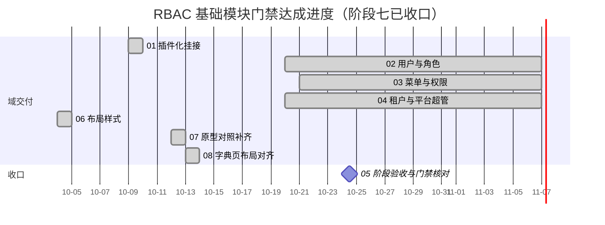

# RBAC 基础模块计划

[文档首页](../../../文档首页.md) › RBAC 基础模块计划　|　[任务基线 →](../任务/02_用户与角色/02_用户与角色.md)　[需求基线 →](../需求/00_需求_RBAC基础模块.md)

> 进度唯一落点（本文档）：**已完成 18 项，剩余 0 项**（阶段七收口于 2026-10-24；工时见 §1，门禁结论见 §5，遗留台账见 §7）

## 1. 计划说明 

- **排期对象**：阶段七 17 条需求、18 个子任务（域 01 插件化挂接 1 / 域 02 用户与角色 6 / 域 03 菜单与权限 3 / 域 04 租户与平台超管 1 / 域 05 阶段验收 1 / 域 06 布局样式 1 / 域 07 原型对照结论补齐 3 / 域 08 字典页布局对齐 2）。
- **排期口径**：自 2026-10-03 起串行排期（单人兼职），国庆假期不计入，窗口按实际滚动调整。
- **工时**：已完成 668h；剩余 0h；阶段合计 668h（`05_01` 因含跨仓口径全量对齐，由 8h 重估为 24h）。
- **里程碑锚点**：M7 = RBAC 基础模块可用（《总体项目规划》「里程碑」节）。
- **负责人**：minjian（兼职，单人）。

## 2. 已完成任务 

| 编号 | 任务 | 工时（重估） | 完成日期 | 任务文件 | 偏差与遗留 |
| --- | --- | --- | --- | --- | --- |
| 06_01 | 前端主框架布局样式（布局族 18 件补样式 / 主题令牌 / 响应式） | 24h | 2026-10-04 | [06_01](../任务/06_布局样式/06_布局样式_01_前端主框架布局样式/06_布局样式_01_前端主框架布局样式.md) | 遗留：7 项（见任务实施记录 §7 与 §7 台账） |
| 03_01 | 菜单/表单/按钮/字段挂接与动态菜单（后端 + 前端消费） | 48h | 2026-10-05 | [03_01](../任务/03_菜单与权限/03_菜单与权限_01_菜单表单按钮字段挂接与动态菜单/03_菜单与权限_01_菜单表单按钮字段挂接与动态菜单.md) | 遗留：4 项（见任务测试记录 §5 与实施记录 §5） |
| 02_05 | 用户账号归口平台（`sys_user` / `sys_account_lock` 迁 platform、identity 内部契约改指、跨库搬迁） | 16h | 2026-10-07 | [02_05](../任务/02_用户与角色/02_用户与角色_05_用户账号归口平台/02_用户与角色_05_用户账号归口平台.md) | 遗留：3 项（见任务测试记录 §6 与实施记录 §6） |
| 02_06 | 平台用户只读出口内部契约（`/api/v1/platform/internal/users/query` 服务间只读出口，供 mdm 组织只读出口取用户明细） | 8h | 2026-10-07 | [02_06](../任务/02_用户与角色/02_用户与角色_06_平台用户只读出口内部契约/02_用户与角色_06_平台用户只读出口内部契约.md) | 遗留：`dept_id` 入参与响应生效随需求 07-2 落字段（开放项 §8） 已注销… |
| 02_01 | 用户完整域后端（CRUD / 启停 / 删除 / 重置密码 / 锁定解锁）**含追加子任务** | 44h | 2026-10-09 | [02_01](../任务/02_用户与角色/02_用户与角色_01_用户完整域后端/02_用户与角色_01_用户完整域后端.md) | 无 |
| 02_03 | 角色管理（后端授权 + 前端角色管理页）**含追加子任务** | 88h | 2026-10-09 | [02_03](../任务/02_用户与角色/02_用户与角色_03_角色管理/02_用户与角色_03_角色管理.md) | 无 |
| 02_04 | 主体链权限计算引擎（含组织主数据只读出口联调）**含追加子任务 `_01` ~ `_04`（需求 `07-16` 权限计算下沉基座）** | 88h | 2026-10-20 | [02_04](../任务/02_用户与角色/02_用户与角色_04_主体链权限计算引擎/02_用户与角色_04_主体链权限计算引擎.md) | 无 |
| 02_02 | 用户管理前端（列表 / 详情 / 表单 / 账号锁定页）**含追加子任务** | 72h | 2026-10-09 | [02_02](../任务/02_用户与角色/02_用户与角色_02_用户管理前端/02_用户与角色_02_用户管理前端.md) | 无 |
| 01_01 | 具名插槽挂接消费与依赖登记（消费约定 / 降级口径 / 依赖标注 + **闭环段**：mdm 插件经 `sys.user.detail.tabs` 真挂接与缺失即隐藏验证） | 4h | 2026-10-09 | [01_01](../任务/01_插件化挂接/01_插件化挂接_01_具名插槽挂接消费与依赖登记/01_插件化挂接_01_具名插槽挂接消费与依赖登记.md) | 无 |
| 07_01 | 非界面类记录「原型对照结论」补齐（纯逻辑 / 后端 / CI / 治理 / 验收报告类 → 「不适用 + 理由」） | 12h | 2026-10-12 | [07_01](../任务/07_原型对照结论补齐/07_原型对照结论补齐_01_非界面类记录/07_原型对照结论补齐_01_非界面类记录.md) | 遗留：`preflight` 的「界面：check-prototype-review」项需 `07_02` / `07_03` 收口后转绿（见测试记录 §5） |
| 07_02 | 组件类记录「原型对照结论」补齐（件族任务 → 组件设计自带原型 + 件族截图） | 24h | 2026-10-12 | [07_02](../任务/07_原型对照结论补齐/07_原型对照结论补齐_02_组件类记录/07_原型对照结论补齐_02_组件类记录.md) | 遗留：`preflight` 的「界面：check-prototype-review」项需 `07_03`（页面类 8 份，用户另开会话执行）收口后转绿 |
| 07_03 | 页面类记录「原型对照结论」补齐（页面 / 宿主外壳 / 模块样例 → 页面原型 + 真机截图 + 识图逐页） | 16h | 2026-10-12 | [07_03](../任务/07_原型对照结论补齐/07_原型对照结论补齐_03_页面类记录/07_原型对照结论补齐_03_页面类记录.md) | 无 |
| 08_01 | 清单显式 `kind` 与前端按 `kind` 套骨架（含通用系统信息件与文档回写） | 9h | 2026-10-13 | [08_01](../任务/08_字典页布局对齐/08_字典页布局对齐_01_清单显式kind与前端套骨架/08_字典页布局对齐_01_清单显式kind与前端套骨架.md) | 无 |
| 08_02 | 现有记录页对齐（`RoleRecordTab` / `UserRecordTab`） | 7h | 2026-10-13 | [08_02](../任务/08_字典页布局对齐/08_字典页布局对齐_02_现有记录页对齐/08_字典页布局对齐_02_现有记录页对齐.md) | 无 |
| 03_02 | 三权分立与平台超管边界（内置三类管理员 + 互斥校验 + 平台超管边界） | 16h | 2026-10-19 | [03_02](../任务/03_菜单与权限/03_菜单与权限_02_三权分立与平台超管边界/03_菜单与权限_02_三权分立与平台超管边界.md) | 无 |
| 04_01 | 租户管理与平台超管（后端 + 前端） | 56h | 2026-10-20 | [04_01](../任务/04_租户与平台超管/04_租户与平台超管_01_租户管理与平台超管/04_租户与平台超管_01_租户管理与平台超管.md) | 无 |
| 03_03 | 权限元数据维护页（`_01` 菜单/表单页 40h + `_02` 业务码/动作码/权限码/图标 72h，含图标真实 CRUD 24h） | 112h | 2026-10-21 | [03_03](../任务/03_菜单与权限/03_菜单与权限_03_权限元数据维护页/03_菜单与权限_03_权限元数据维护页.md) | 无 |
| 05_01 | 阶段验收门禁核对与测试报告（**含跨仓 mdm 口径全量对齐 + 测试种子口径修复**） | 24h | 2026-10-24 | [05_01](../任务/05_阶段验收/05_阶段验收_01_阶段验收门禁核对与测试报告/05_阶段验收_01_阶段验收门禁核对与测试报告.md) | 遗留：口径修复的真实联调归部署窗口（§7 第 44 / 45 项）；前端宿主 3 份记录页 spec 环境失败（§7 第 46 项） |

## 3. 剩余任务排期（自 2026-10-03） 

| 编号 | 任务 | 状态 | 工时 | 依赖 | 排期窗口 | 备注 | 偏差与遗留 |
| --- | --- | --- | --- | --- | --- | --- | --- |

阶段七 18 项任务全部完成，无剩余进度（收口于 2026-10-24）。

## 4. 门禁达成进度 

> 阶段七 18 项任务全部完成；M7「RBAC 基础模块可用」于 **2026-10-24** 达成（7 行门禁逐条核对结论见 §5）。

## 5. M7 验收门禁 

门禁定义见《[总体项目规划](../../../规划/总体项目规划.md)》「阶段内容与完成标准」节（阶段七行）；**下表 7 行为基线（不增删），逐行内联结论与证据索引**，收口于 **2026-10-24**（阶段测试报告见 [RBAC 基础模块阶段测试报告](../01_测试报告_RBAC基础模块.md)）。补充需求 `07-9` / 任务 `06_01`（布局族样式）不属门禁条目，但为「字段权限生效」等界面消费类结论的**可视核对前提**（`06_01` 已于 2026-10-04 交付）；补充需求 `07-12` ~ `07-14` / 任务 `07_01` ~ `07_03`（原型对照结论补齐）亦不属门禁条目，但为《[原型审查规范](../../../规范/原型审查规范.md)》§4.9「未通过不得进入阶段验收」的**前置**（已全部交付，末批零命中）；补充需求 `07-15` / 任务 `08_01`、`08_02`（字典页布局对齐）同属界面口径收口（已交付）；补充需求 `07-16` / 任务 `02_04` 追加子任务（权限计算下沉基座）为「越权与跨租户访问被拒」「数据范围读写检查生效」等门禁行的**实现前提**（已交付，非 platform 服务不再 `null` 恒放行）。

| 验收点 | 对应任务 | 达成路径（结论与证据索引） |
| --- | --- | --- |
| 角色分配权限计算正确 | 02_04 | **达标（2026-10-24）**：用户直接角色读 `sys_user_role` + 岗位/部门链角色经 mdm 只读出口（服务键 `mdm`、`GET /api/v1/mdm/user-roles`，mdm 阶段一 `01_05` 归并后已对齐）跨服务汇总取并集去重；角色-岗位 / 角色-部门写端点与分支 `op`（`mdm.role-posts.assign` / `mdm.role-depts.assign`）同批对齐；用例覆盖并集去重、mdm 不可达降级、严格模式抛错、出口载荷回落（`services/platform/tests/permission/test_engine.py`，Kiwi 2269 / 2320；真库全链 `test_end_to_end.py`）。跨仓证据见 mdm 阶段一 `01_03` / `01_05` 测试记录；（限定：真实跨服务联调 → 部署窗口，§7 第 34 项） |
| 越权与跨租户访问被拒验证通过 | 02_04 / 02_01 | **达标（2026-10-24）**：入口级 `require_permission` + 权限码级判定 + 租户过滤；未命中码即拒、**未预加载从严拒绝**、校验链接缝、豁免层级（系统 / 平台超管）；**权限判定已可被全部服务真实执行**（需求 `07-16` 下沉基座，platform / identity 双服务接入，identity 5 个端点由恒放行转真实判定、跨服务不可达 fail-closed）；服务身份白名单按 `mdm` 口径收口（`require_service("mdm")`）。用例：`test_engine.py` / `test_end_to_end.py` / `tests/api/test_internal_permission.py`（Kiwi 2269 / 2320 / 2270）；（限定：其余服务接入数据来源 → §7 第 38 项） |
| 数据范围读写检查生效 | 02_03 / 02_04 | **达标（2026-10-24）**：`sys_data_scope` 四策略解析后注入读时过滤、写时校验，租户条件由注入点强制叠加；越界 / 未注册规则**永假**（区间倒置、通配符越界、策略未注册、扩展未注册）；**大集合按规则物化共享**（引用计数 + 零引用优先淘汰 + `IN` 阈值护栏，避免按用户复制）。用例：`services/platform/tests/permission/test_scope.py`、`02_04/_03` / `_04` 定向（Kiwi 2269 / 2323 / 2324 / 2248）；（限定：业务仓储 `scope_columns` 消费侧接线 → §7 第 37 项） |
| 字段权限生效 | 02_03 / 02_04 | **达标（2026-10-24）**：多角色字段权限**从严合并**、序列化层读不返回、写入口拒绝（`test_field_permission.py` 4 例 + `_01` 6 例 + `test_end_to_end.py` 写拒绝）；前端由件族按字段态显隐（`02_02` 用户管理前端测试记录 §2）；（Kiwi 2269 / 2320 / 2248 / 2277） |
| 配额超限拦截生效 | 04_01 | **达标（2026-10-24）**：`sys_tenant_quota` 三键（用户数 / 存储 / 开放接口调用量）实时增量、超限统一 `82005`、配额服务不可用 fail-open、检查 / 占用 / 释放原子性；已接「创建 / 删除用户」与「文件上传完成」两处真实链路。用例：`libs/bms_core/tests/tenant_module/test_quota_client.py`（5）、`services/tenant/tests/tenant/test_tenant_quota_internal.py`（3）、`services/file/tests/test_upload_quota.py`（3）；Kiwi 2325；（限定：`open_calls` 网关侧调用计数 → §7 第 31 项） |
| 三权互斥生效 | 03_02 / 04_01 | **达标（2026-10-24）**：内置三类管理员互斥校验在授权写入**前置**执行（三处 `sys_user_role` 写入口经 `SeparationGuard`，`30010`；角色 / 授权路径 `30048`），拒绝不写不递增版本；`role` 业务仅安全管理员持有；操作人侧护栏拦下系统 / 审计管理员的角色域写操作；**AST 机器护栏**断言写入口必调 guard 且先于写入；**开通种子互斥预授**按单一来源 `BUILTIN_ADMIN_ROLES` 编排（`04_01` 落地，`SeedOutcome.assign_conflicts` 复用互斥口径不绕过护栏）。用例：`tests/role/test_separation_guard.py`（6）、`tests/boundary/test_separation_guard.py`（5）、`tests/seed/test_seed_rbac.py`（5）；Kiwi 2314 / 2325 |
| 租户模块开关生效 | 04_01 | **达标（2026-10-24）**：`sys_tenant_module` 开关——停用 / 未开通模块接口拒 `82008`、模块注册校验 `82007`、动态菜单按模块状态剔除（存量可查）、重开即恢复；缓存命中 / 失效 / 回源失败 fail-open 均有用例。用例：`libs/bms_core/tests/tenant_module/test_gate.py`（17）、`services/tenant/tests/tenant/test_tenant_admin.py`、`services/platform/tests/services/test_my_menu_module_filter.py`（2）；Kiwi 2325；（限定：模块停用对进行中流程 / 审批的影响当前无流程数据可验 → §7 第 33 项） |

**门禁对照**：

| 验收点 | 基线（《总体项目规划》阶段七行） | 本计划实际（2026-10-24） |
| --- | --- | --- |
| 角色分配权限计算正确 | 主体链任意长度权限计算正确 | 达标（直接角色 ∪ 岗位 / 部门链并集去重；任意链深由解析器注册表扩展，主流程只做并集） |
| 越权与跨租户访问被拒验证通过 | 同基线 | 达标（入口 + 码级双轨，从严拒绝与 fail-closed 均有用例） |
| 数据范围读写检查生效 | 同基线 | 达标（四策略 + 越界永假 + 写校验 + 租户强制叠加） |
| 字段权限生效 | 同基线 | 达标（读过滤 + 写拒绝 + 前端显隐） |
| 配额超限拦截生效 | 同基线 | 达标（三键 + `82005` + fail-open） |
| 三权互斥生效 | 同基线 | 达标（前置校验 + AST 护栏 + 开通种子预授） |
| 租户模块开关生效 | 停用模块菜单 / 接口被拒、数据保留、重新开通恢复 | 达标（`82008` / `82007` + 菜单过滤 + 重开恢复） |

**里程碑对照**（《总体项目规划》「里程碑」节）：

| 里程碑 | 基线（《总体项目规划》） | 本计划实际 | 说明 |
| --- | --- | --- | --- |
| M7 RBAC 基础模块可用 | 阶段七（5 周基线，上一阶段为阶段六） | **2026-10-24 达成** | 7 行门禁逐条核对均达标；跨仓 mdm 口径漂移于收口日修复并加锁 |

## 6. 风险与对策 

| 风险 | 影响 | 对策 |
| --- | --- | --- |
| mdm 组织域未就绪（岗位 / 部门主数据与用户-岗位契约） | 岗位分配插件、岗位/部门角色分配链、组织只读出口无法真实联调 | 相关子项降级 / 占位推进（插件缺失隐藏、角色分配先覆盖用户主体）；登记外部依赖与归口，mdm 就绪后补联调 |
| 权限缓存版本失效与授权写入不一致 | 授权已改而权限未即时生效 | 授权写入与版本递增同事务；缓存读取校验版本；用例覆盖即时生效 |
| 字段权限读过滤漏接序列化层 | 敏感字段越权返回 | 序列化层统一过滤不可见字段；读写双向用例覆盖 |
| 数据范围规则未强制叠加租户过滤 | 跨租户数据泄漏 | 规则解析结果强制叠加租户条件；跨租户规则拒绝并用例覆盖 |
| 权限计算实现落在服务包、其余服务校验恒放行 | 非 platform 服务越权不被拦（权限码形同虚设） | **已立项消解**：需求 `07-16` 把判定与计算下沉共享基座，各服务接入后 `require_permission` 真实生效（`04_01` 因此搁置待其完成，已于 2026-10-20 交付） |
| 数据权限大集合（百万 / 千万级）下 `IN` 列表膨胀与内存爆炸 | 查询不可用、进程 OOM | **已立项消解**：需求 `07-16` 集合按规则物化共享（不按用户复制）+ 容量淘汰 + 大集合走 SQL 算子 / 扩展式；实测集合约 106 字节/项，按规则共享后可控制在几百 M |
| 租户开通重型操作半途失败 | 残留半开通租户 | 建库 / 迁移 / 种子任一步失败清理已建库并告警；幂等键防重复开通 |
| 模块开关只拦前端入口 | 停用模块仍可经接口写数据 | 前端入口 + 后端接口双拦；停用模块接口返回明确错误码并用例覆盖 |
| 布局族样式缺口（`ui-ep` 18 件无样式实现） | 主框架外壳裸骨架，界面消费与页面交付观感受限、界面类验收无据 | **已消解**：需求 `07-9` / 任务 `06_01` 先行补足并于 **2026-10-04 交付**（样式一律入件 `scoped` + 设计令牌；令牌与 EP 映射同步补全） |
| 单人兼职投入不稳 | M7 延期 | 串行保守排期；先打通「元数据挂接 → 角色授予 → 权限计算 → 用户管理」主链，租户与验收可顺延补 |

## 7. 后续阶段待办 

| # | 事项 | 来源 | 归口 |
| --- | --- | --- | --- |
| 1 | **mdm 组织域实施**：`org_dept` / `org_post` / `org_user_post` 与用户-岗位契约、角色-岗位 `org_role_post` / 角… | 审 07-2 / 07-3 / 07-4；`01_01` 闭环依赖；mdm 概要 02 §5.4 | 已交付 |
| 2 | 会话管理页 / 个人中心收口 | 需求范围外 | 阶段十五 |
| 3 | 操作 / 登录日志落库与哈希链、Socket.IO 实时推送后端 | 需求范围外；阶段六遗留 | 阶段八 |
| 4 | 字段 / 展示类组件回补 | 需求范围外 | 阶段八 |
| 5 | **用户导入入口与 Excel 批量导入流程**（**范围外**：需求 `07-2` 第 6 条原列「导入入口」，2026-10-22 拍板标范围外，入口与流程一并归口；用户管理页… | 审 07-2；概要 03 | 阶段八 通用能力（Excel 导入导出） |
| 6 | 自定义图标管理（`icon:manage`） | 审 07-5；概要 07 | 已交付（2026-10-21） |
| 7 | 平台业务页面（列表导出 `export` / 查询方案 `query`）消费 RBAC 权限 | 审 07-3 / 07-5 | 对应业务阶段 |
| 8 | 布局族组件视觉样式缺失（`ui-ep` 的 `layout/` 18 件无样式） | 2026-10-03 启动链路排查 | 已交付（2026-10-04） |
| 9 | 文档校验脚本：界面类任务「原型依据」登记校验（机器护栏） | 2026-10-04 规范强化 | 工具治理（判定口径须先设计，随下次文档校验批次或界面任务前立项） |
| 10 | `useResponsive` 同一档位内缩放不重算断点 | `06_01` 实测 | 响应式改进（后续界面任务） |
| 11 | 多标签栏「更多」溢出按钮未接线、标签拖拽排序 / 中键关闭未实现（菜单展开状态持久化已随 `03_01` 落地） | `06_01` 实测；`03_01` 部分收口 | 标签 / 导航族后续任务 |
| 12 | 顶栏业务内容装配 | `06_01` 实测；2026-10-05 复核补修 | 已交付 |
| 13 | EP 组件完整深色适配与亮色色阶变化统一评估 | `06_01` 实测 | 品牌化阶段 |
| 14 | 菜单种子图标键为小写 / kebab-case，与官方注册表 PascalCase 不一致 | 2026-10-05 复核 | 前端已兼容（`IconRenderer` 归一） |
| 15 | 具名插槽「显式上下文注入通道」（基座需求 `05-11`） | 审 `07-3`；需求 `05-11` | 已交付 |
| 16 | 用户与账号表迁归 platform（`sys_user` / `sys_account_lock`） | `02_03` 落点改定（2026-10-07） | 已完成 |
| 17 | 权限配置内容件（菜单 / 表单 / 数据权限三页签）待组件库返工 | `02_03` 详设 §6.3 | 已闭环（2026-10-08） |
| 18 | 菜单管理维护页（`/api/v1/forms` 改 `menu_ids` 后入口关联编辑 UI 未交付） | `02_03` 与 `03_01` 遗留 | 已交付（2026-10-21） |
| 19 | `01_01` 闭环段：mdm 插件经 `sys.user.detail.tabs` 真挂接 + 缺失即隐藏验证 | `01_01` 拆口径 | 已闭环（2026-10-09） |
| 20 | 角色码可改与内置判定脱钩 | 2026-10-08 用户复核 | 已交付（2026-10-08） |
| 21 | 需求 `07-11` 用户-部门多分配与主要岗位 / 主要部门 | 审 `07-2`；原型迭代（2026-10-09） | 已交付（2026-10-09） |
| 22 | 宿主 `session.codes` 恒空（按权限显隐失效） | `02_03/_02` 真机走查 | 已修根因（2026-10-09） |
| 23 | 权限计算下沉基座（需求 `07-16`，`02_04/_01` ~ `_04`） | 2026-10-19 `04_01` 开工前复核 | 已交付（2026-10-20） |
| 24 | 权限计算服务化（可选演进：拆独立 `permission` 服务） | 《微服务演进规划》「权限归口」；需求 `07-16` | 可选演进（`RESERVED_SERVICE_KEYS` 已预留） |
| 25 | **用户头像 URL**（规划阶段七行与需求总览曾列入 07-2） | 2026-10-22 阶段七核对 | 口径变更（2026-10-22 拍板）：归阶段十五个人中心 |
| 26 | `/form-keys` 不含 `menu` / `form`，`pageRoute.resolve` 对两页返回 `undefined`（路由已由声明装载、页面可用） | `03_03/_01` 实施记录 §6 | 如需两页参与通用页面解析：先修订《数据库开发规范》系统字段口径并增列，另立任务 |
| 27 | 菜单树拖拽无障碍（键盘调序）未实现 | `03_03/_01` 实施记录 §6 | 交互增强任务 |
| 28 | 权限元数据各页导出按钮按原型置灰占位（导出能力未立项） | `03_03/_01` / `_02` 实施记录 §6 | 导出 / 查询方案阶段 |
| 29 | `src/dev/FieldCheck.vue` 从 `@bms/ui-ep` 导入 `OptionSetSnapshot`（实际由 `@bms/core` 导出），类型检查基线报… | `03_03/_01` 实施记录 §6 | 开发态核对页维护（非交付物） |
| 30 | 图标 SVG 仅做类型 / 大小 / 危险内容基础拒绝，深度清洗未做 | `03_03/_02` 实施记录 §6 | 文件管理阶段 |
| 31 | 开放接口调用量（`open_calls`）配额只登记维度与读写契约，网关侧调用计数未接 | `04_01` 实施记录 §6 | 开放平台 / 网关阶段 |
| 32 | 归档策略仅写 `sys_config` 四键（四类审计日志 90 天），归档执行器未接 | `04_01` 实施记录 §6 | 审计合规模块 |
| 33 | 模块停用后「进行中流程 / 审批不受影响」当前无流程数据可验 | `04_01` 实施记录 §6 | 工作流阶段 |
| 34 | 三库（MySQL / PostgreSQL / 达梦）真库建库与迁移未执行 | `04_01` / `02_01` / `02_05` 实施记录 §6 | 部署联调任务 |
| 35 | 已部署库需执行 `ops.seed_platform` / `bootstrap_platform` / `seed_menu` 补齐平台 RBAC 与 `tenant:*` | `04_01` 实施记录 §6 | 运维步骤（部署窗口） |
| 36 | 本地静态护栏受 Windows 环境影响（外置依赖版本解析 / 路径分隔符）；另 `preflight` 的 `{python}` 占位符取运行解释器，系统 Python 缺 `sqlalchemy` 时「网关」步骤误报 | `04_01` / `02_04` 实施记录 §6；`05_01` 收口（2026-10-24） | 预检工具（非任务缺陷）：本地以仓内 venv 解释器运行 `preflight` 即全通过 |
| 37 | 数据范围**消费侧接线**：业务仓储需声明 `scope_columns`、写入口需传 `scope_columns`（仓内暂无调用方） | `02_04/_01` / `_04` 实施记录 §6 | 各业务模块落地 |
| 38 | 其余服务（tenant / file / txn / ai / report / search / notification）仍走 `null` 占位 | `02_04/_01` 实施记录 §6 | 各服务按需接入（实现数据来源 + `prepare_settings` 登记，不改基座） |
| 39 | 事件订阅式失效（mdm `org.*` → 版本 +1）与跨副本同步清理未做 | `02_04/_01` / `_02` 实施记录 §6 | 阶段八 事件总线接入 |
| 40 | 权限缓存内存指标仅有 `stats()` + 装配日志，无 HTTP / Prometheus 出口 | `02_04/_03` 实施记录 §6 | 可观测性阶段 |
| 41 | 同数据源 `select`（`in`）与 `match`（`like`）并存退化为合取（从严）；数据源维度条件子查询化 | `02_04/_04` 实施记录 §6 | 后续演进（真并集 / 子查询形态需另立任务） |
| 42 | `preflight` 定向档在 `-n auto` 下覆盖率数据合并出现随机缺口（串行采集稳定 100%） | `02_04/_02` 实施记录 §6 | 预检基础设施（`scripts/tools/preflight/`，13_02 归口） |
| 43 | 设计口径类（无动作）：`item_code` 存量不做批量迁移、阈值改动需重启并重建缓存仓、`_user_keys` 可能残留过期版本键、字段权限 provider 留服务侧 | `02_04/_01` ~ `_04` 实施记录 §6 | 设计口径（已定，无需回改） |
| 44 | **跨仓口径漂移**：mdm `01_05` 归并服务标识 `org` → `mdm` 后，bms 侧五类消费点（权限解析器服务键与出口路径、用户 / 角色分配内部写通道、XA 分支 `op`、服务身份白名单、权限码种子与前端产品命名空间）仍按旧口径 | `05_01` 收口核对（2026-10-24） | 已闭环（2026-10-24）：全量对齐 + `test_m7_closure.py::test_mdm_alignment_lockdown` 锁定；**真实跨服务联调仍归部署窗口**（第 34 项） |
| 45 | 平台测试种子只播种静态目录、未含产品清单行 → 装配含产品行时接库对账报「库中缺登记行」并整批拒启 | `05_01` 收口核对（2026-10-24） | 已闭环（2026-10-24）：`ops.seed_module` 改播种「平台清单 + 已装载产品清单」合并视图；模块目录用例改按登记清单断言 |
| 46 | 前端宿主 3 份记录页 spec（`user-record-tab` / `menu-record-tab` / `user-assign-slot`，50 例）因 Element Plus `ElTabPane` 运行时断言失败（`HEAD` 同样失败，非阶段七引入） | `05_01` 收口复跑（2026-10-24） | 前端组件库 / 依赖版本核对（CI Linux 口径为准） |

**台账说明**：

- **逐条归口**：46 行全部给出「来源 + 归口」，**无「无归口」条目**；编号保持既有口径、不重编号（既有任务记录与报告中的「§7 第 N 项」引用继续有效）。
- **闭环汇总（14 项）**：第 1（mdm 组织域实施，2026-10-22 收尾含 `01_02/_04`）、6（自定义图标）、8（布局族样式）、12（顶栏业务内容）、14（图标键归一）、15（插槽注入通道）、16（账号表迁归 platform）、17（权限配置内容件）、18（菜单管理维护页）、19（`01_01` 闭环段）、20（角色码可改）、21（用户-部门多分配）、22（`session.codes` 根因）、23（权限下沉基座），另 **44 / 45** 于本轮闭环。
- **去向分布**：后续阶段 22 项、各业务模块 / 各服务按需接入 4 项、部署联调 / 运维窗口 4 项、设计口径 2 项。
- **口径同步更正**：第 39 项所述事件域 `org.*` 已随 mdm `01_05` 归并为 `mdm.*`（事件域 `mdm`），该项结论不变（事件订阅式失效仍归阶段八）；第 35 项补一句——已部署库除 RBAC / 菜单种子外，还需重跑 `ops.seed_module` 使模块目录与产品清单一致。
- **非缺陷说明**：第 36 项（Windows 环境静态护栏）与第 46 项（Element Plus 断言）均为**环境类**，不计入产品缺陷，不影响门禁结论。
