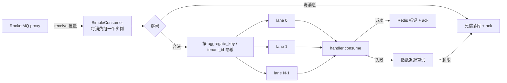

# 事件总线详细设计（Outbox 投递 + 消费组 + 幂等重试死信）

> 通用能力 · 01 异步底座 · 01 事件总线 · 详细设计

[文档首页](../../../../../../文档首页.md) › [08 通用能力](../../../../README.md) › [异步底座](../../01_异步底座.md) › [事件总线](../01_异步底座_01_事件总线.md) › 详细设计　|　[需求 03-1](../../../../需求/03_需求_消息与任务.md#r03-1) · [阶段计划](../../../../计划/01_计划_通用能力.md) · [架构 · 事件总线](../../../../../../设计/架构设计/16_架构设计_子系统_事件总线.md)

## 1. 概述 <a id="overview"></a>

- **目标**：把事件总线的**发布轨与消费轨**从占位落成真 broker 运行时，并补齐架构 §6 要求的幂等短窗口、消费重试与死信、链路贯通。阶段二已交付「事务性发件箱 + 轮询投递器 + 消费幂等账本」（`sys_outbox` / `sys_event_consumed` / `sys_event_dead_letter` 三表、`SqlOutboxStore`、`PollOutboxDispatcher`、`ProcessedEventStore`），本任务**不重做**这些，只补它们缺的那一段：

  1. **发布实现**：`RocketMqEventPublisher`（插件名 `rocketmq`）——投递器现经 `EventPublisher` 端口转发，端口不变、换实现；
  2. **消费组运行时**：`BaseEventConsumerGroup` 端口 + `RocketMqEventConsumerGroup` 实现（SimpleConsumer 主动拉取 + 组内键级串行执行器 + 优雅停机），装配落点 `app.state.event_consumer_group`（现为「仅预热、无落点」）；**组声明各产品自持、基座统一装载**（新增 `event_consumer_records()` 服务工厂钩子，与 `service_records()` / `table_records()` / `form_records()` 同范式，见 §4.3）；同一运行器支持**两种宿主**——服务进程 lifespan 或独立 worker 进程（`ops/event_consumer.py --worker`），先不新增服务目录与镜像；
  3. **幂等两层**：Redis 短窗口**只读预判 + 成功后标记**（避免把至少一次降成至多一次）+ 现有 `ProcessedEventStore` 唯一约束兜底；
  4. **重试与死信**：应用内有限指数退避 → 超限落 `sys_event_dead_letter`（`source=consumer`）→ 指标 + error 日志告警；
  5. **链路贯通**：`sys_outbox` 增 `trace_id` 列（平台链 / 租户链），投递保真，消费端以 `traceparent` 续接 span；
  6. **运维入口**：`ops/event_consumer.py`（单轮消费诊断 / 组订阅清单），与既有 `ops/outbox.py` 对称。

- **依据**：《[架构设计 · 事件总线](../../../../../../设计/架构设计/16_架构设计_子系统_事件总线.md)》§2 事件模型 / §4 生产一致性 / §5 消费组架构 / §6 幂等与重试；《[后端开发规范](../../../../../../规范/后端开发规范.md)》§10「事件与任务规范」；《[命名规范](../../../../../../规范/命名规范.md)》§10「基础设施命名」；需求 [03-1](../../../../需求/03_需求_消息与任务.md#r03-1)；兄弟设计 [Outbox 与幂等消费](../../../../../02_后端基座与服务化地基/任务/05_服务间通信与一致性/05_服务间通信与一致性_03_Outbox%20与幂等消费/设计/01_详细设计_03_Outbox%20与幂等消费.md)。
- **范围**：上述 1~6。
- **不含（归口见 §8）**：具体业务消费组（审计链组 → 任务 06_02、日志落库组 → 06_01、通知组 → 07_01、Webhook 组 → 既有 `webhook_sender` 接入方）；ES / embedding 消费组；任务调度（01_02）；事件契约规则本身（已交付）；Outbox 表保留期清理（归档阶段）。

## 2. 现状与差距（设计 vs 代码不符清单） <a id="gap"></a>

> 本节是动手前的对账结果。**「处置」列写明本段改什么、回写什么、留什么**，不含含糊项。

| # | 关注点 | 架构 / 任务要求 | 代码现状 | 处置 |
| --- | --- | --- | --- | --- |
| 1 | 事件发布 | 业务不直连 MQ，经统一发布组件投递到 RocketMQ | `[event].provider = ""` → `NullEventPublisher`，`publish` 空操作，事件写进 `sys_outbox` 后投递器「投递成功」但什么都没发出去 | **本段改**：新增 `rocketmq` 发布实现 |
| 2 | 消费运行时 | 四个消费组（审计链 / 日志 / Webhook / 通知）并行消费 | `[event_consumer].provider = ""` → `NullEventConsumer`；装配接线 `state_attr=None`，**无 `app.state` 落点**；无 broker 拉取、无组、无订阅运行时 | **本段改**：新端口 + 真实实现 + 落点 |
| 3 | 消费组边界 | 架构 §5 列 6 个组（含 ES / embedding 后续组） | 无「组」概念：`EventConsumer` 只有 `event_type` + `consume`，一个实例等于一个处理器，无法承载「一组多处理器 + 组级有序」 | **本段改**：端口升为「组集合运行器」，处理器契约保留 `EventConsumer` |
| 4 | 同租户串行 | 审计链组「分区有序，分区键 = 租户」 | 发件箱侧已按 `(aggregate_key, id)` 同聚合仅投队首（`claim_pending`）；**消费侧无任何顺序保证**；Python gRPC 客户端无 Java FIFO topic 语义 | **本段改**：组内键级串行执行器（同键必落同道、道内串行） |
| 5 | 幂等短窗口 | §6「Redis SETNX 短窗口 + 业务唯一约束兜底」 | 只有 DB 兜底（`ProcessedEventStore` 事务内查 + `(consumer, event_id)` 唯一）；**无 Redis 短窗口** | **本段改**：新增「只读预判 + 成功后标记」（见 §4.5，刻意不用处理前 SETNX） |
| 6 | 消费重试 | §6「消费失败指数退避（有限次）→ 死信」 | 投递侧有退避与转死信；**消费侧无重试、无死信写入路径**（`sys_event_dead_letter.source=consumer` 无生产代码） | **本段改**：应用内重试 + 死信落库 |
| 7 | 死信载体 | §6「转死信 topic 落库标记」 | 只有库表看板，无死信 topic | **回写架构**：以库表为唯一死信载体（`topic` 方案在 gRPC 客户端下需额外建 topic 与订阅，收益为零）；设计 §10 记决策 |
| 8 | topic 命名 | §2 `bms.{事件域}.{事件}`，示例 `bms.log.operation` / `bms.wf.task` | 无 topic 派生代码；事件名是**三段** `{域}.{对象}.{动作}`，与示例的**两段** topic 无法直接映射 | **本段定规则并回写架构**：`topic = bms.{域}.{对象}`（事件名前两段），见 §4.1 |
| 9 | 信封字段 | §2 五字段（`type` / `event_id` / `tenant_id` / `occurred_at` / `payload`） | `EventEnvelope` 有 8 字段且复数名 `event_type`（`trace_id` / `aggregate_key` / `event_version` 为后续扩展） | **回写架构 §2**：补全字段表并以 `event_type` 为准（与表列同名） |
| 10 | 链路贯通 | 日志 / Trace 关联调用链 | `EventEnvelope.trace_id` 存在，但 `sys_outbox` **无 `trace_id` 列**，`OutboxRecord.to_envelope()` 不设 `trace_id` → 消费端必然丢链路 | **本段改**：加列 + 写入/读取/重建三处保真 |
| 11 | 重复投递 | 至少一次语义 | `claim_pending` 无行锁 / 无 `SKIP LOCKED`：多实例同时轮询会把同一批事件各发一次（消费端幂等可收敛，但产生重复流量） | **本段不改**（单实例投递）；记为开放项，多实例时按租约或 `FOR UPDATE SKIP LOCKED` 改造 |
| 12 | broker 接入 | 部署已备 RocketMQ 5.3.2 双容器 | `base.yml` 已 `--enable-proxy`，但**只映射 9876 / 10911**；无 `[rocketmq]` 配置节、无 `BMS_ROCKETMQ__*` 环境变量；开发服务器文档记「待部署」 | **本段改**：暴露 8081（gRPC proxy）、加配置节与环境变量、更新端口登记 |
| 13 | 依赖 | — | `backend` 依赖树无任何 MQ 客户端（`pyproject` 仅有 `opentelemetry-instrumentation-celery` 这类埋点包）；无 `celery` 运行时 | **本段改**：新增 `rocketmq-python-client` 依赖（见 §4.2 选型） |
| 14 | 迁移脚本 | 表文件记「已落库（平台链 `0003` / 租户链 `0002`）」 | 仓内 `alembic/versions/` **只有 `.gitkeep`**，无任何迁移脚本；建表实际走启动期 `ensure_unit_schema` + `ops/baseline_series.py` 基线行 | **本段按现状处置**：改 ORM 模型 + 表设计文件；开发库用 `ALTER` 补列或重建（`create_all` 不补列）；正式迁移脚本随域清单体系落地再补，记开放项 |
| 15 | 配置注释 | — | `config.toml` 两处注释写「真实消费随阶段十集成消息可用」「消费轨随阶段十」，与本任务口径不符 | **本段改**：注释改为「随 01_01 事件总线交付」 |
| 16 | 订阅声明 | §6、`EventSubscription` 要求消费方声明「消费标识 + 事件类型 + 支持主版本」，升主版本前须覆盖全部订阅 | `PLATFORM_EVENT_SUBSCRIPTIONS` **恒为空表**，`check_subscription_coverage` 与启动校验实际空转（没有任何消费方真的声明过） | **本段改**：由 `event_consumer_records()` 声明驱动订阅登记，让覆盖校验有效 |

## 3. 交付物清单 <a id="tree"></a>

```text
backend/
├── pyproject.toml                                    # 改：workspace 依赖增 rocketmq-python-client
├── libs/bms_core/pyproject.toml                      # 改：依赖增 rocketmq-python-client>=5.1.2
├── config.toml                                       # 改：[event].provider=rocketmq、[event_consumer] 全量参数、新增 [rocketmq]
├── config.dev.toml                                   # 改：同上（开发期连真 broker）
├── config.test.toml                                  # 改：保持空 provider（单测不连 broker）
├── libs/bms_core/src/bms_core/
│   ├── core/error_codes.py                           # 改：EVENT_CONSUME = 10014
│   ├── core/exceptions.py                            # 改：EventConsumeError（10014 / 500）
│   ├── core/config.py                                # 改：RocketMqSettings + EventConsumerSettings 扩参数 + Settings.rocketmq
│   ├── core/assembly.py                              # 改：event_consumer 接线换端口 + state 落点 + 注册两实现工厂
│   ├── metrics/base.py                               # 改：METRIC_NAMES 增消费 / 死信指标
│   ├── events/
│   │   ├── base.py                                   # 改：BaseEventConsumerGroup 端口 + 组规格；EventConsumer 保留为处理器契约
│   │   ├── topic.py                                  # 新：topic 派生 + 信封编解码（纯函数，可单测）
│   │   ├── consumer_records.py                       # 新：EventConsumerRecord（组声明）+ 合并去重与校验
│   │   ├── lane.py                                   # 新：KeyedLaneExecutor（同键串行、跨键并发）
│   │   ├── dedup.py                                  # 新：EventConsumeDedup（Redis 只读预判 + 成功后标记）
│   │   ├── rocketmq_publisher.py                     # 新：RocketMqEventPublisher
│   │   ├── rocketmq_consumer.py                      # 新：RocketMqEventConsumerGroup（拉取 / 分发 / 重试 / 死信 / 停机）
│   │   ├── dead_letter.py                            # 新：消费死信落库（平台库独立事务）
│   │   └── null.py                                   # 改：增 NullEventConsumerGroup
│   ├── application.py                                # 改：BaseServiceApplicationFactory 增 event_consumer_records() 钩子
│   ├── models/outbox.py                              # 改：SysOutbox 增 trace_id 列
│   └── outbox/store.py                               # 改：enqueue 写 trace_id、_to_record 读 trace_id
├── libs/bms_core/src/bms_core/outbox/base.py         # 改：OutboxRecord 增 trace_id 字段 + to_envelope 保真
├── ops/event_consumer.py                             # 新：消费诊断 CLI（--groups / --once / --worker --service）
├── libs/bms_core/tests/
│   ├── events/test_event_topic.py                    # 新：topic 派生 + 编解码往返
│   ├── events/test_event_lane.py                     # 新：同键串行 / 跨键并发 / 关闭排水
│   ├── events/test_event_dedup.py                    # 新：预判 / 标记 / Redis 降级
│   ├── events/test_event_consumer_records.py         # 新：声明校验 / 合并去重与异值即拒 / 订阅登记
│   ├── events/test_event_group.py                    # 新：装载 / 订阅汇总 / 重复装载 / null 组
│   ├── events/test_rocketmq_publisher.py             # 新：消息构造 / 异常包装（替身 producer）
│   ├── events/test_rocketmq_consumer.py              # 新：拉取→分发→ack、重试、死信、毒消息、停机
│   ├── events/fake_broker.py                         # 新：内存 broker 替身（收 / 发 / ack / 重投）
│   ├── outbox/test_outbox_store.py                   # 改：trace_id 写入与读回
│   └── integration/test_event_bus_rocketmq.py        # 新：真 broker 端到端（无 endpoints 自动跳过）
├── services/platform/tests/                          # 改：钩子装载用例（自持声明 → 统一装载）
└── ../deploy/compose/base.yml                        # 改：rocketmq-broker 增 8081:8081（gRPC proxy）
```

## 4. 领域设计 <a id="design"></a>

### 4.1 事件信封与 topic 派生 <a id="topic"></a>

**信封不变**：`EventEnvelope`（`event_type` / `payload` / `tenant_id` / `trace_id` / `event_id` / `occurred_at` / `aggregate_key` / `event_version`）字段与语义**零改动**——它是阶段二已交付、被 23 条平台契约与快照 `deploy/events/contracts.json` 依赖的对外契约。

**topic 派生规则**（本段定，回写架构 §2）：

```text
topic = "bms." + 事件名前两段
sys.user.created   → bms.sys.user
wf.task.completed  → bms.wf.task
notification.sent  → bms.notification.sent   （两段事件名 → 全取）
```

理由：一是与架构示例（`bms.log.operation` / `bms.wf.task`）同形；二是**按「域 + 对象」聚合**，同对象的多个动作落同一 topic（`wf.task` 承载 completed / rejected / created），topic 数量不随动作数膨胀；三是订阅仍按 `event_type` 精确匹配（组内注册），topic 只承担通道与分区职责。

**编解码**（`events/topic.py`，纯函数、无 IO，单测 100% 覆盖）：

| 项 | 规则 |
| --- | --- |
| body | 完整信封 JSON（UTF-8，`ensure_ascii=False`，`sort_keys=True` 保证确定性） |
| 消息属性 | `event_id` / `event_type` / `event_version` / `tenant_id` / `aggregate_key` / `trace_id` / `occurred_at`（ISO8601）/ `traceparent`（有 OTel 时） |
| keys | `event_id`（MQ 侧可按幂等键检索） |
| tag | 事件动作段（`event_type` 末段），供过滤 |
| 解码 | 先读属性，缺失回落 body；**body 解析失败即毒消息**（不重试，直接死信） |

`tenant_id` 缺失不视为非法（平台链事件无租户）；`event_type` 缺失或不符合 `EVENT_TYPE_RE` 视为毒消息。

### 4.2 发布实现 <a id="publish"></a>

`RocketMqEventPublisher(EventPublisher, BaseAsyncResource)`，`plugin_name = "rocketmq"`：

- `setup()`：按 `[rocketmq]` 建 `ClientConfiguration` + `Producer`（topic 集合在首次发布时按需 `startup`，避免启动期枚举全部 topic）；
- `publish(event)`：`encode_event` → `asyncio.to_thread(self._send_sync, msg)`（**官方 SDK 是同步阻塞 API，必须离开事件循环**，否则一次网络抖动拖垮整个进程的请求）；
- `publish_transactional(event)`：**基线委托 `publish`**。架构 §4 写明「RocketMQ 事务消息为备选、当前不作基线」，基线一致性由 Outbox 保证；接口保留以便后续切换。
- 失败：抛 `EventPublishError`（复用 `10009` `OUTBOX_DELIVERY` 段语义，不新增码——投递器只按异常分支处理）；`aclose()` 幂等 shutdown。

**选型**：`rocketmq-python-client`（模块名 `rocketmq`，Apache 官方 v5 gRPC 客户端，纯 Python）。备选的 `rocketmq-client-python`（4.x，C++ 绑定）在 Windows 开发机无法安装，直接排除。

### 4.3 消费组端口与运行时 <a id="consume"></a>

**端口**（`events/base.py`）：

```text
BaseEventConsumerGroup(BasePluggable, BaseAsyncResource, ABC)   plugin_key = "event_consumer"
├── load(records: Sequence[EventConsumerRecord]) -> None   # 装载声明（装配期调用一次）
├── register(*, group: str, handler: EventConsumer, ordered: bool = False) -> None
├── subscriptions() -> list[EventSubscription]        # 供契约覆盖校验与启动日志
├── consume_once(*, max_messages: int) -> ConsumedTally   # 单轮（可测 / 可诊断）
├── start() / stop()                                  # 后台循环生命周期
└── enabled -> bool
```

- 处理器契约**沿用现有 `EventConsumer`**（`event_type` + `consume(event)`）——已交付、已被 `audit` 等域引用，不改。
- `BaseEventConsumer` 保持原样（处理器中间层），**装配端口改为 `BaseEventConsumerGroup`**，`PLUGIN_WIRINGS` 中该键的 `state_attr` 由 `None` 改为 `event_consumer_group`。
- `NullEventConsumerGroup`：`load` 记内存但不启动、`consume_once` 返回空汇总（`[event_consumer].provider = ""` 时行为与今天完全一致，不破坏任何既有用例）。

#### 4.3.1 声明与装载：各产品自持，基座统一装载 <a id="consumer-records"></a>

消费组的**声明归属提供方**，基座不预置任何业务组、不出现产品标识。口径与既有四个钩子完全同构：

| 钩子（`BaseServiceApplicationFactory`） | 自持方返回 | 基座动作 |
| --- | --- | --- |
| `service_records()` | 本产品服务目录记录 | 与 `SERVICE_CATALOG` 合并为应用级视图，启动/接库双向对账 |
| `table_records()` | 本产品表归属清单 | 装配期登记 + 合并视图 → `app.state.table_ownership`（同表异值即拒） |
| `form_records()` | 本产品 `form_key` 清单 | `merge_form_records()` → `app.state.form_registry` |
| `capability_usages()` | 本服务的能力使用与降级策略 | 装配期登记 + 启动 fail-closed 校验 |
| **`event_consumer_records()`（本段新增）** | **本服务的消费组声明（组名 / 事件类型 / 有序 / 并发 / handler 工厂）** | **合并去重 → `group.load()` → 订阅登记默认注册表 → 启动校验** |

**声明契约**（`events/consumer_records.py`）：

```text
EventConsumerRecord(BaseValueObject)           # frozen dataclass，插入序稳定（与 CapabilityUsage 同类）
├── consumer: str            # 组名（{group_prefix}.{域}，如 bms.audit.chain）
├── event_type: str          # 订阅的事件类型（须已登记契约）
├── handler_factory: Callable[[], EventConsumer]   # 工厂而非实例：每次进程独立实例，避免跨进程共享状态
├── ordered: bool = False    # True → 该组 lane 固定 1（审计链组）
├── concurrency: int | None = None                 # 组级并发覆盖（None 取全局）
└── description: str = ""
```

> 基类取 `BaseValueObject`（同 `FormRecord` / `CapabilityUsage`）：它是**构建期声明**、含不可落库的 handler 工厂，不是与库行对齐的登记记录（那类走 `BaseRegistryRecordContract`，如 `TableRecord` / `ModuleRecord`）。

**合并规则**（`merge_event_consumer_records()`）：同 `(consumer, event_type)` 同值去重、**异值即拒**（组名与事件类型撞车但 handler 不同 = 声明漂移）；`consumer` 不带 `group_prefix` 时按配置补齐。

**装载时机与失败语义**：
- 装配点：应用构造期把工厂钩子返回值写入 `app.state.event_consumer_records`；`service_lifespan` 在 `assemble_plugins` **之前**取该值 → `merge_event_consumer_records()` → `group.load(records)`（必须先于 `setup()`，因为 `setup()` 里要 `start()`）；
- 启动校验（fail-closed，拒启）：`event_type` 不符合 `EVENT_TYPE_RE`、首段非已登记事件域、事件未登记契约、`ordered` 组合非法（有序组并发 > 1）、组名为空；
- 订阅登记：每条记录登记 `EventSubscription(consumer=组名, event_type=..., supported_majors=(1,))`，使 `check_subscription_coverage` 与「升主版本前须覆盖全部订阅」真正有约束力（今天订阅清单是空表，形同虚设）。

**跨仓口径**：产品仓的组声明写在**自己的服务包**（与 `service_records()` 同处），基座零改动即可装载；产品事件契约仍走既有 `register_product_event_contracts` 扩展点。CI 侧校验归口见 §8 开放项 4。

#### 4.3.2 两种宿主（C 方案落地） <a id="hosts"></a>

同一运行器、同一份声明，两个宿主可选：

| 宿主 | 启动方式 | 适用 |
| --- | --- | --- |
| 服务进程内 | 随 `service_lifespan` 装配，`[event_consumer].enabled` 开关 | 默认；事件量小、多数服务只有一个组 |
| 独立 worker 进程 | `python -m ops.event_consumer --service <服务key> --worker` | 消费与 API 隔离、单服务消费扩容、灰度迁移 |

- worker 入口**按同一钩子装载**：动态取该服务的 `ApplicationFactory.event_consumer_records()`，不引入第二套声明；不启 HTTP、不挂路由；
- 两种宿主**互斥**：同一组名不得在两个宿主同时跑（否则组内消费竞争、顺序语义被破坏）——由 `[event_consumer].host`（`in_service` / `worker`）+ 启动日志与 `ops` 诊断命令核对，设计口径写进配置注释；
- 正式服务化（新服务目录 / 镜像 / 编排 / 网关）**不在本段**：等真需要独立扩缩容或独立发布节奏时再做，届时只改编排，代码零改动。

#### 4.3.3 服务化落地清单（现状核对） <a id="service-ization"></a>

架构与服务化链路**本身支持** `event-worker`（《[架构设计 · 部署与运维](../../../../../../设计/架构设计/33_架构设计_部署与运维.md)》§11 已登记「event-worker 消费组」；《[命名规范](../../../../../../规范/命名规范.md)》§10 已登记 Compose 服务名 `event-worker`），缺的只是机械登记。现有各环节核对如下：

| 环节 | 现有能力 | 新增 worker 服务要动的点 |
| --- | --- | --- |
| 服务目录 | `SERVICE_CATALOG`（`ModuleRecord`）+ 产品自持清单 + 接库双向对账 | 加一行目录记录（`module_key` / `service_key` / `event_domain` / `service_group` / `build_batch`）；产品服务侧走 `service_records()` 自持 |
| 镜像 | `backend/Dockerfile` 已 `--build-arg SERVICE` 参数化，且只装 `bms_core` + 目标服务 + `ops` | `Dockerfile` 增 2 行 `COPY`（目标服务 `pyproject.toml` 与 `src`）；`known-first-party` 增包名 |
| 编排 | `deploy/compose/services.yml` 每服务一条 + `BMS_TAG_<SERVICE>` 必填（防 latest） | 加一条 service + 发布脚本注入标签变量 |
| CI | 父流水线每服务显式 trigger job + `deploy/ci/templates/backend-service.yml` 参数化子流水线（test / build / Trivy / release） | 父流水线加一段 trigger + 契约冒烟 job 段 |
| 网关 | `gateway_services()` 对「`status=enabled` 且 `service_key` 非空」自动生成 upstream 与 `/api/{service_key}/v1` | **无需改**：worker 保留 HTTP 监听（仅探针），业务路由前缀无匹配返回 404；若要彻底排除，需给目录行加「不参与网关」字段（基座 2 处改动），本段不做 |
| 拓扑 / 单元 | `domain_layout.json` 域 → 承载服务；`[topology].units` 支持按实例承载集合 | worker 不承载业务域 → 不登记域；需把消费固定到某实例时用 `[topology].units` |
| 探针 | `/healthz` `/readyz` 由基座统一挂载；compose 当前**无 healthcheck** | 若 worker 完全不起 HTTP，探针不可用 → 正式服务化时保留端口只跑探针最省事，也免改基座 |
| 发布台账 | `ops/release.py` + 按 `enabled_service_keys()` 建库 / 发布 | worker 若 enabled 会被建一个空库（可接受）；不想建库则登记为无表服务 |

**结论**：能承接，成本是上表 6 处登记 + 1 处形态决策（是否监听端口 / 进网关），**不改运行器与声明代码**——这正是本段只做 `host` 开关、把声明与宿主解耦的原因。

**运行时**（`RocketMqEventConsumerGroup`，单进程内 N 个组）：



- **拉取模式**：`SimpleConsumer` 主动 `receive(max_message_num, visibility_timeout)`，而非 `PushConsumer` 回调。原因：回调里既要等业务完成再 ack，又要控制重试次数，推送模式的线程模型与 asyncio 混用极易卡死；拉取模式控制权在应用，停机时先停拉取、等在途完成，语义清晰可测。
- **ack 时机**：整批分发完成后统一 `ack` **成功与已死信**的消息；失败未超限的不 ack，靠 `visibility_timeout` 重投（与 broker 语义一致，不做「本地 sleep 重试阻塞队列」）。
- **重试**：应用内最多 `max_retries` 次（默认 3），退避 `backoff × 2^(n-1)`；超限落死信并 ack。
- **毒消息**：解码失败、`event_type` 非法、订阅不支持该主版本 → **不重试**，直接死信（重试只会阻塞队列）。
- **组隔离**：一个组异常不影响其他组（每组独立循环任务，异常捕获后按 `poll_interval` 续跑）。

### 4.4 键级串行执行器 <a id="lane"></a>

`KeyedLaneExecutor(lanes: int)`：N 条 `asyncio.Queue` + 每道一个 worker 协程。

- 道索引 = `blake2b(key).digest()[0] % lanes`，**同 key 必落同道**，同道串行 → 该 key 的事件严格按拉取顺序处理；
- key 取 `aggregate_key`，空则回落 `tenant_id`，再空回落 `event_id`（独立事件互不影响）；
- `ordered=True` 的组（审计链组）`lanes = 1`：全组串行，链序绝对正确；其余组默认 `[event_consumer].concurrency`；
- `aclose()`：置停止标志 → 排空队列中已入队任务 → 取消 worker（`stop()` 先停拉取再 `aclose()`，保证不丢在途）。

### 4.5 幂等：两层、三处 <a id="idempotency"></a>

| 层 | 位置 | 作用 | 失效影响 |
| --- | --- | --- | --- |
| L1 短窗口 | `EventConsumeDedup`（Redis） | 挡住 broker 重投 / Outbox 重复投递在秒级窗口内的重复 | 降级放行，L2 兜底 |
| L2 长账本 | `ProcessedEventStore`（`sys_event_consumed` 唯一） | 与业务副作用**同一本地事务**，语义级「效果一次」 | 无（权威） |

**关键取舍：L1 不用处理前 `SETNX`，改「只读预判 + 成功后标记」**。若照架构字面用 `SETNX` 占位，第一次处理**失败回滚**时 DB 没有 `sys_event_consumed` 记录，而 Redis 已占位 → 窗口内的重投被跳过 → **至少一次退化成至多一次，事件永久丢失**。故：

```text
consume 前：EXISTS  bms:global:event:consumed:{group}:{event_id}  → 命中即跳过（ack）
consume 后：SET ... EX {dedup_ttl_seconds}                       → 仅在业务成功提交后标记
```

键口径按《命名规范》`bms:{租户|global}:{域}:{业务键}`：`bms:global:event:consumed:{group}:{event_id}`（跨租户共享，group 已带语义）。TTL 默认 600s（重投窗口远小于此）。

Redis 不可用时**降级放行**（warn 日志 + `bms_capability_degrade_total{capability=event_dedup}` 计数）：判据是《后端开发规范》§10「降级后语义仍正确」——L2 唯一约束仍在，语义正确。这与幂等键（`IdempotencyStore`）的 fail-closed 不同，原因写在代码注释里，避免后来者误改成 fail-closed 把事件流停死。

### 4.6 重试与死信 <a id="dead-letter"></a>

- 死信记录写入 `sys_event_dead_letter`（`source = consumer`，`consumer = 组名`，`event_id` / `event_type` / `aggregate_key` / `tenant_id` / `payload` / `error_msg`（截断 512）/ `retry_count` / `occurred_at`）；
- **落平台库**：既有看板接口 `GET /api/v1/outbox/dead-letters` 读平台库，消费死信若落各租户库则看板聚合不到；故统一落平台库，独立会话独立事务（不挂在消费者业务事务上，业务回滚不能让死信消失）；
- 告警：`event_dead_letter` error 日志（含 `group` / `event_id` / `event_type`）+ 指标 `bms_event_dead_letter_total{consumer}`；告警规则由监控侧接（本段只保证信号存在且基数有界）；
- 重投：复用 `ops/outbox.py replay --event-id`（重置发件箱）或死信看板 `replayed` 处置；死信本身不自动重投（人工/运维介入，避免毒消息循环）。

### 4.7 链路贯通 <a id="trace"></a>

1. **写入**：`SqlOutboxStore.enqueue` 取 `resolve_trace_id()`（此时仍在请求上下文，有值）写入 `trace_id`；
2. **保真**：`OutboxRecord.trace_id` → `to_envelope()` 回填 `EventEnvelope.trace_id`；
3. **发布**：有 OTel 时以 `opentelemetry.propagate.inject` 生成 `traceparent` 属性（W3C 标准，跨语言可读），无 OTel 时写 `trace_id` 属性；
4. **消费**：先 `extract` 建消费 span（父 span = 生产端 span），无 OTel 时 `set_current_trace_id(event.trace_id)` 让日志带上原链路 id——排障时能从消费日志跳回原始请求。

`trace_id` 列**可空**：历史行与平台链无链路事件保持 NULL，不强制回填。

### 4.8 装配、配置与生命周期 <a id="wiring"></a>

**配置**（`config.toml`；开发 `config.dev.toml` 同值；`config.test.toml` 保持空 provider）：

```toml
[rocketmq]
# gRPC proxy 接入点（broker 容器 --enable-proxy 后监听的 8081；不是 9876/10911）
endpoints = "127.0.0.1:8081"
namespace = ""
access_key = ""            # 密钥经 BMS_ROCKETMQ__ACCESS_KEY 注入，不入库
secret_key = ""
request_timeout_seconds = 3.0

[event]
provider = "rocketmq"      # 空串 = null（占位，不投递）

[event_consumer]
provider = "rocketmq"      # 空串 = null（组只装载不启动）
enabled = true
host = "in_service"        # in_service = 随服务进程起；worker = 仅由 ops/event_consumer.py --worker 起（两者互斥）
group_prefix = "bms"
concurrency = 4            # 每消费组默认 lane 数
batch_size = 32
poll_interval_seconds = 1.0
visibility_timeout_seconds = 30
max_retries = 3
retry_backoff_seconds = 1.0
dedup_ttl_seconds = 600
```

**装配**（`core/assembly.py`）：

| 能力键 | 端口 | 实现 | state 落点 |
| --- | --- | --- | --- |
| `event` | `EventPublisher` | `rocketmq` / `null` | `event_publisher`（不变） |
| `event_consumer` | `BaseEventConsumerGroup` | `rocketmq` / `null` | **`event_consumer_group`（本段新增）** |

工厂 `RocketMqEventConsumerGroupFactory(settings, app, resources)`：注入 `EngineRegistry` / `SessionFactory` / `BaseMetrics` / 共享 Redis 客户端。`setup()` 内按 `[event_consumer].host` 决定是否 `start()`（`worker` 宿主下服务进程只装载不启动）；`aclose()` 先 `stop()`（停拉取）再排水再 shutdown（随 `ResourceManager` 逆序回收）。

**装载入口**（`BaseServiceApplicationFactory.event_consumer_records()`，默认空清单）：

- `service_lifespan` 在 `assemble_plugins` **之前**取 `app.state.event_consumer_records`（由工厂钩子写入，构造期收集）+ 工厂钩子返回值 → `merge_event_consumer_records()` 去重 → `group.load(records)`；
- 装载即登记 `EventSubscription`，因此**订阅覆盖面由真实声明驱动**，不再是空表；
- 未覆写钩子的服务（绝大多数平台服务）行为与今天一致：零声明、零订阅、组不启动。

`ops/event_consumer.py` 作为 worker 宿主时复用同一入口：`--service <服务key>` → 动态取该服务 `ApplicationFactory` → 取 `event_consumer_records()` → 构造组运行器 → 长驻，不启 HTTP。

### 4.9 与现有契约的兼容面 <a id="compat"></a>

| 现有对象 | 影响 | 处置 |
| --- | --- | --- |
| `EventEnvelope` | 无字段增删 | 不动（快照 `deploy/events/contracts.json` 零漂移） |
| `EventPublisher` 端口 | 投递器经它转发 | 不动；新增实现即可 |
| `PollOutboxDispatcher` | 调 `publisher.publish` | 不动（换 provider 即生效） |
| `EventConsumer`（处理器） | 保留 `event_type` + `consume` | 不动，作为组的处理器契约 |
| `NullEventConsumer` | 既有无装配引用 | 保留（handler 占位），新增 `NullEventConsumerGroup` 承接装配 |
| `BaseEventConsumer` | 原为 `event_consumer` 域端口 | 保留类与契约；装配端口改为 `BaseEventConsumerGroup`（`contract_version` 新起 `1.0.0`，因端口语义变更不升旧版本号） |
| `BaseServiceApplicationFactory` | 钩子清单增一项 | 新增 `event_consumer_records()`（默认空清单，未覆写零影响）；不引入进程级注册表 |
| `EventSubscription` / 契约校验 | 订阅清单长期为空表 | 由组声明驱动登记，`check_subscription_coverage` 与启动校验开始真正生效 |
| `ProcessedEventStore` | 消费幂等权威 | 不动 |
| `sys_outbox` / `SysOutbox` | 增 `trace_id` 列 | 同步改表文件 + 模型 + store + record |
| 装配测试 `test_plugin_registration` / `test_capability` | 断言 `event_consumer` 域端口是 `BaseEventConsumer` | 同步改为 `BaseEventConsumerGroup`（3 处） |
| `sys_event_dead_letter.source` | 已含 `consumer` 枚举 | 复用，无需改表 |

### 4.10 开发期真 broker 运行方式 <a id="dev-broker"></a>

1. **起 broker**（本机 docker，`deploy/compose/base.yml`）：`rocketmq-nameserver` + `rocketmq-broker`；`bms.yml` 的 `include: base.yml` 已带上；
2. **必改**：broker 服务增 `ports: - "8081:8081"`（`--enable-proxy` 的 gRPC 端口，**这是 Python 客户端唯一入口**，9876 / 10911 是 remoting 与 HA，客户端用不到）；
3. **验证**：`backend` 侧 `[rocketmq].endpoints = "127.0.0.1:8081"`（容器内部署用 `BMS_ROCKETMQ__ENDPOINTS=rocketmq-broker:8081`）；
4. **连通自检**：`uv run python -m ops.event_consumer --groups`（打印已装载组与订阅，不发消息）+ `--once`（单轮拉取）；发布侧 `uv run python -m ops.outbox dispatch`；
5. **worker 宿主自检**：`uv run python -m ops.event_consumer --service platform --worker`（不启 HTTP，长驻消费）；与 `host=in_service` 二选一，验证同一份声明在两种宿主下装载出的组与订阅一致；
6. **端到端验证**（完成标准的可复现脚本）：起 broker → 业务写一条事件（或 `ops.outbox` 手工插入）→ 观察 `sys_outbox.status` 由 `pending` 转 `delivered` → 消费组日志出现同 `event_id` → `kill -9` 投递器进程模拟中断 → 重启后事件补投且 `sys_event_consumed` 只有一行；
7. **开发服务器**（mjbk）：broker 记「待部署」，若部署需防火墙放行 `8081` 并更新《开发服务器部署使用说明总览》端口表；
8. **CI / 单测不连 broker**：`config.test.toml` 保持空 provider，全部单测用内存替身；真 broker 用例标 `integration`，缺 `BMS_ROCKETMQ__ENDPOINTS` 自动 skip。

## 5. 失败分支与边界 <a id="failures"></a>

| 场景 | 行为 | 依据 / 风险 |
| --- | --- | --- |
| broker 不可达（发布） | `EventPublishError` → 投递器 `mark_failed` 退避重试，超限转死信 | 不失事件；Outbox 是账本 |
| broker 不可达（消费） | 组循环捕获异常 → warn 日志 → 按 `poll_interval` 重试；不退出进程 | 不因 MQ 抖动拖垮服务 |
| 消费业务异常（可重试） | 应用内退避重试 ≤ `max_retries`，之后死信 | 不无限重投 |
| 毒消息（解码失败 / 版本不支持） | 直接死信 + ack | 重试无意义，会阻塞队列 |
| Redis 不可用（幂等预判） | 降级放行 + warn + 降级指标 | L2 唯一约束兜底，语义正确 |
| 死信落库失败 | error 日志 + 指标，**消息不 ack**（留待重投） | 宁可重复不可丢；下一轮仍会进死信路径 |
| 进程停机（SIGTERM） | 停拉取 → 等在途完成 → shutdown；未 ack 消息由 broker 重投 | 与「停机摘流先于排空」口径一致 |
| 同 `event_id` 并发到达（两实例） | L1 可能双双放过 → L2 唯一约束拒其一，后者回滚重试后命中账本跳过 | 效果一次 |
| `aggregate_key` 为空且无租户 | 回落 `event_id` 作 lane 键，事件互不影响 | 无顺序诉求 |
| outbox 多实例重复投递 | 仍可能重复发（无行锁） | 消费端幂等收敛；记开放项 |
| 同一组被两个宿主同时消费（`in_service` + `worker` 都开） | 组内竞争消费，顺序语义被破坏；启动日志与 `ops --groups` 可发现 | 由 `[event_consumer].host` 单值约束 + 部署评审把关；不做运行期互斥（需分布式租约，收益低） |
| 组声明的事件未登记契约 | 启动 fail-closed 拒启（`EventContractError`） | 与「先登记契约再发布」同源 |
| 组声明重复（同组名同事件、handler 不同） | `merge_event_consumer_records()` 异值即拒 | 防跨产品声明漂移 |

## 6. 测试设计与验收映射 <a id="tests"></a>

| 完成标准（任务 §3 / 需求 03-1） | 用例 |
| --- | --- |
| 投递器中断恢复后事件补投且不重复生效 | `test_rocketmq_consumer`（拉取→未 ack 重投→L2 命中跳过）+ 集成用例（杀进程后重启） |
| 同一 `event_id` 只产生一次副作用 | `test_event_dedup`（预判 / 标记 / 降级）+ `test_consumed`（既有，唯一约束） |
| 死信有告警 | `test_rocketmq_consumer`（超限落 `sys_event_dead_letter` + `source=consumer` + 指标计数） |
| 同租户链序正确 | `test_event_lane`（同键顺序 / 跨键并发）+ `test_rocketmq_consumer`（`ordered` 组串行） |
| 类型与 topic 命名符合登记规范 | `test_event_topic`（派生规则 / 非法事件名 / 编解码往返） |
| 消费组声明「自持 + 统一装载」（架构 §5 可验证前提） | `test_event_consumer_records`（未登记契约拒启 / 有序组并发非法 / 合并异值即拒）+ `services/platform/tests`（钩子返回声明 → `subscriptions()` 可见） |

覆盖率门禁按《[测试规范](../../../../../../规范/测试规范.md)》：新增模块 100% 行 + 分支。无 broker 环境下 `integration` 用例跳过，**不计入**覆盖率分母（沿用既有集成用例口径）。

## 7. 登记落点 <a id="registry-writeback"></a>

| 文档 | 回写内容 |
| --- | --- |
| 《[架构设计 · 事件总线](../../../../../../设计/架构设计/16_架构设计_子系统_事件总线.md)》§2 | topic 派生规则（前两段）、信封字段补全为 `event_type` 八字段 |
| 同上 §6 | 死信以库表为唯一载体（无死信 topic）；幂等为「只读预判 + 成功后标记」 |
| 同上 §5 | 消费组运行时形态（拉取 + 键级串行），ES / embedding 仍为后续 |
| 《[后端基类清单](../../../../../../后端基类清单.md)》§9 / 《[后端基类实现契约](../../../../../../设计/基类体系/后端基类实现契约.md)》 | 新增 `BaseEventConsumerGroup` / `RocketMqEventConsumerGroup` / `NullEventConsumerGroup` / `EventConsumerRecord` / `KeyedLaneExecutor` / `EventConsumeDedup` 及继承链；`event_consumer` 端口变更；`BaseServiceApplicationFactory` 钩子增 `event_consumer_records()` |
| 《[后端开发规范](../../../../../../规范/后端开发规范.md)》§10 | 补一句消费组口径：声明归提供方服务、经 `event_consumer_records()` 装载，基座不预置业务组 |
| 《[数据库设计 · sys_outbox](../../../../../../设计/数据库设计/数据表设计/sys_outbox.md)》 | 增 `trace_id` 字段与变更记录 |
| 《[数据库设计总览](../../../../../../设计/数据库设计/01_数据库设计_总览.md)》 | 状态列「已落库」与迁移链口径与实际对齐（见 §8 开放项） |
| 《[命名规范](../../../../../../规范/命名规范.md)》§10 | topic 派生规则一句（`bms.{域}.{对象}`） |
| 《[开发服务器部署使用说明总览](../../../../../../资料/开发服务器/linux/开发服务器部署使用说明总览.md)》 | rocketmq 端口增 `8081`，状态由「待部署」更新 |
| [阶段计划](../../../../计划/01_计划_通用能力.md) | 01_01 状态与偏差（进度唯一落点） |

## 8. 边界与开放项 <a id="boundary"></a>

1. **迁移脚本缺口**：表文件记「已落库（`0003` / `0002`）」，但仓内 `alembic/versions/` 无脚本。本段只改模型与表文件，`trace_id` 在开发库用 `ALTER TABLE` 补列（SQLite / MySQL 各一条），**不新造迁移脚本**——正式迁移口径随域清单体系统一落地，避免此处造一套与后续不一致的脚本。
2. **Outbox 多实例投递**：`claim_pending` 无行锁，多实例并发会重复投递。当前单实例部署，记开放项；启用多实例前必须加租约或 `FOR UPDATE SKIP LOCKED`。
3. **业务消费组不在本段**：本段只交付运行时与「自持声明 + 统一装载」机制。审计链组 / 日志组 / 通知组 / Webhook 组随 06_01 / 06_02 / 07_01 与 `webhook_sender` 接入方在自己服务的 `event_consumer_records()` 里声明；因此「真实业务链序」的最终验收在那些任务，本段以测试用例与 `ordered` 组保证机制正确。
4. **跨仓产品组的 CI 校验**：产品仓组的声明在各自服务包内，平台仓 CI 只 clone 自身、看不到产品声明；订阅覆盖与契约一致性目前由**各产品仓自己的启动校验 + `ops/event_contracts.py check`** 保证。若后续需要跨仓统一对账，应在产品清单（`deploy/registry/*.toml`）扩展一个订阅段，而不是在基座里硬编码产品组——记开放项，本段不做。
5. **死信无自动重投**：只有人工/运维 `replayed`，防毒消息循环；批量重投 UI 随监控阶段。
6. **Kiwi 用例编号**：本段尚未在 Kiwi 登记用例编号，测试文档记「编号待登记」，不编造。

## 9. 实施步骤 <a id="steps"></a>

| 批次 | 内容 | 验证 |
| --- | --- | --- |
| 1 | 契约层：`events/topic.py`、`EventConsumerRecord` 与合并校验、`BaseEventConsumerGroup` 端口、`event_consumer_records()` 钩子、`NullEventConsumerGroup`、配置与装配接线 | `ruff check` + `ruff format` + `pyright` + `pytest tests/events` |
| 2 | 执行层：`KeyedLaneExecutor`、`EventConsumeDedup`、死信落库 | 同上 + `test_event_lane` / `test_event_dedup` |
| 3 | 发布实现：`RocketMqEventPublisher` + 依赖 + `[rocketmq]` 配置 | 同上 + `test_rocketmq_publisher` |
| 4 | 消费实现：`RocketMqEventConsumerGroup` + `ops/event_consumer.py`（`--groups` / `--once` / `--worker`） | 同上 + `test_rocketmq_consumer` |
| 5 | 链路列：`SysOutbox.trace_id` + store/record 保真 + 表文件 | `pytest tests/outbox` + `test_base_inheritance.py` |
| 6 | 部署与文档：`base.yml` 暴露 8081、配置注释、§7 全部回写 | 文档三件套 + 开发环 |

每批独立提交；批 5 完成后跑一次 `scripts/tools/preflight/测试改动内容.py`（不含覆盖率门禁），推送前按《[AI开发规范](../../../../../../规范/AI开发规范.md)》走推送环。

## 10. 决策记录（对齐记录） <a id="align"></a>

| # | 决策 | 备选与取舍 |
| --- | --- | --- |
| 1 | 消费组**两种宿主**：随服务进程（`host=in_service`）或独立 worker 进程（`host=worker`，`ops/event_consumer.py`）；本段不新增服务目录 / 镜像 / 编排 | 纯进程内会在每个服务重复起消费循环、也无法把消费与 API 的发布节奏分开；纯独立服务在本阶段要新增服务登记 / 镜像 / 编排 / 网关 / 发布台账，成本远高于收益。两宿主共用同一运行器与同一份声明，服务化只是换宿主 |
| 2 | 客户端用官方 `rocketmq-python-client`（v5 gRPC） | 4.x C++ 绑定在 Windows 开发机装不上；自研 remoting 协议维护成本不可接受 |
| 3 | topic = 事件名前两段（`bms.{域}.{对象}`） | 全部域 + 对象 + 动作会爆 topic 数量；按动作建 topic 也无法承载「同对象多动作」的消费组 |
| 4 | 消费用 `SimpleConsumer` 主动拉取，不用 `PushConsumer` 回调 | 推送回调要「等业务完成再 ack」，与 asyncio 混用易卡死；拉取模式可测、可优雅停机 |
| 5 | 组内键级串行（lane），审计链组 lane=1 | 整组单线程拖累 Webhook / 通知组；依赖 broker FIFO 在 gRPC SDK 下不可保证 |
| 6 | 幂等 L1 为「只读预判 + 成功后标记」，不用处理前 SETNX | 处理前占位会在失败回滚后跳过重投，把至少一次降成至多一次 |
| 7 | Redis 不可用时降级放行（与幂等键 fail-closed 相反） | L2 唯一约束兜底，语义正确，符合「降级后语义仍正确才允许降级」 |
| 8 | 死信只落库，不建死信 topic | 库表已是权威看板，死信 topic 需额外建 topic + 订阅 + 消费方，收益为零 |
| 9 | `sys_outbox` 加 `trace_id` 列，不塞 payload | payload 属事件契约（只增不删、保留键禁用），塞进去污染契约 |
| 10 | 消费死信统一落平台库 | 看板接口读平台库，落租户库则聚合不到 |
| 11 | `event_consumer` 装配端口由 `BaseEventConsumer` 换为 `BaseEventConsumerGroup`，新契约版本 `1.0.0` | 扩旧端口会破坏「一个消费者 = 一个处理器」语义；旧类保留不删，装配测试同步改 3 处 |
| 12 | **消费组声明各产品自持、基座统一装载**：新增 `event_consumer_records()` 服务工厂钩子，返回 `EventConsumerRecord`；基座合并去重后装载，**不设进程级注册表** | 与既有 `service_records()` / `table_records()` / `form_records()` / `capability_usages()` 完全同构：清单在提供方、基座不改常量、装配期统一装载成应用级视图。进程级注册表会让「谁声明了什么」无处对账、也无法按服务隔离，故不采用 |
| 13 | 组声明用 **handler 工厂**而非实例 | 实例在装配期创建会跨进程 / 跨测试共享状态，服务未启用消费时也白建对象；工厂只在组启动时调用 |

## 11. 参考文档 <a id="ref"></a>

- 《[架构设计 · 事件总线](../../../../../../设计/架构设计/16_架构设计_子系统_事件总线.md)》§2 / §4 / §5 / §6
- 《[架构设计 · 服务间通信与分布式一致性](../../../../../../设计/架构设计/37_架构设计_子系统_服务间通信与一致性.md)》
- 《[后端开发规范](../../../../../../规范/后端开发规范.md)》§10「事件与任务规范」
- 《[测试规范](../../../../../../规范/测试规范.md)》《[命名规范](../../../../../../规范/命名规范.md)》§10
- 《[数据库设计 · sys_outbox](../../../../../../设计/数据库设计/数据表设计/sys_outbox.md)》《[sys_event_consumed](../../../../../../设计/数据库设计/数据表设计/sys_event_consumed.md)》《[sys_event_dead_letter](../../../../../../设计/数据库设计/数据表设计/sys_event_dead_letter.md)》
- 兄弟设计：[Outbox 与幂等消费](../../../../../02_后端基座与服务化地基/任务/05_服务间通信与一致性/05_服务间通信与一致性_03_Outbox%20与幂等消费/设计/01_详细设计_03_Outbox%20与幂等消费.md)
- 官方客户端：Apache RocketMQ Python SDK（`rocketmq-python-client` 5.1.2，gRPC proxy 接入）

> 本文档依《[文档生成规范](../../../../../../规范/文档生成规范.md)》《[任务文档规范](../../../../../../规范/任务文档规范.md)》编写 · 进度以阶段计划为唯一落点
