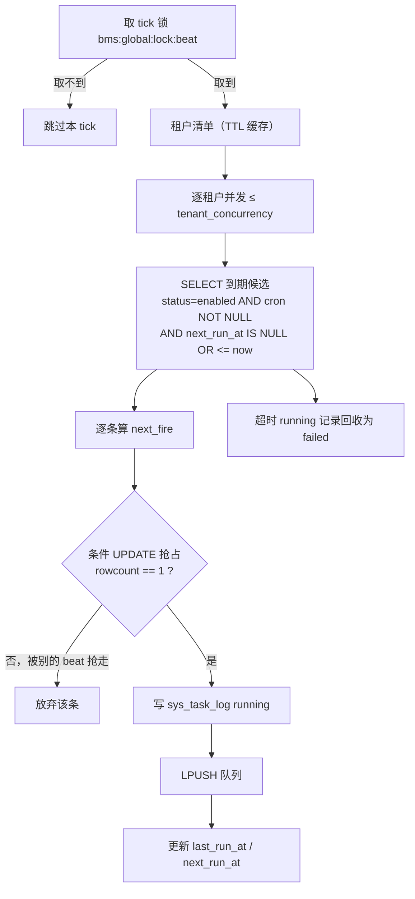
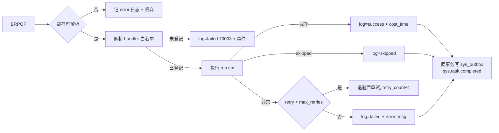

# 任务调度详细设计（sys_task + 数据库调度器 + 自研执行器）

> 通用能力 · 01 异步底座 · 02 任务调度 · 详细设计

[文档首页](../../../../../../文档首页.md) › [08 通用能力](../../../../README.md) › [异步底座](../../01_异步底座.md) › [任务调度](../01_异步底座_02_任务调度.md) › 详细设计　|　[需求 03-2](../../../../需求/03_需求_消息与任务.md#r03-2) · [阶段计划](../../../../计划/01_计划_通用能力.md) · [架构 · 任务调度](../../../../../../设计/架构设计/17_架构设计_子系统_任务调度.md)

## 1. 概述 <a id="overview"></a>

- **目标**：把「定时任务」从散落脚本 / 人工执行，落成**任务定义入库、可页面管理、有执行记录、失败可重试可查**的运行时设施。01_01 已交付事件总线（Outbox / 投递器 / 消费组 / 幂等死信）与 `sys.task.completed` 契约；本段补的是**任务侧**：调度、抢占、派发、执行、记录、事件。

  1. **表**：`sys_task` / `sys_task_log` 补齐需求 03-2 与概要 §4.1 的字段（`args` / `last_run_at` / `next_run_at` / `remark`、`cost_time` / `error_msg` / `trigger_source` / `retry_count` / `run_id`），两表由 `PLANNED` 转 `ENABLED` **进租户链**；
  2. **cron**：自研 5 段解析与 `next_fire` 计算（纯函数、分钟粒度、UTC），不引第三方 cron 库；
  3. **调度器（beat）**：单副本长驻进程，逐租户扫描到期任务，**数据库条件 UPDATE 抢占** `next_run_at` + `bms:global:lock:beat` 双保险，抢占成功才派发；
  4. **执行器（worker）**：自研 Redis 队列消费者（`LPUSH` / `BRPOP`），多副本横向扩展，应用内有限重试 + 终态落事件；
  5. **手动触发与 API**：`/api/v1/tasks` 八个接口（增删改查 / 启停 / 触发 / 执行记录），权限码复用已落种子的 `task:query` / `task:manage` / `task:trigger`；
  6. **内置任务**：孤儿分片清理 / 日志归档 / 分片表预创建 / 软删除残留清理四条种子入库，执行体为**可运行的占位实现**（返回 `skipped` 并落归口任务号）；
  7. **热加载**：任务变更经 Redis pub/sub 唤醒 beat，**只做唤醒、不承担正确性**（正确性由周期轮询兜底）；
  8. **运维入口**：`ops/task_scheduler.py`（`--beat` / `--worker` / `--once` / `--list`），与既有 `ops/outbox.py`、`ops/event_consumer.py` 对称。

- **依据**：《[架构设计 · 任务调度](../../../../../../设计/架构设计/17_架构设计_子系统_任务调度.md)》§2 任务模型 / §3 调度器设计 / §4 执行与重试 / §5 内置任务清单；《[概要设计 · 任务调度](../../../../../../设计/概要设计/23_概要设计_任务调度.md)》§2 / §4 / §5 / §7；《[后端开发规范](../../../../../../规范/后端开发规范.md)》§10「事件与任务规范」；《[命名规范](../../../../../../规范/命名规范.md)》§10「基础设施命名」；需求 [03-2](../../../../需求/03_需求_消息与任务.md#r03-2)；兄弟设计 [01_详细设计_01_事件总线](../../01_异步底座_01_事件总线/设计/01_详细设计_01_事件总线.md)。
- **范围**：上述 1~8。
- **不含（归口见 §8）**：四条内置任务的**真实清理逻辑**（分别归 03_01 / 06_01 / 06_02 / 13 / 14）；前端任务页面（阶段十三）；产品自持任务的 handler 登记（`task_handlers()` 钩子）；`sys_config` 覆盖运行参数（02_02）；租户时区调度（05_02）；事件总线本身的任何改动。

## 2. 现状与差距（设计 vs 代码不符清单） <a id="gap"></a>

> 本节是动手前的对账结果。**「处置」列写明本段改什么、回写什么、留什么**，不含含糊项。

| # | 关注点 | 架构 / 任务要求 | 代码现状 | 处置 |
| --- | --- | --- | --- | --- |
| 1 | 能力域语义 | 任务调度 = 任务定义库 + 调度器 + 执行器 | `tasks/` 只有 `BaseTask`（`name` / `queue` / `run`）+ `NullTask`，语义是「一进程一个任务」，不是任务库 | **本段不动该端口**：`BaseTask` 保留为历史插件位（`[task].provider = ""` → `NullTask`），调度器不进装配面（宿主是独立进程，无应用态）。见 §4.7、决策 9 |
| 2 | 表字段（定义） | 需求 03-2 §1 / 概要 §4.1：`name` / `handler` / `cron` / `args` / `status` / `last_run_at` / `remark` | `SysTask` 缺 `args` / `last_run_at` / `remark`；多出 `form_key` / `code` / `enabled` / `parent_id`（系统字段口径，保留） | **本段改**：加 4 列（多出 `next_run_at` 作调度热路径），保留系统字段；`enabled` 与 `status` 双列按「写入同步、读取只认 `status`」收敛（§4.1） |
| 3 | 表字段（记录） | 概要 §4.1：`task_id` / `status` / `cost_time` / `error_msg` / `started_at` / `finished_at` | `SysTaskLog` 只有 `result`（TEXT），无 `cost_time` / `error_msg` / `trigger_source` / `retry_count` / `run_id` | **本段改**：加 5 列，`result` 语义收窄为「成功输出摘要」 |
| 4 | 表进链 | 表要能被启动期建表、被 `<服务>/tests` 迁移链断言覆盖 | 两表 `TABLE_OWNERSHIP` 均 `status=PLANNED`（注记「未定稿，不进链」）→ `create_all` / `ops.init_schema` **不建表**，调度一跑即 `no such table` | **本段改**：`TableStatus.PLANNED → ENABLED`，随 platform 服务的租户链建表 |
| 5 | 表文件 | 表结构以表文件为唯一事实源（§3.2 顺序：表文件 → 模型 → 建表 → 状态回写） | `sys_task.md` / `sys_task_log.md` 与模型同构，同样缺上述字段，且写「本阶段仅结构声明，不建表」 | **本段改**：先改两份表文件（含变更记录），再改模型，再建表落地，最后回写总览状态 |
| 6 | cron 解析 | §3「按 cron 计算 next_run」 | 全仓**无 cron 解析代码**（仅 `codecheck/base.py` 注释提到「cron 合法性不归该出口」） | **本段改**：`tasks/cron.py` 纯函数解析 + `next_fire` |
| 7 | 调度器 | celery-beat 单副本 + 自研数据库调度器周期扫描 | 无 beat、无 `next_run_at`、`[task]` 段无任何调度参数（只有 `provider` / `options`） | **本段改**：`tasks/scheduler.py` + `[task_scheduler]` 配置节 |
| 8 | 执行器 / 队列 | worker 多副本执行、失败有限次重试 + ack 防丢 | `celery` **不在依赖**（只有 `opentelemetry-instrumentation-celery` 埋点包）；`deploy/compose/` 无 `celery-worker` / `celery-beat`（命名规范 §10 已登记这两个 compose 名，编排里没有）；无 `sys_task_log` 写入路径 | **本段改**：自研 Redis 队列执行器（决策 1），**架构 §1/§3/§4 的「Celery」表述回写为自研执行器** |
| 9 | 热加载 | §3「CRUD / 启停 → Redis pub/sub 通知 beat 重载」 | 全仓 **pub/sub 使用 0 处**；无任何变更通知机制 | **本段改**：`tasks/signal.py`（`PUBLISH` + 订阅唤醒），口径为「唤醒信号 + 轮询兜底」（决策 5） |
| 10 | 单副本 | §3「Redis 分布式锁 `bms:global:lock:beat` 防双调度」 | 锁能力域齐备（`RedisDistributedLock` + `build_lock_key(tenant=None, resource="beat")` → 正是该 key），但**无使用者**；Redis 不可用 fail-closed（`10012`） | **本段用**：锁 + 数据库条件 UPDATE **双保险**（§4.3、决策 3） |
| 11 | 触发入口 | 需求 §3「手动触发不受周期限制（`task:trigger`）」 | `services/platform/api/` 无 tasks 路由；`ops/` 无 task 脚本；`domains/task/public.py` 是空占位 | **本段改**：8 个 REST 接口 + `ops/task_scheduler.py` |
| 12 | 内置任务 | §5 列出 4 条（+ 备份、账号锁定、帮助巡检等） | 无任何实现；且前置能力全未开工（文件管理 03_01、日志审计 06、分片 13、回收站 13/14） | **本段改**：4 条种子 + **占位执行体**（返回 `skipped` + 归口任务号，决策 2）；备份 / 账号锁定 / 帮助巡检不在本段（§8） |
| 13 | 完成任务事件 | §4「执行完成落 `sys.task.completed`」 | 契约已登记（`deploy/events/contracts.json` v1.0.0，`task_id` / `status` 均 required string），**但无发布点** | **本段改**：终态经 `sys_outbox` 同事务入队发布 |
| 14 | 权限与菜单 | `task:manage` / `task:trigger` | 种子已就位（`tenant/seed/menu.py`：`task` 菜单 + `task:query` / `task:manage` / `task:trigger`）；`registry/forms.py` 有 `form_key="task"` | **本段用**：API 直接引用；查询走 `task:query`（决策 8） |
| 15 | 错误码 | 概要 §7.1：`70001`~`70006` | `ErrorSegment.NOTIFY_TASK = 7` 段位已定，段内 `70xxx` **零占用** | **本段改**：新增 6 个错误码 + 异常类，同步 `test_exception_constructors_paths.py` |
| 16 | 多租户 | 概要用「租户库」承载任务定义与记录 | `sys_task` / `sys_task_log` 归属 `Tenant` 库；`tenant_refs(url)` 可枚举租户（`migrate_tenants` 已用此口径），`EngineRegistry` 可懒加载任意租户库 | **本段用**：beat 逐租户扫描（§4.3），租户清单带 TTL 缓存 |
| 17 | 时区 | 架构未定 | 表用 UTC 时间列，无时区字段 | **本段定**：cron 按 **UTC** 解释（决策 6），租户时区留开放项 |
| 18 | 配置注释 | — | `config.toml` `[task]` 注释写「调度入库随阶段六」 | **本段改**：注释改为「随 01_02 任务调度交付；本段只留历史插件位」 |
| 19 | 迁移脚本 | 表文件记「随落库阶段补模型与表文件后自动进租户链」 | `alembic/versions/` 只有 `.gitkeep`（脚本随 06_05 清空，结构以模型为唯一事实源） | **本段按现状处置**：只改模型 + 表文件 + `TableStatus`，不新造迁移脚本；存量本地库补列见 §8 |
| 20 | 双 beat 验收 | 完成标准「双 beat 不重复执行」 | 无任何调度代码可验 | **本段交付可复现验证**：两实例 × 真 Redis × 真库的集成用例（§6） |

## 3. 交付物清单 <a id="tree"></a>

```text
backend/
├── config.toml                                        # 改：新增 [task_scheduler] 全量参数；[task] 注释订正
├── config.dev.toml                                    # 改：同上（开发期连真 Redis）
├── config.test.toml                                   # 改：poll 调小 / 队列 key 隔离，单测不连真 Redis
├── libs/bms_core/src/bms_core/tasks/
│   ├── __init__.py                                    # 改：导出新契约
│   ├── base.py                                        # 不动：BaseTask 保留为历史插件位
│   ├── null.py                                        # 不动：NullTask
│   ├── cron.py                                        # 新：5 段 cron 解析 + next_fire（纯函数）
│   ├── spec.py                                        # 新：TaskRunSpec / TaskResult / TaskContext 值对象
│   ├── handlers.py                                    # 新：内置 handler 注册表 + 白名单解析
│   ├── builtin.py                                     # 新：4 条内置任务占位执行体
│   ├── store.py                                       # 新：sys_task / sys_task_log 读写 + 抢占 SQL + 超时回收
│   ├── queue.py                                       # 新：Redis 队列（LPUSH / BRPOP）+ 载荷编解码
│   ├── signal.py                                      # 新：变更信号 PUBLISH + 订阅唤醒
│   ├── scheduler.py                                   # 新：TaskScheduler（租户扫描 / 抢占 / 派发 / 回收 / 锁）
│   └── worker.py                                      # 新：TaskWorker（消费 / 重试 / 终态 / 事件 / 停机）
├── libs/bms_core/src/bms_core/core/
│   ├── config.py                                      # 改：TaskSchedulerSettings + Settings.task_scheduler
│   ├── error_codes.py                                 # 改：70xxx 六码 + 状态映射
│   └── exceptions.py                                  # 改：6 个异常类（70001~70006）
├── libs/bms_core/src/bms_core/models/platform/task.py # 改：两表补列 + 索引
├── libs/bms_core/src/bms_core/services/table_registry.py  # 改：sys_task / sys_task_log 转 ENABLED
├── libs/bms_core/src/bms_core/metrics/base.py         # 改：METRIC_NAMES 增调度 / 执行 / 重试指标
├── services/platform/src/bms_platform/domains/task/
│   ├── api/task.py                                    # 新：8 个路由
│   ├── schemas/task.py                                # 新：请求 / 响应模型
│   ├── repositories/task.py                           # 新：查询与写入（含乐观锁）
│   ├── services/task.py                               # 新：校验（cron / args / handler 白名单）+ 变更信号
│   └── public.py                                      # 不动：仍为空出口（无跨域引用方）
├── services/platform/src/bms_platform/api/router.py    # 改：挂载 task 路由
├── ops/task_scheduler.py                              # 新：--beat / --worker / --once / --list
├── ops/seed_tasks.py                                  # 新：内置任务种子（幂等 upsert + 存量回填）
├── ../deploy/registry/platform.toml                    # 改：[[seeds]] 增 seed-tasks（tenant_platform_{tenant}）
├── libs/bms_core/tests/tasks/
│   ├── test_task_cron.py                              # 新：解析 / 边界 / next_fire
│   ├── test_task_handlers.py                          # 新：白名单 / 解析 / 非法路径
│   ├── test_task_builtin.py                           # 新：4 条占位执行体返回 skipped
│   ├── test_task_store.py                             # 新：抢占 CAS / 超时回收 / 记录写入
│   ├── test_task_queue.py                             # 新：载荷编解码 / 入队出队 / 脏消息
│   ├── test_task_signal.py                            # 新：发布 / 订阅 / Redis 不可用降级
│   ├── test_task_scheduler.py                         # 新：租户扫描 / 锁 / 抢占 / 派发 / 停用不派发
│   └── test_task_worker.py                            # 新：成功 / 重试 / 耗尽 / 跳过 / 事件 / 停机回队
├── libs/bms_core/tests/ops/test_task_scheduler_cli.py  # 新：三种动作 / 未知参数退码
├── libs/bms_core/tests/core/test_exception_constructors_paths.py  # 改：登记 6 个新异常
├── libs/bms_core/tests/integration/test_task_scheduler_real.py    # 新：双 beat + 真 Redis + 真库
└── services/platform/tests/api/test_tasks_api.py       # 新：8 接口成功 / 失败 / 权限拒绝
```

## 4. 领域设计 <a id="design"></a>

### 4.1 表结构变更 <a id="schema"></a>

两表**先改表文件**（`sys_task.md` / `sys_task_log.md`，含变更记录），再改模型，再随租户链建表（§3.2 强制顺序）。

**`sys_task` 增列**（公共字段与既有系统字段一律不动）：

| 字段 | 类型 | 可空 | 约束 / 默认 | 说明 |
| --- | --- | --- | --- | --- |
| `args` | TEXT | 是 | — | 任务参数（JSON 对象或数组；保存时校验可解析） |
| `next_run_at` | DATETIME | 是 | 与 `status` 组复合索引 | 下次到期时间（UTC；NULL = 尚未计算 / 仅手动触发） |
| `last_run_at` | DATETIME | 是 | — | 最近一次**派发**时间（UTC） |
| `remark` | VARCHAR(256) | 是 | — | 备注 |

新增索引 `idx_sys_task_due (status, next_run_at)`：到期扫描的唯一热路径。

> **`enabled` 与 `status` 双列收敛**：两列语义重叠，长期并存必然分叉。口径定为「**写入时 `enabled = (status == 'enabled')` 同步写，读取一律只看 `status`**」，并在表文件与模型注释里写明。不删 `enabled`（历史系统字段、已有基线用例断言其存在），但不给它第二套真值。

**`sys_task_log` 增列**：

| 字段 | 类型 | 可空 | 约束 / 默认 | 说明 |
| --- | --- | --- | --- | --- |
| `run_id` | VARCHAR(64) | 是 | — | 本次执行标识（UUID；排障串联日志与事件） |
| `trigger_source` | VARCHAR(16) | 否 | 默认 `schedule` | 触发来源（`schedule` / `manual`） |
| `retry_count` | INT | 否 | 默认 0 | 已重试次数（与最终状态一并可查） |
| `cost_time` | INT | 是 | — | 耗时（毫秒） |
| `error_msg` | VARCHAR(512) | 是 | — | 错误摘要（截断 512，与死信同口径） |

新增索引 `idx_sys_task_log_task_started (task_id, started_at)`、`idx_sys_task_log_status (status)`。

`status` 取值域扩为 `running` / `success` / `failed` / `skipped`；`result` 语义收窄为「成功输出摘要（截断 `result_max_chars`）」，失败信息只进 `error_msg`（不两处写同一段文本）。

**建表落地**：`TABLE_OWNERSHIP` 两表 `PLANNED → ENABLED` 后进入 platform 服务的租户链，由启动期 `ensure_unit_schema` / `ops.init_schema` 幂等建表；不新造迁移脚本（§8 开放项 1）。

### 4.2 cron 解析与 next_run <a id="cron"></a>

`tasks/cron.py`，纯函数、无 IO、单测 100%：

```text
CronSpec(BaseValueObject)                 # frozen：5 个字段位集合（minute/hour/day/month/weekday） + 原文
├── parse_cron(expr: str) -> CronSpec     # 非法抛 TaskCronError(70002)
├── next_fire(spec: CronSpec, after: datetime) -> datetime     # 严格晚于 after 的首个到期时刻
└── is_valid_cron(expr: str) -> bool      # 供 API 校验（不抛错）
```

| 项 | 规则 |
| --- | --- |
| 段数 | 固定 5 段（分 时 日 月 周）；`@daily` 类别名**不支持**（避免与 5 段校验混用两套语法） |
| 值域 | 分 `0-59`、时 `0-23`、日 `1-31`、月 `1-12`、周 `0-6`（`7` 归一为 `0`＝周日） |
| 语法 | `*`、`n`、`a-b`、`*/n`、`a-b/n`、逗号列表；月份支持 `JAN`~`DEC`、周支持 `SUN`~`SAT`（大小写不敏感） |
| 日 / 周 | 两者都受限时取**「或」**（标准 cron 口径，不是「与」） |
| 时区 | 一律按 **UTC** 解释（决策 6） |
| 计算 | 从 `after` 截断到分钟再 `+1 分钟`起向上搜索，**上界 4 年**（覆盖 2 月 29 日跨闰年）；超界抛 `TaskCronError`（例：`0 0 30 2 *` 永不触发） |
| 幂等 | 同 `(spec, after)` 结果稳定；`next_fire(spec, t)` 严格 `> t`，不会返回同一分钟（防死循环重复派发） |

### 4.3 调度器（beat） <a id="scheduler"></a>

`TaskScheduler(BaseAsyncResource)`，单副本长驻（宿主见 §4.7）。

**一次 tick 的流程**：



**关键点 1：抢占用数据库 CAS，不是只靠 Redis 锁**

```sql
UPDATE sys_task
   SET next_run_at = :next, last_run_at = :now, updated_at = :now, version = version + 1
 WHERE id = :id AND status = 'enabled' AND deleted_at IS NULL
   AND cron IS NOT NULL
   AND (next_run_at IS NULL OR next_run_at <= :now)
```

`rowcount == 1` 才算抢到。**为什么必须这样**：Redis 锁在 TTL 到期 / 网络分区 / 进程被 `kill -9` 时会出现「两个 beat 同时认为自己持有锁」的窗口；`next_run_at` 的条件 UPDATE 是**同一行上的原子 CAS**，第二个 beat 的 UPDATE 因 `next_run_at` 已被推进而 `rowcount = 0`，重复派发在数据库层就被挡住。Redis 锁的作用降级为「省掉无谓扫描」，**不是唯一保障**（决策 3）。

**关键点 2：先落记录再入队**

顺序固定为「写 `sys_task_log(running)` → 拿到 `log.id` → `LPUSH`」。反过来（先入队后落记录）会让 worker 执行完找不到记录，且崩溃后无法留下「执行中」痕迹。记录停在 `running` 超过 `run_timeout_seconds` 的，由**同一个 tick 顺带回收**为 `failed`（`error_msg = 执行超时未完成（worker 失联）`），这正是「失败可查」的兜底。

**关键点 3：锁的 TTL 与 tick 有界**

`lock_ttl_seconds` 默认 90，`poll_interval_seconds` 默认 30（TTL ≥ 3 倍 tick 间隔）。tick 内不续租 —— 前提是**单 tick 有界**：`batch_size`（单租户单 tick 最多抢占条数，默认 50）+ `tenant_concurrency` 共同约束。Redis 不可用时 `acquire` 抛 `RedisUnavailableError`（`10012`，fail-closed）：**记 error 日志 + 指标后退避重试，绝不降级成「无锁裸跑」**——那会真的双发（与锁能力域口径一致）。

**关键点 4：租户清单缓存**

租户枚举走 `tenant_refs()`（读 `platform_tenant` 注册库，与 `ops/migrate_tenants` 同一口径），结果带 `tenant_cache_ttl_seconds`（默认 60）缓存，避免每 tick 打一次注册库；新开通租户最迟一个 TTL 后被纳入调度。库键由 `build_tenant_db_key(ref.db_basis, service="platform")` 派生。

**关键点 5：热加载只做唤醒**

`tasks/signal.py` 的 `TaskChangeSignal`：API 侧 `PUBLISH bms:global:task:changed`（fire-and-forget），beat 侧订阅并在收到时 `Event.set()` 唤醒一次 tick。

- **正确性不依赖 pub/sub**：Redis pub/sub 本身不持久、断线期间消息全丢；丢了也只是「最多晚一个 `poll_interval` 生效」，与完成标准「不重启即生效」不冲突。
- 发布失败（Redis 抖动）只记 warn，不影响写库事务提交。

### 4.4 执行器（worker） <a id="worker"></a>

`TaskWorker(BaseAsyncResource)`，多副本横向扩展。

**队列与载荷**：

```text
key   : bms:global:task:queue          （LIST；LPUSH 入队，BRPOP 出队）
载荷  : {"db_key","task_id","log_id","run_id","handler","args","code"}
```

- 单条**全局队列**（不按租户分队列）：`BRPOP` 天然是「一个消费者拿一条」，多副本无需再分片；租户隔离靠载荷里的 `db_key`，不靠队列。
- 载荷只带**定位信息**，不带任务全量定义：worker 执行前可按 `log_id` 回读记录，避免「改了定义但队列里是旧定义」的歧义。

**执行循环**（每副本 `worker_concurrency` 个并发协程，各自 `BRPOP`）：



- **重试在应用内完成**（同一消息内循环，退避 `retry_backoff_seconds × 2^(n-1)`，默认 1s/2s/4s），**不把失败消息丢回队列靠 broker 反复重投**：那会让重试次数被两处放大，并阻塞后续消息。`retry_count` 逐次落库，最终状态与重试次数一条记录可查（决策 4）。
- **终态必发事件**：`success` / `failed` / `skipped` 三态都发 `sys.task.completed`（载荷 `{task_id, status}`）；重试中间态不发。事件经 `SqlOutboxStore.enqueue` 与 `sys_task_log` 更新**同一 session 同一事务**写入，再由既有投递器转发（§4 生产一致性口径不变）。
- **执行体统一 async**：worker 本身是 asyncio 进程，`TaskContext.session()` 提供该租户库会话，任务内**禁止自行 `asyncio.run` 或另建事件循环**（架构 §4「禁止跨事件循环复用连接 / 会话」的自研版表述，回写架构）。
- **停机**：置停止标志 → 停止 `BRPOP` → 等在途完成（有界，最多一个 `run_timeout_seconds` 的等待窗口）→ 未完成消息 `LPUSH` 回队 → 对应的 `running` 记录留给 beat 超时回收。宁可重复不可丢。

**handler 白名单**（`tasks/handlers.py`）：

- `builtin_handlers()` 返回 `ConcurrentStableDict[str, str]`（任务 code → 点分路径），本段只有 4 条内置；
- `resolve_handler(path)` 只接受 `module:attr` 形式，且 `module` 必须落在 `[task_scheduler].allowed_handler_prefixes`（默认 `bms_core.tasks.builtin`）内，否则 `TaskHandlerNotRegisteredError`（`70003`）；
- **校验两处**：创建 / 更新任务时（API 层，直接拒绝非法 handler）、执行前（worker，防历史脏数据）。产品自持 handler 由 `task_handlers()` 钩子登记，本段不开放（§8 开放项 2）。

### 4.5 手动触发与 REST 面 <a id="api"></a>

落在 `services/platform/src/bms_platform/domains/task/`（目录已存在，`public.py` 保持空出口）。

| 方法 | 路径 | 权限码 | 要点 |
| --- | --- | --- | --- |
| GET | `/api/v1/tasks` | `task:query` | 分页 `page` / `size`，筛选 `name` / `status` |
| POST | `/api/v1/tasks` | `task:manage` | 校验 cron（`70002`）/ args（`70004`）/ handler（`70003`）/ 唯一（`70005`）；建后算 `next_run_at` |
| PUT | `/api/v1/tasks/{id}` | `task:manage` | 乐观锁 `version`（冲突 `10004`）；cron 变更即重算 `next_run_at` |
| DELETE | `/api/v1/tasks/{id}` | `task:manage` | 软删除；执行记录**不随删物理删除** |
| POST | `/api/v1/tasks/{id}/enable` | `task:manage` | `status=enabled` + `enabled=true` + 重算 `next_run_at` |
| POST | `/api/v1/tasks/{id}/disable` | `task:manage` | `status=disabled` + `enabled=false` + `next_run_at=NULL`（停用不再产生记录） |
| POST | `/api/v1/tasks/{id}/trigger` | `task:trigger` | **不受 status 限制**（应急执行）；冷却 `trigger_cooldown_seconds`（`70006`）；写 `running` 记录 + 入队 |
| GET | `/api/v1/tasks/{id}/logs` | `task:query` | 按 `started_at` 倒序分页 |

- **写路径后置动作**：任一写接口提交成功后 `TaskChangeSignal.publish()`（fire-and-forget，失败只 warn）。
- **trigger 的冷却**：`SET bms:global:task:trigger:{task_id} 1 NX EX trigger_cooldown_seconds`，未抢到即 `70006`。冷却键是「防误点 / 防脚本刷」的轻量限流，不承担业务幂等。
- **幂等**：创建靠 `(code, deleted_at)` / `(name, deleted_at)` 唯一约束兜底（`70005`）；`Idempotency-Key` 未接（§8 开放项 4）。

### 4.6 内置任务与占位语义 <a id="builtin"></a>

`tasks/builtin.py` 四条（`code` 为 `sys_task.code`，同时是 handler 注册键）：

| code | 名称 | cron | 归口（真实逻辑所在任务） |
| --- | --- | --- | --- |
| `cleanup_orphan_parts` | 孤儿分片清理 | `0 3 * * *` | 03_01 文件管理 |
| `archive_audit_logs` | 审计日志归档 | `0 4 * * *` | 06_01 / 06_02 日志与审计、14 归档 |
| `precreate_shard_tables` | 分片表预创建 | `0 5 25 * *` | 13 分片（数据访问与分片） |
| `purge_soft_deleted` | 软删除残留物理清理 | `30 4 * * *` | 13 回收站 / 14 归档 |

**占位执行体的口径**（决策 2）：

```text
async def run(ctx: TaskContext) -> TaskResult
    → TaskResult(status="skipped", message="归口 03_01（文件管理）；清理策略定稿后在此实现")
```

- `skipped` 是**一等终态**：落 `sys_task_log.status = skipped`、`result` 记归口说明、照常发 `sys.task.completed`（`status=skipped`）。
- 为什么不是「只登记不执行」：那样 handler 白名单校验会直接拒掉、触发即失败，`sys_task_log` 只有失败记录，反而看不出「还没做」与「做坏了」的区别；`skipped` 明确表达「已调度、未实现、有归口」。
- 为什么不是「先做两个真的」：软删除清理依赖回收站保留期、孤儿分片清理依赖文件管理的上传中记录口径，两者都未定稿，先写等于先猜，后续必然返工。

**种子**：`ops/seed_tasks.py::seed_tasks_entry`（幂等 upsert，按 `code` 对账），并在 `deploy/registry/platform.toml` 增一条 `[[seeds]]`（`db_key = "tenant_platform_{tenant}"`，`after = ["seed-menu"]`），使**新开通租户**自动带 4 条内置任务；存量租户由 `ops/seed_tasks` 手工回填。

### 4.7 配置、宿主与运维入口 <a id="wiring"></a>

**配置**（新增 `[task_scheduler]`，`config.toml` / `config.dev.toml` 同值；`config.test.toml` 队列 key 隔离 + 间隔调小）：

```toml
[task_scheduler]
# 任务调度运行参数（调度器 / 执行器均为 ops 长驻进程；本段不接入插件装配面）
poll_interval_seconds = 30        # beat 轮询间隔（cron 分钟粒度，30s 足够）
batch_size = 50                   # 单租户单 tick 最多抢占条数（与 tenant_concurrency 共同约束 tick 时长）
tenant_concurrency = 4            # 单 tick 内并发扫描的租户数
tenant_cache_ttl_seconds = 60     # 租户清单缓存（新开通租户最迟一个 TTL 后纳入）
lock_ttl_seconds = 90             # bms:global:lock:beat 的 TTL（≥ 3 × poll_interval）
run_timeout_seconds = 1800        # running 记录超时回收阈值（worker 失联兜底）
worker_concurrency = 4            # 单进程并发执行数（每协程独立 BRPOP）
max_retries = 3                   # 应用内重试次数
retry_backoff_seconds = 1.0       # 退避基数（1s / 2s / 4s）
result_max_chars = 4096           # 成功输出摘要截断
trigger_cooldown_seconds = 5      # 手动触发冷却
queue_key = "bms:global:task:queue"
change_channel = "bms:global:task:changed"
allowed_handler_prefixes = ["bms_core.tasks.builtin"]   # handler 白名单前缀（防任意代码执行）
```

**为什么不接插件装配面**（决策 9）：调度器 / 执行器的宿主是**独立进程**（决策 4），进程内没有 `app.state` 可挂；`BaseTask`（`task` 能力域）语义是「一进程一个任务」，与本段模型（任务定义库 + 调度）不是一回事，硬塞会让 `PLUGIN_WIRINGS` 与 3 处装配测试同时失真。故本段**零改动装配面**，`[task]` 段保留为历史插件位（`NullTask`），调度器由 `ops` 直接构造。

**宿主**（`ops/task_scheduler.py`）：

| 动作 | 行为 |
| --- | --- |
| `--list` | 打印内置任务注册表（code / cron / handler / 归口），不连库 |
| `--beat` | 长驻调度：装配 `EngineFactory` / `EngineRegistry` / 锁 / 队列 / 信号，循环 tick |
| `--worker` | 长驻执行：装配同上（不含锁），循环 `BRPOP` |
| `--once` | 单轮诊断：`--once --beat` 跑一次 tick；`--once --worker` 消费一条即退出 |

- 两个角色**互斥**（`--beat` 与 `--worker` 同传即退码 2）。
- 与 `ops/event_consumer.py` 同范式：不启 HTTP、不跑 lifespan、不建表（前提是服务已正常启动过一次，库表就绪）。
- 编排侧对应命名规范 §10 已登记的 `celery-beat` / `celery-worker` 两个 compose 服务名，只加服务条目与镜像入口，**不新增服务目录**。

### 4.8 与现有契约的兼容面 <a id="compat"></a>

| 现有对象 | 影响 | 处置 |
| --- | --- | --- |
| `BaseTask` / `NullTask` / `get_task()` | 历史插件位 | 不动（含 `PLUGIN_WIRINGS` 的 `("task", BaseTask, "task", "task")` 与 3 处装配测试） |
| `sys.task.completed` 契约 | `status` 为 required string，无枚举约束 | 不动契约；新增 `skipped` 取值属取值扩展、非破坏性变更（无需升主版本） |
| `SqlOutboxStore` / 投递器 | 只由 worker 调用 `enqueue` | 不动，按既有端口写入同库同事务 |
| `sys_task` / `sys_task_log` 模型 | 加列 + 状态转 ENABLED | 同步改表文件 + 总览登记；`test_type_mapping` / `test_cross_phase_bases` 已有引用需同步断言 |
| `RedisDistributedLock` | 首次有调度侧使用者 | 不动实现；`build_lock_key(tenant=None, resource="beat")` 直接产出 `bms:global:lock:beat` |
| `EngineRegistry` / `EngineFactory` | beat 需要租户库键 | 不改公开面：`EngineFactory.resolved_url()` 已有，`tenant_refs(url)` 已有 |
| 权限 / 菜单 / 表单种子 | `task` 菜单、三动作、`form_key=task` 已就位 | 不动，API 直接引用 |
| `METRIC_NAMES` | 调度侧无指标 | 增 `bms_task_dispatch_total` / `bms_task_run_total` / `bms_task_retry_total` / `bms_task_running`（标签基数有界：`code` / `status`） |

## 5. 失败分支与边界 <a id="failures"></a>

| 场景 | 行为 | 依据 / 风险 |
| --- | --- | --- |
| 双 beat 同时 tick（锁失效） | 条件 UPDATE `rowcount=0` 的一方放弃该条，不重复派发 | 数据库 CAS 是最终保障，锁只是省扫描 |
| Redis 不可用（取锁） | `RedisUnavailableError`（`10012`）→ error 日志 + 指标 → 退避重试下一 tick，**不裸跑** | 降级等于放弃单副本，双发不可避免 |
| Redis 不可用（入队） | 该条任务本轮不派发：`next_run_at` 已推进但无记录入队 → 记 error 日志 + 指标；下一周期自然重试 | 宁可漏一拍不可双发；漏拍有 `last_run_at` / 日志可查 |
| Redis 不可用（变更信号） | 只 warn；beat 下一 `poll_interval` 自然看到变更 | pub/sub 不承担正确性 |
| worker 崩溃 / 被杀 | `running` 记录超 `run_timeout_seconds` 由 beat 回收为 `failed` | 「失败可查」兜底 |
| 执行体持续失败 | 应用内重试 ≤ `max_retries`，退避 1s/2s/4s；耗尽 `failed` + `error_msg` + 事件 | 不把失败消息丢回队列放大重试 |
| handler 未登记（历史脏数据） | 执行前拒绝：`failed` + `error_msg`（`70003`）+ 事件 | 不执行未白名单代码 |
| cron 非法 / 永不触发 | 保存即拒（`70002`）；`next_fire` 超 4 年上界同码 | 建任务时就暴露，不留到调度期 |
| args 不可解析 | 保存即拒（`70004`） | 同上 |
| 租户库不存在 / 未建表 | 该租户本轮跳过 + warn（不拖垮其他租户） | 新租户库可能尚未初始化 |
| 停用后仍在队列里的消息 | 照常执行（停用只停**派发**，不停**已派发**），记录 `trigger_source` 可辨 | 停用语义是「不再产生新记录」，不是「掐正在进行」 |
| 同一任务被并发触发 | 允许并发（不互斥），各自一条记录 | 分钟级 cron + 冷却已足够；任务级互斥见开放项 3 |
| beat 停机（SIGTERM） | 停止取锁与扫描，等在途 tick 结束 | 与「停机摘流先于排空」口径一致 |
| 存量库缺新列 | `create_all` 不补列 → 该租户读写报错 | 本地库需 `ALTER TABLE` 补列（§8 开放项 1） |

## 6. 测试设计与验收映射 <a id="tests"></a>

| 完成标准（任务 §3 / 需求 03-2） | 用例 |
| --- | --- |
| 新任务入库后不重启即生效 | `test_task_scheduler`（新任务 → 下一 tick 被抢占派发）+ `test_task_signal`（变更信号唤醒） |
| 双 beat 同一任务不重复执行 | `test_task_scheduler`（两实例同抢一条，仅一方 `rowcount=1`）+ **集成** `test_task_scheduler_real`（两进程 × 真 Redis × 真库，只产生一条记录） |
| 停用任务不再产生执行记录 | `test_task_scheduler`（`status=disabled` 不入选；`next_run_at` 清空） |
| 手动触发即时产生一条执行记录 | `test_tasks_api`（trigger → 记录 + 入队）+ `test_task_scheduler`（不受 status 限制） |
| 失败按配置重试、记录体现重试与最终状态 | `test_task_worker`（退避重试 / `retry_count` / 最终 `failed`）+ 超时回收用例 |
| 内置任务清单可查、各自有执行记录 | `test_task_builtin`（4 条占位返回 `skipped`）+ `test_tasks_api`（列表可见）+ `ops/seed_tasks` 幂等用例 |
| 任务内异步代码不因事件循环复用报错 | `test_task_worker`（`TaskContext.session()` 在 worker 事件循环内取会话，执行体 await 正常） |
| cron / args / handler 校验 | `test_task_cron`（合法 / 非法 / 永不触发 / 闰年）+ `test_task_handlers`（白名单）+ `test_tasks_api`（`70002` / `70003` / `70004` / `70005`） |
| 执行完成落事件 | `test_task_worker`（三终态各写一条 `sys_outbox`，载荷与契约字段一致） |

**替身与真机边界**：Redis 用 `fakeredis`（单测）；**多 beat / 多 worker 的锁与抢占例外**——按任务书约束必须真库真 Redis 实测，落 `tests/integration/test_task_scheduler_real.py`（`BMS_REDIS__URL` 缺失自动 skip，不计入覆盖率分母）。

覆盖率门禁按《[测试规范](../../../../../../规范/测试规范.md)》：新增模块 100% 行 + 分支；真机 SDK / 真实文件系统路径拆独立方法标 `pragma: no cover`，不用空断言凑数。

**Kiwi**：先按《[KiwiTCMS 部署使用说明](../../../../../../资料/开发服务器/linux/KiwiTCMS部署使用说明.md)「用例登记」节在容器内登记（分类「平台骨架」），拿到编号后再写用例并回填 `pytestmark = pytest.mark.kiwi_id(<编号>)`，**不得先写代码后补号**。

## 7. 登记落点 <a id="registry-writeback"></a>

| 文档 | 回写内容 |
| --- | --- |
| 《[架构设计 · 任务调度](../../../../../../设计/架构设计/17_架构设计_子系统_任务调度.md)》§1 / §3 | 执行器由 Celery 改为**自研 Redis 队列执行器**（依赖 / 进程形态 / ack 语义）；调度器补「数据库 CAS 抢占 + Redis 锁双保险」 |
| 同上 §4 | 执行器为 asyncio 进程（原「同步 worker」表述作废）；重试在应用内完成；三终态均发 `sys.task.completed` |
| 同上 §5 | 内置任务表逐步：4 条为**占位执行体 + 归口**，真实逻辑归 03_01 / 06 / 13 / 14；备份 / 账号锁定 / 帮助巡检登记为后续阶段待办 |
| 《[概要设计 · 任务调度](../../../../../../设计/概要设计/23_概要设计_任务调度.md)》§4.1 | 两表字段与状态取值（`skipped`）、`result` 语义收窄 |
| 同上 §5.1 | 查询走 `task:query`（与种子一致），补 trigger 冷却说明 |
| 《[数据库设计 · sys_task](../../../../../../设计/数据库设计/数据表设计/sys_task.md)》《[sys_task_log](../../../../../../设计/数据库设计/数据表设计/sys_task_log.md)》 | 新增字段与索引、变更记录；建表口径由「仅结构声明」改为「随租户链建表」 |
| 《[数据库设计总览](../../../../../../设计/数据库设计/01_数据库设计_总览.md)》 | 两表状态与「已设计数据表登记」一致 |
| 《[后端基类清单](../../../../../../后端基类清单.md)》§9 / 《[后端基类实现契约](../../../../../../设计/基类体系/后端基类实现契约.md)》 | 新增 `TaskScheduler` / `TaskWorker` / `CronSpec` / `TaskRunSpec` / `TaskContext` / `TaskResult` / `TaskChangeSignal` / `TaskQueue` 及继承链（`BaseAsyncResource` → 能力实现）；`task` 端口语义不变说明 |
| 《[后端开发规范](../../../../../../规范/后端开发规范.md)》§10 | 补任务调度口径：定义入库、调度器单副本 + CAS 抢占、执行器 async、终态事件 |
| 《[命名规范](../../../../../../规范/命名规范.md)》§10 | Redis 键登记：`bms:global:task:queue` / `bms:global:task:changed` / `bms:global:task:trigger:{id}`；compose 服务名沿用 `celery-beat` / `celery-worker` |
| [阶段计划](../../../../计划/01_计划_通用能力.md) | 01_02 的进度回写（状态 / 偏差；进度唯一落点，本设计不承载） |
| 需求 [03-2](../../../../需求/03_需求_消息与任务.md#r03-2) | 注块登记「内置任务真实逻辑归口」 |

## 8. 边界与开放项 <a id="boundary"></a>

1. **迁移脚本与存量库**：`alembic/versions/` 为空是既定口径（结构以模型为唯一事实源）。本段只改模型 + 表文件；**存量本地库**需 `ALTER TABLE` 补列（SQLite / MySQL 各一套语句，实测后回写方言特性文档并标「实测」），`create_all` 不会补列。
2. **产品自持 handler**：本段只开放 4 条内置 handler。产品要登记自己的任务（如帮助文章质量巡检），需按 `event_consumer_records()` 范式新增 `task_handlers()` 钩子 —— 涉及跨仓声明与镜像闭包，留后续阶段。
3. **同任务并发互斥**：同一定义可被多次触发并发执行（各自记录），未做任务级锁。分钟级 cron + 5s 冷却已覆盖正常场景；若后续出现「长任务跨周期重入」，再加 `bms:global:task:lock:{code}`。
4. **trigger 幂等键**：`Idempotency-Key` 未接（5s 冷却替代）。客户端重试窗口大于冷却时仍可能双触发，记开放项。
5. **运行参数热更新**：`max_retries` / 冷却等参数走 `[task_scheduler]` 配置（改进程即生效），未接 `sys_config` 租户级覆盖（02_02 系统参数交付后接）。
6. **时区**：cron 按 UTC 解释；按租户时区调度需 05_02 用户时区偏好落地，届时 `sys_task` 需增 `timezone` 列。
7. **队列为单条全局 LIST**：单租户积压会与其他租户共享消费能力（`BRPOP` 公平但无隔离）；真出现多租户大量任务时再按租户分 key。
8. **前端任务页面**：`/api/v1/tasks` 已就绪，PC 页面属阶段十三「任务页面可管理」，开工前须先有可交互原型（界面先原型红线）。
9. **Kiwi 用例编号**：本段设计阶段未登记，实施首步先取号再写用例，不编造。

## 9. 实施步骤 <a id="steps"></a>

| 批次 | 内容 | 验证 |
| --- | --- | --- |
| 1 | 契约与纯函数：两份表文件 + 模型补列 + `TableStatus` 转 ENABLED + `TaskSchedulerSettings` + 错误码/异常 + `tasks/cron.py` / `spec.py` / `handlers.py` / `builtin.py` | `ruff check` + `pyright` + `pytest tests/tasks` + `test_exception_constructors_paths` |
| 2 | 调度层：`tasks/store.py`（抢占 / 回收）、`queue.py`、`signal.py`、`scheduler.py` + `ops/task_scheduler.py --beat/--list` | 同上 + `test_task_store` / `test_task_queue` / `test_task_signal` / `test_task_scheduler` |
| 3 | 执行层：`tasks/worker.py` + 事件发布 + `ops --worker/--once` | 同上 + `test_task_worker` + `test_task_scheduler_cli` |
| 4 | API 与种子：`domains/task` 四件 + router 挂载 + `ops/seed_tasks.py` + `deploy/registry/platform.toml` 种子段 | 同上 + `services/platform/tests/api/test_tasks_api.py` |
| 5 | 真机验证与回写：集成用例（双 beat / 双 worker × 真 Redis × 真库）、§7 全部登记落点、实施与测试记录 | 集成用例 + 文档三件套 + 开发环；推送前走推送入口 |

每批独立提交；批 5 完成后跑一次 `scripts/tools/preflight/测试改动内容.py`（不含覆盖率门禁），推送前按《[AI开发规范](../../../../../../规范/后端开发规范.md)》走推送环（含全量 pyright 与 100% 覆盖率行 + 分支）。

## 10. 决策记录 <a id="align"></a>

| # | 决策 | 备选与取舍 |
| --- | --- | --- |
| 1 | **自研 Redis 队列执行器**，不引 Celery | Celery 需 `celery[redis]` + kombu 重依赖，Windows 开发机只能 solo 池（多副本与双 beat 实测受限），且 acks_late 语义与我们的 ack 口径要再做一层映射；进程内 asyncio 执行则无法满足「worker 多副本 + ack 防丢」。代价：架构 §1/§3/§4 的 Celery 表述需回写 |
| 2 | 4 条内置任务交付**占位执行体**（返回 `skipped` + 归口号） | 真做两个会先猜未定稿的保留期 / 上传中记录口径，后续必然返工；只登记不执行则 handler 白名单直接拒掉、触发即失败，「未实现」与「做坏了」不可区分 |
| 3 | 单副本靠**数据库条件 UPDATE 抢占**，Redis 锁只做优化 | 只靠 Redis 锁在 TTL 边界 / 网络分区下仍可能双发；只靠 CAS 则每个 beat 都要全量扫库。两者叠加：锁省扫描、CAS 保正确 |
| 4 | 重试在**应用内**完成，不丢回队列 | 丢回队列会让重试次数被「应用内 N 次 × broker 重投」放大，并阻塞后续消息；应用内退避可精确落 `retry_count` |
| 5 | pub/sub **只做唤醒**，不承担正确性 | 把热加载做成强依赖（如仅靠订阅重载任务表）会在订阅断线时静默停摆；轮询兜底更可靠 |
| 6 | cron 按 **UTC** 解释 | 按服务器本地时区会让跨时区部署行为漂移；按租户时区需先有用户时区偏好（05_02） |
| 7 | 调度器 / 执行器**不进插件装配面** | `BaseTask` 语义是「一进程一个任务」，强行升级端口会让 `PLUGIN_WIRINGS` 与 3 处装配测试失真；宿主是独立进程，本无 `app.state` 可挂 |
| 8 | 查询接口用 `task:query` | 概要写「执行记录 task:manage」，但种子已落 `task:query` 语义更准（只读不该要管理权）；以种子为准，回写概要 |
| 9 | `enabled` 与 `status` **写入同步、读取只认 `status`** | 删列会破坏既有系统字段基线与 `test_cross_phase_bases` 断言；双真值必然分叉，故收敛读取口径 |
| 10 | 先落 `sys_task_log(running)` 再入队 | 反序会让 worker 执行完找不到记录，且崩溃后无「执行中」痕迹；记录先落也顺带支撑超时回收 |
| 11 | `skipped` 作为一等终态并照发事件 | 归为 `failed` 会污染失败率告警；不发事件则「有调度、无实现」在监控侧完全不可见 |
| 12 | handler 用**点分路径 + 前缀白名单**，两处校验 | 直接存可调用对象无法入库；不限前缀等于开放任意代码执行（任务定义可由页面写入） |

## 11. 参考文档 <a id="ref"></a>

- 《[架构设计 · 任务调度](../../../../../../设计/架构设计/17_架构设计_子系统_任务调度.md)》§2 / §3 / §4 / §5 / §6
- 《[概要设计 · 任务调度](../../../../../../设计/概要设计/23_概要设计_任务调度.md)》§2 / §3 / §4 / §5 / §7 / §8
- 《[架构设计 · 事件总线](../../../../../../设计/架构设计/16_架构设计_子系统_事件总线.md)》§4 生产一致性 / §6 幂等与重试
- 《[后端开发规范](../../../../../../规范/后端开发规范.md)》§10「事件与任务规范」、《[命名规范](../../../../../../规范/命名规范.md)》§10、《[测试规范](../../../../../../规范/测试规范.md)》
- 《[数据规范](../../../../../../设计/数据库设计/02_数据库设计_数据规范.md)》、《[sys_task](../../../../../../设计/数据库设计/数据表设计/sys_task.md)》、《[sys_task_log](../../../../../../设计/数据库设计/数据表设计/sys_task_log.md)》
- 兄弟设计：[01_详细设计_01_事件总线](../../01_异步底座_01_事件总线/设计/01_详细设计_01_事件总线.md)
- 《[KiwiTCMS 部署使用说明](../../../../../../资料/开发服务器/linux/KiwiTCMS部署使用说明.md)》、《[Redis 部署使用说明](../../../../../../资料/开发服务器/linux/Redis部署使用说明.md)》

> 本文档依《[文档生成规范](../../../../../../规范/文档生成规范.md)》《[任务文档规范](../../../../../../规范/任务文档规范.md)》编写 · 进度以阶段计划为唯一落点
