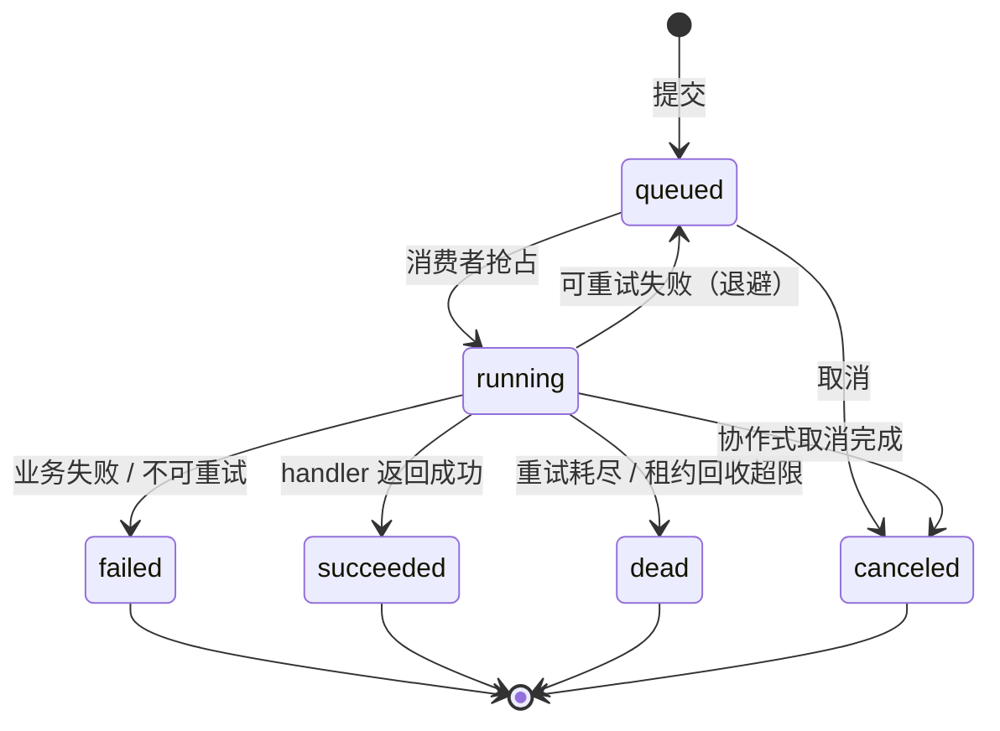

# 作业消费者基建详细设计（统一执行引擎 + 作业注册 + 监控投影）

> 通用能力 · 01 异步底座 · 03 作业消费者基建 · 详细设计

[文档首页](../../../../../../文档首页.md) › [08 通用能力](../../../../README.md) › [异步底座](../../01_异步底座.md) › [作业消费者基建](../01_异步底座_03_作业消费者基建.md) › 详细设计　|　[需求 03-3](../../../../需求/03_需求_消息与任务.md#r03-3) · [阶段计划](../../../../计划/01_计划_通用能力.md) · [架构 · 异步作业中心](../../../../../../设计/架构设计/40_架构设计_子系统_异步作业中心.md) · [架构 · 任务调度](../../../../../../设计/架构设计/17_架构设计_子系统_任务调度.md) · [架构 · 跨产品协同](../../../../../../设计/架构设计/38_架构设计_子系统_跨产品协同.md)

## 1. 概述 <a id="overview"></a>

- **目标**：把「一次性、可恢复、有进度」的异步执行收敛为一套作业消费者基建，替代 03_01 的「内置任务 → 服务内部端点」触发型补丁；任务调度到期只生产作业，导入 / 导出 / 归档 / 备份等业务直接提交作业，所有执行共用一套状态机、租约、重试、取消、进度与监控。
- **依据**：《[架构设计 · 异步作业中心](../../../../../../设计/架构设计/40_架构设计_子系统_异步作业中心.md)》§3~§11；《[架构设计 · 任务调度](../../../../../../设计/架构设计/17_架构设计_子系统_任务调度.md)》§3~§4；《[架构设计 · 跨产品协同](../../../../../../设计/架构设计/38_架构设计_子系统_跨产品协同.md)》§4.2；《[后端开发规范](../../../../../../规范/后端开发规范.md)》；《[数据库设计 · 数据规范](../../../../../../设计/数据库设计/02_数据库设计_数据规范.md)》；《[命名规范](../../../../../../规范/命名规范.md)》§10；需求 [03-3](../../../../需求/03_需求_消息与任务.md#r03-3)；兄弟设计 [01_详细设计_02_任务调度](../../01_异步底座_02_任务调度/设计/01_详细设计_02_任务调度.md)、[01_详细设计_01_事件总线](../../01_异步底座_01_事件总线/设计/01_详细设计_01_事件总线.md)、[01_详细设计_01_文件管理](../../../03_文件管理/03_文件管理_01_文件管理/设计/01_详细设计_01_文件管理.md)。
- **范围**：作业基类体系、`sys_job` / `sys_job_error` / `sys_job_type` / `sys_job_monitor` 四表、作业提交（事务性 / 幂等 / 同步内联）、每服务 worker、租约与并发公平、重试 / 死信 / 取消、任务调度迁移、03_01 迁移、作业类型声明与平台视图、生命周期事件与平台投影、管理面 API、配置 / 指标 / 审计 / 错误码。
- **不含（归口见 §8）**：事件总线与消费组运行时本身（01_01）；cron 表达式与任务定义管理（01_02）；导入 / 导出业务（04_01 / 04_02）；归档 / 备份业务（13 / 14）；通知渠道实现（07_01）；前端作业中心页面（阶段十五）；作业依赖 / DAG、优先级抢占、批量死信重放（§8 开放项）。

## 2. 现状与差距 <a id="gap"></a>

| # | 关注点 | 需求 / 架构要求 | 代码现状 | 处置 |
| --- | --- | --- | --- | --- |
| 1 | 统一执行 | 任务与一次性作业共用一套执行语义 | 01_02 有 `TaskWorker` + Redis 任务队列；03_01 另用「内置任务 → 内部端点」 | **本段改**：执行统一走 `sys_job`；`TaskWorker` 与 Redis 任务队列退役 |
| 2 | 作业记录 | 提交即持久、状态 / 进度 / 重试 / 死信可查 | 无作业表、无作业记录 | **本段建**：`sys_job` + `sys_job_error` |
| 3 | 作业类型目录 | 产品自持声明、平台统一注册、执行者可发现 | 无注册机制；平台不知道各服务有哪些作业 | **本段建**：`[[jobs]]` 声明类 + `sys_job_type` 视图 + 代码侧对账 |
| 4 | 平台监控 | 平台看各服务作业执行情况 | 无投影、无作业事件 | **本段建**：`sys.job.*` 四条事件 + `sys_job_monitor` 投影 |
| 5 | 消费者 | 每服务独立 worker、多副本安全、租约回收 | 01_02 worker 是平台侧 Redis 队列消费 | **本段建**：`JobWorker` + 数据库条件更新 / 租约；每服务 `bms_<service>.jobs` |
| 6 | 03_01 | 孤儿清理迁入作业中心 | `FileMaintenanceClient` + 内置任务触发 + file 内部端点 | **本段改**：file 注册 `file.cleanup_orphans` handler；旧触发路径移除 |
| 7 | 雪花唯一性 | 作业标识全系统唯一 | `worker_id` 默认 0，部署未注入；多服务 / 多副本会撞号 | **本段改**：compose 按服务 / 副本注入唯一 `BMS_APP__WORKER_ID` + 启动校验 + 部署说明 |
| 8 | 产品扩展 | 统一基类供所有产品继承，只扩展实现 | 无作业基类 | **本段建**：`bms_core/jobs/` 基类体系；产品默认继承 `BaseJobHandler`，平台提供具体样例 |
| 9 | 任务历史 | 任务 API / 执行记录口径不变 | `sys_task_log` 由旧 worker 写入 | **本段改**：作业终态回写 `sys_task_log`；任务 API 不改 |
| 10 | 产品声明 | 与 38 同源装载 | 现有产品清单无 `jobs` 段 | **本段改**：`registry/products.py` 增 `[[jobs]]` 解析与校验；platform.toml 先声明平台 / file 作业 |

## 3. 交付物清单 <a id="tree"></a>

```text
backend/
├── config.toml                                    # 改：新增 [jobs] 节；[event_consumer] 说明补 job-monitor
├── deploy/registry/platform.toml                  # 改：[[jobs]] 声明（sys.task.run / file.cleanup_orphans）
├── deploy/events/contracts.json                   # 改：sys.job.* 四条契约（快照重建）
├── deploy/boundaries/domain_layout.json           # 改：platform 增 job 域
├── deploy/compose/services.yml                    # 改：worker_id 注入；platform-jobs / file-jobs 容器
├── libs/bms_core/src/bms_core/
│   ├── core/config.py                             # 改：JobSettings + Settings.jobs
│   ├── core/error_codes.py                        # 改：71001~71006
│   ├── core/exceptions.py                         # 改：JobError 段基类 + 6 异常
│   ├── core/assembly.py                           # 改：无插件注册；仅按需导出 job 依赖（若需要）
│   ├── models/job.py                              # 新：SysJob / SysJobError（基础设施表）
│   ├── models/platform/job.py                     # 新：SysJobType / SysJobMonitor（platform 库）
│   ├── models/__init__.py                         # 改：BASE_MODEL_MODULES / COMMON_MODEL_MODULES
│   ├── services/table_registry.py                 # 改：四表归属登记
│   ├── db/migration.py                            # 改：BASE_MODEL_MODULES 纳入 job 模型
│   ├── registry/products.py                       # 改：JobRecord 解析 + jobs 段
│   ├── jobs/__init__.py                           # 新：导出
│   ├── jobs/base.py                               # 新：JobContext / JobResult / BaseJobHandler
│   ├── jobs/spec.py                               # 新：JobSubmission / JobSnapshot / JobStatus
│   ├── jobs/registry.py                           # 新：JobHandlerRegistry + 代码侧注册
│   ├── jobs/store.py                              # 新：JobStore（提交 / 抢占 / 续租 / 终态 / 清理）
│   ├── jobs/runner.py                             # 新：JobRunner（submit / run_inline）
│   ├── jobs/worker.py                             # 新：JobWorker（每服务消费者）
│   ├── jobs/events.py                             # 新：四条事件构造 + outbox 写入
│   ├── jobs/client.py                             # 新：JobSubmitClient（服务间提交 / 取消 / 重试）
│   ├── jobs/limits.py                             # 新：JobLimits（配置读取 / 默认回落）
│   ├── jobs/signal.py                             # 新：Redis 唤醒信号（只做唤醒，不承担正确性）
│   ├── events/platform_events.py                  # 改：四条事件契约
│   └── tenant/seed/menu.py                        # 改：job 业务 + query/manage 权限码
├── services/platform/src/bms_platform/
│   ├── domains/job/                               # 新域：作业类型目录 / 监控 / 转发管理面
│   │   ├── api/job.py                             # 新：平台用户面 5 端点 + 本地内部端点
│   │   ├── schemas/job.py                         # 新：请求 / 响应
│   │   ├── repositories/job.py                    # 新：sys_job_type / sys_job_monitor 读写
│   │   ├── services/job.py                        # 新：目录 / 列表 / 详情 / 取消 / 重试
│   │   ├── services/monitor.py                    # 新：事件消费 → 投影 upsert
│   │   ├── jobs.py                                # 新：消费组声明与投影 handler
│   │   └── public.py                              # 新：空出口（D2 唯一跨域面）
│   ├── domains/task/services/executor.py          # 新：任务执行逻辑（旧 TaskWorker 迁移）
│   ├── domains/task/jobs.py                       # 新：TaskJobHandler（sys.task.run）
│   ├── domains/task/services/task.py              # 改：trigger 改为提交作业
│   ├── domains/task/services/dispatch.py          # 改：beat 抢占后提交作业
│   ├── api/router.py                              # 改：挂载 job 路由
│   ├── jobs.py                                    # 新：平台 worker 入口
│   └── main.py                                    # 改：event_consumer_records 增 job-monitor
├── services/file/src/bms_file/
│   ├── domains/file/jobs.py                       # 新：CleanupOrphansJob
│   ├── domains/file/api/file.py                   # 改：移除 internal/cleanup-orphans
│   ├── jobs.py                                    # 新：文件 worker 入口
│   └── main.py                                    # 改：无需消费组
├── libs/bms_core/src/bms_core/storage/maintenance.py  # 删：FileMaintenanceClient（旧触发路径）
├── libs/bms_core/src/bms_core/tasks/builtin.py     # 改：run_cleanup_orphan_parts → 提交文件作业
├── libs/bms_core/src/bms_core/tasks/worker.py      # 删：TaskWorker（由 JobWorker 取代）
├── libs/bms_core/src/bms_core/tasks/queue.py       # 删：Redis 任务队列
├── libs/bms_core/src/bms_core/tasks/scheduler.py   # 改：派发改提交作业
├── ops/task_scheduler.py                           # 改：--worker 移除 / 仅 beat
├── ops/job_worker.py                               # 新：开发便捷入口 --service --once
├── libs/bms_core/tests/jobs/                       # 新：store / worker / runner / registry / events / client
├── libs/bms_core/tests/tasks/                      # 改：scheduler 派发 / worker 迁移回归
├── libs/bms_core/tests/integration/test_job_worker_real.py  # 新：真 Redis 双 worker
├── services/platform/tests/jobs/                   # 新：API / 投影 / 注册校验
└── services/file/tests/jobs/                       # 新：cleanup 作业 handler / worker 入口
bms文档/
├── 设计/数据库设计/数据表设计/sys_job.md             # 新
├── 设计/数据库设计/数据表设计/sys_job_error.md       # 新
├── 设计/数据库设计/数据表设计/sys_job_type.md        # 新
├── 设计/数据库设计/数据表设计/sys_job_monitor.md     # 新
├── 设计/数据库设计/38_数据库设计_异步作业中心.md     # 新
├── 设计/数据库设计/01_数据库设计_总览.md             # 改
├── 设计/概要设计/23_概要设计_任务调度.md             # 改：执行归作业中心
├── 设计/架构设计/17 / 33 / 40                         # 已改架构，落地时补充对齐
├── 后端基类清单.md                                   # 改：作业基类 / 具体类落点
├── 规范/命名规范.md                                  # 改：Redis 键 / 表名前缀 / 作业类型名
├── 规范/后端开发规范.md                              # 改：作业写路径纪律
├── 项目/…/01_异步底座_03_作业消费者基建/              # 实施 / 测试记录；03_01 迁移注块
└── 项目/…/需求/03_需求_消息与任务.md                  # 已登记 03-3
```

## 4. 领域设计 <a id="design"></a>

### 4.1 数据模型与迁移口径 <a id="data"></a>

> 表结构以数据表文件为唯一事实源（`sys_job.md` / `sys_job_error.md` / `sys_job_type.md` / `sys_job_monitor.md`），本节只写设计口径与取舍。

**`sys_job`（作业记录，基础设施表：每服务每链一份，`owner=*`、`datasource=both`）**

| 字段 | 类型 | 可空 | 语义 |
| --- | --- | --- | --- |
| `job_type` | VARCHAR(128) | 否 | 作业类型（全局唯一；与声明一致） |
| `service_key` | VARCHAR(64) | 否 | 提供方服务键（执行者所在服务） |
| `domain_key` | VARCHAR(64) | 否 | 提供方业务域（取自声明） |
| `tenant_id` | VARCHAR(32) | 是 | 租户主键（雪花字符串；平台链作业为空） |
| `status` | VARCHAR(16) | 否 | `queued` / `running` / `succeeded` / `failed` / `canceled` / `dead` |
| `priority` | INT | 否 | 租户内优先级（大者先；不跨租户抢占） |
| `payload` | TEXT | 否 | 负载 JSON（业务无关；版本见 `payload_version`） |
| `payload_version` | VARCHAR(16) | 否 | 负载版本（默认 `1.0.0`） |
| `result` | TEXT | 是 | 结果 JSON（成功摘要；按 `result_max_chars` 截断） |
| `progress_done` | BIGINT | 否 | 已完成量（默认 0） |
| `progress_total` | BIGINT | 是 | 总量（NULL = 不确定进度） |
| `attempts` | INT | 否 | 已执行次数（默认 0；每次抢占 +1） |
| `max_attempts` | INT | 否 | 最大执行次数（快照自声明 / 提交覆盖） |
| `next_run_at` | DATETIME | 是 | 下次可执行时刻（退避 / 延迟；NULL = 立即可执行） |
| `lease_owner` | VARCHAR(128) | 是 | 当前执行者（worker 实例标识） |
| `lease_until` | DATETIME | 是 | 租约到期时刻（失联回收依据） |
| `last_heartbeat_at` | DATETIME | 是 | 最近心跳时刻（排障 / 指标） |
| `cancel_requested` | BOOLEAN | 否 | 是否请求取消（默认 false） |
| `error` | VARCHAR(512) | 是 | 失败 / 死信摘要（截断） |
| `remark` | VARCHAR(256) | 是 | 备注（取消原因 / 运维说明） |
| `idempotency_key` | VARCHAR(128) | 是 | 提交幂等键（业务方提供） |
| `started_at` | DATETIME | 是 | 首次开始时刻 |
| `finished_at` | DATETIME | 是 | 终态时刻 |

公共字段（`id` / `created_at` / `created_by` / `updated_at` / `updated_by` / `deleted_at` / `version`）由 `BaseModel` 提供，不重复列出。`id` 为雪花主键，接口按字符串输出。

索引 / 约束：

- `uq_sys_job_idempotency (job_type, idempotency_key)`：同类型同幂等键只允许一条（NULL 可多行；数据库唯一约束兜底并发）。
- `idx_sys_job_claim (status, next_run_at, priority, id)`：抢占热路径。
- `idx_sys_job_lease (status, lease_until)`：租约过期回收。
- `idx_sys_job_type_created (job_type, created_at)`：管理面按类型筛选。
- `idx_sys_job_creator (created_by, created_at)`：按提交人筛选。
- `idx_sys_job_tenant_status (tenant_id, status)`：租户维度公平与统计。

**`sys_job_error`（行级错误明细，基础设施表）**

| 字段 | 类型 | 可空 | 语义 |
| --- | --- | --- | --- |
| `job_id` | BIGINT | 否 | 所属作业（`sys_job.id`；逻辑外键） |
| `row_no` | INT | 是 | 业务行号（导入 Excel 行，自 2 起） |
| `column_key` | VARCHAR(64) | 是 | 出错列 / 字段键 |
| `item_ref` | VARCHAR(128) | 是 | 业务条目标识（非行号场景） |
| `message` | VARCHAR(512) | 否 | 错误原因（可读文案 / 文案键） |

索引：`idx_sys_job_error_job (job_id, id)`。行级错误是运行态数据，随作业清理**硬删**，不参与软删除；无唯一约束。

**`sys_job_type`（作业类型目录，platform 库，`owner=platform`、`domain=job`）**

| 字段 | 类型 | 可空 | 语义 |
| --- | --- | --- | --- |
| `job_type` | VARCHAR(128) | 否 | 作业类型（唯一） |
| `service_key` | VARCHAR(64) | 否 | 提供方服务键 |
| `domain_key` | VARCHAR(64) | 否 | 提供方业务域 |
| `handler` | VARCHAR(256) | 否 | 执行者点分路径（`module:attr`；装载期只校验格式） |
| `description` | VARCHAR(255) | 否 | 说明 |
| `timeout_seconds` | INT | 否 | 单次执行超时（默认 1800） |
| `max_attempts` | INT | 否 | 最大执行次数（默认 3） |
| `backoff_seconds` | INT | 否 | 退避基数（默认 30） |
| `concurrency` | INT | 否 | 单租户该类型并发上限（默认 4） |
| `payload_version` | VARCHAR(16) | 否 | 负载版本（默认 `1.0.0`） |
| `status` | VARCHAR(16) | 否 | `enabled` / `deprecated` / `retired` |
| `source` | VARCHAR(16) | 否 | `platform` / `product` |
| `content_hash` | CHAR(64) | 否 | 声明要素稳定哈希（未变不写） |

唯一约束 `uq_sys_job_type (job_type)`；索引 `idx_sys_job_type_service (service_key, status)`。目录是声明的只读投影，平台不手写产品记录。

**`sys_job_monitor`（平台监控投影，platform 库，`owner=platform`、`domain=job`）**

| 字段 | 类型 | 可空 | 语义 |
| --- | --- | --- | --- |
| `job_id` | BIGINT | 否 | 作业标识（雪花；唯一） |
| `service_key` | VARCHAR(64) | 否 | 提供方服务 |
| `job_type` | VARCHAR(128) | 否 | 作业类型 |
| `tenant_id` | VARCHAR(32) | 是 | 租户主键 |
| `status` | VARCHAR(16) | 否 | 作业状态 |
| `progress_done` | BIGINT | 否 | 已完成量 |
| `progress_total` | BIGINT | 是 | 总量 |
| `attempts` | INT | 否 | 尝试次数 |
| `error` | VARCHAR(512) | 是 | 错误摘要 |
| `submitted_at` | DATETIME | 是 | 提交时刻（事件） |
| `started_at` | DATETIME | 是 | 开始时刻 |
| `finished_at` | DATETIME | 是 | 终态时刻 |
| `last_event_at` | DATETIME | 否 | 最近事件时刻（防旧事件覆盖） |

唯一约束 `uq_sys_job_monitor_job_id (job_id)`；索引 `idx_sys_job_monitor_status (status, last_event_at)`、`idx_sys_job_monitor_type (job_type, last_event_at)`、`idx_sys_job_monitor_tenant (tenant_id, last_event_at)`。投影按保留期清理，可重建。

**迁移口径**：本项目删库重建（`alembic/versions/` 仅 `.gitkeep`）。顺序：四份表文件 → 总览登记 → `TABLE_OWNERSHIP`（`sys_job` / `sys_job_error` 为 `owner=*`、`datasource=both`；`sys_job_type` / `sys_job_monitor` 为 `owner=platform`、`domain=job`）→ 模型 → 本地删库重建（启动期 `ensure_unit_schema` / `ops.init_schema`）。`BASE_MODEL_MODULES` 纳入 `bms_core.models.job`；`PLATFORM_MODEL_MODULES` 纳入 `bms_core.models.platform.job`。

### 4.2 状态机与业务规则 <a id="state"></a>



- **至少一次**：租约过期、worker 崩溃、事件重放均可能导致重复执行；handler 必须幂等，或以业务唯一约束兜底。
- **状态只前进**：终态（`succeeded` / `failed` / `canceled` / `dead`）不可回退；重试只发生在 `running → queued`。
- **`failed` 与 `dead` 区分**：`failed` 是业务终态失败（不可重试或明确失败）；`dead` 是重试耗尽 / 系统异常的死信，供人工处理。
- **进度**：`progress_done` / `progress_total` 由 handler 通过 `report_progress` 更新；总量未知时 `progress_total=NULL`，前端按不确定进度展示。
- **取消**：`cancel_requested=true` 后，队列中作业直接 `canceled`；运行中作业由 handler 在批次边界 `ctx.should_cancel()` 后自行收尾并返回取消；handler 不检查则等租约超时按失败处理（协作式语义）。
- **保留期**：终态作业保留 30 天，由内置清理作业按 `retention_days` 删除；`sys_job_error` 随作业硬删；运行中 / 待执行永不删除。

### 4.3 基类体系与产品扩展 <a id="inheritance"></a>

```text
BaseObject
└── BaseFrameworkObject
    └── BaseCapability
        └── BasePluggable
            └── BaseJobHandler（产品默认扩展基类；ABC，实现 run(ctx)）
```

| 类 / 契约 | 落点 | 职责 |
| --- | --- | --- |
| `BaseJobHandler` | `jobs/base.py` | 产品扩展基类：声明 `job_type`，实现 `run(ctx)`；继承 `BasePluggable` |
| `JobContext` | `jobs/base.py` | 执行上下文：作业标识 / 类型 / 负载 / 尝试次数 / 租户 / `report_progress` / `should_cancel` / `session()` |
| `JobResult` | `jobs/base.py` | 执行结果：`success` / `failed(retryable)` / `canceled`；输出摘要与错误摘要 |
| `JobSubmission` / `JobSnapshot` | `jobs/spec.py` | 提交规格 / 查询快照（值对象） |
| `JobHandlerRegistry` | `jobs/registry.py` | 本服务 job_type → handler 映射；`job_handlers()` 注册与解析 |
| `JobStore` | `jobs/store.py` | 提交 / 抢占 / 续租 / 终态 / 错误明细 / 清理（唯一写作业表入口） |
| `JobRunner` | `jobs/runner.py` | `submit` 与 `run_inline`（同步执行共用同一记录 / 状态机） |
| `JobWorker` | `jobs/worker.py` | 每服务消费者：轮询 / 抢占 / 执行 / 心跳 / 重试 / 停机 |
| `JobSubmitClient` | `jobs/client.py` | 服务间提交 / 取消 / 重试（内部端点） |

- **产品默认只继承 `BaseJobHandler`**：实现 `run(ctx)` 并在 `job_handlers()` 注册；公共执行语义（抢占、租约、重试、进度、取消、事件）由基座提供。
- **确有必要可继承更深的消费者 / worker 基类**：必须保持统一状态机、租约、进度与事件契约；偏差由该产品自担，不得影响其他产品；不得另起炉灶自研平行队列 / 消费者 / 租约 / 重试 / 监控。
- **平台样例**：平台自身的 `TaskJobHandler`（`sys.task.run`）与 `file.cleanup_orphans`（文件服务）作为具体 `BaseJobHandler` 实现样例，供产品参照。
- **组合轨**：不继承基类的第三方实现经统一注册通道登记（实现 `run` 的结构化契约），仍须通过同一套契约测试。

### 4.4 提交、幂等与同步执行 <a id="submit"></a>

- **进程内提交**：`JobRunner.submit(session, submission)` 在调用方事务内写 `sys_job`（`status=queued`），同事务写 `sys.job.submitted` 到 outbox；事务提交即持久，不依赖进程内队列。
- **幂等**：`idempotency_key` 非空时按 `(job_type, idempotency_key)` 查既有作业；命中直接返回既有 `job_id`，不重复插入。数据库唯一约束兜底并发穿透；捕获唯一冲突后回读既有作业返回。
- **同步内联**：`JobRunner.run_inline(session, submission, handler)` 创建同一条 `sys_job` 记录（`status=queued` → 直接置 `running`、写租约），在当前请求进程执行 handler，持续更新进度与终态；返回 `job_id` 与结果。超时仍由租约回收，防止请求进程崩溃留下永久 `running`。04_01 阈值内导入使用该入口，超阈值提交异步。
- **提交入口**：
  - 业务代码进程内：`JobRunner.submit` / `run_inline`；
  - 跨服务 / 定时任务：内部端点 `POST /api/v1/jobs/internal`（服务身份），由 `JobSubmitClient` 调用；
  - 平台管理面不直接提交业务作业（仅查询 / 取消 / 重试）。
- **禁止**：`BackgroundTasks`、临时内存队列、线程内 fire-and-forget 作为生产异步通道。

### 4.5 消费者、租约与公平调度 <a id="worker"></a>

**每服务 worker**：`bms_<service>/jobs.py` 构造 `JobWorker`，注入本服务 `JobHandlerRegistry`、`JobStore`、租户枚举与 `JobSettings`；容器命令 `python -m bms_<service>.jobs`。开发便捷入口 `ops/job_worker.py --service <key>`（仅开发 / 排障，生产走服务入口）。

**一次轮询**：

1. 取库范围：本服务平台库 + 租户库（`tenant_refs()` 缓存，TTL `tenant_cache_ttl_seconds`）；平台服务两条链都扫。
2. 对每个库，按 `status='queued' AND (next_run_at IS NULL OR next_run_at<=now)` 取候选（`ORDER BY priority DESC, id ASC LIMIT claim_batch_size`）。
3. 逐条条件 UPDATE 抢占（CAS）：

```sql
UPDATE sys_job
   SET status='running', lease_owner=:worker, lease_until=:until,
       attempts=attempts+1, started_at=COALESCE(started_at, :now),
       last_heartbeat_at=:now, updated_at=:now, version=version+1
 WHERE id=:id AND status='queued' AND deleted_at IS NULL
   AND (next_run_at IS NULL OR next_run_at<=:now)
```

`rowcount=1` 才算抢到；否则放弃（被其他 worker 抢走）。**不依赖 `SKIP LOCKED`**，SQLite / MySQL / PostgreSQL / 达梦同一口径。

4. 抢占前检查 `attempts+1 > max_attempts` → 直接置 `dead`，不执行。
5. 执行：构造 `JobContext`，调用 handler；持有全局信号量与单租户信号量，受 `global_concurrency` / `per_tenant_concurrency` / 类型 `concurrency` 约束。
6. 心跳：执行期间每 `heartbeat_interval_seconds` 续租 `lease_until` 并写 `last_heartbeat_at`；进度更新同时续租。
7. 终态：成功 / 失败 / 取消写 `status`、`result` / `error`、`finished_at`，同事务写 `sys.job.completed`；可重试失败写回 `queued`、`next_run_at=now+backoff`，不写 completed（只写 progress / 状态变更内部记录）。
8. 租约回收：每个 tick 扫描 `status='running' AND lease_until<now`，置 `queued`（`attempts` 已计）或 `dead`（超过上限），写 `remark` / `error`。

**公平调度**：

- 全局并发：单 worker 进程内总在途上限；
- 单租户并发上限：每租户在途作业数上限，防止单租户万行作业饿死其他租户；
- 类型并发上限：取自 `sys_job_type.concurrency`；
- 优先级只在同租户内排序，不跨租户抢占；运行中作业不抢占。

**优雅停机**：停止抢占；在途作业在批次边界检查取消 / 停机信号，完成后退出；未完成作业保留租约，到期由其他 worker 回收（至少一次）。

### 4.6 重试、死信与取消 <a id="retry"></a>

- **可重试判定**：handler 抛异常默认按可重试处理；`JobResult.failed(retryable=False)` 明确不可重试；`JobResult.failed(retryable=True)` 可重试。系统异常（会话 / 网络 / 下游不可用）默认可重试。
- **退避**：`next_run_at = now + backoff_seconds × 2^(attempts-1)`，上限 `backoff_max_seconds`；退避期间不占并发。
- **死信**：`attempts >= max_attempts` 或不可重试失败 → `dead`，保留 `error` 摘要；死信可人工重试（重置 `attempts=0`、`status=queued`、`cancel_requested=false`、清 `lease`）。
- **取消**：`request_cancel` 置 `cancel_requested=true`；队列中直接 `canceled`；运行中由 handler 在批次边界检查 `ctx.should_cancel()`，返回 `JobResult.canceled()` 后置 `canceled`。取消不强制杀协程。
- **超时**：`timeout_seconds` 是建议阈值；实际失联由租约回收兜底（`lease_until`）。handler 应在批次边界检查剩余时间。

### 4.7 任务调度迁移 <a id="task-migration"></a>

- `sys_task` 保持定义与 cron；`TaskScheduler` 抢占到期任务后**不再写 Redis 队列**，而是在同一事务写 `sys_task_log(running)` 并提交 `sys_job`：
  - `job_type = "sys.task.run"`（平台声明）；
  - `payload = {task_id, log_id, run_id, code, handler, args_json}`；
  - `idempotency_key = "task:{task_id}:{log_id}"`（同一执行记录只提交一次）。
- `TaskJobHandler`（平台服务，`BaseJobHandler` 样例）解析 `TaskRunSpec`，经 `bms_core.tasks.handlers.resolve_handler`（白名单）执行；执行逻辑从旧 `TaskWorker` 抽到 `domains/task/services/executor.py`，成功后更新 `sys_task_log` 终态并写 `sys.task.completed`。
- `sys_task_log` 保留为任务历史；任务 API 查询口径不变；旧 `TaskWorker` / `tasks/queue.py` / `ops/task_scheduler.py --worker` 退役。
- `sys_task_log` 的 `retry_count`、`cost_time`、`error_msg` 由 `TaskJobHandler` 按作业尝试与终态回写；`run_id` 由载荷带入。
- 动态任务 handler 仍受 `[task_scheduler].allowed_handler_prefixes` 白名单；作业中心不绕过该白名单。

### 4.8 作业类型注册与装载 <a id="registry"></a>

**声明**（产品自持清单 `deploy/registry/*.toml` 新增 `[[jobs]]`）：

```toml
[[jobs]]
job_type = "file.cleanup_orphans"
service = "file"
domain = "file"
handler = "bms_file.domains.file.jobs:CleanupOrphansJob"
description = "回收超期上传分片与孤儿记录"
timeout_seconds = 1800
max_attempts = 3
backoff_seconds = 30
concurrency = 1
payload_version = "1.0.0"
status = "enabled"
```

| 字段 | 必填 | 校验 |
| --- | --- | --- |
| `job_type` | 是 | 全局唯一；`{服务/业务域}.{作业名}` 形态；不得与既有类型重名 |
| `service` | 是 | 必须在本清单 `[[services]]` 或平台服务目录登记 |
| `domain` | 是 | 必须在 `[[domains]]` / 域布局登记，且与 `service` 承载关系一致 |
| `handler` | 是 | `module:attr` 形态；模块前缀须落在该服务允许前缀内（装载期只校验格式，执行期服务 worker 解析） |
| `description` | 是 | 非空；供目录展示 |
| `timeout_seconds` / `max_attempts` / `backoff_seconds` / `concurrency` | 是 | 正整数；上限由 `[jobs]` 约束 |
| `payload_version` | 是 | 语义化版本；破坏性变更升版本 |
| `status` | 是 | `enabled` / `deprecated` / `retired`；deprecated 须给替代类型（字段后续扩展） |

**装载**：

1. `registry/products.py` 增 `JobRecord` 与 `jobs` 段解析；`platform.toml` 增平台作业（`sys.task.run`、`file.cleanup_orphans`）；产品仓在各自清单声明。
2. `ops.check_modules` 增校验：类型唯一、服务 / 域登记、handler 格式、版本兼容、与代码侧注册对账（平台仓可导入校验；产品仓由自身预检校验）。
3. 平台启动 / 声明引导把记录写入 `sys_job_type`（`source=platform/product`，`content_hash` 去重）；平台只读视图，不手写。
4. 服务 worker 启动时加载 `job_handlers()`，按本服务 `job_type` 解析 handler；声明存在但代码缺失 → 启动失败（fail-fast）；代码存在但声明缺失 → 启动告警（防止漏声明），由 CI 对账兜底。

**代码侧注册**：

```python
def job_handlers() -> ConcurrentStableDict[str, BaseJobHandler]:
    return ConcurrentStableDict({"file.cleanup_orphans": CleanupOrphansJob()})
```

- 每服务 `jobs.py` 汇总本服务 handler；`JobHandlerRegistry.load(handlers)` 校验类型唯一、继承 `BaseJobHandler`、`job_type` 与声明一致。
- 平台服务 `job_handlers()` 含 `sys.task.run`；文件服务含 `file.cleanup_orphans`；产品服务按各自声明扩展。

### 4.9 事件、投影与通知 <a id="events"></a>

**事件契约**（`sys.job.*`，版本 `1.0.0`）：

| 事件 | 时机 | 载荷（字段 -> 类型） |
| --- | --- | --- |
| `sys.job.submitted` | 作业记录提交成功（同事务 outbox） | `job_id` string / `job_type` string / `service_key` string / `status` string |
| `sys.job.started` | 抢占成功、开始执行 | `job_id` string / `job_type` string / `service_key` string / `attempt` integer |
| `sys.job.progress` | 进度更新（节流） | `job_id` string / `job_type` string / `service_key` string / `progress_done` integer / `progress_total` integer（可选） |
| `sys.job.completed` | 终态（succeeded / failed / canceled / dead） | `job_id` string / `job_type` string / `service_key` string / `status` string / `attempts` integer / `error` string（可选） |

- 事件经 `outbox.enqueue` 与状态更新**同一会话**写入；`aggregate_key = str(job_id)` 保证同作业有序。
- 事件契约登记在 `platform_events.py`，快照由 `ops.contract_snapshot` / `ops.event_contracts` 重建；`sys.job.completed` 同时作为通知中心后续消费的完成事件。
- **平台投影**：`JobMonitorConsumer` 声明消费组 `job-monitor`（`event_consumer_records()`），按 `job_id` 有序消费四条事件，upsert `sys_job_monitor`；`last_event_at` 防旧事件覆盖。投影不可用不影响作业执行，可重建。
- **通知**：`sys.job.completed` 登记为可订阅事件；07_01 通知中心交付后消费，作业中心不直连渠道。

### 4.10 接口面与权限 <a id="api"></a>

**平台用户面**（platform 服务 `job` 域，前缀 `/api/v1/jobs`）：

| 方法 | 路径 | 说明 | 权限 |
| --- | --- | --- | --- |
| GET | `/api/v1/jobs/types` | 作业类型目录（读 `sys_job_type`） | `job:query` |
| GET | `/api/v1/jobs` | 统一作业列表（读 `sys_job_monitor`；筛选类型 / 状态 / 服务 / 租户 / 时间） | `job:query` |
| GET | `/api/v1/jobs/{job_id}` | 作业详情（投影） | `job:query` |
| POST | `/api/v1/jobs/{job_id}/cancel` | 取消（按投影服务键转发到目标服务） | `job:manage` |
| POST | `/api/v1/jobs/{job_id}/retry` | 重试（仅 dead / failed） | `job:manage` |

**服务内部面**（每服务 `job` 路由，前缀 `/api/v1/jobs/internal`；服务身份）：

| 方法 | 路径 | 说明 |
| --- | --- | --- |
| POST | `/api/v1/jobs/internal` | 提交本服务声明的作业类型（`job_type` / `payload` / `priority` / `idempotency_key` / `max_attempts`） |
| GET | `/api/v1/jobs/internal/{job_id}` | 本地作业详情（含错误明细摘要） |
| POST | `/api/v1/jobs/internal/{job_id}/cancel` | 本地取消 |
| POST | `/api/v1/jobs/internal/{job_id}/retry` | 本地重试（重置尝试次数并回队） |

- **提交校验**：`job_type` 必须属于本服务声明；`payload` 必须为 JSON 对象；优先级 / 最大尝试次数在 `[jobs]` 范围内；`idempotency_key` 可选。
- **平台转发**：平台按 `sys_job_monitor.service_key` 取目标服务，经 `JobSubmitClient` 调其内部 `cancel` / `retry`；平台本地作业直接调用本服务 `JobRunner`，不走 HTTP。
- **权限码**：`job:query` / `job:manage`（`manage` 含取消 / 重试）；种子补业务码 `job` 与动作 `query` / `manage`。无菜单 / 按钮种子（前端阶段十五）。
- **统一响应**：沿用 `ApiResponse`；分页用 `page_query`（`page` / `size`，上限 200）；错误码见 §4.14。

### 4.11 03_01 迁移 <a id="migrate-0301"></a>

- **文件服务**：新增 `bms_file/domains/file/jobs.py` 的 `CleanupOrphansJob`（`job_type="file.cleanup_orphans"`），`run(ctx)` 调用 file 域 `cleanup_orphans` 服务，按扫描 / 回收数量上报进度；新增 `bms_file/jobs.py` worker 入口。
- **平台定时任务**：`cleanup_orphan_parts` 执行体改为 `submit_cleanup_orphans_job`：经 `JobSubmitClient` 向文件服务提交 `file.cleanup_orphans`（幂等键按日期），返回 `TaskResult.success("已提交作业 {job_id}")`；任务日志记录提交结果，实际清理在文件服务作业中执行。
- **删除旧路径**：移除 file 内部端点 `POST /api/v1/files/internal/cleanup-orphans`、`FileMaintenanceClient`、旧触发型测试；`03_01` 设计 / 实施 / 测试记录补「迁移注块」，需求 02-1 注块补作业化说明。
- **保留**：`file` 域 `cleanup_orphans` 服务方法、分片清理逻辑、指标 `bms_file_orphan_cleaned_total` 不变；仅驱动方式改变。

### 4.12 配置参数 <a id="config"></a>

**`[jobs]`（进程级参数，进基线 `config.toml`）**

| 键 | 默认 | 说明 |
| --- | --- | --- |
| `enabled` | `true` | 作业中心开关（false = 只读写记录、不启动 worker） |
| `worker_id` | `""` | worker 实例标识（缺省 `{service}-{hostname}-{pid}`）；用于租约与排障 |
| `poll_interval_seconds` | `2.0` | 轮询间隔 |
| `claim_batch_size` | `10` | 单库单轮抢占上限 |
| `global_concurrency` | `4` | 单 worker 进程全局在途上限 |
| `per_tenant_concurrency` | `2` | 单租户在途上限 |
| `lease_seconds` | `300` | 租约时长（须 > 心跳间隔 × 3） |
| `heartbeat_interval_seconds` | `30` | 心跳 / 续租间隔 |
| `progress_interval_seconds` | `2.0` | 进度事件节流间隔 |
| `max_attempts_default` | `3` | 默认最大执行次数 |
| `backoff_seconds_default` | `30` | 默认退避基数 |
| `backoff_max_seconds` | `3600` | 退避上限 |
| `timeout_seconds_default` | `1800` | 默认单次执行超时（提示 / 监控；失联由租约兜底） |
| `result_max_chars` | `65536` | 结果 JSON 截断长度 |
| `error_max_chars` | `512` | 错误摘要截断长度 |
| `retention_days` | `30` | 终态作业保留天数 |
| `shutdown_grace_seconds` | `60` | 优雅停机等待上限 |
| `tenant_cache_ttl_seconds` | `60` | 租户清单缓存 TTL |
| `change_channel` | `bms:global:job:changed` | 唤醒信号信道（仅唤醒，不承担正确性） |
| `heartbeat_path` | `/tmp/bms-jobs-heartbeat` | 容器本地心跳文件（每轮 `tick()` 前刷新；健康检查读 mtime） |
| `heartbeat_timeout_seconds` | `30` | 心跳超时（须显著大于 `poll_interval_seconds`，否则配置校验报错） |

- `JobSettings` 以 `validation_alias="jobs"` 接入；`extra="forbid"`，节与字段同批落地。
- 参数读取 / 默认回落由 `JobLimits` 统一处理；非法值回落代码默认并 `warning`，作业执行不被配置面拖死。
- 作业类型声明的 `timeout / max_attempts / backoff / concurrency` 覆盖 `[jobs]` 默认值；提交时快照 `max_attempts` 到作业记录。

### 4.13 可观测性与审计 <a id="observability"></a>

- **指标**：`bms_job_queued_total`、`bms_job_running`、`bms_job_succeeded_total`、`bms_job_failed_total`、`bms_job_dead_total`、`bms_job_wait_seconds`、`bms_job_run_seconds`、`bms_job_retry_total`、`bms_job_lease_reclaimed_total`；标签 `service_key` / `job_type`（不落租户高基数标签）。
- **日志**：提交 / 抢占 / 续租失败 / 重试 / 终态 / 死信 / 回收均结构化日志；携带 `job_id`、`job_type`、`service_key`、`attempt`、`db_key`。
- **审计**：提交、取消、重试、终态写结构化日志；业务数据变更按各域 `AuditCapturer.capture` 口径，作业中心不重复实现字段级审计。
- **健康**：worker 启动记录 `jobs_worker_started`；无作业时正常；投影消费组不可用单独告警，不影响作业执行。作业 worker 不起 HTTP 端口，容器健康检查读**心跳文件**（`bms_core.jobs.heartbeat`：每轮 `tick()` 前刷新 mtime，超 `heartbeat_timeout_seconds` 判 unhealthy；写入失败只告警，不阻断作业处理）。

### 4.14 错误码 <a id="errors"></a>

| 码 | 名称 | HTTP | 场景 |
| --- | --- | --- | --- |
| 71001 | `JOB_NOT_FOUND` | 404 | 作业不存在（含跨租户 / 已清理） |
| 71002 | `JOB_TYPE_NOT_REGISTERED` | 400 | 作业类型未声明 / 不属于本服务 |
| 71003 | `JOB_NOT_CANCELABLE` | 409 | 终态作业不可取消 |
| 71004 | `JOB_NOT_RETRYABLE` | 409 | 非 dead / failed 作业不可重试 |
| 71005 | `JOB_PAYLOAD_INVALID` | 400 | 负载非 JSON 对象 / 版本不匹配 |
| 71006 | `JOB_HANDLER_NOT_REGISTERED` | 500 | 声明存在但代码侧 handler 缺失（或解析失败） |

- 6 个异常类挂 `JobError` 段基类（构造预置码位与 HTTP 状态），登记 `test_exception_constructors_paths`。
- 71006 属启动 / 执行期装配错误，正常路径不应出现；API 不直接暴露堆栈。

## 5. 失败分支与边界 <a id="failures"></a>

| 场景 | 行为 | 依据 / 风险 |
| --- | --- | --- |
| 提交时幂等键命中 | 返回既有 `job_id`，不重复执行 | 数据库唯一约束兜底 |
| 并发同幂等键插入 | 唯一冲突 → 回读既有作业返回；未读到则 `10003` | 并发穿透 |
| 提交事务回滚 | 作业记录与 outbox 一起回滚，不执行 | 事务性提交 |
| Redis 不可用 | 提交 / 执行不受影响；唤醒信号失败只延迟轮询 | 正确性在 DB |
| 作业类型未声明 | 内部提交 `71002`；worker 启动缺 handler `71006` | 装载 fail-fast |
| 声明与代码不一致 | 平台仓启动拒启；产品仓由自身预检 / 启动告警 | 对账 |
| 多 worker 同时抢占 | 条件 UPDATE `rowcount=1` 唯一成功 | 至少一次 |
| worker 崩溃 | 租约到期回收，重新排队；`attempts` 已计 | 至少一次 |
| 租约到期但原执行仍存活 | 可能重复执行；handler 必须幂等 | 网络分区 / 长 GC |
| handler 抛异常 | 默认可重试；退避回队 | 重试策略 |
| 不可重试失败 | `failed` 终态，保留错误摘要 | handler 明确 |
| 重试耗尽 | `dead` 死信，可人工重试 | 死信 |
| 取消队列中作业 | 直接 `canceled` | 取消 |
| 取消运行中作业 | 批次边界协作停止；不检查则等租约超时 | 协作式 |
| 进度更新失败 | 记 warning，不反噬执行；下次心跳重试 | 可观测性 |
| 事件 outbox 写失败 | 状态更新与事件同事务，整体回滚 | 一致性 |
| 投影消费失败 | 作业执行不受影响；事件总线重试 / 死信；投影可重建 | 最终一致 |
| 通知中心未交付 | 只登记 `sys.job.completed`，不直连渠道 | 07_01 后续 |
| 平台转发取消 / 重试时目标服务不可达 | `ServiceUnavailableError` / 503；作业状态不变 | 服务间调用 |
| 平台投影无数据 | 列表空 / 降级提示；不影响服务本地查询 | 投影可重建 |
| 作业记录超过保留期 | 内置清理作业硬删终态记录与错误明细 | 运行态数据 |
| worker_id 撞号 | 作业 ID 可能冲突；部署必须唯一（compose 注入 + 启动校验） | 部署红线 |
| 任务执行体白名单外 | `TaskJobHandler` 解析失败 → 作业 `dead`，不执行 | 01_02 口径不变 |

## 6. 测试设计与验收映射 <a id="tests"></a>

| 验收（任务书 / 需求 03-3） | 用例 |
| --- | --- |
| 提交即持久、进程重启可继续 | `test_job_store`（提交 / 回读 / 幂等 / 唯一冲突）+ `test_job_worker`（停机 / 重启后回收） |
| 多 worker 同一作业只执行一次 | `test_job_worker`（并发抢占 CAS）+ 集成 `test_job_worker_real`（真 Redis 信号 + 双 worker） |
| 租约过期回收 | `test_job_worker`（租约到期 → queued / dead）+ 集成 |
| 进度 / 尝试 / 错误可查 | `test_job_store` / `test_job_runner` / API 用例 |
| 重试退避与死信 | `test_job_worker`（可重试 / 不可重试 / 耗尽 / 退避时刻）+ `test_job_runner` |
| 取消批次边界生效 | `test_job_worker`（队列取消 / 运行中协作取消 / 终态拒绝） |
| 任务到期生成作业且任务历史不变 | `test_task_scheduler`（派发提交作业）+ `test_task_migration`（TaskJobHandler 回写 log）+ 既有任务 API 用例 |
| 03_01 迁移 | `services/file/tests/jobs/test_file_cleanup_job.py`（handler / 进度 / 幂等）+ `test_task_builtin`（提交作业）+ 旧端点删除断言 |
| `[[jobs]]` 装载 / 对账 | `test_product_manifest_jobs`（解析 / 唯一 / 服务域校验）+ `test_job_registry`（声明 ↔ 代码对账） |
| 平台类型目录 / 投影 / 管理面 | `services/platform/tests/jobs/test_job_api.py`（types / list / detail / cancel / retry）+ `test_job_monitor`（事件 upsert / 旧事件覆盖）+ 权限拒绝 |
| 生命周期事件 | `test_job_events`（四条契约 / outbox 同事务 / aggregate key）+ 契约快照 |
| 产品仅继承 handler 可接入 | `test_job_registry`（样例 handler 继承 `BaseJobHandler`）+ 文件 / 平台样例 |
| 配置参数 | `test_job_limits`（命中 / 缺失 / 非法 / 源不可达回落） |
| 错误码 / 异常 | `test_exception_constructors_paths` 登记 6 个异常 |
| worker_id 唯一 | `test_ops_compose_worker_ids`（compose 解析：每容器不同）+ 配置校验 |

**替身与真机边界**：

- 单测：SQLite 临时库（`create_all([SysJob, SysJobError, SysJobType, SysJobMonitor])`）+ `fakeredis`；handler 用测试替身。
- 真机：`libs/bms_core/tests/integration/test_job_worker_real.py` 用真 Redis（`BMS_REDIS__URL`）+ 真 SQLite/MySQL 文件：① 双 worker 并发抢占同一作业只执行一次；② 租约过期后另一 worker 回收；③ 重试退避后再次执行；④ 唤醒信号跨进程。未配置自动 skip，不计覆盖率分母。
- 覆盖率口径见《[AI开发规范](../../../../../../规范/AI开发规范.md)「覆盖率要求」：新增 / 改动模块 100% 行 + 分支。

**Kiwi**：实施首步在容器内 `bms-kiwi` 按《[KiwiTCMS 部署使用说明](../../../../../../资料/开发服务器/linux/KiwiTCMS部署使用说明.md)「用例登记」节登记（分类「平台骨架」、优先级 P2、状态 CONFIRMED、标签「自动化」），**拿到实际编号后**回填 `pytestmark` 与测试记录；不得按「上一号 + 1」推算（预计从 2375 起，以平台回读为准）。

## 7. 登记落点 <a id="registry-writeback"></a>

| 文档 / 代码 | 回写内容 |
| --- | --- |
| 新建四份数据表文件 | 字段 / 索引 / 状态 / 保留期 / 变更记录 v1 |
| 新建 `38_数据库设计_异步作业中心.md` | 作业表分布、状态机、四表分工、保留期与清理 |
| 《[数据库设计总览](../../../../../../设计/数据库设计/01_数据库设计_总览.md)》 | 四表登记（`sys_job` / `sys_job_error` 每服务每链；`sys_job_type` / `sys_job_monitor` platform 库） |
| `bms_core/services/table_registry.py` | 四表 `TableRecord`；`sys_job` / `sys_job_error` owner `*`、datasource BOTH；另两表 owner platform/domain job |
| `deploy/boundaries/domain_layout.json` | platform 增 `job` 域 |
| 《[后端基类清单](../../../../../../后端基类清单.md)》 | `BaseJobHandler` / `JobWorker` / `JobStore` / `JobSubmitClient` / 四表模型落点与状态 |
| 《[命名规范](../../../../../../规范/命名规范.md)》§10 | 唤醒键 `bms:global:job:changed`；作业类型命名；表名前缀说明 |
| 《[后端开发规范](../../../../../../规范/后端开发规范.md)》 | 作业写路径纪律（提交 → 抢占 → 执行 → 终态；只经 `JobStore`） |
| 《[概要设计 · 任务调度](../../../../../../设计/概要设计/23_概要设计_任务调度.md)》 | 执行归作业中心；任务日志保留 |
| `03_01` 设计 / 实施 / 测试记录 | 迁移注块：旧触发路径 → `file.cleanup_orphans` 作业 |
| 需求 [02-1](../../../../需求/02_需求_文件与导入导出.md#r02-1) | 注块：孤儿回收改由作业中心驱动 |
| 需求 [03-3](../../../../需求/03_需求_消息与任务.md#r03-3) | 交付注块（设计 / 用例号 / 遗留归口） |
| [阶段计划](../../../../计划/01_计划_通用能力.md) | `01_03` 完成归档、统计与后续窗口回写 |
| `deploy/registry/platform.toml` | `[[jobs]]` 平台 / file 声明 |
| `deploy/events/contracts.json` | `sys.job.*` 四条契约快照 |
| `config.toml` / `deploy/compose/services.yml` | `[jobs]` 节；worker_id 注入；job worker 容器 |
| 任务目录 `实施/`、`测试/` | 实施记录与测试记录（信息 / 过程 / 问题 / 验证 / 覆盖率 / 偏差） |

## 8. 边界与开放项 <a id="boundary"></a>

1. **动态 worker_id 注册**：本段按服务 / 副本固定注入唯一 `worker_id`；Redis 自动注册（容器化动态扩容）仍为后续项（01 项目骨架既有待办），不影响本段单副本 / 固定副本。
2. **事件消费组部署**：`job-monitor` 投影依赖 `[event_consumer].provider=msg` 与消费进程；默认关闭。投影不可用时平台列表为空 / 降级，不影响作业执行；部署窗口补 consumer 进程。
3. **产品作业声明**：platform.toml 先声明平台 / file 作业；biz / mdm / cw 在各自 `deploy/registry/*.toml` 增 `[[jobs]]`，由各产品预检对账，不阻塞本段。
4. **任务调度 `--worker` 兼容**：旧 `ops/task_scheduler.py --worker` 退役；部署脚本 / 文档同步改为 `bms_platform.jobs`，不留兼容别名（避免双执行）。
5. **作业依赖 / DAG、优先级抢占、批量死信重放**：本段不做，见架构 40 §11。
6. **作业中心前端**：统一作业列表 / 死信重放页面归阶段十五 `09_01`。
7. **投影保留期**：与作业记录同为 30 天；清理作业在平台服务，按 `sys_job_monitor.last_event_at` 删除。
8. **平台链作业**：`sys_job` 在平台链与租户链各一份；平台服务 worker 两条链都扫。产品服务只扫自身平台库 + 租户库；跨服务作业不互相扫描。
9. **同步内联超时**：`run_inline` 受请求生命周期限制；超过租约后 worker 可回收，但请求可能已返回失败。04_01 阈值须按实测调整。
10. **取消不强制**：handler 不检查取消信号时只能等租约超时；后续可评估强制取消（需业务清理钩子）。

## 9. 决策记录 <a id="decisions"></a>

| # | 决策 | 结论 |
| --- | --- | --- |
| 1 | 服务落点 | 作业中心为共享基座 + 每服务 worker；平台承载类型目录、投影与管理面 |
| 2 | 与 01_02 关系 | 统一执行引擎：任务定义保留，执行走 `sys_job`；`sys_task_log` 保留历史 |
| 3 | 作业表 | `sys_job` 基础设施表（owner `*`，每服务每链一份）；`sys_job_error` 行级明细子表 |
| 4 | 作业类型注册 | 产品清单 `[[jobs]]` + `sys_job_type` 平台视图 + 代码侧对账 |
| 5 | 监控 | 四条生命周期事件 + `sys_job_monitor` 投影 |
| 6 | 管理面 | 平台统一读投影 + 转发取消 / 重试；各服务内部命令端点 |
| 7 | 执行标识 | 雪花 ID（字符串）；补齐部署 `worker_id` 全局唯一 |
| 8 | 产品扩展 | 默认继承 `BaseJobHandler`；确有必要可继承更深，偏差自担，不得平行自研 |
| 9 | 调度公平 | 全局并发 + 单租户并发上限 + 租户内 priority |
| 10 | 取消 / 超时 | 协作式取消 + 租约超时回收 |
| 11 | 保留期 | 作业与投影 30 天；错误明细随作业硬删 |
| 12 | 03_01 | 迁为 `file.cleanup_orphans` 作业；旧触发路径移除 |
| 13 | 验证 | 单测 + 真 Redis 双 worker + Kiwi 登记 |

## 10. 对齐记录 <a id="alignment"></a>

- 2026-11-01：立项对齐——新增架构 40，17 收缩为调度；需求 03-3 / 任务 01_03；01_02 执行器迁移、03_01 迁移、`sys_transfer_job` 由 `sys_job` 取代（04_01 后续）。
- 2026-11-01：用户确认“基类供所有产品继承、产品只扩展实现”；默认 `BaseJobHandler`，平台提供具体样例；更深继承由产品自担偏差。
- 2026-11-01：确认雪花 ID 全系统唯一的前提是每进程 `worker_id` 唯一；补齐部署注入与启动校验，作业外部直接用雪花字符串。
