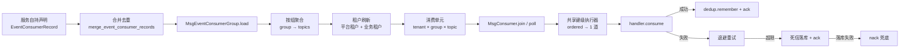

# 事件消费组运行时详细设计（msg 补口）

> 通用能力 · 01 异步底座 · 04 事件消费组运行时 · 详细设计

[文档首页](../../../../../../文档首页.md) › [08 通用能力](../../../../README.md) › [异步底座](../../01_异步底座.md) › [事件消费组运行时](../01_异步底座_04_事件消费组运行时.md) › 详细设计　|　[需求 03-1](../../../../需求/03_需求_消息与任务.md#r03-1) · [需求 11-1](../../../../需求/11_需求_容量与延迟.md#r11-1) · [架构 · 事件总线](../../../../../../设计/架构设计/16_架构设计_子系统_事件总线.md)

## 1. 概述 <a id="overview"></a>

- **目标**：把 01_01 留下的「消费组只有 `null` 实现」补成真实运行时，让审计链、作业投影与通知三个已声明的消费组能在真实 msg 上消费，并为 11-1 的「审计链消费 P95 ≤ 5 秒」提供可复跑证据。

  01_01 已交付：topic 派生与信封编解码（`events/topic.py`）、消费组声明与合并校验（`events/consumer_records.py`）、端口 `BaseEventConsumerGroup`、键级串行执行器（`events/lane.py`）、幂等短窗口（`events/dedup.py`）、消费死信落库（`events/dead_letter.py`）、`MsgEventPublisher`、`sys_outbox.trace_id` 贯通。**缺的只有**「把声明变成真实消费者」的运行时、装配注册、租户覆盖、主题供给与运维入口。

- **关键前提（本段核实）**：
  1. msg 是自研 HTTP 消息平台（容器内 `8000`，经平台网络访问；不是 RocketMQ gRPC `8081`）。主题身份是 `(租户, 命名空间, 主题名)`，消费组身份是 `(租户, 主题, 组名)`；命名空间必须是**已启用 `module_key`**。
  2. 事件命名空间取**事件类型首段（事件域）**——`sys.operation.logged → sys`、`notification.requested → notification`、`wf.task.completed → wf`；事件域与服务目录的 `event_domain` / `module_key` 同源，发布与消费因此能落在同一主题。
  3. 消费组身份按租户隔离：要消费所有租户的事件，必须按租户分别 `join`，不能一个消费者通吃。

- **依据**：《[架构设计 · 事件总线](../../../../../../设计/架构设计/16_架构设计_子系统_事件总线.md)》§2 / §4 / §5 / §6；《[后端开发规范](../../../../../../规范/后端开发规范.md)》§3.2「模块边界与数据所有权」、§10「事件与任务规范」；《[测试规范](../../../../../../规范/测试规范.md)》§2 / §6 / §14；需求 [03-1](../../../../需求/03_需求_消息与任务.md#r03-1) / [11-1](../../../../需求/11_需求_容量与延迟.md#r11-1)；兄弟设计《[01_01 事件总线](../../01_异步底座_01_事件总线/设计/01_详细设计_01_事件总线.md)》与《[15_01 异步链路容量与延迟](../../../15_容量口径/15_容量口径_01_异步链路容量与延迟/设计/01_详细设计_15_01_异步链路容量与延迟.md)》。

- **范围**：上述 1~8（含发布器命名空间 / 平台租户修正、租户清单只读契约、主题供给、`event-worker` 编排、15_01 报告补齐）。
- **不含**：业务消费组本身（已随 06_01 / 06_02 / 07_01 声明）；Outbox 多实例行锁；死信自动重投；正式服务目录 / 镜像 / 网关登记；ES / embedding 消费组；审计链写入吞吐优化（另立任务）。

## 2. 现状与差距（设计 vs 代码不符清单） <a id="gap"></a>

| # | 关注点 | 任务 / 架构要求 | 代码现状 | 处置 |
| --- | --- | --- | --- | --- |
| 1 | 消费实现 | 真实消费组运行时 | `[event_consumer].provider=""`，唯一实现 `NullEventConsumerGroup`（只装载不拉取） | **本段改**：新增 `MsgEventConsumerGroup` |
| 2 | 装配注册 | `event_consumer` 端口可解析 `msg` | 只导入 `bms_core.events.null`；无 `msg` 工厂；`ops/event_consumer.py` 同样只认 `null` | **本段改**：工厂 + 注册 + CLI 共用构造入口 |
| 3 | 客户端 | 拉取 / 确认 / 心跳 | `msgclient/messaging/consumer.py` 已交付 `MsgConsumer`（`join` / `poll` / `ack` / `nack` / 心跳 / `leave`），但无组运行器 | **本段用**：不重写客户端 |
| 4 | 租户覆盖 | 消费所有租户 | 无租户枚举；msg 组按租户隔离 | **本段改**：平台租户固定 + 业务租户动态枚举 |
| 5 | 跨主题链序 | 同租户审计链串行 | 审计组声明 3 个事件 → 3 个主题；无「同组多主题」运行器 | **本段改**：同组多主题汇入同一串行执行器 |
| 6 | 主题供给 | 主题由部署期创建 | 无建主题入口；msg 无 auto-create | **本段改**：新增 `ops/event_topics.py` |
| 7 | 发布命名空间 | 发布与消费落同一主题 | `MsgEventPublisher` 用 `[event].options.namespace` 或 `[app].service`（`platform`），不是合法 `module_key` → 平台事件 `350010`；跨服务主题错位 | **本段改**：按事件域取命名空间；`options.namespace` 仅作显式覆盖 |
| 8 | 平台级事件 | 无租户事件也要可投 | 发布器缺省租户为空 → msg 判 `350012` | **本段改**：缺省租户取 `[platform_tenant].code` |
| 9 | 租户清单契约 | 运行期枚举启用租户 | 只有按 code / id / domain 单条查询与 `active-single`；无清单端点 | **本段改**：新增 `GET /api/v1/tenant-registry/active` |
| 10 | 可观测 | 消费计数 / 死信 / 耗时 | `bms_event_consume_total` / `bms_event_dead_letter_total` 已登记但无发射点；无耗时直方图 | **本段改**：三处发射 + 新指标名 |
| 11 | 运行参数 | 长轮询 / 租户刷新 | `[event_consumer]` 缺 `long_poll_ms` / `tenant_refresh_seconds`；`visibility_timeout_seconds` 对 msg 无效 | **本段改**：补参数并注明旧参数保留原因 |
| 12 | 宿主 | 服务进程 / 独立 worker | 端口注释与 CLI 均保留，但无实现；编排无 `event-worker` | **本段改**：`event-worker` 编排项（复用平台镜像） |
| 13 | 默认开关 | 开发可跑、生产可控 | `[event].provider=""`、`[event_consumer].enabled=false`、`[outbox].provider="poll"` | **本段改**：dev 打开、prod 关闭、test 空 |
| 14 | 用例 | 运行时护栏 | RocketMQ 版用例随实现下线删除（`test_rocketmq_consumer.py` 等） | **本段重建**：msg 版单测 + 真 msg 集成 |
| 15 | 15_01 报告 | 有基线数据与 §9 复跑步骤 | `02_压测报告_15_01_异步链路容量与延迟.md` 为 0 字节（已提交） | **本段补**：据实施 / 测试记录重建，标注来源 |
| 16 | 01_01 文档 | 补口归口清晰 | 设计 / 实施记录仍写「msg 消费组待实现」 | **本段改**：加指针，不改历史结论 |
| 17 | 订阅覆盖面 | 订阅由真实声明驱动 | 三个业务组已声明，但运行时未装载 → 订阅清单空转 | **本段改**：装载即登记 `EventSubscription` |

## 3. 交付物清单 <a id="tree"></a>

```text
backend/
├── libs/bms_core/src/bms_core/
│   ├── core/config.py                                  # 改：EventConsumerSettings + long_poll_ms / tenant_refresh_seconds
│   ├── core/assembly.py                                # 改：msg 消费工厂登记 + msg_namespace 语义（显式覆盖，空 = 事件域）
│   ├── db/tenant.py                                    # 改：TenantDirectory 协议（active_tenants）
│   ├── db/tenant_remote.py                             # 改：RemoteTenantSource.active_tenants + 缓存
│   ├── events/msg_consumer.py                          # 新：MsgEventConsumerGroup + 消费单元 + 监督循环
│   ├── msgclient/adapter/event_publisher.py             # 改：按事件域取命名空间、缺省租户平台租户
│   ├── metrics/base.py                                 # 改：METRIC_NAMES 增消费耗时直方图
│   ├── metrics/prometheus.py                           # 改：METRIC_DOCS 同步
│   └── events/base.py                                  # 改：端口文档补租户 / 多主题 / 宿主语义（签名不变）
├── ops/event_consumer.py                               # 改：msg 工厂构造、--groups 显示租户与主题、--once/--worker
├── ops/event_topics.py                                 # 新：按契约与租户幂等建主题 / 扩分区 / 亲和检查
├── ops/outbox.py                                       # 改：发布器命名空间 / 平台租户同源
├── services/tenant/src/bms_tenant/domains/tenant/
│   ├── api/tenant_registry.py                          # 改：新增 /active 清单端点
│   └── repositories/tenant_registry.py                 # 改：active_rows 复用（如需字段补齐）
├── libs/bms_core/tests/
│   ├── msgclient/adapter/test_event_consumer.py        # 新：拉取→分发→ack/nack、重试、死信、毒消息、停机、指标
│   ├── msgclient/adapter/test_event_publisher.py       # 改：事件域命名空间 / 平台租户
│   ├── events/test_msg_event_consumer_group.py         # 新：装载 / 订阅 / 租户刷新 / 跨主题单串行 / 两进程亲和
│   ├── db/test_tenant_directory.py                     # 新：active_tenants 解析 / 缓存 / 失败保留
│   ├── outbox/test_msg_outbox_switch.py                # 改：命名空间口径
│   └── ops/test_event_topics.py                        # 新：派生 / 幂等 / 扩分区 / 跳过未启用命名空间
├── services/tenant/tests/                              # 改：/active 端点（启用 / 空 / 软删）
├── services/platform/tests/crosscut/test_plugin_registration.py  # 改：event_consumer 注册 msg
└── ../deploy/compose/services.yml                      # 改：event-worker（复用平台镜像）+ 平台服务 host=worker
```

| 文件 | 类型 | 说明 |
| --- | --- | --- |
| `events/msg_consumer.py` | 新建 | `MsgEventConsumerGroup`（端口实现）、`_ConsumerUnit`（租户 × 组 × 主题）、监督循环、指标 |
| `db/tenant_remote.py` | 修改 | `active_tenants()` 走新契约，按 `[tenant].resolve_cache_ttl` 缓存；失败上抛由运行时保留旧集合 |
| `msgclient/adapter/event_publisher.py` | 修改 | `namespace` 参数改为「显式覆盖」；缺省取事件类型首段；缺省租户取平台租户 |
| `ops/event_topics.py` | 新建 | 运维通道；默认 `--ensure`，支持 `--check` / `--tenant` / `--partitions-*` / `--dry-run` |
| `deploy/compose/services.yml` | 修改 | 新增 `event-worker`（同平台镜像、`expose: []`、独立 `worker_id`）；platform 服务 `BMS_EVENT_CONSUMER__HOST=worker` |
| 表 / 迁移 | **不改** | 无新增表；死信复用 `sys_event_dead_letter` |
| 契约快照 | 重导 | tenant 服务新增 `/tenant-registry/active`，随 `ops.contract_snapshot` 重导 |

## 4. 领域设计 <a id="design"></a>

### 4.1 运行模型：组 → 主题 → 租户 <a id="model"></a>

| 层 | 身份 | 说明 |
| --- | --- | --- |
| bms 消费组 | `{group_prefix}-{域}`，如 `bms-audit-chain` | 由服务自持 `EventConsumerRecord.consumer` 声明，基座合并 |
| msg 主题 | `bms-{事件域}-{对象}`，如 `bms-sys-operation` | 由事件类型前两段派生；同对象多动作共用一个主题 |
| msg 命名空间 | 事件类型首段（事件域），如 `sys` / `notification` | 必须是对应租户已启用的 `module_key`；发布与消费同源 |
| msg 消费组 | `(租户, 主题, bms 组名)` | msg 服务端按租户隔离组与位点 |
| 消费单元 | `(租户, bms 组, 命名空间, 主题)` | 运行时最小单位：一个 `MsgConsumer` + 一个拉取协程 |



### 4.2 租户覆盖与刷新 <a id="tenants"></a>

**平台租户**：复用 `[platform_tenant].code`（缺省 `platform`），不新增配置键。无租户事件在发布侧落该租户命名空间；消费侧固定包含它。

**业务租户清单**：新增租户服务只读契约，经 `BaseServiceClient` 取数，按 `[tenant].resolve_cache_ttl`（缺省 60 秒）缓存。

| 项 | 口径 |
| --- | --- |
| 端点 | `GET /api/v1/tenant-registry/active` |
| 提供方 | 租户与配置服务（`sys_tenant` 所有权方） |
| 响应 | `ApiResponse.data.items`：`code` / `name` / `tenant_id` / `db_basis` / `status`（只含启用且未软删） |
| 排序 | 租户主键升序（稳定、可断言） |
| 分页 | 不分页（租户数量级小；后续超千级再改游标） |
| 权限 | 内部只读契约，不挂业务权限码（与既有 `/tenant-registry` 同口径） |
| 失败 | 上抛 `ServiceUnavailableError`；运行时**保留当前租户集合**、记 warn、按 `poll_interval` 下轮重试，不因清单不可用停掉已有消费者 |

**刷新语义**：

| 变化 | 动作 |
| --- | --- |
| 新增租户 | 为该租户建立全部消费单元（`join` 后进入拉取） |
| 租户停用 / 删除 / 不在清单 | 停止其消费单元 → `leave` → 释放传输；`sys_event_consumed` 与位点由 msg 保留 |
| 平台租户不在清单 | 仍保留（固定并集），避免平台级事件无人消费 |
| 刷新间隔 | `[event_consumer].tenant_refresh_seconds`（缺省 60） |

端口在 `db/tenant.py` 增加 `TenantDirectory` 协议，`RemoteTenantSource` 结构化实现；消费运行时不依赖 `TenantLookup` 的单条查询。

### 4.3 消费单元与拉取 <a id="consume"></a>

每个消费单元持有一个 `MsgConsumer`，参数如下：

| 项 | 取值 | 说明 |
| --- | --- | --- |
| `group` | bms 组名（`bms-audit-chain`） | msg 组名规则 `[a-zA-Z0-9._-]+`，连字符合法 |
| `namespace` | 事件域（`sys`） | 由该主题下所有事件类型的首段确定；同主题必然同域 |
| `topic` | `topic_for(event_type)` | 同组多事件可能共用一个主题 |
| `tenant` | 租户编码 | `X-Tenant-ID`；msg 解析链同时接受编码与主键 |
| `consumer_id` | `{service}-{hostname}-{pid}-{uuid8}` | 组内唯一；同 id 再 `join` 视为重连 |
| `endpoints` | `msg_instance_addresses(settings)` | 与发布器同源（`[service_client].instances.msg` 优先） |
| `request_timeout_ms` | `long_poll_ms + 5000` | 必须大于长轮询，否则客户端先超时 |
| `max_wait_ms` | `long_poll_ms`（缺省 20000） | 长轮询挂起上限；空主题不空转 |
| `batch_size` | `[event_consumer].batch_size` | 单次 `poll` 上限 |

**生命周期**：

1. 建 `MessagingConfig` → `build_transport` → `MsgConsumer` → `join()`；
2. 分配为空（成员数 > 分区数）时**不拉取**，只等心跳任务更新分配，按 `poll_interval` 检查；
3. `poll()` 返回 `paused=True`（在途达阈值）时退避后重试，不当错误；
4. `MsgClientError.action` 为 `REFRESH` 时客户端已自动重新 `join` 一次；仍失败按可重试处理；`FATAL` 记 error 并退避，不退出进程；
5. 停止：取消拉取协程 → `await` 在途 → `consumer.close()`（停心跳 + `leave` + 关闭传输）。

**并发**：租户 × 组 × 主题的单元数可能较大，`join` 与启动用信号量限制并发（缺省 8），避免瞬时打满 msg 与连接池。

### 4.4 键级串行与跨主题收敛 <a id="lane"></a>

- **执行器归属**：每个 bms 组一个 `KeyedLaneExecutor`，**该组所有主题、所有租户共用**。`ordered=True` 的组道数固定 1；其余组取 `[event_consumer].concurrency`（组级 `concurrency` 可覆盖）。
- **分区键**：`aggregate_key` → `tenant_id` → `event_id`。审计事件 `aggregate_key = tenant:{id}` / `global`，同一租户必落同一道。
- **提交方式**：一个拉取批次先全部提交、再 `gather` 等结果、最后按原顺序 `ack`。同键在道内串行，跨键并行；`ordered` 组整组串行。
- **跨主题**：审计组 3 个主题的批次都提交到同一个执行器，因此同一租户的 operation / login / data 三类事件**串行追加**，`prev_hash` 不会并发抢链尾。
- **多实例约束（写死并校验）**：两个进程消费同一组时，要保证「同一租户在三个主题上落到同一个进程」，必须同时满足：
  1. 同组各主题的**分区数一致**；
  2. 两个进程都加入该组的**全部主题**（运行时按同一份声明装载，天然满足）；
  3. 同一租户的消息在三个主题上算出**同一分区号**（`select_partition` 按消息 key 的 CRC32 取模，key 都是 `tenant:{id}`，满足）。
  仅满足 1、2 时，msg 的 `assign_range` 按 `consumer_id` 字典序对每个主题做同样的切分，同一分区号必归同一进程。
  `ops/event_topics.py --check` 校验第 1 条；运行启动日志打印每组的主题与分区数，分区数不一致时**拒启**（fail-closed，避免悄悄破坏链序）。

> 若未来某组不得不同时满足上述约束，替代方案是「审计三类事件收敛到同一主题」或「写入侧按租户加分布式锁」，取舍见 §10。

### 4.5 幂等：两层、三处 <a id="idempotency"></a>

| 层 | 位置 | 作用 | 失效影响 |
| --- | --- | --- | --- |
| L1 短窗口 | `EventConsumeDedup`（Redis） | 挡住 msg 重投 / 重复投递在窗口内的重复 | 降级放行，L2 兜底 |
| L2 长账本 | 处理器自身唯一约束（审计 `event_id` 唯一、通知幂等键、作业投影按状态覆盖） | 语义级「效果一次」 | 权威 |

- **顺序固定**：`seen()` → `handler.consume()` → `remember()` **整体在串行道内**。同批同 `event_id` 的两条消息不会互相看不到标记（01_01 真机坑 #12）。
- Redis 不可用：`seen` 返回 False、`remember` 空操作 + warn，不阻断事件流（L2 仍在）。
- 命中 L1：计 `skipped` 并 `ack`。

### 4.6 重试、死信与 nack <a id="dead-letter"></a>

| 场景 | 行为 |
| --- | --- |
| 处理器可重试失败 | 道内退避 `retry_backoff_seconds × 2^(n-1)`，最多 `max_retries` 次；成功计 `retried` |
| 重试耗尽 | 写 `sys_event_dead_letter`（`source=consumer`、`consumer=组名`、`retry_count`）→ `ack` |
| 毒消息（解码失败 / 事件类型非法 / 主版本不支持） | **不重试**，直接写死信 → `ack`；`event_id` 能从属性取到就带上 |
| 死信落库失败 | **不 ack**；尝试 `nack(message, reason="processing_failed"｜"schema_invalid")` 让 msg 侧也留痕；若 `nack` 也失败，留给可见性超时重投。宁可重复不可丢 |
| `ack` 失败 | 记 warn，不重试本轮；msg 停等 + 可见性超时负责重投 |
| 消费运行时异常（单批） | 捕获后按 `poll_interval` 续跑，不终止该组、不影响其他组 |

- 死信统一落**平台库**，与看板 `GET /api/v1/outbox/dead-letters` 同源；独立事务，不随业务回滚。
- 告警：`event_dead_letter` error 日志 + `bms_event_dead_letter_total{consumer}`；阈值与通知由监控侧接。
- **`nack` 的定位**：只作「库表死信写不进去」的兜底，不替代库表；运维排障时两处都要看（msg 死信 + `sys_event_dead_letter`）。

### 4.7 停机与故障 <a id="shutdown"></a>

1. 收到停机信号（服务 lifespan 或 worker 的 SIGTERM / SIGINT）→ 监督循环置停止标志；
2. 先停**租户刷新**与**新单元创建**；
3. 再逐单元取消拉取协程（不再 `poll` 新消息）；
4. `await lane.join()` 排水已入队任务（含重试与 ack）；
5. 逐单元 `consumer.close()`（`leave` + 关传输）；
6. `aclose()` 幂等；未 ack 的消息由 msg 在其可见性窗口后重投。

- 单组异常不影响其他组（每组独立协程 + 捕获）。
- msg 不可达：单元循环捕获 `MsgClientError`，warn + `poll_interval` 退避；不退出进程。
- 租户清单不可达：保留旧集合（见 §4.2）。

### 4.8 装配、配置与宿主 <a id="wiring"></a>

**装配**（`core/assembly.py`）：

| 能力键 | 端口 | 实现 | state 落点 |
| --- | --- | --- | --- |
| `event` | `EventPublisher` | `msg` / `null` | `event_publisher`（不变） |
| `event_consumer` | `BaseEventConsumerGroup` | `msg` / `null` | `event_consumer_group`（本段生效） |

- 工厂 `MsgEventConsumerGroupFactory(settings, app, resources)` 注入：`EngineRegistry` / `SessionFactory` / `BaseMetrics` / `TenantDirectory`。
- `setup()`：`enabled` 且 `host == "in_service"` 时 `start()`；`host == "worker"` 时只装载。
- `aclose()`：`stop()` → 排水 → 释放；随 `ResourceManager` 逆序回收。
- `load_event_consumer_records()` 已在 `assemble_plugins` 之前执行，不需要改顺序；本段只换实现与参数。

**配置**（`config.toml` 基线；dev 打开、prod 关闭、test 空）：

```toml
[event]
# 事件发布实现：msg = 自研消息平台；空串 = null 不投递
provider = "msg"
contract_mode = "enforce"
options = {}
# options.namespace 仅在需要把事件强行收进某个命名空间时显式设置；
# 缺省（不写）= 按事件类型首段取事件域（sys / notification / wf …）

[event_consumer]
# 消费组运行时：msg = 真实消费；空串 = null 只装载
provider = "msg"
enabled = true
# in_service = 随服务进程消费；worker = 只装载，由 ops/event_consumer.py --worker 消费
host = "in_service"
group_prefix = "bms"
concurrency = 4
batch_size = 32
poll_interval_seconds = 1.0
# 长轮询挂起上限（毫秒）；请求超时自动取本值 + 5 秒
long_poll_ms = 20000
# 业务租户清单刷新间隔（秒）；平台租户固定包含
tenant_refresh_seconds = 60
max_retries = 3
retry_backoff_seconds = 1.0
dedup_ttl_seconds = 600
# 保留项：msg 的可见性由服务端在途 / 租约管理，本参数对 msg 实现不生效
visibility_timeout_seconds = 30
```

- `config.dev.toml`：`[event].provider="msg"`、`[event_consumer].provider="msg"`、`enabled=true`、`host="in_service"`；`[outbox].provider="poll"` 保持（投递器用 msg 发布器）。
- `config.prod.toml`：写全套参数但 `[event_consumer].enabled=false`、`[event].provider=""`，由部署评审打开。
- `config.test.toml`：两个 provider 均空，单测不连 msg。

**宿主与编排**：

| 宿主 | 进程 | 配置 |
| --- | --- | --- |
| 服务进程内 | platform / notification | `host=in_service`、`enabled=true` |
| 独立 worker | `event-worker`（复用平台镜像） | platform 服务 `host=worker`；`event-worker` 执行 `python -m ops.event_consumer --service platform --worker`，`enabled=true` |
| 本地裸跑 | platform | `host=in_service`（一个进程同时跑 API 与消费） |

- 两宿主互斥：同一组不得在服务进程与 worker 同时消费；由 `host` + 部署评审 + 启动日志把关。
- `event-worker` 与 `platform-jobs` 同构：同一镜像、独立 `BMS_APP__WORKER_ID`、`BMS_APP__SERVICE=platform`、`expose: []`。
- `ops/event_consumer.py` 与进程内宿主**共用同一构造入口** `build_msg_event_consumer_group(settings, engine_registry, tenant_directory, metrics)`，不写第二套装配。

### 4.9 主题供给 <a id="topics"></a>

`ops/event_topics.py`（运维通道，默认 dry-run 之外的 `--ensure`）：

| 步 | 动作 |
| --- | --- |
| 1 | 装载事件契约：平台内置 + 产品注入（`register_platform_event_contracts` / `register_product_event_contracts`） |
| 2 | 派生：`namespace = event_type.split(".")[0]`，`topic = topic_for(event_type)`，按 `(namespace, topic)` 去重 |
| 3 | 取租户：`GET /api/v1/tenant-registry/active`（经服务客户端） |
| 4 | 逐租户逐主题：`POST /api/v1/msg/admin/topics`；`350008` 视为已存在，查详情 |
| 5 | 分区数：审计三主题（`bms-sys-operation` / `bms-sys-login` / `bms-sys-data`）4；其余 1；已存在且少于目标值时 `POST /{id}/partitions` 扩容 |
| 6 | 命名空间未对租户启用（`350010`）：跳过并 warn（该模块未开通，本就不该有事件） |
| 7 | `--check`：只读校验存在性与同组主题分区数一致，输出缺口，退出码 1 |

- 主题名按 `bms-{域}-{对象}`，长度与字符满足 msg 的 `[%a-zA-Z0-9_-]`；不使用点号。
- 幂等：重复执行不发重复主题；扩分区只增不减。
- 生产网络内执行（内部管理端点；当前无用户态时 `require_permission` 走平台层豁免，依赖网络隔离）。
- 产品事件：产品仓用自己的契约清单跑同一入口（`--service <产品服务>` 或产品侧运维脚本），基座不硬编码产品。

### 4.10 指标与告警 <a id="metrics"></a>

| 指标名 | 类型 | 标签 | 语义 | 发射点 |
| --- | --- | --- | --- | --- |
| `bms_event_consume_total` | 计数器 | `group` / `result`（`succeeded` / `skipped` / `retried` / `dead`） | 消费结果计数 | 每批处理完，按条累加 |
| `bms_event_dead_letter_total` | 计数器 | `consumer` | 转死信次数 | 死信落库成功后 |
| `bms_event_consume_duration_seconds` | 直方图（秒） | `group` / `result`（`success` / `failure`） | **单次处理器调用**从进入到返回的墙钟耗时（不含退避等待） | 每次 `handler.consume` 返回后 |

- 标签基数：组数（当前 3）× 结果（4）有界；不把租户 / 主题放进标签。
- 同步 `METRIC_NAMES` / `METRIC_DOCS`；容量面板增「事件消费耗时 P95（按组）」与「消费结果速率」两块。
- 告警新增 `BmsEventConsumeDurationHigh`：`histogram_quantile(0.95, sum by (le, group) (rate(bms_event_consume_duration_seconds_bucket[5m]))) > 5` for 10m；与既有 `BmsAuditConsumeLagHigh`（端到端 lag）互补。规则单测进 `deploy/observability/rules/tests/`。
- 指标器为 `null` 时空操作，不影响消费结果。

### 4.11 链路贯通 <a id="trace"></a>

- 解码时读消息属性 `traceparent` / `trace_id`；有 OTel 时 `extract` 建消费 span，无 OTel 时用 `set_current_trace_id(event.trace_id)` 让日志带原链路 id。
- 死信日志带 `group` / `event_id` / `event_type` / `tenant_id`；消息属性缺失时回落 body。
- 发布侧已由 01_01 写入 `traceparent` / `trace_id`，本段不改信封。

### 4.12 契约与版本兼容 <a id="contract"></a>

- 订阅主版本按 `EventSubscription(supported_majors=(1,))` 登记；解码后按 `resolve_event_contract` + `event_version_compatible` 判定。
- 缺版本：按**登记契约**补齐（与发件箱同源），不硬编码 `1.0.0`。
- 主版本不支持：毒消息路径（死信 + ack），不重试。
- `EventEnvelope` / `EventPublisher` / `PollOutboxDispatcher` / 业务处理器契约**零改动**。

### 4.13 与业务组的边界 <a id="business-boundary"></a>

本段只交付运行时与机制，不在基座预置任何业务组。现有三个组的声明保持不动：

| 组 | 事件数 | 主题 | ordered |
| --- | --- | --- | --- |
| `audit-chain` | 3（`sys.operation.logged` / `sys.login.logged` / `sys.data.changed`） | 3 | 是 |
| `job-monitor` | 4（`sys.job.*`） | 1 | 是 |
| `notification-inbox` | 1（`notification.requested`） | 1 | 否 |

## 5. 失败分支与边界 <a id="failures"></a>

| 场景 | 行为 | 依据 / 风险 |
| --- | --- | --- |
| msg 不可达（消费） | 单元循环捕获 → warn → `poll_interval` 退避；不退出进程 | 不因 MQ 抖动拖垮服务 |
| 租户清单不可达 | 保留当前租户集合，下轮重试 | 不让「清单服务抖一下」停掉全部消费 |
| 成员分配为空（成员数 > 分区数） | 不拉取，等心跳更新；不报错 | msg 语义：空闲成员合法 |
| `poll` 返回 `paused` | 短退避后重试，不计错误 | 背压信号 |
| 处理器失败 | 道内退避重试 ≤ `max_retries` → 死信 | 不无限重投 |
| 毒消息 | 不重试，死信 + ack | 重试只会堵住同道 |
| 死信落库失败 | 不 ack；`nack` 兜底；再失败靠可见性超时 | 宁可重复不可丢 |
| `ack` 失败 | 记 warn；msg 停等 + 可见性超时重投 | 至少一次 |
| Redis 不可用（幂等预判） | 降级放行 + warn；L2 兜底 | 语义仍正确 |
| 同 `event_id` 并发到达（两进程） | L1 可能双双放过 → L2 唯一约束拒其一 | 效果一次 |
| 同组主题分区数不一致 | 启动拒启（fail-closed） | 否则跨主题同租户可能分到不同进程，链序破坏 |
| 同一组被两个宿主同时消费 | 组内竞争、顺序破坏；由 `host` + 部署评审 + 启动日志把关 | 不做运行期互斥（需分布式租约，收益低） |
| 租户在消费中途被停用 | 下一轮刷新停止该租户单元；已入队任务继续完成 | 停用是管理面动作，不粗暴丢消息 |
| 进程停机 | 停拉取 → 排水 → 关闭；未 ack 消息重投 | 与「停机摘流先于排空」同口径 |
| msg 管理端点无权限 | `350010` / 权限拒绝 → 跳过并 warn（topic 供给） | 未启用模块本就不该有事件 |

## 6. 测试设计与验收映射 <a id="tests"></a>

### 6.1 用例清单 <a id="cases"></a>

| 范围 | 用例（自动化文件） | 断言要点 |
| --- | --- | --- |
| 运行时主链路 | `tests/msgclient/adapter/test_event_consumer.py` | `join` → `poll` → 处理 → 逐条 `ack`；成功 / 跳过 / 重试 / 死信四类计数 |
| 同键串行 | 同上 | 同 `aggregate_key` 两条并发提交，处理顺序与提交顺序一致 |
| 跨主题单串行 | `tests/events/test_msg_event_consumer_group.py` | 审计组 3 个主题的消息进入同一 `ordered` 执行器；处理序列不交错 |
| 幂等 | `test_event_consumer.py` | 命中 L1 → `skipped` + `ack`；Redis 不可用 → 降级放行 |
| 重试 / 死信 | 同上 | 前 N 次失败后成功 → `retried`；耗尽 → 死信落库 + `ack`；落库失败 → 不 `ack` + `nack` |
| 毒消息 | 同上 | 非法 JSON / 非法事件类型 / 主版本不支持 → 死信 + `ack`，不重试 |
| 停机 | 同上 | `stop()` 后不再拉取；已入队任务完成；`close()` 调用 `leave` |
| 租户刷新 | `tests/db/test_tenant_directory.py` + `test_msg_event_consumer_group.py` | 新增租户建立单元；移除租户停止单元；清单失败保留旧集合 |
| 装配 | `services/platform/tests/crosscut/test_plugin_registration.py` + 装配冒烟 | `event_consumer` 可解析 `msg`；`app.state.event_consumer_group` 就位 |
| 运维入口 | `tests/ops/test_event_consumer_cli.py` | `--groups` 打印组 / 主题 / 租户；`--once` 单轮；`--worker` 启动 |
| 主题供给 | `tests/ops/test_event_topics.py` | 派生正确；重复执行幂等；扩分区只增；未启用命名空间跳过 |
| 租户清单端点 | `services/tenant/tests/...` | 启用租户全量、空清单、软删过滤、稳定排序 |
| 发布器修正 | `tests/msgclient/adapter/test_event_publisher.py` | 命名空间按事件域；显式覆盖生效；无租户事件用平台租户 |
| 真 msg 集成 | `tests/integration/test_event_bus_msg.py`（缺 `instances.msg` 自动跳过） | 发布 → 消费 → 落库；重复投递只生效一次；重试耗尽落死信；两进程分区不重叠 |
| 审计链端到端 | 真栈手工 + 测试记录 | 三类审计事件落对应分片；链校验通过；两进程同租户仍串行 |

### 6.2 验收映射 <a id="accept-map"></a>

| 完成标准（任务 §3 / 需求 03-1 / 11-1） | 验证方式 |
| --- | --- |
| 真实 msg 下三组可消费 | 真栈日志 + 库表 + `ops/event_consumer.py --groups` |
| 同 `event_id` 只生效一次 | 集成用例（重复投递）+ 审计 `event_id` 唯一约束 |
| 死信有告警 | 死信表行 + `bms_event_dead_letter_total` + error 日志 |
| 同租户链序正确 | 跨主题单串行用例 + 真栈链校验 + 两进程验证 |
| 新增租户自动接入 | 租户清单刷新用例 + 真栈新建租户观察日志 |
| 中断补投不重复 | 杀投递器 / 消费者后重启；`sys_event_consumed` / 审计唯一键 |
| 两进程分区不重叠 | 两 worker 的 `join` 分配日志 + `ops/event_topics.py --check` |
| 消费 P95 有实测值 | 15_01 §9 复跑步骤 + 压测报告 |
| 覆盖率 / 静态 | 推送环模块级 100% 行 + 分支；`ruff` / `pyright` / 装配冒烟 |

- **Kiwi**：本任务登记**一条**策展用例，覆盖「运行时主链路 + 跨主题串行 + 租户刷新 + 死信」，代码以 `@pytest.mark.kiwi_id(<编号>)` 标注；编号以平台回读为准，不复用 2370。
- **覆盖率**：新增模块 `bms_core.events.msg_consumer`、`bms_core.msgclient.adapter.event_consumer`（若拆分）、`ops.event_topics` 行 + 分支 100%；改动模块按推送环模块级判定。

## 7. 登记落点 <a id="registry-writeback"></a>

| 文档 | 回写内容 |
| --- | --- |
| 《[架构设计 · 事件总线](../../../../../../设计/架构设计/16_架构设计_子系统_事件总线.md)》§5 | 补「命名空间 = 事件域」「按租户消费」「同组多主题单串行」「多实例分区亲和约束」 |
| 《[后端基类清单](../../../../../../后端基类清单.md)》/《后端基类实现契约》 | `MsgEventConsumerGroup`、`TenantDirectory`、`bms_event_consume_duration_seconds`；`event_consumer` 实现名 `msg` |
| 《[后端开发规范](../../../../../../规范/后端开发规范.md)》§10 | 一句：消费运行时按事件域命名空间、按租户装载；死信库表唯一、`nack` 仅兜底 |
| 《[命名规范](../../../../../../规范/命名规范.md)》§10 | 事件命名空间取事件域；`event-worker` 沿用已登记名 |
| 《[开发服务器部署使用说明总览](../../../../../../资料/开发服务器/linux/开发服务器部署使用说明总览.md)》 | msg 地址 / 端口、主题供给命令、`event-worker` 进程、真栈验证步骤 |
| 租户服务契约快照 | `deploy/contracts/tenant.json` 重导（新增 `/tenant-registry/active`） |
| [阶段计划](../../../../计划/01_计划_通用能力.md) | 04 的进度与偏差（唯一落点） |
| [需求 03-1](../../../../需求/03_需求_消息与任务.md#r03-1) / [11-1](../../../../需求/11_需求_容量与延迟.md#r11-1) | 注块补「运行时已交付 / 复跑结果」 |
| [01_01 设计](../../01_异步底座_01_事件总线/设计/01_详细设计_01_事件总线.md) / [实施记录](../../01_异步底座_01_事件总线/实施/01_实施_01_事件总线.md) | 加「运行时补口归 04」指针，不改历史结论 |
| [15_01 压测报告](../../../15_容量口径/15_容量口径_01_异步链路容量与延迟/测试/02_压测报告_15_01_异步链路容量与延迟.md) | 据记录重建正文 + §9 复跑步骤 |

> 无表结构变更：不涉及数据库设计表文件与总览登记。

## 8. 边界与开放项 <a id="boundary"></a>

1. **Outbox 多实例投递**：`claim_pending` 无行锁，多实例会重复投递；消费端幂等收敛。单实例部署无影响，保留开放项。
2. **死信自动重投**：本段只落库 + 告警，人工 / 运维处置；批量重投 UI 随后续监控任务。
3. **`event-worker` 正式服务化**：本段只加 Compose 服务（复用平台镜像），不做服务目录 / 独立镜像 / 网关登记；需要独立扩缩容时再落。
4. **审计链多实例扩容**：本段只做「两进程真机验证 + 分区亲和约束」，生产扩容方案（分区数规划、滚动重启、容量对比）另立任务。
5. **审计链写入吞吐**：SQLite 下 62.7~87.6 条/秒是已知瓶颈，本段不改链实现；生产库复测与优化另立任务。
6. **连接数随租户增长**：每（租户 × 组 × 主题）一条传输；租户数上百时连接数会线性增长，后续可按租户共享传输或做连接池（本段不做）。
7. **产品事件主题**：`ops/event_topics.py` 只装载平台契约；产品仓用自己的契约清单与运维入口，基座不硬编码产品。
8. **租户清单端点不分页**：租户数量级小；超千级再改游标。
9. **15_01 报告重建**：原报告正文未入库（0 字节），只能据实施 / 测试记录与脚本重建；报告须标注「据记录重建、部分明细未留存」，不得补造数字。
10. **`visibility_timeout_seconds`**：对 msg 实现不生效（服务端管理可见性），保留字段避免破坏既有配置文件；配置注释说明。
11. **`nack` 兜底的双看板**：库表死信失败才走 msg 死信，排障要同时看两处；后续可加「msg 死信同步到库表」的巡检。
12. **跨仓订阅覆盖校验**：产品仓的组声明在各自服务包，平台 CI 看不到；仍由各产品启动校验 + `ops/event_contracts.py check` 保证。

## 9. 实施步骤 <a id="steps"></a>

| 批次 | 内容 | 验证 |
| --- | --- | --- |
| 1 | 契约与配置：`/tenant-registry/active` + `TenantDirectory` + `EventConsumerSettings` 新参数 + 发布器命名空间 / 平台租户修正 | `ruff` / `pyright` / 定向 `pytest` |
| 2 | 运行时：`MsgEventConsumerGroup` + 消费单元 + 监督循环 + 跨主题执行器 + 幂等 / 重试 / 死信 + 指标 | 同上 + `test_event_consumer.py` / `test_msg_event_consumer_group.py` |
| 3 | 装配与运维：工厂注册 + `app.state` + CLI + `event-worker` 编排 + 配置三环境 | 装配冒烟 + CLI 用例 |
| 4 | 主题供给：`ops/event_topics.py` + 用例 | 定向用例 + dry-run |
| 5 | 真栈：重建镜像 → 部署 → 建主题 → 端到端 → 两进程 → 消费 P95 复跑 | 实施记录 + 压测报告 §9 |
| 6 | 文档与回写：实施 / 测试记录、15_01 报告、架构 / 基类清单 / 规范 / 计划 / 需求 / 01_01 指针 | `engkit links` / `docs-scope` / `eol` |

## 10. 决策记录（对齐记录） <a id="align"></a>

| # | 决策 | 备选与取舍 |
| --- | --- | --- |
| 1 | 新增独立子任务 04 | 作为 01_01 嵌套子任务会让 01_01 从已完成表回退；重开 01_01 历史混杂 |
| 2 | 命名空间 = 事件域 | 统一 `sys` 会把通知 / 工作流 / 产品事件混在一起；按发布方服务（现状）跨服务消费拿不到同一主题 |
| 3 | 在 04 内修发布器 | 另立缺陷任务会阻塞 04 的端到端验收；只改配置无法解决跨服务主题错位 |
| 4 | 平台租户 + 业务租户动态枚举 | 只消费平台租户无法验收真实审计链；配置清单要改配置重启 |
| 5 | 新增 `/tenant-registry/active` 只读契约 | 运行期直读注册库违反数据所有权；配置清单不可动态 |
| 6 | 同组多主题汇入单串行 | 收敛到同一主题要改主题派生与契约；写入侧加锁增加每次写开销且不保证到达顺序 |
| 7 | 多实例要求同组主题分区数一致 | 分区数不一致时同一租户可能分到不同进程，链序破坏；拒启比静默错序好 |
| 8 | 审计主题 4 分区、其余 1 | 全部 1 无法验证扩容；全部 4 浪费低量主题 |
| 9 | 平台 worker + 通知随服务 | 全部 in_service 让审计链与 API 争资源；全部 worker 进程最多 |
| 10 | 死信库表唯一 + `nack` 兜底 | 只用库表时库长期不可用会反复重投；改用 msg 死信要改看板与架构口径 |
| 11 | 新增消费耗时直方图 | 只接已有两计数缺少耗时定位；端到端时延与 15_01 lag 重复且跨时钟 |
| 12 | dev 开、prod 关、test 空 | 基线直接打开会让未部署 msg 的环境启动即报错；全部保持空本地验证不便 |
| 13 | 主题供给进运维脚本 | 手工创建不可复现；自动建主题需改 msg（跨仓） |
| 14 | 15_01 报告在本任务补齐 | 报告是 11-1 复跑的唯一口径来源，缺失会让验收证据链断裂 |

## 11. 参考文档 <a id="ref"></a>

- 《[架构设计 · 事件总线](../../../../../../设计/架构设计/16_架构设计_子系统_事件总线.md)》§2 / §4 / §5 / §6
- 《[架构设计 · 服务间通信与分布式一致性](../../../../../../设计/架构设计/37_架构设计_子系统_服务间通信与一致性.md)》
- 《[后端开发规范](../../../../../../规范/后端开发规范.md)》§3.2、§10
- 《[测试规范](../../../../../../规范/测试规范.md)》§2 / §5 / §6 / §14
- 《[15_01 详细设计 · 异步链路容量与延迟](../../../15_容量口径/15_容量口径_01_异步链路容量与延迟/设计/01_详细设计_15_01_异步链路容量与延迟.md)》§7
- 《[01_01 详细设计 · 事件总线](../../01_异步底座_01_事件总线/设计/01_详细设计_01_事件总线.md)》§4.3~§4.10
- msg 仓《消费组详细设计》《客户端接入详细设计》（工作区平级 `msg/`）
