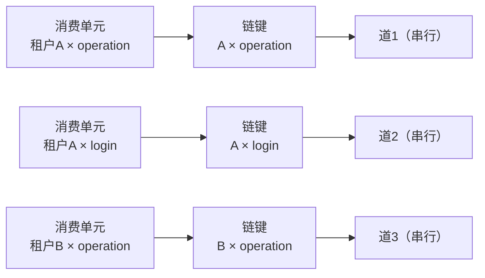

# 审计链消费性能优化详细设计（01_05）

> 通用能力 · 01 异步底座 · 05 审计链消费性能优化 · 详细设计

[文档首页](../../../../../../文档首页.md) › [08 通用能力](../../../../README.md) › [异步底座](../../01_异步底座.md) › [审计链消费性能优化](../01_异步底座_05_审计链消费性能优化.md) › 详细设计　|　[需求 03-1](../../../../需求/03_需求_消息与任务.md#r03-1) · [需求 11-1](../../../../需求/11_需求_容量与延迟.md#r11-1) · [架构 · 事件总线](../../../../../../设计/架构设计/16_架构设计_子系统_事件总线.md)

## 1. 概述 <a id="overview"></a>

- **目标**：把审计链消费端到端 P95 从 15.8~16.1 秒压到 **≤ 5 秒**（180 条突发，同脚本同口径），并保持哈希链、幂等与死信语义不变。
- **手段**（按收益排序）：有序组按「链键 = 租户 × 日志类型」动态分道 → 批量事务与链尾批量读取 → ack 并发化 → 去重与指标开销批量化。
- **不含**：
  - msg 服务端批量 ack 端点（跨仓，另立任务；本轮每条 ack 仍是一次请求）；
  - 进程内链尾缓存（本轮每批每链查一次，DB 仍是唯一真相）；
  - `audit-chain` 生产扩容与分区规划（计划 #49）；
  - 非审计组的行为变更（作业投影 / 通知组保持原语义，只共享批量契约的缺省实现）。

## 2. 现状与差距（设计 vs 代码不符清单） <a id="gap"></a>

| # | 关注点 | 设计 / 目标 | 代码现状（2026-11-21，`ae6b3fd9f`） | 处置 |
| --- | --- | --- | --- | --- |
| 1 | 有序组并行度 | 架构 16 §5 原口径「强有序组退化为全组串行」 | `msg_consumer.py`：`KeyedLaneExecutor(1 if ordered else concurrency)`，审计组 9 条链共用 1 道 | **本段改**：按链键动态建道，同链串行、跨链并行 |
| 2 | 批内处理 | 01_04 设计 §4.4：「一批先全部提交、再 `gather` 等结果、最后按原顺序 ack」 | `_run_unit` 逐条 `await _settle_message`（提交 → 等结果 → ack 串成一条流水线） | **本段改**：恢复批量提交语义，并按链键分组 |
| 3 | 事务边界 | 未规定批量 | `AuditLogConsumer.consume` 每条 `session_scope + session.begin`，链尾查询 + 插入各一次 | **本段改**：一批一次事务、每链一次链尾查询、内存内逐条衔接 |
| 4 | ack | 未规定批量 | 每条 `await consumer.ack(message)`；msg 位点按「连续已确认前缀」推进 | **本段改**：同分区按序、跨单元并发；不加服务端批量端点 |
| 5 | 去重 | L1 Redis 只读预判 + 成功后标记 | 每条两次 Redis 往返（`exists` + `set`）；L2 为分片表 `event_id` 判重 | **本段改**：L1 改 pipeline 批量；L2 改批内 `event_id IN (...)` |
| 6 | 指标 | 计数 + 耗时 + lag | 每条三次指标调用（consume 计数 / 耗时直方图 / audit lag） | **本段改**：计数逐条（合并为批内循环一次调用），耗时改批总耗时计数器，lag 保持逐条 |
| 7 | 分段可观测 | 无 | 只有端到端结果，无法定位 105ms/条的构成 | **本段改**：加可开关的批次分段计时日志（缺省关） |
| 8 | 端到端性能 | 15_01 目标 P95 ≤ 5 秒 | 180 条 / 18.85 秒 ≈ **9.5 条/秒、约 105ms/条**；P95 15.8~16.1 秒 | **本段改**：目标 ≤ 5 秒，复跑同口径 + 600 条线性度 |

## 3. 交付物清单 <a id="tree"></a>

```text
backend/
├── libs/bms_core/src/bms_core/
│   ├── core/config.py                              # 改：commit_batch_size / ordered_lane_limit / lane_idle_seconds / timing_enabled
│   ├── events/base.py                              # 改：EventConsumer.consume_batch 缺省实现 + BatchConsumeOutcome 值对象
│   ├── events/lane.py                              # 改：按链键动态建道（精确键 + 上限哈希合并 + 空闲回收）
│   ├── events/dedup.py                             # 改：seen_many / remember_many（Redis pipeline）
│   ├── events/msg_consumer.py                      # 改：链键派生、批内分组提交、逐条结果回填、ack 顺序、分段计时
│   ├── metrics/base.py                             # 改：METRIC_NAMES 增 bms_event_consume_seconds_total
│   └── metrics/prometheus.py                       # 改：METRIC_DOCS 同步
├── services/platform/src/bms_platform/domains/log/
│   ├── services/writer.py                          # 改：write_batch（链尾每链一次、内存衔接、批量插入）+ 批内查重
│   ├── repositories/shard.py                       # 改：last_hashes / insert_many / event_exists_many
│   └── jobs.py                                     # 改：AuditLogConsumer.consume_batch（一次事务）
├── libs/bms_core/tests/events/…                    # 改 / 增：契约缺省、分组、失败隔离、ack 顺序
├── libs/bms_core/tests/msgclient/…                 # 增：动态道（精确 / 上限 / 回收）
└── services/platform/tests/…                       # 增：批量写入链连续性、月度切换、回滚
bms文档/项目/08_通用能力/任务/01_异步底座/01_异步底座_05_审计链消费性能优化/
├── 设计/01_详细设计_05_审计链消费性能优化.md        # 本文件
├── 实施/01_实施记录_05_审计链消费性能优化.md        # 新
└── 测试/01_测试记录_05_审计链消费性能优化.md        # 新
```

## 4. 领域设计 <a id="design"></a>

### 4.1 执行模型：组 → 单元 → 链键道 <a id="model"></a>



- **不变的部分**：一个 bms 组仍是一个 `KeyedLaneExecutor`；消费单元仍是「租户 × 组 × 主题」；同一单元内消息按拉取顺序处理。
- **变的部分**：道不再是固定 1 条，而是**按链键**建道——同一链键的消息严格串行，不同链键并行。
- **链键派生**（`chain_key(event)`）：
  1. 审计三类事件取 `(tenant_id, 日志类型)`，日志类型由事件类型映射（`sys.operation.logged → operation`、`sys.login.logged → login`、`sys.data.changed → data_audit`）；
  2. 其它有序组：仍按「`aggregate_key` → `tenant_id` → `event_id`」派生（与现状一致，未知类型不会因新规则改变语义）；
  3. 非有序组：沿用 `concurrency` 固定道数 + 哈希（不变）。

### 4.2 动态道（`KeyedLaneExecutor` 扩展） <a id="lanes"></a>

| 项 | 口径 |
| --- | --- |
| 建道 | 首次提交某链键时创建该键专属道（队列 + worker 协程）；同一键此后复用 |
| 精确性 | 键到道一一对应，**无哈希碰撞**；并行度等于活跃链键数（当前 3 租户 × 3 类 = 9，租户增长自然扩展） |
| 上限 | `[event_consumer].ordered_lane_limit`（缺省 64）；活跃键数超上限时，新键按哈希合并到已有道（保证不因租户暴涨创建无限协程） |
| 空闲回收 | `[event_consumer].lane_idle_seconds`（缺省 600）：道内队列空闲超时即回收协程，键记录保留（再次提交时重建） |
| 关闭 | `aclose()`：所有道先 `join` 排水，再取消 worker；已入队任务必跑完 |
| 兼容 | 固定道数模式保留（非有序组与既有用例不改），动态模式只对 `ordered=True` 生效 |

### 4.3 批量消费契约（`EventConsumer.consume_batch`） <a id="contract"></a>

```python
@dataclass(frozen=True)
class BatchConsumeOutcome(BaseValueObject):
    event_id: str
    kind: str            # succeeded / skipped / failed
    retryable: bool = True
    error: str | None = None
```

- `EventConsumer` 增非抽象方法 `async def consume_batch(self, events: ConcurrentStableList[EventEnvelope]) -> ConcurrentStableList[BatchConsumeOutcome]`：缺省实现逐条调用 `consume`，成功 → `succeeded`；异常 → `failed(retryable=True, error=repr)`；单条失败**不终止整批**。
- 需要真正批量的处理器（审计链）覆盖该方法：逐条校验 → 一个事务写入 → 全部成功返回逐条 `succeeded` / 命中幂等 `skipped`；事务失败整批回滚并全部返回 `failed`；毒消息返回 `failed(retryable=False)`。
- 运行时按返回结果分派：
  - `succeeded` / `skipped` → 参与批量去重标记 → 顺序 ack；
  - `failed & retryable` → 复用既有 `_retry_or_dead` 单条路径（退避重试 → 死信）；
  - `failed & 不可重试` → 直接写死信并 ack（与毒消息现状一致）。
- **契约版本**：新增方法不改变既有抽象签名，`contract_version` 不升；契约快照与前端类型不受影响。

### 4.4 批量事务与哈希链 <a id="chain"></a>

| 步骤 | 口径 |
| --- | --- |
| 1 分组 | 批内按 `(log_type, month, tenant_id)` 分组；`month` 取**本批统一写入时刻**（`clock()` 一次），跨月突发的极端情形按批边界切开，不在批内跨月 |
| 2 取链尾 | 每链一次 `last_hash`；批内第一条的 `prev_hash` 取库内尾，其后逐条用内存中的上一条 `record_hash` |
| 3 计算 | `record_hash = SHA256(prev_hash, canonical_record(...))`，与现状同函数、同字段集 |
| 4 插入 | 每链 `insert_many`（一次 executemany），整批一个事务提交 |
| 5 失败 | 任一链写入异常 → **整批回滚**，所有条目返回 `failed(retryable=True)`；随后由运行时逐条重试（此时每条单独事务，行为等价现状） |
| 6 幂等 | 事务内先按分片表 `event_id IN (...)` 批量查重；命中条目不插入，返回 `skipped`；批内重复 `event_id` 先去重再查询 |
| 7 提交后 | 批量写 Redis 去重标记（`remember_many`），再按原顺序 ack |

- **为什么链仍然正确**：同一链键在同一道内串行，批与批之间也串行；批内哈希在内存里逐条衔接，提交后的链尾就是最后一条的 `record_hash`。
- **为什么不需要分布式锁**：链归属于单一进程（同一租户在三个主题上落同一成员，01_04 §4.4 已校验分区数一致与同键同分区）。
- **跨月**：沿用 `ensure_audit_shards(months_ahead=1)` 预建；批内统一月份，跨月由下一批承接（首条 `prev_hash` 取上月同租户末条，既有逻辑不变）。

### 4.5 去重 <a id="dedup"></a>

| 层 | 现状 | 本段 |
| --- | --- | --- |
| L1 Redis | 每条 `EXISTS` + 每条 `SET EX` | 每批一次 `MGET`（`seen_many`）+ 一次 `pipeline SET`（`remember_many`） |
| L2 库表 | 每条一次 `event_exists` | 每个分片一次 `event_id IN (...)`；批内重复 ID 先去重 |
| 降级 | Redis 异常放行，由 L2 兜底 | 不变；批量接口异常同样整体放行并记一次 warn |

- **顺序**：L1 判读在提交前（只读），L1 标记在事务提交后；批内同 `event_id` 只处理一次。
- **幂等语义不变**：L1 命中 → `skipped` 且 ack；L2 命中 → 不插入、返回 `skipped`。

### 4.6 ack 顺序与并发 <a id="ack"></a>

- 批处理完成后，按**原拉取顺序**遍历消息：`outcome.ack` 为真才 `await ack`；同一单元（同一分区序列）严格按序。
- 不同消费单元各自在自己的任务里 ack，天然并发（与现状一致，但不再被 1 条道堵住）。
- ack 失败：记 warn、不重试本轮，由可见性超时重投（现状不变）。
- **acks 不合并**：msg 没有批量端点，合并需要跨仓改造（计划 #61 登记，不在本轮）。

### 4.7 指标与分段计时 <a id="metrics"></a>

| 指标 | 现状 | 本段 |
| --- | --- | --- |
| `bms_event_consume_total{consumer,result}` | 每条一次 | 每批按结果汇总一次调用（值 = 条数） |
| `bms_event_consume_duration_seconds{group,result}` | 每条一次直方图 | 保留（非审计组缺省路径仍逐条）；审计链批次不再逐条观测 |
| `bms_event_consume_seconds_total{group,result}` | 无 | **新增计数器**：每批 `value = 批总耗时（秒）`；`rate(seconds_total) / rate(consume_total)` 得每条平均耗时 |
| `bms_audit_consume_lag_seconds` | 每条一次 | 不变（lag 是 SLO 判据，必须逐条精确） |
| 分段计时 | 无 | `[event_consumer].timing_enabled`（缺省 false）：每批一条 `event_consumer_batch_timing` 日志，字段 `poll / dedup / lane_wait / handler / commit / ack / records / lanes` |

- 基线采集用 `timing_enabled=true` 跑一轮（开发服务器容器已是 DEBUG 日志），据此确认 105ms/条的构成后再定批大小与道上限。

### 4.8 配置项（`[event_consumer]`） <a id="config"></a>

| 键 | 缺省 | 说明 |
| --- | --- | --- |
| `commit_batch_size` | 50 | 单次事务最多写入条数；与拉取 `batch_size`（32）解耦，取 `min(拉取条数, commit_batch_size)` |
| `ordered_lane_limit` | 64 | 有序组动态道上限；超出按哈希合并 |
| `lane_idle_seconds` | 600 | 道空闲回收阈值 |
| `timing_enabled` | false | 批次分段计时日志开关 |

`config.toml` 只补注释与缺省值；`config.dev.toml` 打开 `timing_enabled` 供基线采集，生产保持关闭。

### 4.9 停机、重平衡与多实例 <a id="shutdown"></a>

- 停机：`aclose()` 先排干所有道，再取消 worker；已处理但未提交的批随事务回滚，未 ack 的消息由 broker 重投。
- 重平衡：单元被撤销时取消其拉取任务；已提交的批不受影响；分配为空的窗口沿用 01_04 的空批守卫。
- 多实例约束不变：同组各主题分区数一致、成员加入全部主题、同租户消息同分区号（`ops.event_topics --check` 校验第一条）。

## 5. 失败分支与边界 <a id="failures"></a>

| 场景 | 行为 |
| --- | --- |
| 批内 1 条毒消息（解码 / 必填字段缺失） | 该条 `failed(retryable=False)` → 死信 → ack；同批其余照常提交 |
| 批事务提交失败（连接 / 锁 / 磁盘） | 整批回滚 → 全部 `failed(retryable=True)` → 逐条重试 → 耗尽后死信 |
| 链尾查询与批内计算不一致（并发写链） | 同链串行保证不会发生；若检测到（提交冲突）由整批回滚 + 重试兜底 |
| 批内跨月 | 按批边界切开：本批统一月份，下一批承接；跨月链头由既有逻辑读上月尾 |
| Redis 去重不可用 | 批量判读整体放行、批量标记空操作 + 一次 warn；L2 兜底 |
| 指标上报失败 | 静默（现状不变） |
| 单条 ack 失败 | warn 后继续后续 ack（同分区后续 ack 会推进连续前缀）；未 ack 的消息超时重投 |
| 道上限被打满（租户暴涨） | 新键哈希合并到现有道，退化为部分串行，不报错；打满时记 warn 一次 |
| `commit_batch_size` 大于泄漏的拉取条数 | 按实际条数提交，不等待凑满 |
| 停机时道内仍有排队 | `aclose` 排水后退出；未 ack 的消息重投 |

## 6. 测试设计与验收映射 <a id="tests"></a>

### 6.1 用例清单 <a id="cases"></a>

| # | 用例 | 断言要点 | 落点 |
| --- | --- | --- | --- |
| 1 | 批量契约缺省实现 | 逐条调用 `consume`；单条异常只影响该条；返回顺序与入参一致 | `libs/bms_core/tests/events/test_event_consumer_batch.py` |
| 2 | 动态道精确性 | 两个不同链键并发执行（互不阻塞）；同键严格按提交顺序 | `libs/bms_core/tests/events/test_event_lane_dynamic.py` |
| 3 | 道上限与回收 | 超上限按键哈希合并；空闲超时后 worker 回收、再次提交可重建 | 同上 |
| 4 | 审计链链键派生 | 三类事件映射到各自日志类型；未知类型回落租户键 | `test_msg_event_consumer_group.py` |
| 5 | 批内分组与顺序 | 一批跨 3 链 → 3 道并行；每链内保序 | 同上 |
| 6 | 失败隔离与重试分派 | `failed` 可重试走单条重试；不可重试直死信；成功项照常 ack | 同上 |
| 7 | 批量写入链连续性 | 批内 10 条同链的 `prev_hash` 逐条衔接；跨批衔接正确 | `services/platform/tests/domains/log/test_audit_writer_batch.py` |
| 8 | 批量查重 | 批内重复 ID 只写一条；库内已存在返回 `skipped` | 同上 |
| 9 | 月度边界 | 批统一月份；注入时钟跨月时下一批链头取上月尾 | 同上 |
| 10 | 事务回滚 | 插入抛错 → 一条不落库、返回全失败 | 同上 |
| 11 | Redis 批量去重 | `MGET` / pipeline 语义；Redis 异常放行 | `libs/bms_core/tests/events/test_event_dedup.py`（增补） |
| 12 | 指标 | 计数按条数汇总；新增耗时计数器按批；lag 逐条 | `test_msg_event_consumer_group.py`（增补） |
| 13 | 真栈 180 条 | P95 ≤ 5 秒；链校验通过；missing 0 | `tmp/e2e_audit_latency.py` 复跑 |
| 14 | 真栈 600 条 | 排空耗时增长显著低于线性 3.3 倍；链校验通过 | 同上（参数化条数） |

### 6.2 验收映射 <a id="accept-map"></a>

| 任务完成标准 | 对应用例 / 证据 |
| --- | --- |
| 180 条 P95 ≤ 5 秒 | #13 + 15_01 报告回写 |
| 600 条线性度 | #14 |
| 链校验全量通过 | #7 / #9 / #13 / #14 |
| 毒消息不连坐 | #1 / #6 |
| 事务失败可回滚可重试 | #10 |
| 未 ack 重投只生效一次 | #8 / #11 + 既有 01_04 用例 |
| 非审计组行为不变 | 既有 `test_msg_event_consumer_group.py` 全量回归 |
| 覆盖率 / 静态 / 装配冒烟 | 推送预检 + `pytest services/*/tests -k "plugin_assembly or ..."` |

> Kiwi 用例在详细设计定稿后、写用例前登记一条，编号回填到本表与代码 `@pytest.mark.kiwi_id`。

## 7. 登记落点 <a id="registry-writeback"></a>

| 落点 | 变更 |
| --- | --- |
| 架构 16 §5 | 「强有序组退化为全组串行」改为「强有序组按链键（租户 × 日志类型）串行、跨链并行」 |
| 《后端开发规范》§10 | 同步顺序语义；补「批量消费契约」与「有序组道上限」口径 |
| 《后端基类清单》 | `EventConsumer` / `KeyedLaneExecutor` 的方法与形态说明更新 |
| 指标清单 | `METRIC_NAMES` 增 `bms_event_consume_seconds_total`；面板与告警口径引用 |
| 计划 §3 / §7 | 新增 01_05 任务行；#58 改为指向本任务；#60 登记零除已闭环（01_04 收尾）；#61 登记 msg 批量 ack |
| 01_04 实施 / 测试记录 | 已回写镜像转正、补丁退役与零除修复；本任务完成后补指针 |
| 15_01 报告 §5.3 / §9.5 | 优化后复跑数据回填；复跑步骤补 600 条参数 |
| 本任务实施 / 测试记录 | 新增并随实施更新 |

## 8. 边界与开放项 <a id="boundary"></a>

1. **msg 批量 ack**：本轮不改 msg；每条 ack 的 HTTP + 位点提交仍是固定成本。若 5 秒仍不达，下一步按 #61 立项。
2. **链尾缓存**：本轮不引入进程内缓存；若生产库上的链尾查询成为瓶颈，再评估「尾哈希缓存 + 对账」。
3. **多实例扩容**：本轮只保证单进程内并行；`audit-chain` 多实例分区规划仍归 #49。
4. **批大小的最优值**：由基线数据与 600 条场景决定，不在设计阶段写死；配置可调。
5. **其它有序组**：只有审计链声明 `ordered=True`；动态道对其它组无影响，但若未来出现第二个有序组，链键派生需按其语义扩展。
6. **归档删表**：归档任务会整月迁走分片表；批内 `ensure_shard` 与链尾读取在表被删后按创世哈希重新起链（现状行为），归档与消费的并发窗口仍属 14_01 的运维约束。

## 9. 实施步骤 <a id="steps"></a>

1. **基线**：加 `timing_enabled` 与批次计时日志 → 真栈跑一轮 180 条 → 记录各段占比（不改行为）。
2. **分道**：`KeyedLaneExecutor` 动态道 + 链键派生 + 用例；此时批提交未做，先验证并行度收益。
3. **批量契约与批写入**：`consume_batch` + 审计写入批量事务 + 链尾批量读取 + 用例。
4. **ack / 去重 / 指标**：批内 ack 顺序、Redis pipeline、批量库查重、指标改造。
5. **复跑验收**：180 条 + 600 条；链校验；回写 15_01 报告、测试记录与计划。
6. **文档登记**：架构 16 §5、后端开发规范 §10、基类清单、指标清单。

## 10. 决策记录（对齐记录） <a id="align"></a>

| # | 决策 | 结论 |
| --- | --- | --- |
| 1 | 零除缺陷 | 立即修并补用例（`28e80cdcb`） |
| 2 | 是否先测量 | 先加分段计时基线 |
| 3 | 优化范围 | 分道 + 批提交 + ack + 去重 / 指标，四条一次交付 |
| 4 | 并行度粒度 | 按「租户 × 日志类型」分道 |
| 5 | 跨类型顺序 | 接受同租户不同日志类型并行（链按表独立） |
| 6 | 批量落点 | 框架加批量契约 |
| 7 | 链尾读取 | 每批每链查一次 |
| 8 | ack 策略 | 同分区按序、跨单元并发 |
| 9 | 去重 | Redis 批量 + 批内库查重 |
| 10 | 指标 | 计数逐条、耗时按批聚合 |
| 11 | 验收场景 | 180 条同口径 + 600 条线性度 |
| 12 | 任务落点 | 新建 01_05 |
| 13 | 交付节奏 | 一次交付 |
| 14 | 部署态文档 | 立即回写（已完成） |
| 15 | 道实现 | 按链键动态建道（精确 + 上限哈希合并 + 空闲回收） |
| 16 | 批量结果粒度 | 逐条结果 |
| 17 | 提交批量配置 | 新增 `commit_batch_size`（缺省 50） |
| 18 | 耗时指标 | 新增批总耗时计数器，配合计数算均值 |

## 11. 参考文档 <a id="ref"></a>

- 《[架构设计 · 事件总线](../../../../../../设计/架构设计/16_架构设计_子系统_事件总线.md)》§5
- 《[后端开发规范](../../../../../../规范/后端开发规范.md)》§10
- 《[15_01 压测报告](../../../15_容量口径/15_容量口径_01_异步链路容量与延迟/测试/02_压测报告_15_01_异步链路容量与延迟.md)》§5.3 / §8-2 / §9.5
- 《[01_04 详细设计](../../01_异步底座_04_事件消费组运行时/设计/01_详细设计_04_事件消费组运行时.md)》§4.4 / §4.5 / §4.6
- 《[测试规范](../../../../../../规范/测试规范.md)》§6 / §14
