# 字典统一数据源与运行时查询详细设计（12 key 真实取数 + 版本化失效 + 三防补齐）

> 通用能力 · 02 字典与参数 · 01 字典统一数据源与运行时查询 · 详细设计

[文档首页](../../../../../../文档首页.md) › [08 通用能力](../../../../README.md) › [字典与参数](../../02_字典与参数.md) › [字典统一数据源与运行时查询](../02_字典与参数_01_字典统一数据源与运行时查询.md) › 详细设计　|　[需求 01-1](../../../../需求/01_需求_字典与参数.md#r01-1) · [阶段计划](../../../../计划/01_计划_通用能力.md) · [概要 · 字典管理](../../../../../../设计/概要设计/09_概要设计_字典管理.md)

## 1. 概述 <a id="overview"></a>

- **目标**：02_09 / 02_10 / 02_12 已把「字典六表拆除 + 统一出口骨架 + 通用数据接口三层 + 契约类型化」铺完，但**运行时链路只有 `role` 一个 key 通到真数据**，缓存失效没有写路径，配置只有 dev 生效。本段把这条链路闭合，让它对**全部平台内建字典**可用、可失效、可校验、可实测。

  1. **数据源规格化（12 key 全接入）**：平台服务内落一张**构建期 key → 规格**表（库域 / 物理表 / 列映射 / i18n 附表 / 排序），12 个登记 key 全部经统一出口取到真数据；`origin=product` 的产品数据源仍由前端直取产品命名空间，不经平台出口。
  2. **通用表源扩展**：`DictTableDataSource` 支持**库域（platform / tenant）**与**i18n 附表**（按 locale 覆盖 label、缺省回退主表 `name`）、`sort` 列可缺省。
  3. **版本化失效落地**：新增 `DictInvalidator`（删各 locale 类型键 + 删 id 子集键 + `INCR bms:{tenant}:dict:version`），**先提交事务后失效**；`role` 域写路径接入作端到端样板，其余 key 的接入点登记归口。
  4. **三防与配置化**：新增 `[dict]` 配置节（类型 TTL / 抖动 / 空结果短 TTL / 互斥锁 TTL 与等待 / 探针上限 / L1 容量）；基线 `config.toml` 补 `[data_source]` / `[dict_translator]` / `[dict_cache_region]`，修掉 **test / prod 落 null 实现（字典全空）** 的现状。
  5. **校验前置**：`DataSourceRegistry.validate()` 进启动期（fail-closed），并在 `provider=routed` 时校验「登记 key 均有提供者覆盖」；护栏用例进 CI。
  6. **语义修正**：翻译复用取数缓存（原实现每次全量回源）、`batch` 尊重入参 `locale`、缓存互斥锁键改回命名规范口径。
  7. **失败隔离**：单个字典取数失败（表缺失 / 库不可用）只让该 key 返回空，不把 500 抛给页面，也不把故障写入缓存。
  8. **通用性（一处变更）**：登记 / 规格 / 出口三层各只有一个落点，加字典＝加声明；key 收敛为枚举常量，日志与源码不再散落字面量；表单几十个字典字段走「一次 batch + 版本比对 + ids 子集」三条口径（§4.8）。

- **依据**：《[概要设计 · 字典管理](../../../../../../设计/概要设计/09_概要设计_字典管理.md)》§2.1 / §2.2 / §3 / §4.2 / §5.1 / §7；《[架构设计 · 数据架构](../../../../../../设计/架构设计/07_架构设计_数据架构.md)》§5 缓存与字典内存缓存失效；《[后端开发规范](../../../../../../规范/后端开发规范.md)》「字典取数与翻译必须走基座」条；《[命名规范](../../../../../../规范/命名规范.md)》§10 Redis key；《[组件设计 · 字典字段](../../../../../../设计/组件设计/06_字段类/01_组件设计_字典字段/01_组件设计_字典字段.md)》§8；需求 [01-1](../../../../需求/01_需求_字典与参数.md#r01-1)；兄弟设计 [01_详细设计_02_任务调度](../../../01_异步底座/01_异步底座_02_任务调度/设计/01_详细设计_02_任务调度.md)。
- **范围**：上述 1~6。
- **不含（归口见 §8）**：字典维护页面与写路径（数据归所有者域）、系统参数 02_02、语言包 05_01、产品来源数据源取数、查询方案 RBAC 权限码与前端字典页（阶段十三）、超大字典分片 / 归档（13 / 14）、`sys_query_scheme` 结构与接口（02-4-20 已交付，本段只回归）。

## 2. 现状与差距（设计 vs 代码不符清单） <a id="gap"></a>

> 本节是动手前的对账结果。**「处置」列写明本段改什么、回写什么、留什么**，不含含糊项。

| # | 关注点 | 架构 / 需求要求 | 代码现状 | 处置 |
| --- | --- | --- | --- | --- |
| 1 | 数据源覆盖 | 需求 01-1 §1：登记项含 12 个平台内建 key，运行期按 key 路由取数 | `DATA_SOURCE_CATALOG` 12 条齐全，但平台提供者 `PlatformDictDataSource`（`data_source="platform"`）**只认 `role`**，其余 11 个 key 恒返回空 | **本段改**：平台侧落 key → 规格表，12 个 key 全通真数据（§4.1） |
| 2 | 编码口径 | 条目 `id` 是关联唯一键，业务表存 `id` | 12 张表**全部具备 `id` 雪花主键 + `code` / `name` / `status` / `parent_id` 标准列**（实测列名一致），映射可统一 | **本段用**：统一映射 `value=code` / `label=name`（用户表 `code` 即用户名），不再逐表特判 |
| 3 | 多语言 | 需求 §7：label 按当前 locale 由所有者域下发，缺省回退默认文案 | 4 张表有 `_i18n` 附表（`sys_module_i18n` / `sys_business_i18n` / `sys_action_i18n` / `sys_icon_i18n`，结构统一为 `<实体>_id` / `locale` / `name`），但 `DictTableDataSource` **不支持 i18n**，`locale` 参数被忽略 | **本段改**：表源增可选 i18n 附表（§4.1、决策 3） |
| 4 | 库域 | 平台库与租户库都要承载字典本体 | `DictTableDataSource` 与 `PlatformDictDataSource` 都只经 `session_scope(engines)` 取**当前租户库**；而 `sys_tenant` / `sys_module` / `sys_product` / `sys_business` / `sys_action` 属**平台库**（`fetch` 已核） | **本段改**：表源增 `db_scope`（`tenant` / `platform`，平台库键 `build_platform_db_key`） |
| 5 | 排序 | 条目按稳定顺序下发 | `DictTableDataSource` 固定按 `sort` 列排序，而 12 张表里**只有 `sys_identity_provider` 有 `sort` 列** | **本段改**：`sort` 列可缺省，缺省按 `id` 升序 |
| 6 | 配置基线 | 任务书要求 `[dict]` 与 `[dict_cache_region]` 配置 | **基线 `config.toml` 无 `[data_source]` / `[dict_translator]` / `[dict_cache_region]`**，只有 `config.dev.toml` 有；按「base + env 深合并」口径，**test / prod 落到空 provider（null 实现）→ 字典全空** | **本段改**：三节进基线（`routed` / `routed` / `memory`）；dev / prod 覆盖 `dict_cache_region=redis`；test 继承基线（单测不依赖 Redis） |
| 7 | `[dict]` 参数 | 三防要求「短 TTL + 随机偏移」「互斥锁防击穿」「空值短 TTL 防穿透」 | TTL 只能吃 `CacheRegion` 通用缺省；互斥锁 `LOCK_TTL_SECONDS=5` / `LOCK_WAIT_SECONDS=0.05` 为模块常量；探针上限 `DICT_PROBE_LIMIT=2001` 也是常量；L1 容量 `DEFAULT_MAX_ITEMS=1024` | **本段改**：新增 `[dict]` 节 + `DictSettings`，出口按配置注入（§4.4） |
| 8 | 空结果 TTL | 空结果要**短 TTL**（防穿透），与有数据分开 | 出口只对有数据 / 空结果一视同仁写缓存，TTL 取通用缺省；未登记 key 早退不写缓存（可接受） | **本段改**：空快照用 `empty_ttl_seconds` |
| 9 | 版本化失效 | 需求 §3：所有者域**删 Redis key + `INCR bms:{tenant}:dict:version`** | `DictCacheRegion` 的 `adrop_type` / `aid_subset` / `aincrease_version` 齐备（Redis 走 `INCR`，Memory 走进程内计数），**全仓无写路径调用者**（grep 只有 config 域自用） | **本段改**：新增 `DictInvalidator` + `role` 域写路径接入样板（§4.3） |
| 10 | 互斥锁键 | 命名规范：`bms:{租户\|global}:{域}:{键}` | `RedisDictCacheRegion.alock` 拼成 `lock:bms:{tenant}:dict:{locale}:{type}`——**`lock:` 前缀跑到 `bms:` 之前**，违反键格式 | **本段改**：改 `bms:{tenant}:dict:lock:{locale}:{type}`，登记《命名规范》§10 |
| 11 | 翻译契约 | 文档口径「翻译与取数共用同一份 L1 缓存，防 N+1」 | `RoutedDictTranslator.translate` **每次全量 `provider.load()`**，完全不读 L1 / 不写 L1；`aid_subset` / `aset_id_subset` 无人调用 | **本段改**：先读 id 子集缓存 → 不足再回源 → 回填（§4.2） |
| 12 | 批量 locale | 需求：按 `locale` 返回对应 label | `DictBatchQuery.locale` 字段存在，`RoutedDataSource.batch` **忽略它**，只用上下文 locale | **本段改**：批量按入参 locale 起作用域 |
| 13 | 启动期校验 | 完成标准：`data_source_key` 格式违规在**启动期**被拒 | `DataSourceRegistry.validate()` 实现齐备，**无调用方**（`validate_startup` 只校验密钥 / worker_id；lifespan 只校验服务目录与事件契约） | **本段改**：lifespan 前置校验，失败抛 `CatalogError`（§4.5） |
| 14 | CI 校验 | 完成标准：违规在 **CI** 被拒 | `ops/check_tables.py` 离线段只校验表归属 / `form_key`；CI `base-integrity` 无数据源清单校验 | **本段改**：护栏用例（进选测与 CI service-test）+ `ops/check_tables.py` 离线段补一行（不新增脚本、不改 engkit） |
| 15 | 停用语义 | 需求 §7：登记项与数据源均可启停，停用即时从运行时结果消失 | 概要与实现均为**构建期只读清单**（`DATA_SOURCE_CATALOG` + 注入），无运行期状态载体 → 登记项停用必须改清单发版 | **本段定**（决策 4）：维持构建期只读；「即时消失」只对数据源侧停用成立；**回写需求 §7 与概要措辞** |
| 16 | 版本号语义 | 未登记 key 返回空结果（版本 0） | `_empty_result()` 返回 `version=0`；`NullDictCacheRegion` 固定 `NULL_DICT_VERSION=1`；两套并存且无注释 | **本段改**：明确定义「0 = 未登记 / 无版本；null 实现固定 1 仅作占位断言」，补用例锁定 |
| 17 | 测试库遗留 | 02_11 遗留：`sys_role.form_key` 未落测试库，role 取数在测试库报列缺失 | `test_dict_api.py` 头部注释记录该失败为既有问题 | **已核对（2026-10-31）**：当前 `database/bms/test` 为空库、启动期自动建表带全列，`services/platform/tests/{dict,api/test_dict_api.py}` **12 passed**，无需重建；实施时以实跑结论回填实施记录 |
| 18 | 文档口径 | 架构 / 概要表述「真实取数 / 缓存 / 写路径随通用能力·字典模块阶段」 | 架构 07 §5.2 与概要 09 §4.2 仍是「随阶段回补」的将来时；《后端基类清单》无 `DictInvalidator` / 单表表源条目 | **本段改**：§7 全部登记落点按实际交付回写 |
| 19 | Kiwi 编号 | 先取号再写用例 | 本段尚未登记（01_02 用号 2371） | **本段首步**：容器内 `bms-kiwi` 登记（分类「平台骨架」）取号后再写用例 |
| 20 | `[dict]` 节与字段名 | 任务书口径为 `[dict]` 配置节 | `Settings.model_config` 为 `extra="forbid"`（`core/config.py`），**未声明字段的 TOML 节会让启动直接失败**；且字段若直接命名 `dict` 会遮蔽 `BaseSettings.dict()` 并触发 pydantic 告警（实测） | **本段改**：节名保持 `[dict]`，字段命名 `dict_options` + `validation_alias="dict"`（`populate_by_name=True` 已开，实测可取到值）；**配置节与字段必须同批落地**（决策 13） |
| 21 | 提供者异常边界 | 单个字典取数失败不得拖垮整页 | `RoutedDataSource.by_type` **不包 `provider.load` 异常**（`outlet.py` 只有锁释放的 `finally`）：表缺失 / 库不可用会直接把 500 抛给前端 | **本段改**：出口只包 `load` 一层，记 `warning` + 返回空结果 + 不写缓存（决策 14） |
| 22 | 护栏用例收集面 | CI 必须能拦住清单错配 | 基座 `tests/datasource/` 用例在「只改平台服务」时可能不在选测闭包内，单点护栏会漏拦 | **本段改**：护栏**基座侧 + 平台服务侧各一份**（口径同《AI开发规范》「纯声明模块护栏用例两处」） |
| 23 | key 字面量分散 | 「改一处不能扩散到上万处」 | 12 个 key 以**字符串字面量**同时出现在 `DATA_SOURCE_CATALOG` 与 `FORM_CATALOG`（`registry/forms.py` 13 处）等声明表，业务侧暂无散落；但无枚举约束，后续新增 key 仍会靠复制字符串 | **本段改**：新增 `datasource/keys.py::DataSourceKey`（12 个平台 key 的 StrEnum），两张声明表改用枚举值；护栏禁止声明表外出现 `data_source_key="字面量"`（§4.8） |
| 24 | 表单多字段口径 | 一个表单常有十几个~几十个字典字段，必须一次批量、不能 N 次往返 | 前端 `DictSourceAdapter.batch` 已具备，后端 `batch` 却忽略入参 `locale`（见 #12），且**从未验证过多 key 批量** | **本段改**：§4.8 固化「一次 batch + 版本比对 + ids 子集」三条口径，并补 30 个 key 的批量用例 |

## 3. 交付物清单 <a id="tree"></a>

```text
backend/
├── config.toml                                    # 改：新增 [dict]；补 [data_source]/[dict_translator]/[dict_cache_region] 基线
├── config.dev.toml                                # 改：[dict] 同基线；dict_cache_region 由 memory 改 redis（多实例一致性实测口径）
├── config.prod.toml                               # 改：[dict_cache_region] = redis
├── config.test.toml                               # 改：[dict] 短 TTL（用例不依赖 Redis，继承基线 memory）
├── libs/bms_core/src/bms_core/
│   ├── core/config.py                             # 改：DictSettings + Settings.dict_options
│   ├── application.py                             # 改：lifespan 前置 DataSourceRegistry 校验（格式 / 唯一 / 提供者覆盖）
│   ├── dict/
│   │   ├── base.py                                # 改：lock_cache_key / EMPTY 语义常量 / version 语义注释
│   │   ├── cache.py                               # 改：锁键改 bms:{tenant}:dict:lock:{locale}:{type}；TTL 与容量参数注入
│   │   ├── outlet.py                              # 改：空结果短 TTL、翻译复用缓存、batch 尊重 locale、配置注入
│   │   ├── table.py                               # 改：db_scope（platform/tenant）+ i18n 附表 + sort 可缺省
│   │   └── invalidate.py                          # 新：DictInvalidator（DEL 各 locale 键 + INCR 版本）
│   └── datasource/registry.py                     # 改：补「提供者覆盖」判定助手；catalog 的 key 改用枚举值
│   └── datasource/keys.py                         # 新：DataSourceKey（12 个平台 key 的 StrEnum，唯一常量落点）
│   └── registry/forms.py                          # 改：FORM_CATALOG 的 data_source_key 改用枚举值（13 处）
├── services/platform/src/bms_platform/domains/platform_registry/
│   ├── sources/dict_specs.py                      # 新：12 个 key 的构建期规格表（库域 / 表 / 映射 / i18n）
│   ├── sources/dict_source.py                     # 改：按规格路由（table 形态）+ 保留 role 的域读面（port 形态）
│   └── sources/__init__.py                        # 改：导出规格构造入口
├── services/platform/src/bms_platform/domains/role/api/role.py   # 改：增 / 改（含启停）/ 删三个写端点提交后调 DictInvalidator.invalidate(("role",))
├── services/platform/src/bms_platform/main.py     # 改：configure_service 里装配 app.state.dict_invalidator（区域实例来自插件）
├── services/platform/src/bms_platform/wiring.py   # 改：dict_invalidator_dep 依赖提供者（同 role_reference 范式，无 session 参数）
├── ops/check_tables.py                            # 改：离线段补 DataSourceRegistry().validate()
├── libs/bms_core/tests/dict/
│   ├── test_dict_invalidate.py                    # 新：失效范围 / 版本递增 / Redis 不可用告警不阻断
│   ├── test_outlet_empty_cache.py                 # 新：空结果短 TTL / 未登记不写缓存 / 版本三态
│   ├── test_outlet_translate_cache.py             # 新：翻译先子集缓存后回源并回填
│   ├── test_table_i18n_scope.py                   # 新：i18n 覆盖 / 回退 / 平台库域 / sort 缺省
│   └── test_dict_config.py                        # 新：DictSettings 缺省与覆盖
├── libs/bms_core/tests/datasource/test_registry_guard.py          # 新：清单自检 + 提供者覆盖 + key 字面量护栏（CI 入口）
├── services/platform/tests/dict/
│   ├── test_dict_specs.py                         # 新：12 个 key 规格完整性与表 / 列存在性
│   ├── test_dict_registry_guard.py                # 新：服务侧护栏（规格 ↔ 清单 ↔ 模型列，选测闭包内必有）
│   └── test_dict_source_table.py                  # 新：按 key 取真数据（真表 / 空库降级）
├── services/platform/tests/api/test_dict_api.py   # 改：补 role 取数端到端与失效后即读到新值
└── libs/bms_core/tests/integration/test_dict_cache_real.py        # 新：真 Redis × 双实例（版本失效跨实例生效）
```

## 4. 领域设计 <a id="design"></a>

### 4.1 数据源规格与通用表源 <a id="spec"></a>

**规格表**落在平台服务（数据属平台实体表，产品仓不参与）：`dict_specs.py` 用不可变记录声明 12 条，运行期只读。

```text
DictSourceSpec(BaseValueObject / frozen dataclass)
├── data_source_key  业务码（与 DATA_SOURCE_CATALOG 一一对应，格式 ^[a-z][a-z0-9_]*$）
├── db_scope         platform | tenant
├── table            物理表（取 `Model.__table__`，列名即 DB 列名）
├── value_column     缺省 "code"
├── label_column     缺省 "name"
├── sort_column      None → 按 id 升序
├── i18n             DictI18nSpec | None（i18n 表 / 关联列 / locale 列 / name 列）
└── mode             table | port（port 仅 role，沿既有域读面 RoleOptionsPort）
```

| key | 库域 | 表 | 值列 | i18n 附表 | 排序 |
| --- | --- | --- | --- | --- | --- |
| `module` | platform | `sys_module` | `code` | `sys_module_i18n.module_id` | id |
| `product` | platform | `sys_product` | `code` | — | id |
| `business` | platform | `sys_business` | `code` | `sys_business_i18n.business_id` | id |
| `action` | platform | `sys_action` | `code` | `sys_action_i18n.action_id` | id |
| `tenant` | platform | `sys_tenant` | `code` | — | id |
| `role` | tenant | `sys_role` | `code` | — | id |
| `user` | tenant | `sys_user` | `code`（= 用户名） | — | id |
| `config` | tenant | `sys_config` | `code`（= 参数键） | — | id |
| `icon` | tenant | `sys_icon` | `code` | `sys_icon_i18n.icon_id` | id |
| `task` | tenant | `sys_task` | `code` | — | id |
| `identity_provider` | tenant | `sys_identity_provider` | `code` | — | `sort` |
| `client` | tenant | `sys_client` | `code` | — | id |

> 12 张表**列名实测一致**（`id` / `code` / `name` / `status` / `parent_id` / `deleted_at`），故统一映射、只差库域与 i18n；`user` / `config` 的语义差异由列名承载（`sys_user.code` 即用户名、`sys_config.code` 即 `config_key`）。

**通用表源扩展**（`dict/table.py`）：

- `db_scope="tenant"`：`session_scope(engines)`（现状）；`db_scope="platform"`：`session_scope(engines, db_key=build_platform_db_key())`。
- `i18n` 指定时：主表 `LEFT JOIN` i18n 附表，条件 `i18n.<rel>_id = t.id AND i18n.locale = :locale AND i18n.deleted_at IS NULL`，`label = COALESCE(i18n.name, t.name)`；locale 无对应行即回退主表文案（需求 §7「缺省回退默认文案」）。
- 过滤固定为 `status='enabled' AND deleted_at IS NULL`；排序 `sort`（可缺省）then `id`。
- 仍只做「加载某数据源全部启用行」，**过滤 / 截断 / 缓存 / 版本比对一律留在出口**（口径不变）。

**`mode="port"`（仅 `role`）**：保留现有 `PlatformDictDataSource` 走 `RoleOptionsPort`，理由见决策 2；`table` 形态新增独立提供者类，两者同 `data_source="platform"`，由规格表的 `mode` 分派。

### 4.2 运行时查询链路 <a id="read"></a>

链路本身已存在（`RoutedDataSource`），本段只做四处改造，不改契约：

```mermaid
flowchart TD
    A[GET /api/v1/dicts/&#123;key&#125;] --> B[_locale_scope 设置 current_dict_locale]
    B --> C{出口登记且启用?}
    C -->|否| D[空结果 version=0 items=&#40;&#41;]
    C -->|是| E[读版本 aversion&#40;tenant&#41;]
    E --> F{客户端 version 一致?}
    F -->|是| G[items=null 省流量]
    F -->|否| H{带过滤条件?}
    H -->|是| I[直接回源 + 过滤 + 截断（不写缓存）]
    H -->|否| J[读类型缓存 + 版本比对]
    J -->|命中| K[返回快照]
    J -->|未命中| L[SETNX 互斥锁 bms:tenant:dict:lock:locale:key]
    L -->|未获锁| M[短暂等待后重读缓存，仍无则回源]
    L -->|获锁| N[provider.load → 过滤 / 截断]
    N --> O[写类型缓存：有数据 type_ttl / 空结果 empty_ttl]
    I --> P[返回]
    K --> P
    M --> P
    O --> P
```



**改造点**：

| 项 | 现状 | 本段 |
| --- | --- | --- |
| 空结果 TTL | 与有数据同 TTL | 空快照用 `[dict].empty_ttl_seconds`（缺省 30），有数据用 `type_ttl_seconds`（缺省 300） |
| 锁键与参数 | `lock:bms:...`、常量 5 / 0.05 | `bms:{tenant}:dict:lock:{locale}:{key}`，`lock_ttl_seconds` / `lock_wait_seconds` 可配 |
| 批量 locale | 忽略 `DictBatchQuery.locale` | `batch` 内以入参 locale 起 `current_dict_locale` 作用域（空则沿用上下文） |
| 翻译 | 每次全量 `load` | ① 读 `aid_subset`（id → label）命中直接返回；② 不足则按缺失 id 回源（`load` 后只取子集）；③ `aset_id_subset` 回填；语义仍是「未命中不占位」（调用方回退展示原 id） |
| 版本三态 | 0 / 1 语义混用 | `version=0` 仅表示「未登记 / 无版本」；null 实现固定 `NULL_DICT_VERSION=1` 并注明「仅供占位断言」；补用例锁死 |
| 提供者异常 | 不捕获，异常直冲前端（500） | 只在 `provider.load` 外**包一层**：捕获后记 `warning`（带 `data_source_key` / `locale` / 异常类型）、返回空结果、**不写缓存**（避免把一次故障固化 30s）。不包出口其余逻辑，防止把编程错误一起吞掉（决策 14） |

### 4.3 版本化缓存失效 <a id="invalidate"></a>

新增 `dict/invalidate.py`：

```text
DictInvalidator(BaseFrameworkObject)
└── async def invalidate(keys: ConcurrentStableList[str], *, tenant: str | None = None) -> int
      ① 对每个 key × SUPPORTED_LOCALES：adrop_type（DEL 类型键）
      ② 对每个 key × SUPPORTED_LOCALES：删 id 子集键（子集载荷含 label，必须一并失效）
      ③ aincrease_version(tenant)（Redis INCR bms:{tenant}:dict:version）
      返回递增后的版本号
```



```mermaid
sequenceDiagram
    autonumber
    participant 管理端
    participant 所有者域 as 角色域（平台服务）
    participant DB
    participant 缓存 as DictCacheRegion（L1 + Redis）
    participant 实例B as 另一后端实例（L1）

    管理端->>所有者域: PUT /api/v1/roles/&#123;id&#125;
    所有者域->>DB: 更新并 commit
    所有者域->>缓存: DEL bms:tenant:dict:&#123;locale&#125;:role（各 locale）+ DEL 子集键
    所有者域->>缓存: INCR bms:tenant:dict:version
    Note over 实例B: 下轮请求 aversion 与本地快照 version 不符 → 回源重建
```

**顺序与容错口径**：

- **先提交事务、后失效**：事务回滚时失效无意义（白删 + 版本空跳），提交后失效才是「变更可见后立刻作废」。
- **失效失败只告警不阻断业务**：Redis 不可用时记 `warning`（structlog 事件式，无 `%s`），业务写成功照旧；正确性由 TTL 兜底（最迟 `type_ttl_seconds` 后一致），与「版本比对只作优化、不作正确性兜底」口径一致。
- **版本键是跨实例的唯一信号**：L1 快照带写入时版本，读取时与 `aversion` 比对；`DEL` 只是省一次重算，**不做正确性依赖**。
- **接入范围**：本段只接 `role` 域写端点——`POST /api/v1/roles`（建）、`PUT /api/v1/roles/{id}`（改，**含启停**：状态随更新提交）、`DELETE /api/v1/roles/{id}`（删）三处，提交成功后调 `invalidate(("role",))`；`assign users` / `permissions` / `fields` / `data-permissions` 不改变字典条目，不接。其余 11 个 key 的接入点按「所有者域 × 写路径」列清单归口（§8 开放项 1）。理由：12 个 key 跨 5 个域、写点数十处，段内铺满会同时踩「写路径未定稿」（配置 / 任务 / 用户均有后续段在改）与段内工作量边界。
- **装配**：失效器不带会话（只碰缓存），故在 `configure_service` 里用插件解析出的 `dict_cache_region` 实例构造一次，挂 `app.state.dict_invalidator`；API 层经 `Depends` 取（与既有 `CacheDep` 并列，互不影响）。`[dict].invalidate_on_write = false` 时失效器退化为 no-op（便于压测 / 排障时不打 Redis）。

### 4.4 配置 <a id="config"></a>

```toml
[dict]
# 字典取数缓存与三防参数（02_01）：出口按此注入，不再散落模块常量
type_ttl_seconds = 300            # 类型缓存 TTL（Redis 层，另叠加 [redis] 或 CacheRegion 抖动）
empty_ttl_seconds = 30            # 空结果缓存 TTL（防穿透；远短于 type_ttl）
lock_ttl_seconds = 5              # 回源互斥锁 TTL（防击穿）
lock_wait_seconds = 0.05          # 未获锁等待后重读缓存的时长
l1_max_items = 1024               # 进程内 L1 条目上限（LRU；整类型与 id 子集共享）
probe_limit = 2001                # 探针上限（前端 limit=2001 判别超大字典，阈值 2000）
invalidate_on_write = true        # 所有者域写后自动失效（角色域样板接入开关）
```

基线三节（`config.toml`，缺这三节会退到 null 实现）：

```toml
[data_source]
provider = "routed"        # platform 服务态：统一出口路由；其余服务由 process 环境覆盖为 "http"

[dict_translator]
provider = "routed"

[dict_cache_region]
provider = "memory"        # 基线取进程内（单测 / 无 Redis 可跑）；dev / prod 覆盖为 "redis"
```

环境差异：

| 文件 | 覆盖 |
| --- | --- |
| `config.dev.toml` | `[dict_cache_region] provider = "redis"`（本机 Redis 不可达时 `RedisCacheRegion` 已有降级：读穿透、写忽略）；`[dict]` 与基线同值；**删掉重复的 `[data_source]` / `[dict_translator]` 两节**（改由基线继承，只留注释说明 provider 语义） |
| `config.prod.toml` | `[dict_cache_region] provider = "redis"` |
| `config.test.toml` | `[dict] type_ttl_seconds = 5` / `empty_ttl_seconds = 1` / `lock_wait_seconds = 0.01`（用例不等 300s）；`dict_cache_region` 继承基线 memory |

> 为什么不全环境直上 Redis（决策 5）：单测量最大，Redis 不可达时每条命令都走降级分支，日志噪声与耗时翻倍；跨实例一致性由**集成用例显式装配 redis 实现 + 真 Redis** 验证，而不是靠改默认值来「顺带覆盖」。

### 4.5 启动期与 CI 校验 <a id="validate"></a>

**启动期**（`application.py` lifespan，早于插件装配）：

1. `DataSourceRegistry(data_source_records_view()).validate()` → 非空即 `CatalogError`（格式 / 唯一 / 名称 / 出口 / `kind` / 白名单字段名 / `origin=product` 带 `product_key`）。
2. **提供者覆盖**（仅当 `settings.data_source.provider == "routed"` 时校验）：`origin=platform` 的登记 key 必须能解析到提供者；`origin=product` 豁免（前端直取）。

> 第 2 条为什么带条件：非 platform 服务用 `provider="http"`，此时登记清单里仍有平台 key 但没有本地提供者，无条件校验会让所有服务启动失败。

**CI**：

- **护栏用例两处**（单点收集会漏拦：只改平台服务时基座 `tests/datasource/` 不在选测闭包内）：
  - 基座侧 `tests/datasource/test_registry_guard.py`：清单自检为空 + 表登记与模型清单无 `sys_dict*` 残留 + `origin=platform` 的 key 在 `provider=routed` 下均可解析到提供者判定（纯清单，不连库）。
  - 服务侧 `tests/dict/test_dict_registry_guard.py`：12 个 key 与 `dict_specs` 一一对应（不漏不多）+ 规格里的表 / 列在模型上真实存在（`__table__.c` 取列）+ `id` / `code` / `name` / `status` 列齐备 + 库域与表登记 `datasource` 一致。
- `ops/check_tables.py` 离线段（`check_offline`）补 `DataSourceRegistry().validate()`（运维手工跑与既有对账同入口，**不新增脚本、不改 engkit**）。

### 4.6 接口面 <a id="api"></a>

**本段零新增端点**，全部复用既有（02_09 / 02_10 / 02_12 / 02-4-20 已交付并进契约快照）：

| 方法 | 路径 | 本段变化 |
| --- | --- | --- |
| GET | `/api/v1/dicts/{data_source_key}` | 12 个 key 返回真数据；locale 生效；空结果短 TTL |
| POST | `/api/v1/dicts/batch` | 按入参 `locale` 生效 |
| GET | `/api/v1/dicts/{data_source_key}/attrs` | 不变（固定字段 schema） |
| POST | `/api/v1/dicts/{data_source_key}/advanced-query` | 不变（条件引擎 / 提供者） |
| GET | `/api/v1/dicts/query-providers` | 不变 |
| GET | `/api/v1/data-sources` | 不变 |
| GET/POST/PUT/DELETE | `/api/v1/query-schemes` | 不变（只回归） |

### 4.7 与现有契约的兼容面 <a id="compat"></a>

| 现有对象 | 影响 | 处置 |
| --- | --- | --- |
| `BaseDataSource` / `BaseDictTranslator` / `DictCacheRegion` 三契约 | 方法签名不变 | 不动签名，只加常量与配置注入 |
| `DictTableDataSource` | 构造参数新增可选 `db_scope` / `i18n` | 保留位置参数兼容；`sort` 缺省改为可空 |
| `PlatformDictDataSource`（role） | 语义保留 | 不动，`mode="port"` 分支继续用它 |
| `RoutedDataSource` / `RoutedDictTranslator` | 新增可选 `options: DictOptions` | 缺省值等价当前行为（除锁键与空 TTL，见 §5） |
| `PLUGIN_WIRINGS` / 插件注册 | `data_source` / `dict_translator` / `dict_cache_region` 三名不变 | 不动装配键；仅工厂内传入 `DictSettings` |
| `DATA_SOURCE_CATALOG` | 12 条不变 | 不动（新增规格表与之对账，不改清单） |
| `sys_query_scheme` 模型 / 存储 / 路由 | 无变化 | 只回归 |
| 前端 `capabilities/dict-query.ts` / `dict-source.ts` | 无变化 | 只回归（版本三态语义不变） |
| `NULL_DICT_VERSION` | 语义澄清 | 不变值，补注释与用例 |
| `BaseGenericDataSource.cache_domain` | 属性存在但**出口未使用**（出口固定用 `DictCacheRegion` 的 `domain="dict"`） | 不动（保留作将来按域分桶的预留位），在基类注释写明「当前不参与 key 拼接」，避免误以为生效 |
| `Settings.model_config`（`extra="forbid"`） | 新增 `[dict]` 节必须先有字段，否则启动即失败 | 配置文件与 `DictSettings` **同批提交**；`config.test.toml` 的覆盖也只能在字段就位后加 |

### 4.8 通用性与「一处变更」清单 <a id="extensibility"></a>

> 字典字段是最常用的表单字段（一个表单十几到几十个引用），**抽象的目标是「加一个字典 = 加声明，不改代码」**，同时把「以后改一处」的成本压在 1 个落点。本节是实施与后续阶段都必须遵守的边界。

**三层职责，各只做一件事**：

| 层 | 唯一落点 | 只负责 | 明确不负责 |
| --- | --- | --- | --- |
| 登记（对外有哪几个数据源） | `bms_core/datasource/registry.py::DATA_SOURCE_CATALOG` | 名称 / `kind` / 出口 / 白名单 / 策略 / 状态 | 怎么取数 |
| 规格（数据从哪来） | `bms_platform/domains/platform_registry/sources/dict_specs.py` | 库域 / 物理表 / 列映射 / i18n / 排序 / 固定过滤 | 缓存 / 版本 / 过滤语义 |
| 出口（怎么取、怎么算新鲜） | `bms_core/dict/outlet.py` | 版本比对 / 三防 / 关键字与级联 / 截断 / 异常边界 | 具体表的列与库 |

**变更矩阵（改一处，其余不动）**：

| 变更诉求 | 改哪里 | 处数 | 明确**不**改 |
| --- | --- | --- | --- |
| 新增一个平台字典 | `DATA_SOURCE_CATALOG` 一条 + `dict_specs` 一行 | 2（均为声明） | 提供者类 / 出口 / 接口 / 前端 / 缓存 |
| 换某字典的数据来源（改表、改列、改库域） | `dict_specs` 一行 | 1 | 契约、前端、缓存键 |
| 新增产品（跨仓）字典 | 产品仓 `deploy/registry/<产品>.toml` 的 `data_sources` 段 + 产品侧提供者 | 2（都在产品仓） | 基座任何代码 |
| 调缓存 TTL / 锁 / 探针 / L1 容量 | `[dict]` 配置 | 1 | 代码 |
| 换缓存实现（memory ↔ redis） | `[dict_cache_region].provider` | 1 | 代码、键格式 |
| 让某字典「改完即生效」 | 该所有者域写路径调 `invalidate(("key",))` | 每个写点 1 行 | 出口、缓存键、其他域 |
| 新增一种语言 | `SUPPORTED_LOCALES` + 各 `_i18n` 表数据 | 1 处（既有 i18n 机制） | 字典代码 |
| 改条目字段形状 | `DictItem`（唯一契约）+ 前端类型生成 | 1 | 各 key 规格 |
| 同一个字典被新页面复用 | 页面按 `data_source_key` 取数 | 0（后端） | 后端任何代码 |

**key 常量集中（防「改名改到炸」）**：

- `datasource/keys.py::DataSourceKey(StrEnum)` 固化 12 个平台 key（`MODULE` / `ROLE` / `USER` …）。
- `DATA_SOURCE_CATALOG` 与 `FORM_CATALOG` 的 `data_source_key` 一律引用枚举值；业务代码只 import 枚举常量，不写裸字符串。
- 护栏：① 枚举值集合 == catalog 键集合（多一个少一个即红）；② 声明表（catalog / forms / specs）之外的源码不得出现 `data_source_key="<字面量>"`（测试与规格表豁免）。这样 key 改名只改枚举与规格两处，不会在几十个表单、几十个字段里散开。

**表单多字典字段的三条口径**（后端保证，前端零改动）：

1. **一次批量**：一个表单 N 个字典字段 → `POST /api/v1/dicts/batch`（`types[]` + 本地 `version`），**不是 N 次单取**；`batch` 按入参 `locale` 生效（修 #12），结果按入参顺序返回。
2. **版本比对省流量**：本地 `version` 与全局一致的类型 `items=null`，前端复用本地缓存；改一次字典版本 +1，全部字段一起失效（不做逐字段版本）。
3. **id 子集取 label**：列表/明细已存 `id` 的展示走 `ids` 子集（命中 id 子集缓存后不再全量拉取），避免超大字典为几十个 label 整表搬运。

> 为什么不在后端做「按 form_key 聚合一批字典字段」的新接口：字段与 `data_source_key` 的绑定在前端表单描述里（`form_key` → 字段 → 字典标识），后端再聚合等于把前端渲染契约搬到服务端；`types[]` 批量已等价且更通用。

**明确不做的抽象**（防过度设计）：

- **不做 per-key 提供者类**：12 个类会退化成粘贴复制，改一处仍要改 12 处；规格分派才是单点。
- **不做运行期登记表**（决策 4）：与概要「登记不落表、运行期只读」冲突。
- **不做 SQL 级通用查询 DSL**：高级查询已有条件引擎 + 提供者注册。
- **不抽象字典写路径**：写归所有者域，字典侧只提供失效入口。

## 5. 失败分支与边界 <a id="failures"></a>

| 场景 | 行为 | 依据 / 风险 |
| --- | --- | --- |
| 未登记 key | 空结果（`version=0`、`items=()`），不报错、不写缓存 | 需求 §2；客户端拿到空集不会反复回源 |
| 登记但提供者缺失（历史脏数据 / 漏规格） | 出口按「未登记」处理返回空 + `warning`；**启动期覆盖校验会先拦下** | 生产不应出现；运行期兜底不抛错 |
| 启用但表不存在 / 库未建表 | `provider.load` 抛错被出口兜住：记 `warning`（`data_source_key` / `locale` / 异常类型），返回空结果，**不写缓存** | 不让一个 key 拖垮整页；不写缓存避免把故障固化 30s |
| 提供者实现有编程错误 | 同上（被兜住，但留 `warning` + 失败指标） | 兜底范围只到 `load` 调用边界；出口自身逻辑不包，防止掩盖真 bug |
| locale 无对应 i18n 行 | 回退主表 `name` | 需求 §7「缺省回退默认文案」 |
| Redis 不可用（读缓存 / 版本键） | `RedisCacheRegion` 内部降级：读返回 None → 回源；版本读 0 | 已有实现，不新增分支 |
| Redis 不可用（互斥锁） | `asetnx` 失败降级**放行**（拿到锁语义）→ 直接回源 | 已有实现；降级只损失防击穿，不损正确性 |
| Redis 不可用（失效） | 记 `warning`，业务写成功；TTL 到期自然一致 | 失效不能反向阻断业务写 |
| 版本键缺失 / 非法值 | 按 0 处理 | `aversion` 已捕获 `TypeError/ValueError` |
| 多实例并发失效 | 各自 `DEL` + `INCR`；版本单调递增，最终一致 | `INCR` 原子 |
| 过滤查询（keyword / 级联 / ids / limit） | 一律不写缓存、不读缓存 | 现状口径，避免缓存键爆炸 |
| 超大字典（>2000 条） | 客户端 `limit=2001` 探针判别；出口截断并置 `has_more` | 阈值对齐 06_06 |
| 批量请求含未登记 key | 该 key 结果为空快照，其余正常 | 不整体失败 |
| 平台库域取数在无平台库上下文时 | `build_platform_db_key()` 派生服务平台库相对键，仍不可用则按「库不可用」处理 | 平台库常驻，正常不触发 |
| 停用登记项 / 提供者 | 改清单发版后生效（决策 4）；数据源侧停用（表内 `status`）即时生效 | 与需求 §7 的差距已在 §7 回写 |

## 6. 测试设计与验收映射 <a id="tests"></a>

| 完成标准（任务 §3 / 需求 01-1） | 用例 |
| --- | --- |
| 字典六表在四类库均不存在 | `test_registry_guard`（表登记无 `sys_dict*`）+ 实施记录登记四库扫表结论（本地已扫：无残留）；不新增删除逻辑 |
| 按 key 取数成功（12 个） | `test_dict_source_table`（逐 key 用真表取数，空库返回空）/ `test_dict_specs`（规格 ↔ 清单 ↔ 模型列） |
| 未登记 key 返回空结果、不报错 | `test_outlet`（既有）+ `test_dict_api`（未知 key 200 + 空集） |
| 改数据后下一次请求即生效 | `test_dict_invalidate`（DEL 范围 / 版本递增）+ `test_dict_api`（写角色 → 再取数读到新值）+ **集成** `test_dict_cache_real`（真 Redis × 双实例：A 失效 → B 下一请求回源） |
| 两种 locale 返回对应 label、缺省回退 | `test_table_i18n_scope`（有 i18n 行 / 无行回退 / 平台库域 / sort 缺省） |
| 业务表字典字段落 `id` | 既有 02-14 用例回归（`fieldtype` 侧），本段不新增实现 |
| key 格式违规在启动期被拒 | `test_registry_guard`（清单自检 + 提供者覆盖）+ 启动校验用例（注入非法 key → `CatalogError`） |
| 空结果短 TTL、有数据长 TTL | `test_outlet_empty_cache`（写入 TTL 断言 / 未登记不写） |
| 翻译不复用缓存即回归 | `test_outlet_translate_cache`（第二次翻译不再 `load`，替身计数） |
| 批量 locale 生效 | `test_outlet`（batch 传 `en-US` → label 取英文） |
| 单个 key 取数失败不拖垮其余 | `test_outlet`（`load` 抛错 → 空结果 + `warning` + 未写缓存） |
| 清单 / 规格 / 表列一致（CI 拦截） | `test_registry_guard`（基座：清单与提供者覆盖、无 `sys_dict*` 残留、key 字面量护栏）+ `test_dict_registry_guard`（服务侧：12 key ↔ 规格 ↔ 模型列 ↔ 库域） |
| 表单多字段：一次批量取全 | `test_dict_api`（30 个 key 一次 `batch`：登记的有结果、未登记为空、顺序与入参一致、`locale` 生效） |
| key 改名只改一处 | `test_registry_guard`（枚举 == catalog 键集合；声明表外无字面量） |

**替身与真机边界**：

- 单测：`fakeredis` + 内存缓存域 + 内存 SQLite 表；`provider.load` 用替身计次。
- **多实例 / 缓存一致性按任务书约束必须真库真实例**：`tests/integration/test_dict_cache_real.py` 用真 Redis（`BMS_REDIS__URL`，缺失自动 skip 且不计覆盖率分母）+ 真 SQLite 库，两套 `RoutedDataSource`（各自 L1、共享 Redis）验证「A 实例写库 + 失效 → B 实例下一请求读到新值」。
- 覆盖率口径见《[测试规范](../../../../../../规范/测试规范.md)》与《[AI开发规范](../../../../../../规范/AI开发规范.md)》「覆盖率要求」：新增 / 改动模块 100% 行 + 分支；真机 SDK 路径拆独立方法标 `pragma: no cover`，不用空断言凑数。

**Kiwi**：实施首步在容器内 `bms-kiwi` 按《[KiwiTCMS 部署使用说明](../../../../../../资料/开发服务器/linux/KiwiTCMS部署使用说明.md)》「用例登记」节登记（分类「平台骨架」、优先级 P2、状态 CONFIRMED、标签「自动化」），**拿到编号后**再写用例并回填 `pytestmark = pytest.mark.kiwi_id(<编号>)`；不得先写代码后补号（01_02 用号 2371，本段顺延）。

## 7. 登记落点 <a id="registry-writeback"></a>

| 文档 | 回写内容 |
| --- | --- |
| 《[架构设计 · 数据架构](../../../../../../设计/架构设计/07_架构设计_数据架构.md)》§5.2 / §5 缓存表 | 字典「真实取数 / 缓存 / 写路径随阶段」改为**已交付**：12 key 表源 + 版本化失效 + 三防参数；补锁键 `bms:{tenant}:dict:lock:{locale}:{type}` |
| 《[概要设计 · 字典管理](../../../../../../设计/概要设计/09_概要设计_字典管理.md)》§2.2 / §2.3 / §4.2 / §5.1 | 登记项启停＝构建期（决策 4）；空结果短 TTL、锁键、翻译复用缓存口径；接口清单标注「已交付」 |
| 需求 [01-1](../../../../需求/01_需求_字典与参数.md#r01-1) | §7「登记项可启停即时消失」按决策 4 收敛措辞（构建期只读 + 数据源侧即时）；注块登记「11 个 key 失效接入归口」 |
| 《[命名规范](../../../../../../规范/命名规范.md)》§10 Redis 行 | 增 `bms:{tenant}:dict:lock:{locale}:{type}`（字典回源互斥锁） |
| 《[后端基类清单](../../../../../../后端基类清单.md)》「跨阶段基座」节 | 增 `DictInvalidator`、通用表源（`db_scope` / i18n）、`DictSourceSpec` 及继承链（`BaseFrameworkObject` / `BaseValueObject` → 能力实现） |
| 《[后端开发规范](../../../../../../规范/后端开发规范.md)》「字典取数与翻译必须走基座」条 | 补：写路径提交后必须经 `DictInvalidator` 失效；表源支持 i18n 与库域 |
| 《[数据库设计总览](../../../../../../设计/数据库设计/01_数据库设计_总览.md)》 | 无新表；只核对字典六表「已拆除」状态与 `sys_query_scheme` 登记一致 |
| [阶段计划](../../../../计划/01_计划_通用能力.md) 02_01 行 | 状态 / 实际投入 / 完成日期 / 偏差（进度唯一落点，本文档不承载） |
| `bms文档/项目/08_通用能力/任务/02_字典与参数/02_字典与参数_01_字典统一数据源与运行时查询/实施/`、`测试/` | 实施记录与测试记录（信息 / 过程 / 问题与处置 / 验证 / 覆盖率 / 偏差与遗留） |

## 8. 边界与开放项 <a id="boundary"></a>

1. **其余 11 个 key 的失效接入**：本段只接 `role`。`user` / `config` / `task` / `icon` / `client` / `identity_provider` / `module` / `product` / `business` / `action` / `tenant` 的写路径分属用户、参数（02_02）、任务（01_02）、图标、身份、模块注册、租户等域，多数写路径在后续段仍会调整；改一处即失效一处，按「所有者域写路径 × key」列清单归口，等对应段定稿后接入。在此之前由 TTL 兜底（最迟 `type_ttl_seconds`）。
2. **`tenant` 字典的语义**：平台库取全租户清单，供平台管理视图（数据权限左列）。租户上下文下是否需要按当前租户裁剪，取决于数据权限设计（04 系列），本段不裁剪，记开放项。
3. **`user` / `tenant` 字典的可见面**：`user` 返回全量启用用户的 `id` / `code`（用户名）/ `name` / `status`，**不含邮箱、手机号**，也不做数据权限裁剪；`tenant` 同理返回全租户。数据权限（04 系列 `sys_data_scope`）落地后按来源收口；若届时要求「只列我可见的用户」，在规格表加裁剪钩子，不改出口。
4. **跨服务缓存一致性**：非 platform 服务经 `data_source=http` 读平台接口，自身不缓存字典（`HttpDataSource` 无 L1）。若后续要本地缓存，必须先接版本比对，本段不做。
5. **超大字典**：本段不做分片 / 落库二级缓存；判据仍是 `probe_limit` 探针 + `has_more`。
6. **`action` 按业务码过滤**：`sys_action` 归属 `sys_business`，下拉通常需按业务过滤；现行走 `parent_id` 或高级查询条件引擎，未做专用子集接口。
7. **测试库状态**：已核对（2026-10-31）当前测试库干净、字典用例 12 passed，**不需要重建**；若实施中出现列缺失，按「删库文件 + 启动期自动建表」处置并在实施记录留痕。
8. **文档门禁口径**：本段改文档走 `check_links` + `check_docs_scope` + `engkit eol`；改代码未推送走 `scripts/tools/preflight/测试改动内容.py`；推送走 `scripts/tools/preflight/推送.py`（含全量 pyright 与 100% 覆盖率行 + 分支，且推送前先重建前端类型）。全量 pyright 在 `backend/` 目录跑。
9. **Kiwi 编号**：设计阶段不预填，实施首步取号。

## 9. 实施步骤 <a id="steps"></a>

| 批次 | 内容 | 验证 |
| --- | --- | --- |
| 0 | **取 Kiwi 编号**（容器内登记，分类「平台骨架」）；重建本地测试库 | 取得编号；`pytest services/platform/tests/dict -q` 收集通过 |
| 1 | 配置与设置：`DictSettings`（字段 `dict_options` + 别名 `dict`）与三段配置**同一提交**（`extra="forbid"`，先加节后加字段会启动失败）；`datasource/keys.py` 枚举 + 两张声明表改用枚举；`dict/base.py` 常量与语义注释；`dict/cache.py` 锁键与参数注入 | `ruff check` + `pyright`（backend 目录）+ `pytest libs/bms_core/tests/dict libs/bms_core/tests/datasource` |
| 2 | 出口改造：空结果短 TTL、翻译复用缓存、batch locale；`dict/table.py` 库域 / i18n / sort 缺省；`DictInvalidator` | 同上 + `test_outlet_empty_cache` / `test_outlet_translate_cache` / `test_table_i18n_scope` / `test_dict_invalidate` / `test_dict_config` |
| 3 | 平台侧规格与提供者：`dict_specs.py` + `dict_source.py` 分派；`wiring.dict_invalidator`；`role` 写端点接入失效 | 同上 + `test_dict_specs` / `test_dict_source_table` / `test_dict_api`（端到端） |
| 4 | 校验与 CI：lifespan 校验 + `ops/check_tables.py` 离线段 + 护栏用例 | 同上 + `test_registry_guard`；手工注入非法 key 验证启动拒绝 |
| 5 | 真机验证与回写：`test_dict_cache_real`（真 Redis 双实例）、§7 全部登记落点、实施与测试记录 | 集成用例 + 文档三件套 + 开发环；推送前走推送入口 |

每批独立提交（代码 `feat(dict)` / 文档 `docs(08)`）；批复 5 完成后跑 `scripts/tools/preflight/测试改动内容.py`，推送前按要求重建前端类型并走推送入口。

## 10. 决策记录 <a id="align"></a>

| # | 决策 | 备选与取舍 |
| --- | --- | --- |
| 1 | **12 个内建 key 全部接入真实取数** | 只做租户库 6 个会把 `module` / `business` / `action`（数据权限左列与业务码下拉的真实来源）留空，后续 09_01 组件回补与 04_01 导入模板都要等；只做 4 个带 i18n 的 key 则 locale 验收只覆盖局部。12 张表列名实测一致，统一映射的边际成本很低 |
| 2 | `role` 保留 `mode="port"`（域读面），其余走 `table` 模式 | 全改表源更统一，但角色取数已走 `RoleOptionsPort` 且被角色域复用，改表源等于把域内查询口径复制到字典侧；保留 port 形态可避免两处角色过滤逻辑分叉 |
| 3 | i18n 用**附表 LEFT JOIN + COALESCE 回退**，不做「多语言缓存分区」 | 前者与既有 `_i18n` 表结构一致、回退天然；分区需要按 locale 预载全表，超大字典代价高。代价：每条多一次 join，命中缓存后不再发生 |
| 4 | 登记项启停**维持构建期只读** | 需求 §7 要求「可启停、即时消失」，但概要 §4.1 明确「登记不落表、运行期只读」，且刚拆完字典六表。引入运行期覆盖需先有 02_02 或新登记表（架构级返工）。故收敛为：登记项改清单发版；数据源侧 `status` 停用即时生效。**回写需求措辞** |
| 5 | 缓存域**基线 memory、dev/prod redis** | 全环境 redis：单测每条命令走降级分支，噪声与耗时翻倍；全环境 memory：跨实例一致性无从验证。基线 memory + 集成用例真 Redis，兼顾可跑性与可验证性 |
| 6 | 失效＝**DEL 各 locale 键 + DEL 子集键 + INCR 版本** | 只 `INCR` 不 `DEL`：L1 与 Redis 都留旧载荷直到 TTL，内存与网络都白占；只 `DEL` 不 `INCR`：跨实例 L1 无信号，其他实例继续吐旧值。两者必须成对 |
| 7 | **先提交事务后失效**，失效失败只告警 | 事务内失效会在回滚时白删；失效阻断业务写则把缓存可用性抬成业务可用性，违背「缓存失效不能反噬写路径」 |
| 8 | 启动期**覆盖校验带 `provider=routed` 条件** | 无条件校验会让所有 `provider=http` 的服务启动失败（它们没有本地提供者）；只校验格式则漏掉「登记了但没人实现」 |
| 9 | CI 门禁走**护栏用例**，不新增脚本、不改 engkit | 新增 `ops/check_data_sources.py` 会与既有 `check_tables` 对账入口重复；改 engkit 属跨仓改动，超出本段。护栏用例在选测与 CI service-test 都会被收集 |
| 10 | 空结果用**独立短 TTL**，不引入 EMPTY 哨兵值 | 现有快照结构已能表达「确无数据」（`items=[]`、`total=0`），加哨兵会让三态变四态、前端契约跟着改；只需把 TTL 按空 / 非空分开 |
| 11 | 翻译**先读 id 子集缓存、再按缺失 id 回源、回填** | 现状每次全量 `load` 与文档口径（共用 L1、防 N+1）不符；改成子集缓存后，超大字典的列翻译不再整表拉取 |
| 12 | 锁键改 `bms:{tenant}:dict:lock:{locale}:{type}` | 现 `lock:bms:...` 前缀位置违反 `bms:{租户\|global}:{域}:{键}`，多环境共用 Redis 时无法按 `bms:*` 前缀运维清库 |
| 13 | 节名 `[dict]` + 字段 `dict_options` 别名映射 | 直接字段命名 `dict` 会遮蔽 `BaseSettings.dict()`（实测有 pydantic 告警），且类体内后续 `dict[...]` 注解会解析到字段；改节名 `[dict_options]` 则偏离任务书口径。故用 `validation_alias="dict"`（`populate_by_name=True` 已开，实测可取值）。代价：`[dict]` 与字段必须同批落地（`extra="forbid"`） |
| 14 | 提供者异常**只包 `load` 调用边界** | 全包出口：会把查询 / 过滤的编程错误一起吞成「空字典」，排障时只剩空结果；完全不包：一个表缺失就让整页 500。折中为边界兜底 + `warning`，且失败结果不写缓存 |
| 15 | key 用 **StrEnum 常量**，两张声明表改用枚举 | 保持字面量：key 改名要全文替换、易漏；改成运行期注册表则违背「运行期只读」。枚举 + 护栏是「编译期可见 + 单点改名」的最小代价 |
| 16 | **不做 per-key 提供者类**，规格分派 | 12 个类各写一遍 `load`，等于把「一处变更」放大成 12 处；规格表把差异收敛成数据（库域 / 表 / 列 / i18n / 排序），代码只剩一条路径 |

## 11. 参考文档 <a id="ref"></a>

- 《[概要设计 · 字典管理](../../../../../../设计/概要设计/09_概要设计_字典管理.md)》§2 / §3 / §4 / §5 / §7
- 《[架构设计 · 数据架构](../../../../../../设计/架构设计/07_架构设计_数据架构.md)》§5 缓存与字典内存缓存失效
- 《[组件设计 · 字典字段](../../../../../../设计/组件设计/06_字段类/01_组件设计_字典字段/01_组件设计_字典字段.md)》§8 高级查询与查询方案
- 《[后端开发规范](../../../../../../规范/后端开发规范.md)》「字典取数与翻译必须走基座」、《[命名规范](../../../../../../规范/命名规范.md)》§10、《[测试规范](../../../../../../规范/测试规范.md)》
- 《[数据规范](../../../../../../设计/数据库设计/02_数据库设计_数据规范.md)》、《[sys_query_scheme](../../../../../../设计/数据库设计/数据表设计/sys_query_scheme.md)》
- 兄弟设计：[01_详细设计_02_任务调度](../../../01_异步底座/01_异步底座_02_任务调度/设计/01_详细设计_02_任务调度.md)、[01_详细设计_01_事件总线](../../../01_异步底座/01_异步底座_01_事件总线/设计/01_详细设计_01_事件总线.md)
- 《[KiwiTCMS 部署使用说明](../../../../../../资料/开发服务器/linux/KiwiTCMS部署使用说明.md)》、《[Redis 部署使用说明](../../../../../../资料/开发服务器/linux/Redis部署使用说明.md)》

> 本文档依《[文档生成规范](../../../../../../规范/文档生成规范.md)》《[任务文档规范](../../../../../../规范/任务文档规范.md)》编写 · 进度以阶段计划为唯一落点
