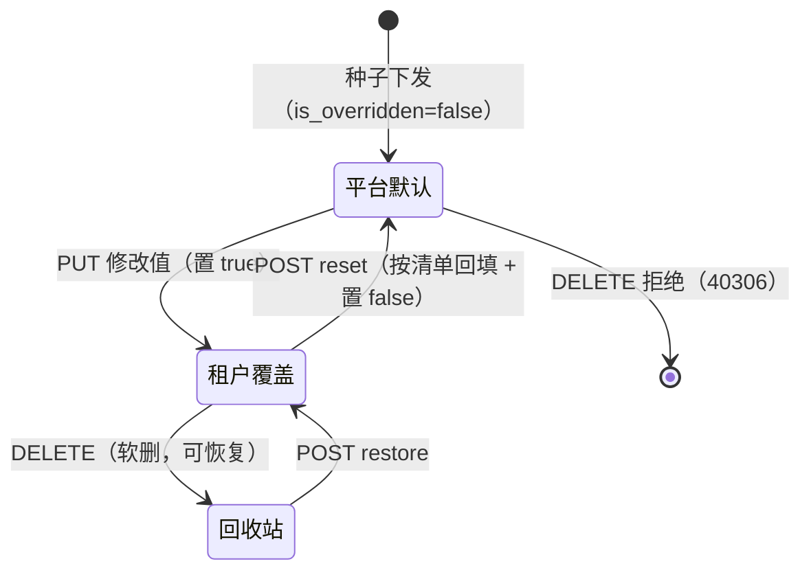
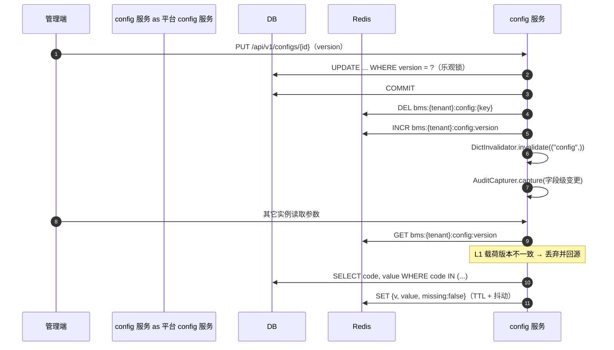

# 系统参数详细设计（管理面 CRUD + 平台默认 / 租户覆盖 + 缓存即时失效）

> 通用能力 · 02 字典与参数 · 02 系统参数（平台默认 + 租户覆盖）· 详细设计

[文档首页](../../../../../../文档首页.md) › [08 通用能力](../../../../README.md) › [字典与参数](../../02_字典与参数.md) › [系统参数](../02_字典与参数_02_系统参数.md) › 详细设计　|　[需求 01-2](../../../../需求/01_需求_字典与参数.md#r01-2) · [阶段计划](../../../../计划/01_计划_通用能力.md) · [概要 · 系统参数](../../../../../../设计/概要设计/10_概要设计_系统参数.md)

## 1. 概述 <a id="overview"></a>

- **目标**：`sys_config` 的**读**链路（03_08 交付）与**基座写**方法（`ConfigService.set` / `drop`）已存在，但管理面（分页 / 新增 / 修改 / 重置 / 删除 / 恢复）、权限码、两层取值语义、缓存即时失效**全部缺位**，参数只能靠种子与代码改。本段把参数做成**运行期可维护**的配置面。

  1. **管理面 CRUD**：7 个端点（分页 / 详情 / 新增 / 修改 / 重置 / 删除 / 恢复），落 `domains/platform_config/` 领域层（api / services / repositories / schemas），走请求级工作单元。
  2. **两层取值落地**：`sys_config` 增加 `is_overridden` 标记——平台默认为种子下发的行（`false`），租户改值即转覆盖（`true`）；**重置 = 按平台默认清单回填并置回 `false`**，删除覆盖项进回收站可恢复；平台默认升级只刷新未覆盖行。
  3. **缓存即时且跨实例一致**：参数值载荷带版本号，读路径先取 `bms:{tenant}:config:version` 比对（对齐 02_01 字典出口模式）；写路径「先写库 → DEL 参数键 → INCR 版本」；补缺失键负缓存防穿透；TTL 进 `[config]` 配置节。
  4. **并发与生效**：修改走显式乐观锁（`WHERE version = ?`），冲突返回并发冲突（`10004`）；安全参数（`password.` / `account.` / `session.` / `ai.` 前缀）变更后缓存删除即生效，并产生字段级审计事件。
  5. **跨段衔接**：参数写路径提交后调 `DictInvalidator`（`config` 字典 key），补齐 02_01 归口的「`config` 写路径失效」；两套缓存语义独立（参数按参数键失效，字典按 `dict:version`）。
  6. **校验前置**：`config_key` 点分小写格式、值类型、参数依赖（`ai.auto_approve` 依赖 `ai.auto_execute`）在保存期校验；平台默认清单补齐已被消费方读取却未登记的键。

- **依据**：《[概要设计 · 系统参数](../../../../../../设计/概要设计/10_概要设计_系统参数.md)》§2 / §3 / §4 / §5.1 / §6 / §7 / §8.2；《[架构设计 · 数据架构](../../../../../../设计/架构设计/07_架构设计_数据架构.md)》§4.1（字典与系统参数管理）、§5（缓存）；《[后端开发规范](../../../../../../规范/后端开发规范.md)》；《[命名规范](../../../../../../规范/命名规范.md)》§10（Redis key）；《[数据库设计 · 数据规范](../../../../../../设计/数据库设计/02_数据库设计_数据规范.md)》；需求 [01-2](../../../../需求/01_需求_字典与参数.md#r01-2) 及其「前序衔接」注块；兄弟设计 [01_详细设计_01_字典统一数据源与运行时查询](../../02_字典与参数_01_字典统一数据源与运行时查询/设计/01_详细设计_01_字典统一数据源与运行时查询.md)、[01_详细设计_02_任务调度](../../../01_异步底座/01_异步底座_02_任务调度/设计/01_详细设计_02_任务调度.md)。
- **范围**：上述 1~6。
- **不含（归口见 §8）**：前端参数页与菜单/表单/按钮种子（阶段十五）；通用回收站页与过期清理（13_01）；操作日志落库、字段级审计落库与哈希链（06_01 / 06_02）；`file.upload.*` / `ai.*` 的**真实消费逻辑**（03_01 / 阶段十九）；i18n 语言包（05_01）；`[config_source]` 在 test / prod 的 provider 拓扑（03_08 遗留，归部署窗口）。

## 2. 现状与差距（设计 vs 代码不符清单） <a id="gap"></a>

> 动手前对账结果。「处置」列写明本段改什么、回写什么、留什么。

| # | 关注点 | 需求 / 概要要求 | 代码现状 | 处置 |
| --- | --- | --- | --- | --- |
| 1 | 两层取值 | 需求 §2：平台库存默认、租户库可覆盖、读取先覆盖后回退默认 | **不是两行两层，而是租户库单行**：`provisioning._seed_configs` 把 `PLATFORM_CONFIG_DEFAULTS` 写进租户库，`ConfigService.set` 命中同键即**改同一行** | **本段改**：加 `is_overridden` 标记区分「平台默认值」与「租户覆盖值」（决策 1、5） |
| 2 | 重置语义 | 需求 §2 / 完成标准：重置后回落到平台默认 | 默认值被覆写后**无处可查**，重置无值来源；`drop()` 只做软删（等同删除） | **本段改**：重置 = 按清单回填 + 置 `is_overridden=false`；与删除分离（§4.2） |
| 3 | 删除语义 | 概要 §2.3：平台库默认项被删除 → 拒绝并提示 | 无判定，任何人可软删任意行（含唯一承载平台默认的行） | **本段改**：`is_overridden=false` 的删除拒绝（`40306`） |
| 4 | 回收站恢复 | 完成标准：删除进回收站且可恢复 | `BaseModel.soft_delete/restore` 齐备，但**无恢复端点、列表无已删筛选** | **本段改**：列表 `include_deleted` + `POST /configs/{id}/restore`（通用回收站页归 13_01） |
| 5 | 管理面 | 任务书 §2.1：分页 / 新增 / 修改 / 重置 + `config:manage` | `domains/platform_config/` 只有 `internal_config.py`（服务间读）+ `query_scheme.py`；无任何管理端点 | **本段改**：7 端点落领域层（§4.4） |
| 6 | 权限码 | 概要 §6.1：`config:manage` | `config:manage` 在 py / ts / vue / json 中**零命中**；种子只有 `("config","query")` | **本段改**：种子补 `("config","manage")`；查询用已有 `config:query`（决策 2） |
| 7 | 菜单 / 表单种子 | 概要 §6.2：菜单「系统参数」+ 表单挂 `config` 业务码 + 按钮挂 manage | `BUSINESS_SEEDS` 有 `config`，`MENU_SEEDS` **无系统参数节点**（`dict` / `task` 同样没有） | **不做**：前端页归阶段十五，与 01_02 / 02_01 同口径（§8 开放项 1） |
| 8 | 参数缓存即时性 | 概要 §3：安全参数变更「缓存删除即生效」 | 写路径已 `DEL` + `INCR bms:{tenant}:config:version`，但**读路径从不校验版本** → 其他实例 L1 旧值保留到 TTL（300s） | **本段改**：载荷带版本 + 读路径比对（决策 3、§4.3） |
| 9 | 缓存穿透 | 概要 §3：不存在缓存空值防穿透 | 缺失键不写缓存，每次请求都回源 `IN` 查询 | **本段改**：缺失键写 `missing` 短 TTL 载荷 |
| 10 | TTL 可配 | 需求 §3：Redis 短 TTL | TTL 吃 `CacheRegion.default_ttl=300` + region 内部 0~10% 抖动，**无 `[config]` 节**、无缺失键 TTL、无 L1 容量参数 | **本段改**：新增 `[config]` 节 + `ConfigSettings`（§4.8） |
| 11 | 配置基线 | 参数在 test / prod 要可用 | `[config_source]` / `[config_cache_region]` **只在 `config.dev.toml` 有**；基线无节 → provider 空 → `NullConfigSource`（参数恒空，消费方回落代码默认） | **不改**：provider 拓扑按服务而异（platform=`sql`、其余=`http`），归部署窗口（§8 开放项 4） |
| 12 | 默认清单完整性 | 管理页应能维护全部生效参数 | 消费方读 `menu.tree_cache_ttl`（`menu/base.py`）与 `role.code_pattern`（`role/services/role.py`），但两键**不在** `PLATFORM_CONFIG_DEFAULTS` → 管理页看不到、无法维护，只能靠代码默认 | **本段改**：清单补齐被消费的键（§4.2） |
| 13 | 默认升级下发 | 平台默认应随发版演进到未覆盖租户 | `seed_configs` **存在即跳过** → 已下发过的键永不更新 | **本段改**：`is_overridden=false` 的行按清单刷新（决策 15） |
| 14 | 唯一性 | 表文件：`(code, deleted_at)` 复合唯一 | **实测约束形同虚设**：`deleted_at IS NULL` 时 NULL 互不相等，重复 `config_key` 可插入（SQLite / MySQL / PG 同语义） | **本段改**：唯一性靠应用层判重（先 `SELECT`），表文件补口径说明；跨阶段问题登记（§8 开放项 5） |
| 15 | 错误码 | 概要 §7 建议 402xx | **402xx 已被菜单占用**（`MENU_NOT_FOUND=40201` ~ `MENU_PERMISSION_EXISTS=40210`）；401xx 是字典；40001 是通用 `CONFIG` | **本段改**：参数用 `403xx`（`40301`~`40307`），回写概要 §7 |
| 16 | 审计 / 操作日志 | 任务书 §2.3：落操作日志与字段级审计 | `AuditCapturer` 契约齐备（`FieldChange` 旧值 / 新值），`role` 只在三权拒绝时 `capture`；操作日志表与消费者尚未落地（06_01 / 06_02） | **本段改**：写路径 `capture` 产生字段级事件（含敏感标记），落库归 06（决策 18） |
| 17 | 参数键格式 | 需求 §5：`config_key` 点分小写 | 无任何格式校验（列宽 128 是唯一约束） | **本段改**：`bms_core/config/rules.py` 校验（§4.5） |
| 18 | 参数依赖 | 概要 §6.3 / §8.2：`ai.auto_approve` 依赖 `ai.auto_execute`，未开启时拒绝保存 | `chat/base.py` 只有键常量与注释，无校验 | **本段改**：登记式依赖表 + 保存期校验（决策 12） |
| 19 | 分组 / 敏感标记 | 概要 §8.1：列表分组浏览、安全参数敏感提示 | 无（`parent_id` 是无层级的系统字段，不能当分组） | **本段改**：按 `config_key` 前缀派生 `group`；按前缀派生 `is_sensitive`（决策 13、14） |
| 20 | 插件接线 | `PLUGIN_WIRINGS` 需含 config 系 | `config_cache_region` / `config_source` **两条均已接线**（`state_attr` 同名），无需改 | **不改** |
| 21 | 前端类型 | 公开契约变更须重建前端类型 | 8 个服务契约快照在 `deploy/contracts/`；`api_types` 由脚本生成 | **本段改**：`ops.contract_snapshot export` + `frontend/packages/api_types && node scripts/generate.mjs`（推送前） |
| 22 | Kiwi 编号 | 《测试规范》：先取号再编码 | 01_01=2370、01_02=2371、02_01=2372 | **本段首步**：容器内 `bms-kiwi` 登记（分类「平台骨架」）后取号 |

## 3. 交付物清单 <a id="tree"></a>

```text
backend/
├── config.toml                                    # 改：新增 [config]（value_ttl / missing_ttl / version_check / l1_max_items）
├── libs/bms_core/src/bms_core/
│   ├── core/config.py                             # 改：ConfigSettings + Settings.config_options（validation_alias="config"）
│   ├── core/error_codes.py                        # 改：40301~40307 七个错误码 + HTTP 映射
│   ├── core/exceptions.py                         # 改：ConfigNotFoundError 等 7 个异常类（挂在既有 ConfigError 段基类下）
│   ├── config/models.py                           # 改：SysConfig 增 is_overridden
│   ├── config/base.py                             # 改：ConfigCacheRegion 增带版本的取值 / 写值 / 写缺失（旧方法保留委托）
│   ├── config/cache.py                            # 改：内存与 Redis 两实现落版本化载荷 + 缺失载荷
│   ├── config/sql.py                              # 改：批量取版本一次 → 逐 key 比对 → 缺失负缓存
│   ├── config/service.py                          # 改：抽出模块级 invalidate_config()；set/drop 复用同一失效入口
│   ├── config/rules.py                            # 新：键格式 / 值类型 / 依赖表 / 敏感前缀（纯函数，无 IO）
│   └── config/seed.py                             # 改：清单补齐 7 键；未覆盖行按清单刷新
├── services/platform/src/bms_platform/domains/platform_config/
│   ├── repositories/config.py                     # 新：分页筛选 / 按键取 / 乐观锁更新 / 软删 / 恢复
│   ├── services/config.py                         # 新：CRUD + 重置 + 恢复 + 校验 + 失效 + 审计
│   ├── schemas/config.py                          # 新：ConfigItem / ConfigPage / 新增 / 修改请求 / 分组与敏感标记
│   └── api/configs.py                             # 新：7 个管理端点（/configs）
├── services/platform/src/bms_platform/api/router.py               # 改：挂 configs.router（追加末尾）
├── libs/bms_core/src/bms_core/tenant/seed/menu.py                 # 改：PERMISSION_SEEDS 增 ("config","manage")
├── libs/bms_core/tests/config/
│   ├── test_config_cache_version.py               # 新：载荷版本化 / 版本不一致即回源 / 缺失负缓存 / 旧载荷兼容
│   ├── test_config_rules.py                       # 新：键格式 / 值类型 / 依赖表 / 敏感前缀
│   ├── test_config_service_reset.py               # 新：set 置覆盖 / drop 保护 / invalidate_config 顺序
│   └── test_config_real.py                        # 改：seed 刷新未覆盖行 / 覆盖行不被刷新
├── libs/bms_core/tests/core/test_exception_constructors_paths.py  # 改：登记 7 个新异常
├── services/platform/tests/config/
│   ├── test_config_admin_api.py                   # 新：7 端点 + 校验分支 + 重置 / 删除保护 / 恢复冲突
│   └── test_internal_config.py                    # 改：回归（内部读契约不受影响）
└── libs/bms_core/tests/integration/test_config_cache_real.py      # 新：真 Redis × 双实例（版本失效跨实例生效）

bms文档/
├── 设计/数据库设计/数据表设计/sys_config.md        # 改：增 is_overridden 字段 + 约束效力说明 + 变更记录 v3
├── 设计/概要设计/10_概要设计_系统参数.md            # 改：§4.2 缓存口径 / §5.1 补 2 端点 / §6.1 权限码分立 / §6.3 清单补齐 / §7 错误码 403xx
├── 设计/架构设计/07_架构设计_数据架构.md            # 改：§5 参数缓存（版本校验 + 负缓存 + 两套失效分工）
├── 规范/命名规范.md                                # 改：§10 Redis 键补 config 值键 / 版本键
├── 后端基类清单.md                                 # 改：ConfigCacheRegion 版本化接口 / ConfigService 失效入口
├── 规范/后端开发规范.md                            # 改：参数写路径必须「先写库 → 失效参数键 + 字典」条
└── 项目/08_通用能力/…/02_字典与参数_02_系统参数/     # 新增 实施/ 与 测试/ 各一份记录；需求 01-2 注块补交付结论
```

## 4. 领域设计 <a id="design"></a>

### 4.1 数据模型与迁移口径 <a id="data"></a>

`sys_config` 增一列（表文件为字段唯一事实源，本文只写设计口径）：

| 字段 | 类型 | 可空 | 默认 | 语义 |
| --- | --- | --- | --- | --- |
| `is_overridden` | BOOLEAN | 否 | `false` | 本行值是否为租户覆盖（`false` = 平台默认值；重置与平台默认升级的判据） |

- **不加新索引**：`code` 唯一键 + 小表分页足够；`is_overridden` 只在重置 / 种子刷新时按单键命中。
- **约束口径要写清**：`uq_sys_config_code_deleted_at` 在 `deleted_at IS NULL` 时不生效（NULL 互不相等，实测三库同语义），**唯一性由应用层判重保证**；表文件 §3 补注，不改索引定义（改索引无法解决 NULL 语义）。
- **迁移口径**：本项目为**删库重建**口径（`alembic/versions/` 仅 `.gitkeep`，结构以模型为唯一事实源）。落地方式：改表文件 → 改模型 → 删本地 `database/bms/bms_platform_{code}.db` → 启动期 `ensure_unit_schema` 重建。**测试库**由用例夹具 `Base.metadata.create_all` 自动带新列，无需额外操作。
- **兼容风险**：旧库未重建时读 `is_overridden` 会报列缺失。实施记录必须登记「删库重建」这一步与执行结果；CI / 部署窗口按同一口径重建（不写迁移脚本）。

### 4.2 两层取值与重置语义 <a id="layers"></a>

**层的物理形态（收敛后的口径）**：

| 层 | 载体 | 说明 |
| --- | --- | --- |
| 平台默认（层 1） | `bms_core/config/seed.py::PLATFORM_CONFIG_DEFAULTS` | 构建期清单，随发版演进；租户开通与 `ops.seed_config` 幂等下发到租户库 |
| 租户覆盖（层 2） | 租户库 `sys_config` 同一行（`is_overridden=true`） | 覆盖即改本行值；默认值不再保留副本，重置按清单回填 |

> 结论：读路径**只读租户库单行**，不做跨库回退（默认已物化为行）。行不存在时由消费方回落代码默认表（`DefaultPasswordPolicy` / `DefaultCaptcha` 等既有契约）。这解释了为何 `sys_config` 只需 `config_key` 唯一，也避免"平台库读 + 租户库读"的双库查询。

**状态机（一行参数）**：



**重置算法**（`is_overridden=true` 才有效）：

1. 按 `config_key` 在 `PLATFORM_CONFIG_DEFAULTS` 查默认项；
2. 命中 → 事务内 `value=默认值`、`remark=默认备注`、`is_overridden=false`、显式乐观锁比对；
3. 未命中 → 说明是租户自建参数（无平台默认）→ `ConfigNoPlatformDefaultError`（`40307`），提示改用删除；
4. 提交后失效参数缓存 + 失效 `config` 字典 + 审计事件。
5. `is_overridden=false` 时调用 reset → **幂等返回当前值**（不报错，前端可统一按钮）。

**覆盖写**：`PUT` 一律置 `is_overridden=true`（未覆盖项被改成覆盖项）。

**新增**：租户自建键同样 `is_overridden=true`（无平台默认）；与清单内已有键或库内活行重复 → `40302`。

**删除 / 恢复**：`is_overridden=true` → 软删（进回收站）；`false` → `40306`（拒绝删掉唯一承载平台默认的行，否则消费方静默回落代码默认且管理页再也看不到）。恢复时若同键已有活行 → `40302`（避免双活行）。

**平台默认升级（本段新增能力）**：`seed_configs` 由「存在即跳过」改为「缺失插入；存在且 `is_overridden=false` → 按清单刷新 `value` / `remark`」；`is_overridden=true` 的行**永不覆盖**。返回值仍为「新增行数」（不破坏 `provisioning` / `ops.seed_config` / 既有用例），刷新条数记 `info` 日志。

**平台默认清单补齐**（当前缺失、但已被消费方读取或概要要求）：

| config_key | 默认值 | 消费方 |
| --- | --- | --- |
| `menu.tree_cache_ttl` | `300` | 菜单树缓存 TTL（`menu/base.py`） |
| `role.code_pattern` | `^[a-z][a-z0-9_-]{1,31}$` | 角色码格式校验（`role/services/role.py`） |
| `session.max_active` | `5` | 会话上限（概要 §6.3；会话域读取随各自任务接入） |
| `file.upload.max_size` | `20971520` | 整包上传上限（文件管理 03_01 接入） |
| `file.upload.max_file_size` | `2147483648` | 单文件上限（同上） |
| `ai.auto_execute` | `false` | AI 自动执行开关（阶段十九接入） |
| `ai.auto_approve` | `false` | AI 自动审批开关（依赖 `ai.auto_execute`） |

### 4.3 缓存设计 <a id="cache"></a>

**键与载荷**：

| 名称 | 形式 | 说明 |
| --- | --- | --- |
| 值键 | `bms:{tenant}:config:{config_key}` | 载荷 JSON（内置 `dict`，可往返）：`{"v": 版本, "value": "值", "missing": false}` |
| 缺失标记 | 同值键 | `{"v": 版本, "value": "", "missing": true}`（短 TTL，防穿透） |
| 版本键 | `bms:{tenant}:config:version` | `INCR` 递增，不设过期 |

**读路径**（`SqlConfigSource.get_many`）：

1. `version = await cache.aversion(tenant)`——**每批一次**，不给每个 key 各发一次；
2. 逐 key `aget_value(tenant, key)` 取载荷，`payload["v"] != version` → 视为未命中（并删该键，避免反复比对）；
3. 未命中键一次 `IN` 回源；命中写 `missing=false`，未命中写 `missing=true`（`missing_ttl_seconds`）；
4. `missing=true` 的键**不进入返回结果**（保持既有契约「只返回存在的键」）。

**写路径**（统一入口 `bms_core/config/service.py::invalidate_config`）：事务**提交后** `adrop_value` → `aincrease_version`。顺序不可反：先 `INCR` 会让并发读把旧值以新版本号写回缓存，成为「污染的有效载荷」。

**版本化接口（非破坏扩展）**：`ConfigCacheRegion` 新增 `aget_value_at` / `aset_value_at` / `aset_missing`（带默认实现，委托既有 `aget_value` / `aset_value`），旧签名与 `contract_version` 不变；`[config].version_check=false` 时退化为旧行为（排障开关）。

**多实例一致性**：`RedisConfigCacheRegion` 的 L1 也存版本化载荷——写方在 A 实例 `DEL`+`INCR` 后，B 实例下一次读 `aversion` 得到新版本，L1 载荷版本不一致即丢弃并回源。Redis 值键由写方删除；若删除失败，版本比对仍能拦住（载荷带版本），TTL 是最后兜底。



### 4.4 管理端接口面 <a id="api"></a>

统一前缀 `/api/v1/configs`（网关挂载口径同其余平台端点）；鉴权 `require_auth` + 逐端点权限码。

| 方法 | 路径 | 说明 | 权限码 |
| --- | --- | --- | --- |
| GET | `/configs` | 分页（`keyword` 匹配 `config_key` / `name` / `remark`；`group` 前缀；`status`；`include_deleted`） | `config:query` |
| GET | `/configs/{config_key}` | 单参数（页面回显，含 `source` / `is_sensitive` / `version`） | `config:query` |
| POST | `/configs` | 新增（格式 / 重复 / 类型 / 依赖校验） | `config:manage` |
| PUT | `/configs/{id}` | 修改（`value` / `name` / `remark` / `status`；必带 `version`） | `config:manage` |
| POST | `/configs/{id}/reset` | 重置回平台默认（仅覆盖项有效） | `config:manage` |
| DELETE | `/configs/{id}` | 软删进回收站（默认项拒绝） | `config:manage` |
| POST | `/configs/{id}/restore` | 从回收站恢复（同键活行冲突拒绝） | `config:manage` |

**响应条目**（`ConfigItem`）：`id` / `config_key` / `name` / `value` / `remark` / `status` / `group` / `source`（`platform` | `tenant`，由 `is_overridden` 派生）/ `is_sensitive` / `version` / `updated_at` / `deleted_at`。

**分页**：`BasePageQuery`（`page` / `size` / 排序），响应 `BasePageResponse`；`group` 取值由 `config_key` 首段派生（`password` / `account` / `session` / `file` / `captcha` / `ai` / `audit` / `menu` / `role`），**不新增列**。

**与既有契约的关系**：`POST /api/v1/platform/internal/configs/resolve`（服务间读）保持不变，本段只做回归；新增 7 个端点属非破坏性追加，契约快照按追加口径重建。

### 4.5 校验规则 <a id="rules"></a>

落 `bms_core/config/rules.py`（纯常量 + 纯函数，无 IO、可被基座与服务共用）：

| 规则 | 口径 | 失败码 |
| --- | --- | --- |
| 键格式 | `^[a-z][a-z0-9_]*(\.[a-z0-9_]+)*$`，长度 ≤ 128（点分小写，段内 snake_case） | `40303` |
| 值长度 | ≤ 20000 字符（`TEXT` 承载，避免无界写入） | `40304` |
| 值类型 | 按 `PLATFORM_CONFIG_DEFAULTS` 同键值推断：`true`/`false` → 布尔；纯数字 → 整数；否则任意文本。**租户自建键不推断类型** | `40304` |
| 参数依赖 | `{"ai.auto_approve": ("ai.auto_execute", "true")}`：保存 / 重置后若依赖项非期望值 → 拒绝 | `40305` |
| 敏感标记 | 前缀 `password.` / `account.` / `session.` / `ai.` → `is_sensitive=true`（页面提示 + 审计强制留痕） | — |

依赖校验作用于**保存后的最终状态**（PUT 时取「本次新值 + 库内其它值」），因此 `ai.auto_execute` 关掉而 `ai.auto_approve=true` 也必须被拒。

### 4.6 审计留痕 <a id="audit"></a>

- 时机：**事务提交后**（与缓存失效同阶段），失败只 `warning`（`AuditCapturer` 不可用不得反噬业务写）。
- 内容：`capture(table="sys_config", model_id=id, changes=[FieldChange(field, old, new), ...], actor=current_user_id())`；字段范围 `value` / `status` / `name` / `remark`；新增与删除分别以 `old=None` / `new=None` 表达。
- 敏感参数：`is_sensitive=true` 的变更在 `changes` 之外由调用点补 `logger.info("config_sensitive_changed", config_key=..., actor=...)`，便于 06_02 落地前先有可检索痕迹。**当前清单无凭据类键**（如 `sms.secret`），故审计值不脱敏；将来出现凭据类键时在 `rules.py` 增 `SECRET_PREFIXES` 并在审计里打码（§8 开放项 7）。
- 不自行 `publish`：与 `role` 三权留痕同口径（`capture` 返回信封但不投递），落库与哈希链归 06_01 / 06_02。

### 4.7 权限码与种子 <a id="permission"></a>

- `PERMISSION_SEEDS` 增 `("config", "manage", "管理（含查询与维护）", "Manage")`；查询复用已有 `("config", "query", "查询", "Query")`。
- 动作码字典由权限码种子去重派生（`_derive_action_seeds`），`manage` 已是既有全局动作码，无需新增动作行。
- 菜单 / 表单 / 按钮种子**本段不加**：`MENU_SEEDS` 无系统参数节点这一现状与 `dict` / `task` 一致，前端页在阶段十五落地时统一补（否则菜单指向不存在的视图）。
- 越权分支：端点挂 `require_permission("config:manage")`；用例沿 `tests/api/test_tasks_api.py` 口径用 `assign_system_admin()` 放行，**不伪造 403 断言**（真实拒绝由安全专项补齐），与 01_02 记录一致。

### 4.8 配置节 <a id="config"></a>

```toml
# 系统参数（02_02）：读缓存 TTL / 缺失负缓存 / 版本校验开关 / L1 容量
[config]
value_ttl_seconds = 300      # 命中值 TTL（region 内部叠加 0~10% 抖动）
missing_ttl_seconds = 30     # 缺失键负缓存 TTL（防穿透，短于值 TTL）
version_check = true         # false = 退回旧行为（不比对版本，排障用）
l1_max_items = 1024          # 进程内 L1 条目上限（LRU）
```

- `ConfigSettings` 字段名 `config_options` + `validation_alias="config"`：`Settings.model_config` 为 `extra="forbid"`，**节与字段必须同批落地**；字段直接命名 `config` 会与 `BaseSettings` 成员冲突（同 02_01 `[dict]` 的坑）。
- 只进基线 `config.toml`（各环境语义一致）；test / dev / prod 不覆盖，避免又一处只在 dev 生效。

## 5. 失败分支与边界 <a id="failures"></a>

| 场景 | 行为 | 依据 / 风险 |
| --- | --- | --- |
| 键不存在（按 key 查详情 / 按 id 改） | `40301`（404） | 统一错误处理器转响应 |
| 新增键重复（清单内已有活行 / 库内活行） | `40302`（409） | 约束在 NULL 语义下不生效，**必须应用层判重** |
| 键格式违规 | `40303`（400） | 点分小写；段数为 1 也合法（`role.code_pattern`） |
| 值超出类型 / 长度 | `40304`（400） | 类型按清单同键推断 |
| 依赖不满足（`ai.auto_approve` 开启而 `ai.auto_execute` 关闭） | `40305`（409） | 概要与验收项 |
| 删除未覆盖项 | `40306`（403） | 删了等于删平台默认，消费方会静默回落代码默认 |
| 重置无平台默认的键（租户自建） | `40307`（400） | 提示改用删除 |
| 恢复时同键已有活行 | `40302`（409） | 避免双活行导致读路径取值不确定 |
| 乐观锁版本不匹配 | `10004`（409）并发冲突 | 显式 `WHERE version = ?`，与 01_02 同口径 |
| 重置 / 修改时值未变 | 正常返回（幂等），仍失效缓存 + 记审计 | 避免前端重复点击报错 |
| Redis 不可用（读） | `RedisCacheRegion` 内部降级为未命中 → 回源 DB | 已有实现，不新增分支 |
| Redis 不可用（失效） | 记 `warning`，业务写成功；TTL（300s）兜底 | 缓存可用性不得抬成业务可用性 |
| 版本键缺失 / 脏值 | `aversion` 按 0 处理 → 版本必然不匹配 → 回源一次后写入新版本 | 自愈，不报错 |
| 旧格式缓存载荷（纯字符串 / 无 `v`） | 视为未命中，回源后覆盖 | 平滑升级，不需要清库 |
| 字典失效失败 | 记 `warning`，不影响参数写；字典由 `dict:version` + TTL 兜底 | 与 02_01 口径一致 |
| 审计捕获失败 | 记 `warning`，不影响业务写 | 留痕不得反噬写路径 |
| 参数缓存与字典缓存混用 | 禁止：参数按参数键失效、字典按 `dict:version` 失效 | 两套键不同域，语义独立（需求注块要求） |
| 敏感参数修改后即时生效 | 缓存删除后下一个读即生效（消费方无本地缓存） | 消费方均经 `BaseConfigSource` 读取，不自行缓存 |

## 6. 测试设计与验收映射 <a id="tests"></a>

| 完成标准（任务书 §3 / 需求 01-2） | 用例 |
| --- | --- |
| 平台默认值在租户未覆盖时生效 | `test_config_service_reset`（种子行 `is_overridden=false` → `get_many` 读到默认值）+ `test_config_real`（seed 刷新） |
| 租户覆盖后仅本租户读到覆盖值 | `test_config_admin_api`（PUT 后 GET 读到新值、`source=tenant`）+ 双租户库夹具各读一次 |
| 重置后回落到平台默认 | `test_config_admin_api`（PUT → reset → 值与 `is_overridden` 同时回落）+ `test_config_service_reset`（无默认键报 `40307`） |
| 并发修改后写者收到版本冲突 | `test_config_admin_api`（同 `version` 连改两次 → 第二次 `10004`） |
| 删除进回收站且可恢复 | `test_config_admin_api`（delete → `include_deleted` 可见 → restore → 可读；默认项删除 `40306`） |
| 参数读取命中缓存（同 key 连续读不重复回源） | `test_config_cache_version`（替身计次：第二次不回源）+ `test_config_real`（既有） |
| 缓存版本不一致即回源（多实例） | `test_config_cache_version`（L1 载荷旧版本 → 丢弃回源）+ **集成** `test_config_cache_real`（真 Redis × 双实例） |
| 缺失键负缓存 | `test_config_cache_version`（缺失写入 `missing=true` 且 TTL 取 `missing_ttl_seconds`） |
| 键格式 / 值类型 / 依赖校验 | `test_config_rules`（规则表逐条）+ `test_config_admin_api`（四个拒绝分支的码值） |
| 字段级审计事件产生 | `test_config_admin_api`（替身捕获器断言 `changes` 字段与旧新值） |
| `config` 字典写路径失效 | `test_config_admin_api`（`DictInvalidator` 替身断言 key=`config`） |
| 内部读契约不回归 | `test_internal_config`（既有 4 用例） |
| 参数缓存 / 字典缓存互不干扰 | `test_config_cache_version`（参数失效不触碰 `dict:` 键，反之亦然） |

**替身与真机边界**：

- 单测：`fakeredis` + 内存缓存域 + 临时 SQLite（`Base.metadata.create_all(tables=[SysConfig...])`）；回源计次用仓库替身。
- **多实例 / 缓存一致性按任务锚点必须真库实测**：`libs/bms_core/tests/integration/test_config_cache_real.py` 用真 Redis（`BMS_REDIS__URL`，缺失自动 skip 且不计覆盖率分母；开发机 `192.168.0.107:6379`）+ 真 SQLite 库，构造两套 `RedisConfigCacheRegion`（各自 L1、共享 Redis），验证「A 写库 + 失效 → B 下一次读回源读到新值」，并断言「B 在失效前命中 L1（不回源）」证明 L1 确实生效。
- 覆盖率口径见《[AI开发规范](../../../../../../规范/AI开发规范.md)「覆盖率要求」：新增 / 改动模块 100% 行 + 分支；真机 Redis 连接路径拆独立方法标 `pragma: no cover`，不用空断言凑数。

**Kiwi**：实施首步在容器内 `bms-kiwi` 按《[KiwiTCMS 部署使用说明](../../../../../../资料/开发服务器/linux/KiwiTCMS部署使用说明.md)「用例登记」节登记（分类「平台骨架」、优先级 P2、状态 CONFIRMED、标签「自动化」），**拿到编号后**再写用例并回填 `pytestmark = pytest.mark.kiwi_id(<编号>)`；按既有用号顺延（01_01=2370 / 01_02=2371 / 02_01=2372）。

## 7. 登记落点 <a id="registry-writeback"></a>

| 文档 | 回写内容 |
| --- | --- |
| 《[sys_config 表文件](../../../../../../设计/数据库设计/数据表设计/sys_config.md)》 | §2 增 `is_overridden`；§3 补「`(code, deleted_at)` 在 NULL 下不生效、唯一性靠应用层」；§4 缓存口径（版本化载荷 + 缺失负缓存）；§5 变更记录 v3 |
| 《[概要设计 · 系统参数](../../../../../../设计/概要设计/10_概要设计_系统参数.md)》 | §2.3 重置 / 删除分离；§4.2 缓存口径；§5.1 补 `reset` / `restore` 两端点；§6.1 权限码分立（query / manage）；§6.3 清单补齐 7 键；§7 错误码改 403xx |
| 《[架构设计 · 数据架构](../../../../../../设计/架构设计/07_架构设计_数据架构.md)》 | §5 参数缓存：版本化载荷 + 读路径比对 + 缺失负缓存；「参数键失效」与「字典版本失效」分工 |
| 《[命名规范](../../../../../../规范/命名规范.md)》§10 | Redis 行补 `bms:{tenant}:config:{config_key}`（值 / 缺失标记）与 `bms:{tenant}:config:version` |
| 《[后端基类清单](../../../../../../后端基类清单.md)》 | `ConfigCacheRegion` 版本化接口；`ConfigService.invalidate` 统一失效入口；`config/rules.py` 规则表 |
| 《[后端开发规范](../../../../../../规范/后端开发规范.md)》 | 参数写路径纪律：先写库 → DEL 参数键 + INCR 版本 → 失效 `config` 字典；两套缓存不得互相替代 |
| 《[数据库设计总览](../../../../../../设计/数据库设计/01_数据库设计_总览.md)》 | 无新表；核对 `sys_config` 状态与登记一致 |
| 需求 [01-2](../../../../需求/01_需求_字典与参数.md#r01-2) | 追加交付注块（管理面 / 两层语义 / 缓存口径 / 用例号 / 遗留归口） |
| [阶段计划](../../../../计划/01_计划_通用能力.md) | `02_02` 归档到 §2「已完成任务」（6 列）并按本段实际投入与剩余项重算顶部统计；§3 只剩未开始任务 |
| 任务目录 `实施/`、`测试/` | 实施记录与测试记录（信息 / 过程 / 问题与处置 / 验证 / 覆盖率 / 偏差与遗留） |

## 8. 边界与开放项 <a id="boundary"></a>

1. **前端参数页与菜单种子**：本段只交后端与管理端点；菜单「系统参数」节点、表单挂接与按钮权限种子随阶段十五前端落地补齐（与 01_02 / 02_01 一致）。在此之前接口可经网关直调验收。
2. **通用回收站**：本段只提供 `include_deleted` 筛选 + 单条恢复；回收站列表页、批量恢复、过期清理归 13_01。参数不设独立保留期（沿用全局策略）。
3. **操作日志与审计落库**：本段只到 `AuditCapturer.capture` 边界（事件已成型），`sys_operation_log` 落库、字段级审计表、哈希链与三权检索归 06_01 / 06_02。
4. **test / prod 的 `[config_source]` provider**：基线无该节 → 非 dev 环境为 null 实现（参数恒空，消费方回落代码默认）。provider 需按服务区分（platform=`sql`、其余=`http`），单份 `config.toml` 无法表达，归部署窗口按环境变量注入（`BMS_CONFIG_SOURCE__PROVIDER`），本段不改。
5. **`(code, deleted_at)` 唯一约束在 NULL 语义下失效**：属**全平台软删表共性问题**（不止 `sys_config`），本段只在应用层判重 + 表文件注明，建议阶段收口统一评估（是否改为 `deleted_at` 非空默认哨兵值或部分唯一索引）。
6. **版本粒度是租户级**：`bms:{tenant}:config:version` 单计数器，任一参数变更会让该租户全部参数缓存下一个读各回源一次。管理端低频写入可接受；若出现高频写场景，需改 per-key 版本（同 02_01 字典结论）。
7. **凭据类参数脱敏**：当前清单无凭据类键，审计值不脱敏；将来引入（如短信密钥）须在 `rules.py` 增 `SECRET_PREFIXES` 并在审计载荷打码。
8. **复杂结构化参数**：`value` 按文本承载，JSON 结构只做长度校验、不做 schema 校验；需要强 schema 的配置应走选项集或独立表。
9. **`is_overridden` 的重置依赖清单存在性**：若清单删掉某键（发版移除），已覆盖行重置会报 `40307`，需删除覆盖行——属预期语义，登记备查。
10. **文档门禁口径**：只改文档走 `check_links` + `check_docs_scope` + `engkit eol`；改代码未推送走 `scripts/tools/preflight/测试改动内容.py`（用 `backend/.venv/Scripts/python.exe`）；推送走 `scripts/tools/preflight/推送.py`（含全量 pyright 与 100% 覆盖率行 + 分支），推送前先 `cd frontend/packages/api_types && node scripts/generate.mjs`。全量 pyright 在 `backend/` 下跑并显式指定解释器。

## 9. 实施步骤 <a id="steps"></a>

| 批次 | 内容 | 验证 |
| --- | --- | --- |
| 0 | **取 Kiwi 编号**（容器内登记，分类「平台骨架」）；确认本地库重建口径 | 取得编号；`pytest services/platform/tests/config -q` 收集通过 |
| 1 | 表与清单：表文件 `sys_config` 增列 + 变更记录；模型 `is_overridden`；`PLATFORM_CONFIG_DEFAULTS` 补 7 键 + `seed_configs` 刷新未覆盖行；错误码 `40301~40307` + 7 个异常类 + `test_exception_constructors_paths` 登记 | `ruff check`（改动文件）+ `pyright`（改动文件）+ `pytest libs/bms_core/tests/config libs/bms_core/tests/core/test_exception_constructors_paths.py` |
| 2 | 基座：`[config]` 节 + `ConfigSettings`（同批）；`config/rules.py`；`ConfigCacheRegion` 版本化接口 + 两实现载荷；`SqlConfigSource` 批量取版本 + 负缓存；`invalidate_config` 抽出 | 同上 + `test_config_cache_version` / `test_config_rules` / `test_config_service_reset` |
| 3 | 领域：`domains/platform_config/{repositories,services,schemas,api}/config.py` + `api/router.py` 挂载 + `PERMISSION_SEEDS` 补 `config:manage` | 同上 + `test_config_admin_api`；`python -m ops.contract_snapshot export` 重建快照 |
| 4 | 跨段与留痕：写路径接 `DictInvalidator`（`config`）+ `AuditCapturer.capture` + 依赖校验 | 同上；手工验证改参数后 `config` 字典下一次读为新值 |
| 5 | 真机与回写：`test_config_cache_real`（真 Redis 双实例）；§7 全部登记落点 + 实施 / 测试记录 + 需求注块 + 计划表归档 | 集成用例通过；文档三门禁 0（`check_links` / `check_docs_scope` / `engkit eol`） |
| 6 | 交付闸门：开发环 `测试改动内容.py` → 重建前端类型 → 推送入口 | 预检全绿（覆盖率行 + 分支 100%、全量 pyright 0 错误） |

每批独立提交（代码 `feat(config)` / 文档 `docs(08)`），只暂存本次相关文件。

## 10. 决策记录 <a id="align"></a>

| # | 决策 | 备选与取舍 |
| --- | --- | --- |
| 1 | **单行 + `is_overridden` 标记列**（用户拍板） | ①不加列：重置按清单回填也能得到正确值，但无法区分「已覆盖 / 未覆盖」，平台默认升级会把租户定制值一起刷掉或干脆不刷；②双行 + `source` 列：最贴需求字面，但要改唯一约束为 `(code, source, deleted_at)`、`config` 字典会出现重复 `code` 需去重，并与概要 §4.2「`config_key` 唯一」冲突。单行 + 标记 = 语义可表达 + 不动唯一键 + 不动字典规格 |
| 2 | 权限码 **query / manage 分立**（用户拍板） | 全部 `config:manage`：与概要 §6.1 字面一致，但查询被放大到维护级；与 `dict` / `task` 现行口径（query + manage）也分叉。分立后回写概要措辞 |
| 3 | 读路径 **版本校验**（用户拍板） | 维持现状：单实例可用、多实例最长 300s 不一致，「安全参数即时生效」在集群下不成立；版本校验每批多 1 次 Redis `GET`（一次批量只取一次，不是每 key 一次），且可经 `[config].version_check=false` 回退 |
| 4 | 附加范围 = **恢复端点 + 审计事件 + 依赖校验 + 分组字段**（用户拍板，全选） | 恢复端点让「删除可恢复」在本段可验收；审计只到 `capture` 边界（落库归 06）；依赖校验做成登记表而非硬编码；分组由 key 前缀派生不落列 |
| 5 | 平台默认**物化为租户库行**，读取不跨库 | 跨库读（平台库默认 + 租户库覆盖）最贴需求字面，但要给 `sys_config` 增平台链、每次读两次查询、`http` 跨服务契约也要改；物化 + 标记的读路径只有一条 SQL |
| 6 | 重置 = **按清单回填**，不双写默认行 | 双写需要在覆盖时保留默认副本（两行或两列），运维面翻倍；清单是默认值的构建期权威，回填即等价 |
| 7 | 删除未覆盖项**拒绝**（`40306`） | 放行软删：管理页再也看不到该键、消费方静默回落代码默认，问题不可见（概要 §2.3 明确要拒绝） |
| 8 | 恢复冲突**拒绝**（`40302`） | 允许双活行：读路径按 `deleted_at IS NULL` 取值会随机命中，比报错更难排查 |
| 9 | 缺失键用 **`missing` 短 TTL 载荷**，不加 `EMPTY` 哨兵值 | 哨兵值会让 `get_many` 的契约（只返回存在的键）变形；独立载荷字段 + 独立 TTL 保持契约不变 |
| 10 | 载荷用**内置 `dict`**（JSON 可往返） | 用 `ConcurrentStableDict` 作载荷：`json.dumps(default=str)` 会整体转成 repr 字符串，读回失败 → Redis 层只写不读（02_01 真机踩过的坑） |
| 11 | 契约扩展用**新增带默认实现的方法**（`*_at` / `aset_missing`） | 直接改 `aget_value` 签名：`NullConfigCacheRegion` / `HttpConfigSource` / 测试替身全要改，`contract_version` 需升版并触发插件校验；新方法带默认实现则旧实现零改动 |
| 12 | 依赖校验用**登记表** `CONFIG_DEPENDS` | 硬编码 `if config_key == "ai.auto_approve"`：第二条依赖出现时要改保存逻辑；登记表加一行即可 |
| 13 | 分组由 **`config_key` 前缀派生**，不落列 | 加 `group` 列：与 `code` 前缀冗余，且清单外的自建键仍要人工填；派生零维护 |
| 14 | 敏感标记按**前缀**，本段不脱敏 | 按 key 白名单维护：清单变动要同步改；当前清单无凭据类键，脱敏属过度设计（开放项 7 预留） |
| 15 | `seed` 刷新**只动未覆盖行** | 全量刷新：会把租户定制值刷回默认，属数据事故；不刷新：平台默认升级永远到不了未覆盖租户 |
| 16 | 管理面走**领域层**（uow + 仓储 + 显式乐观锁） | 直接扩基座 `ConfigService`：它自开 `session_scope`，拿不到请求级事务与审计主体，且基座不应依赖权限 / 审计；基座保留最小写方法供非 HTTP 路径，两处共用 `invalidate_config` 单点 |
| 17 | 菜单 / 表单 / 按钮种子**本段不做** | 加菜单节点但无视图 → 菜单点开 404；`dict` / `task` 同样未加，阶段十五统一补齐 |
| 18 | 审计**只 `capture` 不 `publish`** | 自行投递：审计事件契约与消费者未就绪，投递会撞契约校验；与 `role` 三权留痕同口径，落库归 06 |

## 11. 参考文档 <a id="ref"></a>

- 《[概要设计 · 系统参数](../../../../../../设计/概要设计/10_概要设计_系统参数.md)》§2 / §3 / §4 / §5 / §6 / §7 / §8
- 《[架构设计 · 数据架构](../../../../../../设计/架构设计/07_架构设计_数据架构.md)》§4.1 字典与系统参数管理、§5 缓存
- 《[sys_config 表文件](../../../../../../设计/数据库设计/数据表设计/sys_config.md)》、《[数据规范](../../../../../../设计/数据库设计/02_数据库设计_数据规范.md)》
- 《[后端开发规范](../../../../../../规范/后端开发规范.md)》、《[命名规范](../../../../../../规范/命名规范.md)》§10、《[测试规范](../../../../../../规范/测试规范.md)》、《[AI开发规范](../../../../../../规范/AI开发规范.md)》
- 兄弟设计：[01_详细设计_01_字典统一数据源与运行时查询](../../02_字典与参数_01_字典统一数据源与运行时查询/设计/01_详细设计_01_字典统一数据源与运行时查询.md)（版本化失效与载荷往返教训）、[01_详细设计_02_任务调度](../../../01_异步底座/01_异步底座_02_任务调度/设计/01_详细设计_02_任务调度.md)（领域层 + 乐观锁 + 8 端点范式）
- 《[KiwiTCMS 部署使用说明](../../../../../../资料/开发服务器/linux/KiwiTCMS部署使用说明.md)》、《[Redis 部署使用说明](../../../../../../资料/开发服务器/linux/Redis部署使用说明.md)》

> 本文档依《[文档生成规范](../../../../../../规范/文档生成规范.md)》《[任务文档规范](../../../../../../规范/任务文档规范.md)》编写 · 进度以阶段计划为唯一落点
