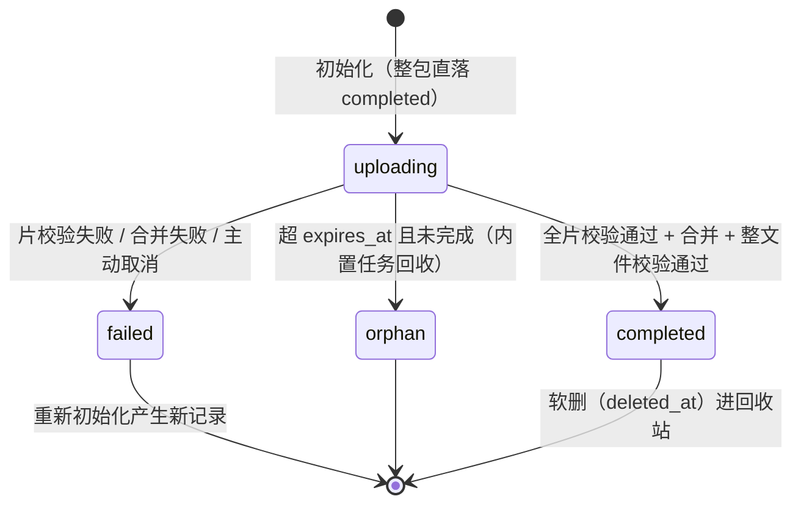

# 文件管理详细设计（整包 / 分片 / 断点续传 / 预签名 / 秒传 / 孤儿回收）

> 通用能力 · 03 文件管理 · 01 文件管理 · 详细设计

[文档首页](../../../../../../文档首页.md) › [08 通用能力](../../../../README.md) › [文件管理](../../03_文件管理.md) › [文件管理（分片 / 断点续传 / 预签名）](../03_文件管理_01_文件管理.md) › 详细设计　|　[需求 02-1](../../../../需求/02_需求_文件与导入导出.md#r02-1) · [阶段计划](../../../../计划/01_计划_通用能力.md) · [概要 · 文件管理](../../../../../../设计/概要设计/13_概要设计_文件管理.md) · [架构 · 文件管理](../../../../../../设计/架构设计/20_架构设计_子系统_文件管理.md)

## 1. 概述 <a id="overview"></a>

- **目标**：`storage` 能力域（`base/local/minio/null` 四件 + 两条插件接线）与文件服务的**占位路由**都在，但**没有一张表、没有一条真实的上传链路**——`sys_file` 只存在于文档，`multipart_upload` 在任何环境配置里都没有 provider（恒落 `NullMultipartUpload` 内存会话表），`file.upload.*` 两个参数键全仓零消费方。本段把文件存取做成**可用的通用通道**，供附件、头像、导入源文件、导出产物统一复用。

  1. **两表落库**：新建 `sys_file`（文件元数据 + 上传会话 + 状态机）与 `sys_file_part`（分片行），随 file 服务租户库建表；表文件 → 总览登记 → 表归属登记 → 模型 → 建表，一条链一次走完。
  2. **整包上传**：`POST /files`，大小上限取 `file.upload.max_size`、类型白名单取 `file.upload.whitelist`（**扩展名 + 服务端嗅探双校验**，阻改扩展名绕过），配额后置消费、超限回滚对象。
  3. **分片上传 + 断点续传**：`multipart_upload` 真实实现落 `bms_core/storage/multipart.py`——**共享基座 + `local`（流式拼接）/ `minio`（`compose_object` 服务端组合）双 provider**，会话快照存 Redis（`bms:{租户}:files:upload:{upload_id}`）；断点续传按 `part_no` 状态列表只补缺失片，`sys_file_part` 是分片状态的**权威**。
  4. **预签名下载与预览**：后端不代理文件流；图片 / PDF 直开预览，其它类型拒绝（`50108`）；取址前复核归属、状态与对象存在性。
  5. **秒传**：`POST /files/dedup` 同租户命中（`sha256` + `size`）即复用既有对象**建一条新元数据行**，配额不重复占用；上传 / 合并完成后回写 `sha256` 供后续命中。
  6. **配额与孤儿回收**：完成时按 `storage_bytes` 后置消费（超限删对象 + `82005` + 告警）；孤儿回收由 01_02 的内置任务 `cleanup_orphan_parts` **触发** file 内部清理端点（执行体不跨库）。
  7. **跨段衔接**：真实消费 02_02 纳入平台默认的 `file.upload.max_size` / `max_file_size`（经 `BaseConfigSource`，缺省回落代码默认），并补 `file.upload.whitelist` / `file.download.presign_ttl` 两键；`file` 不在字典 key 清单，**不接 `DictInvalidator`**（参数缓存失效已在 02_02 写路径承担）。

- **依据**：《[概要设计 · 文件管理](../../../../../../设计/概要设计/13_概要设计_文件管理.md)》§2 / §4 / §5 / §6 / §7 / §8.2；《[架构设计 · 文件管理](../../../../../../设计/架构设计/20_架构设计_子系统_文件管理.md)》§2 / §3 / §4 / §7；《[数据库设计 · 数据规范](../../../../../../设计/数据库设计/02_数据库设计_数据规范.md)》；《[后端开发规范](../../../../../../规范/后端开发规范.md)》；《[命名规范](../../../../../../规范/命名规范.md)》§10；需求 [02-1](../../../../需求/02_需求_文件与导入导出.md#r02-1)；兄弟设计 [01_详细设计_02_任务调度](../../../01_异步底座/01_异步底座_02_任务调度/设计/01_详细设计_02_任务调度.md)（内置任务与 handler 白名单）、[01_详细设计_02_系统参数](../../../02_字典与参数/02_字典与参数_02_系统参数/设计/01_详细设计_02_系统参数.md)（参数基线口径）。

- **范围**：上述 1~7。
- **不含（归口见 §8）**：前端文件管理页 / 上传组件 / 预览组件与菜单按钮种子（阶段十五 `09_01`）；操作日志与字段级审计**落库**、哈希链（`06_01` / `06_02`，本段只到 `AuditCapturer.capture` 边界）；回收站物理清理与配额释放（`13_01`）；Excel 导入、列表导出与 PDF 产物（`04_01` / `04_02`）；文件内容索引与全文检索（阶段十八）；Office 转换预览、缩略图 / 水印、多版本。

## 2. 现状与差距（设计 vs 代码不符清单） <a id="gap"></a>

> 动手前对账结果。「处置」列写明本段改什么、回写什么、留什么。

| # | 关注点 | 需求 / 概要要求 | 代码现状 | 处置 |
| --- | --- | --- | --- | --- |
| 1 | 数据表 | 概要 §4.1：`sys_file`（含分片状态跟踪） | **无表文件、无总览登记、无 `TABLE_OWNERSHIP` 条目、无模型**；`数据表设计/` 下文件相关为 0 | **本段建**：两表文件 + 总览登记 + 模块节点文档 + 归属登记 + 模型（§4.1） |
| 2 | 每片状态 | 需求 §7 / 概要 §2.2：`sys_file` 记录每片状态 | 无任何承载 | **本段改**：分片独立成表 `sys_file_part`（用户拍板），回写概要 §4.1 / 架构 20 §2 措辞 |
| 3 | 分片实现 | 架构 20 §2：底层分片托管经对象存储扩展出口提供 | `[multipart_upload]` **在任何 config*.toml 都不存在** → provider 空 → `NullMultipartUpload`（内存会话表、`check` 恒未命中） | **本段建**：`bms_core/storage/multipart.py`（共享基座 + local/minio 双 provider，§4.3） |
| 4 | 存储后端 | 概要 §1 / §4.2：MinIO 私有桶 `bms-files`、按租户前缀隔离 | `[storage].provider="local"`，且 dev / test / prod **无覆盖** → 各环境实际都是本地磁盘；`MinioObjectStorage` 不建桶、不校验桶存在（桶缺失要到 `put` 才报错） | **本段改**：两后端都真实现并实测；MinIO 拓扑与桶存在性校验归部署窗口（§8 开放项 1） |
| 5 | 服务代码 | 概要 §5.1：8 个端点 | 只有占位路由 5 个（`/files/uploads*` + `/dedup`），`models/schemas/services/repositories` 全为空壳，`MODEL_MODULES=()` | **本段改**：完整领域层（repositories / services / schemas / api），路径对齐概要为 `/files/multipart/*` |
| 6 | 整包上传 | 需求 §1：≤20MB 一次性上传 + 白名单 + 权限 `file:upload` | 无该端点 | **本段建** |
| 7 | 类型白名单 | 概要 §6.3：`file.upload.whitelist`（sys_config 可配） | 该键**不在** `PLATFORM_CONFIG_DEFAULTS`，白名单也不存在 | **本段建**：新增参数键 + 代码默认清单；扩展名与嗅探双校验（§4.5） |
| 8 | 大小参数消费 | 02_02 跨段衔接：`file.upload.max_size` / `max_file_size` 要被真实消费 | 两键已入库，但**全仓零消费方**（仅 `ops/gateway_config.py` 拿 20MB 常量做注释） | **本段改**：经 `BaseConfigSource` 批量读 + 代码默认回落（§4.9） |
| 9 | 参数读通道 | 消费方经 `BaseConfigSource`，不得绕过参数服务 | 基线无 `[config_source]` 节（仅 `config.dev.toml` 为 `sql`）；跨服务读已有 `HttpConfigSource` → `platform/internal/configs/resolve`，但该端点白名单**只放 `identity`** | **本段改**：白名单加 `file`（用户拍板）；provider 拓扑给 file 注入 `http`（§4.9） |
| 10 | 断点续传 | 需求 §3：按 `part_no` 状态列表只补缺失片 | 无状态查询端点；`upload_id` 只活在占位实现的内存里 | **本段建**：`GET /files/multipart/{upload_id}` + `sys_file_part` 权威 + Redis 会话（§4.4） |
| 11 | 预签名 | 需求 §4：限时、后端不代理、过期失效 | 契约已具备（`presign`），但无端点、无 TTL 参数、无对象存在性复核；本地实现返回 `file://` **不校验过期** | **本段建**：端点 + `file.download.presign_ttl` 参数 + 复核；本地实现的过期语义记开放项（§8 开放项 3） |
| 12 | 状态机 | 需求 §5：`uploading` → `completed` / `failed` / `orphan` | 无状态字段、无迁移逻辑 | **本段建**：`sys_file.status` + 四条迁移路径（§4.2） |
| 13 | 事件 | 概要 §5.3：`file.uploaded`；需求：删除事件按需登记 | `file.uploaded` 契约**已登记**（`file_id/sha256/size`），但无发布点；`file.deleted` 未登记 | **本段改**：完成与删除经 `outbox.enqueue` 同事务写；新增 `file.deleted` 契约 |
| 14 | 孤儿回收 | 需求 §8：定时扫描超期 `uploading` 记录并清理 | 内置任务 `cleanup_orphan_parts` 已入种子（cron `0 3 * * *`），handler 指 `bms_core.tasks.builtin` **占位体（返回 `skipped`，owner=03_01）**；handler 白名单只允许该模块前缀 | **本段改**：执行体改「触发型」，经服务间调用驱动 file 内部清理端点（§4.8） |
| 15 | 配额 | 需求 §6：超限拦截并告警 | `TenantQuotaClient.consume/release` 已有，`complete` 已实现「合并 → consume → 超限删对象 + `82005`」，fail-open；整包 / 秒传 / 删除未接；**无剩余量查询端点** | **本段改**：整包与秒传接同一口径；告警落日志 + 指标（§4.6） |
| 16 | 秒传 | 架构 20 §2：同内容命中即复用不重传，判定经扩展出口 | `check` 只有占位实现（恒 None）；无索引、无端点语义 | **本段建**（用户拍板）：`POST /files/dedup` 登记式；`check` 契约保留但真实实现恒 None，判定落 file 域（§4.7 决策 5） |
| 17 | 权限码 | 概要 §6.1：`file:upload` / `download` / `delete` / `manage` | 种子有 `file:query/upload/download/delete`，**没有 `file:manage`** | **本段改**：补 `("file","manage")`；列表查询挂 `file:query`（query / manage 分立，回写概要 §6.1） |
| 18 | 菜单 / 种子 | 概要 §6.2：菜单「文件管理」+ 表单挂 `file` 业务 + 按钮四动作 | `BUSINESS_SEEDS` 有 `file`；`MENU_SEEDS` **无文件管理节点**、无按钮种子 | **不做**：前端页归阶段十五，与 01_02 / 02_01 / 02_02 同口径（§8 开放项 2） |
| 19 | 错误码 | 概要 §7：501xx 示例（50101~50107） | `5xxxx` 段只有 `502xx`（打印 / PDF）占用；`FileError` 段基类已在 | **本段改**：启用 50101~50104 / 50106 / 50108 / 50109；50105 / 50107 保留不分配（理由见 §4.10 与决策 11） |
| 20 | 对象 key | 概要 §4.2：租户 bucket 前缀（`tenant_{code}/…`）；`storage/base.py` 注释写 `bms:{租户}:files:{业务键}` | 两处口径冲突，且后者是 Redis key 形态 | **本段改**：定 `{tenant_code}/files/{yyyy}/{mm}/{file_id}`（用户拍板），回写契约注释与命名规范 |
| 21 | 域名 / 布局 | 模型须能指到归属域 | `file` 域已在 `domain_layout.json` 登记（placement，`domains/file/**`） | **不改布局**：模型落 `bms_file/domains/file/models/`，天然被域 glob 覆盖 |
| 22 | 服务表前缀 | 表名与前缀跨服务唯一 | 服务目录 `table_prefix="file_"`，但 `sys_` 前缀按**表级归属**放行（`sys_notification` 同例） | **本段沿用 `sys_file` / `sys_file_part`**（与概要与架构一致） |
| 23 | 建表口径 | 删库重建 | `alembic/versions/` 仅 `.gitkeep`；走 `ensure_unit_schema` / `ops.init_schema` | **沿用**：不造迁移脚本，本地删 file 服务租户库重建（§4.1） |
| 24 | i18n / 字典 | 概要 §7：文案由前端按错误码映射 | 错误文案中文，无 i18n 附表需求；`file` 不在字典 key 清单 | **不做**：不接 `DictInvalidator`（§4.12 说明） |
| 25 | 网关请求体 | `ops/gateway_config.py`：网关体上限须 ≥ `file.upload.max_size` | 网关侧写死 20MB 常量注释 | **不改本段**：参数调大须同步网关，记开放项（§8 开放项 5） |

## 3. 交付物清单 <a id="tree"></a>

```text
backend/
├── config.toml                                    # 改：新增 [file] 节；[multipart_upload] 节（provider=local）
├── libs/bms_core/src/bms_core/
│   ├── core/config.py                             # 改：FileSettings + Settings.file_options（validation_alias="file"）
│   ├── core/error_codes.py                        # 改：50101~50104 / 50106 / 50108 / 50109 + HTTP 映射
│   ├── core/exceptions.py                         # 改：7 个异常类（挂 FileError 段基类，构造预置码位）
│   ├── core/assembly.py                           # 改：multipart_upload 两工厂登记 + 存储/分片配对校验
│   ├── storage/base.py                            # 改：对象 key 口径注释、check 语义注释（判定归 file 域）
│   ├── storage/multipart.py                       # 新：会话快照 + 共享分片基座（§4.3）
│   ├── storage/multipart_local.py                 # 新：LocalMultipartUpload（流式拼接）
│   ├── storage/multipart_minio.py                 # 新：MinioMultipartUpload（compose_object）
│   ├── storage/maintenance.py                     # 新：FileMaintenanceClient（跨服务清理调用，同 TenantQuotaClient 范式）
│   ├── config/seed.py                             # 改：平台默认补 file.upload.whitelist / file.download.presign_ttl
│   ├── events/platform_events.py                  # 改：登记 file.deleted 契约
│   ├── tasks/builtin.py                           # 改：run_cleanup_orphan_parts 占位 → 触发型真实体
│   └── tenant/seed/menu.py                        # 改：PERMISSION_SEEDS 补 ("file","manage")
├── services/platform/src/bms_platform/domains/platform_config/api/internal_config.py
│                                                  # 改：白名单加 "file"（平台自持服务读参数）
├── services/file/src/bms_file/domains/file/
│   ├── models/file.py                             # 新：SysFile / SysFilePart（继承 BaseModel）
│   ├── models/__init__.py                         # 新：层包标记
│   ├── rules.py                                   # 新：白名单 / 嗅探 / 大小 / 分片 / 对象 key / 预签名判定（纯函数）
│   ├── limits.py                                  # 新：FileLimits（参数批量读取 + 代码默认回落）
│   ├── repositories/file.py                       # 新：分页筛选 / 会话取 / 分片 upsert / 秒传查询 / 孤儿扫描 / 引用计数
│   ├── services/file.py                           # 新：上传 / 分片 / 合并 / 秒传 / 下载 / 列表 / 删除 / 清理编排
│   ├── schemas/file.py                            # 新：请求与响应契约
│   └── api/file.py                                # 改：重写为 12 端点（含内部清理）
├── services/file/src/bms_file/models/__init__.py   # 改：MODEL_MODULES = ("bms_file.domains.file.models.file",)
├── services/file/src/bms_file/api/router.py        # 改：挂载重写后的 file 路由
├── libs/bms_core/src/bms_core/services/table_registry.py
│                                                  # 改：TABLE_OWNERSHIP 增 sys_file / sys_file_part（owner=file，domain=file，tenant）
├── libs/bms_core/tests/
│   ├── tasks/test_builtin_cleanup.py               # 新：触发型 handler（成功 / 下游不可用 / 客户端注入）
│   ├── storage/test_multipart_local.py             # 新：本地分片真读写 + 断点 + 拼接
│   ├── storage/test_multipart_minio.py             # 新：MinIO 分片（SDK 替身）+ 组合调用
│   ├── storage/test_multipart_session.py           # 新：Redis 会话快照 / TTL / 丢失自愈 / 配对校验
│   ├── core/test_exception_constructors_paths.py   # 改：登记 7 个新异常
│   └── config/test_config_seed_refresh.py          # 改：新增两键随种子下发
└── services/file/tests/
    ├── test_file_rules.py                          # 新：白名单 / 嗅探 / 大小 / 分片 / key 派生
    ├── test_file_limits.py                         # 新：参数命中 / 缺失回落 / 源不可达降级
    ├── test_file_upload_api.py                     # 新：整包上传（成功 / 类型 / 大小 / 配额 / 事件）
    ├── test_file_multipart_api.py                  # 新：初始化 / 分片 / 状态 / 合并 / 取消 / 断点续传
    ├── test_file_download_api.py                   # 新：下载 / 预览 / 对象缺失 / 跨租户 / 未完成
    ├── test_file_dedup.py                          # 新：秒传命中 / 未命中 / 对象丢失 / 配额不重复
    ├── test_file_list_delete.py                    # 新：列表筛选 / 软删 / 删除事件
    ├── test_file_orphan.py                         # 新：内部清理端点（扫描 / 标记 orphan / 幂等）
    └── integration/test_file_storage_real.py       # 新：真 MinIO + 真 Redis 端到端
bms文档/
├── 设计/数据库设计/数据表设计/sys_file.md          # 新：文件元数据表
├── 设计/数据库设计/数据表设计/sys_file_part.md     # 新：分片表
├── 设计/数据库设计/14_数据库设计_文件管理.md        # 新：模块节点文档
├── 设计/数据库设计/01_数据库设计_总览.md            # 改：已设计数据表登记 + 节点覆盖表
├── 设计/概要设计/13_概要设计_文件管理.md            # 改：§2.1 功能点 / §2.2 状态机 / §4.1 两表 / §5.1 端点 / §6.1 权限 / §6.3 参数 / §7 错误码 / §8.2
├── 设计/架构设计/20_架构设计_子系统_文件管理.md      # 改：§2 分片实现与秒传落点 / §3 安全控制落地 / §7 孤儿回收驱动方式
├── 规范/命名规范.md                                # 改：§10 Redis 键 + 对象 key 形态
├── 后端基类清单.md                                 # 改：分片实现 / FileLimits / FileMaintenanceClient
└── 项目/08_通用能力/…/03_文件管理_01_文件管理/       # 新增 实施/ 与 测试/ 各一份记录；需求 02-1 注块；计划表归档
```

## 4. 领域设计 <a id="design"></a>

### 4.1 数据模型与迁移口径 <a id="data"></a>

> 表结构以数据表文件为**唯一事实源**（`sys_file.md` / `sys_file_part.md`），本节只写设计口径与取舍。

**`sys_file`（文件元数据 + 上传会话，租户库 `bms_file_{code}`）**

| 字段 | 类型 | 可空 | 语义 |
| --- | --- | --- | --- |
| `name` | VARCHAR(255) | 否 | 原始文件名（含扩展名；用于列表展示与下载文件名） |
| `ext` | VARCHAR(32) | 是 | 小写扩展名（不含点；无扩展名留空）——白名单校验与列表筛选的落库形态 |
| `bucket` | VARCHAR(64) | 否 | 桶名（缺省 `bms-files`） |
| `object_key` | VARCHAR(512) | 否 | 对象 key（**秒传共享，非唯一**；格式见 §4.5） |
| `size` | BIGINT | 否 | 字节数（> 0） |
| `mime_type` | VARCHAR(128) | 否 | **服务端嗅探**得到的 MIME（不采信客户端声明） |
| `sha256` | CHAR(64) | 否 | 整文件 SHA256（上传开始时由客户端声明，完成时校验） |
| `uploader_id` | BIGINT | 是 | 上传人（雪花 ID；系统任务产物可空） |
| `source` | VARCHAR(16) | 否 | 来源：`upload` / `dedup` / `print` / `export`（后两者归 04_02） |
| `status` | VARCHAR(16) | 否 | `uploading` / `completed` / `failed` / `orphan`（§4.2） |
| `upload_id` | VARCHAR(64) | 是 | 分片会话标识（整包上传为空；**单列唯一**，雪花 + 随机保证不撞） |
| `total_parts` | INT | 是 | 分片总数（整包为空；≤ `[file].max_parts`） |
| `uploaded_parts` | INT | 是 | 已上传片数（冗余计数，供列表与回收巡检） |
| `part_size` | INT | 是 | 本次会话的分片大小（断点续传续会话用） |
| `expires_at` | DATETIME | 是 | 会话过期时刻（`uploading` 的孤儿判定**权威字段**，不看 `created_at` 推算） |
| `completed_at` | DATETIME | 是 | 完成时刻 |
| `remark` | VARCHAR(256) | 是 | 失败原因 / 备注 |

索引：`idx_sys_file_uploader_id`、`idx_sys_file_status_created_at`（列表与孤儿扫描）、`idx_sys_file_sha256_size`（秒传判定）、`idx_sys_file_object_key`（删除引用计数）、`uq_sys_file_upload_id`（单列唯一，NULL 可多行）。

**`sys_file_part`（分片状态，租户库）**

| 字段 | 类型 | 可空 | 语义 |
| --- | --- | --- | --- |
| `file_id` | BIGINT | 否 | 所属文件（`sys_file.id`；无物理外键） |
| `part_no` | INT | 否 | 分片序号（1 起） |
| `size` | INT | 否 | 分片字节数 |
| `sha256` | CHAR(64) | 否 | 分片 SHA256（服务端计算值与客户端声明值比对通过后落库） |
| `etag` | VARCHAR(128) | 是 | 存储侧 etag（留痕；MinIO 组合不依赖它） |

约束：`uq_sys_file_part_file_id_part_no (file_id, part_no)`；索引 `idx_sys_file_part_file_id`。

- **分片行是临时期数据，只做硬删**（`abort` / 合并成功 / 孤儿回收时物理删），**不进回收站、不参与软删**——这也是唯一约束能写成 `(file_id, part_no)` 而不带 `deleted_at` 的原因（规避「NULL 互不相等导致唯一约束失效」的全平台共性问题）。
- **重传同一片是覆盖写**：`upsert(file_id, part_no)`，不是新增行（断点续传天然幂等）。
- **不加外键**：与全平台口径一致（无物理外键）。

**迁移口径**：本项目为删库重建（`alembic/versions/` 仅 `.gitkeep`，结构以模型为唯一事实源）。落地顺序：表文件 → 总览登记 → `TABLE_OWNERSHIP`（`status=enabled`）→ 模型 → 删本地 `database/bms/bms_file_*.db` → 启动期 `ensure_unit_schema` / `ops.init_schema` 重建。测试库由夹具 `create_all` 自动带表，无需额外操作。**实施记录须登记「删库重建」执行结果**。

### 4.2 状态机与业务规则 <a id="state"></a>



| 迁移 | 触发 | 附带动作 |
| --- | --- | --- |
| → `uploading` | `POST /files/multipart` | 建 `sys_file`（`upload_id`/`total_parts`/`part_size`/`expires_at`）+ 建 Redis 会话快照 |
| `uploading` → `completed` | `POST .../complete` | 全片齐全 → 存储合并 → 整文件校验 → 写 `completed_at` → 删分片行 → 配额 consume → 同事务 `file.uploaded` |
| `uploading` → `failed` | 片校验失败 / 合并失败 / `DELETE .../multipart/{id}` | 清存储分片对象 + 删分片行 + 写 `remark`；允许重新初始化（**新记录**，旧记录留痕） |
| `uploading` → `orphan` | 内置任务扫描 `expires_at < now` | 同上清理 + 置 `orphan`（可查、可审计；不物理删元数据行） |

- **整包上传**不经过 `uploading`：一次请求内完成校验 + 写对象 + 落 `completed`，失败不落行（无中间态）。
- **不可迁移**：`completed` / `orphan` 不回退（`failed` → `completed` 也不行，必须重新初始化）——避免「半个文件被当完整文件」。
- **完成即不可再写分片**：`complete` 后 Redis 会话删除，再传分片 → `50104`。

### 4.3 分片上传契约与实现 <a id="multipart"></a>

**职责切分（能力域 ↔ 领域层）**

| 层 | 职责 |
| --- | --- |
| `BaseMultipartUpload`（现有契约，不改签名） | 存储侧分片托管：`initiate` / `upload_part` / `complete` / `abort` / `check` |
| `bms_core.storage.multipart`（本段新增） | 会话快照、分片序号 / 尺寸校验、`upload_id` 生成、模板方法 |
| `bms_file.domains.file`（本段） | 状态机、`sys_file` / `sys_file_part` 落库、白名单与配额、事件、孤儿回收、秒传判定 |

**`upload_id` 与分片对象 key**

- `upload_id`：`{file_id}-{secrets.token_hex(8)}`（含 file_id 便于对账；随机段防猜测）。
- 会话快照：Redis `bms:{tenant}:files:upload:{upload_id}`（值 = JSON `{key,size,sha256,mime,part_size,total_parts}`，TTL = `[file].session_ttl_seconds`）。**会话只是加速面**：丢失时上层重建会话（分片对象仍在，见下），断点续传不受影响。
- 分片对象 key：`{object_key}.part.{part_no:05d}`（`object_key` 里已含租户前缀，见 §4.5）。
- 最终对象 key：**初始化时即确定**（`sys_file.object_key`），与分片 key 同前缀，便于按前缀巡检 / 清理。

**双 provider（用户拍板）**

| provider | 分片写入 | 合并 | 清理 |
| --- | --- | --- | --- |
| `local` | 落本地根目录下 `.part.00001` 文件 | `to_thread` 内按序流式拼接（读出 → 写临时文件 → `os.replace`），内存占用 O(64KB) | 删 `.part` 文件 |
| `minio` | `put_object` 写 `.part.00001` 对象 | `compose_object(bucket, key, sources=[ComposeSource(...)])` 服务端组合（≤ `[file].max_parts` 源，分片 ≥5MB 由 `part_size` 保证） | `remove_object` 逐个删 |

- **配对校验（fail-closed）**：`[multipart_upload].provider` 与 `[storage].provider` 必须一致（同为空视为都走 null）；不一致在装配期抛 `PluginError` 拒启。理由：两套实现各自绑定后端，混配会在写入/合并时对不上 key 空间。
- **`check` 语义收敛**：真实实现恒返回 `None`——`sha256 → 对象` 的索引在**业务库**（`sys_file`），存储层无此数据。秒传判定改由 file 域执行（§4.7），`storage/base.py` 注释与架构 20 同步改口径（决策 5）。
- **单片尺寸规则**：`part_no < total_parts` 的片必须 `== part_size`；末片 `1 ~ part_size`。越界 → `50102`；序号越界 → `50104`。
- **Total parts 上界**：`[file].max_parts = 10000`（S3 / MinIO 组合上限），超出 → `50102`。

### 4.4 接口面 <a id="api"></a>

| 方法 | 路径 | 说明 | 权限 |
| --- | --- | --- | --- |
| POST | `/files` | 整包上传（`multipart/form-data`：`file` + 可选 `name`）→ 文件元数据 | `file:upload` |
| POST | `/files/multipart` | 分片初始化 → `{file_id, upload_id, part_size, total_parts, expires_at}`；支持 `Idempotency-Key` | `file:upload` |
| PUT | `/files/multipart/{upload_id}/parts/{part_no}` | 上传单片（头 `X-Part-Sha256` 必填，服务端复算比对） | `file:upload` |
| GET | `/files/multipart/{upload_id}` | 断点状态 → `{uploaded_parts, missing_parts, part_size, total_parts, expires_at}` | `file:upload` |
| POST | `/files/multipart/{upload_id}/complete` | 合并完成（幂等：已 `completed` 直接回既有结果） | `file:upload` |
| DELETE | `/files/multipart/{upload_id}` | 取消会话（→ `failed`，清分片） | `file:upload` |
| POST | `/files/dedup` | 秒传登记（命中即建行；未命中 `data=null`） | `file:upload` |
| GET | `/files` | 列表分页（名称 / 类型 / 上传人 / 状态 / 时间范围） | `file:query` |
| GET | `/files/{id}/download-url` | 限时预签名下载 URL（可选 `expires_in` ≤ 参数上限） | `file:download` |
| GET | `/files/{id}/preview-url` | 限时预签名预览 URL（仅 `image/*` 与 `application/pdf`） | `file:download` |
| DELETE | `/files/{id}` | 软删元数据（不动对象、不释放配额） | `file:delete` |
| POST | `/files/internal/cleanup-orphans` | 孤儿回收（服务间内部端点，服务 JWT） | 服务身份 |

- **前缀**：`/api/v1`，与全平台一致；路由挂 `BaseRouter(key="file", prefix="/files")`。
- **占位路由处置**：现有 `/files/uploads/*` 与 `GET /files/dedup` 全部重写（无外部消费方；`tests/storage` 下的能力域用例保留）。
- **分页**：`page`（1 起）/ `size`，响应 `{list,total,page,size}`；限深 100 页（基座 `page_query`）。
- **幂等**：初始化接幂等基座（`Idempotency-Key`，缺失即跳过）；`complete` 靠状态幂等（不额外用键）。
- **限流**：上传 / 下载接口级限流归基座 `rate_limiter`，本段只登记配置项，不新写限流器（与全平台一致，避免第二套口径）。

### 4.5 安全控制与对象 key <a id="security"></a>

**白名单双校验（阻改扩展名绕过）**

1. 扩展名：从 `name` 取末段小写，必须落在 `file.upload.whitelist` 的扩展名集合内；
2. 嗅探：读前 512 字节做 magic 判定（`%PDF-` / PNG / JPEG / GIF / ZIP 容器判别 `docx|xlsx|pptx` / 纯文本启发），判定结果必须落在白名单的 MIME 集合内，且与扩展名类别相容（`docx` 的 MIME 必须是 OOXML 而不是 `application/zip`）；
3. 落库一律用**嗅探 MIME**，客户端声明的 `mime` 只用于早期拒绝，不作真值。

默认清单（代码内置，参数可覆盖）：`image/png` `image/jpeg` `image/gif` `image/webp` `application/pdf` `application/vnd.openxmlformats-officedocument.{wordprocessingml.document,spreadsheetml.sheet,presentationml.presentation}` `text/plain` `text/csv`；扩展名对应 `png jpg jpeg gif webp pdf docx xlsx pptx txt csv`。嗅探不认识的类型（含加密容器、可执行体）一律拒（`50101`）。

**大小规则**

- 整包：`size ≤ file.upload.max_size`（默认 20MB），否则提示走分片（`50102`）；
- 分片：`size ≤ file.upload.max_file_size`（默认 2GB）、`total_parts ≤ max_parts`；
- 单片：见 §4.3。

**对象 key**

- 形态：`{tenant_code}/files/{yyyy}/{mm}/{file_id}`（分片：`…/{file_id}.part.00001`；无扩展名后缀，MIME 走元数据，避免 key 里出现点与非法字符）。
- 租户隔离：前缀 = 租户编码（`current_tenant()`），**跨租户天然不可达**；查询在租户库内进行，跨租户 `file_id` 命中即 `50106`（不泄露存在性）。
- 私有桶：桶 `bms-files` 不开放匿名读，读一律预签名。

**预签名边界**

- TTL：`file.download.presign_ttl`（默认 3600s），请求可传 `expires_in` 但**不得超过**参数值（防越权延长）；
- 取址前复核：文件归属本租户 + `status=completed` + `storage.exists(object_key)`（不通过 → `50109`）；
- URL 本身是 bearer 凭证：拿到即可在 TTL 内下载，属**已知接受**（开放项 4）；
- 后端不代理：接口只回 URL，不提供字节流端点（`get` 仅供内部读取）。

### 4.6 配额与告警 <a id="quota"></a>

- 时点：**完成时后置消费**（整包写入后 / 合并后），秒传**不消费**（对象未新增）。
- 超限：删除已写对象（整包删除该对象；合并场景删除合并产物）→ 抛 `TenantQuotaExceededError`（`82005`）+ `logger.warning("file_quota_exceeded", tenant=…, size=…, quota_key="storage_bytes")` + 指标 `bms_file_quota_rejected_total`。
- 下游不可用：`TenantQuotaClient` 现有 fail-open（告警 + 放行），保持不变——配额可用性不得抬成上传可用性。
- 删除：**不释放配额**（软删、对象保留；释放随 13_01 物理清理），避免「删了就白嫖空间」与「恢复后超额」。

### 4.7 秒传 <a id="dedup"></a>

- 入口：`POST /files/dedup`，请求 `{name, mime, sha256, size}`。
- 判定：租户库内查 `status=completed AND sha256=? AND size=? AND deleted_at IS NULL` 的最新一条；命中后**再校验 `storage.exists(object_key)`**（对象可能已被外部清理）——不存在则视为未命中。
- 命中动作：复制 `bucket/object_key/mime_type/size/sha256` 建**新 `sys_file` 行**（`source=dedup`、`status=completed`、`uploader_id`=当前用户、`completed_at`=now），**不 consume 配额**，同事务 `file.uploaded`，返回 `{file_id, dedup: true}`。
- 未命中：`data=null`（200），前端走正常上传。
- **引用共享的风险交接**：多条 `sys_file` 可指向同一 `object_key`；13_01 物理清理必须"同 `object_key` 仍有活行则跳过对象删除"——本段提供仓储方法 `count_live_by_object_key(object_key)`，交接契约写进 §8 与需求注块。
- 白名单与大小校验同样先行（秒传不能成为绕过白名单的后门）。

### 4.8 孤儿回收 <a id="orphan"></a>

- **驱动方式（用户拍板）**：01_02 的内置任务 `cleanup_orphan_parts` 执行体改「触发型」——读 `service_client` → `FileMaintenanceClient.cleanup_orphans(limit)` → `POST /api/v1/files/internal/cleanup-orphans`，把「扫描 / 清理 / 标记」留在 file 域（自有租户库 + 对象存储）。`[task_scheduler].allowed_handler_prefixes` **不变**（执行体仍在 `bms_core.tasks.builtin`）。
- **清理逻辑（file 侧）**：分页扫 `status=uploading AND expires_at < now`（`[file].orphan_batch` 上限）→ 逐条 `abort` 存储会话（删 `.part` 对象）+ 删分片行 + 置 `orphan` + 写 `remark="超时未完成"`；单条失败不影响其余（记 `warning` + 计数）。
- **幂等**：`orphan` / `completed` 不再被扫到；重复调用无副作用。
- **返回**：`{scanned, orphaned, failed}`，进 `sys_task_log.result` 摘要。
- **不涉及配额**：`uploading` 期间从未 consume。

### 4.9 参数消费与配置节 <a id="config"></a>

**参数键（`sys_config`，平台默认随种子下发，缺省回落代码默认）**

| 键 | 默认值 | 用途 |
| --- | --- | --- |
| `file.upload.max_size` | `20971520` | 整包上限（02_02 已纳入清单，本段**首次真实消费**） |
| `file.upload.max_file_size` | `2147483648` | 单文件上限（同上） |
| `file.upload.whitelist` | 见 §4.5 默认清单（`mime:ext` 逗号分隔） | 类型白名单（**本段新增键**） |
| `file.download.presign_ttl` | `3600` | 预签名有效期上限（**本段新增键**） |

- 读取：`FileLimits.load(config_source)` 一次 `get_many` 批量取四键 → 解析 → 缺失 / 非法 / 源不可达一律回落代码默认（**不抛业务错**，上传不能被配置面拖死）；解析失败记 `warning`。
- 通道：file 服务 `[config_source].provider` 走 `http`（`HttpConfigSource` → `platform/internal/configs/resolve`），平台侧白名单加 `file`；部署侧给 file 注入 `BMS_CONFIG_SOURCE__PROVIDER=http`（§8 开放项 6，02_02 同款口径）。
- 缓存：命中 `bms:{tenant}:config:{key}`（02_02 版本化载荷），本层**不再自建缓存**——否则改参数最多 300s 不生效。

**配置节 `[file]`（进程级参数，只进基线 `config.toml`）**

```toml
[file]
part_size = 5242880            # 分片缺省大小（字节，5MB；MinIO 组合下限，末片除外）
max_parts = 10000              # 单文件片数上限（S3 / MinIO 组合上限）
session_ttl_seconds = 86400    # 上传会话有效期（秒；孤儿判定基准，落 sys_file.expires_at）
verify_sha256_on_merge = true  # 合并后是否整文件复算 SHA256（本地拼接顺手算；MinIO 需读回）
orphan_batch = 100             # 单次孤儿回收处理上限
```

- `Settings` 字段名 `file_options` + `validation_alias="file"`（同 02_01 `[dict]` / 02_02 `[config]` 的坑：`extra="forbid"`，节与字段必须同批落地）。
- `[multipart_upload]` 节同步新增：`provider = "local"`（与 `[storage].provider` 配对）。

**`DictInvalidator` 不接**：`file` 不在字典 key 清单（字典用于枚举 / 翻译，文件元数据无字典化需求）；参数缓存失效由 02_02 写路径承担，本段只消费。

### 4.10 事件、审计与错误码 <a id="observability"></a>

**事件（事务性发件箱，与状态同事务）**

| 事件 | 时机 | 载荷 |
| --- | --- | --- |
| `file.uploaded`（已登记） | 整包完成 / 分片合并完成 / 秒传登记 | `file_id`、`sha256`、`size` |
| `file.deleted`（**本段新增契约**） | 软删成功 | `file_id`、`sha256` |
| `file.upload.abandoned` | 孤儿回收置 `orphan` | `file_id`、`upload_id` |

- 写入方式：`outbox.enqueue(session, EventEnvelope(...))`，**与 `sys_file` 状态更新同一会话**（沿用 01_01 / 01_02 口径）；投递器由既有实现承担。
- `aggregate_key` 取 `file_id`，保证同文件事件有序。

**审计**：上传 / 下载 / 预览 / 删除 / 秒传调 `AuditCapturer.capture`（动作 + 目标 + 结果摘要），落库归 06；失败只 `warning`，不反噬业务写。

**错误码（501xx）**

| 码 | 名称 | HTTP | 场景 |
| --- | --- | --- | --- |
| 50101 | `FILE_TYPE_NOT_ALLOWED` | 400 | 扩展名或嗅探不在白名单 / 二者不相容 |
| 50102 | `FILE_SIZE_EXCEEDED` | 413 | 超整包上限 / 超单文件上限 / 片尺寸违规 / 片数超限 |
| 50103 | `FILE_CHECKSUM_MISMATCH` | 400 | 分片 SHA256 不符；合并后整文件 SHA256 与声明不符 |
| 50104 | `FILE_UPLOAD_SESSION_INVALID` | 409 | 会话不存在 / 已合并 / 已过期 / 已取消 |
| 50106 | `FILE_NOT_FOUND` | 404 | 元数据不存在（含跨租户、已软删） |
| 50108 | `FILE_PREVIEW_UNSUPPORTED` | 400 | 非图片 / PDF 请求预览 |
| 50109 | `FILE_OBJECT_MISSING` | 404 | 元数据在而对象已丢（`exists` 复核失败） |

- `50105`（存储配额超限）**保留不分配**：配额权威在 tenant 服务，统一用 `82005`，避免同一语义双码；`50107`（预签名已过期）**保留不分配**：过期由对象存储返回 403，服务端无法判定，登记为「不实现」并在概要 §7 注明。
- 7 个异常类挂 `FileError` 段基类（构造预置码位与 HTTP 状态，同 `PrintError` 范式），并登记 `test_exception_constructors_paths`。

### 4.11 权限码与种子 <a id="permission"></a>

- 种子补 `("file", "manage", "管理（含查询与维护）", "Manage")`——列表查询用已有 `file:query`，维护面用 `file:manage`（与 `dict` / `task` / `config` 的 query + manage 口径一致，回写概要 §6.1）。
- 上传 / 下载 / 删除沿用已有 `file:upload` / `file:download` / `file:delete`。
- 菜单与按钮种子**不做**（前端阶段十五，同 01_02 / 02_01 / 02_02）。

### 4.12 与其他能力的接线口径 <a id="wiring"></a>

| 能力 | 接线 | 说明 |
| --- | --- | --- |
| `object_storage` | 已有（`[storage]`） | 本段不改契约；`get` 仅供内部读取 |
| `multipart_upload` | **新增 real 两工厂** | `local` / `minio`，与 `[storage]` 配对校验 |
| `config_source` | 消费侧（`FileLimits`） | provider 拓扑归部署窗口 |
| `idempotency` | 已有 | 初始化接 `Idempotency-Key` |
| `service_client` | 已有 | 配额消费（tenant）、参数读取（platform）、孤儿清理（file 内部） |
| `outbox_store` | 已有 | 事件同事务写入 |
| `metrics` | 新增指标名 | `bms_file_quota_rejected_total`、`bms_file_orphan_cleaned_total` |
| `DictInvalidator` | **不接** | `file` 非字典 key（§4.9） |
| 任务调度 | 内置任务触发型 | §4.8 |

## 5. 失败分支与边界 <a id="failures"></a>

| 场景 | 行为 | 依据 / 风险 |
| --- | --- | --- |
| 扩展名在白名单但内容不符（改扩展名） | `50101`，不落对象、不落行 | 需求完成标准明确项 |
| 声明 MIME 与嗅探不符 | 以嗅探为准；若嗅探不在白名单 → `50101` | 客户端声明不可信 |
| 整包超 20MB | `50102`，提示走分片 | 参数可调，语义不变 |
| 分片超 2GB / 片数超 10000 | `50102` | MinIO 组合上限硬约束 |
| 片序号越界 / 会话不存在 / 已合并 | `50104` | 与能力域 `NotFoundError` 映射：能力域抛 404，领域层转 `50104` |
| 单片 SHA256 不符 | `50103`，该片不落库（不写分片行、删已写对象） | 前端只重传该片 |
| 缺片即调 complete | `50104`（附缺失片号），**不改状态** | 断点续传的入口 |
| 合并后整文件 SHA256 不符 | `50103` + 状态 `failed` + 清分片与产物 | `verify_sha256_on_merge=true` 时；关掉则记 `warning` 不失败（排障开关） |
| 合并过程中进程崩溃 | 会话仍在 Redis、分片仍在存储 → 重新 `complete` 可继续；过期后由孤儿回收清理 | at-least-once，天然幂等 |
| Redis 会话丢失（重启 / 淘汰） | 上层按 `sys_file` 重建会话快照后继续（分片对象未丢） | 「会话只是加速面」的直接收益 |
| 配额超限 | 删对象 + `82005` + 告警 | 现有 `complete` 口径扩展到整包 |
| 配额服务不可用 | fail-open 放行 + 告警 | 既有 `TenantQuotaClient` 语义 |
| 对象存储不可用 | `10007`（503）+ 告警；不落 `completed` | 故障应对见部署运维节点 |
| 对象丢失（元数据在、对象无） | 取址复核 → `50109`；秒传命中判定视为未命中 | 外部清理 / 人工误删的兜底 |
| 跨租户 `file_id` | `50106`（不区分「不存在」与「无权」） | 不泄露存在性 |
| 未完成文件取址 | `50104` | 半成品不可下载 |
| 非图片 / PDF 预览 | `50108` | 概要 §2.1 |
| 软删后再次删除 | 幂等成功（`deleted_at` 已有值不再改） | 与基座 `soft_delete` 一致 |
| 回收站恢复（本段无端点） | 恢复后对象仍在（软删不删对象）→ 可直接下载 | 决策 6 的直接收益 |
| 秒传引用对象后被 13_01 清理 | 取址时 `50109`；秒传判定视为未命中 | 交接契约见 §8 开放项 7 |
| 孤儿清理单条失败 | 记 `warning` + 计数，继续下一条；任务返回 `success` 带 `failed>0` 摘要 | 不让一条坏数据卡住整批 |
| 参数读取失败 / 值非法 | 回落代码默认 + `warning` | 配置面不得阻断上传 |
| 网关体上限小于参数值 | 大文件在网关层被拒（413），服务端无感知 | 开放项 5：调参须同步网关 |

## 6. 测试设计与验收映射 <a id="tests"></a>

| 验收（任务书 §3 / 需求 02-1） | 用例 |
| --- | --- |
| ≤20MB 整包上传成功 | `test_file_upload_api`（成功路径：落 `completed`、`sha256` 回写、`file.uploaded` 入发件箱） |
| >20MB 自动走分片并在断网重传后可合并 | `test_file_multipart_api`（初始化 → 传 1/3 片 → 状态查询 → 补片 → 合并）+ `test_multipart_local`（真文件拼接）+ 集成 `test_file_storage_real`（真 MinIO 组合） |
| 白名单外被拒（含改扩展名） | `test_file_rules`（扩展名 / 嗅探 / 不相容三组）+ `test_file_upload_api`（`50101`） |
| 分片 SHA256 与整文件校验生效 | `test_file_multipart_api`（片不符 `50103`；整文件不符 `50103` + `failed`）+ `test_multipart_local`（拼接后复算） |
| 预签名过期不可下载 | 集成 `test_file_storage_real`（真 MinIO：短 TTL 取址 → 等待 → 直连 403）+ `test_file_download_api`（TTL 上限截断、`50109`） |
| 跨租户不可见 | `test_file_download_api` / `test_file_list_delete`（他租户 `file_id` → `50106`；列表按租户库天然隔离） |
| 配额超限拦截 + 告警 | `test_file_upload_api`（`82005` + 对象被删 + 告警日志断言）+ `test_file_dedup`（秒传不 consume） |
| 超时上传被清理且状态为 `orphan` | `test_file_orphan`（内部端点：扫描 / 置 `orphan` / 删分片 / 幂等）+ `test_builtin_cleanup`（任务触发型：客户端注入 / 下游不可用） |
| 秒传命中不重传 | `test_file_dedup`（命中建行 / 未命中 null / 对象丢失视为未命中 / 配额 0） |
| 状态机四条迁移 | `test_file_multipart_api`（uploading → completed / failed / orphan 三态） |
| 断点续传只补缺失片 | `test_file_multipart_api`（缺片号列表准确；重传已存在片为覆盖写） |
| 删除软删 + 事件 | `test_file_list_delete`（`deleted_at` 落值、对象仍在、`file.deleted` 入发件箱、配额不变） |
| 参数真实消费 | `test_file_limits`（参数命中覆盖默认 / 缺失回落 / 源不可达 / 非法值） |
| 分片 provider 配对 | `test_multipart_session`（`local`+`minio` 混配 → 装配期 `PluginError`） |
| 事件契约不漂移 | 契约快照重建后 `test_plugin_contracts` / `check_contracts` 通过 |

**替身与真机边界**：

- 单测：`fakeredis` + 临时 SQLite（`Base.metadata.create_all(tables=[SysFile, SysFilePart])`）+ `LocalObjectStorage(tmp_path)` 真文件系统；MinIO 走 SDK 替身（`_FakeMinioClient` 扩展 `compose_object` 记录）。
- **并发 / 多实例 / 预签名过期必须真库实测**：`services/file/tests/integration/test_file_storage_real.py` 用真 Redis（`BMS_REDIS__URL`）+ 真 MinIO（`BMS_MINIO__*`，缺失自动 skip 且不计覆盖率分母）：① 两实例并发同片重传只留一行；② 一实例初始化、另一实例查断点状态与合并；③ 真 MinIO 组合后对象大小 / `sha256` 与声明一致；④ 短 TTL 预签名过期后直连 403；⑤ 孤儿回收后 `.part` 对象确实不存在。
- 覆盖率口径见《[AI开发规范](../../../../../../规范/AI开发规范.md)「覆盖率要求」：新增 / 改动模块 100% 行 + 分支；真机连接路径拆独立方法标 `pragma: no cover`，不用空断言凑数。

**Kiwi**：实施首步在容器内 `bms-kiwi` 按《[KiwiTCMS 部署使用说明](../../../../../../资料/开发服务器/linux/KiwiTCMS部署使用说明.md)「用例登记」节登记（分类「平台骨架」、优先级 P2、状态 CONFIRMED、标签「自动化」），**拿到编号后**再写用例并回填 `pytestmark = pytest.mark.kiwi_id(<编号>)`；按既有用号顺延（2370 / 2371 / 2372 / 2373 → 本段预期 **2374**）。

## 7. 登记落点 <a id="registry-writeback"></a>

| 文档 | 回写内容 |
| --- | --- |
| 新建 `数据表设计/sys_file.md`、`sys_file_part.md` | 字段 / 索引 / 分片归档口径 / 变更记录 v1 |
| 新建 `设计/数据库设计/14_数据库设计_文件管理.md` | 模块数据分布、状态字段、对象存储与元数据的分工、归档与清理口径 |
| 《[数据库设计总览](../../../../../../设计/数据库设计/01_数据库设计_总览.md)》 | 「已设计数据表登记」增两表（租户库 / 14-文件管理 / 已设计）；§7.2 节点覆盖表核对 |
| 《[概要设计 · 文件管理](../../../../../../设计/概要设计/13_概要设计_文件管理.md)》 | §2.1 功能点（秒传）/ §2.2 两表与状态机 / §4.1 表清单 / §5.1 端点补 4 个 / §6.1 权限码 query+manage / §6.3 参数两键 / §7 错误码 501xx 与实际分配 / §8.2 验收补充 |
| 《[架构设计 · 文件管理](../../../../../../设计/架构设计/20_架构设计_子系统_文件管理.md)》 | §2 分片实现（共享基座 + 双 provider）与秒传判定落点、§3 安全控制落地（双校验 / 对象 key / TTL 上限）、§7 孤儿回收改「内置任务触发」 |
| 《[命名规范](../../../../../../规范/命名规范.md)》§10 | Redis 键 `bms:{tenant}:files:upload:{upload_id}`；对象 key 形态一行（非 Redis 键，单列说明） |
| 《[后端基类清单](../../../../../../后端基类清单.md)》 | `BaseMultipartUpload` 两实现与配对校验、`FileLimits`、`FileMaintenanceClient`、`FileRules` 纯函数模块 |
| 《[后端开发规范](../../../../../../规范/后端开发规范.md)》 | 文件写路径纪律：白名单 → 大小 → 配额 → 对象 → 元数据 → 事件（顺序不可反）；分片行只硬删 |
| `bms_core/services/table_registry.py` | `TABLE_OWNERSHIP` 增两表（`owner="file"`、`domain="file"`、`tenant`、`enabled`） |
| 需求 [02-1](../../../../需求/02_需求_文件与导入导出.md#r02-1) | 追加交付注块（两表 / 双 provider / 秒传口径 / 错误码 / 用例号 / 遗留归口），并写明「秒传共享对象 → 13_01 清理须引用计数」 |
| [阶段计划](../../../../计划/01_计划_通用能力.md) | `03_01` 行从 §3 归档到 §2「已完成任务」（6 列），顶部统计按完成项与剩余项重算，§3 只留未开始任务 |
| 任务目录 `实施/`、`测试/` | 实施记录与测试记录（信息 / 过程 / 问题与处置 / 验证 / 覆盖率 / 偏差与遗留） |

## 8. 边界与开放项 <a id="boundary"></a>

1. **MinIO 拓扑与桶保障**：`[storage].provider` / `[multipart_upload].provider` 各环境仍是 `local`（基线只有一处配置）。切 MinIO 需部署侧同时注入两个 provider 环境变量；`MinioObjectStorage` 不建桶、不校验桶存在（桶缺失要到首次 `put` 才报错），归部署窗口补「启动期桶探测」或部署脚本前置建桶。
2. **前端页面与菜单种子**：本段只交后端与端点；「文件管理」菜单节点、表单挂接与四动作按钮种子随阶段十五（`09_01`）补齐，在此之前接口经网关直调验收。
3. **本地实现的预签名过期语义**：`LocalObjectStorage.presign` 返回 `file://` 绝对路径，**无过期概念**；「过期不可下载」只在 MinIO 后端成立。本地仅用于开发与单测，部署须切 MinIO（与开放项 1 同源）。
4. **预签名 URL 是 bearer 凭证**：TTL 内任何人拿到即可下载；本段用「TTL 上限 + 复核」收敛，不做绑定 IP / 一次性令牌（如后续有敏感文件场景再评估）。
5. **网关请求体上限与参数联动**：网关侧上限写死 20MB；调大 `file.upload.max_size` 必须同批调网关，否则大文件在网关层 413 且服务端无感知。建议后续把网关上限也纳入参数下发（跨仓改动）。
6. **`config_source` 的 provider 拓扑**：基线无该节 → 非 dev 环境为 null（参数恒空，回落代码默认）。file 服务需 `http`，单份 `config.toml` 无法按服务表达，归部署窗口按环境变量注入（`BMS_CONFIG_SOURCE__PROVIDER`），与 02_02 开放项同口径。
7. **秒传共享对象的清理契约**：同一 `object_key` 可能被多条 `sys_file` 引用；13_01 物理清理必须按 `count_live_by_object_key` 判定，否则会删掉他人仍引用的对象。本段提供仓储方法并写入需求注块，实际清理逻辑归 13_01。
8. **整文件 SHA256 复算成本**：`verify_sha256_on_merge=true` 时 MinIO 后端要把合并产物整份读回算摘要（2GB 一次内网读）；合规要求不强时可关掉开关，改由片级校验承担完整性。
9. **孤儿回收的租户范围**：内置任务按租户派发（01_02 的 beat 逐租户扫描），本段不改调度语义；单租户内批量上限 `[file].orphan_batch`，超大租户需多轮或调参。
10. **上传会话 TTL 与孤儿阈值同一个值**：`session_ttl_seconds` 既是 Redis 会话 TTL 也是 `expires_at` 基准；两者若分别可配会出现「DB 说未过期但会话没了」或反之，故意绑成一个。
11. **`50105` / `50107` 保留不分配**：配额超限统一走 `82005`（权威在 tenant 服务），预签名过期由存储侧 403 表达；两码在概要 §7 标注「保留」而非删除，避免码位被后续任务重复分配。
12. **文档门禁口径**：只改文档走 `check_links` + `check_docs_scope` + `engkit eol`；改代码未推送走 `scripts/tools/preflight/测试改动内容.py`（`backend/.venv/Scripts/python.exe`）；推送走 `scripts/tools/preflight/推送.py`（全量 pyright + 覆盖率行 / 分支 100%），推送前 `cd frontend/packages/api_types && node scripts/generate.mjs` 重建前端类型。本机跑门禁须 `PYTHONPATH=` 清掉 IDE 注入的删除 shim。

## 9. 实施步骤 <a id="steps"></a>

| 批次 | 内容 | 验证 |
| --- | --- | --- |
| 0 | **取 Kiwi 编号**（容器内登记，分类「平台骨架」）；确认本地 file 服务租户库重建口径 | 取得编号；`pytest services/file/tests -q` 收集通过 |
| 1 | 表与登记：两份表文件 + 模块节点文档 + 总览登记 + `TABLE_OWNERSHIP`；模型 `SysFile` / `SysFilePart` + `MODEL_MODULES` | `ruff check`（改动文件）+ `pyright`（改动文件）+ `pytest services/file/tests` + `python -m ops.check_tables` |
| 2 | 基座面：错误码 7 个 + 异常类 + `test_exception_constructors_paths`；`[file]` / `[multipart_upload]` 配置节 + `FileSettings`；`file.deleted` 契约；平台默认补两键；种子补 `file:manage` | 同上 + `pytest libs/bms_core/tests/config libs/bms_core/tests/core` |
| 3 | 能力域：`storage/multipart*.py` 三件 + 两工厂 + 配对校验 + `storage/base.py` 注释回写 | `pytest libs/bms_core/tests/storage` |
| 4 | 领域层（不含秒传）：`rules.py` / `limits.py` / `repositories` / `services` / `schemas` / `api`（整包、分片、状态、合并、取消、下载、预览、列表、删除） | `pytest services/file/tests`；`python -m ops.contract_snapshot export` 重建快照 |
| 5 | 秒传 + 事件 + 审计 + 配额贯通 | `pytest services/file/tests/test_file_dedup.py` 等 |
| 6 | 孤儿回收：file 内部端点 + `FileMaintenanceClient` + `tasks/builtin` 触发型执行体 + 平台 `internal_config` 白名单加 `file` | `pytest services/file/tests/test_file_orphan.py libs/bms_core/tests/tasks` |
| 7 | 参数消费接线：file 服务 `config_source` 走 http 的部署侧说明 + 参数命中实测（真 platform 内部端点） | `pytest services/file/tests/test_file_limits.py` + 手工验证 |
| 8 | 真机：`integration/test_file_storage_real.py`（真 Redis + 真 MinIO 五项）；§7 全部登记落点 + 实施 / 测试记录 + 需求注块 + 计划表归档 | 集成用例通过；文档三门禁 0（`check_links` / `check_docs_scope` / `engkit eol`） |
| 9 | 交付闸门：开发环 `测试改动内容.py` → 重建前端类型 → 推送入口 | 预检全绿（覆盖率行 + 分支 100%、全量 pyright 0 错误） |

每批独立提交（代码 `feat(file)` / 文档 `docs(08)`），只暂存本次相关文件。

## 10. 决策记录 <a id="align"></a>

| # | 决策 | 备选与取舍 |
| --- | --- | --- |
| 1 | **`sys_file` + `sys_file_part` 两表**（用户拍板） | ①单表 + `parts` JSON：贴概要字面，但并行分片要整行乐观锁重试、400 片 JSON 写放大、孤儿回收要解析 JSON；②Redis 分片登记：丢缓存即丢断点、无法在库侧排查孤儿。两表的代价是多一张表与一套仓储，收益是分片查询 / 回收 / 续传都能按行定位 |
| 2 | 分片实现 **共享基座 + local/minio 双 provider**（用户拍板） | ①单一 provider 架在对象存储原语上：`complete` 要把 2GB 读进内存或临时盘，MinIO 放弃服务端组合；②扩展 `BaseObjectStorage` 加组合原语：最干净但要动跨阶段基座契约与 `contract_version`，牵连 4 个实现与契约快照。双 provider 只多两个薄实现，合并路径各自最优 |
| 3 | 孤儿回收 **内置任务触发型**（用户拍板） | ①补 01_02 服务自持 handler 钩子：最彻底但要改白名单 / 注册面 / 种子与 worker 宿主，属 01_02 已登记遗留；②bms_core 任务直接操作 file 库：跨库写，表归属守卫必拦。触发型保住「执行体归内置、数据归 file 域」 |
| 4 | 参数通道 **平台内部读端点白名单加 `file`**（用户拍板） | ①走 07B 能力分配：最正式，但平台自持服务之间的内部调用绕远，还要登记能力名与降级声明；②只读代码默认：参数化失效，违背 02_02 衔接。`file` 与 `identity` 同为平台自持服务，白名单是最小改动 |
| 5 | 秒传判定 **落 file 域**，`check` 真实实现恒 None（本设计的取舍） | ①把 `sha256 → object` 索引注入能力域：要在 `bms_core.storage` 依赖业务库或新增索引端口 + 装配注入，能力域变成「有状态的业务组件」，破坏「存储原语」边界；②保留 `check` 在能力域并落 Redis 索引：多一套要与 DB 对齐的冗余索引。结论：契约保留（其他实现不受影响），秒传判定归业务侧，`storage/base.py` 与架构 20 同步改口径 |
| 6 | 删除 = **软删 + 保留对象 + 不释放配额**（用户拍板） | ①软删即删对象：回收站恢复只剩空壳，与 13_01 冲突；②本段自带回收 / 恢复：与 13_01 重叠实现。保留对象让「恢复即真恢复」成立，代价是空间释放推迟到 13_01 |
| 7 | 接口路径 **对齐概要 `/files/multipart/*`**（用户拍板） | ①沿用 `/files/uploads`：省一次改动，但与概要 §5.1、架构时序图全部不一致，后续回写成本更高；②两套并存：契约面翻倍且当前无存量调用方。占位路由直接重写 |
| 8 | 对象 key **`{tenant_code}/files/{yyyy}/{mm}/{file_id}`**（用户拍板） | ①`bms:{租户}:files:{…}`：与命名规范 §10 的 Redis 形态混淆、控制台可读性差；②uuid 平铺：单目录爆炸，后期迁移成本高。年 / 月分目录兼顾巡检与列表 |
| 9 | 类型白名单 **新增 `file.upload.whitelist` 参数**（用户拍板） | ①代码常量：加一类文件就发版，且概要 §6.3 已把它列为可配项；参数化的代价是多一个默认键与解析分支（解析失败回落默认） |
| 10 | 权限码 **`file:query` + `file:manage` 分立**（用户拍板） | ①只加 `manage` 并把列表也挂 manage：与 `file:query` 冗余、口径与 dict/task/config 分叉；②只留现有四码：概要 §6.1 的 `file:manage` 永不落地。分立后回写概要 |
| 11 | 错误码 **50101~50104 / 50106 / 50108 / 50109**，50105 / 50107 保留 | ①按概要示例把配额也编 `50105`：同一语义出现两码（`82005` 已在 04_01 落地），前端与运维要认两套；②预签名过期编 `50107`：服务端无法判定过期（由存储 403 表达），登记了也没路径抛，会成为死码。保留而非删除，避免码位被后续任务重复分配 |
| 12 | 实现 **仅后端**，菜单 / 按钮种子不做 | 加菜单节点但无视图 → 点开 404；与 01_02 / 02_01 / 02_02 同口径，阶段十五统一补齐 |
| 13 | 事件走 **事务性发件箱**，与状态同事务 | 直接 `publish`：状态回滚后事件已发出，下游看到不存在的文件；发件箱是 01_01 定下的口径 |
| 14 | `file.deleted` / `file.upload.abandoned` **新增契约** | 只发 `file.uploaded`：删除与弃传无事件可消费，13_01 与监控只能靠扫表；新增两契约各 2~3 字段，成本低 |
| 15 | 分片行 **只硬删**，唯一约束不带 `deleted_at` | 沿用软删口径：`(file_id, part_no, deleted_at)` 在 NULL 下不唯一（全平台共性问题），要靠应用层判重；分片是临时期数据，硬删语义更诚实 |
| 16 | 会话 **Redis 存快照、DB 存权威** | 只存 DB：每次分片都读库，且 `complete` 要重算 key / part_size；只存 Redis：丢缓存即丢会话。双写让「Redis 丢 → 由 DB 重建」成为可行降级 |
| 17 | 每片 SHA256 **服务端复算比对**（`X-Part-Sha256` 必填） | 只信客户端声明：等于不校验；片级校验是整文件校验的前置，也是断点续传「只补坏片」的依据 |
| 18 | 整文件校验默认开启（`verify_sha256_on_merge=true`） | 默认关闭：省一次 2GB 读回，但概要 §8.2 明确要求「整文件校验生效」；给开关是为了大文件场景可权衡 |

## 11. 参考文档 <a id="ref"></a>

- 《[概要设计 · 文件管理](../../../../../../设计/概要设计/13_概要设计_文件管理.md)》§2 / §4 / §5 / §6 / §7 / §8.2
- 《[架构设计 · 文件管理](../../../../../../设计/架构设计/20_架构设计_子系统_文件管理.md)》§2 分片状态机、§3 安全控制、§4 预览与下载、§7 协调
- 《[数据库设计 · 数据规范](../../../../../../设计/数据库设计/02_数据库设计_数据规范.md)》、《[数据库设计总览](../../../../../../设计/数据库设计/01_数据库设计_总览.md)》
- 《[后端开发规范](../../../../../../规范/后端开发规范.md)》、《[命名规范](../../../../../../规范/命名规范.md)》§10、《[测试规范](../../../../../../规范/测试规范.md)》、《[AI开发规范](../../../../../../规范/AI开发规范.md)》
- 兄弟设计：[01_详细设计_02_任务调度](../../../01_异步底座/01_异步底座_02_任务调度/设计/01_详细设计_02_任务调度.md)（内置任务 / handler 白名单 / 触发型执行体）、[01_详细设计_02_系统参数](../../../02_字典与参数/02_字典与参数_02_系统参数/设计/01_详细设计_02_系统参数.md)（参数清单与通道口径）
- 《[MinIO 部署使用说明](../../../../../../资料/开发服务器/linux/MinIO部署使用说明.md)》、《[Redis 部署使用说明](../../../../../../资料/开发服务器/linux/Redis部署使用说明.md)》、《[KiwiTCMS 部署使用说明](../../../../../../资料/开发服务器/linux/KiwiTCMS部署使用说明.md)》

> 本文档依《[文档生成规范](../../../../../../规范/文档生成规范.md)》《[任务文档规范](../../../../../../规范/任务文档规范.md)》编写 · 进度以阶段计划为唯一落点

## 12. 对齐记录（实施回写） <a id="align-log"></a>

> 实施中与本文原稿不一致之处，按「先回写设计、再继续」口径登记；条目编号对应 §10 决策。

| # | 原稿 | 实施落地 | 原因 |
| --- | --- | --- | --- |
| 1 | §4.3 分片合并在能力域内「读回算摘要」 | **本地实现拼接时边写边算**（零额外 IO）；**MinIO 实现组合后流式读回复算**（1MB 分块，不整份入内存）；开关 `[file].verify_sha256_on_merge` 由工厂注入能力域 | 合并校验必须闭环，且不能把 2GB 读进内存 |
| 2 | §4.3 会话 `initiate` 由能力域生成 `upload_id` | 能力域支持**上层指定的 `upload_id`**（`MultipartInit.upload_id` 可选字段），file 域以 `{file_id}-{随机}` 生成并落 `sys_file` | 断点续传恢复时须沿用原标识重建会话，标识必须与库内记录同源 |
| 3 | §4.3 存储/分片 provider 必须一致（fail-closed） | 只拦**已知后端互斥错配**（`local` 分片 + `minio` 存储、反之）；自定义 provider 不在基座写死名单 | 平台插件切换用例用自定义 provider 验证「零代码改动」，硬名单会误拒第三方实现 |
| 4 | §4.5 分片路径「扩展名 + 嗅探双校验」 | 分片路径**只做扩展名 + 声明 MIME 相容校验**；落库 MIME 取白名单规范值（合并后不再嗅探），整包路径才做内容嗅探 | 初始化时无字节可嗅探；合并后嗅探需整份读回，代价不成比例（已知限制，§8 开放项） |
| 5 | §4.2 `/or` §5 失败表「软删后再次删除幂等成功」 | 实际返回 `50106`（软删行对查询不可见） | 与全平台「软删除即不存在」语义一致，避免为幂等单独铺穿透查询 |
| 6 | §4.4 分片上传接口未列「会话状态查询」在 8 端点内 | 实际端点共 **12 个**（含 `GET /files/multipart/{upload_id}`、`POST /files/dedup`、`POST /files/internal/cleanup-orphans`、`GET /files`） | 断点续传与秒传登记必须可查可调；内部清理端点独立路由（不带用户登录态依赖） |
| 7 | 原稿未提分片行的「硬删」实现方式 | 仓储提供 `delete_by_file`（批量物理删）；`abort` / 合并成功 / 孤儿回收统一走它 | 与表文件 §4「只硬删」一致，保证唯一约束 `(file_id, part_no)` 有效 |
| 8 | 原稿「事件经发件箱与状态同事务」 | 落地为 3 条：`file.uploaded`（整包 / 合并 / 秒传）、`file.deleted`（软删）、`file.upload.abandoned`（孤儿）；`aggregate_key` 取 `file_id`，`tenant_id` 取请求租户主键 | 保持 01_01 口径；三条事件均已登记契约（契约 23 → 25 条） |
| 9 | §4.10 未明确审计落点 | `_capture` 只在有捕获器时产生事件（`upload` / `complete` / `dedup` / `download` / `preview` / `delete`），**不投递发件箱** | 审计落库归 06；与 02_02 同口径（只 capture 不 publish） |
| 10 | §4.6 配额告警只有指标名 | 实际：`logger.warning("file_quota_exceeded", quota_key, size, tenant)` + `bms_file_quota_rejected_total`；孤儿回收计数 `bms_file_orphan_cleaned_total` | 指标名已登记 `METRIC_NAMES`，日志按 structlog 事件风格（不传 `%s`） |
| 11 | §5 失败表「落库失败 → 删对象 + 回滚配额」未说明读取时机 | 回滚分支**先取局部量**（`key` / `size`）再 `delete` / `release`：事务回滚后 ORM 属性已过期，异步下再读即 `MissingGreenlet`，会把原始异常盖掉 | 覆盖率收口时发现的真实缺陷（`complete`）；实现与用例同步补，见实施记录 §3#11 |

**真机实测结论（开发服务器，真 MinIO + 真 Redis）**：服务端组合对象内容与按序拼接一致、分片清理彻底；预签名 5s 过期后直连返回 403；会话快照跨两套实例共享（多实例断点续传成立）；同片并发重传后合并结果正确。用例：`services/file/tests/integration/test_file_storage_real.py`（4 passed）。
