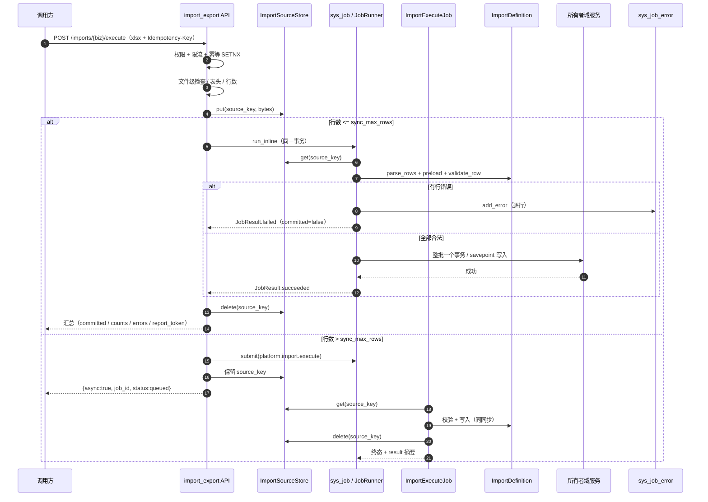

# Excel 批量导入详细设计（users + roles / 全量原子 / 异步作业）

> 通用能力 · 04 导入导出 · 01 Excel 批量导入 · 详细设计

[文档首页](../../../../../../文档首页.md) › [08 通用能力](../../../../README.md) › [导入导出](../../04_导入导出.md) › [Excel 批量导入](../04_导入导出_01_Excel批量导入.md) › 详细设计　|　[需求 02-2](../../../../需求/02_需求_文件与导入导出.md#r02-2) · [阶段计划](../../../../计划/01_计划_通用能力.md) · [概要 · 导入导出](../../../../../../设计/概要设计/19_概要设计_导入导出.md)

## 1. 概述 <a id="overview"></a>

- **目标**：把「Excel 批量导入」从契约占位做成可运行的通用通道——模板下载、文件解析、全量预检、全量原子落库、错误行报告、幂等拦截、异步作业与进度/错误明细查询；首批落地 **用户（users）** 与 **角色（roles）** 两个业务定义。
- **依据**：《[概要设计 · 导入导出](../../../../../../设计/概要设计/19_概要设计_导入导出.md)》§2 / §3 / §4 / §5 / §6 / §7；《[概要设计 · 用户管理](../../../../../../设计/概要设计/03_概要设计_用户管理.md)》§2.1 / §5；《[概要设计 · 角色管理](../../../../../../设计/概要设计/06_概要设计_角色管理.md)》；《[架构设计 · 异步作业中心](../../../../../../设计/架构设计/40_架构设计_子系统_异步作业中心.md)》；《[架构设计 · 文件管理](../../../../../../设计/架构设计/20_架构设计_子系统_文件管理.md)》§5；《[后端开发规范](../../../../../../规范/后端开发规范.md)》；《[测试规范](../../../../../../规范/测试规范.md)》；《[AI开发规范](../../../../../../规范/AI开发规范.md)》。
- **范围**：
  1. 基座：真实 `OpenpyxlImporter`、导入定义契约与注册表、导入源文件端口、导入参数、`503xx` 错误码、幂等 `release`。
  2. 平台导入域：模板 / 执行 / 状态 / 错误明细端点，同步内联与异步作业编排，源文件生命周期。
  3. 业务定义：`users`（`sys_user`，复用 `UserAdminService`）与 `roles`（`sys_role`，复用 `RoleService`）。
  4. 全量原子语义：任一行非法整批不落库；响应带 `committed` / `blocked_count`；异步校验拒绝落 `failed` 且不可重试。
  5. 审计与权限：每成功行 `AuditCapturer.capture`；入口 `import:execute` + 定义声明的业务写权限。
- **不含（归口见 §8）**：前端导入对话框与菜单/按钮种子（阶段十五）；操作日志落库与哈希链（06_01 / 06_02）；表单定制动态列（10_01）；列表导出与 PDF（04_02）；产品仓自定义导入定义（各产品接入任务）；导入源文件的统一 `sys_file` 元数据与配额（后续文件通道统一）。

## 2. 现状与差距（设计 vs 代码不符清单） <a id="gap"></a>

> 动手前对账结果。「处置」列写明本段改什么、回写什么、留什么。

| # | 关注点 | 需求 / 概要要求 | 代码现状 | 处置 |
| --- | --- | --- | --- | --- |
| 1 | 真实 Excel 读写 | openpyxl 生成模板、解析上传文件、生成错误明细 | `bms_core/transfer` 只有 `ColumnSpec` / `BaseImporter` / `BaseExporter` 与 `NullImporter` / `NullExporter`；`openpyxl` 未入依赖 | **本段改**：新增真实 `OpenpyxlImporter` 与 workbook 读写助手；`openpyxl` 加入 `bms_core` |
| 2 | 导入通道 | 模板 / 执行 / 错误明细接口 | 只有契约与空实现，**无任何导入端点** | **本段改**：平台新增 `domains/import_export`，落 4 类端点 |
| 3 | 业务定义 | 用户等主数据模板列、校验、落库 | 无导入定义 / 注册机制；用户创建只有单条 `POST /users` | **本段改**：新增 `BaseImportDefinition` + 注册表；落 `users` / `roles` 两个定义 |
| 4 | 部分成功 vs 全量原子 | 任务书「非法行逐行报错且不落库」；需求 §5「校验全量预检、非法行不落库」 | 无实现 | **本段定**：**全量原子**——任一行非法整批不落库；响应带 `committed` / `blocked_count`（决策 1） |
| 5 | 事务粒度 | 概要 §2.2「单事务分批落库」；需求 §5「按行事务」 | 无实现 | **本段定**：**整批一个事务**（同步批次 savepoint / 异步一个业务事务）；单行失败只回滚该行 savepoint，最终任一行失败整批回滚（决策 2） |
| 6 | 幂等 | `Idempotency-Key` + Redis SETNX + 唯一约束兜底 | `IdempotencyStore` 有 `begin/load/save`，**无 release**；`sys_job` 有 `(job_type, idempotency_key)` 唯一约束 | **本段改**：键按 `tenant + biz + key`；处理中 `10003`；扩展 `release`；唯一约束用 `sys_job` |
| 7 | 异步执行 | 万行级不超时、进度可查、统一走 `sys_job` | `JobRunner.run_inline` 已为 04_01 预留；`sys_job` / `sys_job_error` / 进度 / 取消齐备；**无导入作业类型** | **本段改**：新增 `platform.import.execute` 作业；阈值内 `run_inline`，超阈值 `submit` |
| 8 | 源文件持久化 | 异步 worker 需读上传文件 | 无导入源文件通道；文件服务有 `sys_file` 但无内部按 id 读内容 | **本段改**：新增 `ImportSourceStore` 端口，默认落 `BaseObjectStorage`；作业结束删除（决策 3） |
| 9 | 错误明细 | `errors:[{row, column?, message}]` + 错误明细下载 | `sys_job_error` 已有 `row_no` / `column_key` / `message`；无查询/下载接口 | **本段改**：新增状态端点与 `report_token` 错误明细端点 |
| 10 | 错误码 | 5xxxx 文件段 | `501xx` 文件自身、`502xx` 打印已占；`503xx` 空闲 | **本段改**：启用 `50301` ~ `50310`，回写架构 09 / 概要 19 |
| 11 | 用户写路径 | 批量建号、密码策略、事件 | `UserAdminService.create_user` 已做唯一性、密码策略、哈希、`sys.user.created` | **本段复用**：用户定义经 `UserAdminService` 写；不复制建号逻辑 |
| 12 | 角色写路径 | 批量建角色 | `RoleService.create_role` 已做角色码格式、唯一性、状态校验；新角色恒为 `custom` | **本段复用**：角色定义经 `RoleService` 写；不开放 `role_type` |
| 13 | 配额 | 用户创建受 `user_count` 限制 | 用户 API 调 `TenantQuotaClient`；导入无 | **本段改**：users 定义按合法行一次性 consume，失败 release；roles 无配额 |
| 14 | 审计 | 导入动作落操作日志；字段级审计可追溯 | `AuditCapturer` 契约齐备、默认 null；`sys_operation_log` 未落地（06_01） | **本段改**：每成功行 `capture`（排除密码哈希）；请求动作由 06_01 中间件统一落库 |
| 15 | 限流 | 导入 / 导出接口级限流 | `BaseRateLimiter` 契约齐备；平台导入端点无 | **本段改**：用户维度默认 10 次/分钟，`sys_config` 可调 |
| 16 | 参数 | 文件大小 / 单批行数 / 阈值可配 | `PLATFORM_CONFIG_DEFAULTS` 无导入键 | **本段改**：补 `import.*` 默认项，`ImportLimits` 批量读取并回落代码默认 |
| 17 | 插件接线 | `[importer]` 选真实实现 | `Settings.importer` 与 `PLUGIN_WIRINGS` 已有，但无 `[importer]` 配置节与真实实现登记 | **本段改**：`config.toml` 增 `[importer] provider="openpyxl"`；装配登记工厂 |
| 18 | 导入定义注册 | 产品 / 业务可扩展 | 无 | **本段改**：`ImportDefinitionRegistry` + 各服务根装配；产品仓按同一契约接入 |
| 19 | 领域登记 | 新域须登记 | `deploy/registry/platform.toml` / `domain_layout.json` 无 `import_export` | **本段改**：新增域登记与公开出口（空占位） |
| 20 | 契约 | 新增端点须进公开契约 | `deploy/contracts/platform.json` 需重建 | **本段改**：`ops.contract_snapshot export` + 前端类型生成 |
| 21 | 作业结果摘要 | 失败作业也要带汇总计数 | `JobExecutor._finalize` 失败分支**不落 `result.output`** | **本段改**：失败分支同样持久化 `result` 摘要（截断），供状态端点读取 |
| 22 | Kiwi | 先登记用例再编码 | 既有用号至 01_03 | **本段首步**：容器内 `bms-kiwi` 登记取号后回填 |

## 3. 交付物清单 <a id="tree"></a>

```text
backend/
├── pyproject.toml                                   # 不改（openpyxl 进 bms_core）
├── libs/bms_core/
│   ├── pyproject.toml                               # 改：openpyxl>=3.1.5
│   └── src/bms_core/
│       ├── transfer/
│       │   ├── base.py                              # 改：ColumnSpec 增可选校验字段
│       │   ├── importer.py                          # 改：ParsedRow / parse_rows / validate_rows（旧 parse/validate 委托）
│       │   ├── openpyxl_io.py                       # 新：xlsx 结构校验 / 读行 / 写工作簿 / zip 安全
│       │   ├── openpyxl.py                          # 新：OpenpyxlImporter 真实实现
│       │   ├── definition.py                        # 新：BaseImportDefinition / ImportDefinitionRegistry / ImportRowContext
│       │   ├── source.py                            # 新：ImportSourceStore + ObjectStorageImportSourceStore
│       │   ├── limits.py                            # 新：ImportLimits + import.* 参数键
│       │   ├── null.py                              # 改：NullImporter 适配新契约
│       │   └── __init__.py                          # 改：导出新契约
│       ├── core/assembly.py                         # 改：登记 OpenpyxlImporterFactory
│       ├── core/error_codes.py                      # 改：50301~50310 + HTTP 映射
│       ├── core/exceptions.py                       # 改：ImportError 段位基 + 子类
│       ├── config/seed.py                           # 改：import.* 平台默认项
│       ├── idempotency/base.py                      # 改：release（默认空实现）
│       └── idempotency/redis.py                     # 改：release = DEL
├── services/platform/src/bms_platform/
│   ├── imports.py                                   # 新：users/roles 定义与写服务工厂装配
│   ├── jobs.py                                      # 改：登记 platform.import.execute
│   ├── api/router.py                                # 改：挂导入路由
│   └── domains/
│       ├── import_export/
│       │   ├── __init__.py
│       │   ├── public.py                            # 新：空占位（无跨域消费方）
│       │   ├── api/imports.py                       # 新：模板 / 执行 / 状态 / 错误明细
│       │   ├── schemas/import.py                    # 新：执行结果 / 状态 / 错误项
│       │   ├── repositories/job.py                  # 新：sys_job / sys_job_error 读侧
│       │   ├── services/import.py                   # 新：文件检查 / 同步异步编排 / 幂等
│       │   ├── services/report.py                   # 新：错误明细 xlsx 与 report_token
│       │   └── jobs.py                              # 新：ImportExecuteJob
│       ├── user/imports.py                          # 新：UserImportDefinition
│       └── role/imports.py                          # 新：RoleImportDefinition
├── deploy/registry/platform.toml                    # 改：import_export 域 + platform.import.execute 作业
├── deploy/boundaries/domain_layout.json             # 改：import_export 域
└── deploy/contracts/platform.json                   # 改：契约快照重建

bms文档/
├── 设计/概要设计/19_概要设计_导入导出.md              # 改：§2.2 全量原子 / §4 源文件与作业 / §5 端点 / §6 权限 / §7 错误码
├── 设计/概要设计/06_概要设计_角色管理.md              # 改：批量导入入口与权限码
├── 设计/架构设计/09_架构设计_接口与集成.md            # 改：已发布码位补 503xx
├── 设计/架构设计/20_架构设计_子系统_文件管理.md       # 改：§5 Excel 导入通道与源文件落点
├── 设计/数据库设计/38_数据库设计_异步作业中心.md       # 改：导入的 run_inline / 异步 / sys_job_error 口径
├── 后端基类清单.md                                  # 改：transfer 新契约 / 实现 / 参数 / 幂等 release
├── 设计/基类体系/后端基类实现契约.md                  # 改：导入导出行补真实实现与定义注册
├── 规范/命名规范.md                                 # 改：§10 Redis / 对象 key 补导入
├── 项目/08_通用能力/…/04_导入导出_01_Excel批量导入/    # 新增 设计/实施/测试 三份
├── 项目/08_通用能力/需求/02_需求_文件与导入导出.md     # 改：交付注块（users+roles / 全量原子 / 异步）
└── 项目/08_通用能力/计划/01_计划_通用能力.md           # 改：04_01 归档、04_02 及后续按计划表顺延
```

## 4. 领域设计 <a id="design"></a>

### 4.1 总体架构与职责边界 <a id="arch"></a>

```mermaid
flowchart LR
    subgraph 请求面
        A[列表页 / 调用方] --> B[GET /imports/{biz}/template]
        A --> C[POST /imports/{biz}/execute]
        A --> D[GET /imports/{biz}/jobs/{job_id}]
        A --> E[GET /imports/{biz}/error-report/{token}]
    end
    subgraph platform 服务
        B --> F[import_export 域]
        C --> F
        D --> F
        E --> F
        F --> G[ImportService 编排]
        G --> H[ImportDefinitionRegistry]
        H --> I[UserImportDefinition]
        H --> J[RoleImportDefinition]
        G --> K[ImportSourceStore]
        G --> L[JobRunner]
        L --> M[platform.import.execute]
        M --> N[ImportExecuteJob]
        N --> G
    end
    subgraph 共享基座
        G --> O[OpenpyxlImporter]
        G --> P[ImportLimits / sys_config]
        G --> Q[IdempotencyStore]
        K --> R[BaseObjectStorage]
        I --> S[UserAdminService]
        J --> T[RoleService]
    end
    subgraph 数据面
        S --> U[(sys_user)]
        T --> V[(sys_role)]
        M --> W[(sys_job)]
        W --> X[(sys_job_error)]
    end
```

**职责边界**：

| 层 / 单元 | 职责 | 禁止 |
| --- | --- | --- |
| `bms_core/transfer` | Excel 读写、通用列校验、定义契约与注册表、源文件端口、导入参数 | 不承载具体业务字段、不直接写业务表、不依赖平台服务 |
| `domains/import_export` | 模板 / 执行 / 状态 / 错误明细端点、同步异步编排、幂等、错误明细生成 | 不直接写 `sys_user` / `sys_role`；业务写只经定义调用所有者域服务 |
| `domains/user/imports.py` | 用户导入列集、预检、写路径（复用 `UserAdminService`） | 不跨域写角色 / 租户数据 |
| `domains/role/imports.py` | 角色导入列集、预检、写路径（复用 `RoleService`） | 不开放 `role_type`、不做权限分配 |
| 服务根 `imports.py` | 装配定义、写服务工厂、表达式 | 不承载业务规则；只做跨域接线 |
| `platform.import.execute` | 异步执行同一编排，读源文件、写业务表、写错误明细 | 不复制 API 层逻辑；与同步共用 workflow |

### 4.2 基座契约与数据契约 <a id="contracts"></a>

#### 4.2.1 `ColumnSpec` 非破坏扩展

`ColumnSpec` 保持现有 `key` / `title` / `required`，新增可选字段（全部有默认值，导出列定义零影响）：

| 字段 | 类型 | 默认 | 语义 |
| --- | --- | --- | --- |
| `max_length` | `int \| None` | `None` | 文本最大长度；None 不限制 |
| `value_type` | `str` | `"text"` | 通用读值类型：`text` / `int` / `number` / `bool` / `date` / `datetime` |
| `pattern` | `str \| None` | `None` | 可选正则（如账号 / 邮箱 / 手机号）；None 不校验 |
| `choices` | `frozen list[str]` | 空 | 可选值（模板下拉 + 通用预检）；空表示不限制 |
| `note` | `str` | `""` | 填写说明（模板「填写说明」sheet） |
| `example` | `str` | `""` | 示例（只进说明 sheet，不进数据 sheet） |

> 枚举 label 反查（`enabled`/`disabled`/`启用`/`禁用`）由业务定义负责；通用层只做类型/长度/正则/必填，避免基座感知业务值域。

#### 4.2.2 `ParsedRow` 与导入器契约

```python
@dataclass(frozen=True)
class ParsedRow(BaseValueObject):
    """解析行：Excel 行号 + 字段值。"""
    row_no: int                 # Excel 行号，从 2 起
    values: ConcurrentStableFrozenDict[str, object]
```

`BaseImporter` 保留旧方法并新增带行号方法：

| 方法 | 语义 | 兼容 |
| --- | --- | --- |
| `async parse_rows(data, *, columns) -> ConcurrentStableList[ParsedRow]` | 解析为带行号的行（抽象） | 新 |
| `async parse(data, *, columns) -> ConcurrentStableList[ConcurrentStableDict[str, object]]` | 旧签名；默认委托 `parse_rows` 并丢弃行号 | 保留 |
| `async validate_rows(rows, *, columns) -> ImportResult` | 通用校验（必填 / 长度 / 类型 / 正则），错误带 `row_no` / `field` | 新 |
| `async validate(rows, *, columns) -> ImportResult` | 旧签名；默认把行号按 2 起顺延后委托 `validate_rows` | 保留 |

- `RowError` 保持 `row` / `message` / `field`；API 层把 `field` 映射为 `column`，错误明细同时展示字段键与列标题。
- 契约版本升 `0.2.0`（主版本仍 0，兼容校验不阻断旧实现）；`NullImporter` 实现 `parse_rows` / `validate_rows`，旧方法继承。
- `OpenpyxlImporter` 的 `validate_rows` 只做通用校验；业务校验由定义完成。

#### 4.2.3 导入定义契约

```python
class BaseImportDefinition(BaseFrameworkObject, ABC):
    """业务导入定义：列集 + 预检 + 单行写入。"""

    biz: str                         # 路径段，如 users / roles
    title: str                       # 中文名（模板 / 错误明细文件名）
    write_permission: str | None     # 业务写权限码（None = 仅入口权限）

    @property
    @abstractmethod
    def columns(self) -> ConcurrentStableFrozenList[ColumnSpec]: ...

    async def preload(self, session: DbSession, rows: ConcurrentStableList[ParsedRow]) -> object:
        """批量预取（库内已存在键等），返回给 validate_row 使用。"""

    @abstractmethod
    async def validate_row(self, row: ParsedRow, preloaded: object, *,
                           config: BaseConfigSource | None) -> ConcurrentStableList[RowError]: ...

    @abstractmethod
    async def write_row(self, row: ParsedRow, ctx: ImportRowContext) -> None: ...
```

`ImportRowContext`（框架对象，非值对象）由编排构造，字段：

| 字段 | 语义 |
| --- | --- |
| `session` / `uow` | 当前作业或请求会话 / 工作单元 |
| `actor` | 操作人（`current_user_id` 或作业 payload） |
| `tenant_id` / `tenant_code` | 租户主键 / 编码（配额与服务调用） |
| `audit` | `AuditCapturer`（可为 null 占位） |
| `quota` | `TenantQuotaClient`（仅 users 使用） |
| `job_ctx` | 异步作业上下文（可为 None）；`add_error` / `report_progress` / `should_cancel` |

`ImportDefinitionRegistry`：进程内 `biz → 定义`，构建期登记、运行期只读；重名 / 非法 biz 构建期即拒。各服务根装配自己的定义，**不跨服务共享**；产品仓按同一契约登记。

#### 4.2.4 导入源文件端口

```python
class ImportSourceStore(BaseFrameworkObject, ABC):
    async def put(self, key: str, data: bytes) -> None: ...
    async def get(self, key: str) -> bytes: ...
    async def delete(self, key: str) -> None: ...
```

- 默认实现 `ObjectStorageImportSourceStore` 包装 `BaseObjectStorage`（`local` / `minio` 均可）。
- key 统一助手：`build_import_source_key(tenant, token)` → `{租户|global}/imports/source/{token}.xlsx`（路径风格；Windows 本地存储不接受冒号）。
- 只存 xlsx 源文件，**不建 `sys_file` 元数据、不占存储配额**；长期统一文件通道时只替换端口实现，编排零改动（开放项 3）。

#### 4.2.5 导入参数

`ImportLimits.load(config_source)` 批量读取，缺失 / 非法 / 源不可达一律回落代码默认（与 `FileLimits` 同口径）：

| 参数键 | 代码默认 | 语义 |
| --- | --- | --- |
| `import.upload.max_size` | `20971520`（20MB） | 单文件大小上限（字节） |
| `import.upload.max_rows` | `50000` | 单次数据行上限；超过文件级拒绝 |
| `import.sync_max_rows` | `200` | 同步内联阈值；超过走异步 |
| `import.batch_size` | `200` | 进度上报 / 取消检查粒度（**不是提交粒度**） |
| `import.error_report_ttl` | `86400` | `report_token` 有效期（秒） |
| `import.file.max_uncompressed_bytes` | `104857600`（100MB） | zip 解压后总大小上限 |
| `import.file.max_zip_entries` | `2000` | zip 条目数上限 |
| `import.rate_limit.limit` | `10` | 用户维度窗口内次数 |
| `import.rate_limit.window` | `60` | 限流窗口（秒） |

### 4.3 Excel 读写、模板与文件安全 <a id="excel"></a>

#### 4.3.1 模板

- 文件名：`{title}-导入模板.xlsx`；`Content-Disposition` 用 RFC 5987 `filename*=UTF-8''...`。
- 两个 sheet：
  1. **数据**：首行固定列头（`ColumnSpec.title`），无示例数据；冻结首行；列宽按标题长度设置；状态列加数据验证下拉（`enabled,disabled,启用,禁用`）。
  2. **填写说明**：列名 / 是否必填 / 类型 / 长度 / 格式或可选值 / 示例 / 说明。
- 解析只认名为「数据」的 sheet（按名称定位，不依赖 sheet 顺序）；缺少该 sheet → `50301`。

#### 4.3.2 文件级安全

| 检查 | 口径 | 失败 |
| --- | --- | --- |
| 扩展名 | 仅 `.xlsx`；`.xls` / `.xlsm` / `.csv` 拒绝 | `50302` |
| 大小 | ≤ `import.upload.max_size` | `50303` |
| 容器 | 字节以 `PK\x03\x04` 开头；ZIP 内必须含 `[Content_Types].xml` 与 `xl/workbook.xml` | `50302` |
| zip 安全 | 条目数 ≤ `max_zip_entries`；解压后总大小 ≤ `max_uncompressed_bytes`；条目名不得为绝对路径或含 `..` | `50302` |
| 宏 | 不加载 VBA（`keep_vba=False`），宏文件按普通 xlsx 解析失败即拒 | `50302` |
| 结构 | openpyxl `read_only=True, data_only=True` 可解析；表头行完整 | `50302` / `50301` |

#### 4.3.3 表头与行读取

- 表头固定第 1 行；列数、列序、列头文本必须与 `columns` **完全一致**；多列 / 少列 / 错序 / 空列头 → `50301`。
- 数据行从第 2 行起；**整行为空的跳过**（不报错、不计入 total）；有值的行计入 total。
- 单元格值：
  - `text`：去首尾空白；数字 / 日期转字符串（日期用 ISO 8601）；
  - `int` / `number`：接受数字或数字文本；非法 → 行错误；
  - `bool`：接受 `true/false/1/0/是/否`；非法 → 行错误；
  - `date` / `datetime`：接受 Excel 日期或 ISO 文本；非法 → 行错误；
  - 公式单元格按缓存值读取；无缓存值视为空值；**不执行公式**。
- 行号始终取 Excel 物理行号（从 2 起），与错误报告、前端展示一致。

#### 4.3.4 工作簿写入助手

- `openpyxl_io.py` 提供 `inspect_xlsx` / `read_rows` / `write_workbook`：
  - 模板与错误明细共用 `write_workbook`（普通 `Workbook`；错误明细大数据量用 `write_only=True`）；
  - 读路径统一 `read_only=True, data_only=True`，关闭后及时 `close()`；
  - 所有 openpyxl 调用包在 `asyncio.to_thread` 中，避免阻塞事件循环（参考 `LocalObjectStorage` 的 IO 口径）。

### 4.4 导入定义：用户（users） <a id="users"></a>

#### 4.4.1 列集

| 列键 | 列头 | 必填 | 长度 | 类型 | 说明 |
| --- | --- | --- | --- | --- | --- |
| `username` | 登录账号 | 是 | 64 | text | `^[A-Za-z0-9][A-Za-z0-9_.-]{0,63}$`；租户内唯一 |
| `name` | 姓名 | 是 | 128 | text | 去空白后非空 |
| `email` | 邮箱 | 否 | 255 | text | 空=不填；`^[^@\s]+@[^@\s]+\.[^@\s]+$` |
| `phone` | 手机号 | 否 | 32 | text | 空=不填；`^[+]?[0-9][0-9\-\s]{5,31}$` |
| `status` | 状态 | 否 | 16 | text | `enabled` / `disabled` / `启用` / `禁用`；空=`enabled` |
| `password` | 初始密码 | 否 | 128 | text | 空=随机生成；填写则过密码策略；**导入后一律强制首登改密** |

#### 4.4.2 校验

1. **文件内重复**：`username` 在同一文件出现两次 → 两行都报「登录账号在文件内重复」。
2. **库内唯一**：`preload` 一次 `SELECT code FROM sys_user WHERE code IN (...)`（含软删过滤，按仓储口径）→ 已存在行报「登录账号已存在」。
3. **格式 / 长度**：按列表格；邮箱 / 手机号允许空。
4. **状态**：中文标签映射为库值；非法值报行错误。
5. **密码**：非空时用 `BasePasswordPolicy.validate` 预检；为空不预检（由 `UserAdminService` 随机生成并通过策略）。
6. **全量预检**：所有行先校验；**任一行有错误 → 整批不落库**，返回全部行错误。

#### 4.4.3 写路径

- 每行调用 `UserAdminService.create_user(username=..., name=..., password=None|value, pwd_reset_required=True, email=..., phone=..., status=...)`：
  - 复用唯一性复检、密码策略、PBKDF2 哈希、`sys.user.created` 事务性发件箱；
  - 密码为空时由服务随机生成并强制首登改密；生成的密码不落日志 / 不回显（用户由管理员另行重置或走后续通知通道）。
- **全量原子**：整批包在一个事务 / savepoint 内；任一行写失败（唯一冲突、策略失败、DB 异常）→ 整批回滚；已写入行不保留。
- **配额**：预检全部通过后，`TenantQuotaClient.consume("user_count", 合法行数, ref="import:users")` 一次；写失败 / 回滚时 `release` 同量。
- **审计**：每成功行 `AuditCapturer.capture(table="sys_user", model_id=user.id, changes=[username/name/email/phone/status]，old=None)`；**不含 `password_hash`**。
- **事件**：由 `UserAdminService` 在写事务内发 `sys.user.created`；导入不额外发布事件。

### 4.5 导入定义：角色（roles） <a id="roles"></a>

#### 4.5.1 列集

| 列键 | 列头 | 必填 | 长度 | 类型 | 说明 |
| --- | --- | --- | --- | --- | --- |
| `code` | 角色码 | 是 | 64 | text | 复用 `role.code_pattern`（默认小写字母开头，2~32 位）；租户内唯一 |
| `name` | 角色名称 | 是 | 128 | text | 去空白后非空 |
| `status` | 状态 | 否 | 16 | text | `enabled` / `disabled` / `启用` / `禁用`；空=`enabled` |

- **不提供 `role_type`**：全部导入为 `custom`；内置 `system` / `security` / `audit` / `platform_admin` 只由种子创建，禁止导入。
- **不做权限分配**：菜单 / 表单 / 权限码 / 数据权限不进入导入模板；权限分配仍走角色授权页或后续专用任务。

#### 4.5.2 校验与写路径

1. 文件内 `code` 重复 → 两行都报错；库内已存在 → 报「角色码已存在」。
2. `code` 格式用 `resolve_role_code_pattern(config)` 读取 `role.code_pattern` 后 `re.fullmatch`；`name` 去空白非空。
3. 状态中文标签映射同 users。
4. 全量预检；任一行错误整批不落库。
5. 每行调用 `RoleService.create_role(code=..., name=..., status=...)`；新角色恒为 `custom`，复用角色码格式 / 唯一性校验。
6. 审计：每成功行 `capture(table="sys_role", model_id=role.id, changes=[code/name/status]，old=None)`。
7. 无配额、无事件（角色创建按既有角色域口径，不新增事件）。

### 4.6 执行编排（同步 / 异步） <a id="flow"></a>



#### 4.6.1 同步路径

- API 在请求级工作单元内完成：幂等 SETNX → 文件检查 → 源文件落存储 → `JobRunner.run_inline` → 删除源文件 → 保存幂等结果 → 返回。
- `run_inline` 与异步共用同一 `sys_job` 记录、状态机、`sys_job_error` 与进度语义。
- 业务写包在**批次 savepoint** 内（`ctx.session().begin_nested()`）：任一行失败回滚整个批次，但 `sys_job` 记录与错误明细保留（`JobExecutor` 在调用方事务内收敛终态）。
- 文件级错误（非 xlsx / 超限 / 表头不匹配）在落存储前拒绝，不创建作业。

#### 4.6.2 异步路径

- API 只做文件级检查 / 表头 / 行数，然后 `runner.submit(JobSubmission(job_type="platform.import.execute", payload={...}, idempotency_key=...))`；提交事务提交后返回 `job_id`。
- `payload` 字段：`biz` / `source_key` / `file_name` / `file_size` / `total_rows` / `actor` / `tenant_code` / `report_token`。
- Worker `ImportExecuteJob`：
  1. 从 `ctx.session()` 取会话，按 `payload.biz` 取定义；
  2. `source_store.get(source_key)`；对象缺失 → `50309`，`JobResult.failed(retryable=False)`；
  3. 解析 + 通用校验（`BaseImporter.validate_rows`）+ 全量业务预检：有错 → 逐行 `ctx.add_error`，返回 `failed(retryable=False, output=汇总)`；
  4. 全部合法 → 配额 consume（users）→ 一个业务事务写入 → 成功 `succeeded(output=汇总)`；失败 → 回滚 + 配额 release + `failed(retryable=False)`；
  5. `finally` 删除源文件；进度按 `import.batch_size` 上报，取消检查在批次边界。

#### 4.6.3 进度、取消与清理

- 进度：`done` = 已处理行数（校验或写入），`total` = `total_rows`；每 `batch_size` 行上报一次，避免写放大。
- 取消：每 `batch_size` 行检查 `ctx.should_cancel()`；已取消 → 回滚批次（全量原子）→ 返回 `canceled`；源文件仍删除。
- 源文件：同步在 `finally` 删除；异步在 handler `finally` 删除；进程崩溃导致的孤儿对象登记开放项（§8），暂不做定时回收。

### 4.7 全量原子语义与失败汇总 <a id="atomic"></a>

#### 4.7.1 汇总字段

| 字段 | 语义 |
| --- | --- |
| `total` | 数据行数（跳过整行为空的行） |
| `success_count` | 实际落库行数；全量原子下只有 `committed=true` 时为 `total` |
| `fail_count` | **有错误的行数**（按行去重；一行多错只计 1） |
| `blocked_count` | 合法但因整批拒绝未落库的行数 = `total - fail_count`（拒绝时）；成功时为 0 |
| `committed` | 是否已落库；校验拒绝 / 写失败 / 取消均为 `false` |
| `errors` | 错误项 `{row, column?, message}`，按行号升序；同步响应最多前 200 条，完整明细走错误明细下载 |
| `duplicate` | 是否命中幂等键、返回首次结果 |

- **校验拒绝**：`success_count=0`、`fail_count=非法行数`、`blocked_count=合法行数`、`committed=false`。
- **写失败 / 取消**：`success_count=0`、`fail_count=0`（或 1 条批次级错误）、`blocked_count=total`、`committed=false`。
- **成功**：`success_count=total`、`fail_count=0`、`blocked_count=0`、`committed=true`。

#### 4.7.2 同步与异步终态

| 场景 | 同步 `run_inline` | 异步作业 |
| --- | --- | --- |
| 校验有非法行 | `JobResult.failed(retryable=False)`；响应 `committed=false` | `failed` + 不可重试；`sys_job.result` 保留汇总 |
| 写入失败 | 回滚批次 savepoint；`JobResult.failed(retryable=False)` | 回滚事务；`failed` + 不可重试 |
| 取消 | 回滚批次；`JobResult.canceled` | `canceled`；不可重试 |
| 成功 | `JobResult.succeeded(output=汇总)` | `succeeded`；`result` 摘要 |

> 为让异步失败也能带汇总，`JobExecutor._finalize` 的失败分支同样把 `result.output` 写入 `sys_job.result`（按 `result_max_chars` 截断）；这是本段唯一改动作业基座的语义，向后兼容（既有失败作业 `output=None` 时不写）。

### 4.8 幂等设计 <a id="idempotency"></a>

- **必填**：`POST /execute` 缺 `Idempotency-Key` → `50305`（400）。
- **键空间**：
  - Redis：`build_idempotency_key(key=f"{biz}:{client_key}", tenant=tenant_id)` → `bms:{tenant}:idem:{biz}:{client_key}`；
  - `sys_job.idempotency_key`：`{biz}:{client_key}`（列宽 128；超长用 SHA256 十六进制截断）。
  - 业务标识进入键，users / roles 同一客户端键互不干扰。
- **流程**：
  1. `begin(key)` 为 False：
     - `load(key)` 有结果 → 直接返回首次结果，`duplicate=true`；
     - `load(key)` 为 None（处理中）→ `ConflictError`（`10003` / 409）。
  2. `begin(key)` 为 True：继续。
  3. 内部异常（未形成业务结果）→ `release(key)` 后抛出；业务结果（成功 / 校验拒绝 / 写失败）→ `save(key, payload)`。
  4. 首次结果载荷：`job_id` / `async` / `total` / `success_count` / `fail_count` / `blocked_count` / `committed` / `report_token` / 前 200 条 `errors`。
- **唯一约束兜底**：`sys_job(job_type, idempotency_key)` 唯一；Redis 丢失 / 并发穿透时，第二次 `submit` 命中既有记录，不产生第二个作业。命中既有记录时返回既有 `job_id` 与状态；完整首次结果回放以 Redis 载荷为准（Redis 可用为前提）。
- **幂等键生命周期**：TTL 默认 86400 秒（与 `IdempotencyStore` 一致）；错误明细 token TTL 独立 86400 秒。
- **release 契约**：`IdempotencyStore.release(key)` 新增带默认空实现的方法；`RedisIdempotencyStore` 覆写为 `DEL`（Redis 不可用按既有 fail-closed 语义抛 `10012`）；`NullIdempotencyStore` 保持空操作。

### 4.9 错误明细与状态查询 <a id="report"></a>

#### 4.9.1 `report_token`

- 执行开始时生成 `secrets.token_urlsafe(24)`，随 `payload.report_token` 入作业；提交 / 内联完成后写 Redis：
  - key：`bms:{tenant}:imports:report:{token}`；
  - value：`{"job_id": <int>, "biz": "<biz>"}`；
  - TTL：`import.error_report_ttl`（默认 86400）。
- 只有 `fail_count > 0` 时才在响应 / 状态端点返回 `report_token`；全部成功返回 `null`。

#### 4.9.2 `GET /api/v1/imports/{biz}/error-report/{token}`

1. 取 token 映射；缺失 / 过期 → `50306`（404）。
2. 读 `sys_job`：必须存在、`job_type=platform.import.execute`、`tenant_id` 与当前租户一致、`payload.biz == {biz}`；否则 `50306`。
3. 作业未终态 → `50308`（409）「错误明细尚未生成」。
4. 读 `sys_job_error`（按 `job_id` 全量，按 `row_no` 升序）；无错误 → `50306`。
5. 用 `write_workbook` 生成 xlsx：列头「行号 / 列 / 原因」；`列` 优先展示定义列标题（`column_key` 反查），查不到展示键。
6. 返回文件流：`application/vnd.openxmlformats-officedocument.spreadsheetml.sheet`；文件名 `{title}-导入错误明细-{yyyyMMddHHmmss}.xlsx`（时间按用户时区由前端展示，后端用 UTC 生成）。

#### 4.9.3 `GET /api/v1/imports/{biz}/jobs/{job_id}`

| 字段 | 语义 |
| --- | --- |
| `job_id` | 作业主键（字符串） |
| `status` | `queued` / `running` / `succeeded` / `failed` / `canceled` / `dead` |
| `progress_done` / `progress_total` | 进度（未知总量为 null） |
| `total` / `success_count` / `fail_count` / `blocked_count` | 从 `sys_job.result` 解析；未终态为 null / 0 |
| `committed` | 终态且 `succeeded` 为 true；其余 false |
| `errors` | 前 N 条（默认 20，上限 200） |
| `report_token` | `fail_count > 0` 时返回 |
| `message` | `sys_job.error` 或结果说明 |

- 校验：`job_type` / `payload.biz` / `tenant_id` 不符 → `50307` 或 `JobNotFoundError`（`71001`）；推荐 `50307`「导入业务未注册 / 作业不属于该业务」，避免暴露其他业务作业。
- 状态端点权限 `import:execute`，不复用 `job:query`。

### 4.10 接口设计 <a id="api"></a>

统一前缀 `/api/v1`；鉴权 `require_auth`；统一响应 `{code, message, data}`（文件流端点除外）。

| 方法 | 路径 | 说明 | 权限 |
| --- | --- | --- | --- |
| GET | `/imports/{biz}/template` | 下载导入模板（xlsx 文件流） | `import:execute` |
| POST | `/imports/{biz}/execute` | 执行导入（multipart `file` + `Idempotency-Key`） | `import:execute` + 定义 `write_permission` |
| GET | `/imports/{biz}/jobs/{job_id}` | 异步状态 / 进度 / 汇总 / 前 N 条错误 | `import:execute` |
| GET | `/imports/{biz}/error-report/{token}` | 下载错误明细 xlsx | `import:execute` |

#### 4.10.1 执行响应

```json
{
  "code": 0,
  "message": "ok",
  "data": {
    "total": 100,
    "success_count": 0,
    "fail_count": 2,
    "blocked_count": 98,
    "committed": false,
    "errors": [
      {"row": 3, "column": "username", "message": "登录账号格式非法"},
      {"row": 7, "column": "email", "message": "邮箱格式非法"}
    ],
    "async": false,
    "job_id": "1800000000000000123",
    "report_token": "…",
    "duplicate": false
  }
}
```

- 异步提交：`async=true`、`committed=false`、`success_count=0`、`fail_count=0`、`blocked_count=0`、`errors=[]`、`job_id` 有值；汇总以后续状态端点为准。
- 幂等命中：`duplicate=true`，其余字段为首次结果。
- `errors` 同步响应最多前 200 条；完整明细经 `report_token` 下载。

#### 4.10.2 文件与 multipart

- 表单字段名 `file`；`UploadFile` 读取后立即做大小 / 容器检查；不落临时磁盘。
- `Content-Type` 接受 `application/vnd.openxmlformats-officedocument.spreadsheetml.sheet`、`application/octet-stream`；以扩展名 + 容器嗅探为准。
- `Idempotency-Key` 头长度 1~128；超长 / 空 → `50305`。

#### 4.10.3 限流

- 用户维度：`build_rate_limit_key(dimension="user", target=str(user_id), tenant=tenant_code)`；
- 规则：`RateLimitRule(limit=import.rate_limit.limit, window=import.rate_limit.window)`；
- 四个端点统一接入；超限 → `10005`（429）。模板下载也计入，防止批量刷模板。

### 4.11 数据模型与表设计 <a id="data"></a>

**不新建业务表**：

| 载体 | 用途 | 归属 / 说明 |
| --- | --- | --- |
| `sys_user` | 用户导入落库 | platform 服务租户库；沿用既有唯一约束与审计字段 |
| `sys_role` | 角色导入落库 | platform 服务租户库；导入恒为 `custom` |
| `sys_job` | 同步内联 / 异步作业记录 | 01_03 基础设施表；本段新增作业类型 `platform.import.execute` |
| `sys_job_error` | 行级错误明细 | `row_no` / `column_key` / `message`；随作业 30 天硬删 |
| 对象存储 | 导入源文件 | key `{tenant|global}/imports/source/{token}.xlsx`；作业结束删除，不建 `sys_file` |

- **幂等键不落业务表**：唯一约束由 `sys_job(job_type, idempotency_key)` 承担；用户 / 角色表不加幂等列。
- **索引**：`sys_job_error` 已有 `(job_id, id)`；状态查询按 `job_id` 命中；无需新增索引。
- **表文件**：`sys_job.md` / `sys_job_error.md` 为唯一事实源；本段只在《数据库设计 · 异步作业中心》补「导入使用口径」，不改字段。
- **数据库设计总览 §20 引用文件缺失**：总览登记了 `20_数据库设计_导入导出.md`，但目录下无该文件；本段核对为「无独立表」，建议后续补建一页「无独立表、复用 sys_job / sys_job_error / 对象存储」的说明或在总览改链（开放项 6）。

### 4.12 配置与错误码 <a id="config"></a>

#### 4.12.1 `[importer]`

```toml
[importer]
# Excel 导入实现选择（插件化配置；openpyxl = 真实读写、空串 = null 占位）
provider = "openpyxl"
options = {}
```

- `Settings.importer` 与 `PLUGIN_WIRINGS` 已存在，本段只补基线配置与真实工厂登记。
- `OpenpyxlImporterFactory` 零参构造（无外部依赖），在 `register_platform_plugins` 中登记 `("importer", "openpyxl")`。

#### 4.12.2 错误码 `503xx`

| 码 | 名称 | HTTP | 触发 |
| --- | --- | --- | --- |
| `50301` | `IMPORT_TEMPLATE_MISMATCH` | 400 | 缺少「数据」sheet / 表头列数、列序、列头文本不一致 |
| `50302` | `IMPORT_FILE_INVALID` | 400 | 非 xlsx / 容器损坏 / 结构非法 / zip 超限 / 无数据行 |
| `50303` | `IMPORT_FILE_TOO_LARGE` | 413 | 文件大小超过 `import.upload.max_size` |
| `50304` | `IMPORT_ROW_LIMIT_EXCEEDED` | 400 | 数据行数超过 `import.upload.max_rows` |
| `50305` | `IMPORT_IDEMPOTENCY_REQUIRED` | 400 | 缺少 / 非法 `Idempotency-Key` |
| `50306` | `IMPORT_REPORT_NOT_FOUND` | 404 | token 缺失 / 过期 / 作业无错误 |
| `50307` | `IMPORT_BIZ_NOT_REGISTERED` | 404 | `{biz}` 未注册 / 作业不属于该业务 |
| `50308` | `IMPORT_REPORT_NOT_READY` | 409 | 作业未终态，错误明细尚未生成 |
| `50309` | `IMPORT_SOURCE_MISSING` | 500 | 源文件对象丢失（作业不可重试） |
| `50310` | `IMPORT_COMMIT_FAILED` | 500 | 整批写入失败（已回滚，未落库） |

- 新增 `ImportError(FileError)` 段位基与上述子类；错误码登记在 `core/error_codes.py` + `HTTP_STATUS_MAP`；`test_exception_constructors_paths` 同步登记。
- 行级校验不进错误码：以 `{row, column?, message}` 返回；前端按 `import.row.*` 或直接展示后端文案（i18n 归后续）。

### 4.13 审计与操作日志 <a id="audit"></a>

- **字段级审计**：每成功行 `AuditCapturer.capture`：
  - users：`table="sys_user"`、`model_id=user.id`、`changes=[username/name/email/phone/status]`、`actor=操作人`；`password_hash` 不记录。
  - roles：`table="sys_role"`、`model_id=role.id`、`changes=[code/name/status]`。
- **操作日志**：导入动作是 HTTP 请求，06_01 的请求中间件统一落 `sys_operation_log`（module=`import`、action=`import:execute`、params 脱敏、结果摘要）。本段不新建日志表、不自行投递审计事件。
- **结构化日志**：提交 / 完成 / 失败各一条 `logger.info/warning`，字段 `biz` / `job_id` / `total` / `committed` / `duration_ms`；不记录文件内容、密码、完整错误明细。
- **审计失败不反噬业务**：`capture` 为 null 占位或实现异常时只 `warning`，不影响导入结果。

### 4.14 权限与种子 <a id="permission"></a>

- 入口：`import:execute`（已有种子 `("import","execute")`）。
- 业务写权限：
  - users：`user:create`（已有种子）；
  - roles：`role:create`（已有种子）。
- 执行端点在校验通过后、写库前调用 `BasePermissionChecker.require(definition.write_permission)`；模板 / 状态 / 错误明细只校验入口。
- 不新增菜单 / 表单 / 按钮种子：前端导入对话框与按钮挂接归阶段十五；接口可经网关直调验收。
- 限流：`import.rate_limit.*`（用户维度），超限 `10005`。

## 5. 失败分支与边界 <a id="failures"></a>

| 场景 | 行为 | 依据 / 风险 |
| --- | --- | --- |
| 缺少 `Idempotency-Key` | `50305`（400），不读文件 | 概要 §5.2 必填 |
| 同一幂等键重复提交（已完成） | 返回首次结果，`duplicate=true` | 需求 02-2 §3 |
| 同一幂等键仍在处理 | `10003`（409） | 避免并发重复建号 |
| Redis 不可用（幂等） | `10012`（503），fail-closed | 03_04 既有口径 |
| 非 xlsx / 改扩展名 | `50302`（400） | 容器嗅探 + 结构校验 |
| 文件超 20MB | `50303`（413） | `import.upload.max_size` |
| zip bomb / 条目超限 | `50302`（400） | 条目数 + 解压后大小上限 |
| 表头多列 / 少列 / 错序 | `50301`（400），整体拒绝 | 概要 §2.2 列头固定 |
| 无数据行 | `50302`（400） | 文件级错误，不创建作业 |
| 行数超 50000 | `50304`（400） | 全量原子长事务上界 |
| 任一行校验失败 | 整批不落库；`committed=false`；`fail_count` / `blocked_count` 汇总；错误明细可下载 | 全量原子决策 |
| 写入阶段 DB 失败 | 整批回滚；`50310`（同步）或 `failed`（异步） | 不保留部分行 |
| 异步作业校验拒绝 | `failed` + 不可重试；`sys_job.result` 带汇总 | 决策 3 |
| 异步作业源文件丢失 | `50309`；作业 `failed` 不可重试 | 对象被清理 / 存储故障 |
| 作业被取消 | `canceled`；整批回滚；源文件删除 | 全量原子 |
| 错误明细 token 过期 | `50306`（404） | TTL 86400 秒 |
| 作业未终态取错误明细 | `50308`（409） | 避免返回不完整明细 |
| 业务未注册 | `50307`（404） | 路径 `{biz}` 白名单 |
| 权限不足 | `30001`（403） | 入口 / 业务写权限 |
| 限流超限 | `10005`（429） | 用户维度 |
| 用户配额超限 | `82005`（409） | `TenantQuotaClient` 既有口径 |
| 密码不合策略 | 行错误，整批不落库 | 全量原子 |
| 角色码重复 / 格式非法 | 行错误，整批不落库 | `role.code_pattern` |
| 审计 / 操作日志不可用 | 只 warning，不影响导入 | 留痕不得反噬写路径 |
| 50000 行长事务 | 保留上限；真库出现锁等待 / 回滚段压力时评估 staging 表 / 分批 + 批次标记 | 已登记风险 |

## 6. 测试设计与验收映射 <a id="tests"></a>

| 完成标准（任务书 §3 / 需求 02-2） | 用例 |
| --- | --- |
| 模板可下载且列头与字段一致 | `test_import_api`（users / roles 模板 xlsx，读取表头断言；说明 sheet 存在） |
| 非法行逐行报错且不落库 | `test_import_api`（含非法行 → `committed=false`、`success_count=0`、`fail_count` / `blocked_count`、`sys_user` / `sys_role` 行数不变） |
| 合法行全量落库 | `test_import_api`（全部合法 → `committed=true`、`success_count=total`；用户 / 角色各一条） |
| 同幂等键只生效一次 | `test_import_api`（重复提交返回首次结果、`duplicate=true`；并发处理中 `10003`） |
| 万行级不超时（异步 + 进度） | `test_import_job`（阈值调低 → `async=true`；轮询状态 → `succeeded`；进度 `done/total`；源文件删除） |
| 导入后操作日志可查 | 本段只到 `AuditCapturer.capture` 边界；`test_user_import` / `test_role_import` 断言 capture 字段；06_01 落库后回归 |
| 数据变更可在字段级审计追溯 | `test_user_import` / `test_role_import`（`changes` 含新增字段、不含 `password_hash`） |
| 异步校验拒绝终态 | `test_import_job`（非法行 → `failed`、`committed=false`、`result` 汇总、`sys_job_error` 有行） |
| 错误明细下载 | `test_import_api`（token → xlsx，行号 / 列 / 原因；过期 → `50306`；未终态 → `50308`） |
| 文件安全 | `test_openpyxl_importer`（非 xlsx / 改扩展名 / zip bomb / 超条目 / 表头错序 / 无数据行） |
| 权限 | `test_import_api`（缺 `import:execute` 拒绝；users 缺 `user:create` 拒绝；roles 缺 `role:create` 拒绝） |
| 限流 | `test_import_api`（第 N+1 次 → `10005`） |
| 配额 | `test_user_import`（合法行一次 consume；写失败 release；roles 不调用） |
| 角色安全边界 | `test_role_import`（无 `role_type` 列；导入恒为 `custom`；内置角色不受影响） |
| 幂等 release | `test_idempotency_release`（Redis DEL；内部异常后可用同键重试） |
| 失败作业带汇总 | `test_import_job`（`JobExecutor` 失败分支写 `result`；状态端点可读） |
| 契约门禁 | `ops.contract_snapshot export` + `ops.check_contracts`；前端类型生成 |

**替身与真机边界**：

- 单测：临时 SQLite（`Base.metadata.create_all` 带 `sys_job` / `sys_job_error` / `sys_user` / `sys_role`）；`fakeredis` 或 `MemoryCacheRegion`；`LocalObjectStorage` 临时目录；`MemoryRateLimiter`。
- 幂等 / token 跨实例语义用 `fakeredis` 覆盖；真 Redis 集成用例按需（开发机已有 Redis 时跑，缺失 skip 且不计覆盖率分母）。
- 覆盖率口径见《[AI开发规范](../../../../../../规范/AI开发规范.md)》「覆盖率要求」：新增 / 改动模块 100% 行 + 分支；openpyxl 的异常分支用替身 / 构造坏文件覆盖。
- **Kiwi**：实施首步在容器内 `bms-kiwi` 登记（分类「平台骨架」、优先级 P2、状态 CONFIRMED、标签「自动化」），取证号后回填 `pytestmark = pytest.mark.kiwi_id(<编号>)`；按既有用号顺延。

## 7. 登记落点 <a id="registry-writeback"></a>

| 文档 | 回写内容 |
| --- | --- |
| 《[概要设计 · 导入导出](../../../../../../设计/概要设计/19_概要设计_导入导出.md)》 | §2.2 全量原子 / 汇总字段；§4 源文件与作业；§5.1 补状态 / 错误明细端点；§5.2 `committed/blocked_count`；§6 权限（入口 + 业务写）；§7 错误码 `503xx` |
| 《[概要设计 · 角色管理](../../../../../../设计/概要设计/06_概要设计_角色管理.md)》 | 批量导入入口、3 列模板、`role:create`、仅 `custom` |
| 《[概要设计 · 用户管理](../../../../../../设计/概要设计/03_概要设计_用户管理.md)》 | 确认 `/imports/users` 走通用通道；列集 / 密码强制改密口径 |
| 《[架构设计 · 接口与集成](../../../../../../设计/架构设计/09_架构设计_接口与集成.md)》 | 已发布码位补 `50301`~`50310`；导入异步形态说明 |
| 《[架构设计 · 文件管理](../../../../../../设计/架构设计/20_架构设计_子系统_文件管理.md)》 | §5 Excel 导入：通用引擎、源文件落点、作业清理 |
| 《[数据库设计 · 异步作业中心](../../../../../../设计/数据库设计/38_数据库设计_异步作业中心.md)》 | 导入 `run_inline` / 异步 / `sys_job_error` 口径；失败作业 `result` 摘要 |
| 《[后端基类清单](../../../../../../后端基类清单.md)》 | `BaseImporter` 新方法 / `ColumnSpec` 字段 / `ImportDefinition` / `ImportSourceStore` / `ImportLimits` / `OpenpyxlImporter` / 幂等 `release` |
| 《[后端基类实现契约](../../../../../../设计/基类体系/后端基类实现契约.md)》 | 导入导出行补真实实现与定义注册 |
| 《[命名规范](../../../../../../规范/命名规范.md)》§10 | Redis `bms:{tenant}:imports:report:{token}`；对象 key `{tenant}/imports/source/{token}.xlsx` |
| 需求 [02-2](../../../../需求/02_需求_文件与导入导出.md#r02-2) | 交付注块：users + roles / 全量原子 / 异步 / 错误明细 / 遗留归口 |
| [阶段计划](../../../../计划/01_计划_通用能力.md) | 04_01 归档 §2、移出 §3、重算头部；04_02 及后续按计划表顺延 |
| 任务目录 `实施/`、`测试/` | 实施记录与测试记录（信息 / 过程 / 问题与处置 / 验证 / 覆盖率 / 偏差与遗留） |

## 8. 边界与开放项 <a id="boundary"></a>

1. **前端**：导入对话框、菜单 / 按钮种子、i18n 文案归阶段十五；本段只交后端与契约，接口可直调验收。
2. **操作日志与审计落库**：本段只到 `AuditCapturer.capture` 边界；`sys_operation_log` 中间件、字段级审计表、哈希链归 06_01 / 06_02；导入请求的 action / params 由 06_01 统一采集。
3. **源文件统一文件通道**：当前直接落对象存储、不建 `sys_file`、不占配额；后续统一文件通道时替换 `ImportSourceStore` 实现，编排零改动。
4. **孤儿源文件**：作业 `finally` 删除；进程崩溃 / 对象删除失败会留下孤儿，暂不做定时回收；后续可加 `import.cleanup_sources` 内置任务（归 01_02 / 13_01）。
5. **表单定制动态列**：当前 users / roles 列集静态；10_01 表单定制落地后，定义可改为按布局动态生成列（`columns` 从属性改为异步 provider），本段预留定义契约但不在本段实现。
6. **数据库设计总览 §20 缺文件**：总览登记 `20_数据库设计_导入导出.md`，目录下不存在；本段核对为「无独立表」，建议后续补建说明页或改链。
7. **长事务**：50000 行 + 全量原子 + 整批一个事务，极端批量可能长时间持锁；本段按拍板保留上限，真库出现瓶颈时评估 staging 表 / 分批提交 + 批次标记回滚。
8. **产品仓接入**：产品（mdm / biz / cw）按同一 `BaseImportDefinition` + `ImportDefinitionRegistry` 在各服务根装配；本段只验证平台 users / roles，不代产品实现。
9. **i18n**：模板列头、错误消息、错误明细列头当前中文；语言包与 `error.{code}` 映射归 05_01 / 05_02，本段不引入翻译调用。
10. **API 契约兼容**：新增端点与字段均为追加；`errors` 保持 `{row, column?, message}`，新增 `committed` / `blocked_count` / `async` / `job_id` / `report_token` / `duplicate`；前端旧字段读取不受影响。

## 9. 实施步骤 <a id="steps"></a>

| 批次 | 内容 | 验证 |
| --- | --- | --- |
| 0 | **取 Kiwi 编号**；确认本地库重建 / 测试库口径；`openpyxl` 加入 `bms_core` 依赖并还原依赖 | 取得编号；`uv sync` / 依赖检查通过；`pytest` 收集通过 |
| 1 | 基座契约：`ColumnSpec` 扩展、`ParsedRow` / `parse_rows` / `validate_rows`、`OpenpyxlImporter`、`openpyxl_io`、`NullImporter`、`ImportDefinition` / 注册表、`ImportSourceStore`、`ImportLimits` | `test_openpyxl_importer` / `test_import_definition` / `test_import_source` / `test_import_limits`；ruff + pyright（改动文件） |
| 2 | 基座配套：`503xx` 错误码 + 异常、`import.*` 默认参数、`[importer]` 配置、`IdempotencyStore.release`、作业失败分支 `result` 摘要 | `test_exception_constructors_paths` / `test_idempotency_release` / `test_import_job`（失败摘要）；ruff + pyright |
| 3 | 平台导入域：`domains/import_export` 路由 / schemas / 编排 / 状态 / 错误明细；`domains/user/imports.py`、`domains/role/imports.py`、服务根 `imports.py` 装配 | `test_import_api` / `test_user_import` / `test_role_import`；契约快照重建 |
| 4 | 异步：`platform.import.execute` 作业、`jobs.py` 登记、`platform.toml` / `domain_layout.json` 域登记、限流 | `test_import_job` / `test_import_api`（限流）；作业目录对账 |
| 5 | 文档与收口：§7 全部登记落点、实施 / 测试记录、需求注块、计划表归档；文档三门禁 | `engkit links` / `docs-scope` / `eol` 全 0 |
| 6 | 交付闸门：开发环 `测试改动内容.py` → 重建前端类型 → 推送入口 | 预检全绿（覆盖率 100% 行 + 分支、全量 pyright 0 错误） |

每批独立提交（代码 `feat(import)` / 文档 `docs(08)`），只暂存本次相关文件；提交与推送分离。

## 10. 决策记录 <a id="align"></a>

| # | 决策 | 备选与取舍 |
| --- | --- | --- |
| 1 | **users + roles 双定义**（用户拍板） | 仅 users：范围最小，但通用通道只验证一个业务，角色主数据仍靠单条录入；双定义能同时验证文本 / 枚举 / 唯一性 / 状态映射，长期产品接入有样板。 |
| 2 | **全量原子**（用户拍板） | 部分成功：体验好，但与「非法行逐行报错且不落库」的验收口径有歧义；全量原子下非法行绝不落库，代价是合法行也要等修正后重导。 |
| 3 | **整批一个事务**（用户拍板） | 每行 savepoint / 每行独立提交：崩溃后保留部分成功，但重试重复建号、语义复杂；整批一个事务最符合全量原子，长事务风险登记 §8。 |
| 4 | **users 6 列、密码可空**（用户拍板） | 密码必填：Excel 明文密码风险高；不含密码：管理员无法交付账号；可空 + 随机 + 强制改密兼顾可用性与安全。 |
| 5 | **始终强制首登改密**（用户拍板） | 仅随机密码强制：管理员给的密码可直接长期使用，泄露风险高；始终强制让 Excel 中的密码只作临时密码。 |
| 6 | **roles 3 列、仅 custom**（用户拍板） | 加 `role_type`：可导入内置管理员，安全风险高；加权限码列：解析 / 校验 / 审计复杂，超出主数据导入范围。 |
| 7 | **同步阈值 200 行**（用户拍板） | 1000 行：用户密码哈希可能超请求超时；0（全异步）：小批量交互变重；200 行是当前密码策略成本下的折中。 |
| 8 | **源文件走 `ImportSourceStore` + 对象存储**（用户拍板） | 经文件服务 `sys_file`：长期最规范，但服务间客户端只支持 JSON，需新增文件通道；端口抽象让后续切换局部化。 |
| 9 | **异步不自动重试**（用户拍板） | 自动重试：重复建号 / 角色码冲突，需逐行判断「上次成功还是本次冲突」；`max_attempts=1` + 新幂等键重导最安全。 |
| 10 | **幂等键必填 + 作用域 + 唯一约束**（用户拍板） | 选填：无法满足验收；只靠 Redis：丢数据 / 并发穿透时重复；`sys_job` 唯一约束是零新增表的兜底。 |
| 11 | **幂等 `release`**（用户拍板） | 不释放：内部失败会被缓存为首次结果，TTL 内不能重试；新增带默认实现的方法，非破坏扩展。 |
| 12 | **错误明细随机 token + Redis**（用户拍板） | job_id 直用：语义弱、易猜；落对象存储：产物可复用但要清理；实时生成 + token TTL 无清理负担。 |
| 13 | **专用状态端点**（用户拍板） | 复用 `/jobs/{job_id}`：需 `job:query`，且不含导入汇总；专用端点一个权限、响应贴合前端。 |
| 14 | **`bms_core` 引擎 + platform 导入域 + 所有者域定义**（用户拍板） | 全部放 user 域：通道绑死用户；引擎放 file 服务：业务写入跨服务；分层落点兼顾复用与写路径归属。 |
| 15 | **模板两 sheet**（用户拍板） | 单 sheet + 批注：部分客户端不显示；单 sheet + 说明行：解析要跳过且易误改；两 sheet 解析只读「数据」。 |
| 16 | **严格列序 + 列头文本**（用户拍板） | 按列头匹配：宽容但解析复杂、与概要固定列序冲突；允许缺列：错误定位更晚。 |
| 17 | **入口 + 业务写权限**（用户拍板） | 仅 `import:execute`：持导入权限即可绕过 `user:create` / `role:create`；定义声明写权限，长期各业务可配。 |
| 18 | **字段级 capture + 06_01 中间件**（用户拍板） | 自建日志表：与 06_01 重复；只记结构化日志：字段级不可追溯；capture 边界 + 中间件分工最省返工。 |
| 19 | **`[importer]` + `sys_config`**（用户拍板） | 全放部署配置：大小 / 阈值改参数要重启；全硬编码：无法按租户调整；插件选择 + 运行期参数是既有口径。 |
| 20 | **`503xx` 错误码**（用户拍板） | 复用 501xx：文件上传与导入语义混淆；通用 1xxxx：与文件段不一致；503xx 与 501 / 502 并列最清晰。 |
| 21 | **openpyxl 进 `bms_core`**（用户拍板） | 进 platform：产品仓复用时各自声明；换库：需重新评估安全基线；通用引擎在基座，依赖随基座分发。 |
| 22 | **users 配额批量占用**（用户拍板） | 不接：导入绕过 `user_count`；每行调用：万行跨服务调用不可接受；批量占用 + 失败释放是折中。 |
| 23 | **xlsx 容器 / 解压上限**（用户拍板） | 只验扩展名 / MIME：改扩展名与 zip bomb 可绕过；容器 + 条目 + 解压上限覆盖主要风险。 |
| 24 | **契约非破坏扩展**（用户拍板） | 直接改 `parse`：破坏性；保留键 `_row_no`：污染业务字段；新增方法 + 旧方法委托最平滑。 |
| 25 | **仅后端**（用户拍板） | 同时做前端：需先补原型，超出范围；只补类型：可作附带项；本段聚焦后端与契约。 |
| 26 | **汇总增 `committed` + `blocked_count`**（用户拍板） | `fail_count=total`：合法行被算失败，语义模糊；只返回 errors：契约不自解释；新增字段最清晰。 |
| 27 | **异步校验拒绝 = failed**（用户拍板） | succeeded + committed=false：列表看似成功，易误解；canceled：语义不符；failed 最直白。 |
| 28 | **单次最大 50000 行**（用户拍板） | 10000：更保守；2000：低于万行级验收；50000 保上限，长事务风险登记。 |
| 29 | **计划表按确认口径回写**（用户拍板） | 保持原计划：测试压缩风险；只顺延 04_01：与 04_02 重叠；整体顺延保持串行依赖链。 |

## 11. 参考文档 <a id="ref"></a>

- 《[概要设计 · 导入导出](../../../../../../设计/概要设计/19_概要设计_导入导出.md)》§2 / §3 / §4 / §5 / §6 / §7
- 《[概要设计 · 用户管理](../../../../../../设计/概要设计/03_概要设计_用户管理.md)》、《[概要设计 · 角色管理](../../../../../../设计/概要设计/06_概要设计_角色管理.md)》
- 《[架构设计 · 异步作业中心](../../../../../../设计/架构设计/40_架构设计_子系统_异步作业中心.md)》、《[架构设计 · 文件管理](../../../../../../设计/架构设计/20_架构设计_子系统_文件管理.md)》§5、《[架构设计 · 接口与集成](../../../../../../设计/架构设计/09_架构设计_接口与集成.md)》
- 《[数据库设计 · 异步作业中心](../../../../../../设计/数据库设计/38_数据库设计_异步作业中心.md)》、《[sys_job 表文件](../../../../../../设计/数据库设计/数据表设计/sys_job.md)》、《[sys_job_error 表文件](../../../../../../设计/数据库设计/数据表设计/sys_job_error.md)》
- 《[后端开发规范](../../../../../../规范/后端开发规范.md)》、《[测试规范](../../../../../../规范/测试规范.md)》、《[AI开发规范](../../../../../../规范/AI开发规范.md)》、《[命名规范](../../../../../../规范/命名规范.md)》§10
- 《[后端基类清单](../../../../../../后端基类清单.md)》、《[后端基类实现契约](../../../../../../设计/基类体系/后端基类实现契约.md)》
- 兄弟设计：[01_详细设计_03_作业消费者基建](../../../01_异步底座/01_异步底座_03_作业消费者基建/设计/01_详细设计_03_作业消费者基建.md)（作业状态机 / 进度 / 错误明细）、[01_详细设计_01_文件管理](../../../03_文件管理/03_文件管理_01_文件管理/设计/01_详细设计_01_文件管理.md)（对象存储 / 上传安全）、[01_详细设计_02_系统参数](../../../02_字典与参数/02_字典与参数_02_系统参数/设计/01_详细设计_02_系统参数.md)（sys_config / 限流 / 领域层范式）
- 《[组件设计 · 导入导出](../../../../../../设计/组件设计/08_交互类/01_组件设计_导入导出/01_组件设计_导入导出.md)》、《[KiwiTCMS 部署使用说明](../../../../../../资料/开发服务器/linux/KiwiTCMS部署使用说明.md)》

> 本文档依《[文档生成规范](../../../../../../规范/文档生成规范.md)》《[任务文档规范](../../../../../../规范/任务文档规范.md)》编写 · 进度以阶段计划为唯一落点
