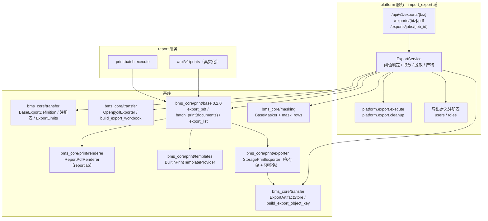
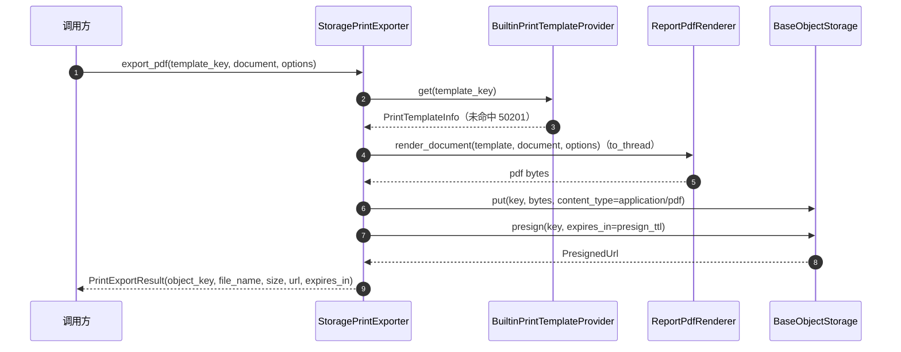
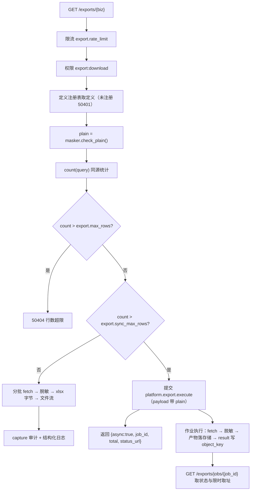

# 列表导出与 PDF 产物详细设计（同口径导出 / 脱敏 / PDF 逐份合并 / 异步作业）

> 通用能力 · 04 导入导出 · 02 列表导出与 PDF 产物 · 详细设计

[文档首页](../../../../../../文档首页.md) › [08 通用能力](../../../../README.md) › [导入导出](../../04_导入导出.md) › [列表导出与 PDF 产物](../04_导入导出_02_列表导出与PDF产物.md) › 详细设计　|　[需求 02-3](../../../../需求/02_需求_文件与导入导出.md#r02-3) · [阶段计划](../../../../计划/01_计划_通用能力.md) · [概要 · 导入导出](../../../../../../设计/概要设计/19_概要设计_导入导出.md) · [架构 · 文件管理](../../../../../../设计/架构设计/20_架构设计_子系统_文件管理.md)

## 1. 概述 <a id="overview"></a>

- **目标**：把「列表导出」与「PDF 产物」从契约占位做成可运行通道——按当前筛选导出 Excel（与列表同查询构造）、敏感列默认脱敏（`data:plain` 方得明文并留痕）、列表 / 单据 PDF 按模板渲染并落对象存储返回限时取址、批量打印逐份 / 合并、超阈值转后台作业并可查状态取产物。首批落地 **users** 与 **roles** 两个导出定义。
- **依据**：《[概要设计 · 导入导出](../../../../../../设计/概要设计/19_概要设计_导入导出.md)》「功能分解与业务流程」「接口设计」「权限与配置」「错误码与异常处理」；《[概要设计 · 文件管理](../../../../../../设计/概要设计/13_概要设计_文件管理.md)》「功能分解与业务流程」（打印 / 导出 PDF 产物）；《[架构设计 · 文件管理](../../../../../../设计/架构设计/20_架构设计_子系统_文件管理.md)》「Excel 导入导出」「导出（打印模板与 PDF）」；《[架构设计 · 异步作业中心](../../../../../../设计/架构设计/40_架构设计_子系统_异步作业中心.md)》；《[组件设计 · 导入导出](../../../../../../设计/组件设计/08_交互类/01_组件设计_导入导出/01_组件设计_导入导出.md)》「导出」「性能与边界」；《[后端开发规范](../../../../../../规范/后端开发规范.md)》；《[测试规范](../../../../../../规范/测试规范.md)》；《[AI开发规范](../../../../../../规范/AI开发规范.md)》「一条龙」。
- **范围**：
  1. 基座导出：`BaseExportDefinition` / `ExportDefinitionRegistry` / `ExportLimits` / `OpenpyxlExporter`（真实实现）/ 产物 key 助手；
  2. 基座打印：契约 `0.2.0`（`batch_print` 增可选 `documents`、新增 `export_list`）、`ReportPdfRenderer`、`BuiltinPrintTemplateProvider`、`StoragePrintExporter`；
  3. 平台导出域：`GET /api/v1/exports/{biz}`（Excel）、`GET /api/v1/exports/{biz}/pdf`（列表 PDF）、`GET /api/v1/exports/jobs/{job_id}`（状态与产物）、`platform.export.execute`（异步导出）、`platform.export.cleanup`（产物过期清理）；
  4. 业务定义：`users` / `roles` 的导出定义与仓储取数通道；
  5. report 服务：`/api/v1/prints` 四端点真实化、`print.batch.execute` 作业、`bms_report.jobs` worker 与 `report-jobs` 容器；
  6. 配置、错误码、审计留痕、契约快照与文档登记回写。
- **不在范围**：前端导出按钮与对话框（阶段十五）、操作日志落库（06_01）、字段级审计链（06_02）、站内信通知（07_01）、表单定制模板设计器（10_01）、恢复/回收站（13_01）、真库与真对象存储压测（部署窗口）。

## 2. 现状与差距（设计 vs 代码不符清单） <a id="gap"></a>

| # | 设计口径 | 代码现状 | 本任务处置 |
| --- | --- | --- | --- |
| 1 | 列表导出按当前筛选、与查询同一构造（概要 §2.2） | **无导出端点**、无导出定义 | 新增 `BaseExportDefinition` 与 `/exports/{biz}` 端点，取数复用各域仓储的 `_filter_conditions` / `_apply_sort` |
| 2 | 敏感列默认脱敏，`data:plain` 放行明文（概要 §6） | `masking` 真实实现 + `mask_rows` 已备，但无调用方 | 导出编排调用 `mask_rows`，脱敏字段由导出定义声明 |
| 3 | 导出与查询共用同一查询构造，含多列排序（概要 §2.2） | 列表分页 `BasePageQuery.page ≤ max_page`（`max_page=100`，即 ≤20000 行） | 导出取数走**仓储新方法 `list_export_chunk`**（同 `_filter_conditions`，offset 分批，不受 `max_page` 限制） |
| 4 | PDF 单据 / 列表、逐份 / 合并、落对象存储 + 限时取址（概要 §2.2、架构 20 §6） | `bms_core/print` 契约齐备，实现为 `NullPrintExporter`（固定 `null-print-url`）；`/api/v1/prints` 四端点已挂但全占位 | 契约升 `0.2.0`，新增 reportlab 渲染器 + 真实导出器 + 内置模板来源 |
| 5 | 批量打印需要单据数据才能渲染（架构 20 §6「模板键 + 单据数据」） | `PrintBatchRequest` 只有 `keys`，`batch_print(keys)` 拿不到单据数据 | `batch_print` 增可选 `documents`（与 `keys` 同序）；缺省只渲染单据键 + 模板元信息的简版页，不臆造数据 |
| 6 | 大批量转后台任务（架构 20 §6） | report 服务无 worker、无 `report-jobs` 容器 | 新增 `bms_report/jobs.py`、`print.batch.execute` 作业与 compose `report-jobs` |
| 7 | 产物元数据与生命周期（架构 20 §6） | `sys_file.source` 预留 `print` / `export` 但未使用；导入源文件走「不建元数据」口径 | 本段产物**只落对象存储**（不建 `sys_file`、不占配额），保留期由参数 + 清理作业承载；`file_id` 恒 null |
| 8 | 产物对象 key 由统一助手派生（架构 20 §6） | `build_print_object_key` 用冒号 `bms:{tenant}:prints:…`，**Windows 本地存储写盘失败**（04_01 已踩同类坑） | 改为路径风格 `{tenant\|global}/prints/{template_key}/{biz_key}.pdf`，同步回写《命名规范》§10 |
| 9 | 过期产物清理 | 无 | `platform.export.cleanup` 作业按 `sys_job` 结果里的产物 key 回销（对象存储契约无 `list`，不改契约） |
| 10 | 导出留痕（概要 §2.2、需求完成标准） | `AuditCapturer` 真实实现归 06_01；导入只到 capture 边界 | 同口径：调用 `capture` + 结构化日志；明文导出额外 `warning` |
| 11 | 错误码 5xxxx 文件段（概要 §7） | `501xx` 文件、`502xx` 打印、`503xx` 导入已用 | 启用 `504xx` 导出子段 |

## 3. 交付物清单 <a id="tree"></a>

```text
backend/
├── libs/bms_core/src/bms_core/
│   ├── transfer/
│   │   ├── export_definition.py        # 新增：ExportQuery / BaseExportDefinition / ExportDefinitionRegistry
│   │   ├── export_limits.py            # 新增：ExportLimits + export.* 键与代码默认
│   │   ├── exporter.py                 # 改：docstring 更新（真实实现落 openpyxl_exporter）
│   │   ├── openpyxl_exporter.py        # 新增：OpenpyxlExporter（BaseExporter 真实实现，分块产出）
│   │   ├── openpyxl_io.py              # 改：新增 build_export_workbook（write_only 低内存 + 表头样式 + 列宽）
│   │   ├── artifacts.py                # 新增：ExportArtifactStore / build_export_object_key
│   │   └── __init__.py                 # 改：导出面导出
│   ├── print/
│   │   ├── base.py                     # 改：契约 0.2.0（batch_print 增 documents、新增 export_list）
│   │   ├── null.py                     # 改：占位实现补齐新方法
│   │   ├── renderer.py                 # 新增：PdfRenderConfig / ReportPdfRenderer（单据 / 列表 / 合并 / 水印 / 页脚）
│   │   ├── templates.py                # 新增：BuiltinPrintTemplateProvider（内置模板注册表）
│   │   ├── exporter.py                 # 新增：StoragePrintExporter（渲染 → 对象存储 → 预签名）
│   │   └── __init__.py                 # 改：导出面导出
│   ├── core/error_codes.py             # 改：504xx 导出子段 + HTTP 映射
│   ├── core/exceptions.py              # 改：导出段异常类
│   ├── config/seed.py                  # 改：export.* 参数种子
│   └── config/plugin_registry.py       # 改：exporter / print_template / print_exporter 候选登记（如未含）
├── services/platform/src/bms_platform/
│   ├── domains/import_export/
│   │   ├── api/exports.py              # 新增：三端点
│   │   ├── schemas/exports.py          # 新增：ExportArtifact / ExportJobStatus / ExportAsyncAccepted / ExportListPdfResult
│   │   ├── services/exports.py         # 新增：ExportService（同步 / 异步 / 列表 PDF / 状态）
│   │   ├── services/artifact.py        # 新增：ObjectStorageExportArtifactStore 适配
│   │   ├── jobs.py                     # 改：新增 ExportExecuteJob / ExportCleanupJob
│   │   ├── repositories/job.py         # 改：新增按类型 + 终态 + 时间的清理查询（如未含）
│   │   └── public.py                   # 改：按需导出注册表工厂
│   ├── domains/user/
│   │   ├── exports.py                  # 新增：UsersExportDefinition
│   │   └── repositories/user.py        # 改：新增 list_export_chunk（复用 _filter_conditions / _apply_sort）
│   ├── domains/role/
│   │   ├── exports.py                  # 新增：RolesExportDefinition
│   │   └── repositories/role.py        # 改：新增 list_export_chunk
│   ├── exports.py                      # 新增：build_export_definitions（服务根装配）
│   ├── api/router.py                   # 改：挂导出路由
│   └── jobs.py                         # 改：handler / spec 登记新增两作业
├── services/report/src/bms_report/
│   ├── jobs.py                         # 新增：worker 入口（print.batch.execute）
│   ├── domains/report/
│   │   ├── api/print.py                # 改：真实 exporter、批量超阈值转作业、模板清单真实
│   │   ├── jobs.py                     # 新增：PrintBatchJob
│   │   └── public.py                   # 改：作业登记出口
│   └── main.py                         # 改：装配打印插件（如需要）
├── config.toml                          # 改：[exporter] / [print] / [print_template] / [print_exporter]
├── deploy/registry/platform.toml        # 改：domains.paths + 两条 [[jobs]] + 打印作业
deploy/compose/services.yml              # 改：新增 report-jobs
bms文档/                                 # 本设计 + 实施 / 测试记录 + 概要 / 架构 / 命名 / 基类清单回写
```

**测试落点**（与实现同目录，遵循《测试规范》分层）：

```text
backend/libs/bms_core/tests/transfer/test_export_definition.py
backend/libs/bms_core/tests/transfer/test_export_limits.py
backend/libs/bms_core/tests/transfer/test_openpyxl_exporter.py
backend/libs/bms_core/tests/transfer/test_artifacts.py
backend/libs/bms_core/tests/print/test_renderer.py
backend/libs/bms_core/tests/print/test_templates.py
backend/libs/bms_core/tests/print/test_storage_exporter.py
backend/services/platform/tests/import_export/test_exports_api.py
backend/services/platform/tests/import_export/test_exports_service.py
backend/services/platform/tests/import_export/test_export_jobs.py
backend/services/report/tests/print/test_print_exporter.py      # 既有：改为真实实现断言
```

## 4. 领域设计 <a id="design"></a>

### 4.1 总体架构与职责边界 <a id="arch"></a>



- **基座**只放契约与可复用实现（读写引擎、渲染、模板来源、产物取址助手），不含任何业务列集与筛选；
- **platform 导出域**只做编排（阈值、限流、权限、脱敏、作业提交、状态查询）与路由，不写业务表；
- **业务定义**（users / roles）由所有者域提供，取数只经本域仓储 / 服务，不跨域读表；
- **report** 只负责单据打印（单条 / 批量），列表导出（Excel 与 PDF）一律走 platform 导出域——列表数据在各业务库，跨服务取数会破坏「导出与查询同一构造」。

### 4.2 基座契约与数据契约 <a id="contracts"></a>

#### 4.2.1 导出定义（`transfer/export_definition.py`）

```python
@dataclass(frozen=True)
class ExportQuery(BaseValueObject):
    keyword: str | None = None
    status: str | None = None
    ids: ConcurrentStableFrozenList[int] = ...       # 选中行导出（空 = 不限定）
    order_by: str | None = None
    order: str = "asc"                                # asc / desc
    params: ConcurrentStableFrozenDict[str, str] = ...  # 未识别 query 参数（产品自定义筛选透传）

class BaseExportDefinition(BaseFrameworkObject, ABC):
    biz: str = ""
    title: str = ""
    export_permission: str = "export:download"        # 入口权限码（端点级已校验，定义可加严）
    masked_fields: ConcurrentStableDict[str, str]     # 列键 → 掩码策略（空 = 无敏感列）

    @property
    @abstractmethod
    def columns(self) -> ConcurrentStableFrozenList[ColumnSpec]: ...   # 与导入共用 ColumnSpec，导出只用 key / title

    async def count(self, session: DbSession, query: ExportQuery) -> int: ...
    @abstractmethod
    async def fetch(
        self, session: DbSession, query: ExportQuery, *, offset: int, limit: int
    ) -> ConcurrentStableList[ConcurrentStableDict[str, object]]: ...
```

- **行形态**：`{列键: 已格式化值}`（字符串 / 数字 / None），列键与 `columns` 一一对应；格式化（状态标签、时间）在定义内完成，导出层不再解析业务语义；
- **`count` 与 `fetch` 必须同源**：两者都只调本域仓储的同一组过滤函数（`_filter_conditions` / `_apply_sort`），**不得另写 SQL**——这是「导出条数 = 列表总数」的结构性保证；
- `params` 只承接端点未显式声明的 query 参数，产品仓自定义定义可自行解析，首批两定义忽略。

#### 4.2.2 注册表（`ExportDefinitionRegistry`）

与 `ImportDefinitionRegistry` 同构，额外校验：

| 校验 | 判据 | 失败 |
| --- | --- | --- |
| 业务标识 | `^[a-z][a-z0-9_]*$` | `ValueError`（构建期 fail-fast） |
| 重名 | 同 `biz` 二次登记 | `ValueError` |
| 标题 | 空白 | `ValueError` |
| 列集 | 空 / 列键重复 / 列标题重复 | `ValueError` |
| 脱敏键 | `masked_fields` 的键不在列集内 | `ValueError`（防配错字段名导致「以为脱敏、实际明文」） |

#### 4.2.3 导出参数（`transfer/export_limits.py`）

| 参数键 | 代码默认 | 含义 |
| --- | --- | --- |
| `export.sync_max_rows` | 5000 | Excel 同步阈值（行数 ≤ 阈值直接回文件流） |
| `export.max_rows` | 50000 | 单次导出行数上限（超限 `50404`） |
| `export.fetch_batch_size` | 500 | 取数分批大小（同时是进度上报粒度） |
| `export.rate_limit.limit` | 20 | 用户维度窗口内次数 |
| `export.rate_limit.window` | 60 | 用户维度限流窗口（秒） |
| `export.artifact_ttl` | 604800 | 异步产物保留期（秒，7 天） |
| `export.presign_ttl` | 3600 | 产物取址有效期（秒） |
| `export.pdf.sync_max_docs` | 50 | PDF 同步份数上限（列表 PDF 按行数折算、批量打印按单据数） |

解析口径与 `ImportLimits` 一致：一次 `get_many`，缺失 / 非法 / 源不可达回落代码默认，只记 `warning`。

#### 4.2.4 产物与对象 key（`transfer/artifacts.py`）

```python
def build_export_object_key(tenant: str | None, biz: str, token: str, ext: str) -> str:
    """`{tenant|global}/exports/{biz}/{token}.{ext}`"""

class ExportArtifactStore(BaseFrameworkObject, ABC):
    async def put(self, key: str, data: bytes, *, content_type: str) -> None: ...
    async def presign(self, key: str, *, expires_in: int) -> PresignedUrl: ...
    async def delete(self, key: str) -> None: ...
```

- token 用 `secrets.token_urlsafe(24)`，不含路径分隔符；
- 打印产物 key 由 `build_print_object_key` 派生，改为 `{tenant|global}/prints/{template_key}/{biz_key}.pdf`，`template_key` / `biz_key` 均经 `_sanitize_segment`（`[^A-Za-z0-9_.-]` → `_`，截断 64 字符，空值回落 `_`）；
- **历史兼容**：`build_print_object_key` 属跨阶段基座，改格式即回写《命名规范》§10 与《后端基类清单》契约表；既有打印用例断言同步更新（占位实现与新增真实实现共用该助手）。

#### 4.2.5 打印契约 0.2.0（`print/base.py`）

| 变更 | 签名 | 兼容性 |
| --- | --- | --- |
| 契约版本 | `PRINT_CONTRACT_VERSION = "0.2.0"`（`BasePrintExporter.contract_version` 取值） | 插件装配按版本校验，Null 与真实实现同步声明 |
| 批量打印 | `batch_print(keys, *, template_key, mode="separate", options=None, documents=None)` | 只增可选关键字参数；既有调用方零改动 |
| 列表 PDF | `export_list(title, columns, rows, *, options=None) -> PrintExportResult` | 新增抽象方法；`NullPrintExporter` 与 `StoragePrintExporter` 同步实现 |

- `documents`：与 `keys` **同序等长**（长度不符 `ParamError` / `10001`）；提供时按真实数据渲染，未提供时按 `keys` 渲染简版页（单据键 + 模板名 + 打印时间），**不臆造业务字段**；
- `export_list`：`columns` 为 `ColumnSpec` 列集（与导出 Excel 同一列集），`rows` 为已脱敏的 `{列键: 值}` 行；渲染成表格式 PDF，跨页重复表头；
- 超阈值判定**不在导出器内**（导出器不知道阈值）：路由层按 `documents` 份数或列表行数判定同步 / 异步。

### 4.3 Excel 写出 <a id="excel"></a>

`openpyxl_io.py` 新增 `build_export_workbook(columns, rows) -> bytes`：

| 项 | 口径 |
| --- | --- |
| 模式 | `Workbook(write_only=True)`，`append` 逐行写，内存与行数线性、不持有整表对象 |
| 表头 | 首行写 `column.title`，加粗 + 浅灰底 + 列宽按标题长度与列内容长度取较宽者（上限 40） |
| 值类型 | `str` / `int` / `float` / `bool` / `None` 原样写入；`date` / `datetime` 由定义侧格式化为字符串（见 §4.7） |
| sheet 名 | `数据`（与模板同名，便于用户对照） |
| 冻结 | `freeze_panes = "A2"`（write_only 模式不支持冻结，改为不加，文档说明） |
| 空行 | 不入表（`fetch` 不产空行） |

`OpenpyxlExporter`（`transfer/openpyxl_exporter.py`）：

- `plugin_name = "openpyxl"`，实现 `BaseExporter.export(rows, columns) -> AsyncIterator[bytes]`；
- 内部 `asyncio.to_thread(build_export_workbook, ...)` 生成完整字节，再按 `_CHUNK_SIZE = 64 * 1024` 分块 `yield`（契约语义成立，内存上界 = 完整文件，5000 行约 1~3MB）；
- 不改变 `BaseExporter` 契约（仍只有 `export`）。

### 4.4 PDF 渲染 <a id="pdf"></a>

#### 4.4.1 渲染器（`print/renderer.py`）

```python
@dataclass(frozen=True)
class PdfRenderConfig(BaseValueObject):
    font_name: str = "BMS-CJK"
    font_path: str | None = None        # 空 → 内置 CID 字体 STSong-Light
    font_size: float = 10.0
    margin_mm: float = 15.0
    footer_enabled: bool = True
```

| 能力 | 实现 |
| --- | --- |
| 中文字体 | `font_path` 为空：`pdfmetrics.registerFont(UnicodeCIDFont("STSong-Light"))` 并注册字体族；非空：`TTFont(font_name, font_path)` 嵌入 |
| 纸张 | `A4` / `A5` / `custom`（custom 回落 A4）+ `portrait` / `landscape`，经 `pagesizes` 与 `landscape()` |
| 单据版式 | 标题（模板名）→ 主表字段两列表（`label: value`，超过 2 列时按行折列）→ 明细表（`document.rows`，首行列键作表头）→ 页脚 |
| 列表版式 | 标题（`title`）→ 列头 + 数据行，`LongTable(repeatRows=1)` 跨页重复表头 |
| 水印 | `onPage` 回调：`setFillGray(0.85)` + `rotate(45)` + 居中 `drawCentredString`，字号按页宽自适应 |
| 页脚 | 左：打印人（`options.printed_by`），中：打印时间（UTC，`YYYY-MM-DD HH:mm:ss`），右：`第 N 页` |
| 色调 | `mono` 时表头与文字统一黑灰，`color` 时表头深蓝底 + 白字 |
| 合并 | `merged` 模式在**同一 story** 内串联多份单据、份间 `PageBreak()`，一次 `build()` 出单份 PDF（不引入 `pypdf` 合并依赖） |
| 空数据 | 列表 0 行：渲染标题 + 「当前筛选无数据」提示行，不报错（是否给用户取决于路由层，见 §4.9） |
| 线程 | 渲染是 CPU 密集同步代码，统一 `asyncio.to_thread` 调用 |

> 不引入 HTML 模板：模板定义（页眉 / 字段 / 明细列 / 签章）归表单定制（10_01），本段的「模板」= 模板键 + 名称 + 单据类型 + 变量清单的元数据，渲染按「变量清单 + 明细列」直排。

#### 4.4.2 内置模板来源（`print/templates.py`）

```python
BUILTIN_PRINT_TEMPLATES: dict[str, PrintTemplateInfo] = {
    "generic_document": PrintTemplateInfo(key="generic_document", name="通用单据", biz_type=None, variables=[]),
    "generic_list": PrintTemplateInfo(key="generic_list", name="通用列表", biz_type=None, variables=[]),
}
```

- `BuiltinPrintTemplateProvider`（`plugin_name = "builtin"`）：`list` 按 `biz_type` 过滤，`get` 未命中抛 `PrintTemplateNotFoundError`（`50201` / 404）；
- **变量清单为空**：单据字段由调用方随 `PrintDocument.fields` 传入，渲染器按实际键值渲染；页面 / 字段渲染定义归 10_01，本段不臆造；
- 注册扩展口：`register_builtin_template(info)` 供后续产品或 10_01 追加，重名即拒。

#### 4.4.3 真实导出器（`print/exporter.py`）

```python
class StoragePrintExporter(BasePrintExporter, BasePlugin):
    plugin_name = "reportlab"
    def __init__(self, *, storage, templates, renderer, presign_ttl=DEFAULT_PRESIGN_TTL): ...
```

流程（`export_pdf`）：



- 租户位：取 `current_tenant_context().code`（请求期由中间件设置；作业期由 handler 设租户上下文），无上下文回落 `global`；
- `batch_print`：`mode` 校验（`PRINT_BATCH_MODES`，非法 `ParamError`）→ `documents` 与 `keys` 对齐 → `separate` 逐份 `export_pdf` 语义（同一渲染器、逐份 put + presign，单份失败计入 `failed` 并继续）→ `merged` 一次渲染全部并落一份产物（`biz_key` 取批内首键）；
- 单份失败不整体中断：`PrintBatchResult.failed` 计数 + `message` 汇总首条原因，错误明细进结构化日志；
- `export_list`：按 `columns` + `rows` 渲染表格 PDF，落存储 + presign。

### 4.5 导出定义：用户与角色 <a id="definitions"></a>

#### 4.5.1 users

| 列键 | 列标题 | 取值 | 脱敏 |
| --- | --- | --- | --- |
| `username` | 登录账号 | `SysUser.username` | — |
| `name` | 姓名 | `SysUser.name` | — |
| `phone` | 手机号 | `SysUser.phone` | `phone` |
| `email` | 邮箱 | `SysUser.email` | `email` |
| `status` | 状态 | `enabled→启用` / `disabled→停用` | — |
| `last_login_at` | 最近登录 | `last_login_at` 按 UTC `YYYY-MM-DD HH:mm:ss`；空 → 空串 | — |

- `masked_fields = {phone: phone, email: email}`；
- 筛选：`keyword`（账号 / 姓名 / 邮箱 / 手机号）、`status`、`ids`；排序白名单与列表接口一致（复用仓储 `_apply_sort`）；
- 取数：`UserRepository.list_export_chunk(...)`（新增），与 `list_filtered` **共用 `_filter_conditions` / `_apply_sort` / `_scope_where`**，只把 `size/offset` 换成显式 `limit/offset` 以绕开 `max_page` 限制；
- `count`：复用 `count_filtered`；
- 权限：`export_permission = "export:download"`（无额外业务读权限——列表本身已由 `user:query` 保护，导出不放开越权字段）。

#### 4.5.2 roles

| 列键 | 列标题 | 取值 | 脱敏 |
| --- | --- | --- | --- |
| `code` | 角色编码 | `code` | — |
| `name` | 角色名称 | `name` | — |
| `role_type` | 角色类型 | `custom→自定义` / `system→内置` | — |
| `status` | 状态 | `enabled→启用` / `disabled→停用` | — |
| `created_at` | 创建时间 | UTC `YYYY-MM-DD HH:mm:ss` | — |

- 无敏感列（`masked_fields` 为空），用于验证「无 data:plain 也不脱敏」的反向路径；
- 取数 / 统计同 users：`RoleRepository.list_export_chunk` + `count_filtered`。

### 4.6 执行编排（同步 / 异步） <a id="flow"></a>



| 分支 | 触发 | 响应 |
| --- | --- | --- |
| 同步 Excel | `count ≤ export.sync_max_rows` | `200` + 文件流（`XLSX_CONTENT_TYPE`，`Content-Disposition` RFC 5987 中文文件名） |
| 异步 Excel | `count > export.sync_max_rows` | `200` + `{async: true, job_id, total, status_url, message}`（body 为统一响应信封 `ApiResponse`） |
| 同步列表 PDF | `count ≤ export.pdf.sync_max_docs` 且渲染完成 | `200` + `{async: false, artifact: {url, file_name, size, expires_in, object_key}}` |
| 异步列表 PDF | `count > export.pdf.sync_max_docs` | 同异步 Excel，`kind = "pdf"` |
| 0 行 | `count == 0` | 同步分支不生成空文件：`200` + `{empty: true, message: "当前筛选无数据可导出"}`（不落产物、不建作业） |
| 失败 | 取数 / 渲染 / 落存储异常 | 同步：`50310` 语义的导出失败码 `50405`；异步：作业终态 `failed`，状态端点回 `failed` + 原因摘要 |

- **同步 Excel 的文件名**：`{定义标题}_{YYYYMMDDHHmmss}.xlsx`（UTC）；PDF：`{title 或定义标题}_{YYYYMMDDHHmmss}.pdf`；
- **同步分支是否建作业记录**：否（不写 `sys_job`，减少写放大）；审计 `model_id = 0`，异步分支 `model_id = job_id`；
- **异步分支 payload**（`sys_job.payload`）：`{biz, kind, params, ids, plain, actor, tenant_code, title, paper, orientation, watermark}`，`params` 只放端点显式声明的筛选键（不含 `ids`）；
- **异步分支 result**（`sys_job.result`）：`{object_key, file_name, size, total, content_type, expires_in}`，供状态端点与清理作业消费；
- **进度**：`ctx.report_progress(done, total)`，`done` 以 `fetch_batch_size` 为步长递增；取消检查同粒度（`ctx.cancelled()`）；
- **重试**：`max_attempts = 1`（导出结果依赖取数时点，自动重试会产出与用户预期不同的数据，重试由用户重新发起）。

### 4.7 脱敏与 `data:plain` <a id="masking"></a>

- **请求期**：`plain = masker.check_plain()`（基座单点判定，占位权限器 fail-closed 返回 False）；
- **同步分支**：直接 `mask_rows(rows, definition.masked_fields, masker)`；
- **异步分支**：作业进程没有用户请求上下文，`plain` 在**提交时判定一次**并固化为 payload 字段；作业内构造 `DefaultMasker(checker=<固定布尔检查器>)`：`plain=True` 时所有码放行、`plain=False` 时一律拒绝，再走同一 `mask_rows`（**不复用请求期 masker 实例**，避免上下文串用）；
- **明文留痕**：`plain=True` 时额外写 `warning` 结构化日志（`biz` / `actor` / `rows` / `file_name`）并落审计事件（`changes` 里 `FieldChange(field="plain", new=True)`）；
- **字段来源**：只认导出定义的 `masked_fields`（注册表已校验键在列集内）；`[masking].options.rules` 全局规则仍生效（同名键会叠加），但**不作为导出脱敏的声明位置**；
- **时间格式**：全部按 UTC `YYYY-MM-DD HH:mm:ss` 输出（时区转换归 05_02 用户时区偏好，落地后统一改格式化函数一处）。

### 4.8 产物清理 <a id="cleanup"></a>

- 作业类型 `platform.export.cleanup`，调度由 `01_02` 任务调度驱动（内置任务触发型，与 `file.cleanup_orphans` 同模式）；
- 查询：本服务库 `sys_job` 中 `job_type = 'platform.export.execute'`、`status = 'success'`、`finished_at < now - export.artifact_ttl`；**过滤下推到 SQL**（job_type / status / 时间三列均有索引或低基数），`result` 是否为 JSON 且含 `object_key` 在应用层判定（JSON 列跨方言语法不一致，不在 SQL 层解析）；
- 动作：`storage.delete(object_key)`（幂等）→ 更新 `result` 追加 `expired_at`（保留原 key 便于审计），单条失败记 `warning` 并继续；
- 分页：每批 `cleanup_batch_size`（复用 `export.fetch_batch_size`）循环，直到无命中；单次运行上限由作业超时兜底（1800s）；
- 只清 platform 导出产物；report 的单据打印产物（低频、小体积）过期清理登记计划遗留。

### 4.9 接口设计 <a id="api"></a>

接口前缀、统一响应与鉴权约定见《[API 接口规范](../../../../../../规范/API接口规范.md)》第 2~3、6 节。

| 方法 | 路径 | 说明 | 权限码 |
| --- | --- | --- | --- |
| GET | `/api/v1/exports/{biz}` | 按当前筛选导出 Excel（同步文件流 / 超阈值返回作业标识） | `export:download` |
| GET | `/api/v1/exports/{biz}/pdf` | 按当前筛选导出列表 PDF（同步返回限时取址 / 超阈值转作业） | `export:download` |
| GET | `/api/v1/exports/jobs/{job_id}` | 异步导出状态 / 进度 / 产物限时取址 | `export:download` |

#### 4.9.1 查询参数（三个端点共用）

| 参数 | 类型 | 说明 |
| --- | --- | --- |
| `kw` | str? | 关键字（与列表接口同名同义） |
| `status` | str? | 状态筛选 |
| `ids` | str? | 选中行导出，逗号分隔雪花 ID（空 = 按筛选全量） |
| `order_by` | str? | 排序字段（各定义白名单，非法回落默认） |
| `order` | str = `asc` | 排序方向 |
| 其他参数 | — | 未识别键进 `ExportQuery.params`（产品自定义定义消费） |

PDF 端点附加：`paper`（`A4`/`A5`/`custom`，默认 `A4`）、`orientation`（`portrait`/`landscape`）、`watermark`（≤64 字）、`title`（≤64 字，缺省取定义标题）。

#### 4.9.2 响应契约（`schemas/exports.py`）

```python
class ExportArtifact(BaseSchema):
    object_key: str
    file_name: str
    size: int
    content_type: str
    url: str
    expires_in: int

class ExportAsyncAccepted(BaseSchema):
    async_: bool = Field(alias="async")        # 恒 True
    job_id: int
    total: int
    status_url: str
    message: str

class ExportEmptyResult(BaseSchema):
    empty: bool = True
    message: str

class ExportListPdfResult(BaseSchema):
    async_: bool = Field(alias="async")        # 恒 False
    total: int
    artifact: ExportArtifact | None

class ExportJobStatus(BaseSchema):
    job_id: int
    status: str                                # pending / running / success / failed / cancelled
    kind: str                                  # excel / pdf
    biz: str
    total: int
    done: int
    artifact: ExportArtifact | None
    message: str | None
```

- 同步 Excel 为文件流（`Response`，不走统一信封），OpenAPI 里以 `responses={200: {"content": {"application/vnd...": {}}, "application/json": {...}}}` 双声明；
- `status_url` 固定 `/api/v1/exports/jobs/{job_id}`（相对路径，前端拼 base）。

#### 4.9.3 状态端点

- 作业不存在 / 不属于本租户 → `50402`；终态 `failed` 时 `message` 取 `sys_job.error` 摘要（不暴露堆栈）；
- 产物取址**每次请求重新 presign**（`export.presign_ttl`），不缓存 URL；对象不存在（已过期清理）→ `artifact = null` + `message = "产物已过期"`（不报错，避免前端反复失败）。

### 4.10 数据模型与表设计 <a id="data"></a>

- **无新增业务表**；不写 `sys_file`（产物只落对象存储，`file_id` 恒 null）；
- 复用既有 `sys_job`（异步导出记录）与 `sys_job_log`（进度）；`sys_job_error` 不使用（导出无行级错误语义）；
- 表结构以《数据库设计》数据表文件为唯一事实源，本设计不复制字段清单。

### 4.11 配置与错误码 <a id="config"></a>

**`config.toml` 新增插件段**：

```toml
[exporter]
provider = "openpyxl"          # openpyxl = 真实 xlsx 写出（缺省）、空串 = null 占位
options = {}

[print]
options = { font_path = "", font_size = 10.0, margin_mm = 15.0 }

[print_template]
provider = "builtin"           # builtin = 内置模板注册表、空串 = null 占位

[print_exporter]
provider = "reportlab"         # reportlab = 真实渲染 + 落存储 + 预签名、空串 = null 占位
options = {}
```

**参数种子**（`config/seed.py`，平台库存默认，租户库可覆盖）：§4.2.3 八项。

**错误码 504xx（导出子段）**：

| 码 | 常量 | HTTP | 含义 |
| --- | --- | --- | --- |
| `50401` | `EXPORT_BIZ_NOT_REGISTERED` | 400 | 导出业务未注册 |
| `50402` | `EXPORT_JOB_NOT_FOUND` | 404 | 导出作业不存在 / 不属于当前租户 |
| `50403` | `EXPORT_ARTIFACT_MISSING` | 404 | 产物对象不存在（已过期清理或写入失败） |
| `50404` | `EXPORT_ROW_LIMIT_EXCEEDED` | 400 | 导出行数超过 `export.max_rows` |
| `50405` | `EXPORT_JOB_FAILED` | 409 | 导出作业执行失败（同步分支取数 / 渲染 / 落存储异常同码） |

- 参数非法（`paper` 取值、`ids` 非数字、`mode` 非法）沿用 `ParamError`（`10001`）；
- 限流命中沿用限流基座错误（与导入同码），不新增；
- 打印段（`502xx`）沿用既有三码，本段使它们**首次真实生效**。

### 4.12 审计与权限 <a id="audit"></a>

| 项 | 口径 |
| --- | --- |
| 权限码 | 端点级 `export:download`（`require_permission`）；明文另需 `data:plain`（由 `masker.check_plain()` 判定，不单独拦请求） |
| 审计 | `AuditCapturer.capture(table="sys_export", model_id=<job_id 或 0>, changes=[FieldChange(...)], actor=<用户 id>)`；字段：`biz` / `rows` / `plain` / `file_name` / `format` |
| 结构化日志 | `info`：导出完成（biz / rows / plain / ms）；`warning`：明文导出（biz / actor / rows）、产物清理失败、批量打印单份失败 |
| 落库 | 归 06_01 操作日志（`sys_operation_log`）与 06_02 审计链；本段只到 capture 边界（与 04_01 同口径） |
| 种子 | `export:download` / `data:plain` 权限码种子已由阶段七 RBAC 与既有 `ops/seed_rbac.py` 提供；本段核对存在，不新增 |

### 4.13 report 服务真实化 <a id="report"></a>

- `/api/v1/prints` 四端点改走真实插件：`get_print_exporter` / `get_print_template_provider`（依赖不变，只换 provider 配置）；
- **批量转后台**：`len(keys) > export.pdf.sync_max_docs` 时 `runner.submit(print.batch.execute)`，返回 `PrintBatchResult(task_id=...)`；作业完成后 `result` 写产物清单（`items[].object_key`），状态经既有作业端点查询（`GET /api/v1/jobs/{job_id}` 归 01_03 管理面）；
- **worker**：新增 `bms_report/jobs.py`（结构复制 `bms_file/jobs.py`：`job_handlers` / `job_specs` / `build_worker` / `main`），handler 为 `bms_report.domains.report.jobs:PrintBatchJob`；
- **compose**：`deploy/compose/services.yml` 增 `report-jobs`（与 `platform-jobs` / `file-jobs` 同构，命令 `python -m bms_report.jobs`）；
- **注册表**：`deploy/registry/platform.toml` 增 `[[jobs]]` 三条（导出执行 / 导出清理 / 打印批量），`bms_report` 域 paths 补齐 `jobs.py` 与 `domains/report/jobs.py`；
- report 服务不写 `sys_file`、不占配额，产物 key 与 platform 同规则（同桶、按租户前缀）。

### 4.14 与相邻任务的职责边界 <a id="boundary-tasks"></a>

| 相邻任务 | 边界 |
| --- | --- |
| 04_01 导入 | 共用 `ColumnSpec` / `XLSX_CONTENT_TYPE` / `openpyxl_io` / 参数解析口径 / `503xx` 与 `504xx` 分段；导出不读写导入源文件与 `sys_job_error` |
| 03_01 文件管理 | 共用 `BaseObjectStorage`；产物**不建** `sys_file`（与导入源文件同口径），文件配额不占用 |
| 01_02 / 01_03 异步底座 | 导出两作业按 `[[jobs]]` 声明 + 每服务 worker；清理作业由内置任务触发驱动 |
| 06_01 / 06_02 审计 | 本段只 capture；落库与链校验归 06_01 / 06_02 |
| 07_01 通知中心 | 超阈值导出完成后**不推送站内信**；通知归 07_01（本段状态端点已能取产物，前端可轮询） |
| 10_01 表单定制 | 模板定义来源换 provider（`builtin` → 表单定制），导出侧与渲染器不改；渲染定义（页眉 / 签章）归 10_01 |
| 13_01 回收站 | 产物不建元数据，不参与回收站；对象删除由清理作业直接执行 |
| 阶段十五 前端 | 导出按钮 / 对话框 / 列偏好不入本段；端点可直接调用验收 |

## 5. 失败分支与边界 <a id="failures"></a>

| # | 场景 | 处置 | 错误码 / 状态 |
| --- | --- | --- | --- |
| 1 | `biz` 未注册 | 直接拒绝，不取数 | `50401` / 400 |
| 2 | `ids` 含非数字 / 非正整数 | 拒绝 | `ParamError` `10001` |
| 3 | 筛选参数非法（`status` 非枚举、`order_by` 不在白名单） | 定义内校验：`status` 非法拒绝；`order_by` 非法回落默认排序（与列表接口一致） | `10001` / 回落 |
| 4 | 行数超上限 | 拒绝并提示改用筛选收窄 | `50404` / 400 |
| 5 | 0 行 | 不生成空文件、不建作业 | `empty: true` |
| 6 | 取数中途异常（库断连） | 同步：整体失败；异步：作业失败终态，已写产物删除 | `50405` / `failed` |
| 7 | 渲染异常（字体缺失 / 布局溢出） | 捕获后返回可读原因，不暴露堆栈；字体缺失回落 CID 字体并 `warning` | `50405` |
| 8 | 对象存储写入失败 | 同步：`50405`；异步：作业失败，不落 result 产物 | `50405` |
| 9 | 预签名失败 | 产物已落但取址失败：响应 `artifact.url = null` + `message`，日志记 key 供排查 | — |
| 10 | 状态端点查非本租户作业 | 视为不存在 | `50402` / 404 |
| 11 | 产物已过期被清理 | `artifact = null` + 「产物已过期」 | 200 |
| 12 | 批量打印 `documents` 与 `keys` 长度不符 | 拒绝 | `10001` |
| 13 | 批量打印 `mode` 非法 | 拒绝 | `10001` |
| 14 | 批量单份渲染失败 | 计入 `failed`，继续其余；`succeeded + failed = total` | 200 |
| 15 | 打印模板键未命中 | 拒绝 | `50201` / 404 |
| 16 | 批量份数超上限（异步上限外的硬上限） | 拒绝 | `50203` / 400 |
| 17 | 取消（异步作业） | 作业终态 `cancelled`，不写产物 | 状态端点 |
| 18 | 清理作业删对象失败 | `warning` 继续，下轮再试（幂等） | — |
| 19 | 明文权限判定发生在提交时 | 作业执行期权限变化不影响本次产物（payload 固化），文档明示 | — |

## 6. 测试设计与验收映射 <a id="tests"></a>

**Kiwi 用例**：延续「一任务一条用例」口径，本任务登记**一条**模块级用例（实施阶段先在平台登记取得编号，再回填 `pytestmark`；预计紧接 04_01 的 2401，实际编号以平台自增为准）。

| 层 | 用例组 | 关键断言 |
| --- | --- | --- |
| 基座 · 定义 | 注册表校验 | 非法 biz / 重名 / 空列集 / 列键重复 / 脱敏键不在列集 → `ValueError`；正常登记可取 |
| 基座 · 参数 | `ExportLimits.load` | 缺键 / 非数字 / 非正 / 源不可达 → 代码默认；正常值生效 |
| 基座 · Excel | `build_export_workbook` / `OpenpyxlExporter` | 表头与列序一致；行数与数据一致；分块非空且拼接等于完整文件；空行不入表 |
| 基座 · 脱敏 | `mask_rows` + 定义声明 | 无 `data:plain` 时 phone / email 掩码、其余列原样；持码时明文 |
| 基座 · 产物 | `build_export_object_key` / `build_print_object_key` | 路径风格、Windows 非法字符被替换、租户缺省为 `global` |
| 基座 · 渲染 | `ReportPdfRenderer` | PDF 魔数 `%PDF`、页数符合分页规则、水印文案出现、页脚含打印人、列表表头跨页重复（多页数据） |
| 基座 · 模板 | `BuiltinPrintTemplateProvider` | 清单含两模板；`get` 未命中 `50201`；`biz_type` 过滤 |
| 基座 · 导出器 | `StoragePrintExporter` | 落存储 key 符合规则；presign 被调用且有效期取参；`documents` 缺失时渲染简版页；`merged` 单份产物、`separate` 多份；单份失败不影响其余 |
| 平台 · 端点 | 同步 Excel | 200 文件流 + `Content-Disposition` 含中文文件名；行数 = `count` |
| 平台 · 端点 | 异步 Excel | `count > 阈值` 返回 `async:true` + `job_id`；作业执行后状态端点给产物取址 |
| 平台 · 端点 | 列表 PDF | 同步返回 `artifact.url`；超阈值转作业 |
| 平台 · 端点 | 脱敏 / 明文 | 无 `data:plain` 掩码；持码明文 + 审计 capture 被调用（替身捕获） |
| 平台 · 端点 | `ids` 选中导出 | 只含选中行；`ids` 为空 = 全量 |
| 平台 · 端点 | 排序 | `order_by` / `order` 生效且与列表一致；非法 `order_by` 回落 |
| 平台 · 端点 | 边界 | 未注册 `50401`；超上限 `50404`；0 行 `empty`；非本租户作业 `50402`；产物过期 `artifact=null` |
| 平台 · 端点 | 限流 / 权限 | 超 20 次/分被拒；无 `export:download` 拒绝 |
| 平台 · 作业 | `ExportExecuteJob` | 产物落存储 + result 字段齐；`plain=True` 明文；取数异常 → 失败终态且不残留产物 |
| 平台 · 作业 | `ExportCleanupJob` | 超 TTL 作业的产物被删、`expired_at` 写入；未超 TTL 不动；删除失败不中断 |
| report | `/prints` 真实化 | 单条导出返回真实 PDF 取址；模板清单非空；模板详情未命中 `50201`；批量超阈值回 `task_id`，作业落产物 |
| 契约 | 快照 | `ops.contract_snapshot export/check` 通过（新增三端点进 platform 快照，`documents` 字段进打印请求契约） |

**验收映射（需求 02-3 完成标准）**：

| 完成标准 | 证据 |
| --- | --- |
| 同一筛选条件下导出条数与列表总数一致 | 「同步 Excel」用例：导出 xlsx 数据行数 = 列表接口 `total` |
| 无 `data:plain` 时敏感列脱敏，有该权限时明文且审计可查 | 「脱敏 / 明文」用例 + capture 替身断言 |
| PDF 产物可通过限时链接下载，链接过期失效 | 「列表 PDF」「/prints」用例：`url` 非空、`expires_in` 取参；过期路径由「产物过期」用例覆盖 |
| 超阈值导出转异步且完成有通知 | 「异步 Excel」用例（作业终态 + 状态端点取址）；**站内信通知**：本段不推送，归 07_01，注块登记（见 §8） |
| 导出文件不出现在本地磁盘路径 | 产物 key 只经对象存储 `put`；本地 provider 的 root 在 `tmp_path` / `var/storage` 下（用例断言不在源码目录，且不写任何固定磁盘路径） |

**覆盖率**：变更模块行 + 分支 100（口径见《[AI开发规范](../../../../../../规范/AI开发规范.md)「覆盖率要求」节），本地跑满变更范围，全量由 CI 复核。

## 7. 登记落点 <a id="registry-writeback"></a>

| 文档 | 回写内容 |
| --- | --- |
| 《概要设计 · 导入导出》 | §5.1 端点表（`/exports/{biz}`、`/exports/{biz}/pdf`、`/exports/jobs/{job_id}`）、§5.2 导出口径（阈值、`ids`、PDF 参数）、§7 `504xx` 子段 |
| 《概要设计 · 文件管理》 | 导出 / 打印产物：只落对象存储、不建 `sys_file`、保留期与清理 |
| 《架构设计 · 文件管理》 §6 | 模板来源 `builtin`、渲染引擎 reportlab、产物 key 路径风格、批量转作业与 report worker |
| 《架构设计 · 接口与集成》 | 已发布码位补 `50401`~`50405` |
| 《命名规范》 §10 | 对象 key：`{tenant\|global}/exports/{biz}/{token}.xlsx`、`{tenant\|global}/prints/{template_key}/{biz_key}.pdf` |
| 《后端基类清单》/《后端基类实现契约》 | `BaseExportDefinition` / `ExportDefinitionRegistry` / `ExportLimits` / `ExportArtifactStore` / `OpenpyxlExporter`；打印契约 `0.2.0`（`batch_print.documents`、`export_list`）、`BuiltinPrintTemplateProvider`、`StoragePrintExporter` |
| 《组件设计 · 导入导出》 | 端点路径改为 `/api/v1/exports/{biz}`（含 PDF 与状态端点） |
| 《数据库设计》 | 无新表（不登记） |
| 需求 [02-3](../../../../需求/02_需求_文件与导入导出.md#r02-3) | 交付注块（Kiwi 编号 / 端点 / 语义 / 遗留归口） |
| [阶段计划](../../../../计划/01_计划_通用能力.md) | 04_02 归档 §2、移出 §3、后续窗口顺延；「后续阶段待办」补站内信与 PDF 产物清理归口 |

## 8. 边界与开放项 <a id="boundary"></a>

| # | 项 | 处置 / 归口 |
| --- | --- | --- |
| 1 | 前端导出按钮、导出对话框、列偏好 | 阶段十五（09_01 / 前端任务） |
| 2 | 超阈值导出完成站内信 | 07_01 通知中心（本段状态端点可取产物，前端轮询） |
| 3 | 操作日志与字段级审计落库 | 06_01 / 06_02 |
| 4 | 单据打印产物过期清理 | 计划遗留（体量小；platform 导出产物已清） |
| 5 | 模板定义来源与渲染定义（页眉 / 签章 / 明细列） | 10_01 表单定制（换 provider，不改导出侧） |
| 6 | 导出取数 offset 分页在超大表上的性能 | 已知限制：`max_rows = 50000` + `fetch_batch_size = 500`；真库瓶颈出现后评估 keyset 游标（登记计划遗留） |
| 7 | 时间字段时区 | 05_02 用户时区偏好（当前 UTC，格式化函数单点） |
| 8 | 中文字体嵌入 | `[print].options.font_path` 配置位；当前用 CID 字体（不嵌入），需嵌入时配 TTF |
| 9 | 真对象存储 / 真 Redis 集成 | 单测用本地存储 + `fakeredis`；真机验证登记部署窗口 |
| 10 | PDF 渲染并发与内存 | 渲染在 `to_thread` 串行于线程池；批量超阈值转作业，避免长请求占 worker |

## 9. 实施步骤 <a id="steps"></a>

| 批次 | 内容 | 验证 |
| --- | --- | --- |
| 1 | 基座导出：`export_definition.py` / `export_limits.py` / `openpyxl_io.build_export_workbook` / `openpyxl_exporter.py` / `artifacts.py` / `__init__` 导出面 | `pytest libs/bms_core/tests/transfer` |
| 2 | 基座打印：契约 0.2.0 + Null 补齐 + `renderer.py` + `templates.py` + `exporter.py` + 依赖 `reportlab`（pyproject + 锁）+ `config.toml` 插件段 | `pytest libs/bms_core/tests/print`；渲染冒烟出 PDF |
| 3 | platform 导出域：`users` / `roles` 定义与仓储 `list_export_chunk`、`ExportService`、三端点、两作业、清理查询、路由与种子 | `pytest services/platform/tests/import_export` |
| 4 | report 真实化：`/prints` 四端点、`PrintBatchJob`、`bms_report/jobs.py`、compose `report-jobs`、注册表三条 `[[jobs]]` | `pytest services/report/tests/print` |
| 5 | 登记与文档：概要 / 架构 / 命名 / 基类清单回写、契约快照、实施 / 测试记录、需求注块、计划回写 | `engkit links` / `docs-scope` / `eol`；`ops.contract_snapshot export` + `check` |

**开发环**：每批完成后跑 `bms/scripts/tools/preflight/测试改动内容.py`（Windows 用后端 venv Python 启动）；推送前 `scripts/tools/preflight/推送.py`（工作树干净）。

## 10. 决策记录 <a id="align"></a>

| # | 决策项 | 结论 |
| --- | --- | --- |
| 1 | PDF 渲染引擎 | reportlab（5.x，支持 Python 3.14，BSD） |
| 2 | 中文字体 | 内置 CID `STSong-Light` + `[print].options.font_path` 可配 |
| 3 | 首批导出业务 | `users` + `roles` |
| 4 | 导出端点路径 | `/api/v1/exports/{biz}`（与 `/imports/{biz}` 对称） |
| 5 | 列表 PDF 落点 | platform 导出域（与 Excel 共用定义与取数） |
| 6 | 产物元数据 | 只落对象存储，不建 `sys_file`，`file_id` 恒 null |
| 7 | 异步完成通知 | 只到作业终态 + 状态端点；站内信归 07_01 |
| 8 | 明文导出审计 | `AuditCapturer.capture` 边界 + 结构化日志；落库归 06_01 |
| 9 | Excel 同步阈值 | 5000 行 |
| 10 | PDF 同步上限 | 50 份 |
| 11 | 错误码 | 启用 `504xx` 导出子段 |
| 12 | 导出幂等 | 不要求 `Idempotency-Key` |
| 13 | 产物清理 | `export.artifact_ttl` + `platform.export.cleanup` 作业；只清 platform 导出产物 |
| 14 | 选中行导出 | 支持 `ids` |
| 15 | 脱敏声明 | 导出定义 `masked_fields` |
| 16 | users 列集 | 6 列（账号 / 姓名 / 手机号 / 邮箱 / 状态 / 最近登录） |
| 17 | 导出限流 | 20 次/分（用户维度） |
| 18 | 列表 PDF 参数 | `paper` / `orientation` / `watermark` / `title` |
| 19 | 产物对象 key | 路径风格，Windows 兼容；同步回写命名规范 |
| 20 | PDF 模板来源 | 内置注册表 provider（`builtin`） |
| 21 | `/api/v1/prints` | 四端点全部真实化 |
| 22 | 分层落点 | 基座定义 + platform 编排 + 所有者域定义 |
| 23 | 批量打印契约 | `batch_print` 增可选 `documents`（同序等长；缺省渲染简版页） |
| 24 | report 异步 | 新增 `bms_report/jobs.py` + `print.batch.execute` + `report-jobs` 容器 |
| 25 | 列表 PDF 契约 | 新增 `BasePrintExporter.export_list`（契约 0.2.0 一并补） |
| 26 | 时间字段格式 | UTC `YYYY-MM-DD HH:mm:ss`，时区转换归 05_02 |

## 11. 参考文档 <a id="ref"></a>

- 《[概要设计 · 导入导出](../../../../../../设计/概要设计/19_概要设计_导入导出.md)》§2 / §5 / §6 / §7
- 《[概要设计 · 文件管理](../../../../../../设计/概要设计/13_概要设计_文件管理.md)》§2.1
- 《[架构设计 · 文件管理](../../../../../../设计/架构设计/20_架构设计_子系统_文件管理.md)》§5 / §6
- 《[架构设计 · 异步作业中心](../../../../../../设计/架构设计/40_架构设计_子系统_异步作业中心.md)》
- 《[组件设计 · 导入导出](../../../../../../设计/组件设计/08_交互类/01_组件设计_导入导出/01_组件设计_导入导出.md)》§4 / §8
- 《[01 详细设计 · Excel 批量导入](../../04_导入导出_01_Excel批量导入/设计/01_详细设计_01_Excel批量导入.md)》（同口径参照）
- 《[后端开发规范](../../../../../../规范/后端开发规范.md)》《[测试规范](../../../../../../规范/测试规范.md)》《[命名规范](../../../../../../规范/命名规范.md)》《[AI开发规范](../../../../../../规范/AI开发规范.md)》

> 本文档依《[任务文档规范](../../../../../../规范/任务文档规范.md)》《[文档生成规范](../../../../../../规范/文档生成规范.md)》编写 · 进度以阶段计划为唯一落点
