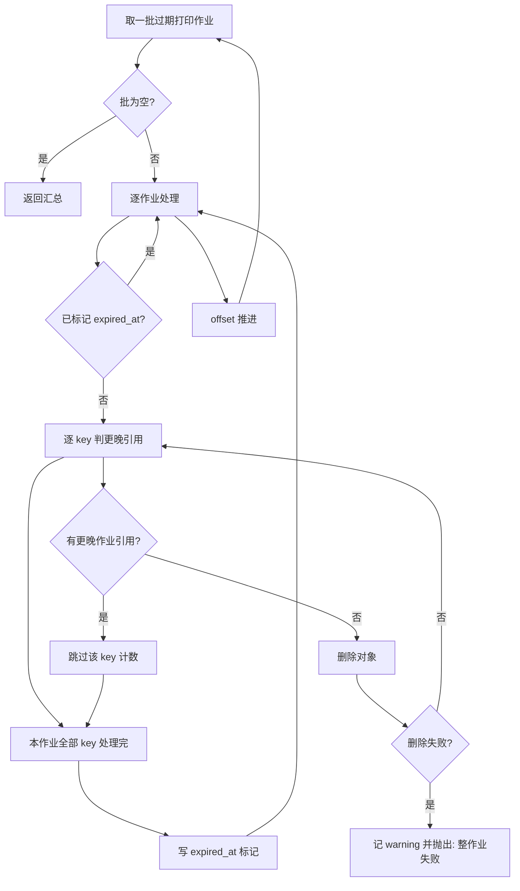

# 单据 PDF 产物清理详细设计（作业回收 / 覆盖防护 / 调度接线 / 打印参数归位）

> 通用能力 · 04 导入导出 · 03 单据 PDF 产物清理 · 详细设计

[文档首页](../../../../../../文档首页.md) › [08 通用能力](../../../../README.md) › [导入导出](../../04_导入导出.md) › [单据 PDF 产物清理](../04_导入导出_03_单据PDF产物清理.md) › 详细设计　|　[需求 02-3](../../../../需求/02_需求_文件与导入导出.md#r02-3) · [阶段计划](../../../../计划/01_计划_通用能力.md) · [04_02 详设](../../04_导入导出_02_列表导出与PDF产物/设计/01_详细设计_02_列表导出与PDF产物.md) · [架构 · 文件管理](../../../../../../设计/架构设计/20_架构设计_子系统_文件管理.md)

## 1. 概述 <a id="overview"></a>

- **目标**：为单据打印 PDF 产物补上回收路径——按保留期回收过期产物，重打场景不误删新产物，并由定时任务自动触发；同时把打印侧仍挂在导出段的两个参数归位到 `print.*`。
- **不做什么**：不改产物命名与存址、不改打印渲染、不改同步打印链路、不引入产物索引表、不改对象存储契约。
- **依据**：04_02 详设 §4.8「只清 platform 导出产物；report 单据打印产物清理登记计划遗留」、§8 遗留 4；《架构设计 · 文件管理》§6；《架构设计 · 异步作业中心》。
- **范式来源**：`platform.export.cleanup`（`ExportCleanupJob` + `ExportLimits` + `ImportJobRepository.list_succeeded_before`）。

## 2. 现状与缺口（已核实） <a id="current"></a>

| # | 事实 | 证据 | 后果 |
| --- | --- | --- | --- |
| 1 | 详设把打印产物清理明确划在 04_02 之外 | 04_02 详设 §4.8 尾段、§8 遗留 4；实施记录「偏差 5」 | 本次需新出设计 |
| 2 | 只有**异步**批量打印写作业记录 | `bms_report/domains/report/api/print.py`：超阈值走 `_submit_batch` 写 `sys_job`；`POST /prints/exports` 与同步批量直接 `exporter` 返回，不落记录 | 可回销的只有 `print.batch.execute` 的产物 |
| 3 | 对象存储契约无 `list` | `bms_core/storage/base.py`：`put` / `get` / `delete` / `exists` / `presign` / 分片四方法 | 无法按前缀扫孤儿，只能按记录回销 |
| 4 | 打印产物 key 按「模板 + 单据」固定 | `bms_core/print/base.py:build_print_object_key` → `{tenant\|global}/prints/{template_key}/{biz_key}.pdf` | 同一单据重打**覆盖同一 key**，旧作业记录的 key 指向的已是新产物 |
| 5 | `platform.export.cleanup` 从未被调度 | `bms_core/tasks/builtin.py` 的 `BUILTIN_TASK_SPECS` 仅四条内置任务；全仓无任何 `sys_task` 提交它 | 导出产物实际也未被回收；新作业若照抄会同样永不运行 |

> 第 4 条是本次与导出侧最大的差异：导出的 key 带随机 token（每次唯一），「记录 key → 删 key」天然安全；打印的 key 固定，直接删会删掉更新后的产物。

## 3. 决策记录 <a id="decisions"></a>

| # | 事项 | 结论 |
| --- | --- | --- |
| D1 | 交付形态 | 新建嵌套子任务 `04_导入导出_03_单据PDF产物清理`（不并入已归档的 04_02） |
| D2 | 清理覆盖范围 | 只回销异步批量作业记录（`print.batch.execute` 成功作业的 `result.items[].object_key`）；同步单条 / 批量产物无记录，不纳入 |
| D3 | 覆盖防误删 | 删 key 前反查同库是否有更晚的成功打印作业引用同一 key，有则跳过且不写 `expired_at` |
| D4 | 调度形态 | 拆成两条独立内置任务（`cleanup_export_artifacts` / `cleanup_print_artifacts`），各自 cron、各自任务日志 |
| D5 | 保留期参数 | 新增 `print.artifact_ttl`，由 `PrintLimits` 解析，不借用 `export.artifact_ttl` |
| D6 | 失败处置 | 首条删除失败立即抛错、整作业失败；`max_attempts=1` 不自动重跑，等次日调度 |
| D7 | 阈值参数归位 | 新增 `print.pdf.sync_max_docs`，保留 `export.pdf.sync_max_docs` 读取回退 |
| D8 | 参数归属 | `print.artifact_ttl` / `print.pdf.sync_max_docs` / `print.cleanup_batch_size` 统一由 `PrintLimits` 解析，打印路由改用 `PrintLimits` |

## 4. 详细设计 <a id="design"></a>

### 4.1 产物口径：key 与记录来源 <a id="artifact-source"></a>

- **key 来源**：唯一来源是 `build_print_object_key`，本次**不改**命名与存址，因此与 `print.batch.execute` 完全一致（`{tenant|global}/prints/{template_key}/{biz_key}.pdf`）；合并模式为 `{首单据键}-merged`。
- **记录来源**：`sys_job` 中 `job_type = 'print.batch.execute'` 且 `status = succeeded` 的行，其 `result` JSON 形如：

```json
{
  "total": 60,
  "succeeded": 60,
  "failed": 0,
  "items": [{ "object_key": "demo/prints/generic_document/A001.pdf", "file_name": "...", "size": 12345 }]
}
```

- **只回销 `items[].object_key`**：`failed` 项本身没有产物；`merged` 模式 `items` 仅一条。结果里没有 `items` 的作业只标记、不删对象（与导出侧 `cleanup_targets` 返回 `None` 同义）。

### 4.2 清理判据 <a id="criteria"></a>

判据全部下推到 SQL，产物 key 的解析留在应用层（JSON 列跨方言语法不一致，与导出侧同口径）：

```text
job_type  = 'print.batch.execute'
status    = succeeded
finished_at IS NOT NULL AND finished_at < now_utc_naive - print.artifact_ttl
ORDER BY finished_at ASC, id ASC  LIMIT cleanup_batch_size OFFSET offset
```

- 时间统一取 `datetime.now(UTC).replace(tzinfo=None)`（库内为 naive UTC，与导出侧一致）。
- 分页推进用 `offset` 累加：写 `expired_at` 不改变上述过滤条件，行仍会被扫到，靠 offset 推进（导出侧已验证该写法，避免无限循环）。

### 4.3 参数与默认值（`PrintLimits`） <a id="limits"></a>

新增 `bms_core/print/limits.py`，与 `ExportLimits` / `ImportLimits` / `FileLimits` 同构（一次 `get_many` 批量取数，缺失 / 非法回落代码默认，只 `warning`）。

| 参数键 | 代码默认 | 含义 |
| --- | --- | --- |
| `print.artifact_ttl` | `604800`（7 天） | 单据打印产物保留期（秒） |
| `print.pdf.sync_max_docs` | `50` | 批量打印同步份数上限（超过转后台） |
| `print.cleanup_batch_size` | `100` | 清理单批作业数 |
| `export.pdf.sync_max_docs` | —（仅回退读取） | 旧键，`print.*` 缺失时兜底 |

```python
@dataclass(frozen=True)
class PrintLimits(BaseValueObject):
    artifact_ttl: int = DEFAULT_ARTIFACT_TTL
    pdf_sync_max_docs: int = DEFAULT_PDF_SYNC_MAX_DOCS
    cleanup_batch_size: int = DEFAULT_CLEANUP_BATCH_SIZE

    @classmethod
    async def load(cls, source: BaseConfigSource | None) -> PrintLimits: ...
```

- **批大小取 100 而非 500**：导出侧单个作业的 `result` 只有一个 key；打印作业的 `items` 可达数千条，按作业数控制批次才能压住单轮内存与覆盖防护的查询次数。
- **回退顺序**：`print.pdf.sync_max_docs` → `export.pdf.sync_max_docs` → 代码默认 50。回退分支必须有独立用例覆盖。

### 4.4 覆盖防护（防误删） <a id="guard"></a>

同一 key 可能被后来的打印覆盖，因此删除前逐 key 判定「是否存在更晚的成功打印作业引用它」：

```sql
SELECT 1 FROM sys_job
 WHERE job_type = 'print.batch.execute'
   AND status   = succeeded
   AND id       > :当前作业_id
   AND result LIKE :'%"object_key"%' ESCAPE '\'
 LIMIT 1
```

- **用 `id` 而非 `finished_at` 比较**：同库雪花 ID 单调，是可靠全序；`finished_at` 可能同秒并列。
- **LIKE 转义**：key 由 `_sanitize_segment` 生成，字符集为 `[A-Za-z0-9_.-]`，其中 `_` 是 LIKE 通配符，须转义为 `\_`；`%` 不会出现但仍一并转义。
- **方向性**：即便转义遗漏导致误匹配，后果是「多跳过」而非「误删」，属安全侧偏差。
- **代价与上限**：逐 key 一次 `LIMIT 1` 查询，在**同一会话**内顺序执行（不逐 key 开事务）；查询次数 = 批内 key 总数，由 `cleanup_batch_size=100` 与单作业单据数共同约束。
- **为何不「按批一次拉出所有更晚作业的 result」**：单作业 `items` 可达数千条，100 个作业的 result 文本量不可控，拉回内存再解析不如逐 key 判定。

### 4.5 幂等 <a id="idempotent"></a>

- **对象删除幂等**：`BaseObjectStorage.delete` 对不存在的对象不报错（与导出侧同契约），重复删除安全。
- **作业标记幂等**：`result` 已含 `expired_at` 的作业直接跳过，不再删对象、不再重复写标记。
- **失败后重复**：删除过程中途抛错时，**已删的 key 不写 `expired_at`**，下轮重复 `delete`（幂等），不会留下「标记了但没删完」的中间态。



### 4.6 失败处置与重试 <a id="failure"></a>

- **单条删除失败**：记 `warning`（含 `job_id` / `object_key` / 异常文本）后**立即抛出**，本批剩余项与后续批次不再处理，作业转 `failed` 终态——不留「部分成功」的模糊态。
- **作业级重试**：`max_attempts = 1`、`backoff_seconds = 0`。坏对象是顽固的，重跑只会重复同一个错；下一轮由次日 cron 调度重新发起。
- **取消**：批边界检查 `ctx.should_cancel()`，命中则收尾返回（已处理部分照常标记）。

### 4.7 作业声明与注册 <a id="registration"></a>

| 落点 | 内容 |
| --- | --- |
| `bms_report/domains/report/artifact_cleanup.py`（新增） | `PrintArtifactCleanupJob`，`job_type = "print.artifact.cleanup"` |
| `bms_report/domains/report/repositories/job.py`（新增） | `PrintJobRepository`：`list_succeeded_before` / `has_newer_reference` / `mark_expired` |
| `bms_report/jobs.py` | `job_handlers()` 注册 handler；`job_specs()` 增声明 |
| `deploy/registry/platform.toml` | 增 `[[jobs]]`（`service=report`、`domain=report`、`max_attempts=1`、`concurrency=1`、`timeout_seconds=1800`） |

- 新增路径落在 `domains/report/**/*.py` 内，域登记 `paths` 已覆盖，**无需改域声明**。
- 目录对账：`cd backend && ./.venv/Scripts/python.exe -m ops.check_modules --offline`（作业声明 ↔ handler 双向核对）。

### 4.8 调度接线（两条独立内置任务） <a id="schedule"></a>

`bms_core/tasks/builtin.py` 增两条（清单 4 → 6 条）：

| code | cron（UTC） | 执行体 | 提交的作业 |
| --- | --- | --- | --- |
| `cleanup_export_artifacts` | `30 3 * * *` | `run_cleanup_export_artifacts` | `platform.export.cleanup` → service `platform` |
| `cleanup_print_artifacts` | `45 3 * * *` | `run_cleanup_print_artifacts` | `print.artifact.cleanup` → service `report` |

- 执行体与 `run_cleanup_orphan_parts` 同构：`JobInternalClient.submit` + 幂等键 `{job_type}:{tenant|platform}:{date}`，`tenant_id` 取 `ctx.run.tenant_id`。
- 两条错开 15 分钟，避免同一时刻抢库；任一执行体失败只影响自己那条任务日志与作业终态。
- `ServiceUnavailableError` → `TaskResult.failed`（由调度器按策略重试提交）。
- 种子随 `BUILTIN_TASK_SPECS` 自动写入 `sys_task`（`seed_tasks_entry` 读同一清单），存量租户由 `python -m ops.seed_platform` 回填。

### 4.9 打印阈值参数归位 <a id="rename"></a>

- `bms_report/domains/report/api/print.py`：`ExportLimits.load(config)` → `PrintLimits.load(config)`，字段名仍为 `pdf_sync_max_docs`，判定逻辑不变。
- 该文件因此不再依赖 `bms_core.transfer.export_limits`，打印侧与导出段参数解耦。
- 存量租户库只有旧键值时，回退读取保证阈值不突变；seed 写入新键后以新键为准。

## 5. 交付物清单 <a id="deliverables"></a>

```text
bms/
├── backend/
│   ├── libs/bms_core/src/bms_core/
│   │   ├── print/limits.py                                    # 新增 PrintLimits
│   │   ├── config/seed.py                                     # 增 print.* 三键
│   │   └── tasks/builtin.py                                   # 增两条内置任务与执行体
│   ├── libs/bms_core/tests/
│   │   ├── print/test_print_limits.py                         # 新增
│   │   └── tasks/test_task_builtin.py                         # 清单断言 4 → 6
│   └── services/report/
│       ├── src/bms_report/domains/report/artifact_cleanup.py  # 新增作业体
│       ├── src/bms_report/domains/report/repositories/job.py  # 新增仓储
│       ├── src/bms_report/domains/report/api/print.py         # 改用 PrintLimits
│       ├── src/bms_report/jobs.py                             # handler + 声明
│       └── tests/print/test_print_artifact_cleanup.py         # 新增用例
└── deploy/registry/platform.toml                              # 增 [[jobs]]
```

文档侧：本详设、任务书、父任务清单一行、阶段计划一行、04_02 遗留条闭环注记。

## 6. 接口与数据边界 <a id="boundary"></a>

| 项 | 约定 |
| --- | --- |
| 作业负载 | 空对象 `{}`（无参数；保留期与批大小走系统参数，便于按租户调整） |
| 结果摘要 | `{"scanned": 扫描作业数, "cleaned": 删除对象数, "skipped": 因覆盖或已标记跳过数, "marked": 写 expired_at 作业数}` |
| `expired_at` | 写入 `result` JSON，格式 `YYYY-MM-DDTHH:MM:SSZ`（与导出侧一致，保留原 key 便于审计） |
| 失败语义 | 抛异常 → 作业 `failed` 终态；不产生部分成功摘要 |
| 跨服务 | 只读本库 `sys_job`，不跨库、不调用其他服务接口 |
| 事务 | 「读批」与「写标记」分开事务；批内取值到局部变量后再在事务外使用（规避回滚后读 ORM 属性导致的 `MissingGreenlet`） |

## 7. 测试设计 <a id="test"></a>

| 编号 | 用例 | 断言要点 |
| --- | --- | --- |
| T1 | 清理主路径 | 过期作业的产物被删、`result` 含 `expired_at`；未过期作业产物仍在 |
| T2 | 覆盖防护 | 存在更晚成功作业引用同 key 时跳过，对象仍在、本作业未标记 |
| T3 | 已标记跳过 | `result` 已含 `expired_at` 的作业不重复删、不重复写 |
| T4 | 无 items | 结果无产物键的作业只标记、不删 |
| T5 | 删除失败 | 首条失败即抛错、作业失败；已删 key 未标记（下轮可重试） |
| T6 | 取消 | 批间发现取消即停止，返回已处理汇总 |
| T7 | 分页 / 多批 | 超过批大小的作业分多批处理完 |
| T8 | `PrintLimits` 加载 | 新键优先；新键缺失回退旧键；都缺失用默认；非法值回落 |
| T9 | 打印阈值改读新键 | 路由按 `print.pdf.sync_max_docs` 判同步 / 异步 |
| T10 | 内置任务清单 | `BUILTIN_TASK_SPECS` 含两条新任务，cron 与执行体正确 |
| T11 | 执行体提交 | 两条执行体分别向 `platform` / `report` 提交对应作业，幂等键含日期 |

- 测试落点：`backend/libs/bms_core/tests/print/`、`backend/services/report/tests/print/`、`backend/libs/bms_core/tests/tasks/`。
- 库夹具复用 `bms_core.testing.plugin` 的 `shared_tenant_engine` / `shared_tenant_db_url` + `ensure_tables`（与 `test_export_jobs.py` 同范式）。
- 覆盖率：新增模块须 100% 行 + 分支（口径见《AI开发规范》「覆盖率要求」节）。
- Kiwi：先登记一条模块级用例取得编号，再回填 `pytestmark`。

## 8. 验收映射 <a id="acceptance"></a>

| 完成标准（任务书） | 落点 |
| --- | --- |
| 过期产物被删且写 `expired_at` | T1 / T3 / T4 |
| 重打后的新产物不被误删 | T2 |
| 两条内置任务各按 cron 提交作业 | T10 / T11 |
| 打印阈值从新键读取、旧键仍生效 | T8 / T9 |
| 覆盖率 100% 行 + 分支 | 推送预检覆盖率门禁 |

## 9. 登记落点 <a id="registry"></a>

| 类型 | 落点 |
| --- | --- |
| 作业类型 | `deploy/registry/platform.toml` `[[jobs]]` + `bms_report/jobs.py` `job_specs()` |
| 内置任务 | `bms_core/tasks/builtin.py` `BUILTIN_TASK_SPECS`（种子与 `--list` 同源） |
| 系统参数 | `bms_core/config/seed.py` 三个 `print.*` 键 |
| 计划 | 阶段计划 §3 剩余任务表新增 `04_03` 行；04_02 归档行遗留条注闭环 |
| 任务树 | `04_导入导出.md` 子任务清单新增一行（2 项 → 3 项） |
| 架构 | 《架构设计 · 文件管理》§6「产物清理」补打印侧口径 |

## 10. 边界与开放项 <a id="open"></a>

1. **同步打印产物无回收路径**：`POST /prints/exports` 与同步批量（≤50 份）不写作业记录，本次不覆盖。缓解事实：打印产物 key 按「模板 + 单据」去重，堆积上界 = 单据数 × 模板数，不随打印次数增长。若将来需要，路径是「产物登记表」或「对象存储契约加 `list`」，前者更可控。
2. **被跳过的作业会长期留在扫描面**：因覆盖防护跳过的作业不写 `expired_at`，每轮都会被扫到。作业量小可接受；若要收敛，需产物索引（key → 最后写入时间）或对象元数据带 mtime。
3. **历史孤儿**：04_02 之前产生的打印产物（若存在）无记录可依，本次不处理。
4. **打印份数阈值语义差异**：`print.pdf.sync_max_docs` 与导出同名键分属两个域，运维调参时须注意键前缀。

## 11. 对齐记录 <a id="alignment"></a>

| 日期 | 事项 |
| --- | --- |
| 2026-11-03 | 新建本子任务与详设；D1~D8 经逐项确认后定稿 |
| 2026-11-03 | 核对确认：`platform.export.cleanup` 已声明但无任何调度触发，本次一并接线（D4） |
| 2026-11-03 | 核对确认：`export_limits.py` 的无括号 `except` 为 PEP 758（py314）合法写法，非缺陷；验证须用 `backend/.venv` |
| 2026-11-03 | 实施对齐：作业体的对象删除直接用 `BaseObjectStorage`（与 `print/exporter.py` 同口径），未借用导出产物端口 `ExportArtifactStore`——避免打印域反向依赖 transfer 域 |
| 2026-11-03 | 实施对齐：三条清理执行体抽出 `_submit_cleanup` 共用，`run_cleanup_orphan_parts` 改为调用它（成功 / 失败文案逐字保持，无行为变更） |
| 2026-11-03 | 实施对齐：`services/report/tests/conftest.py` 补 `serial_db_write` 薄壳（子工程 rootdir 时工程根夹具不参与），与 platform / file 服务同实现 |
