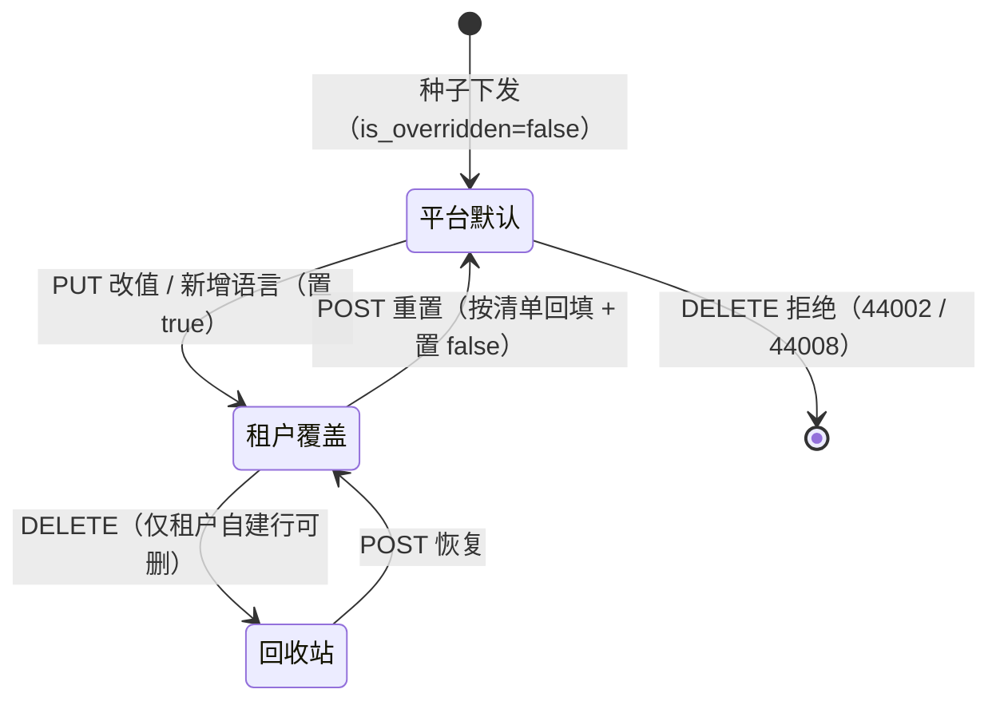
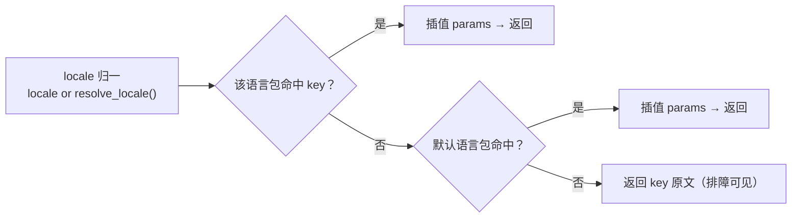
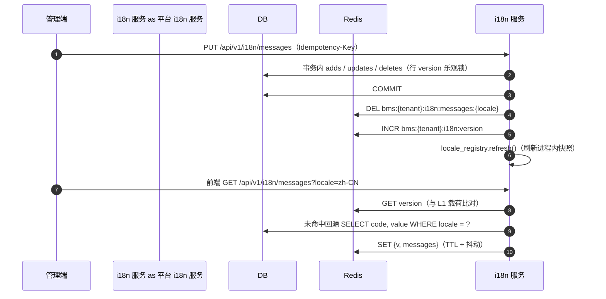

# 语言清单与语言包详细设计（运行期扩语言 + 语言包下发 + 缓存即时失效）

> 通用能力 · 05 国际化 · 01 语言清单与语言包 · 详细设计

[文档首页](../../../../../../文档首页.md) › [08 通用能力](../../../../README.md) › [国际化](../../05_国际化.md) › [语言清单与语言包](../05_国际化_01_语言清单与语言包.md) › 详细设计　|　[需求 06-1](../../../../需求/06_需求_国际化.md#r06-1) · [阶段计划](../../../../计划/01_计划_通用能力.md) · [概要 · 国际化管理](../../../../../../设计/概要设计/29_概要设计_国际化管理.md)

## 1. 概述 <a id="overview"></a>

- **目标**：把国际化从「硬编码语言清单 + 空占位翻译器」补成**运行期可维护**的能力面——语言清单（含默认语言标记与 RTL）与固定文案语言包都入库、页面在线维护、运行时下发并带缓存即时失效；新增一门语言（含 RTL）不需要前端发版。

  1. **语言清单动态扩展**：`sys_i18n_locale`（`code` / `name` / `rtl` / `status` / `is_default` / `sort`）落库，平台默认行由种子下发、租户可改值 / 启停 / 增语言；默认语言全租户唯一且不可停用、不可删除。
  2. **能力域承载清单**：新增独立能力域 `BaseLocaleRegistry`（插件键 `locale_registry`）承载「清单查询 / 默认语言 / RTL / 语言解析」，把 `SUPPORTED_LOCALES` 从「运行期事实源」降级为「种子兜底」；`BaseTranslator` 保持取词职责不变（契约不破坏）。
  3. **语言包维护与下发**：`sys_i18n_message`（`msg_key` + `locale` + `value`）页面在线维护，`GET /api/v1/i18n/messages` 运行时下发，Redis 缓存 + 进程内 L1 二次加速。
  4. **缓存即时且跨实例一致**：语言包与清单缓存都带版本号（对齐 02_01 字典 / 02_02 参数口径）；写路径「提交事务 → DEL 缓存键 → INCR 版本」；语言清单变更连带失效全部语言包缓存。
  5. **缺省回退**：某 key 在某语言缺失时回退**默认语言**文案；默认语言也缺失才回落 key 原文（排障可见），不出现空白。
  6. **种子即平台默认**：语言清单与语言包默认值经幂等种子写入各租户库（`is_overridden=false`），租户改过（`true`）的行不被平台升级覆盖。

- **依据**：《[概要设计 · 国际化管理](../../../../../../设计/概要设计/29_概要设计_国际化管理.md)》§2 / §3 / §4 / §5 / §6 / §7；《[架构设计 · 国际化](../../../../../../设计/架构设计/24_架构设计_子系统_国际化.md)》§2 / §4 / §6；《[国际化规范](../../../../../../规范/国际化规范.md)》§2 / §4 / §6；《[后端开发规范](../../../../../../规范/后端开发规范.md)》§3.1「能力实现必须走基座」；《[命名规范](../../../../../../规范/命名规范.md)》§10 Redis 键 / §12 国际化命名；《[数据库设计 · 数据规范](../../../../../../设计/数据库设计/02_数据库设计_数据规范.md)》§2 / §5；需求 [06-1](../../../../需求/06_需求_国际化.md#r06-1)。
- **范围**：上述 1~6；平台服务 `domains/i18n/` 领域层与 9 个端点、`bms_core/i18n/` 能力域与缓存域、两张表（表文件 + 模型 + 建表）、种子、错误码 `44001~44008`、权限码 `i18n:query` / `i18n:manage`、`[i18n]` 配置节，以及 5 处既有消费点的动态化接线（§4.13）。
- **不含（归口见 §8）**：**前端** vue-i18n 初始化、`/i18n/messages` 拉取、RTL 方向切换、`localStorage` 二次缓存，以及语言管理页 / 语言包维护页 / 个人中心偏好页 / 顶栏语言切换（**阶段十五** 前端全页面）；业务数据文案 i18n 附表（`{主表}_i18n` 查询与回退）与用户时区偏好（**05_02**）；运行时通知 / 邮件模板多语言（07_03）；Babel 开发期提取脚本（只登记口径，见 §8-2）；菜单 / 按钮种子（阶段十五）。

## 2. 现状与差距（设计 vs 代码不符清单） <a id="gap"></a>

> 动手前对账结果。「处置」列写明本段改什么、回写什么、留什么。

| # | 关注点 | 需求 / 概要要求 | 代码现状 | 处置 |
| --- | --- | --- | --- | --- |
| 1 | 语言清单表 | 概要 §4：`sys_i18n_locale`（code / name / rtl / status / is_default） | **零实现**：全仓无模型 / 表文件 / 章节文件；数据库总览 L191 已挂 `30_数据库设计_国际化管理.md` 空链 | **本段建**：表文件 + 章节 + 总览登记 + 模型 |
| 2 | 语言包表 | 概要 §4：`sys_i18n_message`（msg_key + locale + value，联合主键） | **零实现**，同上 | **本段建** |
| 3 | 清单动态扩展 | 需求 06-1 §2：运行期增改启停、默认标记唯一、rtl 驱动布局 | `SUPPORTED_LOCALES` 是**硬编码常量** `("zh-CN","en-US")`（`bms_core/i18n/base.py`），三处消费（`accept_locale` / `DictInvalidator` / `i18n_text`） | **本段改**：新增 `BaseLocaleRegistry` 能力域；常量降为种子兜底；三处改读能力域（§4.13） |
| 4 | 默认语言来源 | 概要与数据规范：默认语言由清单标记确定，**不写死语言标识** | `DEFAULT_LOCALE = "zh-CN"` 被 10+ 处直接引用 | **本段改**：`DEFAULT_LOCALE` 语义降为「出厂兜底」；运行期默认语言经 `locale_registry.default_locale()` 取 |
| 5 | 翻译实现 | 架构 §2：真实语言包取词 + Redis 缓存 + 缺省回退 | `bms_core/i18n/` 只有 `base.py` / `null.py`；`get_translator` provider 走 `null` | **本段改**：新增 `DbTranslator`（读库 + 缓存）；`[translator] provider = "db"` |
| 6 | 语言包下发 | 概要 §5：`GET /api/v1/i18n/messages`，Redis + localStorage 二次缓存 | **无端点**；前端已存在 `GET /i18n/locales/enabled` 的调用桩（`ui_ep/src/utils/i18nLocaleSource.ts`） | **本段改**：两个只读端点落地（否则前端桩 404） |
| 7 | 管理面 | 概要 §5：8 个端点 + 批量保存幂等 + 缓存失效 | **无任何 `/i18n/*` 路由** | **本段改**：9 端点落 `domains/i18n/`（§4.6） |
| 8 | 缓存 | 概要 §3.1 / §4：Redis 缓存、键含租户与 locale 维度、短 TTL | 无 i18n 缓存域；`CacheRegion` 基座、`RedisCacheRegion`、版本化范式齐备（可复用） | **本段改**：新增 `I18nCacheRegion`（L1 + Redis + 版本键），照 `RedisDictCacheRegion` 范式 |
| 9 | 表归属 | 数据规范 §5 与总览：语言清单与语言包落**租户库** | 无登记 | **本段改**：`TableRecord(owner="platform", domain="i18n", datasource=TENANT)` 两条 |
| 10 | 平台默认可覆盖 | 概要 §6 / 数据规范 §5：平台默认 + 租户覆盖 | 无先例（业务 i18n 附表是平台库表，`sys_config` 是租户库单表物化） | **本段定**：租户库单表 + `is_overridden` 物化（与 02_02 同范式，零跨库） |
| 11 | 错误码 | 概要 §7：44001~44006 | `44xxx` 段**全空**；`4xxxx` 已用 40001~40003 / 40101~40103 / 40201~40210 / 40501~40507 | **本段改**：44001~44008 + 8 个异常类 + `ERROR_CODE_HTTP_STATUS` |
| 12 | 权限码 | 概要 §5 / §6：`i18n:manage` | `PERMISSION_SEEDS` **无 i18n 行**（业务码 `i18n` 已存在） | **本段改**：补 `i18n:query` / `i18n:manage` |
| 13 | 菜单 / 按钮种子 | 概要 §6：菜单挂「国际化」表单 | `MENU_SEEDS` 无国际化节点（与 `dict` / `config` / `task` 同现状） | **不做**：前端页归阶段十五（§8-1） |
| 14 | 种子 | 概要 §6：zh-CN / en-US 与前后端文案种子 | **无 i18n 种子**；`deploy/registry/platform.toml` 无 `[[seeds]] i18n` | **本段改**：`bms_core/i18n/seed.py` + `ops/seed_i18n.py` + 注册 `[[seeds]]` + `seed_branch_handlers` |
| 15 | locale 大小写 | 数据规范 §5 写「小写归一（zh-cn）」；实现与种子用 `zh-CN` | **口径冲突**：`menu.py` 种子 `ZH="zh-CN"`、`DEFAULT_LOCALE="zh-CN"`、前端 `I18nLocaleItem.code` 均标准形态 | **本段定**：统一 IETF 标准形态 `zh-CN`，比较一律大小写不敏感；回写数据规范 §5（§7） |
| 16 | 平台默认升级 | 平台默认应随发版演进到未覆盖租户 | 无（新表） | **本段做**：种子「缺失插入；存在且 `is_overridden=false` 刷新；`true` 跳过」 |
| 17 | 错误码文案种子 | 国际化规范 §5：错误码文案按 `error.{code}` 映射 | 现有 ~150 个错误码**无任何 error.* 文案**（前端接入时只能显示 code） | **本段做**：`error.*` 全量种子 + 护栏用例断言「每个 `ErrorCode` 都有中英种子」 |
| 18 | 前端运行时 | 需求 06-1：免发版切换、RTL、localStorage | 无 `vue-i18n`、无 `/i18n/messages` 拉取、无 RTL 应用、无 locale 持久化 | **不做**：归阶段十五（§8-1），接口已就位即可零改动接入 |
| 19 | Babel 提取 | 任务书 §2 第 3 条 | 后端文案全是中文字面量、无 gettext 标记；提取无源 | **不做**：只回写规范口径（§8-2） |
| 20 | 契约与前端类型 | 后端开发规范 §7.4：实现端点必须进公开契约 | 新增 9 端点 | **本段改**：`ops.contract_snapshot export` 追加；推送前重建 `frontend/packages/api_types` |
| 21 | 域布局登记 | 后端开发规范 §3.2：一域一目录 + `public.py` + `domain_layout.json` | `domain_layout.json` **无 i18n 域** | **本段改**：登记域 `i18n`（paths / public_api） |
| 22 | Kiwi 编号 | 测试规范：先取号再编码 | 最近用号 2401 / 2402 / 2403（08 阶段） | **本段首步**：容器内 `bms-kiwi` 登记取号 |

## 3. 交付物清单 <a id="tree"></a>

```text
backend/
├── config.toml                                        # 改：新增 [i18n]；[translator] provider=db；[locale_registry] / [i18n_cache_region]
├── config.dev.toml                                    # 改：同上（dev 覆盖，与基线同值）
├── libs/bms_core/src/bms_core/
│   ├── core/error_codes.py                            # 改：44001~44008 + HTTP 映射
│   ├── core/exceptions.py                             # 改：8 个异常类（挂 4xxxx 段基类）
│   ├── core/config.py                                 # 改：I18nSettings（validation_alias="i18n"）+ locale_registry / i18n_cache_region 选择项
│   ├── core/assembly.py                               # 改：两条 PluginWiring + 工厂登记（locale_registry / i18n_cache_region / translator:db）
│   ├── models/platform/i18n.py                        # 新：SysI18nLocale / SysI18nMessage
│   ├── models/platform/__init__.py                    # 改：MODEL_MODULES 追加
│   ├── services/table_registry.py                     # 改：两条 TableRecord
│   ├── i18n/locale.py                                 # 新：LocaleInfo 值对象 + match_locale 纯函数
│   ├── i18n/registry.py                               # 新：BaseLocaleRegistry 契约 + 同步快照
│   ├── i18n/registry_null.py                          # 新：NullLocaleRegistry（种子常量兜底）
│   ├── i18n/registry_sql.py                           # 新：SqlLocaleRegistry（读库 + 缓存 + 快照刷新）
│   ├── i18n/cache.py                                  # 新：I18nCacheRegion 契约 + Memory / Redis 两实现（L1 + 版本化载荷）
│   ├── i18n/invalidate.py                             # 新：I18nInvalidator（清单 / 消息 / 全量失效 + 版本递增）
│   ├── i18n/db.py                                     # 新：DbTranslator（取词 / 语言包加载 / 回退与插值）
│   ├── i18n/seed.py                                   # 新：LOCALE_SEEDS / MESSAGE_SEEDS / seed_i18n_entry / expected_rows
│   ├── i18n/base.py                                   # 改：常量语义标注为「种子兜底」；provider 说明
│   ├── i18n/null.py                                   # 改：docstring 对齐（占位语义不变）
│   └── dict/invalidate.py                             # 改：失效语言集合改读 locale_registry（回退常量）
├── ops/seed_i18n.py                                   # 新：种子脚本入口转发（RUN_IMAGE="*"）
├── deploy/registry/platform.toml                      # 改：新增 [[seeds]] seed-i18n
├── deploy/boundaries/domain_layout.json               # 改：登记域 i18n
├── services/platform/src/bms_platform/
│   ├── api/router.py                                  # 改：挂 i18n 路由（追加末尾）
│   ├── api/locale.py                                  # 改：accept_locale 委托 locale_registry
│   ├── services/i18n_text.py                          # 改：request_locale 委托 locale_registry
│   ├── services/seed_branch_handlers.py               # 改：注册 seed-i18n
│   └── domains/i18n/
│       ├── __init__.py
│       ├── public.py                                  # 新：跨域出口（本段空占位，护栏用例覆盖）
│       ├── api/locales.py                             # 新：5 个语言清单端点
│       ├── api/messages.py                            # 新：4 个语言包 / 缓存端点
│       ├── schemas/i18n.py                            # 新：请求 / 响应契约
│       ├── repositories/locale.py                     # 新：清单分页 / 取单 / 判重 / 默认语言切换
│       ├── repositories/message.py                    # 新：语言包分页 / 按 locale 全量 / 批量增删改
│       ├── services/locale.py                         # 新：清单 CRUD 规则 + 失效 + 审计
│       └── services/message.py                        # 新：批量保存（幂等 + 乐观锁）+ 下发 + 失效
├── services/platform/tests/
│   ├── i18n/test_locale_api.py                        # 新：5 端点 + 错误码分支
│   ├── i18n/test_message_api.py                       # 新：维护列表 + 批量保存 + 删除边界
│   ├── i18n/test_messages_dispatch.py                 # 新：下发 / 回退 / 缓存命中
│   └── api/test_menu_metadata.py                      # 改：accept_locale 用例随签名调整
└── libs/bms_core/tests/
    ├── i18n/test_i18n.py                              # 改：常量语义回归（保持既有断言）
    ├── i18n/test_locale_registry.py                   # 新：契约 / 快照 / 解析 / Null 实现
    ├── i18n/test_i18n_cache.py                        # 新：版本化载荷 / 失效 / 旧载荷兼容
    ├── i18n/test_i18n_translator.py                   # 新：取词 / 回退链 / 插值
    ├── i18n/test_i18n_seed.py                         # 新：幂等 / 只刷新未覆盖 / 默认语言唯一
    ├── i18n/test_error_seed_coverage.py               # 新：护栏——每个 ErrorCode 有 error.* 中英种子
    └── integration/test_i18n_cache_real.py            # 新：真 Redis × 双实例（跨实例即时生效）

bms文档/
├── 设计/数据库设计/数据表设计/sys_i18n_locale.md        # 新：表文件
├── 设计/数据库设计/数据表设计/sys_i18n_message.md       # 新：表文件
├── 设计/数据库设计/30_数据库设计_国际化管理.md          # 新：章节文件（补总览空链）
├── 设计/数据库设计/01_数据库设计_总览.md                # 改：登记两表 + 章节状态
├── 设计/数据库设计/02_数据库设计_数据规范.md            # 改：§5 locale 大小写口径
├── 设计/概要设计/29_概要设计_国际化管理.md              # 改：§4 归属/覆盖形态、§5 DELETE 与权限码、§6 权限、§7 错误码
├── 设计/架构设计/24_架构设计_子系统_国际化.md           # 改：§2 清单动态化与缓存口径、§4 默认语言来源
├── 规范/命名规范.md                                    # 改：§10 补 i18n 三条 Redis 键
├── 规范/后端开发规范.md                                # 改：§3.1 补 locale_registry 与取词口径
├── 规范/国际化规范.md                                  # 改：§6 平台默认物化与默认语言来源
├── 后端基类清单.md                                     # 改：能力域清单补 locale_registry / i18n_cache_region / translator:db
├── 项目/08_通用能力/计划/01_计划_通用能力.md            # 改：05_01 归档 + 遗留台账
└── 项目/08_通用能力/需求/06_需求_国际化.md              # 改：06-1 交付注块（用例号 / 遗留归口）
```

## 4. 领域设计 <a id="design"></a>

### 4.1 数据模型与建表口径 <a id="data"></a>

两张表都落 **platform 服务租户库**（`platform:tenant` 链），字段细节以表文件为唯一事实源，本节只写设计口径。

**`sys_i18n_locale`（语言清单）**

| 字段 | 类型 | 可空 | 约束 / 默认 | 语义 |
| --- | --- | --- | --- | --- |
| `form_key` | VARCHAR(64) | 否 | `(form_key, deleted_at)` 唯一，默认 `i18n_locale` | 表单标识（系统字段） |
| `code` | VARCHAR(16) | 否 | `(code, deleted_at)` 唯一（应用层大小写不敏感判重） | 语言标识（IETF，如 `zh-CN` / `en-US` / `ar-SA`） |
| `name` | VARCHAR(64) | 否 | — | 语言名称（本地名，如 `简体中文` / `English`） |
| `status` | VARCHAR(16) | 否 | 默认 `enabled` | 状态（`enabled` / `disabled`） |
| `rtl` | BOOLEAN | 否 | 默认 `false` | 是否从右到左（驱动前端布局方向） |
| `is_default` | BOOLEAN | 否 | 默认 `false`；**全表恰一条**（应用层保证） | 默认语言标记（派生默认文案 + 缺省回退目标） |
| `sort` | INT | 否 | 默认 0，升序 | 排序（下拉与列表） |
| `is_overridden` | BOOLEAN | 否 | 默认 `false` | 是否被租户改过（平台默认行保护与种子刷新判据） |
| `parent_id` | DECIMAL(38,0) | 是 | — | 上级字典 ID（系统字段口径保留，本表无层级） |

**`sys_i18n_message`（语言包）**

| 字段 | 类型 | 可空 | 约束 / 默认 | 语义 |
| --- | --- | --- | --- | --- |
| `form_key` | VARCHAR(64) | 否 | `(form_key, deleted_at)` 唯一，默认 `i18n_message` | 表单标识（系统字段） |
| `code` | VARCHAR(128) | 否 | `(code, locale, deleted_at)` 唯一 | 文案 key（DB 列名 `code`，ORM 属性 / 契约字段名 `msg_key`）；`模块.页面.字段` |
| `name` | VARCHAR(128) | 否 | 默认空串 | 展示名（系统字段，缺省取 `code`） |
| `status` | VARCHAR(16) | 否 | 默认 `enabled` | 状态（系统字段；本段恒 `enabled`，不承载废弃语义） |
| `locale` | VARCHAR(16) | 否 | 同上复合唯一；`idx_sys_i18n_message_locale` | 语言标识（与清单 `code` 同形态） |
| `value` | TEXT | 否 | 默认空串（应用侧） | 该语言文案；**去空白后为空即「缺失」** |
| `remark` | VARCHAR(255) | 是 | — | 备注（维护页说明；配合插值变量提示） |
| `is_overridden` | BOOLEAN | 否 | 默认 `false` | 是否被租户改过 |
| `parent_id` | DECIMAL(38,0) | 是 | — | 上级明细 ID（系统字段口径保留，本表无层级） |

口径：

- **唯一性与软删**：两张表都沿用「`(唯一字段, deleted_at)` 复合唯一」；**`deleted_at IS NULL` 时复合唯一不生效**（NULL 互不相等，三库同语义，02_02 已实测），故唯一性由**应用层判重**保证，表文件注明。
- **默认语言唯一性**：不用 DB 偏索引（跨方言差异大），由写路径事务内「先清其它行的 `is_default` 再置本条」+ 读路径断言（`44006`）保证。
- **`sort` 索引**：`sort` 进排序白名单，建 `idx_sys_i18n_locale_sort`；`sys_i18n_message` 按 `locale` 全量加载语言包，建 `idx_sys_i18n_message_locale`。
- **建表与迁移**：本项目为**删库重建**口径（`alembic/versions/` 仅 `.gitkeep`，结构以模型为唯一事实源）。顺序：**表文件 → 总览登记 → 模型 → `TableRecord` → 启动期自动建表 / `ops.init_schema`**。测试库由夹具 `Base.metadata.create_all` 自动带新表。

### 4.2 平台默认 + 租户覆盖（物化语义） <a id="override"></a>

**物理形态（收敛后的口径）**：

| 层 | 载体 | 说明 |
| --- | --- | --- |
| 平台默认 | `bms_core/i18n/seed.py::LOCALE_SEEDS` / `MESSAGE_SEEDS` | 构建期清单，随发版演进；租户开通与 `ops.seed_i18n` 幂等下发到租户库（`is_overridden=false`） |
| 租户覆盖 | 租户库同名表的同一行（`is_overridden=true`） | 覆盖即改本行值；平台默认不再保留副本，**重置 = 按清单回填** |

> 结论：读路径**只读租户库单表**，不跨库、不做「平台库默认 + 租户库覆盖」合并——平台默认已物化为行。这与 02_02 系统参数同范式，也是概要 §4「两张表均位于租户库」的落法。

**状态机（一行清单 / 一行文案）**：



**种子写入算法**（幂等）：

1. 清单行按 `code` 小写不敏感匹配活行：不存在 → 插入（`is_overridden=false`）；存在且 `is_overridden=false` → 刷新 `name` / `rtl` / `status` / `sort` / `is_default`；`true` → **跳过**。
2. 文案行按 `(code, locale)` 匹配活行：规则同上（刷新 `value` / `remark`）。
3. 清单全部处理完后校验「`is_default` 恰一条」：不足则把种子默认语言置 `true`；多于一条 → 抛 `44006`（种子期即暴露，不等运行期）。
4. 返回值仍为「新增行数」（不破坏编排契约）；刷新条数记 `info` 日志。

**写路径规则**：

| 操作 | 规则 | 失败码 |
| --- | --- | --- |
| 新增语言 | `code` 格式 + 唯一（大小写不敏感）；`is_default=true` 时在同事务内清其它行标记 | `44001` / `44003` |
| 修改语言 | `status=disabled` 时：默认语言拒绝、且须至少保留一种启用 | `44005` / `44004` |
| 切换默认语言 | 置本条 `is_default=true` + 清其它行；`status` 必须为 `enabled` | `44006` |
| 删除语言 | 默认语言拒绝；存在任意语言包行（该 locale 的活行）拒绝 | `44005` / `44002` |
| 文案新增 | `msg_key` 格式校验；`(msg_key, locale)` 已存在 → **转为更新**（幂等 upsert） | `44003` |
| 文案修改 | 行不存在 / 版本冲突 | `44008` / `10004` |
| 文案删除 | `is_overridden=true` 可删；`false`（平台默认行）拒绝 | `44008` |

> 「重置」（按清单回填）本段不单独开端点：管理页把值改回种子值即可；`is_overridden` 由「值是否等于种子值」**派生**（写路径计算），避免多一个端点与一套语义。种子清单里没有的租户自建行，`is_overridden` 恒 `true`。

### 4.3 语言清单能力域（`BaseLocaleRegistry`） <a id="registry"></a>

```text
bms_core/i18n/
├── locale.py           # LocaleInfo（值对象）+ match_locale（纯函数）
├── registry.py         # BaseLocaleRegistry（契约 + 进程内快照基类）
├── registry_null.py    # NullLocaleRegistry（种子常量兜底；测试 / 无库环境）
└── registry_sql.py     # SqlLocaleRegistry（读缓存 / 回源 DB / 快照刷新）
```

| 成员 | 形态 | 说明 |
| --- | --- | --- |
| `LocaleInfo` | `BaseValueObject` + `@dataclass(frozen=True)` | `code` / `name` / `rtl` / `is_default` / `status` / `sort` |
| `match_locale(accept_language, supported, default)` | 纯函数（同步） | 按 `Accept-Language` 顺序匹配：精确命中（大小写不敏感）→ 主语言前缀命中 → 默认语言 |
| `BaseLocaleRegistry(BasePluggable, ABC)` | 能力域契约 | `plugin_key = "locale_registry"`，`key = "locale_registry"` |
| `list_locales(*, enabled_only=False)` | 异步 | 清单（读缓存 / DB；维护面与多语言字段语言格用） |
| `refresh()` | 异步 | 刷新进程内快照（装配期、写路径后、失效端点调用） |
| `snapshot()` | 同步 | 进程内快照（不可变副本；未加载时为空） |
| `default_locale()` | 同步 | 快照里的默认语言；空快照回退 `DEFAULT_LOCALE` |
| `is_rtl(locale)` | 同步 | 快照判定；未知语言 `False` |
| `resolve_locale(accept_language=None)` | 同步 | `match_locale(raw, 快照启用语言, default_locale())` |
| `ensure_supported(locale)` | 异步 | 归一 + 校验：未登记 / 停用 → 回退默认语言（不抛错） |

**为什么「同步解析 + 异步刷新」**：`BaseTranslator.resolve_locale` 是同步契约，`accept_locale` 与 `DictInvalidator` 也在同步路径上；而清单在库里。方案是**进程内不可变快照**（`ConcurrentStableList[LocaleInfo]` + 默认语言串）承担同步读，异步方法负责读缓存 / 回源并原子替换快照——同步路径零 IO，跨实例一致性由「写路径调 `refresh()` + 缓存版本号」保证。

`NullLocaleRegistry`：快照固定为 `SUPPORTED_LOCALES`（`zh-CN` 默认 / `en-US`，`rtl=False`），`list_locales` 直接返回种子，不读库不读缓存——用于无库环境与契约测试。

`SqlLocaleRegistry`：注入 `I18nCacheRegion` + 一个「读库可调用对象」（`async def load() -> ConcurrentStableList[LocaleInfo]`，由装配注入，内部经 `session_scope()` 读租户库）；`list_locales` 顺序为 L1 快照 → 缓存 → DB；`refresh()` 强制回源并写缓存。

### 4.4 翻译实现（`DbTranslator`）与回退链 <a id="translator"></a>

`bms_core/i18n/db.py::DbTranslator(BaseTranslator)`，构造注入 `BaseLocaleRegistry` + `I18nCacheRegion` + 读库可调用对象。

**`load_messages(locale)`**：L1 → Redis → DB（该 locale 全部非空文案）；命中回填 L1 与 Redis；返回 `key → 文案`。

**`translate(key, *, locale=None, params=None)`** 的解析顺序：



- 插值：`{var}` 占位，按 `params` 替换；缺参数保留占位符原样（不抛错）。
- 「缺 key 回退」验收口径：缺**该语言**文案时回退**默认语言**文案，故前端不会看到 key 原文；只有当默认语言也没有该 key（种子未覆盖且页面未维护）时才返回原 key。

### 4.5 缓存设计 <a id="cache"></a>

**键与载荷**（`I18nCacheRegion.domain = "i18n"`）：

| 名称 | 形式 | 载荷 |
| --- | --- | --- |
| 语言包 | `bms:{tenant}:i18n:messages:{locale}` | `{"v": 版本, "messages": {key: 文案}}`（载荷用**内置 `dict`**，JSON 可往返） |
| 语言清单 | `bms:{tenant}:i18n:locales` | `{"v": 版本, "locales": [{code,name,rtl,is_default,status,sort}]}` |
| 版本键 | `bms:{tenant}:i18n:version` | `INCR` 递增，**不设过期** |

**读路径**：`version = aversion(tenant)`（每批一次）→ 取载荷 → `payload["v"] != version` 视为未命中并删该键 → 未命中回源 DB → 写回（TTL + `[i18n]` 抖动）。

**写路径**（统一入口 `bms_core/i18n/invalidate.py::I18nInvalidator`）：事务**提交后**执行，顺序不可反（先 `INCR` 会让并发读把旧值以新版本号写回，成为「污染的有效载荷」）：

| 变更 | 动作 |
| --- | --- |
| 保存语言包 | `adrop_messages(tenant, 受影响 locale 集合)` → `aincrease_version` → `refresh()` |
| 新增 / 修改 / 删除语言、切换默认、改 rtl | `adrop_locales` + **`adrop_messages` 遍历全部已登记语言（含停用）** → `aincrease_version` → `refresh()` |
| 显式失效端点 | 同上「全量失效」 |
| 失效失败（Redis 不可用） | 记 `warning`，业务写成功；正确性由版本比对 + TTL 兜底（不反噬业务写） |

**多实例一致性**：`RedisI18nCacheRegion` 的 L1 也存版本化载荷——A 实例写后 `DEL` + `INCR`，B 实例下一次读 `aversion` 得到新版本，L1 载荷版本不一致即丢弃回源。



### 4.6 管理端接口面（9 端点） <a id="api"></a>

统一前缀 `/api/v1/i18n`；模块级 `require_auth`，逐端点权限码（下发与启用清单**登录即可**）。

| 方法 | 路径 | 说明 | 权限码 |
| --- | --- | --- | --- |
| GET | `/i18n/messages` | 语言包下发（`locale` 显式指定优先，缺省按 `Accept-Language`） | 登录即可 |
| GET | `/i18n/locales` | 语言清单分页（`keyword` / `status` / `include_deleted`） | `i18n:query` |
| GET | `/i18n/locales/enabled` | 启用语言清单只读出口（语言格渲染用） | 登录即可 |
| POST | `/i18n/locales` | 新增语言 | `i18n:manage` |
| PUT | `/i18n/locales/{code}` | 修改语言（名称 / rtl / 启停 / 排序 / 默认标记） | `i18n:manage` |
| DELETE | `/i18n/locales/{code}` | 删除语言（非默认 + 无语言包数据） | `i18n:manage` |
| GET | `/i18n/messages/manage` | 语言包维护列表（`keyword` / `module` / `locale` / `missing_only`） | `i18n:query` |
| PUT | `/i18n/messages` | 语言包批量保存（差异三段 + 幂等键） | `i18n:manage` |
| PUT | `/i18n/cache/invalidate` | 语言包缓存主动失效 | `i18n:manage` |

**关键契约**：

- 下发响应：`{locale, fallback, version, messages}`；`fallback=true` 表示请求语言未启用 / 未登记而回退默认语言。
- 启用清单条目：`{code, name, rtl, isDefault, sort}`（不含 `status`——本端点只返回启用行）。
- 清单分页条目：`{id, code, name, rtl, status, isDefault, sort, isOverridden, version, updatedAt, deletedAt}`。
- 维护列表条目：`{id, msgKey, locale, value, remark, isOverridden, version}`；`module` 由 `msg_key` 首段派生（不落列）。
- 批量保存请求：`{adds: [{msgKey, locale, value, remark?}], updates: [{id, value, remark?, version}], deletes: [id]}`；`Idempotency-Key` 按变更集内容派生（同变更集同键），响应 `{created, updated, deleted, version}`。
- 失效响应：`{version, degraded}`；Redis 不可用时 `degraded=true` 且仍 200（概要与规范口径：失效失败不阻断保存）。

**分页与排序**：`BasePageQuery` / `BasePageResponse`；清单默认 `sort` 升序 + `code` 兜底；维护列表默认 `code` 升序 + `locale` 升序。

### 4.7 校验规则 <a id="rules"></a>

| 规则 | 口径 | 失败码 |
| --- | --- | --- |
| 语言标识格式 | IETF 语言标签：`^[A-Za-z]{2,3}(-[A-Za-z0-9]{2,8})*$`，长度 ≤ 16；存原样（标准形态），比较大小写不敏感 | `44003` |
| 语言名称 | 非空，≤ 64 | `44003` |
| 文案 key 格式 | `^[a-z][a-z0-9_]*(\.[a-z0-9_]+)+$`（点分小写、至少两段），长度 ≤ 128 | `44003` |
| 文案值长度 | ≤ 4000 字符（与前端 `MESSAGE_VALUE_MAX` 对齐，避免无界写入） | `44003` |
| 默认语言唯一 | 全表恰一条；新增 / 修改 / 种子后校验 | `44006` |
| 至少一种启用 | 停用 / 删除后仍有至少一条 `enabled` | `44004` |
| 默认语言保护 | 默认语言不可停用、不可删除 | `44005` |

### 4.8 配置节 <a id="config"></a>

```toml
# 国际化（05_01）：语言包与清单缓存 TTL / 版本校验开关 / L1 容量
[i18n]
messages_ttl_seconds = 300    # 语言包 L2 TTL（region 内部叠加 0~10% 抖动）
locales_ttl_seconds = 300     # 语言清单 TTL
version_check = true          # false = 退回纯 TTL（不比对版本，排障用）
l1_max_items = 64             # 进程内 L1 条目上限（LRU）

[locale_registry]
provider = "sql"              # 无库环境 / 契约测试用 "null"

[i18n_cache_region]
provider = "redis"            # 进程内 / 测试用 "memory"

[translator]
provider = "db"               # 占位实现仍可配 "null"
```

- `I18nSettings` 字段名 `i18n_options` + `validation_alias="i18n"`（`Settings.model_config` 为 `extra="forbid"`，**节与字段必须同批落地**；字段直接命名 `i18n` 会与 `BaseSettings` 成员冲突，同 02_01 / 02_02 的坑）。
- 只进基线 `config.toml`（各环境语义一致）；dev 覆盖同值。

### 4.9 种子设计 <a id="seed"></a>

**清单种子**（`LOCALE_SEEDS`）：

| code | name | rtl | is_default | sort |
| --- | --- | --- | --- | --- |
| `zh-CN` | 简体中文 | false | **true** | 0 |
| `en-US` | English | false | false | 10 |

**语言包种子**（`MESSAGE_SEEDS`）：

| 组 | 规模 | 说明 |
| --- | --- | --- |
| `common.*` | 约 30 条 | 确认 / 取消 / 保存 / 删除 / 查询 / 重置 / 新增 / 编辑 / 导入 / 导出 / 操作成功 / 操作失败 / 无数据 / 加载中 等 |
| `error.*` | **全量**（每个 `ErrorCode` 一条） | 中文取现有异常文案口径，英文按 sentence case 补写；护栏用例断言「无遗漏」 |
| `i18n.*` | 约 10 条 | 本任务接口与页面提示（语言已存在 / 默认语言不可停用 等） |

- **`error.*` 完整性护栏**：`libs/bms_core/tests/i18n/test_error_seed_coverage.py` 断言 `ErrorCode` 的每个业务码（排除 1~9 段位哨兵）在 `MESSAGE_SEEDS` 中都有 `zh-CN` 与 `en-US` 两行——新增错误码若忘记补文案，CI 直接失败。
- **种子入口**：`bms_core/i18n/seed.py::seed_i18n_entry(session, args)`（不建连接、不提交，写入并入 XA 分支事务）+ `ops/seed_i18n.py`（入口转发，`RUN_IMAGE="*"`）+ `deploy/registry/platform.toml` 新增 `[[seeds]] name="seed-i18n"`（`service="tenant"`、`db_key="tenant_platform_{tenant}"`，`after=["seed-tenant"]`）+ `seed_branch_handlers.py` 注册 `seed-i18n`。
- **`expected_rows()`**：返回清单与文案的期望行（供种子预检比对），与 `seed-menu` / `seed-config` 同契约。

### 4.10 权限码与种子 <a id="permission"></a>

- `PERMISSION_SEEDS` 增 `("i18n", "query", "查询", "Query")` 与 `("i18n", "manage", "管理（含查询与维护）", "Manage")`；业务码 `i18n` 已存在，动作码 `query` / `manage` 均为既有全局动作码。
- 菜单 / 表单 / 按钮种子**本段不加**（与 `dict` / `config` / `task` 同口径，前端页归阶段十五）。
- 越权分支：端点挂 `require_permission(...)`；用例沿既有口径用 `assign_system_admin()` 放行，**不伪造 403 断言**（真实拒绝由安全专项补齐）。

### 4.11 审计留痕 <a id="audit"></a>

- 时机：**事务提交后**（与缓存失效同阶段），失败只 `warning`。
- 内容：`capture(table="sys_i18n_locale" / "sys_i18n_message", model_id=id, changes=[FieldChange(field, old, new)], actor=current_user_id())`；新增 / 删除分别以 `old=None` / `new=None` 表达。
- **不自行 `publish`**：与 `role` 三权留痕、`config` 参数同口径（`capture` 返回信封但不投递），落库与哈希链归 06_01 / 06_02。

### 4.12 应用装配与依赖注入 <a id="di"></a>

| 位置 | 变更 |
| --- | --- |
| `core/assembly.py::PLUGIN_WIRINGS` | 追加 `PluginWiring("locale_registry", BaseLocaleRegistry, "locale_registry", "locale_registry")`、`PluginWiring("i18n_cache_region", I18nCacheRegion, "i18n_cache_region", "i18n_cache_region")`（`translator` 接线保留） |
| `core/assembly.py::register_platform_plugins` | 新增工厂：`MemoryI18nCacheRegionFactory` / `RedisI18nCacheRegionFactory` / `MemoryLocaleRegistryFactory` / `SqlLocaleRegistryFactory` / `DbTranslatorFactory`（装配期顺序：`i18n_cache_region` → `locale_registry` → `translator`） |
| `bms_core/api/deps.py` | 导出 `get_locale_registry` / `get_i18n_cache_region`（公共依赖统一从 `bms_core.api.deps` 取） |
| `core/assembly.py::assemble_base_plugins` | `locale_registry` 装配后调一次 `await registry.refresh()`（失败降级 `warning`，不拒启） |
| `services/platform/src/bms_platform/api/router.py` | 追加 `locales.router` / `messages.router`（列表末尾，契约快照按追加口径重建） |

### 4.13 既有消费点接线（动态化清单） <a id="wiring"></a>

| 位置 | 现状 | 改法 |
| --- | --- | --- |
| `bms_platform/api/locale.py::accept_locale` | 遍历 `SUPPORTED_LOCALES` 常量 | 改读 `request.app.state.locale_registry.resolve_locale(...)`；签名保持同步 |
| `bms_platform/api/locale.py::locale_scope` | 设置 `current_dict_locale` | 不变（内部调 `accept_locale`） |
| `bms_platform/services/i18n_text.py::request_locale` | 常量归一 | 接受 `registry` 参数（调用方从 `app.state` 取），未登记回退 `default_locale()` |
| `bms_platform/domains/permission_meta/services/icon_store.py` | 常量归一 | 同上（经 `request_locale` 统一） |
| `bms_platform/services/metadata_cache.py` | `DEFAULT_LOCALE` 兜底 | 改 `registry.default_locale()` |
| `bms_core/dict/invalidate.py::DictInvalidator` | 遍历 `SUPPORTED_LOCALES` 失效 | 注入 `BaseLocaleRegistry`，遍历**全部已登记语言（含停用）**；注册表不可用时回退常量 |
| `bms_core/i18n/base.py::DEFAULT_LOCALE` / `SUPPORTED_LOCALES` | 运行期事实源 | 语义降为「种子 / 出厂兜底」；docstring 与基类清单同步 |
| `bms_platform/domains/platform_registry/api/dict.py::_accept_locale` | 私有副本 | 改为委托 `locale.accept_locale`（消除第二份解析实现） |

## 5. 失败分支与边界 <a id="failures"></a>

| 场景 | 行为 | 依据 / 风险 |
| --- | --- | --- |
| 下发请求的 `locale` 未登记 / 已停用 | 回退默认语言，`fallback=true`，200 | 需求「缺省回退不阻塞渲染」 |
| 某 key 缺当前语言文案 | 回退默认语言文案；默认语言也缺 → 返回 key | 验收项「缺 key 回退不显示 key 原文」 |
| 语言包为空（新租户未种子） | 返回空 `messages`，200（前端按 key 渲染） | 种子漏跑属部署问题，接口不报错 |
| 新增语言 `code` 重复（大小写不敏感） | `44001`（409） | 约束在 NULL 语义下不生效，**必须应用层判重** |
| 停用默认语言 | `44005`（403） | 默认语言保护 |
| 停用 / 删除后无启用语言 | `44004`（409） | 概要与验收项 |
| 删除默认语言 | `44005`（403） | 同「不可停用」 |
| 删除仍有语言包数据的语言 | `44002`（409） | 防孤儿文案 |
| 默认语言标记缺失 / 重复 | `44006`（409） | 不允许静默取第一条 |
| 语言标识 / 文案 key 格式非法 | `44003`（400） | 前后端同规则（前端轻校验、后端强制） |
| 文案 id 不存在 / 删除平台默认行 | `44008`（404 / 403） | 默认行不可删（回退链始终有底） |
| 乐观锁版本不匹配 | `10004`（409） | 显式 `WHERE version = ?`，与 01_02 / 02_02 同口径 |
| `adds` 命中已存在 `(msgKey, locale)` | 转为更新（幂等 upsert），不报错 | 批量保存天然可重放 |
| 幂等键重复提交 | 直接返回首次结果，不再执行业务 | `IdempotencyStore.begin` 为 False |
| Redis 不可用（读） | 缓存层降级为未命中 → 回源 DB | 既有 `RedisCacheRegion` 语义 |
| Redis 不可用（失效） | 记 `warning`，业务写成功；`degraded=true`；TTL 兜底 | 缓存可用性不得抬成业务可用性 |
| 版本键缺失 / 脏值 | 按 0 处理 → 版本必然不匹配 → 回源一次后写入新版本 | 自愈 |
| 旧格式缓存载荷（无 `v`） | 视为未命中，回源后覆盖 | 平滑升级 |
| 进程内快照为空（启动瞬间） | `resolve_locale` 回退 `DEFAULT_LOCALE`；`refresh()` 失败只告警 | 首请求最多落后一次刷新 |
| 语言清单变更未及时失效 | 写路径必连带失效消息包 + 版本递增 | 切默认语言会影响所有语言的回退结果 |
| 语言包维护页并发保存 | 行级 `version` 乐观锁 + 幂等键 | 后到者收到 `10004` 而非静默覆盖 |
| 种子在租户库缺失（历史租户） | `ops.seed_i18n` 可幂等补跑 | 部署窗口执行 |

## 6. 测试设计与验收映射 <a id="tests"></a>

**Kiwi**：实施首步在容器内 `bms-kiwi` 按《[KiwiTCMS 部署使用说明](../../../../../../资料/开发服务器/linux/KiwiTCMS部署使用说明.md)「用例登记」节登记（分类「平台骨架」、优先级 `P2`、状态 `CONFIRMED`、标签「自动化」），**本任务登记 1 条**（多断言共用），取得编号后回填 `@pytest.mark.kiwi_id(<编号>)`。

| 完成标准（任务书 §3 / 需求 06-1） | 用例 |
| --- | --- |
| 新增语言（含 RTL）免发版可切换 | `test_locale_api`（新增 `ar-SA` + `rtl=true` → `enabled` 清单立即可见）+ `test_messages_dispatch`（`?locale=ar-SA` 拉到该语言包） |
| 语言包编辑后下一次请求即生效 | `test_messages_dispatch`（PUT 后立即 GET 读到新值，断言未命中旧缓存）+ 集成 `test_i18n_cache_real` |
| 删除某语言某 key 后回退默认语言而非 key | `test_i18n_translator`（缺该语言 → 回退 zh-CN；两语言都缺 → 返回 key） |
| 默认语言唯一且不可停用 | `test_locale_api`（停用 → 44005；切默认 → 恰好一条；种子后断言）+ `test_i18n_seed` |
| 语言包接口有缓存（重复请求不重复回源） | `test_i18n_cache`（替身计次：第二次不回源）+ `test_messages_dispatch`（`version` 不变） |
| 语言清单动态解析（`Accept-Language` 命中新语言） | `test_locale_registry`（`match_locale` 精确 / 前缀 / 兜底）+ `test_locale_api`（新增 `ar-SA` 后请求头命中） |
| 平台默认升级不覆盖租户修改 | `test_i18n_seed`（`is_overridden=true` 行刷新后值不变；`false` 行刷新） |
| 每行 `is_overridden` 派生正确 | `test_message_api`（改值 → true；改回种子值 → false；新增 key → true） |
| 错误码分支全覆盖 | `test_locale_api` + `test_message_api`（44001~44008 各至少一条） |
| 幂等键重复提交 | `test_message_api`（同 `Idempotency-Key` 二次提交返回首次结果、不重复写） |
| 失效失败不阻断保存 | `test_message_api`（缓存替身抛错 → 200 + `degraded=true`） |
| `error.*` 种子完整性 | `test_error_seed_coverage`（`ErrorCode` 全集 ⊆ 种子） |
| 多实例即时生效 | **集成** `test_i18n_cache_real`（真 Redis × 双实例：A 写 + 失效 → B 下一次读回源读到新值；并断言失效前 B 命中 L1） |

**替身与真机边界**：

- 单测：`fakeredis` + 内存缓存域 + 临时 SQLite（`Base.metadata.create_all`）；回源计次用仓储 / 加载器替身。
- **多实例一致性按任务锚点必须真库实测**：`libs/bms_core/tests/integration/test_i18n_cache_real.py` 用真 Redis（`BMS_REDIS__URL`，缺失自动 skip 且不计覆盖率分母）+ 真 SQLite，构造两套 `RedisI18nCacheRegion`（各自 L1、共享 Redis）。
- 覆盖率口径见《[AI开发规范](../../../../../../规范/AI开发规范.md)》「覆盖率要求」节：新增 / 改动模块 100% 行 + 分支；真机 Redis 连接路径拆独立方法标 `pragma: no cover`。

## 7. 登记落点 <a id="registry-writeback"></a>

| 文档 | 回写内容 |
| --- | --- |
| 新建《[sys_i18n_locale 表文件](../../../../../../设计/数据库设计/数据表设计/sys_i18n_locale.md)》 | 归属与依据 / 字段 / 索引 / 分片归档建表 / 变更记录 v1 |
| 新建《[sys_i18n_message 表文件](../../../../../../设计/数据库设计/数据表设计/sys_i18n_message.md)》 | 同上（含 `idx_sys_i18n_message_locale`、`code` 列名口径） |
| 新建《[30_数据库设计_国际化管理](../../../../../../设计/数据库设计/30_数据库设计_国际化管理.md)》 | 章节总述 + 两表索引 + i18n 附表约定引用 |
| 《[数据库设计总览](../../../../../../设计/数据库设计/01_数据库设计_总览.md)》 | 「已设计数据表登记」补两表（状态：已落库）+ 章节表状态 |
| 《[数据规范](../../../../../../设计/数据库设计/02_数据库设计_数据规范.md)》§5 | locale 大小写口径改「标准形态 `zh-CN` + 比较不敏感」 |
| 《[概要设计 · 国际化管理](../../../../../../设计/概要设计/29_概要设计_国际化管理.md)》 | §4 两表归属租户库 + 平台默认物化 / `is_overridden`；§5 补 DELETE 端点与权限码；§6 权限码分立；§7 错误码 44007 / 44008 |
| 《[架构设计 · 国际化](../../../../../../设计/架构设计/24_架构设计_子系统_国际化.md)》 | §2 清单动态化经 `locale_registry`、缓存版本化；§4 默认语言来源改为清单标记 |
| 《[命名规范](../../../../../../规范/命名规范.md)》§10 | Redis 键补 `bms:{tenant}:i18n:messages:{locale}` / `bms:{tenant}:i18n:locales` / `bms:{tenant}:i18n:version` |
| 《[后端开发规范](../../../../../../规范/后端开发规范.md)》§3.1 | 补「语言与取词必须走 `locale_registry` + `translator`」条 |
| 《[国际化规范](../../../../../../规范/国际化规范.md)》§6 | 平台默认物化 + 默认语言由清单标记确定 + 语言包维护口径 |
| 《[后端基类清单](../../../../../../后端基类清单.md)》 | 能力域补 `BaseLocaleRegistry` / `I18nCacheRegion` / `DbTranslator` 及落点 |
| 《[计划 · 通用能力](../../../../计划/01_计划_通用能力.md)》 | `05_01` 归档到 §2「已完成任务」；§7 后续阶段待办补前端运行时接入与页面 |
| 《[需求 06-1](../../../../需求/06_需求_国际化.md#r06-1)》 | 追加交付注块（范围 / 用例号 / 遗留归口） |
| 任务目录 `实施/`、`测试/` | 实施记录与测试记录（信息 / 过程 / 问题与处置 / 验证 / 覆盖率 / 偏差与遗留） |

## 8. 边界与开放项 <a id="boundary"></a>

1. **前端运行时与页面（阶段十五）**：vue-i18n 初始化、`/i18n/messages` 拉取、RTL 方向切换、`localStorage` 二次缓存，以及语言管理页 / 语言包维护网格 / 个人中心语言时区页 / 顶栏语言切换——归**阶段十五 前端全页面**。本段交付后前端接入为零接口改动；已登记计划 §7 与需求注块。
2. **Babel 开发期提取**：后端文案当前为直接中文字面量、无 gettext 标记，提取无源；且运行时取词已走库，Babel 与「页面维护」会成双源。本段只在规范侧保留口径（`msgid` = key、`msgstr` 入库），**不落脚本**；将来真要 i18n 化后端源码文案时另立项。
3. **语言包表单页的「只看缺失」筛选**：本段后端提供 `missing_only` 参数（`value` 去空白为空即缺失）；前端网格的本地筛选与「只看已修改」归阶段十五。
4. **废弃 key 停用**：`sys_i18n_message.status` 列按系统字段口径存在但本段恒 `enabled`；「停用废弃文案、不下发」需另立语义（前端需配合），不在本段。
5. **语言包导入导出**：概要与需求提到「批量维护亦可经导入导出」——归 04 系列导入导出定义，不在本段。
6. **缓存版本粒度是租户级**：`bms:{tenant}:i18n:version` 单计数器，任一语言包变更会让该租户全部语言包下一个读各回源一次。管理端低频写入可接受；若出现高频写场景，需改 per-locale 版本。
7. **进程内快照的跨实例时延**：`refresh()` 只刷新本实例，其它实例的同步快照在下一次 `list_locales` / `refresh()` 时才更新；解析走快照可能短暂用旧清单（最长 TTL）。影响仅「新语言被 `Accept-Language` 命中」的时间窗，不影响已登记语言。
8. **`(唯一字段, deleted_at)` 复合唯一在 NULL 下失效**：全平台软删表共性问题（02_02 已登记），本段只在应用层判重 + 表文件注明；建议阶段收口统一评估。
9. **平台默认清单的演进责任**：`error.*` 种子随错误码新增而增长，由护栏用例强制同步；`common.*` 由各模块按需追加。
10. **文档门禁口径**：只改文档走 `check_links` + `check_docs_scope` + `engkit eol`；改代码跑 `scripts/tools/preflight/测试改动内容.py`（用 `backend/.venv/Scripts/python.exe`）；推送走 `scripts/tools/preflight/推送.py`（含全量 pyright 与 100% 覆盖率行 + 分支），推送前先重建 `frontend/packages/api_types`。全量 pyright 在 `backend/` 下跑并显式指定解释器。

## 9. 实施步骤 <a id="steps"></a>

| 批次 | 内容 | 验证 |
| --- | --- | --- |
| 0 | **取 Kiwi 编号**（容器内登记，分类「平台骨架」）；确认本地库重建口径 | 取得编号；`pytest services/platform/tests/i18n -q` 可收集（空集通过） |
| 1 | 文档与表：两表文件 + 30 章节 + 总览登记；模型 `SysI18nLocale` / `SysI18nMessage` + `MODEL_MODULES`；`TableRecord` 两条；域布局登记 | `ruff check`（改动文件）+ `pyright`（改动文件）+ `pytest services/platform/tests/test_package_shape.py` 类护栏 |
| 2 | 基座契约：`LocaleInfo` / `match_locale` / `BaseLocaleRegistry` / `NullLocaleRegistry` / `SqlLocaleRegistry`；`I18nCacheRegion` 两实现；`I18nInvalidator`；`DbTranslator`；错误码 8 个 + 异常类；`[i18n]` 节与选择项；装配与工厂 | `test_locale_registry` / `test_i18n_cache` / `test_i18n_translator` / `test_exception_constructors_paths` |
| 3 | 领域与服务：`domains/i18n/{repositories,services,schemas,api}` + 路由挂载 + `PERMISSION_SEEDS` 补两条 | 同上 + `test_locale_api` / `test_message_api` / `test_messages_dispatch`；`python -m ops.contract_snapshot export` 重建快照 |
| 4 | 种子与接线：`i18n/seed.py` + `ops/seed_i18n.py` + `[[seeds]]` + `seed_branch_handlers`；`accept_locale` / `i18n_text` / `icon_store` / `metadata_cache` / `DictInvalidator` / `dict.py::_accept_locale` 接线 | 同上 + `test_i18n_seed` / `test_error_seed_coverage`；手工验证改语言包后下次请求即生效 |
| 5 | 真机与回写：`test_i18n_cache_real`（真 Redis 双实例）；§7 全部登记落点 + 实施 / 测试记录 + 需求注块 + 计划表归档 | 集成用例通过；文档三门禁 0 |
| 6 | 交付闸门：开发环 `测试改动内容.py` → 重建前端类型 → 推送入口 | 预检全绿（覆盖率行 + 分支 100%、全量 pyright 0 错误） |

每批独立提交（代码 `feat(i18n)` / 文档 `docs(08)`），只暂存本次相关文件。

## 10. 决策记录 <a id="align"></a>

| # | 决策 | 备选与取舍 |
| --- | --- | --- |
| 1 | 交付范围 = **后端全量**，前端归阶段十五（用户拍板） | 连前端一起做：能端到端验收免发版切换，但与阶段八「不做前端全页面」冲突、范围 +50%；仅只读下发：验收项「编辑后即生效」无法兑现 |
| 2 | 两表**归属租户库**（用户拍板） | 平台库：管理面简单但租户定制要再加覆盖表，且与概要 §4 字面冲突 |
| 3 | 平台默认 + 租户覆盖**物化为租户库单表 + `is_overridden`**（用户拍板） | 平台库 + 租户库两张表：`Datasource.BOTH` 被限定为基础设施表，需放宽护栏或改表名，读路径双库合并 + 双失效；平台库单表 + `tenant_id`：破坏「每服务每租户一库」隔离 |
| 4 | 清单动态化走**独立能力域 `BaseLocaleRegistry`**（用户拍板） | 扩展 `BaseTranslator`：改动小但翻译与语言元数据混一职责；常量运行期刷新：多实例不一致、无法承载 `is_default` / `rtl` |
| 5 | locale 统一 **`zh-CN` 形态**，比较不敏感（用户拍板） | 库内小写 `zh-cn`：需改既有种子与数据、读路径易漏转换；原样保留：同义值并存、复合唯一失效 |
| 6 | 默认语言**租户可改**（用户拍板） | 只能平台定：以非中文为母语的租户无法把本语言设为默认，必填语言与回退链别扭 |
| 7 | 默认项**不可删**，只能改值 / 停用语言（用户拍板） | 允许软删平台默认 key：前端会渲染 key 原文，与验收项冲突 |
| 8 | 缓存 **L1 + Redis + 版本键**（用户拍板） | 仅 Redis：每请求一次往返；两级缓存（默认 / 覆盖分开）：两次 GET + 合并 + 双键失效 |
| 9 | 端点 **9 个**（8 + DELETE 语言）（用户拍板） | 严格 8 个：44002 失去触发路径；再加单条 CRUD：双写入口与失效点翻倍 |
| 10 | 清单字段 = 概要 5 项 + `sort` + `is_overridden`（用户拍板） | 严格 5 项：无法区分种子行，平台升级会覆盖租户新增语言；加 `is_system`：与 `is_overridden` 职责重叠 |
| 11 | 语言包字段 = `msg_key` + `locale` + `value` + `remark` + `is_overridden`（用户拍板） | 严格三列：无备注位、无法标记租户改过；加 `module` 列：与 key 前缀冗余 |
| 12 | 保存语义 = **差异三段 + 幂等键 + 行 version**（用户拍板） | 整包覆盖：并发互相覆盖、无法区分删除；逐条 CRUD：无原子性、失效次数多 |
| 13 | 种子 = 清单 + `common.*` + **`error.*` 全量**（用户拍板） | 只种示例：错误提示长期裸奔；只种清单：前端接入无文案 |
| 14 | Babel **只登记口径**（用户拍板） | 落扫描脚本：需先给后端文案加 `_()` 标记，属跨模块改造；AST 扫中文自动入库：误收日志/注释且双源 |
| 15 | 下发 `?locale=` 优先 + `Accept-Language` 兜底（用户拍板） | 只按请求头：无法预加载与排障；一次返回全部语言：首屏体量 ×N |
| 16 | 权限码 **query / manage 分立**（用户拍板） | 全 `i18n:manage`：只读查询被放大，菜单按钮无法只给查询权 |
| 17 | 错误码 **44001~44008**（用户拍板） | 严格 6 个：查不到只能复用通用码，前端无法单独提示；再加缓存失效码：与「失效不阻断」矛盾 |
| 18 | 新增 **`[i18n]` 四参数**（用户拍板） | 用 Region 默认：高频大对象 L1 不可调、无排障开关 |
| 19 | 清单变更**连带失效全部语言包**（用户拍板） | 只失效清单：切默认语言后最长 300s 内回退结果仍旧 |
| 20 | 登记**全量回写**（用户拍板） | 只回写必需：架构 / 规范 / 基类清单与代码脱钩，必再踩坑 |
| 21 | 菜单 / 按钮种子**不做**（用户拍板） | 提前加节点：阶段十五前点开 404 |
| 22 | Kiwi **1 条**（多断言共用）（用户拍板） | 拆 3~4 条：本任务串行一条链，拆分后依赖重复 |
| 23 | `deletes` **只删租户自建行**（用户拍板） | 删默认行 = 回填默认值：与「重置」语义混同 |
| 24 | 推进节奏 **一条龙自动、推送前停**（用户拍板） | 每批停下确认：交互轮次多 |
| 25 | 「重置」**不单开端点**，`is_overridden` 由「值是否等于种子值」派生 | 单开 `POST reset`：多一个端点与一套语义；派生法在改回种子值时自然回到 `false`，等效且更少状态 |

## 11. 参考文档 <a id="ref"></a>

- 《[概要设计 · 国际化管理](../../../../../../设计/概要设计/29_概要设计_国际化管理.md)》§2 / §3 / §4 / §5 / §6 / §7
- 《[架构设计 · 国际化](../../../../../../设计/架构设计/24_架构设计_子系统_国际化.md)》§2 固定文案语言包 / §4 语言与 RTL / §6 运行时渲染
- 《[国际化规范](../../../../../../规范/国际化规范.md)》§2 / §4 / §6；《[命名规范](../../../../../../规范/命名规范.md)》§10 / §12
- 《[数据规范](../../../../../../设计/数据库设计/02_数据库设计_数据规范.md)》§2 公共字段 / §5 多语言与 i18n 附表；《[数据库开发规范](../../../../../../规范/数据库开发规范.md)》§3.1 系统字段
- 《[后端开发规范](../../../../../../规范/后端开发规范.md)》§3.1 / §3.2 / §6 / §7；《[后端基类清单](../../../../../../后端基类清单.md)》
- 兄弟设计：[01_详细设计_02_系统参数](../../../02_字典与参数/02_字典与参数_02_系统参数/设计/01_详细设计_02_系统参数.md)（`is_overridden` 物化与版本化缓存范式）、[01_详细设计_01_字典统一数据源与运行时查询](../../../02_字典与参数/02_字典与参数_01_字典统一数据源与运行时查询/设计/01_详细设计_01_字典统一数据源与运行时查询.md)（版本化失效与载荷往返教训）、[14_详细设计_01_国际化翻译基座](../../../../../01_项目骨架/任务/02_后端基座/02_后端基座_04_跨阶段基座/02_后端基座_04_跨阶段基座_14_国际化翻译基座/设计/14_详细设计_01_国际化翻译基座.md)（契约与占位语义）
- 《[KiwiTCMS 部署使用说明](../../../../../../资料/开发服务器/linux/KiwiTCMS部署使用说明.md)》「用例登记」

> 本文档依《[文档生成规范](../../../../../../规范/文档生成规范.md)》《[任务文档规范](../../../../../../规范/任务文档规范.md)》编写 · 进度以阶段计划为唯一落点
