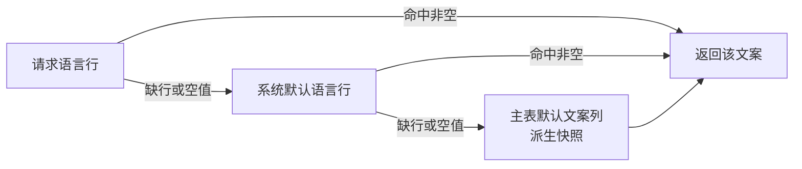

# 业务文案 i18n 附表与用户时区偏好详细设计（统一回退链 + 附表登记 + 偏好维护）

> 通用能力 · 05 国际化 · 02 业务文案 i18n 附表与用户时区偏好 · 详细设计

[文档首页](../../../../../../文档首页.md) › [08 通用能力](../../../../README.md) › [国际化](../../05_国际化.md) › [业务文案 i18n 附表与用户时区偏好](../05_国际化_02_业务文案i18n附表与用户时区偏好.md) › 详细设计　|　[需求 06-2](../../../../需求/06_需求_国际化.md#r06-2) · [阶段计划](../../../../计划/01_计划_通用能力.md) · [概要 · 国际化管理](../../../../../../设计/概要设计/29_概要设计_国际化管理.md)

## 1. 概述 <a id="overview"></a>

- **目标**：把「业务数据本身的多语言」与「用户时区偏好」这两块从「各域各写一套、缺少一级回退、没有维护入口」补成**全平台统一口径的能力面**。

  1. **统一回退链（三级）**：`{主表}_i18n` 附表读取按「请求语言 → 系统默认语言 → 主表默认文案列（派生快照）」回退，一次 SQL 取两级、内存按优先级合并；`locale` 比较一律大小写不敏感（数据规范 §5）。回退目标里的「系统默认语言」取语言清单能力域（`locale_registry.default_locale()`），不写死语言标识。
  2. **附表登记台账**：`{主表}_i18n` 附表**逐项登记、不全表附挂**——已落库 6 张（菜单 / 字段 / 业务码 / 动作码 / 模块名 / 图标名）+ 待落地 5 张（邮件模板 / 公告 / 帮助文章 / 工作台卡片 / 自建字段，随各自任务）+ 字典 label 走通用数据源的 `DictI18nSpec`；台账落《数据库设计 · 国际化管理》，数据规范 §5 改为引用；加**模型 ↔ 台账一致性护栏**防漏登记。
  3. **同生命周期**：主表软删时附表**同事务连带软删**（消除孤儿行），验收项「主表删除附表不残留」当场成立。
  4. **多文案列**：助手支持多文案列（邮件模板 `subject` + `content`、帮助文章标题 + 正文），后续任务零改造接入。
  5. **用户时区偏好**：个人中心维护 `sys_user.locale` / `sys_user.timezone`（登录即可、仅本人），时区按 IANA 白名单校验（非法即拒 `44009`）、语言必须已登记且启用（`44010`）；未设置时按「生效语言 → 时区」映射派生，接口同时返回**存值**与**生效值**。
  6. **存储 UTC、展示按偏好**：接口时间契约保持 UTC ISO 不变，另在基座提供时区格式化工具，供后端产物（导出 Excel / PDF / 通知内容）按用户时区渲染。

- **依据**：需求 [06-2](../../../../需求/06_需求_国际化.md#r06-2)；《[概要设计 · 国际化管理](../../../../../../设计/概要设计/29_概要设计_国际化管理.md)》§2.2 / §4 / §6；《[架构设计 · 国际化](../../../../../../设计/架构设计/24_架构设计_子系统_国际化.md)》§3 / §5；《[数据规范](../../../../../../设计/数据库设计/02_数据库设计_数据规范.md)》§4 / §5；《[国际化规范](../../../../../../规范/国际化规范.md)》§6 / §7；《[数据库开发规范](../../../../../../规范/数据库开发规范.md)》；《[测试规范](../../../../../../规范/测试规范.md)》；05_01 [详细设计](../../05_国际化_01_语言清单与语言包/设计/01_详细设计_05_01_语言清单与语言包.md)（语言清单能力域与默认语言来源）。
- **范围**：上述 1~6；基座 `bms_core/repositories/i18n.py` 与 `bms_core/dict/table.py`、新增 `bms_core/i18n/timezone.py` 与 `bms_core/i18n/attachments.py`；`bms_platform/services/i18n_text.py`；user 域新增 `profile` 端点；菜单表单与权限元数据 7 个删除路径；错误码 `44009` / `44010`；`[i18n]` 配置节扩两项；护栏脚本 `check_i18n_attachments.py`；文档台账与数据规范回写。
- **不含（归口见 §8）**：**前端**个人中心语言 / 时区偏好页、`Intl` 时间与数字本地化、顶栏语言切换（**阶段十五**，与 05_01 同口径）；公告 / 帮助文章 / 邮件模板 / 工作台卡片 / 自建字段的**表与附表**（07_02 / 12_01 / 07_03 / 11_01 / 10_01，本任务只登记口径）；运行时通知按收件人语言渲染（07_03）；`sys_user_preference` 偏好存储真实实现（用户喜好模块）。

## 2. 现状与差距（设计 vs 代码不符清单） <a id="gap"></a>

> 动手前对账结果。「处置」列写明本段改什么、回写什么、留什么。

| # | 关注点 | 需求 / 规范要求 | 代码现状 | 处置 |
| --- | --- | --- | --- | --- |
| 1 | 回退链级数 | 数据规范 §5：附表缺该 locale → 回退**系统默认语言** → 再回退主表默认文案列 | `load_i18n` 只按精确 locale 取；服务层 `i18n.get(id, row.name)` 只做两级（请求语言 → 主表列），**缺默认语言一级** | **本段改**：`load_i18n` 增 `locales` 优先级序 + 一次取两级 |
| 2 | locale 比较 | 规范：比较一律**大小写不敏感** | `model.locale == locale` 精确比较，`zh-cn` 存量行取不到 | **本段改**：`func.lower()` 比较 |
| 3 | 默认语言来源 | 05_01 定稿：默认语言由清单标记确定，不写死 | `i18n_text.request_locale` / `derive_default_name` 仍用常量 `DEFAULT_LOCALE` / `SUPPORTED_LOCALES`（05_01 设计 §4.13 未闭环） | **本段改**：新增 `current_default_locale` 上下文，`locale_scope` 写入；两函数改读 |
| 4 | 主表删除清理 | 完成标准：主表删除附表不残留 | 7 个删除路径只 `soft_delete(主表)`，附表行**永久残留** | **本段改**：新增 `soft_delete_i18n` 并在 7 处调用 |
| 5 | 多文案列 | 邮件模板 `subject` + `content`、帮助文章标题 + 正文 | `replace_i18n` / `load_i18n` 硬编码 `name` 单列 | **本段改**：文案列参数化，多列走 `text_columns` |
| 6 | 附表登记 | 任务书第 2 条：逐项登记，不全表附挂 | 各表散落在总览一行、30 章节一句，无台账；`sys_mail_template_i18n` 等只存在于文本提及 | **本段建**：《国际化管理》「i18n 附表登记」节 + `attachments.py` 常量 + 护栏 |
| 7 | 字典 label | 需求：字典 label 多语言 | 字典六表 + 3 张 `_i18n` 已于 02_09 拆除；`DictTableDataSource` 已支持 `DictI18nSpec` 左连，但**只回退主表列**，缺默认语言一级 | **本段改**：`DictI18nSpec` 支持默认语言回落（二次 join + `coalesce` 三级） |
| 8 | 语言偏好读写 | 需求：个人中心维护 | `sys_user.locale` 列与登录返回已有；**无任何读写端点**，`users.py` 明写「不含 locale / timezone」 | **本段建**：`GET/PUT /api/v1/profile/preferences` |
| 9 | 语言偏好校验 | 需求：时区非法拒；语言须可用 | 建号接口可写任意串，无校验 | **本段改**：登记 + 启用校验（44010） |
| 10 | 时区校验 | 需求：非法时区保存被拒 | 无任何校验 | **本段改**：`zoneinfo.available_timezones()` 白名单（44009） |
| 11 | 缺省时区 | 需求：未设置时取默认语言时区 | 无概念 | **本段定**：`[i18n.timezone_by_locale]` 映射 + `default_timezone` 兜底 |
| 12 | 存储 UTC / 展示按偏好 | 数据规范 §4：时间存 UTC，展示层换算 | 全平台 UTC 契约已成立；后端产物（导出 / PDF）无时区换算工具 | **本段做**：基座 `timezone.py` 格式化工具（接口契约不变） |
| 13 | 错误码 | 概要 §7：44xxx 段 | `44xxx` 已用 44001~44008 | **本段改**：补 44009 / 44010 + 异常类 + HTTP 映射 |
| 14 | 契约与前端类型 | 后端开发规范：端点必须进公开契约 | 新增 2 端点 | **本段改**：`ops.contract_snapshot export`；推送前重建 `frontend/packages/api_types` |
| 15 | 域布局登记 | 后端开发规范：一域一目录 + `domain_layout.json` | user 域已有；新增 `api/profile.py` 属同域新文件 | **本段改**：域布局生成物随清单重渲（若有路径变更） |
| 16 | 机器护栏 | 本段新增台账，须防漏登记 | 无 | **本段建**：`scripts/tools/base_check/check_i18n_attachments.py` |
| 17 | Kiwi 编号 | 测试规范：先取号再编码 | 最近用号 2404（05_01） | **本段首步**：容器内 `bms-kiwi` 登记取号 |

## 3. 交付物清单 <a id="tree"></a>

```text
backend/
├── config.toml                                    # 改：[i18n] 增 default_timezone / timezone_by_locale
├── config.dev.toml                                # 改：同基线（dev 覆盖同值）
├── libs/bms_core/src/bms_core/
│   ├── core/error_codes.py                        # 改：44009 / 44010 + HTTP 映射
│   ├── core/exceptions.py                         # 改：TimezoneInvalidError / UserLocaleInvalidError
│   ├── core/config.py                             # 改：I18nSettings 增 default_timezone / timezone_by_locale
│   ├── i18n/base.py                               # 改：current_default_locale 上下文
│   ├── i18n/timezone.py                           # 新建：时区校验 / 解析 / UTC 换算 / 格式化
│   ├── i18n/attachments.py                        # 新建：i18n 附表登记常量（台账代码侧事实源）
│   ├── repositories/i18n.py                       # 改：locales 优先级 / 多文案列 / soft_delete_i18n
│   └── dict/table.py                              # 改：DictI18nSpec 默认语言回落（二次 join）
├── libs/bms_core/tests/
│   ├── i18n/test_timezone.py                      # 新建：校验 / 缺省 / 换算 / 格式化
│   ├── i18n/test_i18n_attachments.py              # 新建：台账常量与模型一致性
│   └── repositories/test_i18n_repository.py       # 新建：回退链 / 多列 / 连带清理
├── services/platform/src/bms_platform/
│   ├── api/locale.py                              # 改：locale_scope 写 current_default_locale
│   ├── services/i18n_text.py                      # 改：默认语言读清单上下文
│   ├── domains/user/api/profile.py                # 新建：GET/PUT /profile/preferences
│   ├── domains/user/schemas/profile.py            # 新建：请求 / 响应
│   ├── domains/user/services/profile.py           # 新建：校验 + 生效值派生 + 持久化
│   ├── domains/user/api/router 注册（api/__init__.py / router.py）  # 改：挂 profile 路由
│   ├── domains/menu_form/services/menu.py         # 改：4 个删除路径连带清理附表
│   └── domains/permission_meta/services/permission_meta.py、api/icon.py  # 改：3 个删除路径连带清理
├── services/platform/tests/
│   ├── users/test_profile_preferences.py           # 新建：接口与校验分支
│   ├── services/test_i18n_fallback_cleanup.py     # 新建：三级回退 / 大小写 / 删除连带清理
│   └── users/test_profile_preferences.py          # 新建：偏好接口与校验分支
└── scripts/tools/base_check/check_i18n_attachments.py   # 新建：模型 ↔ 台账一致性护栏

frontend/packages/api_types/                       # 推送前重建（生成物，零手工改）
bms文档/…/05_国际化_02_…/设计、实施、测试            # 本文档 + 实施 / 测试记录
```

## 4. 领域设计 <a id="design"></a>

### 4.1 回退链与统一助手 <a id="fallback"></a>

**三级回退**（数据规范 §5）：



职责划分（关键）：

- **基座助手负责前两级**（都在附表里，一次 SQL 可取）：`load_i18n(...)` 收 `locales` 优先级序，`WHERE lower(locale) IN (...)`，内存按序取首个非空。
- **第三级由调用方完成**（主表列只有调用方知道哪个字段）：保持现有 `i18n.get(row.id, row.name)` 写法不变。
- 这样助手不感知业务列名，也不引入第二次查询。

**签名（`bms_core/repositories/i18n.py`）**：

| 函数 | 签名要点 | 用途 |
| --- | --- | --- |
| `load_i18n` | `(session, model, key_column, owner_ids, *, locales: Sequence[str], text_column="name")` → `dict[int, str]` | 读路径（两级回退） |
| `load_i18n_texts` | 同上 + `text_columns: Sequence[str]` → `dict[int, dict[str, str]]` | 多文案列读路径（每列独立回退） |
| `load_i18n_all` | 增 `text_column`（缺省 `name`）→ `dict[int, dict[str, str]]` | 维护视图（全部语言单列，保持既有签名） |
| `load_i18n_all_texts` | 同 `text_columns` → `dict[int, dict[str, dict[str, str]]]` | 维护视图（全部语言多列） |
| `replace_i18n` | `(..., texts: Mapping[str, Mapping[str, str]])`（locale → 列 → 文案） | 写路径（软删旧行 + 插新行） |
| `soft_delete_i18n` | `(session, model, key_column, owner_id)` | 主表删除连带清理 |

- `load_i18n` 保留 `text_column` 单列便捷签名，是 `load_i18n_texts` 的单列投影（同层实现，不复制 SQL）。
- 返回结构继续用 `ConcurrentStableDict` / `ConcurrentStableList`（裸集合护栏）。
- `replace_i18n` 的 `texts` 为空映射时等价于「清空该主表行全部文案」（软删不插行），语义与现有实现一致。

### 4.2 附表登记台账 <a id="attachments"></a>

台账**双处同源**：代码常量 `bms_core/i18n/attachments.py::I18N_ATTACHMENTS` 为机器可读事实源，文档《数据库设计 · 国际化管理》「i18n 附表登记」节为人类可读视图，护栏断言两者一致。

`I18N_ATTACHMENTS` 行结构（`I18nAttachment` 值对象）：`table`（附表名）/ `owner_table`（主表）/ `key_column` / `text_columns` / `db`（`platform` / `tenant`）/ `status`（`landed` / `pending`）/ `owner_task`（待落地归口）。

| 附表 | 主表 | 文案列 | 状态 | 归口 |
| --- | --- | --- | --- | --- |
| `sys_menu_i18n` | `sys_menu` | `name` | 已落库 | 08 菜单管理 |
| `sys_field_i18n` | `sys_field` | `name` | 已落库 | 08 菜单管理 |
| `sys_business_i18n` | `sys_business` | `name` | 已落库 | 08 菜单管理 |
| `sys_action_i18n` | `sys_action` | `name` | 已落库 | 08 菜单管理 |
| `sys_module_i18n` | `sys_module` | `name` | 已落库 | 03 模块注册 |
| `sys_icon_i18n` | `sys_icon` | `name` | 已落库 | 03_03 自定义图标 |
| `sys_mail_template_i18n` | `sys_mail_template` | `subject`、`content` | 待落地 | 07_03 邮件与短信通知 |
| `sys_help_article_i18n` | `sys_help_article` | `title`、`content` | 待落地 | 12_01 帮助内容维护 |
| `sys_dashboard_card_i18n` | `sys_dashboard_card` | `name` | 待落地 | 11_01 首页工作台 |
| `sys_field_ext_i18n` | `sys_field_ext` | `name` | 待落地 | 10_01 表单定制 |
| `sys_notice_i18n` | `sys_notice` | `title`、`content` | 待落地 | 07_02 公告管理 |

- **字典 label 不入台账**：字典无独立 i18n 附表（02_09 已拆除），多语言由通用数据源 `DictI18nSpec` 按需挂载（§4.5），台账「字典」行改为**口径说明**而非表登记。
- **不做全表无差别附挂**：仅「面向用户的文本列」挂附表；技术列（`code` / `path` / `key`）不挂。
- 待落地行的文案列只是**约定**，建表时以该任务表文件为准并回填台账（护栏按 `status` 区分强弱：`landed` 必须模型存在且列名一致；`pending` 只校验表名不重复）。

### 4.3 多文案列 <a id="multi-column"></a>

- 读：`load_i18n_texts(..., text_columns=("subject", "content"))` 一次 SQL 取 `(key, locale, subject, content)`，每列**独立**按 `locales` 优先级回退；某列两级都空则不返回该键，由调用方回落主表列。
- 写：`replace_i18n(..., texts={"zh-CN": {"subject": "...", "content": "..."}})`，软删旧行后按 locale 插入一行、多列同写。
- 单列场景调用方写 `texts={loc: {"name": value}}`；本段为存量 6 张附表的调用点统一改造为显式列名，避免「默认列」隐式假设。

### 4.4 主表删除连带清理 <a id="cleanup"></a>

7 个删除路径在**同一事务**内先清理附表再软删主表（顺序保证：先附表后主表，任何一步失败都回滚，不留半态）：

| 域 | 服务方法 | 附表 |
| --- | --- | --- |
| menu_form | `delete_menu` | `sys_menu_i18n`（`menu_id`） |
| menu_form | `delete_form` | 无（表单无名称附表） |
| menu_form | `delete_button` | 无（按钮无名称附表） |
| menu_form | `delete_field` | `sys_field_i18n`（`field_id`） |
| permission_meta | `delete_business` | `sys_business_i18n`（`business_id`） |
| permission_meta | `delete_action` | `sys_action_i18n`（`action_id`） |
| permission_meta | `delete_icon` | `sys_icon_i18n`（`icon_id`，经 `IconStore.delete`） |

- 表单 / 按钮当前无附表，设计上显式标注「无」，避免被误认为漏改。
- **模块（`sys_module`）不涉及**：平台注册域无模块删除入口（只能注册 / 停用），故 `sys_module_i18n` 无连带清理路径；将来若新增模块删除入口，须同步补 `soft_delete_i18n`。
- 表单删除在存在字段时即拒绝（「表单存在按钮 / 字段，先删除」），因此不存在「删表单级联删字段」的路径。

### 4.5 字典 label 回退 <a id="dict"></a>

`DictI18nSpec` 现为单次 `outerjoin` + `coalesce(i18n.name, label_col)`。本段改为**两级 join**：

```text
LEFT JOIN {表}_i18n AS primary  ON primary.{key} = t.id AND lower(primary.locale) = :locale
LEFT JOIN {表}_i18n AS fallback ON fallback.{key} = t.id AND lower(fallback.locale) = :default_locale
label = coalesce(primary.name, fallback.name, t.{label_col})
```

- 默认语言来源：`DictTableDataSource.__init__` 增 `fallback_locale: Callable[[], str] | None`（**运行时取值**，不在构造时固定，否则租户切默认语言后陈旧）；为 `None` 时退化为现有单 join（纯函数 / 单测口径）。
- `dict_specs.py` 的 4 处 `DictI18nSpec` 装配传入该 provider（`lambda: get_locale_registry_default()`，从应用态取）。
- 字典缓存键已含 locale 维度（`bms:{tenant}:dict:{locale}:{type}`），默认语言变更经 05_01 的清单失效链路连带失效，无需新增失效点。

### 4.6 用户语言 / 时区偏好 <a id="profile"></a>

**接口**（user 域，独立前缀，登录即可、仅本人）：

| 方法 | 路径 | 说明 | 权限 |
| --- | --- | --- | --- |
| GET | `/api/v1/profile/preferences` | 读本人语言 / 时区偏好（存值 + 生效值） | 登录即可 |
| PUT | `/api/v1/profile/preferences` | 设置本人语言 / 时区偏好（部分更新） | 登录即可 |

- **请求体**：`{locale?: string|null, timezone?: string|null}`；按 `model_fields_set` 判定「未传＝不修改」，传 `null` ＝清空（回退缺省）。两字段都不传 → `10001`（无变更）。
- **响应体**：`{locale, timezone, effectiveLocale, effectiveTimezone}`。
  - `locale` / `timezone`：库内存储值（可空）；
  - `effectiveLocale`：`locale` 非空且在启用清单中 → 该值；否则系统默认语言；
  - `effectiveTimezone`：`timezone` 非空 → 该值；否则按 `effectiveLocale` 查 `[i18n.timezone_by_locale]`；再缺 → `[i18n].default_timezone`。
- **为什么生效时区按 `effectiveLocale` 而非系统默认语言**：用户已显式设了语言偏好时，按其语言取时区更符合预期；未设语言时 `effectiveLocale` 即系统默认语言，与需求「取默认语言时区」字面一致（决策记录 §10-9）。
- **校验**：
  1. `timezone` 非空且不在 `zoneinfo.available_timezones()` → `44009`（400）；
  2. `locale` 非空且不在启用语言清单（大小写不敏感）→ `44010`（400）；
  3. 两字段类型 / 长度由 schema 约束（`max_length=16` / `64`）。
- **持久化**：`UserRepository.update(user_id, locale=..., timezone=...)`（白名单字段，一次 UPDATE）；不写 `sys_user_preference`（需求明确落 `sys_user` 列）。
- **不发事件、不审计**：偏好属展示与交互状态，不承载业务事实（架构 07「用户偏好」节）；与 `sys_user` 其它字段更新隔离，避免污染 `sys.user.updated` 事件流。
- **登录返回**：`credentials.py` 已返回 `locale` / `timezone` 原值；本段补 `effectiveTimezone`（同派生口径，供前端首屏即按偏好渲染）。

### 4.7 基座时区工具 <a id="tzutil"></a>

`bms_core/i18n/timezone.py`（纯函数，无 IO）：

| 函数 | 说明 |
| --- | --- |
| `is_valid_timezone(name)` | `name in available_timezones()`（结果集合模块级缓存，避免每次重建 598 条集合） |
| `resolve_timezone(locale, by_locale, default)` | 生效时区派生（§4.6 第 2 步） |
| `to_local(utc_naive, tz_name)` | UTC naive → 指定时区 aware datetime（非法时区抛 `ValueError`，业务码由 API 层校验时给出） |
| `format_datetime(utc_naive, tz_name, *, pattern="%Y-%m-%d %H:%M")` | 供导出 / PDF / 通知内容渲染；**不参与接口契约** |

- 为什么放在基座：导出（04 系列）、PDF 打印、通知内容三类后端产物都要用，放任一域都会跨域 import。
- 展示职责仍在前端（`Intl.DateTimeFormat`），后端工具只服务「后端自己生成文本」的场景，避免两套口径打架。

### 4.8 配置节 <a id="config"></a>

```toml
[i18n]
# 既有四项（05_01）…
default_timezone = "Asia/Shanghai"   # 时区兜底（语言映射缺失 / 语言未映射时用）

[i18n.timezone_by_locale]
# 语言 → 时区（未设置时区时的缺省来源；新增语言在这里加一行）
zh-CN = "Asia/Shanghai"
en-US = "UTC"
```

- `I18nSettings` 增两字段：`default_timezone: str = "Asia/Shanghai"`、`timezone_by_locale: dict[str, str] = {...}`；启动期校验每个值都在 `available_timezones()`（配错即拒启，不等到运行时才 500）。语言键统一按 `zh-CN` 形态存储、查表时小写归一。
- 并入 `[i18n]` 而非新开 `[timezone]`：时区归属国际化能力域，避免 `Settings` 再多一个节与别名。

### 4.9 错误码与异常 <a id="errors"></a>

| 错误码 | 异常类 | HTTP | 含义 |
| --- | --- | --- | --- |
| 44009 | `TimezoneInvalidError` | 400 | 时区标识非法（不在 IANA 清单） |
| 44010 | `UserLocaleInvalidError` | 400 | 语言偏好未登记或未启用 |

- 两者挂在 `44xxx` 国际化段，继承 `BizError`；错误文案走语言包 `error.44009` / `error.44010`（05_01 的 `error.*` 种子护栏会自动要求补种，否则护栏用例失败）。

### 4.10 机器护栏 <a id="guard"></a>

`scripts/tools/base_check/check_i18n_attachments.py`（登记进 `RUNNABLE_STEPS` 与 `SCRIPT_INCREMENTAL`，提交环增量、预检全量）：

1. 扫描 `bms_core/models/**` 中 `__tablename__` 以 `_i18n` 结尾的模型类；
2. 断言每张表都在 `I18N_ATTACHMENTS`（漏登记即失败）；
3. 断言 `status="landed"` 的行：模型存在、`text_columns` 与模型列名一致、`key_column` 存在；
4. 断言文档《数据库设计 · 国际化管理》正文出现 `I18N_ATTACHMENTS` 每张表名（文档台账漂移即失败）；
5. `status="pending"` 行只校验表名唯一。

### 4.11 契约、域布局与前端类型 <a id="contract"></a>

- 新增端点计入 platform 公开契约：`python -m ops.contract_snapshot export` 重建 `deploy/contracts/platform.json`；
- 推送前重建 `frontend/packages/api_types`（`cd frontend/packages/api_types && node scripts/generate.mjs`）——不改会红在 CI 类型门禁；
- `deploy/boundaries/domain_layout.json` 为清单生成物：user 域仅新增文件、路径前缀不变，若无 diff 则不改（以生成结果为准）。

## 5. 失败分支与边界 <a id="failures"></a>

| 场景 | 行为 | 依据 / 风险 |
| --- | --- | --- |
| 请求语言与默认语言都缺文案 | 回落主表默认文案列（派生快照，恒非空） | 数据规范 §5 |
| 附表存在但该行文案为空串 | 视为缺失，继续下一级回退 | 「去空白为空即缺失」 |
| 存量 locale 大小写不一（`zh-cn`） | `lower()` 比较后命中，不报错 | 规范「比较大小写不敏感」 |
| 请求语言未登记 | 由 `locale_scope` 回退系统默认语言，读路径拿到的是默认语言，再回退主表列 | 05_01 已有行为 |
| 默认语言也停用（清单异常） | `default_locale()` 仍返回标记值；回退链不抛错 | 清单保护已禁止停用默认语言 |
| 主表删除时附表无行 | `soft_delete_i18n` 影响 0 行，正常返回 | 幂等 |
| 删除表单级联字段 | 表单删除 → 字段批量软删 → 字段附表连带软删（同一事务） | 不留孤儿 |
| 时区不在 IANA 清单 | `44009`（400），不落库 | 验收「非法时区保存被拒」 |
| 时区为 `UTC+08:00` 类固定偏移 | 同 `44009` 拒绝 | 固定偏移无夏令时、无法反推 IANA 名（§10-10） |
| 语言未登记 / 已停用 | `44010`（400） | 防止登录后语言包为空 |
| 语言大小写不同但等价（`zh-cn`） | 归一为清单内标准形态后落库 | 与 `sys_user.locale` 口径一致 |
| 请求体两字段都未传 | `10001`（业务错误统一 HTTP 200 + `code`，与 `ParamError` 既有约定一致），不产生空 UPDATE | 避免无意义写与审计噪声 |
| 显式传 `null` | 清空存储值，响应回退生效值 | 「未设置 → 取默认」语义 |
| 用户不存在（会话与库不一致） | `UserNotFoundError`（10002） | 与既有用户端点同口径 |
| 配置里 `timezone_by_locale` 值非法 | **启动失败**（配置校验），不静默降级 | 配错应在部署期暴露 |
| 配置缺某语言的时区映射 | 回落 `default_timezone`，记 WARNING 一次 | 不为单个语言阻断保存 |
| `zoneinfo` 缺 tzdata（容器镜像） | 启动期校验即失败；镜像须装 `tzdata` | 实测本机 598 个时区可用 |
| 字典未配 `fallback_locale` | 退化为单 join（现状行为） | 纯函数 / 单测 / 产品仓未装配时 |
| Redis / 缓存 | 本段不改缓存链路；偏好读取直连库（单次 PII 级查询，无需缓存） | 避免与清单缓存耦合 |
| 并发改同一用户偏好 | 后写覆盖（无乐观锁） | 本人单端操作，冲突无业务后果；不加 `version` 校验 |

## 6. 测试设计与验收映射 <a id="tests"></a>

**Kiwi**：实施首步在容器内 `bms-kiwi` 按《[KiwiTCMS 部署使用说明](../../../../../../资料/开发服务器/linux/KiwiTCMS部署使用说明.md)「用例登记」节登记（分类「平台骨架」、优先级 `P2`、状态 `CONFIRMED`、标签「自动化」），**本任务登记 1 条**（多断言共用），取得编号后回填 `@pytest.mark.kiwi_id(<编号>)`。

| 完成标准（任务书 §3 / 需求 06-2） | 用例 |
| --- | --- |
| 业务文案在两种 locale 下返回对应语言 | `test_i18n_repository`（`load_i18n` 命中 zh-CN / en-US 各自文案） |
| 缺省回退正确（三级） | `test_i18n_repository`（缺请求语言 → 命中默认语言；两级都缺 → 返回空由主表列兜底）+ `test_i18n_fallback_cleanup`（服务层 `i18n.get(id, row.name)` 结果） |
| 大小写不敏感 | `test_i18n_repository`（存量 `zh-cn` 行被 `zh-CN` 请求命中） |
| 主表删除附表不残留 | `test_i18n_fallback_cleanup`（删菜单 → 附表无活行；删表单 → 字段附表无活行；删业务码 / 动作码 / 图标 / 模块同） |
| 多文案列 | `test_i18n_repository`（`subject` / `content` 各自独立回退，互不影响） |
| 附表台账与模型一致 | `test_i18n_attachments`（模型集合 == `landed` 集合；pending 行表名唯一） |
| 字典 label 两种 locale + 回退 | `libs/bms_core/tests/dict/test_table_i18n_fallback.py`（请求语言命中 / 缺则默认语言 / 两级缺则主表列） |
| 切换时区后存储值不变、生效值变 | `test_profile_preferences`（PUT `timezone=UTC` → 再 PUT 回 `Asia/Shanghai`；库内值随之变，接口其它字段不受影响；**存储始终为原样 IANA 名**） |
| 未设置时区 → 生效值取默认语言时区 | `test_profile_preferences`（不传 timezone → `effectiveTimezone` == `timezone_by_locale[effectiveLocale]`） |
| 非法时区保存被拒 | `test_profile_preferences`（`Mars/Base` → 44009；`UTC+08:00` → 44009） |
| 语言未登记 / 停用被拒 | `test_profile_preferences`（`fr-FR` → 44010；新登记后启用 → 通过） |
| 偏好接口权限 | `test_profile_preferences`（未登录 401；登录用户读到的是本人值） |
| 基座时区工具 | `test_timezone`（校验命中 / 未命中、缺省派生、UTC→本地换算、格式化、非法时区抛错） |
| 错误码文案种子完整 | 既有 `test_error_seed_coverage`（新增 44009 / 44010 后仍须全绿，缺种子即失败） |
| 配置校验 | `test_timezone`（非法 `default_timezone` 触发配置校验失败） |

**替身与真机边界**：全部用例用临时 SQLite（`Base.metadata.create_all`）+ `fakeredis`（字典缓存路径）；**不需要真 Redis**（本段不改缓存链路）。`zoneinfo` 用真实 tzdata（本机已装，镜像须声明依赖）。

**覆盖率**：口径见《[AI开发规范](../../../../../../规范/AI开发规范.md)》「覆盖率要求」节——新增 / 改动模块 100% 行 + 分支；不可达分支（如配置校验中 `zoneinfo` 抛 `ZoneInfoNotFoundError` 的兜底）须带理由标注。

## 7. 登记落点 <a id="registry-writeback"></a>

| 文档 / 清单 | 回写内容 |
| --- | --- |
| 《[30_数据库设计_国际化管理](../../../../../../设计/数据库设计/30_数据库设计_国际化管理.md)》 | 新增「i18n 附表登记」节（11 行台账 + 字典口径说明）；变更记录 v2 |
| 《[数据规范](../../../../../../设计/数据库设计/02_数据库设计_数据规范.md)》§5 | 附表登记改为引用 §「i18n 附表登记」；补「主表删除连带清理」与「多文案列」两条约定 |
| 《[sys_user 表文件](../../../../../../设计/数据库设计/数据表设计/sys_user.md)》 | `locale` 示例 `zh-cn` → `zh-CN`；`timezone` 补「IANA 标识、白名单校验」口径；变更记录 |
| 《[概要设计 · 国际化管理](../../../../../../设计/概要设计/29_概要设计_国际化管理.md)》 | §5 补两偏好端点；§7 补 44009 / 44010；§4 附表清单与实际一致 |
| 《[架构设计 · 国际化](../../../../../../设计/架构设计/24_架构设计_子系统_国际化.md)》 | §3 补三级回退与附表登记；§5 补时区校验与缺省派生 |
| 《[国际化规范](../../../../../../规范/国际化规范.md)》§6 / §7 | 附表回退三级、主表删除连带清理、多文案列、时区校验与缺省 |
| 《[后端基类清单](../../../../../../后端基类清单.md)》 | 基座工具 `i18n/timezone.py` / `i18n/attachments.py` 落点登记 |
| 《[计划 · 通用能力](../../../../计划/01_计划_通用能力.md)》 | `05_02` 按该文档口径归档到 §2「已完成任务」；§7 待办补前端偏好页 |
| 《[需求 06-2](../../../../需求/06_需求_国际化.md#r06-2)》 | 追加交付注块（范围 / 用例号 / 遗留归口） |
| 任务目录 `实施/`、`测试/` | 实施记录与测试记录 |

## 8. 边界与开放项 <a id="boundary"></a>

1. **前端（阶段十五）**：个人中心语言 / 时区偏好页、`Intl` 时间与数字本地化、顶栏语言切换、RTL 布局——后端接口与生效值已就位，前端零接口改动接入。
2. **5 张待落地附表**：公告 / 帮助文章 / 邮件模板 / 工作台卡片 / 自建字段随各自任务建表；本段只登记约定（`pending` 行），建表时回填 `text_columns` 与 `status=landed`。
3. **孤儿附表巡检**：当前删除入口已全覆盖，不做定时巡检；若后续出现新的物理删除入口，再评估补巡检作业（登记为后续项）。
4. **偏好无缓存**：偏好每请求最多一次主键查询（本人），不引入缓存以避免与 `sys_user` 更新一致性问题；若 P95 受影响再评估。
5. **时区不支持固定偏移**：`UTC+08:00` 类值一律拒绝；若后续确有需求，需定义「偏移 → IANA 反查」规则后再放开。
6. **`sys_user_preference` 与 `sys_user.timezone` 双源问题**：语言 / 时区偏好落 `sys_user` 列（需求明确），列表类偏好落 `sys_user_preference`；两者职责在架构 07 已分开，本段不改偏好存储实现。
7. **默认语言变更后的偏好落点**：用户已设 `locale` 被停用后，`effectiveLocale` 回退默认语言，但库内值不改写（下次用户主动保存才会归一）——避免后台批量改用户数据；该行为在设计与测试中显式登记。
8. **文档门禁口径**：只改文档走 `check_links` + `check_docs_scope` + `engkit eol`；改代码跑 `scripts/tools/preflight/测试改动内容.py`（用 `backend/.venv/Scripts/python.exe`）；推送走 `scripts/tools/preflight/推送.py`。

## 9. 实施步骤 <a id="steps"></a>

| 批次 | 内容 | 验证 |
| --- | --- | --- |
| 0 | **取 Kiwi 编号**（容器内登记，分类「平台骨架」） | 取得编号 |
| 1 | 基座：`repositories/i18n.py` 三级回退 + 多列 + `soft_delete_i18n`；`i18n/timezone.py`；`i18n/attachments.py`；`i18n/base.py` 上下文；错误码 / 异常；`I18nSettings` 两字段 + 启动校验 | `pytest libs/bms_core/tests/i18n libs/bms_core/tests/repositories -q` |
| 2 | 接线：`locale_scope` 写默认语言上下文；`i18n_text` 改读；存量 6 张附表消费点改造（menu_form / permission_meta / dict_specs） | 同上 + `pytest services/platform/tests/i18n -q` |
| 3 | 删除连带清理：7 个删除路径 + `FieldRepository.delete_by_form` | `pytest services/platform/tests/i18n/test_i18n_cleanup.py -q` |
| 4 | 偏好端点：schemas / services / api / 路由挂载 | `pytest services/platform/tests/users/test_profile_preferences.py -q` |
| 5 | 护栏与契约：`check_i18n_attachments.py` 登记 + `ops.contract_snapshot export` | 护栏跑通；契约快照含两新端点 |
| 6 | 回写与记录：§7 全部登记落点 + 实施 / 测试记录 + 计划归档 + 需求注块 | 文档三门禁 0 |
| 7 | 交付闸门：开发环 `测试改动内容.py` → 重建前端类型 → 推送入口 | 预检全绿（覆盖率行 + 分支 100%） |

每批独立提交（代码 `feat(i18n)` / 文档 `docs(08)`），只暂存本次相关文件。

## 10. 决策记录 <a id="align"></a>

| # | 决策 | 备选与取舍 |
| --- | --- | --- |
| 1 | 交付边界 = **仅后端**（用户拍板） | 连前端偏好页一起做：可端到端验收，但与阶段八边界冲突且需先补原型；只做回退链：需求 06-2 无法闭环 |
| 2 | 回退落点 = **基座助手统一两级回退**（用户拍板） | 服务层逐个补：12+ 调用点各写一遍、口径必漂移；新增能力域：当前只有 SQL 一种实现，抽象成本高于收益 |
| 3 | 默认语言来源 = **`locale_registry.default_locale()`**（用户拍板） | 常量：租户切默认语言后回退目标错；常量 + 断言：运行期仍错 |
| 4 | 存量 6 张附表**全部改造**（用户拍板） | 只做基座：同平台两套口径；留待收口：改动面更大 |
| 5 | 待落地附表**只登记不预建**（用户拍板） | 预建 5 张：字段与归属库要等主表定稿，返工风险高 |
| 6 | 字典**复用 `DictI18nSpec` 补一级回退**（用户拍板） | 不碰字典：回退口径差一级；重建字典附表：推翻 02_09 拍板 |
| 7 | 台账落 **30 章节 + 数据规范引用**（用户拍板） | 只写详细设计：收口后不在主线；新建文档：与双台账模式重复 |
| 8 | 加 **模型 ↔ 台账一致性护栏**（用户拍板） | 靠纪律：两个任务后台账即失真 |
| 9 | 生效时区按 **`effectiveLocale`** 派生（本设计定） | 严格按系统默认语言：用户设了 en-US 仍拿东八区，反直觉；两者在「未设语言」时等价，故不影响需求字面成立 |
| 10 | 时区**只收 IANA**，拒固定偏移（用户拍板） | 允许 `UTC+08:00`：无夏令时、无法反推 IANA 名、前后端口径分叉 |
| 11 | 偏好接口 **`/profile/preferences`**（用户拍板） | `/users/me`：路由顺序坑 + 管理面语义混；`/preferences/{key}`：与 `sys_user` 列双源 |
| 12 | 权限 = **登录即可**（用户拍板） | 挂 `user:update`：普通用户无该码，个人中心存不了 |
| 13 | 语言偏好**必须已登记且启用**（用户拍板） | 只校格式：登录后语言包为空 |
| 14 | 配置并入 **`[i18n]`**（用户拍板） | 新开 `[timezone]`：多一个节与别名，语义割裂 |
| 15 | 响应返回**存值 + 生效值**（用户拍板） | 只返存值：兼底规则前后端各写一遍必漂 |
| 16 | 错误码 **44009 / 44010**（用户拍板） | 复用 44003：语义污染；复用 10001：排障分不清来源 |
| 17 | 删除**同事务连带清理**（用户拍板） | 定时巡检：最长一周期残留，验收不成立；两者都做：过度建设 |
| 18 | 助手**支持多文案列**（用户拍板） | 保持单列：邮件模板落地时再改一次基座，两套写法并存 |
| 19 | Kiwi **1 条**（用户拍板） | 拆 3 条：同一夹具与前置，维护成本 ×3 |
| 20 | 偏好**不审计不发事件**（架构 07 既定） | 纳入审计：偏好非业务事实，会污染审计链 |
| 21 | 推进节奏 **一条龙自动、推送前停** | 每批停下确认：交互轮次多 |

## 11. 参考文档 <a id="ref"></a>

- [需求 06-2](../../../../需求/06_需求_国际化.md#r06-2)
- [概要设计 · 国际化管理](../../../../../../设计/概要设计/29_概要设计_国际化管理.md) §2.2 / §4 / §5 / §7
- [架构设计 · 子系统 · 国际化](../../../../../../设计/架构设计/24_架构设计_子系统_国际化.md) §3 / §5
- [数据库设计 · 数据规范](../../../../../../设计/数据库设计/02_数据库设计_数据规范.md) §4 / §5
- [数据库设计 · 国际化管理](../../../../../../设计/数据库设计/30_数据库设计_国际化管理.md)
- [国际化规范](../../../../../../规范/国际化规范.md) §6 / §7
- [测试规范](../../../../../../规范/测试规范.md)、[AI开发规范](../../../../../../规范/AI开发规范.md)「覆盖率要求」节
- [05_01 详细设计](../../05_国际化_01_语言清单与语言包/设计/01_详细设计_05_01_语言清单与语言包.md)（默认语言来源与上下文口径）

> 本文档依《[文档生成规范](../../../../../../规范/文档生成规范.md)》编写 · 进度以阶段计划为唯一落点
