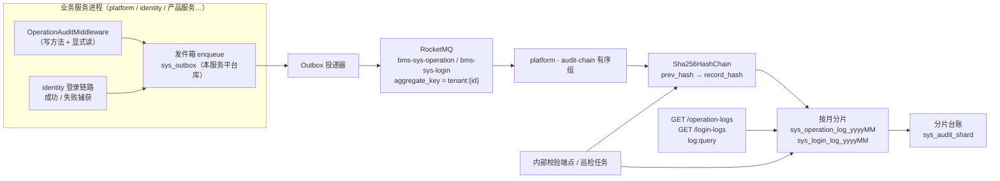

# 操作日志与登录日志详细设计（捕获 / 脱敏 / 链式落库 / 查询 / 链校验）

> 通用能力 · 06 日志与审计 · 01 操作日志与登录日志 · 详细设计

[文档首页](../../../../../../文档首页.md) › [08 通用能力](../../../../README.md) › [日志与审计](../../06_日志与审计.md) › [操作日志与登录日志](../06_日志与审计_01_操作日志与登录日志.md) › 详细设计　|　[需求 05-1](../../../../需求/05_需求_日志与审计.md#r05-1) · [阶段计划](../../../../计划/01_计划_通用能力.md)

## 1. 概述 <a id="overview"></a>

- **目标**：交付「谁在什么时候对什么做了什么」「谁从哪来、失败几次」两类可追溯审计数据，并证明其未被篡改。
  1. **捕获**：操作日志由基座请求中间件捕获；登录日志由认证域（identity）登录链路捕获。
  2. **脱敏**：参数按敏感键名单脱敏后落库，密码 / token / 密钥不落原始值。
  3. **异步链式落库**：事件经事务性发件箱 → RocketMQ → platform 服务 `audit-chain` 有序组消费，逐条 `SHA256(prev_hash + 规范化记录)` 写入按月分片表。
  4. **查询**：操作日志按用户 / 模块 / 动作 / 状态 / 时间范围，登录日志按用户名 / 状态 / IP / 时间范围，均分页 + 详情（权限码 `log:query`）。
  5. **链校验**：真实 SHA256 链实现 + 内部校验端点（归档前强制校验入口）+ 内置巡检任务。
  6. **归档衔接**：热表 90 天保留，本期只提供归档前校验契约与分片台账，迁移归 14_01。
- **依据**：需求 [05-1](../../../../需求/05_需求_日志与审计.md#r05-1)；《[概要设计 · 操作日志](../../../../../../设计/概要设计/11_概要设计_操作日志.md)》§2 / §4 / §5 / §7、《[概要设计 · 登录日志](../../../../../../设计/概要设计/12_概要设计_登录日志.md)》§2 / §4 / §5 / §7、《[架构设计 · 审计哈希链](../../../../../../设计/架构设计/19_架构设计_子系统_审计哈希链.md)》§3 / §4 / §5 / §6、《[架构设计 · 事件总线](../../../../../../设计/架构设计/16_架构设计_子系统_事件总线.md)》§2 / §5 / §6。
- **范围**：
  - `bms_core`：真实哈希链实现、审计事件契约与构造器、参数脱敏、请求审计中间件、登录审计发射器、审计配置节、`require_permission` 记录动作码。
  - `platform` 服务：`log` 域（分片台账 / 分片建表 / 链写入 / 查询 / 校验 / 消费组 / 内部端点）。
  - `identity` 服务：登录成功 / 失败捕获与事件发射（不改动既有锁定判定语义）。
  - 数据设计：新增 `sys_operation_log` / `sys_login_log` / `sys_audit_shard` 表文件与本模块节点文档；平台种子补菜单与权限。
- **不含（归口见 §12）**：字段级变更审计与三权分立回补（06_02）、归档迁移与销毁（14_01）、全文检索同步（阶段十八）、前端页面（阶段十五）、真实三库性能调优。

## 2. 现状与差距（设计 vs 代码） <a id="gap"></a>

| # | 关注点 | 需求要求 | 代码现状 | 处置 |
| --- | --- | --- | --- | --- |
| 1 | 操作日志捕获 | 中间件收集上下文 | 仅有访问日志中间件（不落库、无参数） | **本段建**：新增 `OperationAuditMiddleware`，写发件箱 |
| 2 | 参数脱敏 | 密码 / token / 密钥不落原始值 | 日志渲染有脱敏，审计无入口 | **本段建**：公开 `mask_sensitive`，审计复用同一名单 |
| 3 | action 记录权限码 | `action` = `业务:动作` | 权限依赖无请求态留痕 | **本段改**：`require_permission` 写 `request.state.audit_action` |
| 4 | 登录审计 | 成功 / 失败落库，失败原因可查 | 登录流程只抛异常 + 写锁定记录，无审计事件 | **本段建**：identity 登录端点统一捕获 + 失败原因映射 |
| 5 | 异步链式落库 | 有序消费 + SHA256 链 + 按月分片 | `BaseHashChain` 只有 `NullHashChain`；无日志表、无消费组 | **本段建**：`Sha256HashChain` + `audit-chain` 组 + 分片写 |
| 6 | 查询 | 条件筛选 / 分页 / 详情 / `log:query` | 无模型、无端点、无种子菜单 | **本段建**：4 个查询端点 + 菜单 / 权限种子 |
| 7 | 链校验 | 定期巡检 + 归档前强制 | 无实现 | **本段建**：校验服务 + 内部端点 + 内置任务 |
| 8 | 归档 | 90 天热表交 14_01 | `archive_audit_logs` 仍是占位 | **不改**（只提供校验契约与分片台账），归 14_01 |
| 9 | 分表预创建 | 新月份分片表提前创建 | `precreate_shard_tables` 占位 | **本段改**：真实预创建审计分片（其余表仍归 13） |

## 3. 总体方案 <a id="architecture"></a>



口径：

- **落库位置**：日志表归 platform 服务、存 **platform 服务平台库**（`bms_platform`），带 `tenant_id`；不按租户库分库（审计属平台治理数据，便于跨租户查询与统一归档）。
- **事件域**：沿用已登记事件域 `sys`（`sys.operation.logged` / `sys.login.logged`），topic 派生为 `bms-sys-operation` / `bms-sys-login`。说明：架构 16 §2 的 `bms-log-operation` 为命名示例；新增 `log` 事件域需要新增服务目录行且表前缀须以 `log_` 开头，与既有 `sys_*` 表名冲突，故不改服务目录，按 `sys` 域登记（对齐记录见 §13）。
- **消费组**：平台服务声明 `audit-chain`（`ordered=True`，全组串行），两条事件共用一个组；同租户事件由 `aggregate_key = tenant:{tenant_id}` 保持投递顺序。**部署约束**：同一组不得在两个宿主同时消费（架构 16 §5）。
- **并行消费组说明**：架构 16 §5 另列「日志落库组（并行）」，本段不启用——审计链写入必须串行，拆两个组会重复落库；差异登记见 §13。

## 4. 数据模型与分片 <a id="data"></a>

字段唯一事实源为表文件（不在此复制字段清单）：

- [sys_operation_log](../../../../../../设计/数据库设计/数据表设计/sys_operation_log.md)（逻辑表名，物理按月分片）
- [sys_login_log](../../../../../../设计/数据库设计/数据表设计/sys_login_log.md)（逻辑表名，物理按月分片）
- [sys_audit_shard](../../../../../../设计/数据库设计/数据表设计/sys_audit_shard.md)（分片台账，普通表）

设计要点：

1. **分片键 = 写入时刻（消费时刻）**：消费者按 `occurred_at` 所在月路由分片，避免「延迟事件插入旧月」破坏跨月链；`occurred_at` 单独存列，查询与展示按事件时间筛选。查询路由时在请求时间范围前后各扩一个月覆盖跨月延迟。
2. **链在 (log_type, tenant) 内成链**：每条记录 `record_hash = SHA256(prev_hash + 规范化记录内容)`；`prev_hash` 取同租户**更早分片中最后一条** `record_hash`，无则 `GENESIS_HASH`（64 位零）。同分片内按雪花 `id` 升序成链（单写者保证）。
3. **逻辑表不建实体**：`sys_operation_log` / `sys_login_log` 不进入 `Base.metadata`、不进迁移链；物理分片表由运行期 `ensure_shard` 用 SQLAlchemy Core 建（四方言、`checkfirst`），台账 `sys_audit_shard` 记录已建分片。表归属登记状态为 `planned`（与 `ai_chat_log` 同口径：结构定稿、按月物理建表、不进域清单）。
4. **只追加**：两类日志无更新 / 删除入口；`event_id` 唯一约束兜底消费幂等。分片台账 `sys_audit_shard` 的唯一约束为 `(log_type, shard_month)`（不带 `deleted_at`——台账行不软删，带 NULL 列会让唯一约束失效）。

## 5. 事件契约与载荷 <a id="events"></a>

| 事件 | 触发 | 聚合键 | 载荷（全字段） |
| --- | --- | --- | --- |
| `sys.operation.logged` | 写请求响应完成 / 显式读审计 | `tenant:{tenant_id}`，无租户 `global` | `tenant_id` / `user_id` / `username` / `module` / `action` / `method` / `path` / `query` / `params` / `ip` / `user_agent` / `cost_time` / `status` / `error_msg` |
| `sys.login.logged` | 登录成功 / 失败 | `tenant:{tenant_id}` | `tenant_id` / `user_id` / `username` / `ip` / `user_agent` / `status`（success / failed） / `fail_reason` |

> `occurred_at` / `trace_id` 由**事件信封**承载（信封保留键，载荷不得重复），消费侧按 `EventEnvelope.occurred_at` 取事件时间。

- 契约登记：`bms_core/events/platform_events.py` 追加两条 `EventContract`（版本 `1.0.0`，字段只增不删），同步 `deploy/events/contracts.json` 快照。
- 载荷 `params` 为**已脱敏的 JSON 字符串**（确定性序列化，键排序），便于链规范化逐字节一致；其余字段为标量。
- 事件发布经 `BaseOutboxStore.enqueue`（不直连 MQ），无 MQ 时事件留在发件箱，恢复后补投。

## 6. 操作日志捕获与脱敏 <a id="capture"></a>

### 6.1 中间件 <a id="capture-middleware"></a>

`OperationAuditMiddleware`（纯 ASGI，基座统一装配，最外层之一）：

1. **筛选**：`[audit_log].enabled` 开、路径不在 `exclude_paths`、方法在 `record_methods`（缺省 `POST/PUT/PATCH/DELETE`）或端点显式标记 `audit_read`。
2. **参数**：仅当 `Content-Type` 为 `application/json` / `application/x-www-form-urlencoded` 且 `Content-Length ≤ max_param_bytes`（缺省 8192）时，包装 `receive` 缓冲请求体（原样回放给下游）；其余（multipart / 二进制 / 超限）只记路径与查询串。
3. **上下文**：`user_id`（请求态 / 上下文）、`tenant_id` / `tenant_code`（租户中间件）、`module` / `action`（见 6.2）、`ip`（`X-Forwarded-For` 首值）、`user_agent`、`cost_time`、`status`、`error_msg`（未捕获异常原文 / `HTTP {status}`）、`trace_id`。
4. **发射**：响应结束后（`finally`）以**本服务平台库**短会话 `enqueue` 事件；任何失败只告警（`audit_emit_failed`），**不影响业务响应**。
5. **不记录**：`/healthz` `/readyz` `/metrics` `/docs` `/redoc` `/openapi.json`、认证端点（`/api/v1/auth/login|refresh|logout|introspect`，登录走登录日志）。

### 6.2 action 与 module <a id="capture-action"></a>

- `require_permission(code)` 在**校验前**把首个权限码写入 `request.state.audit_action`（拒绝的请求也留痕），中间件取用。
- `module` = 权限码业务段（`user:create` → `user`）；无权限码端点回落路径首段，`action` = `{module}:{方法动词}`（`POST→create`、`PUT/PATCH→update`、`DELETE→delete`、`GET→query`）。

### 6.3 脱敏 <a id="capture-mask"></a>

- 复用 `[log]` 敏感名单（内置 `password` / `passwd` / `pwd` / `token` / `access_token` / `refresh_token` / `client_secret` / `secret` / `secret_key` / `private_key` / `api_key` / `authorization` / `cookie` / `captcha` / `captcha_code` / `phone` / `mobile` / `email` / `id_card` / `idcard` / `bank_card` + 后缀 `_password` / `_passwd` / `_secret` / `_token`），配置只可追加。
- 新增公开函数 `bms_core.core.logging.mask_sensitive(value)`：递归脱敏（限深 5），命中键值置 `***`，字符串中的连接串密码同样脱敏。
- 中间件对 `query` / JSON body / form body 调用该函数后序列化；**不落原始值**。

## 7. 登录日志捕获 <a id="login"></a>

在 identity 服务 `POST /api/v1/auth/login` 端点统一捕获（不改 `LoginService` 内部流程与锁定语义）：

| 结果 | fail_reason | 说明 |
| --- | --- | --- |
| 成功 | — | `status=success`，`user_id` 取签发结果 |
| `RateLimitError` | `rate_limited` | IP / 账号维度限流 |
| `CaptchaVerifyError` | `captcha_invalid` | 验证码缺失 / 错误 / 过期 |
| `AccountLockedError` | `account_locked` | 已锁定或本次失败触达阈值 |
| `AccountDisabledError` | `account_disabled` | 账号停用 |
| `LoginFailedError` | `bad_credentials` | 账号不存在或密码错误（同码不区分，防枚举） |
| `ServiceUnavailableError` | `backend_unavailable` | platform 凭据接口不可用 |
| 其他异常 | `internal_error` | 记录后原样抛出 |

- `username` 记录登录名明文（设计允许），密码本身不进入载荷。
- 发射在独立短会话中进行，失败只告警，不改变登录结果。
- `last_login_at` 仍由 platform `apply_login_state(success=True)` 写回（既有逻辑不动）；失败计数与 `fail_limit` 锁定仍由 identity + platform 共同判定，登录日志只做**事实留痕**。

## 8. 链实现与消费落库 <a id="chain"></a>

### 8.1 真实链实现 <a id="chain-impl"></a>

`bms_core/audit/sha256.py::Sha256HashChain`（实现 `BaseHashChain`，`plugin_name="sha256"`）：

- `compute(prev_hash, record)`：`sha256((prev_hash + canonical_json(record)).encode("utf-8")).hexdigest()`；`canonical_json` = 键排序 + 紧凑分隔符 + 非 ASCII 直出。
- `verify(entries)`：逐条重算，返回首个断裂位置（`ChainVerifyResult.valid/broken_index`）。
- 平台服务 `prepare_settings` 在 `[hash_chain].provider` 为空时置 `sha256`（显式配置尊重）；基座 `register_platform_plugins` 显式登记。

### 8.2 消费与写入 <a id="chain-write"></a>

`platform.domains.log.jobs` 声明 `audit-chain` 组（两条事件、`ordered=True`）；处理器：

1. 校验载荷 → 按 `occurred_at` 所在月定位分片（缺表先 `ensure_shard`）。
2. 同租户查 `event_id`，命中即幂等跳过。
3. 取同租户更早分片中最后一条 `record_hash` 作为 `prev_hash`（无则 `GENESIS_HASH`）。
4. 计算 `record_hash` → 插入分片表 → 提交；失败抛出由消费组按退避重试、超限转死信。

`ensure_shard` 幂等：建表（`checkfirst`）+ 台账 upsert；启动钩子预热当月 / 次月，内置任务每月 25 日预创建下月（§10）。

## 9. 查询接口 <a id="api"></a>

前缀 `/api/v1`，统一响应 `{code, message, data}`；权限码 `log:query`；只读（不提供写接口）。

| 方法 | 路径 | 筛选 | 说明 |
| --- | --- | --- | --- |
| GET | `/operation-logs` | `user_id` / `module` / `action` / `status` / `created_from` / `created_to` / `page` / `size` | 分页列表（按 `occurred_at`、`id` 倒序） |
| GET | `/operation-logs/{id}` | — | 详情（含 `prev_hash` / `record_hash`）；按雪花时间定位分片 |
| GET | `/login-logs` | `username` / `status` / `ip` / `created_from` / `created_to` / `page` / `size` | 分页列表 |
| GET | `/login-logs/{id}` | — | 详情（含 `fail_reason` / 哈希）；按雪花时间定位分片 |

- 时间范围缺省取最近 `[audit_log].query_default_days`（30 天）；跨度超 `[audit_log].max_query_days`（366 天）按参数非法（`10107` 风格，本模块用 `90203`）。
- 分片路由：取台账中落在 [起始月-1, 结束月+1] 的分片，`UNION ALL` 查询 + 计数；台账为空返回空页。
- 详情：由雪花 ID 反解时间戳定位分片；缺失按 `90201` / `90301`（HTTP 404）。
- 错误码：操作日志 `90201`（不存在）/ `90203`（范围过大）；登录日志 `90301` / `90303`；`i18n` 文案同步补 `error.*` 中英种子。

## 10. 链校验与巡检 <a id="verify"></a>

- **服务**：`AuditChainVerifier` 按 `(log_type, months)` 逐分片、逐租户重算；跨月首条比对更早分片末条（无则 `GENESIS_HASH`）；返回 `valid / checked_months / checked_records / broken_month / broken_index / broken_record_id`。
- **内部端点**：`POST /api/v1/platform/internal/audit/verify`（`require_service()`，仅服务 JWT），供归档前强制校验与巡检任务调用；参数 `{log_type, months?}`，缺省校验台账全部月份。
- **内置任务**：新增 `verify_audit_chain`（每日 05:30，`bms_core/tasks/builtin.py`），经服务间调用触发内部端点；失败写入任务执行记录并告警（日志事件 `audit_chain_broken` + 指标 `bms_audit_chain_broken_total`）。巡检**只告警不阻断**。
- **分片预创建**：`precreate_shard_tables` 改为真实实现——调用 `POST /api/v1/platform/internal/audit/shards/ensure` 建下月分片；其余分片表仍归 13。
- **归档衔接**：14_01 在迁移分片前调用校验端点；链完整方可归档；分片台账提供待归档分片清单。

## 11. 代码落点与登记回写 <a id="code"></a>

```text
backend/libs/bms_core/src/bms_core/
├── api/
│   ├── audit_middleware.py            # 新增：OperationAuditMiddleware
│   └── middleware.py                  # 不改（新中间件独立文件，装配在 application.py）
├── application.py                     # 改：装配中间件（audit.enabled 时）
├── audit/
│   ├── sha256.py                      # 新增：Sha256HashChain（真实链）
│   ├── events.py                      # 新增：日志事件常量 / 载荷构造 / 时间规范化
│   └── emit.py                        # 新增：AuditEventEmitter（平台库短会话 emit）
├── core/
│   ├── config.py                      # 改：AuditLogSettings（[audit]）
│   ├── logging.py                     # 改：公开 mask_sensitive
│   └── error_codes.py                 # 改：90201 / 90203 / 90301 / 90303
├── i18n/error_seed.py                 # 改：错误码中英文案
├── permission/base.py                 # 改：require_permission 写 request.state.audit_action
├── events/platform_events.py          # 改：两条事件契约
├── tasks/builtin.py                   # 改：precreate 真实实现 + verify_audit_chain
└── core/assembly.py                   # 改：登记 sha256 链

backend/services/platform/src/bms_platform/domains/log/
├── __init__.py · public.py
├── schema.py                          # 分片表工厂 / 月份工具 / 雪花反解月份
├── models.py                          # SysAuditShard（台账，进 Base.metadata）
├── repositories/shard.py              # 台账与分片 DDL / 写入 / 查询
├── services/
│   ├── operation_log.py · login_log.py  # 查询 / 详情
│   ├── writer.py                       # 链计算 + 分片写入
│   └── verify.py                       # 链校验
├── api/logs.py · api/internal_audit.py
├── jobs.py                             # audit-chain 消费组声明
└── schemas/log.py

backend/services/platform/src/bms_platform/
├── main.py                             # 改：startup_hooks 加审计分片预热；event_consumer_records 加 audit-chain
├── api/router.py                       # 改：挂载查询 / 内部路由
└── prepare_settings                          # 改：hash_chain.provider 缺省 sha256

backend/services/identity/src/bms_identity/domains/auth/api/auth.py
└── 改：登录端点统一捕获 + 登录审计发射

backend/deploy 等
├── deploy/boundaries/domain_layout.json   # 改：新增 log 域
├── deploy/registry 之外的表登记            # 改：bms_core/services/table_registry.py
├── deploy/contracts/platform.json          # 重生成
└── deploy/events/contracts.json            # 重生成
```

登记回写：

| 落点 | 内容 |
| --- | --- |
| `bms_core/services/table_registry.py` | `sys_operation_log` / `sys_login_log`（`planned`，domain=`log`）、`sys_audit_shard`（`enabled`，platform 库） |
| `deploy/boundaries/domain_layout.json` | 新增 `log` 域（service=platform，路径 `domains/log/**`，`public_api=bms_platform.domains.log.public`） |
| `bms_core/tenant/seed/rbac.py` | `AUDIT_ADMIN_CODES` 增加 `log:query` |
| `bms_core/tenant/seed/menu.py` | 菜单「操作日志」「登录日志」（`/monitor/operation-logs`、`/monitor/login-logs`）+ 查询按钮（导出归阶段十五） |
| `bms_core/events/platform_events.py` | 两条事件契约 |
| `bms_core/tasks/builtin.py` | `verify_audit_chain` 任务定义；`precreate_shard_tables` 真实实现 |
| 数据库设计 | 新建 12 / 13 节点文档 + 三张表文件；总览登记（状态 `已设计`） |
| 架构 / 需求 / 任务 / 计划 | 事件清单补两行；阶段计划表回写（唯一落点，见《计划文档规范》） |

## 12. 测试设计与验收映射 <a id="test"></a>

| 验收点（需求 05-1 / 任务完成标准） | 用例 |
| --- | --- |
| 写操作产生一条操作日志，密码类字段为脱敏值 | 中间件用例：POST JSON 含 `password` → 发件箱事件载荷 `***`；非审计路径不产生事件 |
| action 记录权限码 | 受 `require_permission` 保护端点 → `action` 等于权限码；无权限码端点回落 `{module}:{verb}` |
| 参数限长 / 非 JSON 不解析 | 超 `max_param_bytes` / multipart → 载荷无 body 内容 |
| 登录失败可查且与锁定一致 | 依次触发 bad_credentials / captcha / locked / disabled / success → 事件 `fail_reason` 正确；锁定阈值命中记 `account_locked` |
| 并发下链序正确、校验通过 | 消费组用例：同租户多条事件按序写入 → `verify` 通过；跨月首条 `prev_hash` = 上月同租户末条 |
| 篡改可定位 | 直接改分片表一条 `record_hash` → `verify` 返回该月 / 该条索引与 ID |
| 按月分片正确路由 / 次月预创建 | `ensure_shard` 建表 + 台账；预创建任务建下月；查询跨月合并 |
| 查询筛选准确 | 按用户 / 模块 / 状态 / 时间范围 / 用户名 / IP 过滤，分页 total 正确 |
| 幂等 | 重复 `event_id` 消费 → 不新增记录、链不变 |
| 链路不阻塞业务 | 发件箱写失败 → 响应仍 200，告警日志出现 |
| 权限 | 无 `log:query` → 403；审计管理员种子持该码 |

- Kiwi 用例：本任务登记 **一条**（2407），覆盖上述断言；代码以 `@pytest.mark.kiwi_id(2407)` 标注。
- 覆盖率：变更模块行 + 分支 100%（`bms_core.audit.*` / `bms_core.api.audit_middleware` / `bms_platform.domains.log.*` / identity 登录捕获函数）；提交环判改动行、推送环判模块级。

## 13. 对齐记录与开放项 <a id="open"></a>

| # | 事项 | 结论 / 归口 |
| --- | --- | --- |
| 1 | 事件域命名 | 用 `sys` 域（`sys.operation.logged` / `sys.login.logged`）；架构 16 的 `bms-log-operation` 视为示例。原因是新增 `log` 服务目录行要求表前缀以 `log_` 开头，与 `sys_*` 表名冲突。 |
| 2 | 双消费组 | 只用 `audit-chain`（有序）；架构 16 的「日志落库组（并行）」不启用，避免重复落库。 |
| 3 | 分片键 | 采用**写入时刻**（消费时刻）分片，事件时间另存 `occurred_at` 供筛选；避免延迟事件破坏跨月链。 |
| 4 | 表归属状态 | 两张日志逻辑表登记 `planned`（不建实体、不进迁移链），物理分片运行期创建；台账表 `enabled`。 |
| 5 | 失败请求 error_msg | 仅未捕获异常记原文；已处理 4xx/5xx 记 `HTTP {status}`（异常处理器不回写中间件）。 |
| 6 | 归档迁移 / 冷存储 / 销毁 | 14_01 |
| 7 | 字段级审计、三权分立互斥校验 | 06_02（本段只补 `AUDIT_ADMIN_CODES` 的 `log:query`） |
| 8 | 全文检索同步 | 阶段十八 |
| 9 | 前端页面 / 导出按钮 | 阶段十五（09_01 / 15 系列） |
| 10 | 同组多实例竞争 | 部署约束：`audit-chain` 单宿主；多实例需按租户分区扩缩时另行设计（15_01 容量） |
| 11 | 真实三库 / 高并发压测 | 部署窗口（与 07C 遗留同窗口） |
| 12 | 哈希链插件登记 | `Sha256HashChain` 为零参类，**导入即自动登记**；平台 `domains/log/jobs.py` 导入并作为 `[hash_chain].provider` 空缺时的回落名，避免基座 `assembly.py` 仅为登记改一行而牵动整模块覆盖率门禁 |

> 详细设计 · 依《[文档生成规范](../../../../../../规范/文档生成规范.md)》编写 · 进度以[阶段计划](../../../../计划/01_计划_通用能力.md)为唯一落点
