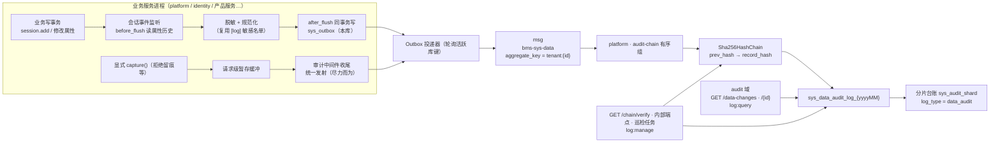
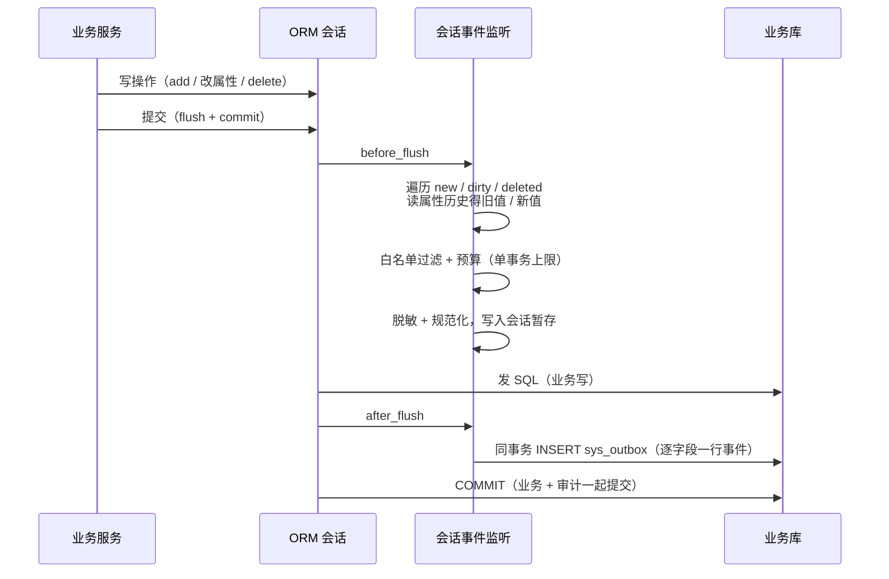

# 字段级变更审计与哈希链详细设计（ORM 捕获 / 同事务发件箱 / 链写入 / 查询 / 校验 / 三权分立）

> 通用能力 · 06 日志与审计 · 02 字段级变更审计与哈希链 · 详细设计

[文档首页](../../../../../../文档首页.md) › [08 通用能力](../../../../README.md) › [日志与审计](../../06_日志与审计.md) › [字段级变更审计与哈希链](../06_日志与审计_02_字段级变更审计与哈希链.md) › 详细设计　|　[需求 05-2](../../../../需求/05_需求_日志与审计.md#r05-2) · [阶段计划](../../../../计划/01_计划_通用能力.md)

## 1. 概述 <a id="overview"></a>

- **目标**：交付「这条记录的某个字段从什么值变成了什么值、谁改的、属于哪个业务域，且事后没被改过」——字段级审计 + 哈希链防篡改，并把三权分立最后一段（拒绝尝试留痕、审计管理员只读）收口。
  1. **捕获**：基座挂 SQLAlchemy 会话事件（`before_flush` / `after_flush`），按关键表白名单读属性历史得旧值 / 新值，**业务代码零侵入**。
  2. **同事务入账**：捕获结果在**本次业务事务内**写进该库 `sys_outbox`（业务提交则审计必达、业务回滚则审计不留）。
  3. **链式落库**：事件经发件箱 → msg → platform 服务 `audit-chain` 有序组消费，逐条 `SHA256(prev_hash + 规范化记录)` 写入 `sys_data_audit_log_{yyyyMM}`。
  4. **查询**：新增 `audit` 域，`GET /api/v1/audit/data-changes` 列表 / 详情（权限码 `log:query`），`GET /api/v1/audit/chain/verify` 触发链校验（权限码 `log:manage`）。
  5. **链校验**：复用 `AuditChainVerifier`，扩展 `log_type=data_audit`；内部校验端点与 `verify_audit_chain` 巡检任务一并覆盖第三类。
  6. **三权分立**：拒绝尝试的审计事件由空实现改为真实落库；新增「审计管理员授权集合 ⊆ 只读白名单」不变量。
- **依据**：需求 [05-2](../../../../需求/05_需求_日志与审计.md#r05-2)；《[概要设计 · 审计合规](../../../../../../设计/概要设计/28_概要设计_审计合规.md)》§2 / §4 / §5 / §6 / §7、《[架构设计 · 审计哈希链](../../../../../../设计/架构设计/19_架构设计_子系统_审计哈希链.md)》§2 / §3 / §4 / §5、《[架构设计 · 事件总线](../../../../../../设计/架构设计/16_架构设计_子系统_事件总线.md)》§5；06_01 同族实现见[操作日志与登录日志详细设计](../../06_日志与审计_01_操作日志与登录日志/设计/01_详细设计_06_01_操作日志与登录日志.md)。
- **范围**：
  - `bms_core`：关键表白名单与产品注册口、ORM 会话事件捕获器、真实 `AuditCapturer` 实现（`db`）、`sys.data.changed` 事件构造、同事务发件箱写入、`[audit_capture]` 配置段、错误码与文案。
  - `platform` 服务：`log` 域扩展第三类日志（分片结构 / 写入 / 校验 / 消费组 / 巡检月份）；新增 `audit` 域（查询与校验触发面）。
  - 数据设计：新建 `29-审计合规` 节点文档与 `sys_data_audit_log` 表文件；表归属登记、域布局与种子同步。
- **不含（归口见 §13）**：归档迁移 / 冷存储 / 销毁（14_01）、归档库只读查询（14_01）、前端页面与导出按钮（阶段十五）、产品仓（biz / mdm）表接入的具体登记（产品仓按注册口自行登记）、全文检索同步（阶段十八）、真实三库压测（部署窗口）。

## 2. 现状与差距（设计 vs 代码） <a id="gap"></a>

| # | 关注点 | 需求要求 | 代码现状 | 处置 |
| --- | --- | --- | --- | --- |
| 1 | 字段级捕获 | ORM 事件自动记旧值 / 新值 | 只有 `AuditCapturer` 契约与 `NullAuditCapturer`；无会话事件、无属性历史读取 | **本段建**：`audit/field_capture.py` + 关键表白名单 |
| 2 | 捕获实现 | 契约实现，业务不手写审计 | 约 20 处端点 / 服务显式调 `capture()`，返回值被丢弃（含三权拒绝留痕） | **本段改**：真实实现 `DbAuditCapturer`，显式调用暂存 → 中间件统一发射 |
| 3 | 数据表 | `sys_data_audit_log` 按月分表 | 无表文件、无分片结构、无表归属登记 | **本段建**：表文件 + 分片声明 + 归属登记（`planned`） |
| 4 | 链写入 | 逐条成链、跨月衔接 | `AuditLogWriter` 只认操作 / 登录两类事件 | **本段改**：新增 `data_audit` 类型（结构 / 规范化 / 写入分支） |
| 5 | 查询 | 列表 / 详情（按月分片） | 无端点、无域 | **本段建**：`audit` 域三端点 + 域布局登记 + 菜单与权限种子 |
| 6 | 链校验 | 巡检 + 归档前强制 | 校验器与内部端点已支持 `log_type`，但 `LOG_TYPES` 只有两类；巡检任务写死两类 | **本段改**：登记第三类，巡检覆盖三类 |
| 7 | 三权分立 | 三类互斥、审计管理员只读 | 互斥与防自锁已在 03_02 落地；拒绝留痕落库为空实现；无「审计管理员授权只读」不变量 | **本段改**：留痕真实落库 + 新增只读不变量与用例 |
| 8 | 归档与销毁 | 90 天热表 + 哈希链随归档导出 | 台账与校验契约已就绪 | **不改**：只交契约与待归档清单，实现归 14_01 |
| 9 | 发件箱一致性 | 审计不得因进程崩溃丢失 | 06_01 中间件走「响应后平台库短事务」，尽力而为 | **本段建**：字段级走**业务库同事务**入账（强一致），操作日志维持原口径 |

## 3. 总体方案 <a id="architecture"></a>



口径：

- **落库位置**：`sys_data_audit_log` 归 platform 服务、存**平台库** `bms_platform`，带 `tenant_id`。理由与 06_01 一致（审计属平台治理数据、便于跨租户检索与统一归档），与《概要设计 · 审计合规》§4 原文「租户库」不同——差异与回写见 §13-2。
- **链分条**：链在 `(log_type=data_audit, tenant_id)` 内成链，与操作 / 登录日志**同库同台账同一消费组**，互不干扰（`log_type` 区分）。
- **强一致边界**：捕获与业务同事务（业务库发件箱），此后「投递 → 消费 → 落库」为异步，链序由有序组保证；落库失败按消费组退避重试、超限转死信。
- **两类事件通道**：字段级变更走 `sys.data.changed`；显式留痕（三权拒绝等无实体变更场景）同一事件类型、`field` 取判定要素名，与字段级记录同表同链（便于「谁试图越权」与「字段被改」一起按表检索）。

## 4. 数据模型与分片 <a id="data"></a>

字段唯一事实源为表文件（不在此复制字段清单）：

- [sys_data_audit_log](../../../../../../设计/数据库设计/数据表设计/sys_data_audit_log.md)（逻辑表名，物理按月分片）
- [sys_audit_shard](../../../../../../设计/数据库设计/数据表设计/sys_audit_shard.md)（分片台账，**不新增表**，`log_type` 增加 `data_audit` 取值）

设计要点：

1. **一行一字段**：一次更新改 3 个字段 → 3 条记录，各自带 `field` / `old_value` / `new_value`；链逐行成链，篡改定位精确到字段。
2. **分片键 = 写入时刻**（消费时刻），与 06_01 同口径；事件时间另存 `occurred_at`。延迟事件不会插进旧月破坏跨月链。
3. **只追加**：无更新 / 删除入口；`event_id` 唯一索引兜底消费幂等；不做软删除（不继承 `BaseModel` 公共列）。
4. **值列口径**：`old_value` / `new_value` 为 JSON 文本（字符串、数字、布尔、时间按 ISO8601、`Decimal` 转字符串）；单值超过 `[audit_capture].max_value_chars`（缺省 2000）截断并追加 `…(truncated)`；超长文本不落原始值片段以外内容。
5. **域归属**：`domain_key` 由表归属派生（`domain_of_table`，07C `04_03`），产品表未登记域时落 `unknown`，不阻断写入。
6. **逻辑表不进迁移链**：`sys_data_audit_log` 登记为 `planned`，物理分片由运行期 `ensure_shard` 用 SQLAlchemy Core 建（四方言、`checkfirst`），台账 `sys_audit_shard` 记录已建分片。

## 5. 事件契约与载荷 <a id="events"></a>

| 事件 | 触发 | 聚合键 | 载荷（全字段） |
| --- | --- | --- | --- |
| `sys.data.changed` | 关键表 ORM 变更（新增 / 修改 / 软删）或显式留痕 | `tenant:{tenant_id}`，无租户 `global` | `tenant_id` / `table` / `model_id` / `field` / `old_value` / `new_value` / `operator_id` / `domain_key` |

- 契约登记：`bms_core/events/platform_events.py` 追加一条 `EventContract`（版本 `1.0.0`，字段只增不删），同步 `deploy/events/contracts.json` 快照；topic 派生 `bms-sys-data`（取事件名前两段「域 + 对象」，与 `sys.operation.logged → bms-sys-operation` 同规则；事件域 `sys`，不新增服务目录行）。
- `occurred_at` / `trace_id` / `event_id` 由**事件信封**承载，载荷不得重复占用（与 06_01 同一教训）。
- 数值型字段统一按**字符串**承载（`model_id` / `operator_id` 为雪花 id 十进制字符串），避免 JSON 大整数精度差异；`old_value` / `new_value` 已是字符串，空值为 `null`（新值不存在）与 `""`（值被改为空串）语义区分。
- 事件发布经 `BaseOutboxStore` 语义同款的行结构写入（同库同事务），**不直连 MQ**；无 msg 时事件留在发件箱，恢复后补投。

## 6. 捕获：ORM 会话事件 <a id="capture"></a>

### 6.1 关键表白名单 <a id="capture-tables"></a>

三层合并，按「基座常量 → 产品注册 → 配置增删」求并集后减去排除项：

1. **基座常量** `AUDITED_TABLES`（`bms_core/audit/tables.py`）：`sys_user`、`sys_role`、`sys_user_role`、`sys_role_permission`、`sys_role_field`、`sys_help_article`、`wf_process`（出处《概要设计 · 审计合规》§2.2 **中归属 platform 的表**）。`sys_tenant_quota` 归属 tenant 服务，**不在基座常量**——基座引用他人服务库表名会被「跨服务库访问」门禁拒绝，改由 tenant 服务装载期经 `register_audited_tables()` 注册（已在 `bms_tenant/main.py` 落地）。`sys_notice` 归属 notification 服务（07_02 落表），同理由 `bms_notification/main.py` 装载期注册，不在基座常量。
2. **产品注册口** `register_audited_tables(tables)`：产品仓装载期调用（与 `register_table_records` 同构、幂等），产品表归属由产品自行声明；未登记域的表 `domain_key` 落 `unknown`。
3. **配置** `[audit_capture].extra_tables`（追加）/ `exclude_tables`（排除，优先于前三层）——现场可按合规要求临时增减，不改代码。

判定入口 `is_audited_table(table)`：白名单命中即审计；基础设施表（`sys_outbox` / `sys_event_consumed` / `sys_event_dead_letter` / `sys_job` / `sys_job_error`）与审计自身表（`sys_data_audit_log` / `sys_operation_log` / `sys_login_log` / `sys_audit_shard`）**硬排除**，避免自审计递归。

### 6.2 捕获流程 <a id="capture-flow"></a>

`install_field_audit(settings)`（`bms_core/audit/field_capture.py`，幂等、进程内一次）在应用装配期把两个监听挂到 ORM 会话类上（`sqlalchemy.orm.Session`，异步会话与达梦同步门面共用同一底层类）：



1. **`before_flush`**：
   - 遍历 `session.new | session.dirty | session.deleted`；表名取 `obj.__table__.name`，不在白名单即跳过。
   - `new`：非 `None` 列，旧值 `null`、新值取值；`dirty`：逐列比对 `inspect(obj).attrs[key].history`（`has_changes()` 为真才算，`added` / `deleted` 首值即新 / 旧值）；`deleted`：旧值取值、新值 `null`。
   - 跳过噪声列：`updated_at`（写时间，无审计价值）、`version`（乐观锁计数）；保留 `deleted_at`（软删除必须留痕）、`updated_by`（谁改的）。
   - 未变化 / 值为 `None` 且原本为 `None` 的列不产生记录。
2. **预算**：单事务最多 `[audit_capture].max_changes_per_tx`（缺省 200）条字段级记录，超出部分记 WARN 日志 `audit_capture_truncated` 并丢弃溢出项（防一条批量导入把事务撑爆），丢弃事实写进实施记录口径。
3. **脱敏**：按列名调用 `mask_sensitive({列名: 值})` 复用 `[log]` 敏感名单（密码 / token / 密钥 / 身份证 / 银行卡等命中即 `***`）；脱敏在**捕获侧**完成，链上不回填原文。
4. **`after_flush`**：把暂存项转事件，用 `session.connection().execute()` 批量 `INSERT INTO sys_outbox`（不触发二次 flush，避免递归）。行字段与 `SqlOutboxStore.enqueue` 同构：`event_id`（雪花 / UUID 唯一）、`event_type`、`event_version`、`aggregate_key`、`tenant_id`、`trace_id`、`payload`、`occurred_at`、`status=pending`、`retry_count=0`。
5. **重复 flush**：同一事务多次 flush 各自结算一次暂存（每次 `after_flush` 后清空），不会重复入库。
6. **失败分档**：`[audit_capture].fail_closed`（缺省 `true`）——发件箱写失败抛 `InternalError`，业务事务随请求回滚（「宁可拒绝写，不可无审计」）；置 `false` 时只记 ERROR 日志与指标 `bms_audit_capture_failed_total` 并放行（仅限非合规场景，配置注释写明）。
7. **上下文**：`operator_id` 取 `current_user_id`（请求上下文）；缺失（作业 / 内部通道）记空。`tenant_id` 取租户上下文主键；上下文缺主键（演示兜底 / 后台任务）时按库键反查租户，仍无则落 `global` 链。`trace_id` 取当前链路上下文。

### 6.3 显式留痕与去重 <a id="capture-explicit"></a>

- `DbAuditCapturer`（`bms_core/audit/db_capturer.py`，`plugin_name = "db"`，实现既有 `AuditCapturer` 契约）：`is_audited()` 走 §6.1；`capture()` 按传入 `FieldChange` 构造 `sys.data.changed` 事件并投入**请求级暂存缓冲**（`ContextVar`），返回首个信封（保持既有调用面签名与语义）。
- 三权分立拒绝、账号锁定处置等**无实体变更**场景继续用 `capture()`；`changes` 为空时**不产生**记录（这类场景的「调了哪个接口」已由操作日志覆盖）。
- **去重**：同一会话内，ORM 侧已捕获的 `(表, 主键, 字段)` 记入集合，显式 `capture()` 遇到同键即跳过——拒绝路径本就不写库，正常写入路径不会重复。
- **发射**：06_01 的 `OperationAuditMiddleware` 在响应收尾（`finally`）排空暂存缓冲，经 `AuditEventEmitter`（平台库短事务）入发件箱；失败按 `required=False` 只告警（拒绝已是错误响应，不得因审计再改变结果）。
- 平台服务 `prepare_settings` 在 `[audit].provider` 为空时置 `db`（显式配置尊重）；`register_platform_plugins` 显式登记 `DbAuditCapturer`。

## 7. 链写入 <a id="chain"></a>

`platform.domains.log` 扩第三类：

1. **结构**：`LOG_TYPE_DATA_AUDIT = "data_audit"`、`LOGIC_TABLES` 增映射、`DATA_AUDIT_RECORD_FIELDS`（参与链计算的列：`id` / `event_id` / `tenant_id` / `table_name` / `record_id` / `field` / `old_value` / `new_value` / `operator_id` / `domain_key` / `occurred_at`）、`_data_audit_columns()` 分片列与索引；`canonical_record` 与写入 / 校验共用，保证两侧重算逐字节一致。
2. **写入**：`AuditLogWriter.write()` 增 `sys.data.changed` 分支 → `write_data_audit()`：校验 `table` / `model_id` / `field` 必填（缺失按毒消息抛 `EventConsumeError`）→ `ensure_shard` → `event_id` 幂等判重 → 取链尾 → `compute` → 插入。链尾规则不变（同 `log_type` 同租户、跨分片向前找）。
3. **消费组**：`jobs.py` 的 `_AUDIT_EVENTS` 增 `sys.data.changed`，仍归 `audit-chain` 有序组（全组串行）；处理器按事件类型分派到同一 `AuditLogWriter`。
4. **预创建**：`ensure_audit_shards` 遍历 `LOGIC_TABLES` 全类型，自动覆盖 `data_audit`（无需改任务）。

## 8. 查询接口（`audit` 域） <a id="api"></a>

前缀 `/api/v1`，统一响应 `{code, message, data}`；只读（不提供写接口）。

| 方法 | 路径 | 权限码 | 筛选 / 说明 |
| --- | --- | --- | --- |
| GET | `/audit/data-changes` | `log:query` | `table_name` / `record_id` / `operator_id` / `domain_key` / `field` / `created_from` / `created_to` / `page` / `size`；按 `occurred_at`、`id` 倒序 |
| GET | `/audit/data-changes/{id}` | `log:query` | 详情（含 `prev_hash` / `record_hash` / `event_id`）；按雪花 ID 反解月份定位单一分片 |
| GET | `/audit/chain/verify` | `log:manage` | `log_type`（缺省 `data_audit`）/ `months`（逗号分隔，缺省台账全部月份）；同步执行并返回断裂定位，单独限流 |

- **时间范围**：缺省取最近 `[audit_log].query_default_days`（30 天）——沿用 06_01 同一配置段，不新开参数；跨度超 `[audit_log].max_query_days`（366 天）按参数非法拒（`90203`）。
- **分片路由**：取台账中落在 `[起始月-1, 结束月+1]` 的 `data_audit` 分片，`UNION ALL` + 计数；台账为空返回空页。
- **详情**：由雪花 ID 反解写入月份定位分片；缺失按 `90401`（HTTP 404）。
- **错误码**：`90401` 数据变更审计不存在（404）；范围过大复用 `90203`（400）；`i18n` 文案补 `error.90401` 中英种子。
- **链校验不通过不是错误**：返回 `200` + `valid=false` + 断裂定位（`broken_month` / `broken_index` / `broken_record_id`），与内部端点同形；《概要设计 · 审计合规》§7 的 `91001` 不启用，差异见 §13-7。

## 9. 链校验与巡检 <a id="verify"></a>

- **校验器**：`AuditChainVerifier` 无需改逻辑，`LOG_TYPES`（`platform.domains.log.services.verify`）增 `data_audit`——按 `(log_type, 月份)` 逐分片、逐租户重算，跨月首条比对更早分片末条。
- **内部端点**：`POST /api/v1/platform/internal/audit/verify` 已按 `log_type` 参数化，登记新取值即生效；14_01 归档前强制校验可直接复用。
- **巡检任务**：`run_verify_audit_chain` 的日志类型元组由写死两类改为读 `LOG_TYPES`，覆盖三类；断裂仍返回失败并写任务执行记录（告警出口沿用 06_01 的日志事件 `audit_chain_broken` + 指标 `bms_audit_chain_broken_total`），**只告警不阻断**。
- **预创建**：`precreate_shard_tables` 遍历全类型，覆盖 `data_audit`。

## 10. 三权分立收口 <a id="separation"></a>

互斥（`30010`）与 `role` 归属、防自锁（`30048`）已在 03_02 落地；本段补两件：

1. **拒绝留痕真实落库**：`SeparationGuard._audit_reject()` 已调用 `AuditCapturer.capture()`，随 `db` 实现接入后自动经 §6.3 落库——「谁在什么时候试图越权 / 兼任」可查，且 `domain_key=role`。
2. **审计管理员只读不变量**：新增 `ensure_audit_admin_readonly(role, permission_ids)`（`role/services/separation.py`）——目标角色 `role_type=audit` 时，本次授权集合必须 ⊆ `AUDIT_ADMIN_CODES`（`log:query` / `log:manage`），超出即拒 `30048` 并留痕。判定点挂在授权路径（`ensure_grant_scope`）与字段 / 数据权限路径（`ensure_not_self_lock` 同层），**前置生效**（写库前校验）。
3. **种子**：`AUDIT_ADMIN_CODES` 增 `log:manage`；菜单补「数据变更审计」（`/monitor/data-changes`，业务码 `log`）+ 「查询」按钮（`query`）+「链校验」按钮（`manage`）。

## 11. 代码落点与登记回写 <a id="code"></a>

> **实施回写（域边界门禁纠正）**：engkit 域边界门禁 D2/D6 规定「跨域 import 只能指向目标域 `public` 出口」且「`public` 出口不得导出仓储 / `services` 实现 / `api` 函数 / ORM 模型」。原方案「audit 域复用 log 域的仓储与校验器」因此不成立——改为把**链内核上移基座**（`bms_core.audit.*`），两域共用同一口径，`log` 域保留三个再导出薄壳以稳定 06_01 调用面。

```text
backend/libs/bms_core/src/bms_core/
├── audit/
│   ├── tables.py                    # 新增：AUDITED_TABLES / register_audited_tables / is_audited_table
│   ├── field_capture.py             # 新增：会话事件监听（install_field_audit）+ 同事务写发件箱 + 去重键
│   ├── db_capturer.py               # 新增：DbAuditCapturer（AuditCapturer 真实实现，plugin_name=db）
│   ├── staging.py                   # 新增：请求级暂存缓冲（显式留痕 → 响应收尾统一发射）
│   ├── shards.py                    # 上移：分片表结构 / 月份工具 / 规范化记录（原 log 域 schema.py）
│   ├── shard_repository.py          # 上移：分片台账 / 运行期建表 / 链尾 / 写入 / 跨片查询
│   ├── verifier.py                  # 上移：链校验（逐条重算 + 断裂定位）+ LOG_TYPES
│   ├── query_range.py               # 上移：查询时间范围收敛（两域共用 90203 口径）
│   ├── events.py                    # 改：DATA_CHANGED_EVENT + build_data_changed_event + encode_audit_value
│   └── emit.py                      # 改：drain_staged()（排空暂存并发射）
├── api/audit_middleware.py          # 改：响应收尾排空暂存缓冲（含未跟踪请求路径）
├── application.py                   # 改：装配期 install_field_audit（[audit_capture].enabled）
├── core/config.py                   # 改：AuditCaptureSettings（[audit_capture]）
├── core/error_codes.py              # 改：90401
├── core/exceptions.py               # 改：DataAuditLogNotFoundError
├── i18n/error_seed.py               # 改：error.90401 中英文案
├── events/platform_events.py        # 改：sys.data.changed 契约
├── services/table_registry.py       # 改：sys_data_audit_log（planned，domain=audit）
├── tenant/seed/rbac.py              # 改：AUDIT_ADMIN_CODES 增 log:manage
├── tenant/seed/menu.py              # 改：数据变更审计菜单与两个按钮
├── tasks/builtin.py                 # 改：AUDIT_LOG_TYPES 覆盖三类，巡检按清单遍历
└── core/assembly.py                 # 改：导入即登记 audit:db（AUDIT_CAPTURER_DEFAULT 引用锚点）

backend/services/platform/src/bms_platform/
├── domains/log/
│   ├── schema.py · repositories/shard.py · services/verify.py   # 改：三处再导出薄壳（实现在基座）
│   ├── services/writer.py           # 改：write_data_audit 分支（按事件类型分派）
│   ├── services/query.py            # 改：范围收敛改调基座 resolve_query_range
│   └── jobs.py                      # 改：_AUDIT_EVENTS 增 sys.data.changed
├── domains/audit/                   # 新增域（查询 + 校验触发面）
│   ├── __init__.py · public.py
│   ├── services/data_change.py      # 列表 / 详情（分片路由 + 分页 + 90401）+ 链校验服务
│   ├── schemas/data_change.py       # 列表 / 详情 / 校验响应契约
│   └── api/data_changes.py · api/chain.py
├── api/router.py                    # 改：挂载 audit 域路由
└── main.py                          # 改：prepare_settings 置 audit.provider=db

backend/services/tenant/src/bms_tenant/main.py   # 改：装载期注册 sys_tenant_quota（本服务库表）

deploy/
├── registry/platform.toml           # 改：新增 [[domains]] audit
├── boundaries/domain_layout.json    # 重生成（ops/check_modules.py --render-domain-layout）
├── contracts/platform.json          # 重生成（含三条 /api/v1/audit/*）
└── events/contracts.json            # 重生成（34 条契约）

frontend/packages/api_types            # 重生成（contracts → 前端契约类型）

backend/config.toml                  # 未改：新段有缺省值，按需在部署环境覆盖
```

登记回写：

| 落点 | 内容 |
| --- | --- |
| `bms_core/services/table_registry.py` | `sys_data_audit_log`（`planned`，`domain=audit`，平台库） |
| `deploy/registry/platform.toml` + `domain_layout.json` | 新增 `audit` 域（service=platform，路径 `domains/audit/**`，`public_api=bms_platform.domains.audit.public`）；`log` 域 `public_api` 补导出面 |
| 数据库设计 | 新建 `29_数据库设计_审计合规.md` + `数据表设计/sys_data_audit_log.md`；总览 §6.2 / §7.2 / §7.3 登记（状态 `已设计`），并注明「平台库集中」例外 |
| 《概要设计 · 审计合规》§4 | 回写落库位置例外（租户库 → 平台库，与 06_01 同口径），并注明 `sys_data_audit_log` 属审计治理数据 |
| 架构 09 事件清单 | 补 `sys.data.changed` 一行 |
| `bms_core/tenant/seed/rbac.py` / `menu.py` | 审计管理员补 `log:manage`；数据变更审计菜单与按钮 |
| `bms_core/tasks/builtin.py` | 巡检任务说明与覆盖类型更新 |
| 阶段计划 | 06_02 状态改「进行中 → 已完成」，填窗口 2026-11-16 ~ 2026-11-18 与偏差遗留 |
| 需求 / 任务文档 | 需求 05-2 注块补实现期要点；任务 05_02 与域总览同步 |

## 12. 测试设计与验收映射 <a id="test"></a>

| 验收点（需求 05-2 / 任务完成标准） | 用例 |
| --- | --- |
| 更新关键表产生含旧值 / 新值 / 操作人 / `domain_key` 的记录 | 改 `sys_role.code` → 捕获一条 `field=code`，旧新值正确、`domain_key=role`、`operator_id` 为当前用户 |
| 新增 / 软删也留痕 | 新增 `sys_notice` → 旧值 `null`；置 `deleted_at` → 该列有记录（`updated_at` / `version` 不入账） |
| 未经 ORM 的直连 SQL 不产生审计 | 直连 `connection.execute(update(...))` → 无事件（口径显式声明，不假装覆盖） |
| 敏感字段脱敏 | 改 `sys_user.password` → 新旧值均 `***`，原文不出现于事件与库 |
| 同事务一致性 | 业务事务回滚 → 发件箱无行、审计表无记录；提交 → 发件箱有行 |
| 失败分档 | `fail_closed=true` 下发件箱写失败 → 业务抛错回滚；`false` → 放行 + 指标计数 |
| 链序与幂等 | 同租户多条事件按序写入 → `verify` 通过；重复 `event_id` → 不新增、链不变 |
| 跨月衔接 | 上月同租户末条 = 本月首条 `prev_hash`；空链首条 = `GENESIS_HASH` |
| 篡改可定位 | 直接改分片一条 `record_hash` → 校验返回该月 / 该条索引与 ID；`/audit/chain/verify` 同形返回 |
| 查询筛选与分页 | 按表名 / 记录 ID / 操作人 / 域 / 字段 / 时间范围过滤，`total` 正确；详情按 ID 定位分片；不存在 `90401`；超范围 `90203` |
| 权限 | 无 `log:query` → 403；无 `log:manage` → 校验端点 403 |
| 三权分立 | 越权 / 兼任被拒后审计可查（`domain_key=role`）；审计管理员角色被授予非白名单权限码 → `30048` |
| 巡检覆盖三类 | `verify_audit_chain` 依次校验 operation / login / data_audit，任一断裂即失败 |

- Kiwi 用例：本任务登记 **一条**，覆盖上述断言；代码以 `@pytest.mark.kiwi_id(<编号>)` 标注（编号见实施记录）。
- 覆盖率：变更模块行 + 分支 100%（`bms_core.audit.*`、`bms_core.api.audit_middleware`、`bms_core.tasks.builtin`、`bms_platform.domains.log.*`、`bms_platform.domains.audit.*`、`bms_platform.domains.role.services.separation`）；提交环判改动行、推送环判模块级。

## 13. 对齐记录与开放项 <a id="open"></a>

| # | 事项 | 结论 / 归口 |
| --- | --- | --- |
| 1 | 开工范围 | 解除搁置、按全量一条龙交付（用户拍板 2026-11-16）；8B 结论已具备（事件基座 06_01 已用上，审计链仍归 bms） |
| 2 | 落库位置 | 平台库集中；概要设计 28 §4「租户库」按例外回写（与 06_01 同口径） |
| 3 | 链与台账 | 新增 `log_type=data_audit`，复用 `audit-chain` 组与 `sys_audit_shard` 台账、同一 `Sha256HashChain` |
| 4 | 捕获机制 | 基座全局会话事件；业务代码零侵入 |
| 5 | 事件粒度 | 每字段一条记录 |
| 6 | 关键表清单 | 基座常量 + 产品注册 + 配置增删；本期不接产品仓具体表 |
| 7 | 事件命名与错误码 | 事件 `sys.data.changed`；链校验不通过返回 200 + `valid=false`（不启用概要设计 91001），仅新增 `90401` 不存在 |
| 8 | 值形态 | JSON 文本 + `[log]` 名单脱敏；超长截断 |
| 9 | 发件箱 | 业务库同事务；`fail_closed` 缺省 `true`（由口径 9 派生的语义取舍，配置可关） |
| 10 | 接口 | 新建 `audit` 域：列表 / 详情 / 链校验三端点 |
| 11 | 权限码 | `log:query` 查询、`log:manage` 校验，均授审计管理员 |
| 12 | 三权分立 | 只补拒绝留痕落库 + 审计管理员只读不变量 |
| 13 | 归档 / 销毁 | 只交契约与台账清单，实现归 14_01 |
| 14 | 校验端点 | 内部端点已按 `log_type` 参数化，登记新取值即生效 |
| 15 | Kiwi | 登记 1 条，全模块共用 |
| 16 | 开工窗口（回写阶段计划） | 2026-11-16 ~ 2026-11-18 |
| 17 | 域划分 | 链基础设施（分片结构 / 写入 / 校验 / 台账）留在 `log` 域，`audit` 域只承载数据变更审计的查询与校验触发面，经 `log.public` 跨域引用（避免两套链实现） |
| 18 | 批量导入溢出 | 单事务字段级记录上限 `max_changes_per_tx`（缺省 200），溢出丢弃并告警；完整留痕归操作日志（导入批次摘要） |
| 19 | 直连 SQL 盲区 | 不经 ORM 的写入不产生审计，口径在表文件与需求注块显式声明，不假装覆盖 |
| 20 | 多实例竞争 | `audit-chain` 仍要求单宿主消费（部署约束，扩缩容归 15_01） |
| 21 | 域划分（实施纠正） | 域边界门禁 D2/D6 使「audit 域复用 log 域仓储 / 校验器」不可行；改为链内核上移基座（`shards` / `shard_repository` / `verifier` / `query_range`），`log` 域留三处再导出薄壳稳定调用面，`audit` 域只承载查询与校验触发面 |
| 22 | 事件 topic | `bms-sys-data`（按「域 + 对象」两段派生），非 `bms-sys-data-changed` |
| 23 | 失败分档实现 | 同步钩子内无指标出口，`fail_closed=false` 时只记 ERROR 日志 `audit_capture_failed`（不接 `bms_audit_capture_failed_total`）；`fail_closed` 缺省 `true` 口径不变 |
| 24 | 关键表清单落点 | 基座常量只放归属 platform 的表；`sys_tenant_quota` 由 tenant 服务装载期注册（跨服务库访问门禁） |
| 25 | 列表筛选参数名 | 用 `occurred_from` / `occurred_to`（与操作 / 登录日志一致），不引入 `created_from` / `created_to` |
| 26 | 链校验限流 | 未加接口级限流：端点要 `log:manage`（审计管理员专属）且走网关统一限流；如后续需要按用户限流归平台可观测性 |
| 27 | 硬删除留痕 | ORM `session.delete` 同样留痕（旧值有、新值为空）；软删除记 `deleted_at` 列变更 |
| 28 | 显式留痕与 ORM 去重 | 进程级键集合 `(表, 记录主键, 字段)`，先到先得；同事务重复 flush 改同一字段只记一次 |
| 29 | 查询与校验实现 | `AuditChainVerifier` 保持单一实现（参数化 `log_type`），审计域只做服务封装与 DTO 转换 |
| 30 | 捕获实现装配 | 平台服务 `prepare_settings` 置 `audit.provider=db`；其他服务保持 `null`——字段级捕获由基座会话事件独立生效，不依赖该 provider（显式留痕在非平台服务暂不落库） |

> 详细设计 · 依《[文档生成规范](../../../../../../规范/文档生成规范.md)》编写 · 进度以[阶段计划](../../../../计划/01_计划_通用能力.md)为唯一落点
