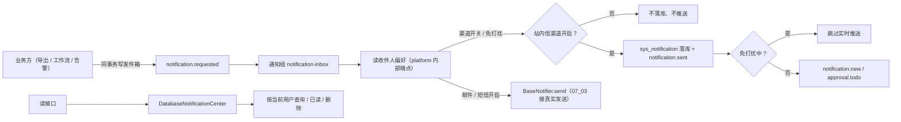

# 通知中心详细设计（站内信落库 / 渠道偏好 / 实时角标 / 事件生成）

> 通用能力 · 07 通知与公告 · 01 通知中心 · 详细设计

[文档首页](../../../../../../文档首页.md) › [08 通用能力](../../../../README.md) › [通知与公告](../../07_通知与公告.md) › [通知中心](../07_通知与公告_01_通知中心.md) › 详细设计　|　[需求 04-1](../../../../需求/04_需求_通知与公告.md#r04-1) · [阶段计划](../../../../计划/01_计划_通用能力.md) · [概要 · 通知中心](../../../../../../设计/概要设计/16_概要设计_通知中心.md)

## 1. 概述 <a id="overview"></a>

- **目标**：把通知中心从「占位路由 + 内存契约」补成**真实可用的个人站内信能力**：

  1. **真实落库与读面**：`sys_notification` 建表、模型补索引、仓储 / 服务 / 通知中心实现；列表（类型 / 已读 / 关键字筛选 + 分页）、详情（查看即已读）、未读数、单条 / 批量 / 全部已读、单条软删除全部走真实数据；所有查询强制按当前用户过滤。
  2. **事件生成路径**：新增 `notification.requested` 平台事件契约与统一的请求构造 / 发件箱助手；通知组订阅该事件，消费落库并发布 `notification.sent`，业务代码不直写通知表。
  3. **渠道偏好与免打扰**：把 `sys_user_preference` 从占位做成真实读写（`sql` 实现 + 平台内部按用户读取端点），新增 `notification_preference` 能力域（`null` / `http`）；通知组按收件人偏好过滤渠道，命中免打扰时段时站内信仍落库、仅跳过实时推送。
  4. **实时角标**：新站内信落库后经 `BaseRealtimePublisher` 推送 `notification.new`；`type=approval` 时同时推送 `approval.todo`；已读靠接口返回值与前端重连 / 聚焦校准，不新增推送事件。
  5. **业务生产接入**：超阈值异步导出完成给提交人发站内信（闭环 04_02 遗留）；导入完成通知留后续。
  6. **错误码 / 权限 / 表文件**：通知中心错误码 `70101–70106`、偏好错误码 `30021–30024`；补 `notification:update` / `notification:delete` 权限码；新建 `sys_notification` 与 `sys_user_preference` 表文件并登记数据库设计总览。

- **依据**：需求 [04-1](../../../../需求/04_需求_通知与公告.md#r04-1)；《[概要设计 · 通知中心](../../../../../../设计/概要设计/16_概要设计_通知中心.md)》§2 / §4 / §5 / §7；《[架构设计 · 通知公告](../../../../../../设计/架构设计/22_架构设计_子系统_通知公告.md)》§2 / §6；《[架构设计 · 实时推送](../../../../../../设计/架构设计/18_架构设计_子系统_实时推送.md)》§5 / §6；《[概要设计 · 用户喜好](../../../../../../设计/概要设计/04_概要设计_用户喜好.md)》§2；《[数据规范](../../../../../../设计/数据库设计/02_数据库设计_数据规范.md)》§2 / §3 / §6；《[AI开发规范](../../../../../../规范/AI开发规范.md)》「覆盖率要求」节；《[测试规范](../../../../../../规范/测试规范.md)》。

- **范围**：`bms_core` 的通知事件契约 / 请求助手 / 偏好读取能力域 / 偏好 SQL 存储；`bms_notification` 的通知域模型、仓储、服务、通知中心实现、路由、事件消费组、应用装配；`bms_platform` 的偏好内部端点与导出完成通知生产；`sys_notification` / `sys_user_preference` 表文件与总览登记；错误码、权限种子、契约快照与前端类型。

- **不含（归口见 §8）**：前端通知中心页面、顶栏铃铛与移动端 H5（阶段十五）；真实 python-socketio 服务端与 Redis 跨实例广播（实时推送阶段）；邮件 / 短信模板、真实 SMTP 与阿里云 / 腾讯云发送、发送记录（07_03）；公告与已读回执（07_02）；工作流审批待办生产（阶段九，本任务只提供 `notification.requested` 契约与 `approval` 类型）；通知归档策略（随 14_01 既有策略机制接入）；导入完成通知（后续业务接入）。

## 2. 现状与差距（设计 vs 代码不符清单） <a id="gap"></a>

> 动手前对账结果。「处置」列写明本段改什么、回写什么、留什么。

| # | 关注点 | 需求 / 规范要求 | 代码现状 | 处置 |
| --- | --- | --- | --- | --- |
| 1 | 通知落库 | 个人站内信可查询 / 已读 / 删除 | `sys_notification` 只有模型声明（无 `deleted_at` 显式、无组合索引），表未进链、未建表 | **本段改**：补组合索引、表归属转 enabled、新建表文件并登记 |
| 2 | 通知中心实现 | 读接口统一经 `BaseNotificationCenter` | 只有 `NullNotificationCenter`，路由返回空集 | **本段建**：`DatabaseNotificationCenter`（插件名 `db`）+ 仓储 / 服务 |
| 3 | 用户维度隔离 | 跨用户不可见 | 占位实现无数据 | **本段建**：所有查询 / 更新强制 `user_id = 当前用户`；跨用户详情 / 删除按错误码拒绝 |
| 4 | 批量已读 | 单条 / 批量 / 全部已读，幂等 | 占位固定返回 0 | **本段建**：按 id 更新本人未读行，返回操作后未读总数；空 / 超 500 拒绝 |
| 5 | 删除 | 单条软删除，仅本人；删除后不进列表与未读数 | 无 | **本段建**：`BaseModel.soft_delete()`，`_select()` 自动过滤 |
| 6 | 事件生成 | 业务事件 → 通知组消费落库，不直写 | 无请求事件契约、无消费组 | **本段建**：`notification.requested` + 请求助手 + `notification-inbox` 消费组 |
| 7 | 推送 | 落库后 `notification.new`；审批类 `approval.todo` | `BaseRealtimePublisher` 为 Null，无调用方 | **本段建**：消费后按契约推送；真实 Socket.IO 留后续 |
| 8 | 发送事件 | 落库后发布 `notification.sent` | 契约已登记，无发布方 | **本段建**：与落库同事务写发件箱 |
| 9 | 渠道偏好 | 站内信 / 邮件 / 短信开关，被过滤渠道不发送 | `sys_user_preference` 只有模型和占位端点，`BasePreferenceStore` 为 Null | **本段建**：`SqlPreferenceStore` + 表文件 / 总览登记 + 平台内部读取端点 |
| 10 | 通知偏好读取 | 通知组按收件人偏好过滤 | 无跨服务读取通道 | **本段建**：`notification_preference` 能力域（`null` / `http`），通知服务默认 `http` |
| 11 | 免打扰 | 站内信仍落库，实时推送延后 / 跳过 | 无 | **本段建**：按用户时区判定时段，命中只跳过推送 |
| 12 | 通知类型 | 列表可按类型筛选 | 模型为自由字符串，无枚举 | **本段定**：`system` / `approval` / `alert` / `import` 四类，消费侧校验 |
| 13 | 错误码 | 7xxxx 通知段 | 70001–70006 已被任务调度占用 | **本段改**：通知中心用 70101–70106；偏好用 30021–30024 |
| 14 | 权限 | `notification:query` / `update` / `delete` | 只有 `notification:query` 种子；路由无权限码 | **本段改**：补两个权限码；路由挂三个权限依赖；角标只登录 |
| 15 | 表文件 | 一表一文件并登记总览 | 两张表均未登记 | **本段建**：`sys_notification.md` / `sys_user_preference.md` + 总览登记 + 表归属 enabled |
| 16 | 导出完成通知 | 04_02 遗留：超阈值导出完成通知 | 只到作业终态 + 状态端点 | **本段接**：导出作业成功后发布 `notification.requested`（提交人 = `payload.actor`） |
| 17 | 契约与前端类型 | 端点必须进公开契约 | 通知契约快照为占位；新增平台内部端点 | **本段改**：重建 `deploy/contracts/notification.json` / `platform.json` 与前端 `api_types` |
| 18 | Kiwi 编号 | 先登记后编码 | 最近用号 2516（14_01） | **本段首步**：容器内登记取号，回填 `@pytest.mark.kiwi_id(<编号>)` |

## 3. 交付物清单 <a id="tree"></a>

```text
backend/
├── config.toml                                       # 改：新增 [notification_preference] 分区说明
├── libs/bms_core/src/bms_core/
│   ├── core/error_codes.py                           # 改：30021~30024 / 70101~70106 + HTTP 映射
│   ├── core/exceptions.py                            # 改：偏好异常 + 通知异常
│   ├── core/config.py                                # 改：NotificationPreferenceSettings（PluginSelection）
│   ├── core/assembly.py                              # 改：notification_preference 接线 + null / http 工厂 + preference sql 工厂
│   ├── events/platform_events.py                     # 改：新增 notification.requested 契约（35 条）
│   ├── notification/request.py                       # 新建：NotificationRequest / 事件构造 / 发件箱助手
│   ├── notification/preference.py                    # 新建：NotificationPreference / BaseNotificationPreferenceStore / 默认值
│   ├── notification/preference_null.py               # 新建：NullNotificationPreferenceStore
│   ├── notification/preference_http.py               # 新建：HttpNotificationPreferenceStore（读 platform 内部端点）
│   ├── preference/rules.py                           # 新建：偏好键允许前缀 / 大小 / 通知偏好结构校验
│   ├── preference/repository.py                      # 新建：sys_user_preference 仓储（按用户 / 键读写）
│   ├── preference/sql.py                             # 新建：SqlPreferenceStore（当前用户 get / set / reset）
│   ├── i18n/error_seed.py                            # 改：补 8 个错误码中英文案
│   ├── models/platform/user.py                       # 改：sys_user_preference 索引与注释对齐
│   ├── models/__init__.py                            # 改：无（模型清单已含）
│   └── tenant/seed/menu.py                           # 改：PERMISSION_SEEDS 补 notification:update / delete
├── libs/bms_core/tests/
│   ├── notification/test_notification_request.py     # 新建：请求负载 / 信封 / 租户位
│   ├── notification/test_notification_preference.py  # 新建：默认值 / 渠道开关 / 免打扰 / null 实现
│   ├── preference/test_preference_rules.py           # 新建：键前缀 / 大小 / 渠道与免打扰结构
│   ├── preference/test_preference_sql.py             # 新建：读写 / 重置 / 超限 / JSON 容错
│   └── events/test_platform_events.py                # 改：契约条数与新事件断言
├── services/notification/src/bms_notification/
│   ├── main.py                                       # 改：prepare_settings 设默认实现 + event_consumer_records
│   ├── domains/notification/models/notification.py   # 改：组合索引 + 类型常量
│   ├── domains/notification/repositories/notification.py  # 新建：按用户分页 / 未读 / 已读 / 删除
│   ├── domains/notification/services/notification.py # 新建：读面与已读 / 删除业务
│   ├── domains/notification/services/generation.py   # 新建：事件请求落库 + notification.sent
│   ├── domains/notification/center.py                # 新建：DatabaseNotificationCenter（插件名 db）
│   ├── domains/notification/preference.py            # 新建：通知偏好读取装配（默认 http / 测试注入）
│   ├── domains/notification/consumers.py             # 新建：通知组消费（偏好过滤 / 推送 / 邮件短信）
│   ├── domains/notification/api/notification.py      # 改：权限码 / type / is_read / 错误语义
│   └── domains/notification/public.py                # 改：导出 Request / Notification（供 07_02 / 07_03）
├── services/notification/tests/
│   ├── notification/test_notification_repository.py  # 新建：分页 / 筛选 / 未读 / 跨用户
│   ├── notification/test_notification_center.py      # 新建：查看即已读 / 批量 / 全部 / 删除
│   ├── notification/test_notification_consumer.py    # 新建：渠道过滤 / 免打扰 / 推送 / 事件
│   └── notification/test_notification_api.py         # 新建：权限码 / 参数 / 错误码
├── services/platform/src/bms_platform/
│   ├── main.py                                       # 改：prepare_settings 设 preference provider = sql
│   ├── domains/user/api/internal_preferences.py      # 新建：POST /platform/internal/preferences/resolve
│   ├── domains/user/api/router 或 api/__init__.py    # 改：挂内部偏好路由
│   ├── domains/user/schemas/preferences.py           # 新建：内部请求 / 响应
│   ├── domains/import_export/export_jobs.py          # 改：导出成功后发布 notification.requested
│   └── api/router.py                                 # 改：登记内部偏好路由
├── services/platform/tests/
│   ├── users/test_internal_preferences.py            # 新建：按用户读取 / 租户 / 鉴权 / 缺省
│   └── import_export/test_export_notification.py     # 新建：成功发布 / 无 actor 不发 / 失败不发
├── deploy/contracts/notification.json                # 重新生成
├── deploy/contracts/platform.json                    # 重新生成
└── frontend/packages/api_types/                      # 重新生成（生成物，零手工改）

bms文档/
├── 设计/数据库设计/数据表设计/sys_notification.md      # 新建
├── 设计/数据库设计/数据表设计/sys_user_preference.md   # 新建
├── 设计/数据库设计/01_数据库设计_总览.md              # 改：登记两表
├── 设计/概要设计/16_概要设计_通知中心.md              # 改：错误码 / 接口 / 渠道过滤落点
├── 设计/架构设计/22_架构设计_子系统_通知公告.md       # 改：事件契约 / 偏好读取
├── 设计/架构设计/09_架构设计_接口与集成.md            # 改：notification.requested 事件登记
├── 后端基类清单.md                                    # 改：notification_preference 跨阶段基座
├── 规范/后端开发规范.md                               # 改：通知中心 / 偏好读取口径（如需要）
├── 项目/08_通用能力/计划/01_计划_通用能力.md          # 改：07_01 归档 + 计数
├── 项目/08_通用能力/需求/04_需求_通知与公告.md        # 改：04-1 交付注块
└── 任务目录/设计、实施、测试                          # 本文档 + 实施 / 测试记录
```

## 4. 领域设计 <a id="design"></a>

### 4.1 总体流程 <a id="flow"></a>



### 4.2 事件契约与请求助手 <a id="event"></a>

**新增平台事件契约**（`bms_core/events/platform_events.py`）：

| 事件 | 版本 | 主要载荷 | 说明 |
| --- | --- | --- | --- |
| `notification.requested` | `1.0.0` | `user_id`（必填，字符串）、`title`（必填）、`type`（必填）、`content`（可选）、`biz_type` / `biz_id`（可选）、`email` / `phone`（可选） | 业务方请求发送一条通知；通知组消费落库 |

- 事件域 `notification` 已在服务目录登记，事件名形态通过现有契约校验。
- 载荷**不包含未读数与正文以外的大对象**；正文按收件人语言由生产方渲染后放入（与 `BaseNotifier`「接收已渲染内容」口径一致）。
- `user_id` 用十进制字符串（与其他平台事件口径一致）；`notification.sent` 契约不变。

**请求助手**（`bms_core/notification/request.py`）：

| 成员 | 形态 | 说明 |
| --- | --- | --- |
| `NOTIFICATION_REQUESTED_EVENT` | `str` | `"notification.requested"` |
| `NOTIFICATION_TYPES` | 常量清单 | `system` / `approval` / `alert` / `import` |
| `NotificationRequest` | frozen 值对象 | `user_id` / `title` / `type` / `content` / `biz_type` / `biz_id` / `email` / `phone`；`to_payload()` |
| `build_requested_envelope(request, *, tenant_id)` | 函数 | 构造 `EventEnvelope`（`aggregate_key = f"notification:{user_id}"`，租户位显式传入） |
| `enqueue_notification_request(session, request, *, tenant_id, outbox=None)` | 异步函数 | 业务事务内写发件箱（`SqlOutboxStore` 缺省），返回事件 id |

- 生产者必须与业务写同事务调用 `enqueue_notification_request`，保证「业务成功才有通知请求」。
- 生产方若拿不到租户上下文（作业执行体），显式传 `tenant_id`；无租户的通知请求直接拒绝。

### 4.3 表与模型（`sys_notification`） <a id="table"></a>

按《数据规范》，表文件为字段唯一事实源；本文只写本表差异，完整字段见 [sys_notification 表文件](../../../../../../设计/数据库设计/数据表设计/sys_notification.md)。

| 字段 | 类型 | 可空 | 说明 |
| --- | --- | --- | --- |
| 公共字段 | — | — | 继承 `BaseModel`（雪花 `id` / 审计 / `deleted_at` / `version`） |
| `user_id` | `DECIMAL(38,0)` | 否 | 收件用户（逻辑外键 → `sys_user.id`） |
| `title` | `VARCHAR(256)` | 否 | 标题 |
| `content` | `TEXT` | 否 | 正文（已按收件人语言渲染） |
| `type` | `VARCHAR(32)` | 否 | 类型：`system` / `approval` / `alert` / `import` |
| `biz_type` | `VARCHAR(64)` | 是 | 业务类型（如 `export` / `approval`） |
| `biz_id` | `VARCHAR(64)` | 是 | 业务标识（供跳转与去重） |
| `is_read` | `BOOLEAN` | 否 | 默认 `false`；已读标记 |

**索引**（业务索引 3 个，加公共 `deleted_at` 共 4 个，≤5）：

| 索引 | 列 | 用途 |
| --- | --- | --- |
| `idx_sys_notification_user_id_created_at` | `user_id`, `created_at` | 列表按时间倒序 |
| `idx_sys_notification_user_id_is_read` | `user_id`, `is_read` | 未读数与已读筛选 |
| `idx_sys_notification_user_id_type` | `user_id`, `type` | 类型筛选 |

- **软删除**：沿用 `BaseModel.deleted_at`，不新增 `deleted` 布尔列（与阶段八贯穿口径一致）；列表 / 未读 / 详情 / 删除全部经 `_select()` 过滤。
- **去重**：消费幂等由 `sys_event_consumed`（事件总线）负责；`biz_type` / `biz_id` 只做跳转与业务识别，不建唯一约束（同一业务允许产生多条提醒）。
- **表归属**：`sys_notification` 由 `owner=notification`、`datasource=tenant`、`status=planned` 改为 `enabled`，进入 notification 服务租户链。

### 4.4 通知中心实现 <a id="center"></a>

**分层**：

| 层 | 文件 | 职责 |
| --- | --- | --- |
| 仓储 | `domains/notification/repositories/notification.py` | `BaseDbRepository[SysNotification]`：按用户分页（关键字 / 类型 / 已读）、按 id 取（任意用户，供越权判定）、未读数、批量已读、全部已读、软删除 |
| 服务 | `domains/notification/services/notification.py` | 当前用户校验、错误语义、事务边界（只 `flush`，由中心 / 调用方提交） |
| 通知中心 | `domains/notification/center.py` | `DatabaseNotificationCenter(BaseNotificationCenter)`，插件名 `db`；每次调用开租户库会话、构造服务、提交并映射 DTO |
| 路由 | `domains/notification/api/notification.py` | 参数绑定、权限码、统一响应；保持 02-4-19 六端点不变 |

**通知中心取会话**：

- `DatabaseNotificationCenter` 为零参类（`plugin_name = "db"`，导入即自动登记）；内部懒建 `EngineRegistry(EngineFactory(get_settings()))` 与 `SessionFactory`，会话库键取 `current_tenant_context().db_key`。
- 为便于测试，构造器接受可选 `session_opener`（默认 `session_scope(registry, factory=...)`），单测 / 接口测试注入共享租户库的回滚会话；生产不传。

**查询与写入口径**：

| 操作 | 口径 |
| --- | --- |
| `list` | `WHERE user_id = 当前用户 AND deleted_at IS NULL`；`keyword` 仅模糊匹配 `title`；`type` / `is_read` 精确匹配；默认 `created_at DESC, id DESC`；分页返回 `{list,total,page,size}` |
| `detail` | 先按 id 取行：不存在 → `70101`；存在但 `user_id` 不符 → `70102`；本人未读且 `mark_read=True` → 更新 `is_read=True` 后返回 |
| `unread_count` | `COUNT(*) WHERE user_id = 当前用户 AND is_read = false AND deleted_at IS NULL` |
| `mark_read` | `ids` 为空或 > 500 → `70103`；仅更新本人未读行（跨用户 id 静默忽略）；返回操作后未读数；天然幂等 |
| `mark_all_read` | 更新本人全部未读行；返回 `0` |
| `delete` | 按 id 取行：不存在 → `70101`；他人 → `70106`；本人 → `soft_delete()`，返回 `true` |

- **未读数不缓存**：直接 COUNT，避免「新增 / 已读 / 删除」三处失效遗漏；压测确有瓶颈再加短 TTL 缓存（§8）。
- **并发**：不做进程内锁；已读与新增的并发由数据库事务与「服务端未读数为唯一口径」兜底，前端以接口返回值校准角标。

**路由参数**（六端点路径不变）：

| 方法 | 路径 | 权限 | 变更 |
| --- | --- | --- | --- |
| GET | `/api/v1/notifications` | `notification:query` | 新增 `type` / `is_read` 查询参数；保留 `keyword` / `filters` / 分页 / 排序 |
| GET | `/api/v1/notifications/unread-count` | 登录即可 | 不变 |
| GET | `/api/v1/notifications/{id}` | `notification:query` | `mark_read` 默认 `true`；未命中 / 越权返回错误码 |
| POST | `/api/v1/notifications/read` | `notification:update` | 批量已读，返回操作后未读数 |
| POST | `/api/v1/notifications/read-all` | `notification:update` | 全部已读，返回 0 |
| DELETE | `/api/v1/notifications/{id}` | `notification:delete` | 软删除，含归属校验 |

- 显式 `type` / `is_read` 在路由层转换为 `FilterSpec` 追加到 `BaseFilterQuery.filters`，服务层仍按通用筛选契约处理，不新增第二套查询 DSL。
- `type` 非法值直接 `10001`（参数错误），不进入查询。

### 4.5 用户偏好真实存储（`sys_user_preference`） <a id="preference"></a>

**表与模型**：沿用现有 `SysUserPreference`（`user_id` / `pref_key` / `pref_value` TEXT / `parent_id` + 公共字段），表文件新建并登记；`user_id` 普通索引 + `(user_id, pref_key, deleted_at)` 唯一约束。

**存储实现**（`bms_core/preference/sql.py`，插件名 `sql`）：

| 方法 | 口径 |
| --- | --- |
| `get(key, default)` | 当前用户 + 键取活行；`json.loads` 失败回退 `default` 并告警（不让坏数据打断主流程） |
| `set(key, value)` | 校验键前缀 / 长度 / JSON 字节上限（64KB）/ 键数上限（200）；`notify.*` 追加结构校验；活行存在则更新，否则插入 |
| `reset(key)` | 软删除该键活行，返回是否删除到 |

- **键白名单**：首段允许 `ui` / `list` / `notify` / `dashboard` / `wizard`；非法 → `30021`。`list.{form_key}` 允许动态第二段。
- **值校验**：`json.dumps(..., ensure_ascii=False)` 后字节数 > 65536 → `30022`；键数超限 → `30023`；`notify.channels` / `notify.dnd` 结构非法 → `30022` / `30024`。
- **事务**：沿用 `BasePreferenceStore` 约定，`set` / `reset` 由调用方（路由的 `get_uow`）提交；存储实现只 `flush`。
- **平台装配**：`bms_platform.main.prepare_settings` 在未显式配置时把 `[preference].provider` 置为 `sql`；其他服务保持 null（不使用该表）。

**偏好结构**（本任务只要求通知偏好，其他域按既有约定）：

```json
notify.channels = {"inbox": true, "email": true, "sms": true}
notify.dnd      = {"enabled": false, "start": "22:00", "end": "08:00"}
```

- `notify.channels` 缺省三渠道全开；缺键按 `true` 处理，未知键拒绝。
- `notify.dnd.start` / `end` 为 `HH:MM`，`start != end`；跨午夜（`start > end`）合法。
- 时段按收件人 `sys_user.timezone` 解释；用户无时区或非法时回落 `[i18n].default_timezone`。

**平台内部读取端点**（`bms_platform/domains/user/api/internal_preferences.py`）：

| 方法 | 路径 | 鉴权 | 说明 |
| --- | --- | --- | --- |
| POST | `/api/v1/platform/internal/preferences/resolve` | `require_service("notification")` | 按用户主键批量取偏好值 + 用户时区 |

- 请求：`{user_id: string, keys: [string]}`；响应：`{values: {key: value}, timezone: string|null}`。
- 只返回请求的键；用户不存在返回空 `values` 与 `timezone=null`，由调用方回落默认。
- 租户由服务 JWT 的 `tenant` claim 经全局租户中间件解析；不跨租户读取。
- 计入 platform 公开契约；内部端点不经网关。

### 4.6 通知偏好读取能力域（`notification_preference`） <a id="pref-reader"></a>

| 成员 | 形态 | 说明 |
| --- | --- | --- |
| `NotificationPreference` | frozen 值对象 | `channels`（`inbox`/`email`/`sms` → bool）、`dnd_enabled`、`dnd_start`、`dnd_end`、`timezone`；方法 `channel_enabled(channel)` / `in_quiet_hours(now)` |
| `BaseNotificationPreferenceStore` | 契约（`key = plugin_key = "notification_preference"`） | `async load(user_id) -> NotificationPreference` |
| `NullNotificationPreferenceStore` | 占位 | 全渠道开启、免打扰关闭；不读库 / 不发请求 |
| `HttpNotificationPreferenceStore` | 真实（插件名 `http`） | 经 `service_client` 调 platform 内部端点；不可达 / 非 2xx / 载荷非法 → 回落默认并告警 |

- 通知服务 `prepare_settings` 在 `[notification_preference].provider` 为空时置 `http`；其他服务保持 `null`。
- 该能力域只承载「按收件人读取通知偏好」，不复用 `BasePreferenceStore`（后者是当前用户维度，签名不含 `user_id`，跨用户读取会破坏契约）。
- 组装：`bms_core/core/assembly.py` 增 `PluginWiring`、null 模块导入与 `http` 工厂；`Settings` 增 `notification_preference: PluginSelection`。

**免打扰判定**：

1. 取当前 UTC 时间 → 按 `timezone` 转本地时间（`bms_core/i18n/timezone.py::to_local`；非法时区回落 UTC）。
2. `start <= end`：`start <= now <= end` 命中；`start > end`：`now >= start or now <= end` 命中。
3. 命中只影响实时推送；站内信照常落库。

### 4.7 事件消费组（`notification-inbox`） <a id="consumer"></a>

**声明**（`bms_notification/main.py::event_consumer_records`）：

| 项 | 值 |
| --- | --- |
| 组名 | `notification-inbox`（装载时补 `[event_consumer].group_prefix`，如 `bms-notification-inbox`） |
| 订阅事件 | `notification.requested` |
| 有序 | `ordered=False`（不同用户互不影响；同一用户顺序由 `aggregate_key` 保证） |
| 处理器 | `NotificationRequestConsumer`（每次启动构造独立实例） |

**消费流程**：

1. 校验载荷：`user_id` 十进制、`title` 非空且 ≤256、`type` 属于四类、`content` ≤10000、`biz_*` ≤64；非法 → `EventConsumeError`（死信，不阻塞同组其他事件）。
2. 解析租户：`envelope.tenant_id` 必填，经 `TenantLookup.by_id` 取 `TenantContext`；设置租户上下文（失败 → `EventConsumeError`）。
3. 读偏好：`notification_preference.load(user_id)`；失败已由实现回落默认，不再阻断。
4. 站内信渠道开启：
   - 同事务插入 `sys_notification` 一行（`type` 原样、`is_read=false`）；
   - 同事务写 `notification.sent` 发件箱（`user_id` / `type` / `biz_type`）；
   - 提交后推送（免打扰命中则不推）。
5. 邮件 / 短信渠道开启且载荷带 `email` / `phone`：调用 `BaseNotifier.send(NotificationMessage(...))`；失败只告警，不影响站内信；未带地址则跳过并记日志（地址解析归 07_03）。
6. 推送：`notification.new` 载荷取 `NotificationPayload`（`title` / `type` / `biz_type` / `biz_id` / `created_at`）；`type=approval` 追加 `approval.todo`（同载荷）。推送失败只告警，靠重连补偿。
7. 站内信渠道关闭：不落库、不推送、不写 `notification.sent`；邮件 / 短信按各自开关处理。

**幂等与重试**：消费组 `sys_event_consumed` 保证同事件只成功处理一次；落库失败抛出使事件重试；推送 / 邮件失败不抛（已落库的事实不回滚）。

### 4.8 生产者接入（导出完成） <a id="producer"></a>

- `ExportExecuteJob.run` 在产物生成成功、返回 `JobResult.success` 之前：
  1. 取 `payload.actor`（提交人，导出服务端点已固化）；为空则跳过（不猜测收件人）。
  2. 读取提交人 `sys_user.locale`（platform 服务本库，`UserRepository.get`）；`locale` 以 `en` 开头用英文文案，否则中文。
  3. 构造 `NotificationRequest(user_id=actor, title=..., content=..., type="import", biz_type="export", biz_id=str(ctx.job_id))`，`tenant_id` 取 `ctx.tenant_id`。
  4. `async with ctx.session() as session, session.begin(): await enqueue_notification_request(...)`。
  5. 通知入队失败只告警，不改变导出成功结果（导出产物已生成，通知失败可重发；不把通知失败升级为导出失败）。
- 工作时间线：导出成功 → 发件箱 → 投递器 → `notification.requested` → 通知组 → 站内信 + 推送。
- 导入完成通知不在本任务接入（§8）。

### 4.9 错误码与异常 <a id="errors"></a>

| 错误码 | 异常类 | HTTP | 含义 |
| --- | --- | --- | --- |
| 70101 | `NotificationNotFoundError` | 404 | 通知不存在或已删除 |
| 70102 | `NotificationForbiddenError` | 403 | 无权读取他人通知 |
| 70103 | `NotificationBatchInvalidError` | 400 | 批量已读 id 为空或超 500 |
| 70104 | `NotificationGenerateError` | 500 | 通知生成失败（消费落库异常；走重试 / 死信） |
| 70105 | `NotificationPushUnreachableError` | 503 | 推送不可达（只记日志 / 指标，不向用户抛） |
| 70106 | `NotificationDeleteForbiddenError` | 403 | 无权删除他人通知 |
| 30021 | `PreferenceKeyInvalidError` | 400 | 偏好键不在允许范围 |
| 30022 | `PreferenceValueInvalidError` | 400 | 偏好值 JSON 非法或超限 |
| 30023 | `PreferenceKeyLimitError` | 409 | 单用户偏好键数超限 |
| 30024 | `PreferenceDndInvalidError` | 400 | 免打扰时段配置非法 |

- 文案走 `error.{code}` 中英种子（`i18n/error_seed.py`）；新增码不补种子会被既有护栏用例拦截。
- 70105 不向 API 调用方暴露；推送实现抛错时只记录日志与告警，不改变已读 / 落库结果。

### 4.10 权限、种子与配置 <a id="perm"></a>

- **权限码**：`notification:query`（已有）、`notification:update`、`notification:delete`（本段补种子）；未读数 / 角标只要求登录。
- **菜单 / 按钮 / 字段种子**：本段不加（通知中心是顶栏入口，页面与按钮随阶段十五）。`sys_notification` 菜单挂接在页面落地时补。
- **配置**：

```toml
[notification_preference]
# 通知偏好读取实现：http = 经 service_client 读 platform 内部端点（通知服务默认）；
# 空串 = null（全渠道开启、无免打扰，仅测试 / 降级）
provider = ""
```

- `Settings` 增 `notification_preference: PluginSelection`；通知服务 `prepare_settings` 为空时置 `http`。
- 不新增 `sys_config` 参数；通知类型四类、偏好结构均由代码常量与校验固定（避免运行期漂移）。

### 4.11 契约、域布局与前端类型 <a id="contract"></a>

- 新增平台内部端点与通知端点参数变更：`python -m ops.contract_snapshot export` 重建 `deploy/contracts/platform.json` / `notification.json`。
- 前端类型：`cd frontend/packages/api_types && node scripts/generate.mjs` 重建（生成物，零手工改）。
- `deploy/boundaries/domain_layout.json`：notification 域新增文件不改变路径前缀；以生成结果为准，无 diff 不改。

## 5. 失败分支与边界 <a id="failures"></a>

| 场景 | 行为 | 依据 / 风险 |
| --- | --- | --- |
| 详情 id 不存在 / 已软删 | `70101`（404） | 与错误码表一致 |
| 详情 id 属于他人 | `70102`（403），不返回内容 | 需求「跨用户不可见」 |
| 删除 id 属于他人 | `70106`（403），不删除 | 需求「删除仅本人」 |
| 批量已读 ids 为空 | `70103`（400） | 概要 70003 语义 |
| 批量已读超过 500 条 | `70103`（400），整批拒绝 | 防大事务与误操作 |
| 批量已读含他人 id | 静默忽略他人 id，本人 id 正常更新 | 幂等 + 不泄露存在性 |
| 已读重复提交 | 更新 0 行，返回当前未读数 | 幂等 |
| 删除重复提交 | 第二次返回 `70101` | 已删除不可见 |
| 通知类型非法 | 路由 `10001`；消费 `EventConsumeError` 死信 | 固定四类 |
| 列表 `type` 非法 | `10001` | 参数校验前置 |
| 事件缺租户 / 租户不可解析 | `EventConsumeError` 死信 | 通知必须落租户库 |
| 事件缺 `user_id` / `title` / `type` | `EventConsumeError` 死信 | 毒消息不重试 |
| 偏好端点不可达 / 超时 | 回落全渠道开启、无免打扰并告警 | 通知不得因偏好抖动而不落库 |
| 偏好键不在白名单 | `30021` | 防脏数据 |
| 偏好值超 64KB / JSON 非法 | `30022` | 概要 30022 |
| 偏好键数超 200 | `30023` | 概要 30023 |
| 免打扰起止相同 / 格式非法 | `30024` | 概要 30024 |
| 免打扰时段内到达 | 落库 + 写 `notification.sent`，跳过推送 | 概要 §2.2 |
| 推送实现抛错 | 只告警，不重试、不回滚 | 断线补偿兜底 |
| 邮件 / 短信地址缺失 | 跳过并记日志 | 地址解析归 07_03 |
| 邮件 / 短信发送失败 | 只告警，不影响站内信 | 发送记录归 07_03 |
| 站内信渠道关闭 | 不落库、不推送、不发 `notification.sent` | 完成标准「关闭渠道不再产生记录」 |
| 消费落库失败 | 抛出让事件重试；同一事件不重复落库 | `sys_event_consumed` |
| 导出完成入队失败 | 告警，导出仍成功 | 通知是副作用 |
| 提交人 `actor` 为空 | 不发送导出完成通知 | 不猜测收件人 |
| 用户不存在 / 已删 | 偏好返回空 → 默认全开；站内信仍落库（用户不可见） | 不阻断事件链路 |

## 6. 测试设计与验收映射 <a id="tests"></a>

**Kiwi**：实施首步在容器内 `bms-kiwi` 按《[KiwiTCMS 部署使用说明](../../../../../../资料/开发服务器/linux/KiwiTCMS部署使用说明.md)「用例登记」节登记（分类「平台骨架」、优先级 `P2`、状态 `CONFIRMED`、标签「自动化」），**本任务登记 1 条**（多断言共用），取得编号后回填 `@pytest.mark.kiwi_id(<编号>)`。

| 完成标准（任务书 §3 / 需求 04-1） | 用例 |
| --- | --- |
| 事件触发后目标用户收到站内信 | `test_notification_consumer`（合成 `notification.requested` → `sys_notification` 有行） |
| 角标实时变化（无需刷新） | `test_notification_consumer`（推送替身收到 `notification.new`；审批类收到 `approval.todo`） |
| 详情打开即已读，未读数下降 | `test_notification_center`（detail → `is_read=true`，`unread_count` 减一） |
| 批量 / 全部已读生效且幂等 | `test_notification_center` / `test_notification_api`（重复提交未读数不变；返回操作后总数） |
| 删除后列表与未读数不含该条 | `test_notification_center`（软删后 list / unread 均不含） |
| 关闭站内信渠道后不再产生通知记录 | `test_notification_consumer`（偏好替身 `inbox=false` → 无行、无推送） |
| 跨用户不可见 | `test_notification_repository` / `test_notification_api`（A 看不到 / 改不了 / 删不了 B 的通知，返回 70102 / 70106） |
| 类型 / 已读筛选与分页 | `test_notification_repository` / `test_notification_api`（`type`、`is_read`、`keyword`、分页总数） |
| 免打扰只跳过推送 | `test_notification_consumer`（命中时段 → 有行、无推送） |
| 消息落库后发布 `notification.sent` | `test_notification_consumer`（发件箱有 `notification.sent`） |
| 偏好真实读写 / 重置 / 缺省 | `libs/bms_core/tests/preference/test_preference_sql.py` |
| 偏好键 / 值 / 数量 / 免打扰校验 | `libs/bms_core/tests/preference/test_preference_rules.py` |
| 平台内部按用户读取偏好 | `services/platform/tests/users/test_internal_preferences.py`（租户正确、鉴权、空用户回落） |
| 导出完成通知 | `services/platform/tests/import_export/test_export_notification.py`（成功入队 / actor 为空不发 / 通知失败不影响导出） |
| 通知请求负载与信封 | `libs/bms_core/tests/notification/test_notification_request.py` |
| 通知偏好默认值 / 开关 / 免打扰 | `libs/bms_core/tests/notification/test_notification_preference.py` |
| 错误码文案完整 | 既有 `test_error_seed_coverage`（新增码后仍须全绿） |
| 装配冒烟 | `pytest services/notification/tests/test_service_boot.py` + 消费组声明校验 |

**替身与真机边界**：

- 通知服务测试用临时 SQLite（`Base.metadata.create_all` 或共享租户库回滚会话）+ `fakeredis`；推送 / 偏好 / 通知器均用替身，**不需要真 Socket.IO / 真 SMTP / 真 Redis**。
- 平台偏好端点用临时 SQLite；服务鉴权用测试服务 JWT 或依赖覆盖。
- 真实 Socket.IO、真实 SMTP / 短信、真库压测随对应阶段（§8）。

**覆盖率**：口径见《[AI开发规范](../../../../../../规范/AI开发规范.md)》「覆盖率要求」节——新增 / 改动模块 100% 行 + 分支；不可达分支（如异常兜底）须带理由标注 `# pragma: no cover - 原因`。

## 7. 登记落点 <a id="registry-writeback"></a>

| 文档 / 清单 | 回写内容 |
| --- | --- |
| 《[数据库设计总览](../../../../../../设计/数据库设计/01_数据库设计_总览.md)》 | 「已设计数据表登记」新增 `sys_notification` / `sys_user_preference` 两行（状态 `已设计`） |
| 《[sys_notification 表文件](../../../../../../设计/数据库设计/数据表设计/sys_notification.md)》 | 新建：字段 / 索引 / 分片归档 / 建表 / 变更记录 |
| 《[sys_user_preference 表文件](../../../../../../设计/数据库设计/数据表设计/sys_user_preference.md)》 | 新建：字段 / 唯一约束 / 索引 / 建表 / 变更记录 |
| 《[概要设计 · 通知中心](../../../../../../设计/概要设计/16_概要设计_通知中心.md)》 | §4 索引口径、§5 接口筛选参数、§7 错误码 70101–70106 |
| 《[架构设计 · 通知公告](../../../../../../设计/架构设计/22_架构设计_子系统_通知公告.md)》 | §2 事件生成与偏好读取口径、§6 事件登记 |
| 《[架构设计 · 接口与集成](../../../../../../设计/架构设计/09_架构设计_接口与集成.md)》 | 事件模型清单补 `notification.requested` |
| 《[后端基类清单](../../../../../../后端基类清单.md)》 | 跨阶段基座表补 `notification_preference`；继承链补两条 |
| 《[后端开发规范](../../../../../../规范/后端开发规范.md)》 | 「后端基座体系」补通知中心 / 通知偏好读取口径（如需要） |
| 《[计划 · 通用能力](../../../../计划/01_计划_通用能力.md)》 | 07_01 移入 §2「已完成任务」（完成日期 / 遗留）；计数更新 |
| 《[需求 04-1](../../../../需求/04_需求_通知与公告.md#r04-1)》 | 追加交付注块（范围 / 用例号 / 遗留归口） |
| 任务文档 | 参考文档补详细设计 / 实施 / 测试链接 |
| 平台与服务种子 | `PERMISSION_SEEDS` 补 `notification:update` / `notification:delete` |

## 8. 边界与开放项 <a id="boundary"></a>

1. **前端（阶段十五）**：通知中心页面、顶栏铃铛、移动端 H5、未读数轮询 / 重连补偿的前端实现；本段只交付接口、推送契约与返回口径。
2. **真实 Socket.IO（实时推送阶段）**：ASGI 挂载、握手鉴权、Redis 连接注册、RedisManager 跨实例广播、连接数指标；本段只调用 `BaseRealtimePublisher`。
3. **邮件 / 短信真实发送（07_03）**：模板、Jinja2 / 多语言附表、SMTP 与阿里云 / 腾讯云、`sys_mail_log` / `sys_sms_log`、收件地址解析；本段只按渠道开关调用 `BaseNotifier`。
4. **公告（07_02）**：`sys_notice` / 回执 / 过期下线；与通知中心数据隔离，不共用本表。
5. **工作流审批待办（阶段九）**：审批待办生产方发布 `notification.requested`（`type=approval`）；本段不实现工作流。
6. **导入完成通知**：本段只接导出完成；导入完成由后续业务接入（04_01 遗留仍挂账）。
7. **未读数缓存**：当前直接查库；若压测 P95 不达标，再评估 Redis 短 TTL 缓存与三处失效（新增 / 已读 / 删除）。
8. **偏好全量接口**：`GET /api/v1/preferences` 与批量写入仍未实现（架构 09 登记为后续）；本段只保证单键读写与内部按用户读取。
9. **通知归档**：`sys_notification` 已进租户链；归档策略与清理归 14_01 既有策略机制，随部署窗口配置，不在本段建策略。
10. **跨用户错误码语义**：70102 / 70106 会暴露「该 id 存在但不属于你」；当前为便于排障采用显式拒绝，若后续安全审计要求改为统一 70101，属行为变更需同步契约与测试。

## 9. 实施步骤 <a id="steps"></a>

| 批次 | 内容 | 验证 |
| --- | --- | --- |
| 0 | **取 Kiwi 编号**（容器内登记，分类「平台骨架」） | 取得编号并回读 |
| 1 | 基座：错误码 / 异常 / 文案种子；`notification.requested` 契约；请求助手；`notification_preference` 能力域；偏好规则 / 仓储 / SQL 存储；装配 | `pytest libs/bms_core/tests/notification libs/bms_core/tests/preference libs/bms_core/tests/events -q` |
| 2 | 表与模型：`sys_notification` 索引、`sys_user_preference` 索引与注释；表文件 + 总览登记；表归属 enabled | `python -m ops.check_tables` / 既有基座护栏 |
| 3 | 通知服务：仓储 / 服务 / 通知中心 / 路由权限与筛选 / 消费组 / 应用装配 / 公开出口 | `pytest services/notification/tests -q` |
| 4 | 平台服务：偏好内部端点 / `prepare_settings` 偏好 provider / 导出完成通知 | `pytest services/platform/tests/users/test_internal_preferences.py services/platform/tests/import_export/test_export_notification.py -q` |
| 5 | 权限种子与装配冒烟：`notification:update` / `delete`；消费组声明校验；服务启动 | 装配冒烟用例全绿 |
| 6 | 契约与前端类型：`ops.contract_snapshot export` → `api_types` 重建 | 契约快照含新端点 / 参数 |
| 7 | 回写与记录：§7 全部登记落点 + 实施 / 测试记录 + 计划归档 + 需求注块 + 任务链接 | 文档三门禁（links / docs-scope / eol）0 |
| 8 | 交付闸门：单文件 ruff / pyright / pytest；覆盖率缺口按唯一入口查；提交前预检 | 预检全绿（覆盖率行 + 分支 100%） |

- 本任务按「一个任务最多两次提交」执行：代码 + 契约快照 + 前端类型一次 `feat(notification)`；设计 / 记录 / 登记一次 `docs(08)`。不推送。

## 10. 决策记录 <a id="align"></a>

| # | 决策 | 备选与取舍 |
| --- | --- | --- |
| 1 | 交付范围 = **仅后端**（用户拍板） | 连前端页面一起做：越过阶段八边界且需先补原型；只做契约：需求无法闭环 |
| 2 | 偏好 = **落地真实存储 + 跨服务读取**（用户拍板） | 只做端口占位：验收靠替身；通知服务自建偏好表：偏离统一偏好口径 |
| 3 | 事件 = **新增 `notification.requested`**（用户拍板） | 直接消费作业完成：拿不到收件人；两者并行：多一条隐式耦合 |
| 4 | 负载 = **已渲染文本**（用户拍板） | 模板键 + 参数：通知服务要跨服务读 locale 与文案包 |
| 5 | 渠道过滤 = **通知组统一过滤**（用户拍板） | 只过滤站内信：两处判偏好易漂移；不过滤：需求第 3 条不闭环 |
| 6 | 免打扰 = **落库但跳过推送**（用户拍板） | 站内信也延迟：需延迟队列；不实现：需求未闭环 |
| 7 | 权限 = **只补权限码**（用户拍板） | 加隐藏菜单 / 按钮：当前无页面，空挂；不加权限码：与需求冲突 |
| 8 | 错误码 = **70101–70106**（用户拍板） | 70011–70016：与任务调度混段；70201–70206：编号习惯不一致 |
| 9 | 未读数 = **不缓存**（用户拍板） | Redis 短 TTL：多三处失效链路 |
| 10 | 筛选 = **显式 `type` / `is_read`**（用户拍板） | 只走通用 filters：前端拼 JSON；两者都支持：两套入口要同时测 |
| 11 | 类型 = **固定四类**（用户拍板；`import` 覆盖导入导出任务结果） | 自由字符串：脏数据；sys_config：多一层缓存 |
| 12 | 推送 = **只推新消息 + 审批类 `approval.todo`**（用户拍板） | 已读也推：需扩实时推送契约；只推 notification.new：与概要不一致 |
| 13 | 业务生产 = **接通导出完成**（用户拍板） | 导出 + 导入：两个业务域；只做消费端：04_02 遗留继续挂账 |
| 14 | 真实通道 = **只走基座契约**（用户拍板） | 顺带 Socket.IO / SMTP：跨实时推送与 07_03 阶段 |
| 15 | 偏好读取 = **新增 `notification_preference` 能力域**（本设计定） | 复用 `BasePreferenceStore`：签名只有当前用户，跨用户读取破坏契约 |
| 16 | 偏好键白名单 = **`ui` / `list` / `notify` / `dashboard` / `wizard`**（本设计定） | 不校验：脏数据；只允许 notify：挡住既有前端偏好写入 |
| 17 | 跨用户错误 = **显式 70102 / 70106**（本设计定） | 统一按 70101：不泄露存在性，但与需求错误码表不一致；已登记开放项 |
| 18 | Kiwi = **1 条**（本设计定，沿用近期口径） | 拆 3 条：同一夹具与前置，维护成本 ×3 |
| 19 | 提交 = **代码一次 + 文档一次，不推送**（用户指令 + 规范） | 多次小提交：每次付一遍预检；推送：用户明确不推送 |

## 11. 参考文档 <a id="ref"></a>

- [需求 04-1](../../../../需求/04_需求_通知与公告.md#r04-1)
- [概要设计 · 通知中心](../../../../../../设计/概要设计/16_概要设计_通知中心.md) §2 / §4 / §5 / §7
- [架构设计 · 通知公告](../../../../../../设计/架构设计/22_架构设计_子系统_通知公告.md) §2 / §6
- [架构设计 · 实时推送](../../../../../../设计/架构设计/18_架构设计_子系统_实时推送.md) §5 / §6
- [概要设计 · 用户喜好](../../../../../../设计/概要设计/04_概要设计_用户喜好.md) §2
- [数据库设计 · 数据规范](../../../../../../设计/数据库设计/02_数据库设计_数据规范.md) §2 / §3 / §6
- [数据库设计 · 总览](../../../../../../设计/数据库设计/01_数据库设计_总览.md)
- [测试规范](../../../../../../规范/测试规范.md)、[AI开发规范](../../../../../../规范/AI开发规范.md)「覆盖率要求」节
- [02-4-19 通知中心接口契约基座详细设计](../../../../../01_项目骨架/任务/02_后端基座/02_后端基座_04_跨阶段基座/02_后端基座_04_跨阶段基座_19_通知中心接口契约基座/设计/19_详细设计_01_通知中心接口契约基座.md)（契约与占位口径）
- [05_02 业务文案 i18n 附表与用户时区偏好详细设计](../../../05_国际化/05_国际化_02_业务文案i18n附表与用户时区偏好/设计/01_详细设计_05_02_业务文案i18n附表与用户时区偏好.md)（locale / 时区工具与偏好口径）

> 本文档依《[文档生成规范](../../../../../../规范/文档生成规范.md)》编写 · 进度以阶段计划为唯一落点
