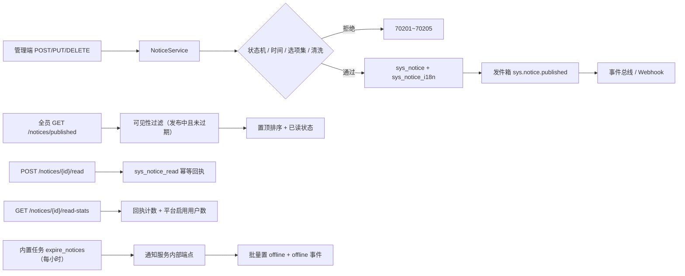
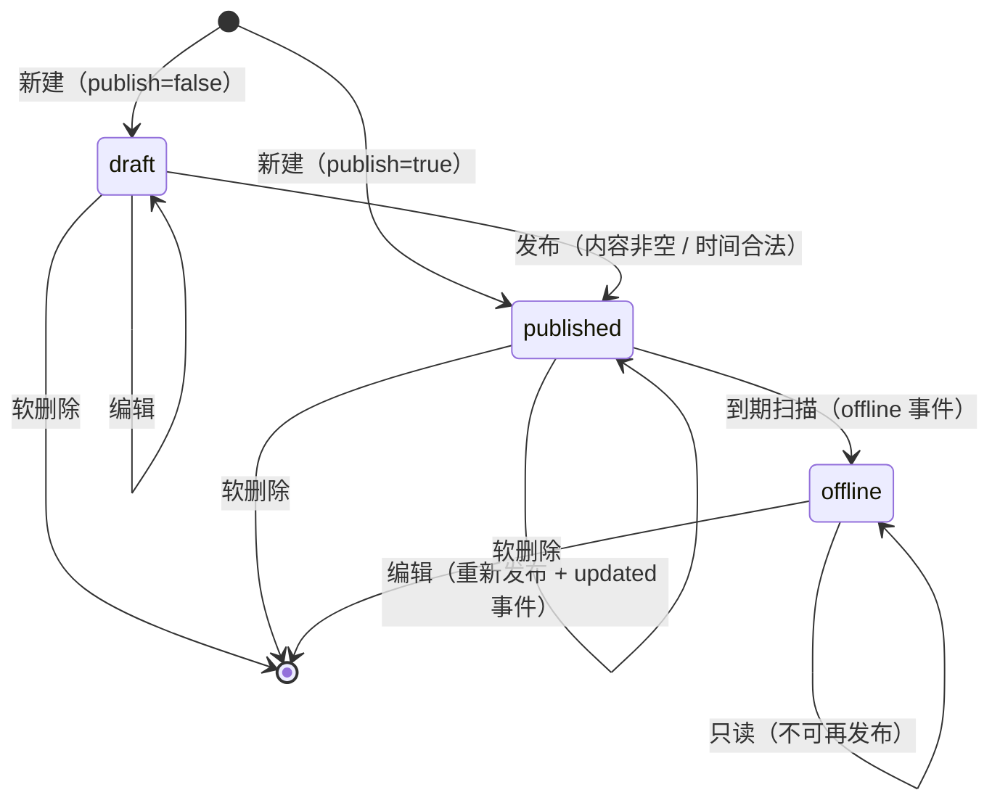

# 公告管理详细设计（公告落库 / 置顶 / 过期下线 / 已读回执 / 多语言）

> 通用能力 · 07 通知与公告 · 02 公告管理 · 详细设计

[文档首页](../../../../../../文档首页.md) › [08 通用能力](../../../../README.md) › [通知与公告](../../07_通知与公告.md) › [公告管理](../07_通知与公告_02_公告管理.md) › 详细设计　|　[需求 04-2](../../../../需求/04_需求_通知与公告.md#r04-2) · [阶段计划](../../../../计划/01_计划_通用能力.md) · [概要 · 公告管理](../../../../../../设计/概要设计/18_概要设计_公告管理.md)

## 1. 概述 <a id="overview"></a>

- **目标**：把公告管理从「只有概要与权限码」补成**真实可用的全员公告能力**：

  1. **公告落库与多语言**：新建 `sys_notice` / `sys_notice_read` / `sys_notice_i18n`；标题 / 正文按 locale 存附表，主表列只作默认文案派生快照；关闭 05_02 台账「待审核」状态。
  2. **发布 / 编辑 / 删除 / 置顶**：`POST` 新建（草稿或直接发布）、`PUT` 编辑（含置顶、重新发布）、`DELETE` 软删除；写操作落操作日志，`sys_notice` 进字段级变更审计。
  3. **全员查看**：管理列表（状态 / 类型 / 关键字筛选 + 分页）与发布中列表（置顶优先）；详情按可见性过滤，草稿 / 已下线仅管理侧可见。
  4. **过期自动下线**：读取校验 + 每小时内置任务扫描双保险；下线发布 `sys.notice.published`（`action=offline`）。
  5. **已读回执与统计**：`POST /notices/{id}/read` 幂等落回执；`GET /notices/{id}/read-stats` 返回应读 / 已读 / 未读人数，应读人数实时取当前租户启用用户数。
  6. **事件与契约**：扩展 `sys.notice.published` 载荷（可选动作 / 类型 / 优先级 / 时间）；重建 `deploy/contracts/notification.json` / `platform.json`、`deploy/events/contracts.json` 与前端 `api_types`。
  7. **权限 / 选项集 / 错误码**：补 `notice:create/update/delete` 权限码；新增 `bms.notice.type` / `bms.notice.priority` 选项集；公告错误码 `70201–70206`。

- **依据**：需求 [04-2](../../../../需求/04_需求_通知与公告.md#r04-2)；《[概要设计 · 公告管理](../../../../../../设计/概要设计/18_概要设计_公告管理.md)》§2 / §4 / §5 / §7；《[架构设计 · 通知公告](../../../../../../设计/架构设计/22_架构设计_子系统_通知公告.md)》§3 / §6；《[数据规范](../../../../../../设计/数据库设计/02_数据库设计_数据规范.md)》§3 / §5 / §6；《[阶段八贯穿口径](../../../../README.md#rules)》第 2 条；《[后端开发规范](../../../../../../规范/后端开发规范.md)》；《[测试规范](../../../../../../规范/测试规范.md)》；《[AI开发规范](../../../../../../规范/AI开发规范.md)》「覆盖率要求」节。

- **范围**：`bms_core` 的错误码 / 异常 / 文案 / 事件契约 / 富文本清洗 / 审计白名单 / i18n 台账 / 表归属 / 权限种子 / 内置任务；`bms_notification` 的公告模型、仓储、服务、路由、内部过期端点、应读人数读取、应用装配；`bms_platform` 用户只读出口的授权方式调整；`sys_notice` / `sys_notice_read` / `sys_notice_i18n` 表文件与总览登记；`18` / `19` 数据库设计节点文档；`deploy/registry/platform.toml` 选项集；契约快照与前端类型。

- **不含（归口见 §9）**：前端公告管理页、移动端 H5 与富文本编辑器（阶段十五）；公告读统计的人员明细与催办；管理员手动下线（当前只支持到期自动下线与删除）；公告归档策略（随 14_01 既有策略机制接入）；真实 Socket.IO / 邮件短信（07_03 / 实时推送阶段）；`sys_notice_i18n` 的跨服务默认语言实时切换（国际化阶段）。

## 2. 现状与差距（设计 vs 代码不符清单） <a id="gap"></a>

> 动手前对账结果。「处置」列写明本段改什么、回写什么、留什么。

| # | 关注点 | 需求 / 规范要求 | 代码现状 | 处置 |
| --- | --- | --- | --- | --- |
| 1 | 公告落库 | 全员公告可发布 / 编辑 / 删除 / 查看 | 无 `sys_notice` 模型、无表文件、表归属未登记 | **本段建**：三表 + 模型 + 表文件 + 表归属 |
| 2 | 数据隔离 | 公告与站内信是两件事 | `sys_notification` 只承载个人站内信 | **本段守**：不新建广播类型、不共用表 |
| 3 | 回执主键 | 一人一条回执，重复阅读不重复计 | 无 | **本段定**：雪花 ID 主键 + `(notice_id,user_id,deleted_at)` 复合唯一（回写概要 §4「联合主键」） |
| 4 | 多语言 | 业务文案走 `{主表}_i18n` | 05_02 台账登记 `sys_notice_i18n` 为待落地 | **本段建**：附表 + 三级回退读写 + 台账改已落库 |
| 5 | 置顶排序 | 置顶在前，多置顶按更新时间 | 无 | **本段建**：`is_top DESC, CASE WHEN is_top THEN updated_at ELSE publish_at END DESC, id DESC` |
| 6 | 过期下线 | 读取校验 + 定时扫描兜底 | 无 | **本段建**：可见性判定 + 内置任务 + 通知服务内部端点 |
| 7 | 已读回执 | 联合主键防重复，统计已读 / 未读 | 无 | **本段建**：显式 `POST /read`，幂等插入；统计接口 |
| 8 | 应读人数 | 已读 + 未读 = 应读 | 无 | **本段建**：实时读平台启用用户数；统计接口返回三值 |
| 9 | 事件 | 发布 / 更新 / 下线发 `sys.notice.published` | 契约已登记，载荷只有 notice_id/title/is_top，无生产方 | **本段改**：载荷增可选 action/type/priority/publish_at/expire_at；发布 / 更新 / 过期下线同事务写发件箱 |
| 10 | 后端清洗 | 富文本 HTML 白名单清洗为权威口径 | 后端无清洗依赖与工具 | **本段建**：引入 `nh3`，基座共享清洗工具 |
| 11 | 类型 / 优先级 | 取值由通用字典维护 | 无取值域声明 | **本段建**：`bms.notice.type` / `bms.notice.priority` 选项集 + 运行时校验 |
| 12 | 错误码 | 7xxxx 通知段 | 70001–70006 任务调度、70101–70106 通知中心、71001–71006 作业中心 | **本段改**：公告用 70201–70206；71xxx 已不可用（07_03 邮件需另改段） |
| 13 | 权限 | `notice:create/update/delete/query` | 只有 `notice:query` 权限码，动作种子也没有 create/update/delete | **本段改**：补动作与权限码；不加菜单 / 按钮 / 字段种子 |
| 14 | 审计 | `sys_notice` 属关键表，字段级变更入审计 | `sys_notice` 在基座 `AUDITED_TABLES`，但表将归 notification 服务 | **本段改**：移出基座常量，通知服务装载期注册 |
| 15 | 表归属 | 一表一文件并登记总览 | 三表均未登记，连 `planned` 都没有 | **本段建**：三条 `TableRecord` + 总览 §7.3 |
| 16 | 数据库节点文档 | 总览 §7.2 登记 18 / 19 节点 | 两文件均不存在（07_01 只交付表文件） | **本段建**：19 本段交付；18 作为 07_01 遗留顺带补齐 |
| 17 | 契约与前端类型 | 端点必须进公开契约 | 通知服务无公告端点 | **本段改**：重建 notification / platform 契约、事件快照与 `api_types` |
| 18 | Kiwi 编号 | 先登记后编码 | 07_01 已用 2517 | **本段首步**：容器内登记取新号，回填 `@pytest.mark.kiwi_id(<编号>)` |

## 3. 交付物清单 <a id="tree"></a>

```text
backend/
├── libs/bms_core/pyproject.toml                        # 改：新增 nh3 依赖
├── libs/bms_core/src/bms_core/
│   ├── core/error_codes.py                             # 改：70201~70206 + HTTP 映射
│   ├── core/exceptions.py                              # 改：NoticeError 子段基 + 六个异常
│   ├── core/assembly.py                                # 改：无（公告不新增插件能力域）
│   ├── events/platform_events.py                       # 改：sys.notice.published 增可选字段
│   ├── richtext/__init__.py                            # 新建：富文本能力域出口
│   ├── richtext/sanitize.py                            # 新建：nh3 白名单清洗 / 长度与空内容校验
│   ├── audit/tables.py                                 # 改：移出 sys_notice
│   ├── i18n/attachments.py                             # 改：sys_notice_i18n 状态改 landed
│   ├── i18n/error_seed.py                              # 改：补 70201~70206 中英文案
│   ├── services/table_registry.py                      # 改：登记三表（enabled）
│   ├── tenant/seed/menu.py                             # 改：notice 的 create/update/delete 动作与权限码
│   └── tasks/builtin.py                                # 改：新增 expire_notices + 通用服务内部调用助手
├── libs/bms_core/tests/
│   ├── richtext/test_sanitize.py                       # 新建：白名单 / 协议 / style / 空内容 / 超长
│   ├── events/test_platform_events.py                  # 改：公告载荷字段断言
│   ├── services/test_table_registry.py                 # 改：三表归属断言
│   ├── i18n/test_i18n_attachments.py                   # 改：公告附表已落库断言（若既有）
│   └── tasks/test_task_builtin.py                      # 改：十条内置任务与新执行体
├── services/notification/src/bms_notification/
│   ├── main.py                                         # 改：注册 sys_notice 审计白名单
│   ├── models/__init__.py                              # 改：公告模型模块清单
│   ├── domains/notification/models/notice.py           # 新建：SysNotice / SysNoticeRead / SysNoticeI18n
│   ├── domains/notification/repositories/notice.py     # 新建：管理 / 公开分页、回执、统计、过期扫描
│   ├── domains/notification/services/notice.py         # 新建：公告业务（状态机 / 可见性 / 多语言 / 事件）
│   ├── domains/notification/services/notice_audience.py# 新建：应读人数读取（平台用户只读出口）
│   ├── domains/notification/schemas/notice.py          # 新建：请求 / 响应契约
│   ├── domains/notification/api/notice.py              # 新建：公告路由 + 内部过期端点
│   └── domains/notification/public.py                  # 改：导出公告常量 / 契约（供后续复用）
├── services/notification/tests/
│   ├── notice/_support.py                              # 新建：公告造数 / 选项集 / 应读人数替身
│   ├── notice/test_notice_repository.py                # 新建：分页 / 筛选 / 排序 / 回执 / 过期
│   ├── notice/test_notice_service.py                   # 新建：状态机 / 可见性 / 多语言 / 事件 / 统计
│   ├── notice/test_notice_api.py                       # 新建：权限 / 参数 / 错误码 / 内部端点
│   └── notice/test_notice_audience.py                  # 新建：应读人数读取成功 / 降级
├── services/platform/src/bms_platform/domains/user/api/internal_users.py  # 改：查询出口改能力或白名单
├── services/platform/tests/users/test_internal_query.py                   # 改：notification 白名单放行
├── config.toml                                         # 改：无新增配置段（选项集走 registry）
├── deploy/contracts/notification.json                  # 重新生成
├── deploy/contracts/platform.json                      # 重新生成
├── deploy/events/contracts.json                        # 重新生成
└── frontend/packages/api_types/                        # 重新生成（生成物，零手工改）

deploy/registry/platform.toml                           # 改：新增 bms.notice.type / bms.notice.priority 选项集

bms文档/
├── 设计/数据库设计/数据表设计/sys_notice.md             # 新建
├── 设计/数据库设计/数据表设计/sys_notice_read.md        # 新建
├── 设计/数据库设计/数据表设计/sys_notice_i18n.md        # 新建
├── 设计/数据库设计/01_数据库设计_总览.md                # 改：§6.2 / §7.2 / §7.3
├── 设计/数据库设计/18_数据库设计_通知中心.md            # 新建（07_01 遗留）
├── 设计/数据库设计/19_数据库设计_公告管理.md            # 新建
├── 设计/数据库设计/30_数据库设计_国际化管理.md          # 改：附表状态改已落库
├── 设计/概要设计/18_概要设计_公告管理.md                # 改：表 / 接口 / 事件 / 错误码
├── 设计/架构设计/22_架构设计_子系统_通知公告.md         # 改：§3 公告口径
├── 规范/后端开发规范.md                                 # 改：通知公告能力补公告口径（如需要）
├── 后端基类清单.md                                      # 改：无新增基类（公告走继承体系，不新增契约基座）
├── 项目/08_通用能力/任务/05_国际化/.../设计/01_详细设计_05_02_...md  # 改：台账状态
├── 项目/08_通用能力/任务/06_日志与审计/.../设计/01_详细设计_06_02_...md # 改：审计白名单归属
├── 项目/08_通用能力/计划/01_计划_通用能力.md            # 改：07_02 归档 + 计数
├── 项目/08_通用能力/需求/04_需求_通知与公告.md          # 改：04-2 交付注块
└── 本任务目录/设计、实施、测试                          # 本文档 + 实施 / 测试记录
```

## 4. 领域设计 <a id="design"></a>

### 4.1 总体流程 <a id="flow"></a>



### 4.2 数据模型 <a id="table"></a>

按《数据规范》，三张表一表一文件；本文只写差异，完整字段见对应表文件。

| 表 | 字段 | 约束 / 索引 | 表文件 |
| --- | --- | --- | --- |
| `sys_notice` | `title`(256) / `content`(TEXT) / `type`(32) / `priority`(16) / `is_top`(BOOLEAN) / `publish_at`(DATETIME) / `expire_at`(DATETIME, 可空) / `status`(16) | 业务索引：`(status, is_top, publish_at)`、`(status, expire_at)`、`(type)`；公共 `deleted_at` 索引 | [sys_notice.md](../../../../../../设计/数据库设计/数据表设计/sys_notice.md) |
| `sys_notice_read` | `notice_id`(雪花) / `user_id`(雪花) / `read_at`(DATETIME) | 唯一 `(notice_id, user_id, deleted_at)`；普通 `(user_id)` | [sys_notice_read.md](../../../../../../设计/数据库设计/数据表设计/sys_notice_read.md) |
| `sys_notice_i18n` | `notice_id`(雪花) / `locale`(16) / `title`(256) / `content`(TEXT) | 唯一 `(notice_id, locale, deleted_at)` | [sys_notice_i18n.md](../../../../../../设计/数据库设计/数据表设计/sys_notice_i18n.md) |

- **公共字段**：三表均继承 `BaseModel`（雪花 `id` / 审计 / `deleted_at` / `version`），不重复展开。
- **软删除**：公告删除写 `deleted_at`，i18n 附表同事务连带软删；回执保留（审计追溯）。列表 / 详情 / 统计全部经 `_select()` 过滤。
- **无物理外键**：`notice_id` / `user_id` 为逻辑外键；`user_id` 跨服务（platform），不建库约束。
- **表归属**：三表 `owner=notification`、`domain=notification`、`datasource=tenant`、`status=enabled`，进 notification 服务租户链。

### 4.3 状态机 <a id="status"></a>



- **状态取值**：`draft`（草稿）/ `published`（发布中）/ `offline`（已下线）。
- **禁止迁移**：`offline → published`（对已下线公告重复发布，`70204`）；`published → draft`（不支持撤回）；`draft → offline`（无手动下线）。
- **软删除**：任何状态均可删除；删除不发事件，只落操作日志；回执与附表保留，详情不可见。

### 4.4 可见性与排序 <a id="visibility"></a>

**可见性（唯一判定函数 `is_visible(row, now)`）**：

```text
status == published
AND publish_at <= now
AND (expire_at IS NULL OR now < expire_at)
```

- **普通用户**：列表 / 详情 / 回执只允许满足 `is_visible` 的公告；不满足按 `70201`（不存在）返回，不泄露草稿 / 下线状态。
- **管理侧**：持有 `notice:update` 的调用方可查看全部未删除公告（含草稿 / 未到发布时间 / 已下线）。
- **回执**：只允许对 `is_visible` 的公告写回执；草稿 / 下线 / 未到时间返回 `70202`（详情不泄露）。

**排序（固定，不接受客户端排序参数）**：

```sql
ORDER BY is_top DESC,
         CASE WHEN is_top THEN updated_at ELSE publish_at END DESC,
         id DESC
```

- 置顶组内按更新时间倒序（概要「多公告置顶按更新时间排序」）；非置顶组按发布时间倒序。
- 管理列表与公开列表共用同一排序；`BasePageQuery` 的排序参数被忽略并在文档注明。
- 说明：CASE 排序无法完全走组合索引，公告量级小（租户级），先以正确性优先；压测确有瓶颈再评估 `top_sort_at` 冗余列。

### 4.5 多语言读写 <a id="i18n"></a>

**写入**（`POST` / `PUT`）：

- 请求体 `i18n: {locale: {title, content}}`，locale 长度 ≤16、非空白；单次 ≤50 个语言。
- 空白文案剔除；必填语言（请求语言）必须有非空 `title`；发布时必须有非空 `content`。
- 主表 `title` / `content` 为**派生快照**：系统默认语言（`get_default_locale()`）→ 请求语言 → 首个有值语言；调用方不单独提交主表列。
- 附表写经 `bms_core/repositories/i18n.py::replace_i18n_texts`（软删旧行再插新行）；主表删除经 `soft_delete_i18n` 连带软删。

**读取**：

- 语言优先级：显式 `locale` 查询参数 → `Accept-Language` 主语言 → `get_default_locale()`。
- 经 `load_i18n_texts` 取两级回退；两级都缺时回落主表默认文案列（派生快照恒非空）。
- 列表只返回本地化 `title`；详情返回本地化 `title` / `content`；管理侧详情额外返回完整 `i18n` 映射（供编辑页回显）。
- 已知限制：通知服务不读平台 `sys_i18n_locale` 的默认标记，默认语言取基座常量；租户切换默认语言后主表快照不会自动重派生，登记为国际化阶段开放项（§9）。

### 4.6 富文本清洗 <a id="sanitize"></a>

**实现**：`bms_core/richtext/sanitize.py`，基于 `nh3`（Rust ammonia）白名单清洗。

| 项 | 口径 |
| --- | --- |
| 允许标签 | `p` `br` `strong` `b` `em` `i` `u` `s` `ul` `ol` `li` `blockquote` `h1`~`h6` `a` `img` `table` `thead` `tbody` `tr` `th` `td` `code` `pre` `span` `div` `hr` |
| 允许属性 | `a[href,title,target,rel]`、`img[src,alt,title,width,height]`、`th/td[colspan,rowspan]`、`code[class]`、通用 `style`（属性级白名单） |
| URL 协议 | `http` / `https` / `mailto` / 相对路径；禁止 `javascript:` / `data:` / `vbscript:` |
| `style` | 仅允许 `text-align` / `text-indent` / `width` / `height` / `max-width`；禁止 `expression()` / `url()` |
| 禁止 | `script` `style` `iframe` `object` `embed` `form` `input` `video` `audio` `svg`、全部 `on*` 事件属性 |
| 失败判定 | 清洗后正文去标签为空（发布时）、UTF-8 字节数 > 60000、标题 > 256 字符 → `70205` |

- 清洗在服务层入口执行一次，入库即净化后 HTML；读取不二次清洗（前端渲染前仍按《富文本字段》二次净化）。
- 实现优先用 `nh3.clean(..., attribute_filter=...)` 做 `style` 与 URL 的细粒度过滤；`nh3` 版本能力不足时退化为「整列 `style` 剥离」并在实施记录登记。

### 4.7 接口契约 <a id="api"></a>

**管理端**：

| 方法 | 路径 | 权限 | 说明 |
| --- | --- | --- | --- |
| GET | `/api/v1/notices` | `notice:query` | 管理列表：`page` / `size` / `keyword`（标题）/ `status` / `type`；无 `notice:update` 时强制只看发布中 |
| POST | `/api/v1/notices` | `notice:create` | 新建：`i18n` / `type` / `priority` / `is_top` / `publish_at` / `expire_at` / `publish`（默认 true） |
| PUT | `/api/v1/notices/{id}` | `notice:update` | 编辑：同名字段可选；`publish=true` 表示草稿发布；`false` 拒绝（`70204`） |
| DELETE | `/api/v1/notices/{id}` | `notice:delete` | 软删除，连带软删 i18n；返回 `{deleted: true}` |

**全员端**：

| 方法 | 路径 | 权限 | 说明 |
| --- | --- | --- | --- |
| GET | `/api/v1/notices/published` | 登录即可 | 发布中列表（置顶优先）：`page` / `size` / `locale`；含当前用户 `is_read` |
| GET | `/api/v1/notices/{id}` | 登录即可 | 详情：发布中可见；草稿 / 下线仅 `notice:update` 可见；`locale` 可选 |
| POST | `/api/v1/notices/{id}/read` | 登录即可 | 已读回执，幂等；返回 `{notice_id, read_at}` |

**管理统计**：

| 方法 | 路径 | 权限 | 说明 |
| --- | --- | --- | --- |
| GET | `/api/v1/notices/{id}/read-stats` | `notice:query` | 返回 `{notice_id, audience_count, read_count, unread_count}` |

**内部**：

| 方法 | 路径 | 鉴权 | 说明 |
| --- | --- | --- | --- |
| POST | `/api/v1/notices/internal/expire` | `require_service("platform")` | 过期扫描：`{limit?: int, now?: datetime}` → `{expired: int}`；租户由服务 JWT 解析 |

**契约字段**：

- `NoticeTextInput`：`title`（1..256）、`content`（0..60000 字节对应的字符上限，服务层再按字节校验）。
- `NoticeListItem`：`id` / `title` / `type` / `priority` / `is_top` / `status` / `publish_at` / `expire_at` / `is_read` / `created_at` / `updated_at`。
- `NoticeDetail`：列表字段 + `content` / `i18n`（管理侧才返回映射）/ `created_by` / `updated_by`。
- 时间统一 UTC；请求带时区的时间在服务层转 UTC naive 后入库；响应按 UTC naive 序列化（与既有契约一致）。
- 路由静态段（`/published`、`/internal/expire`）先于 `/{notice_id}` 登记，避免路径吞并。

### 4.8 已读回执与统计 <a id="read"></a>

**回执**：

- 仅对可见公告写入；不存在 / 已删除 `70201`，未发布 / 未到时间 / 已过期 `70202`。
- 幂等：先按 `(notice_id, user_id)` 查活行；已存在直接返回原 `read_at`；并发插入用 `begin_nested()` 保存点包住，唯一冲突时回滚保存点并重查。
- 不允许批量 / 全部已读（公告按条阅读；需求未要求）。

**统计**：

- `read_count` = `COUNT(DISTINCT user_id) WHERE notice_id=? AND deleted_at IS NULL`。
- `audience_count` = 平台 `POST /api/v1/platform/internal/users/query`（`status=enabled`、`page=1`、`size=1`）的 `total`。
- `unread_count` = `max(audience_count - read_count, 0)`。
- **边界**：已停用用户的存量回执仍计入 `read_count`，当 `read_count > audience_count` 时 `unread_count` 记 0，响应保留两个原始数值（不伪造「应读」）。
- **降级**：平台用户查询不可达 / 非 2xx / 响应非法 → `70206`（503），不返回猜测数字。
- 统计只允许未删除公告；已删除 `70201`。

### 4.9 过期下线与内置任务 <a id="expire"></a>

**读取校验**：所有读路径（管理列表 / 公开列表 / 详情 / 回执）按 `is_visible` 判定；过期即刻不展示，不依赖扫描。

**定时扫描**：

- **内置任务** `expire_notices`（名称「公告过期下线」，cron `0 * * * *`，owner `07_02`）在 `bms_core/tasks/builtin.py` 登记；执行体只经 `service_client` 调通知服务内部端点，扫描 / 更新 / 事件全在通知域。
- **内部端点**：`POST /api/v1/notices/internal/expire`，`require_service("platform")`；租户取服务 JWT 的 `tenant_id`。
- **扫描口径**：`status=published AND expire_at IS NOT NULL AND expire_at <= now`，默认 `limit=200`（上限 1000），循环到无命中或达上限。
- **并发与审计**：逐行加载并用 `begin_nested()` 保存点更新 `status=offline`；`StaleDataError` 回滚该行、跳过（另一实例已处理）；更新走 ORM 以触发字段级审计与 `updated_at`。
- **事件**：每成功下线一行，同事务写 `sys.notice.published`（`action=offline`）；并发下被跳过的不重复发事件。
- **失败**：内部端点异常使任务 `failed`，按调度器策略重试；读取校验仍兜底展示。
- **存量租户**：新任务随 `ops.seed_platform` 回填；实施记录登记该操作。

### 4.10 事件契约 <a id="event"></a>

`sys.notice.published` 契约扩展（只增可选字段，不升主版本）：

| 字段 | 类型 | 必填 | 说明 |
| --- | --- | --- | --- |
| `notice_id` | string | 是 | 公告主键（十进制字符串） |
| `title` | string | 是 | 事件发生时的主表标题（默认文案快照） |
| `is_top` | boolean | 是 | 是否置顶 |
| `action` | string | 否 | `published` 发布 / `updated` 更新 / `offline` 过期下线 |
| `type` | string | 否 | 公告类型（选项集 value） |
| `priority` | string | 否 | 优先级（选项集 value） |
| `publish_at` | string | 否 | 发布时间（ISO8601 UTC） |
| `expire_at` | string | 否 | 过期时间（ISO8601 UTC；无过期不带） |

- **生产点**：`NoticeService` 在公告写入事务内构造 `EventEnvelope`，`aggregate_key=f"notice:{notice_id}"`，`tenant_id` 取当前租户；发件箱 `SqlOutboxStore` 缺省实现。
- **不发事件**：新建草稿、编辑草稿（未发布）、软删除。
- **删除语义**：只落操作日志，不发 `sys.notice.published`（与概要 §2.2 事件清单一致）。
- **Webhook**：订阅方按事件名匹配后按 `action` 区分三种动作；`notice_id` 供回查。

### 4.11 权限 / 选项集 / 审计 / 表归属 <a id="governance"></a>

**权限码**：

| 权限码 | 用途 | 备注 |
| --- | --- | --- |
| `notice:query` | 管理列表 / 详情 / 统计 | 已有种子 |
| `notice:create` | 新建公告 | 本段补动作与权限码 |
| `notice:update` | 编辑 / 置顶 / 发布 / 查看草稿与下线 | 本段补动作与权限码 |
| `notice:delete` | 软删除 | 本段补动作与权限码 |

- 不加菜单 / 按钮 / 字段种子（页面随阶段十五）；操作日志动作码由权限依赖自动带出。
- 公开列表 / 详情（发布中）/ 回执只要求登录；草稿与下线详情额外要求 `notice:update`。

**选项集**（`deploy/registry/platform.toml`）：

| 选项集 | 可增长 | 取值 |
| --- | --- | --- |
| `bms.notice.type` | 是 | `system` 系统 / `policy` 制度 / `maintenance` 维护 / `activity` 活动 |
| `bms.notice.priority` | 是 | `low` 低 / `normal` 普通 / `high` 高 / `urgent` 紧急 |

- 运行时经 `BaseOptionSetRegistry.validate` 校验；非法值 → `10001`；选项集缺失属配置漂移（启动期契约校验 / 测试拦截）。
- 默认值：`type=system`、`priority=normal`。

**字段级审计**：

- `sys_notice` 从 `bms_core/audit/tables.py::AUDITED_TABLES` 移出；`bms_notification/main.py::prepare_settings` 调 `register_audited_tables(("sys_notice",))`。
- `sys_notice_i18n` / `sys_notice_read` 不纳入字段级审计（文案跟随主表；回执写入量大、非关键变更）。
- 回写 06_02 详细设计的基座常量清单，注明 `sys_notice` 改由通知服务注册。

**表归属**：

- `sys_notice` / `sys_notice_read` / `sys_notice_i18n` 登记到 `TABLE_OWNERSHIP`（owner/domain=notification、tenant、enabled）。
- 表文件、总览登记、目录一致性由既有 `ops.check_tables` / 基座护栏断言。

### 4.12 错误码与异常 <a id="errors"></a>

| 错误码 | 异常类 | HTTP | 含义 |
| --- | --- | --- | --- |
| 70201 | `NoticeNotFoundError` | 404 | 公告不存在或已删除 |
| 70202 | `NoticeNotVisibleError` | 404 | 公告未发布 / 未到发布时间 / 已过期下线 |
| 70203 | `NoticeTimeInvalidError` | 400 | 发布时间与过期时间非法（`expire_at <= publish_at` 或发布已过期） |
| 70204 | `NoticeStatusConflictError` | 409 | 状态冲突（已下线再发布 / 发布中撤回草稿 / 草稿手动下线） |
| 70205 | `NoticeContentInvalidError` | 400 | 正文清洗后为空 / 超长 / 标题超长 |
| 70206 | `NoticeAudienceUnavailableError` | 503 | 应读人数读取不可用（平台用户查询不可达） |

- `NoticeError(NotificationError)` 作为 702xx 子段基；文案走 `error.{code}` 中英种子，新增码由既有护栏用例拦截。
- 选项集非法值 / 页码超限 / 参数类型错误仍走 `10001`。

## 5. 失败分支与边界 <a id="failures"></a>

| 场景 | 行为 | 依据 / 风险 |
| --- | --- | --- |
| 公告 id 不存在 / 已软删 | `70201`（404） | 与错误码表一致 |
| 普通用户访问草稿 / 未到时间 / 已下线 | `70201`（详情不泄露状态） | 可见性口径 |
| 草稿 / 下线回执 | `70202`（404 语义） | 不可读即不可回执 |
| `expire_at <= publish_at` | `70203`（400） | 概要 §2.3 |
| 发布时 `expire_at <= now` | `70203`（400） | 发布即过期无意义 |
| 已下线公告再发布 | `70204`（409） | 概要 §7「发布状态冲突」 |
| `publish=false` 更新已发布公告 | `70204`（409） | 不支持撤回草稿 |
| 正文清洗后为空且要发布 | `70205`（400） | 概要 §7 内容校验 |
| 正文 UTF-8 > 60000 字节 | `70205`（400） | MySQL TEXT 上限约束；三库统一按字节校验 |
| 标题 > 256 字符 | `70205`（400） | 列宽约束 |
| `type` / `priority` 不在选项集 | `10001`（参数错误） | 选项集运行时校验 |
| `i18n` 为空 / 必填语言缺标题 | `10001`（参数错误） | 05_02 写入口径 |
| 重复 `POST /read` | 返回原 `read_at`，不新增行 | 幂等 |
| 并发重复回执 | 保存点回滚后重查，返回原回执 | 唯一约束兜底 |
| 统计时平台用户查询不可达 | `70206`（503） | 不返回猜测数字 |
| 已停用用户的存量回执 | 计入 `read_count`；`unread=max(audience-read,0)` | 保留原始数值，不伪造 |
| 过期扫描并发 | 逐行保存点 + 乐观锁，冲突行跳过、不重复发事件 | 至少一次语义 |
| 过期扫描单批失败 | 任务 `failed`，调度器重试；读取校验兜底展示 | 概要 §2.3 |
| 事件发件箱写失败 | 公告写入事务回滚 | 同事务保证 |
| 删除后列表 / 详情 | 不可见；回执与附表保留 | 软删除口径 |
| 主表删除时附表 | 同事务软删，不留孤儿 | 数据规范 §5 |
| 租户切换默认语言 | 主表快照不自动重派生；显式 locale 仍可读附表 | 开放项，国际化阶段补 |
| 新内置任务未回填存量租户 | 扫描不执行；读取校验仍生效 | 实施记录登记 `ops.seed_platform` |

## 6. 测试设计与验收映射 <a id="tests"></a>

**Kiwi**：实施首步在容器内 `bms-kiwi` 按《[KiwiTCMS 部署使用说明](../../../../../../资料/开发服务器/linux/KiwiTCMS部署使用说明.md)「用例登记」节登记（分类「平台骨架」、优先级 `P2`、状态 `CONFIRMED`、标签「自动化」），**本任务登记 1 条**（多断言共用），取得编号后回填 `@pytest.mark.kiwi_id(<编号>)`；不得复用 2517。

| 完成标准（任务书 §3 / 需求 04-2） | 用例 |
| --- | --- |
| 发布后全员可见且置顶排序正确 | `test_notice_service`（置顶组按更新时间、非置顶按发布时间）+ `test_notice_api`（公开列表） |
| 到期后不再展示（读取校验兜底） | `test_notice_service`（过期行 `is_visible=false`）+ `test_notice_api`（公开列表 / 详情 404） |
| 定时扫描执行记录可查 | `test_task_builtin`（任务提交内部端点）+ `test_notice_api`（内部端点返回 expired） |
| 重复阅读不产生重复回执 | `test_notice_service`（重复 POST 返回原 read_at、行数不变） |
| 已读 + 未读 = 应读 | `test_notice_service`（audience=5/read=2 → unread=3）+ 边界（read>audience） |
| 软删除后列表与详情不可见 | `test_notice_repository` / `test_notice_api` |
| 操作日志可查（发布 / 编辑 / 删除） | 既有操作审计中间件用例 + 路由权限码断言（动作码来自权限依赖） |
| 多语言三级回退 | `test_notice_service`（显式 locale / Accept-Language / 主表列） |
| 富文本白名单清洗 | `libs/bms_core/tests/richtext/test_sanitize.py` |
| 类型 / 优先级选项集校验 | `test_notice_api`（非法值 10001） |
| 字段级审计仍覆盖公告 | `libs/bms_core/tests/audit/test_audit_capture.py`（既有注册入口）+ 通知服务启动注册断言 |
| 应读人数读取降级 | `test_notice_audience`（不可达 70206） |
| 平台用户查询白名单 | `services/platform/tests/users/test_internal_query.py`（notification 放行、mdm 能力路径不变） |
| 错误码文案完整 | 既有 `test_error_seed_coverage`（新增 6 码后仍须全绿） |
| 表归属 / i18n 台账 | `test_table_registry` / `test_i18n_attachments` |
| 装配冒烟 | `pytest services/notification/tests/test_service_boot.py` + 新模型模块清单 |

**替身与真机边界**：

- 通知服务测试用临时 SQLite（共享租户库回滚会话）+ 选项集替身 / `ManifestOptionSet`；应读人数用替身，不请求真平台。
- 平台用户查询白名单用测试服务 JWT 替身，不连真 identity。
- `nh3` 为进程内纯函数，不需要外部服务。
- 真库压测、MySQL / PostgreSQL / 达梦方言验证、真实 Webhook 订阅随部署窗口 / 后续阶段。

**覆盖率**：口径见《[AI开发规范](../../../../../../规范/AI开发规范.md)》「覆盖率要求」节——新增 / 改动模块 100% 行 + 分支；不可达分支须带理由标注 `# pragma: no cover - 原因`。

## 7. 登记落点 <a id="registry-writeback"></a>

| 文档 / 清单 | 回写内容 |
| --- | --- |
| 《[数据库设计总览](../../../../../../设计/数据库设计/01_数据库设计_总览.md)》 | §6.2 修正公告主键 / 唯一口径并补 i18n 附表；§7.2 补 18 / 19 节点；§7.3 登记三表（已设计） |
| 表文件 | 新建 `sys_notice.md` / `sys_notice_read.md` / `sys_notice_i18n.md`（字段 / 索引 / 分片归档 / 建表 / 变更记录） |
| 数据库设计节点 | 新建 `19_数据库设计_公告管理.md`；补建 `18_数据库设计_通知中心.md`（07_01 遗留） |
| 《[数据库设计 · 国际化管理](../../../../../../设计/数据库设计/30_数据库设计_国际化管理.md)》 | `sys_notice_i18n` 状态改「已落库」 |
| 《[概要设计 · 公告管理](../../../../../../设计/概要设计/18_概要设计_公告管理.md)》 | §2.2 事件载荷 / 动作；§4 表与唯一约束、i18n 附表；§5.1 接口与可见性；§7 错误码 70201–70206 |
| 《[架构设计 · 通知公告](../../../../../../设计/架构设计/22_架构设计_子系统_通知公告.md)》 | §3 公告落库 / 多语言 / 过期扫描 / 回执统计口径 |
| 《[06_02 详细设计](../../../06_日志与审计/06_日志与审计_02_字段级变更审计与哈希链/设计/01_详细设计_06_02_字段级变更审计与哈希链.md)》 | 基座审计常量移出 `sys_notice`，注明通知服务注册 |
| 《[05_02 详细设计](../../../05_国际化/05_国际化_02_业务文案i18n附表与用户时区偏好/设计/01_详细设计_05_02_业务文案i18n附表与用户时区偏好.md)》 | 台账行状态改「已落库」 |
| 《[计划 · 通用能力](../../../../计划/01_计划_通用能力.md)》 | 07_02 移入 §2「已完成任务」（完成日期 / 遗留）；计数更新 |
| 《[需求 04-2](../../../../需求/04_需求_通知与公告.md#r04-2)》 | 追加交付注块（范围 / 用例号 / 遗留归口） |
| 任务文档 | 参考文档补详细设计 / 实施 / 测试链接 |
| 平台与服务种子 | `ACTION_SEEDS` / `PERMISSION_SEEDS` 补 notice 三动作；`TABLE_OWNERSHIP` 补三表 |
| 选项集 | `deploy/registry/platform.toml` 新增 `bms.notice.type` / `bms.notice.priority` |
| 契约 / 前端类型 | `deploy/contracts/notification.json` / `platform.json`、`deploy/events/contracts.json`、`frontend/packages/api_types` 重建 |

## 8. 实施步骤 <a id="steps"></a>

| 批次 | 内容 | 验证 |
| --- | --- | --- |
| 0 | **取 Kiwi 编号**（容器内登记，分类「平台骨架」） | 取得编号并回读 |
| 1 | 依赖与基座：`nh3` + `richtext/sanitize.py`；错误码 / 异常 / 文案；事件载荷；审计移出；i18n 台账；表归属；权限种子；选项集 | `pytest libs/bms_core/tests/richtext libs/bms_core/tests/events libs/bms_core/tests/tasks -q` |
| 2 | 数据库设计：三张表文件 + 18 / 19 节点文档 + 总览登记 | `ops.check_tables` / 既有基座护栏 |
| 3 | 公告模型与仓储：三模型 + `MODEL_MODULES` + 仓储（分页 / 回执 / 统计 / 过期） | `pytest services/notification/tests/notice/test_notice_repository.py -q` |
| 4 | 公告服务与路由：状态机 / 可见性 / 多语言 / 清洗 / 事件 / 统计 / 内部过期端点 / 应读人数读取 | `pytest services/notification/tests/notice -q` |
| 5 | 内置任务与平台授权：`expire_notices` 触发型执行体；`internal_users.query` 改能力或白名单 | 对应单文件用例 |
| 6 | 契约与前端类型：事件 / 服务契约快照 + `api_types` 重建 | 契约快照含新端点 / 字段 |
| 7 | 回写与记录：§7 全部登记落点 + 实施 / 测试记录 + 计划归档 + 需求注块 + 任务链接 | 文档三门禁（links / docs-scope / eol）0 |
| 8 | 交付闸门：单文件 ruff / pyright / pytest；覆盖率缺口按唯一入口查；提交前预检 | 预检全绿（覆盖率行 + 分支 100%） |

- 本任务按「一个任务最多两次提交」执行：代码 + 依赖 + 契约快照 + 前端类型一次 `feat(通知)`；设计 / 记录 / 登记一次 `docs(08)`。**不推送**。

## 9. 边界与开放项 <a id="boundary"></a>

1. **前端（阶段十五）**：公告管理页、移动端 H5、富文本编辑器、已读统计面板；本段只交付接口与契约。
2. **手动下线**：当前只支持到期自动下线与删除；管理员主动下线需新增状态迁移与事件语义，留后续需求确认。
3. **人员明细**：读统计只给人数；已读 / 未读人员明细需跨服务解析用户名与分页，留后续。
4. **默认语言运行时切换**：通知服务不读平台 `sys_i18n_locale` 默认标记，主表快照取基座常量；显式 `locale` / `Accept-Language` 仍可读附表。国际化阶段补跨服务默认语言读取。
5. **公告归档**：`sys_notice` / `sys_notice_read` 归档随 14_01 既有策略机制配置，本任务不建策略。
6. **07_03 邮件错误码**：概要设计 24 原规划 `71001–71006` 已被作业中心占用；07_03 需另定子段并同步概要 24 / 契约。
7. **存量租户任务回填**：新内置任务需对已有租户执行 `ops.seed_platform`；部署窗口登记。
8. **真库方言**：过期扫描的逐行保存点 + 乐观锁在 SQLite 测试通过；MySQL / PostgreSQL / 达梦在部署窗口实测并回写方言文档（未实测前不写入表文件结论）。
9. **操作日志动作码**：依赖权限码自动带出；阶段十五页面接入后复核日志动作与权限码一致。

## 10. 决策记录 <a id="align"></a>

| # | 决策 | 备选与取舍 |
| --- | --- | --- |
| 1 | 数据隔离：**新建三表，不复用站内信**（用户拍板） | 复用 sys_notification：广播与个人已读混杂；单表内嵌回执：无法按人统计 |
| 2 | 回执主键：**雪花 ID + `(notice_id,user_id,deleted_at)`**（用户拍板） | 联合主键：与 BaseModel / 软删除冲突；无 deleted_at 唯一：软删后无法再回执 |
| 3 | 多语言：**建 `sys_notice_i18n` 并接通读写**（用户拍板） | 只建表不接 API：台账假闭环；不建：与 05_02 归口冲突 |
| 4 | 类型 / 优先级：**选项集 + 运行时校验**（用户拍板） | 代码枚举：加值要发版；自由字符串：脏值无拦截 |
| 5 | 具体值：**system/policy/maintenance/activity + low/normal/high/urgent**（用户拍板） | 更少类型：制度 / 活动不好归类；只定优先级：类型无稳定标签 |
| 6 | 错误码：**70201–70206**（用户拍板） | 710xx：被作业中心占用；703xx / 720xx：编号不连续 |
| 7 | 事件载荷：**action + type/priority/publish_at/expire_at**（用户拍板） | 只加 action：订阅方仍要回查；不改：无法区分动作 |
| 8 | 事件动作：**published / updated / offline，删除不发**（用户拍板） | 删除也发：与概要清单不一致；拆三事件：破坏既有订阅 |
| 9 | 过期扫描：**内置任务 + 通知服务内部端点**（用户拍板） | 通知服务作业 worker：工作量与部署面大增；只读取校验：缺扫描记录 |
| 10 | 扫描频率：**每小时整点**（用户拍板） | 每 10 分钟：日志与扫描量 ×6；每日：下线事件延迟一天 |
| 11 | 应读人数：**实时取租户启用用户数**（用户拍板） | 发布快照：新增 / 停用用户不计入；只按回执：未读恒 0 |
| 12 | 统计明细：**只返回人数**（用户拍板） | 人员明细：要跨服务用户数据与分页 |
| 13 | 回执写入：**只由显式 POST**（用户拍板） | 详情自动写：读变写、缓存复杂；不提供 POST：与概要不一致 |
| 14 | 权限：**只补三个权限码**（用户拍板） | 加菜单 / 按钮种子：页面未落地，易漂移；不补：无法授权管理动作 |
| 15 | 范围：**仅后端**（用户拍板） | 含前端：需先补原型，越过阶段八边界 |
| 16 | 清洗：**引入 nh3**（用户拍板） | 自研 HTMLParser：边界多、长期风险高；只前端清洗：违反概要权威口径 |
| 17 | 非发布可见性：**普通用户只见发布中，管理态需 notice:update**（用户拍板） | 全状态 notice:query 可见：草稿泄露；管理 / 公开双端点：契约面变大 |
| 18 | 时间字段：**publish_at 必填（缺省当前）+ expire_at 可空**（用户拍板） | 两者必填：长期公告填假日期；两者可空：未到时间语义不成立 |
| 19 | 状态：**draft / published / offline**（用户拍板） | 两态 + 实时算过期：缺下线状态；加 archived：无业务动作 |
| 20 | 排序：**置顶按 updated_at，非置顶按 publish_at**（用户拍板） | 全按 updated_at：编辑会顶起非置顶；置顶按 publish_at：不符概要 |
| 21 | 置顶：**并入 PUT 编辑**（用户拍板） | 独立 pin/unpin：多端点；两者都提供：两套入口易漂移 |
| 22 | 审计：**移出基座、通知服务注册**（用户拍板） | 保留基座：违数据所有权；不审计：违概要 |
| 23 | 数据库节点：**补 19 并顺带补 18**（用户拍板） | 只补 19：18 继续悬空；只表文件：总览节点链接继续断 |
| 24 | 多语言语言来源：**显式 locale → Accept-Language → 默认常量**（用户拍板） | 只认请求头：无法预加载；只读主表：附表白建 |
| 25 | Kiwi：**1 条**（用户拍板） | 拆 3 条：维护成本 ×3 |
| 26 | 应读人数通道：**复用 `platform.user.query`，入站改「能力或平台内部白名单」**（用户拍板） | 仅能力 + 绑定 user 域：拓扑耦合；新增计数端点：多一份契约 |
| 27 | 计划投入：**按确认范围回写，进度以阶段计划为准**（用户拍板） | 保留原口径：与确认范围不符；在本设计重复数字：违反「进度唯一落点」 |
| 28 | 提交：**代码一次 + 文档一次，不推送**（用户指令 + 规范） | 多次小提交：每次付预检；推送：用户明确不推送 |

## 11. 参考文档 <a id="ref"></a>

- [需求 04-2](../../../../需求/04_需求_通知与公告.md#r04-2)
- [概要设计 · 公告管理](../../../../../../设计/概要设计/18_概要设计_公告管理.md) §2 / §4 / §5 / §7
- [架构设计 · 通知公告](../../../../../../设计/架构设计/22_架构设计_子系统_通知公告.md) §3 / §6
- [数据库设计 · 数据规范](../../../../../../设计/数据库设计/02_数据库设计_数据规范.md) §3 / §5 / §6
- [数据库设计 · 总览](../../../../../../设计/数据库设计/01_数据库设计_总览.md)
- [数据库设计 · 国际化管理](../../../../../../设计/数据库设计/30_数据库设计_国际化管理.md) §2.1
- [测试规范](../../../../../../规范/测试规范.md)、[AI开发规范](../../../../../../规范/AI开发规范.md)「覆盖率要求」节
- [07_01 通知中心详细设计](../../07_通知与公告_01_通知中心/设计/01_详细设计_07_01_通知中心.md)（事件 / 偏好 / 站内信边界）
- [05_02 业务文案 i18n 附表与用户时区偏好详细设计](../../../05_国际化/05_国际化_02_业务文案i18n附表与用户时区偏好/设计/01_详细设计_05_02_业务文案i18n附表与用户时区偏好.md)（i18n 附表读写助手）
- [06_02 字段级变更审计与哈希链详细设计](../../../06_日志与审计/06_日志与审计_02_字段级变更审计与哈希链/设计/01_详细设计_06_02_字段级变更审计与哈希链.md)（审计白名单）
- [组件设计 · 富文本字段](../../../../../../设计/组件设计/06_字段类/07_组件设计_富文本字段/07_组件设计_富文本字段.md)（白名单与双向清洗）
- [KiwiTCMS 部署使用说明](../../../../../../资料/开发服务器/linux/KiwiTCMS部署使用说明.md) §5.2 / §5.3

> 本文档依《[文档生成规范](../../../../../../规范/文档生成规范.md)》编写 · 进度以阶段计划为唯一落点
