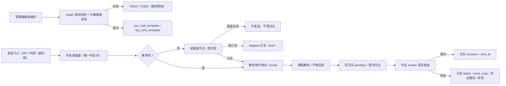
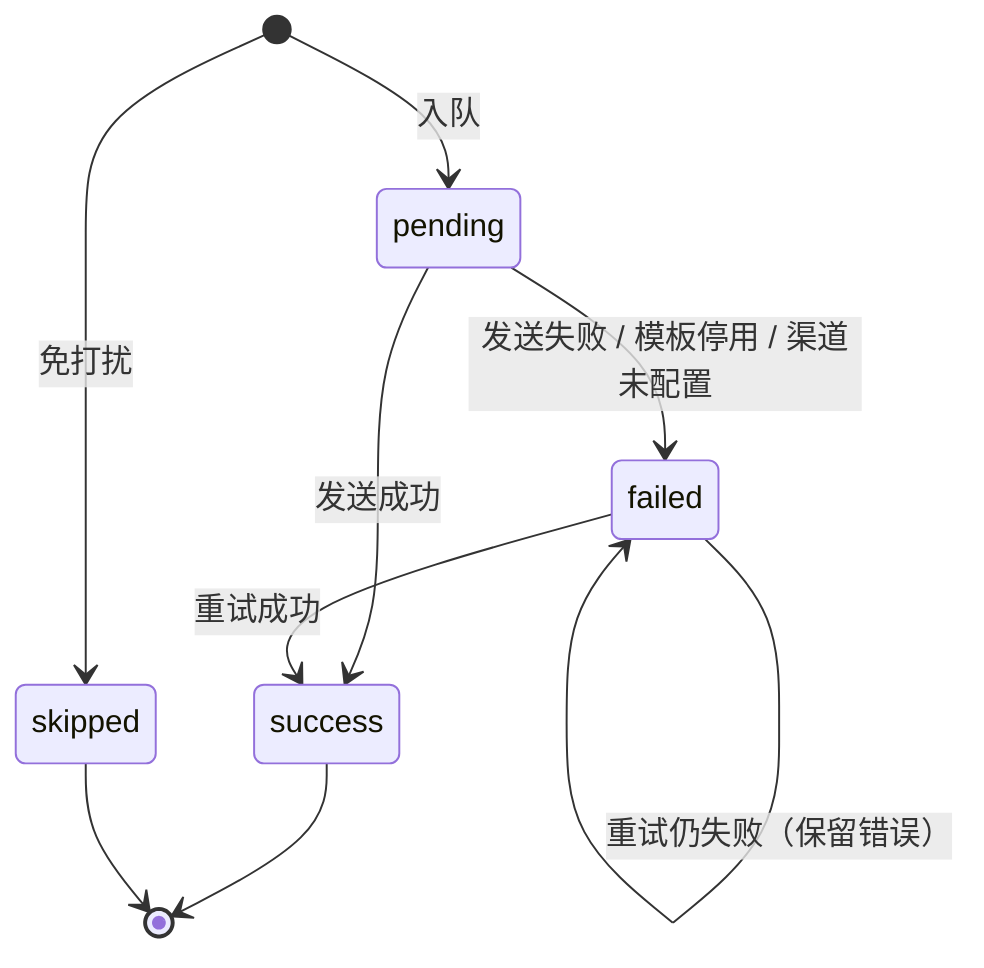

# 邮件与短信通知详细设计（模板多语言 / 沙箱校验 / 异步发送 / 发送记录）

> 通用能力 · 07 通知与公告 · 03 邮件与短信通知 · 详细设计

[文档首页](../../../../../../文档首页.md) › [08 通用能力](../../../../README.md) › [通知与公告](../../07_通知与公告.md) › [邮件与短信通知](../07_通知与公告_03_邮件与短信通知.md) › 详细设计　|　[需求 04-3](../../../../需求/04_需求_通知与公告.md#r04-3) · [阶段计划](../../../../计划/01_计划_通用能力.md) · [概要 · 邮件通知](../../../../../../设计/概要设计/24_概要设计_邮件通知.md)

## 1. 概述 <a id="overview"></a>

- **目标**：把邮件与短信从「只有概要、错误码与 `BaseNotifier` 占位」补成**真实可用的外发通道**：

  1. **模板体系**：新建 `sys_mail_template` / `sys_mail_template_i18n` / `sys_sms_template`；邮件模板按 locale 存附表并三级回退，短信模板按 `scene`（验证码 / 告警 / 通知）分类；**平台默认模板在代码内置、租户库可覆盖**。
  2. **语法校验与沙箱渲染**：邮件与短信模板保存时做 Jinja2 语法校验、危险标签拦截与沙箱冒烟渲染；发送前按参数严格渲染，输出超限 / 渲染超时即拒。
  3. **异步发送**：发送请求同事务写发送日志 + 提交作业（`notification.mail.send` / `notification.sms.send`），由新增的通知服务作业 worker 执行；主请求不阻塞，失败按作业中心重试并落 `error_msg`。
  4. **真实通道**：SMTP（aiosmtplib）+ 阿里云 / 腾讯云短信（httpx 直连签名，不引云 SDK）；凭证只走配置 / 环境变量，真实联调留部署窗口。
  5. **发送记录**：新建 `sys_mail_log` / `sys_sms_log`，按状态 / 渠道 / 模板 / 收件人 / 时间查询；邮件不存正文、短信正文脱敏。
  6. **统一外发调度**：新增外发调度器作为渠道开关与免打扰的**唯一判定点**；通知组消费、模板发送 API、内部 raw 发送全部经同一入口，避免两处判定漂移。
  7. **`BaseNotifier` 真实化**：新增 `http` 实现调通知服务内部发送端点；认证服务的验证码 / 找回密码自动获得真实邮件与短信发送能力（短信按厂商模板发送）。
  8. **错误码 / 能力 / 作业 / 契约**：错误码 `70301–70306`；能力 `notification.send`；两个作业类型与通知服务 worker；重建契约、事件快照与前端类型。

- **依据**：需求 [04-3](../../../../需求/04_需求_通知与公告.md#r04-3)；《[概要设计 · 邮件通知](../../../../../../设计/概要设计/24_概要设计_邮件通知.md)》§2 / §4 / §5 / §7；《[架构设计 · 通知公告](../../../../../../设计/架构设计/22_架构设计_子系统_通知公告.md)》§2 / §4 / §5 / §6；《[数据库设计 · 数据规范](../../../../../../设计/数据库设计/02_数据库设计_数据规范.md)》§2 / §3 / §5 / §6；《[后端开发规范](../../../../../../规范/后端开发规范.md)》；《[测试规范](../../../../../../规范/测试规范.md)》；《[AI开发规范](../../../../../../规范/AI开发规范.md)》「覆盖率要求」节。

- **范围**：`bms_core` 的错误码 / 异常 / 文案 / 配置 / `BaseNotifier` 契约扩展与 `http` 实现 / `notification.requested` 载荷扩展 / 验证码短信模板化；`bms_notification` 的五表模型、仓储、沙箱渲染、内置默认模板、真实通道适配、外发调度、收件人解析、路由、内部发送端点、通知组消费改造、作业 worker；`bms_identity` 的 `prepare_settings` 与找回密码模板化；`bms_platform` 用户只读出口补 `locale`；表文件 / 数据库设计节点 / 总览登记；能力 / 作业 / 选项集 / 契约 / 前端类型 / 部署 compose。

- **不含（归口见 §9）**：前端邮件模板页、发送记录页、短信模板页（阶段十五）；短信模板多语言（后续需求确认）；免打扰期间外发延迟补发；发送限流（70306 预留）；跨渠道自动降级与企业微信 / 钉钉降级（08_02）；发送记录归档策略（随 14_01）；租户初始化下发模板种子（不物化，默认模板在代码内置）。

## 2. 现状与差距（设计 vs 代码不符清单） <a id="gap"></a>

> 动手前对账结果。「处置」列写明本段改什么、回写什么、留什么。

| # | 关注点 | 需求 / 规范要求 | 代码现状 | 处置 |
| --- | --- | --- | --- | --- |
| 1 | 服务归属 | 邮件 / 短信与通知公告同阶段 | 通知服务只有站内信与公告 | **本段建**：五表落 notification 租户库，mail / sms 为 notification 域内子能力 |
| 2 | 模板落库 | 邮件模板 CRUD + 多语言；短信模板 CRUD | 无模型、无表文件、无表归属 | **本段建**：五表 + 表文件 + 总览登记 + 表归属 |
| 3 | 平台默认模板 | 概要 24 §2.2「平台库存默认、租户库可覆盖」 | 无任何模板机制 | **本段建**：代码内置默认清单 + 租户库覆盖；不物化种子 |
| 4 | 模板语法校验 | 保存时语法校验 + 沙箱渲染，失败禁止保存 | 无模板能力 | **本段建**：Jinja2 沙箱 + 危险标签拦截 + 冒烟渲染；发送时严格渲染 |
| 5 | 邮件多语言 | 主题 / 正文按 locale 存 `sys_mail_template_i18n`，缺省回退 | 05_02 台账为「待落地」，附表仅在基座常量占位 | **本段建**：建表 + 三级回退读写；台账改「已落库」，登记移交服务侧 |
| 6 | 短信模板场景 | 验证码 / 告警 / 通知三类场景 | 无表 | **本段建**：`scene` 字段 + `bms.sms.scene` 选项集 |
| 7 | 真实发送 | 异步 SMTP + 阿里 / 腾讯短信，记录失败原因 | `BaseNotifier` 只有 `NullNotifier`；验证码 / 找回密码调它 | **本段建**：SMTP / 阿里云 / 腾讯云真实适配 + `BaseNotifier` `http` 实现 |
| 8 | 短信厂商限制 | 云短信只能发已审核模板 | 现有调用只传正文 | **本段改**：短信全链路模板化；`NotificationMessage` 增 `template_code` / `params`；验证码 / 找回密码改造 |
| 9 | 异步发送 | 发送不阻塞主请求，失败可重试 | 无发送链路；`[event_consumer]` 消费运行时为空实现；作业中心可用 | **本段建**：作业中心 + 通知服务 job worker + 日志状态机 |
| 10 | 发送记录 | 邮件 / 短信记录按状态 / 时间查询 | 无表 | **本段建**：日志表 + 列表筛选；失败 `error_msg` 可定位 |
| 11 | 渠道过滤 | 渠道开关 / 免打扰只判定一处 | 07_01 通知组自行判定后调 `BaseNotifier` | **本段改**：外发调度器统一判定；通知组传入已读偏好 |
| 12 | 免打扰 | 被过滤渠道不发送 | 07_01 只跳过实时推送；架构 22 登记「邮件 / 短信补发归 07_03」 | **本段定**：外发记录 `skipped`（原因 `dnd`）不发送；补发登记遗留 |
| 13 | 收件地址 | 用户手机 / 邮箱可作为收件目标 | `/platform/internal/users/query` 已返回 phone / email，但不返回 locale | **本段改**：调用方可传地址；缺省读平台出口；`InternalUserItem` 增可选 `locale` |
| 14 | 错误码 | 7xxxx 通知段；71001–71006 已被作业中心占用 | 仅 700 / 701 / 702 / 710 段 | **本段改**：邮件 / 短信用 `70301–70306`；同步概要 24 / 契约 |
| 15 | 权限 | `mail:send` 与查询权限 | `mail:query` / `mail:send` 已有种子；无路由、无菜单 | **本段改**：路由挂两个权限码；不加菜单 / 按钮种子 |
| 16 | 审计 | 模板属关键配置 | `sys_mail_template` 未登记审计 | **本段改**：模板表纳入通知服务审计白名单；日志表不审计 |
| 17 | 能力 | 服务间发送需授权 | 无 `notification.send` 能力 | **本段建**：新增能力 + identity 默认消费方 |
| 18 | 契约与前端类型 | 端点 / 事件必须进公开契约 | 无邮件 / 短信端点；`notification.requested` 无短信模板字段 | **本段改**：重建 notification / platform / events 契约与 `api_types` |
| 19 | 数据库节点 | 总览 §7.2 登记 25-邮件通知 | `25_数据库设计_邮件通知.md` 文件不存在 | **本段建**：补建节点文档 |
| 20 | Kiwi 编号 | 先登记后编码 | 07_02 已用 2518 | **本段首步**：容器内登记取新号，回填 `@pytest.mark.kiwi_id(<编号>)` |

## 3. 交付物清单 <a id="tree"></a>

```text
backend/
├── services/notification/pyproject.toml                 # 改：新增 jinja2 / aiosmtplib 依赖
├── libs/bms_core/src/bms_core/
│   ├── core/error_codes.py                              # 改：70301~70306 + HTTP 映射
│   ├── core/exceptions.py                               # 改：MailError / SmsError 子段基与六个异常
│   ├── core/config.py                                   # 改：MailSettings / SmsSettings / Notifier 配置
│   ├── core/assembly.py                                 # 改：notifier http 工厂注册与 PluginWiring 说明
│   ├── notify/base.py                                   # 改：NotificationMessage 增 template_code / params
│   ├── notify/http.py                                   # 新建：HttpNotifier（调通知服务内部发送端点）
│   ├── notify/null.py                                   # 改：契约扩展后仍保持占位行为
│   ├── events/platform_events.py                        # 改：notification.requested 增可选短信模板字段（1.1.0）
│   ├── notification/request.py                          # 改：请求值对象增 sms_template_code / sms_params
│   ├── captcha/default.py                               # 改：验证码短信带 sms_captcha 模板与参数
│   ├── i18n/attachments.py                              # 改：移出 sys_mail_template_i18n（交服务侧登记）
│   ├── i18n/error_seed.py                               # 改：补 70301~70306 中英文案
│   ├── services/table_registry.py                       # 改：登记五表（enabled）
│   └── tenant/seed/menu.py                              # 不改（mail:query / mail:send 已存在）
├── libs/bms_core/tests/
│   ├── notify/test_notifier_http.py                     # 新建：内部发送端点调用 / 失败降级
│   ├── notification/test_notification_request.py        # 改：短信模板字段与信封
│   ├── captcha/test_captcha_sms.py                      # 改：模板 code / params 断言
│   ├── events/test_platform_events.py                   # 改：事件契约版本与字段
│   ├── i18n/test_i18n_attachments.py                    # 改：邮件附表移交服务侧
│   └── services/test_table_registry.py                  # 改：五表归属断言
├── services/notification/src/bms_notification/
│   ├── main.py                                          # 改：注册模板审计 / i18n 附表 / 内置默认校验
│   ├── models/__init__.py                               # 改：mail / sms 模型模块
│   ├── jobs.py                                          # 新建：作业 worker 入口（job_handlers / job_specs）
│   ├── domains/notification/models/mail.py              # 新建：SysMailTemplate / SysMailTemplateI18n / SysMailLog
│   ├── domains/notification/models/sms.py               # 新建：SysSmsTemplate / SysSmsLog
│   ├── domains/notification/mail_constants.py           # 新建：状态 / 来源 / 模板 code 规则
│   ├── domains/notification/sms_constants.py            # 新建：渠道 / 状态 / 场景
│   ├── domains/notification/mail_defaults.py            # 新建：内置邮件默认模板（审批 / 告警，中英）
│   ├── domains/notification/sms_defaults.py             # 新建：内置事务性短信模板（验证码 / 找回密码）
│   ├── domains/notification/rendering.py                # 新建：Jinja2 沙箱 / 语法校验 / 超时 / 输出上限
│   ├── domains/notification/repositories/mail.py        # 新建：模板 / 附表 / 日志仓储
│   ├── domains/notification/repositories/sms.py         # 新建：模板 / 日志仓储
│   ├── domains/notification/services/mail.py            # 新建：邮件模板业务
│   ├── domains/notification/services/sms.py             # 新建：短信模板业务
│   ├── domains/notification/services/outbound.py        # 新建：外发调度（渠道过滤 / 渲染 / 日志 / 作业）
│   ├── domains/notification/services/recipient.py       # 新建：收件地址与 locale 解析（平台用户出口）
│   ├── domains/notification/channels/base.py            # 新建：邮件 / 短信通道协议与结果
│   ├── domains/notification/channels/smtp.py            # 新建：aiosmtplib SMTP 发送
│   ├── domains/notification/channels/aliyun.py          # 新建：阿里云短信 RPC 签名发送
│   ├── domains/notification/channels/tencent.py         # 新建：腾讯云短信 TC3 签名发送
│   ├── domains/notification/services/mail_jobs.py       # 新建：邮件发送作业 handler
│   ├── domains/notification/services/sms_jobs.py        # 新建：短信发送作业 handler
│   ├── domains/notification/schemas/mail.py             # 新建：邮件模板 / 发送 / 日志契约
│   ├── domains/notification/schemas/sms.py              # 新建：短信模板 / 发送 / 日志契约
│   ├── domains/notification/schemas/internal_send.py    # 新建：内部发送端点契约
│   ├── domains/notification/api/mail.py                 # 新建：邮件模板 / 发送 / 日志路由
│   ├── domains/notification/api/sms.py                  # 新建：短信模板 / 发送 / 日志路由
│   ├── domains/notification/api/internal_send.py        # 新建：内部发送端点（notification.send 能力）
│   ├── domains/notification/api/__init__.py             # 改：挂新路由
│   ├── domains/notification/consumers.py                # 改：外发改走外发调度器
│   ├── domains/notification/i18n_attachments.py         # 改：登记 sys_mail_template_i18n
│   └── domains/notification/public.py                   # 改：导出邮件 / 短信常量（供后续复用）
├── services/notification/tests/
│   ├── mail/_support.py                                 # 新建：模板 / 渲染 / 通道替身
│   ├── mail/test_mail_template.py                       # 新建：CRUD / 多语言 / 内置默认覆盖
│   ├── mail/test_mail_send.py                           # 新建：发送 / 幂等 / 过滤 / 日志
│   ├── sms/_support.py                                  # 新建：短信模板 / 通道替身
│   ├── sms/test_sms_template.py                         # 新建：CRUD / 场景 / 渠道唯一
│   ├── sms/test_sms_send.py                             # 新建：模板化发送 / 渠道 / 脱敏
│   ├── notification/test_rendering.py                   # 新建：沙箱 / 危险属性 / 输出上限 / 超时
│   ├── notification/test_outbound.py                    # 新建：调度 / 渠道过滤 / 免打扰 / 事务性
│   ├── notification/test_recipient.py                   # 新建：平台用户地址 / locale / 降级
│   ├── notification/test_mail_job.py                    # 新建：作业成功 / 重试 / 永久失败
│   ├── notification/test_sms_job.py                     # 新建：作业成功 / 重试 / 永久失败
│   ├── notification/test_internal_send.py               # 新建：能力鉴权 / raw 邮件 / 模板短信
│   ├── notification/test_notification_consumer.py       # 改：外发改走调度器
│   ├── notification/test_notification_api.py            # 改：新契约字段
│   └── test_service_boot.py                             # 改：新模型 / 审计 / i18n 注册
├── services/identity/src/bms_identity/
│   ├── main.py                                          # 改：notifier provider 缺省置 http
│   └── domains/auth/services/password_reset.py          # 改：短信带 sms_password_reset 模板与参数
├── services/identity/tests/auth/
│   ├── test_password_reset_service.py                   # 改：模板字段断言
│   └── helpers.py                                       # 改：RecordingNotifier 兼容新字段
├── services/platform/src/bms_platform/
│   └── domains/user/schemas/users.py                    # 改：InternalUserItem 增可选 locale
├── services/platform/src/bms_platform/domains/user/api/internal_users.py  # 改：只读行返回 locale
├── services/platform/tests/users/test_internal_query.py # 改：locale 断言
├── deploy/registry/platform.toml                        # 改：能力 notification.send + 两个作业 + bms.sms.scene 选项集
├── deploy/compose/services.yml                          # 改：新增 notification-jobs 服务
├── deploy/contracts/notification.json                   # 重新生成
├── deploy/contracts/platform.json                       # 重新生成
├── deploy/events/contracts.json                         # 重新生成
└── frontend/packages/api_types/                         # 重新生成（生成物，零手工改）

bms文档/
├── 设计/数据库设计/数据表设计/sys_mail_template.md       # 新建
├── 设计/数据库设计/数据表设计/sys_mail_template_i18n.md  # 新建
├── 设计/数据库设计/数据表设计/sys_mail_log.md            # 新建
├── 设计/数据库设计/数据表设计/sys_sms_template.md        # 新建
├── 设计/数据库设计/数据表设计/sys_sms_log.md             # 新建
├── 设计/数据库设计/01_数据库设计_总览.md                 # 改：§7.2 / §7.3
├── 设计/数据库设计/25_数据库设计_邮件通知.md             # 新建
├── 设计/数据库设计/30_数据库设计_国际化管理.md           # 改：邮件附表状态改已落库
├── 设计/概要设计/24_概要设计_邮件通知.md                 # 改：权限 / 平台默认 / 表字段 / 接口 / 错误码
├── 设计/架构设计/22_架构设计_子系统_通知公告.md          # 改：§4 / §5 / §6 邮件短信口径
├── 设计/架构设计/09_架构设计_接口与集成.md               # 改：事件 / 错误码登记（如需）
├── 规范/后端开发规范.md                                  # 改：通知外发 / BaseNotifier 口径（如需）
├── 后端基类清单.md                                       # 改：BaseNotifier http 实现登记
├── 项目/08_通用能力/任务/05_国际化/.../设计/01_详细设计_05_02_...md  # 改：台账状态
├── 项目/08_通用能力/计划/01_计划_通用能力.md             # 改：07_03 归档 + 计数 + 遗留台账
├── 项目/08_通用能力/需求/04_需求_通知与公告.md           # 改：04-3 交付注块
├── 项目/08_通用能力/任务/07_通知与公告/07_通知与公告_03_邮件与短信通知/
│   ├── 07_通知与公告_03_邮件与短信通知.md               # 改：参考文档 / 交付链接
│   ├── 设计/01_详细设计_07_03_邮件与短信通知.md          # 本文档
│   ├── 实施/01_实施记录_07_03_邮件与短信通知.md          # 新建
│   └── 测试/01_测试记录_07_03_邮件与短信通知.md          # 新建
```

## 4. 领域设计 <a id="design"></a>

### 4.1 总体流程 <a id="flow"></a>



### 4.2 数据模型 <a id="tables"></a>

按《数据规范》，五张表一表一文件；本文只写本表差异，完整字段见对应表文件。五表均 `owner=notification`、`domain=notification`、`datasource=tenant`、`status=enabled`，进入 notification 服务租户链。

| 表 | 关键字段 | 约束 / 索引 | 表文件 |
| --- | --- | --- | --- |
| `sys_mail_template` | `code`(64) / `name`(128) / `subject`(256) / `content`(TEXT) / `status`(16) / `remark`(255) | 唯一 `(code, deleted_at)`；普通 `(status)` | [sys_mail_template.md](../../../../../../设计/数据库设计/数据表设计/sys_mail_template.md) |
| `sys_mail_template_i18n` | `template_id`(雪花) / `locale`(16) / `subject`(256) / `content`(TEXT) | 唯一 `(template_id, locale, deleted_at)` | [sys_mail_template_i18n.md](../../../../../../设计/数据库设计/数据表设计/sys_mail_template_i18n.md) |
| `sys_mail_log` | `recipient`(255, 可空) / `subject`(256, 可空) / `template_code`(64, 可空) / `channel`(16) / `status`(16) / `error_msg`(512) / `attempts`(INT) / `locale`(16) / `user_id`(雪花, 可空) / `idempotency_key`(128, 可空) / `job_id`(雪花, 可空) / `sent_at`(DATETIME, 可空) | 唯一 `(idempotency_key, deleted_at)`；普通 `(status, created_at)`、`(template_code)`、`(user_id)` | [sys_mail_log.md](../../../../../../设计/数据库设计/数据表设计/sys_mail_log.md) |
| `sys_sms_template` | `code`(64) / `name`(128) / `content`(TEXT) / `channel`(16) / `scene`(16) / `provider_template_id`(64, 可空) / `provider_param_keys`(TEXT, 可空 JSON 数组) / `status`(16) / `remark`(255) | 唯一 `(code, channel, deleted_at)`；普通 `(channel, status)`、`(scene)` | [sys_sms_template.md](../../../../../../设计/数据库设计/数据表设计/sys_sms_template.md) |
| `sys_sms_log` | `recipient`(32, 可空) / `channel`(16) / `template_code`(64, 可空) / `scene`(16, 可空) / `content`(TEXT, 脱敏) / `status`(16) / `error_msg`(512) / `attempts`(INT) / `user_id`(雪花, 可空) / `idempotency_key`(128, 可空) / `job_id`(雪花, 可空) / `sent_at`(DATETIME, 可空) | 唯一 `(idempotency_key, deleted_at)`；普通 `(status, created_at)`、`(template_code)`、`(user_id)` | [sys_sms_log.md](../../../../../../设计/数据库设计/数据表设计/sys_sms_log.md) |

- **公共字段**：五表均继承 `BaseModel`（雪花 `id` / 审计 / `deleted_at` / `version`），不重复展开；时间一律 UTC。
- **日志软删除**：日志表沿用 `deleted_at`，但发送链路不提供删除；归档 / 清理随 14_01 策略。
- **邮件正文不落日志**：`sys_mail_log` 只存主题、模板 code、状态、错误；正文放作业负载（短保留期，见 §4.8）。
- **短信正文脱敏**：`sys_sms_log.content` 存脱敏文本（连续 4 位及以上数字替换为 `****`），供排障与审计，不含完整验证码 / 链接令牌。
- **短信厂商字段**：`provider_template_id` 为厂商已审核模板 ID；`provider_param_keys` 为 JSON 数组，按厂商模板占位顺序列出参数名（腾讯按数组顺序，阿里云要求参数名与模板变量名一致）。
- **唯一键 NULL 语义**：`(idempotency_key, deleted_at)` 在 `idempotency_key IS NULL` 时按三库 NULL 语义不构成重复；写路径先按「幂等键 + 未删除」查询，唯一约束只作并发兜底。
- **无物理外键**：`template_id` 同库逻辑外键；`user_id` 跨服务（platform），不建库约束。
- **审计**：`sys_mail_template` / `sys_sms_template` 纳入字段级审计；三张日志表不审计。

### 4.3 模板作用域与内置默认 <a id="scope"></a>

**平台默认模板在代码内置、租户库可覆盖**（不物化种子行）：

| 项 | 口径 |
| --- | --- |
| 内置默认来源 | `mail_defaults.py` / `sms_defaults.py` 的只读清单；随发版更新 |
| 覆盖方式 | 租户在库内新建同 `code` 模板行；读取先租户库、无行回落内置默认 |
| 停用语义 | 租户行 `status=disabled` 视为显式停用，**不回落**内置默认（发送返回模板停用错误） |
| 删除覆盖 | 软删除租户行后，下一次发送自动回落到内置默认 |
| 列表展示 | 租户模板与内置默认合并返回，`source=tenant / builtin`；内置行 `id=null`、只读 |
| 迁移成本 | 后续要给后台编辑平台默认模板时，把清单物化为租户库 / 平台库数据即可，读取优先级不变 |

**内置默认清单**：

| code | 类型 | 名称 | 场景 | 说明 |
| --- | --- | --- | --- | --- |
| `approval_todo` | 邮件 | 审批待办提醒 | — | 中英文主题 / 正文；参数 `title` / `content` / `biz_id`（可选） |
| `system_alert` | 邮件 | 系统告警通知 | — | 中英文主题 / 正文；参数 `title` / `content`（可选） |
| `sms_captcha` | 短信 | 验证码短信 | `code` | 参数 `code` / `minutes`；厂商模板 ID 取 `[sms.<当前渠道>].captcha_template_id` |
| `sms_password_reset` | 短信 | 密码重置短信 | `code` | 参数 `account` / `minutes` / `token` / `link`；厂商模板 ID 取 `[sms.<当前渠道>].password_reset_template_id` |

- 内置邮件模板的 `i18n` 直接内置 `zh-CN` / `en-US` 两套；读取按「请求 / 收件人 locale → 系统默认语言 → 第一套有值语言」回退。
- 内置短信模板为单语言（短信不建 i18n 附表），本地文案用于日志与替身发送；真实发送以厂商模板 ID + 参数为准。
- 内置模板 `code` 不允许被租户修改；租户同 code 行即覆盖，覆盖后拥有完整 CRUD 语义。
- 租户模板 `code` 规则：`^[a-z][a-z0-9_.-]{1,63}$`，创建后**不可修改**（避免发送引用漂移）。

### 4.4 模板语法校验与沙箱渲染 <a id="sandbox"></a>

**实现**：通知服务 `domains/notification/rendering.py`，基于 Jinja2 `SandboxedEnvironment`。

| 项 | 口径 |
| --- | --- |
| 环境 | `SandboxedEnvironment`，`autoescape=True`，**无 loader**（禁止文件 / 网络模板） |
| 未定义变量 | 保存期冒烟渲染用宽松 `Undefined`（允许空参数）；**实际发送 / 测试接口用 `StrictUndefined`**，缺参即失败 |
| 禁止标签 | `include` / `extends` / `import` / `from` / `macro` / `call` / `filter` / `raw` 之外的扩展标签；`` 允许但赋值次数受限 |
| 禁止属性 | 沙箱默认拦截 `__class__` / `__globals__` / `__mro__` / `__subclasses__` 等危险属性；额外拒绝任何以下划线开头的属性访问 |
| 过滤器白名单 | `upper` / `lower` / `title` / `capitalize` / `trim` / `replace` / `length` / `default` / `join` / `round` / `int` / `float` / `string` / `safe` / `e` / `escape` / `urlencode` / `first` / `last` / `slice` / `list` |
| 模板块 | 只允许 `{{ ... }}` 与 `` / ``；`` 最多 20 处 |
| 模板长度 | 邮件正文清洗前 UTF-8 ≤ 60000 字节；主题 ≤ 256 字符；短信正文 ≤ 2000 字节 |
| 输出上限 | 流式 `generate()` 累加，输出 UTF-8 超过 60000 字节（短信 2000）立即失败 |
| 渲染超时 | `[mail].render_timeout_seconds`（缺省 3 秒）；`asyncio.to_thread` + `wait_for`，超时按渲染失败处理；线程无法强制杀死，超时后丢弃结果并告警 |
| 参数 | 仅接受扁平映射，键 `^[A-Za-z_][A-Za-z0-9_]{0,63}$`，最多 50 个；值只允许 `str` / `int` / `float` / `bool`；不接受对象 / 列表 |
| 保存校验 | `env.parse()` 语法校验 + 宽松参数沙箱冒烟渲染；任一失败即 `70302` / `70303`，不进库 |
| 发送校验 | `StrictUndefined` 严格渲染；缺参 / 超时 / 超限 → `70303`（API 直接拒绝；作业内记 `failed`） |

- 邮件模板正文按 HTML 使用；**不做 HTML 白名单清洗**（模板由持有 `mail:send` 的管理员维护，与公告面向全员编辑不同）；短信模板按纯文本使用。
- 模板保存前若带 `sample_params`，用严格模式渲染一次，便于管理员当场发现缺参；不带则只做宽松冒烟。

### 4.5 接口契约 <a id="api"></a>

**邮件模板**：

| 方法 | 路径 | 权限 | 说明 |
| --- | --- | --- | --- |
| GET | `/api/v1/mail/templates` | `mail:query` | 合并列表：租户模板 + 内置默认；筛选 `code` / `keyword` / `status` / `source`；分页 |
| GET | `/api/v1/mail/templates/{id}` | `mail:query` | 租户模板详情（含 `i18n` 全量映射）；内置默认无 id，按列表 / 预览查看 |
| POST | `/api/v1/mail/templates` | `mail:send` | 新建：`code` / `name` / `status` / `remark` / `i18n` / `sample_params`（可选）；code 与内置默认相同即覆盖 |
| PUT | `/api/v1/mail/templates/{id}` | `mail:send` | 编辑：`name` / `status` / `remark` / `i18n` / `sample_params`；`code` 不可改 |
| DELETE | `/api/v1/mail/templates/{id}` | `mail:send` | 软删除；若是内置默认的覆盖行，发送回落到内置默认 |
| POST | `/api/v1/mail/templates/{id}/test` | `mail:send` | 按 id 沙箱渲染（不发送）；返回 `{subject, content}` |
| POST | `/api/v1/mail/templates/preview` | `mail:send` | 按 `code`（可命中内置默认）沙箱渲染；返回 `{code, subject, content}` |

**短信模板**：

| 方法 | 路径 | 权限 | 说明 |
| --- | --- | --- | --- |
| GET | `/api/v1/sms/templates` | `mail:query` | 合并列表：租户模板 + 内置事务性模板；筛选 `code` / `channel` / `scene` / `status` / `keyword` |
| GET | `/api/v1/sms/templates/{id}` | `mail:query` | 租户模板详情 |
| POST | `/api/v1/sms/templates` | `mail:send` | 新建：`code` / `name` / `channel` / `scene` / `content` / `provider_template_id` / `provider_param_keys` / `status` / `remark` |
| PUT | `/api/v1/sms/templates/{id}` | `mail:send` | 编辑（`code` / `channel` 不可改；换渠道请新建同 code 另一渠道行） |
| DELETE | `/api/v1/sms/templates/{id}` | `mail:send` | 软删除；内置事务性模板不可删除 |
| POST | `/api/v1/sms/templates/{id}/test` | `mail:send` | 沙箱渲染（不发送）；返回 `{code, content}` |

**发送**：

| 方法 | 路径 | 权限 | 说明 |
| --- | --- | --- | --- |
| POST | `/api/v1/mail/send` | `mail:send` | 邮件模板发送：`template_code` / `params` / `user_id`（可选）/ `recipient`（可选）/ `locale`（可选）/ `transactional`（默认 false）；`Idempotency-Key` 头可选 |
| POST | `/api/v1/sms/send` | `mail:send` | 短信模板发送：同上；渠道取 `[sms].channel`，模板按 `(code, 渠道)` 解析 |
| GET | `/api/v1/mail/logs` | `mail:query` | 邮件记录列表：`status` / `template_code` / `recipient` / `user_id` / `start_at` / `end_at` / 分页 |
| GET | `/api/v1/sms/logs` | `mail:query` | 短信记录列表：额外 `channel` / `scene` 筛选 |

**内部（服务间）**：

| 方法 | 路径 | 鉴权 | 说明 |
| --- | --- | --- | --- |
| POST | `/api/v1/mail/internal/send` | `require_capability_or_service("notification.send", "identity")` | `BaseNotifier` 的 `http` 实现调用：邮件 raw 发送；短信必须带 `template_code` + `params`；返回 `{log_id, status}` |

**发送请求字段**：

| 字段 | 类型 | 必填 | 说明 |
| --- | --- | --- | --- |
| `template_code` | string | 是（模板发送） | 模板 code；内置默认 code 可直接使用 |
| `params` | object | 否 | 扁平参数（键值均为字符串或标量）；严格渲染缺参即失败 |
| `user_id` | string | 否 | 收件用户主键；用于地址 / locale 解析与日志归属 |
| `recipient` | string | 否 | 显式收件地址；与 `user_id` 至少一个 |
| `locale` | string | 否 | 显式语言；缺省取收件人 locale，再回落系统默认语言 |
| `transactional` | boolean | 否 | 默认 false；true 时跳过渠道开关与免打扰（验证码 / 找回密码） |

- 响应：`{log_id, status}`；`status` 为 `pending / skipped`。`skipped` 表示被偏好过滤（免打扰），HTTP 仍 200。
- `Idempotency-Key`：同一租户内唯一；重复请求返回原 `{log_id, status}`，不重复提交作业。
- 日志列表项：邮件 `{id, recipient, subject, template_code, channel, status, error_msg, attempts, locale, user_id, sent_at, created_at}`；短信额外 `scene`，`content` 为脱敏文本。

**模板请求字段**：

- 邮件：`i18n: {locale: {subject, content}}`；`sample_params` 可选；主表 `subject` / `content` 由服务端按「系统默认语言 → 请求语言 → 首个有值语言」派生，调用方不单独提交。
- 短信：`content` 单语言（Jinja2）；`provider_param_keys` 为字符串数组（≤20，去重，非空）；`scene` 取选项集。
- 请求语言：显式 `locale` 查询参数 → `Accept-Language` 主语言 → `get_default_locale()`。
- 路由静态段（`/preview`、`/internal/send`）先于 `/{id}` 登记，避免路径吞并。

### 4.6 外发调度（唯一判定点） <a id="outbound"></a>

**入口**：`OutboundDispatchService.enqueue(session, request, *, preference=None)`。

| 步骤 | 口径 |
| --- | --- |
| 1 事务性判定 | `transactional=True` → 跳过步骤 2–3 |
| 2 渠道开关 | `preference.channel_enabled(channel)` 为假 → **不发送、不落日志**（与 07_01 站内信口径一致） |
| 3 免打扰 | `preference.in_quiet_hours(now)` 为真 → 落 `skipped` 日志（`error_msg="dnd"`），不提交作业 |
| 4 收件地址 | 显式 `recipient` 优先；否则按 `user_id` 读平台用户只读出口；都没有 → `10001`（API）/ 落 `failed`（通知组） |
| 5 模板解析 | 租户行 → 内置默认；模板停用 / 缺失 → `70301` / `70304` |
| 6 语言 | 显式 `locale` → 收件人 locale → 系统默认语言 |
| 7 渲染 | 严格沙箱渲染；失败 → `70303` |
| 8 落库 + 作业 | 同事务写日志 `pending` + 提交作业；作业负载带渲染结果 |

- **偏好读取**：通知组消费已读偏好并传入，避免二次跨服务调用；API / 内部入口由调度器自行读取（`BaseNotificationPreferenceStore`）。
- **渠道关闭**：通知组消费的邮件 / 短信渠道关闭时不落日志；站内信仍按 07_01 逻辑处理。
- **地址解析降级**：平台用户查询不可达 → 通知组落 `failed`（`error_msg="收件地址解析不可用"`），不阻断站内信；API 返回 `10007`（服务不可用）。
- **单点漂移防护**：渠道开关与免打扰判定只在本服务实现一次；后续新增发送入口必须经 `OutboundDispatchService`。

### 4.7 收件人与语言解析 <a id="recipient"></a>

**平台用户只读出口**：复用 `POST /api/v1/platform/internal/users/query`（通知服务已在白名单 / 能力内）。

| 项 | 口径 |
| --- | --- |
| 查询 | `{ids: [user_id], status: "enabled", page: 1, size: 1}` |
| 取用 | `email` / `phone` / `locale`（本段新增） |
| 缺失 | 用户不存在 / 已停用 / 无对应联系方式 → 视为地址缺失 |
| 降级 | 不可达 / 非 2xx / 载荷非法 → 抛服务不可用；调度器按入口类型转 failed 或 `10007` |
| 契约 | `InternalUserItem` 增可选 `locale`（非破坏性）；平台契约快照重建 |

- 邮件地址长度 ≤255、短信手机号 ≤32；手机号发送前归一（腾讯云需 `+86` 前缀，阿里云用原号；归一失败按参数错误）。
- 收件人 locale 为 `sys_user.locale`；为空时回落系统默认语言（通知服务不读平台默认语言标记，取基座常量，与 07_02 同口径）。

### 4.8 异步发送与作业中心 <a id="async"></a>

**作业类型**（`deploy/registry/platform.toml` + `bms_notification/jobs.py`）：

| 作业类型 | 服务 / 域 | handler | 超时 | 最多尝试 | 退避 | 并发 |
| --- | --- | --- | --- | --- | --- | --- |
| `notification.mail.send` | notification / notification | `...services.mail_jobs:MailSendJob` | 120s | 3 | 30s | 4 |
| `notification.sms.send` | notification / notification | `...services.sms_jobs:SmsSendJob` | 120s | 3 | 30s | 4 |

**作业负载**（入队时渲染，日志只存元数据）：

```json
{
  "log_id": "雪花 id 十进制字符串",
  "kind": "mail",
  "channel": "smtp",
  "recipient": "a@b.c",
  "title": "主题",
  "content": "已渲染正文",
  "html": true,
  "locale": "zh-CN",
  "template_code": "approval_todo",
  "provider_template_id": null,
  "provider_param_keys": [],
  "params": {"...": "..."}
}
```

- 负载大小：正文 ≤60000 字节、短信 ≤2000 字节；`params` ≤50 键。
- **日志不存正文**：邮件正文只在作业负载中，随作业保留期（默认 30 天）清理；短信日志存脱敏正文。
- **重试**：作业中心按 `max_attempts=3` / `backoff=30s` 重试；每次执行更新 `attempts` 与 `error_msg`，最终失败保留 `failed` 并进死信。
- **幂等**：handler 先读日志；`success` 直接返回成功（不重复发送）；`skipped` 不执行；`pending` / `failed` 可执行。
- **并发**：同一日志只提交一个作业；作业中心按租户 / 全局并发限制控制。
- **worker 部署**：新增 `notification-jobs` compose 服务（`python -m bms_notification.jobs`），与 notification 主服务同镜像；部署窗口启动。未启动时日志保持 `pending`，不阻塞请求。

**状态机**：



### 4.9 真实通道适配 <a id="channels"></a>

**通道协议**：`channels/base.py` 定义 `MailChannel` / `SmsChannel` 协议与 `ChannelResult(delivered, provider_message_id, error, retryable)`；测试注入替身。

**SMTP（aiosmtplib）**：

| 项 | 口径 |
| --- | --- |
| 配置 | `[mail.smtp]`：`host` / `port` / `username` / `password` / `from` / `from_name` / `security`（`ssl` / `starttls` / `plain`）/ `timeout_seconds` |
| 发送 | `EmailMessage`；`html=true` 用 `text/html`，否则 `text/plain`；主题取渲染结果 |
| 失败分类 | 连接 / 超时 / 4xx → 可重试；认证失败 / 5xx / 地址拒绝 → 不可重试 |
| 密钥 | 密码只从环境变量 / `deploy/.env` 注入，`config.toml` 只留空值注释 |

**阿里云短信（Dysmsapi RPC 签名）**：

| 项 | 口径 |
| --- | --- |
| 配置 | `[sms.aliyun]`：`endpoint` / `access_key_id` / `access_key_secret` / `sign_name` / `region_id` / `captcha_template_id` / `password_reset_template_id` |
| 签名 | RPC 签名：`SignatureMethod=HMAC-SHA1`，`StringToSign = POST&%2F&percentEncode(canonicalQuery)`；`TemplateParam` 为 JSON 对象 |
| 参数 | 模板 `provider_param_keys` 的键名必须与厂商模板变量名一致；`params` 按 key 取子集 |
| 失败分类 | 限流 / 系统错误 → 可重试；模板不存在 / 签名 / 参数错误 → 不可重试 |

**腾讯云短信（TC3-HMAC-SHA256）**：

| 项 | 口径 |
| --- | --- |
| 配置 | `[sms.tencent]`：`endpoint` / `secret_id` / `secret_key` / `sdk_app_id` / `sign_name` / `region` / `captcha_template_id` / `password_reset_template_id` |
| 签名 | TC3-HMAC-SHA256：`X-TC-Action: SendSms`、`X-TC-Version: 2021-01-11`、`X-TC-Region`、`X-TC-Timestamp`、`Authorization` |
| 参数 | `TemplateParamSet` 按 `provider_param_keys` 顺序取值；手机号归一为 `+86` 前缀 |
| 失败分类 | 频控 / 内部错误 → 可重试；模板 / 签名 / 参数错误 → 不可重试 |

- **渠道切换**：`[sms].channel` 为 `aliyun`（缺省）/ `tencent`；切换后新发送按新渠道解析模板与签名，日志 `channel` 标注实际渠道。
- **渠道未配置**：当前渠道必需配置为空 → `70305`（API 503；通知组落 `failed`）。
- **真实联调**：测试全部用假 SMTP / 假 HTTP 传输；真实凭证、签名与厂商模板审核在部署窗口验证，结论回写资料文档。

### 4.10 `BaseNotifier` 的 `http` 实现与能力 <a id="notifier"></a>

| 成员 | 形态 | 说明 |
| --- | --- | --- |
| `NotificationMessage` | 扩展 | 增可选 `template_code: str \| None`、`params: ConcurrentStableFrozenDict[str, str] \| None`；短信真实发送必带模板 |
| `HttpNotifier` | `BaseNotifier` 插件（`plugin_name="http"`） | 经 `service_client` 调 `/api/v1/mail/internal/send`；成功返回 `delivered=True` + `message_id=log_id`；失败返回 `delivered=False` + `detail` |
| `notification.send` | 协作能力 | 声明于 `deploy/registry/platform.toml`：`domain=notification`、`kind=write`、`path=/api/v1/mail/internal/send`、`default_consumers=["identity"]` |
| 入站鉴权 | 能力或白名单 | `require_capability_or_service("notification.send", "identity")`；只接受服务 JWT |
| 装配 | identity `prepare_settings` | `[notifier].provider` 未显式配置时置 `http`；notification / 其他服务保持占位（除非配置） |

- **SMS 限制**：`HttpNotifier` 收到 `channel=sms` 且无 `template_code` → 直接返回 `delivered=False`（不发起调用），避免把任意正文误发给云厂商。
- **租户透传**：`HttpNotifier` 用 `get_current_tenant_id()` 填 `ServiceRequest.tenant_id`，通知服务按服务 JWT 的租户 claim 解析。
- **失败语义**：不可达 / 非 2xx / 载荷非法 → `delivered=False`；调用方（验证码 / 找回密码）按既有逻辑返回 503，不影响安全语义。

### 4.11 通知组消费改造 <a id="consumer"></a>

- **解析扩展**：`notification.requested` 增可选 `sms_template_code`（string）与 `sms_params`（object）；`NotificationRequest` 同步增字段。
- **流程**：
  1. 读偏好（保持现状，一次）。
  2. 站内信渠道开启：同事务落 `sys_notification` + `notification.sent`（不变）。
  3. 邮件 / 短信：调用 `OutboundDispatchService.enqueue(..., preference=已读偏好)`；邮件用请求正文 raw 发送；短信必须带 `sms_template_code`，未带则落 `failed`（`error_msg="短信未提供模板 code"`）不阻断站内信。
  4. 站内信落库后按免打扰决定是否推送（不变）。
- **事务**：站内信 + 外发日志 + 作业提交尽量在同一租户会话事务内；地址解析在事务前完成，避免持锁跨服务调用。
- **失败隔离**：外发失败只告警，不影响站内信；事件消费仍按 07_01 的幂等与重试口径。

### 4.12 错误码与异常 <a id="errors"></a>

| 错误码 | 异常类 | HTTP | 含义 |
| --- | --- | --- | --- |
| 70301 | `MailTemplateNotFoundError` | 404 | 邮件模板不存在、已停用或无可用的内置默认 |
| 70302 | `TemplateSyntaxInvalidError` | 400 | 模板语法校验失败（邮件 / 短信） |
| 70303 | `TemplateRenderError` | 400 | 沙箱渲染失败、缺参、超时或输出超限 |
| 70304 | `SmsTemplateUnavailableError` | 404 | 短信模板不存在、已停用或与当前渠道不匹配 |
| 70305 | `ChannelConfigInvalidError` | 503 | SMTP / 短信渠道未配置或配置无效 |
| 70306 | `SendRateLimitedError` | 429 | 发送过于频繁（本任务预留，不实现限流） |

- `MailError(NotificationError)` / `SmsError(NotificationError)` 作为 703xx 子段基；文案走 `error.{code}` 中英种子，新增码由既有护栏用例拦截。
- 参数类型 / 页码 / 收件地址缺失 → `10001`；模板 code 冲突 → `10003`；服务间不可达 → `10007`。
- 作业中心错误仍用 710xx；发送失败详情只回填日志 `error_msg`，不向 API 调用方暴露厂商堆栈。

### 4.13 幂等与限流 <a id="idempotency"></a>

- **幂等键**：`Idempotency-Key` 头（≤128 字符）；调度器先按 `(idempotency_key, deleted_at IS NULL)` 查日志，命中即返回原记录；并发插入由唯一约束兜底，冲突后回查。
- **作用域**：租户内全局；调用方应保证键在业务内唯一（如「业务类型 + 业务 id + 收件人 + 渠道」）。
- **重复点击**：同键返回同 `log_id` / `status`，不重复提交作业。
- **限流**：本任务不实现发送限流；`70306` 保留给后续「收件人 + 模板」时间窗限流，验证码限流仍由认证域负责。

### 4.14 权限 / 审计 / 配置 / 选项集 <a id="governance"></a>

**权限码**：

| 权限码 | 用途 | 备注 |
| --- | --- | --- |
| `mail:query` | 模板列表 / 详情 / 发送记录 | 已有种子 |
| `mail:send` | 模板新建 / 修改 / 删除 / 渲染测试 / 发送 | 已有种子 |

- 不加菜单 / 按钮 / 字段种子（页面随阶段十五）；操作日志动作码由权限依赖自动带出。

**字段级审计**：

- `sys_mail_template` / `sys_sms_template` 加入 `bms_notification/main.py` 的 `AUDITED_TABLES_NOTIFICATION`；`sys_mail_log` / `sys_sms_log` / `sys_mail_template_i18n` 不审计。

**配置**（`config.toml`，密钥只留空值注释）：

```toml
[notifier]
# 通知发送实现：空串 = null 占位；http = 调通知服务内部发送端点（identity 未显式配置时自动置 http）
provider = ""

[mail]
render_timeout_seconds = 3
smtp_host = ""
smtp_port = 465
smtp_username = ""
smtp_password = ""          # 仅环境变量 / deploy/.env 注入
smtp_from = ""
smtp_from_name = "BMS"
smtp_security = "ssl"       # ssl / starttls / plain
smtp_timeout_seconds = 10

[sms]
channel = "aliyun"          # aliyun / tencent
[sms.aliyun]
endpoint = "https://dysmsapi.aliyuncs.com"
access_key_id = ""
access_key_secret = ""      # 仅环境变量 / deploy/.env 注入
sign_name = ""
region_id = "cn-hangzhou"
captcha_template_id = ""
password_reset_template_id = ""
[sms.tencent]
endpoint = "https://sms.tencentcloudapi.com"
secret_id = ""
secret_key = ""             # 仅环境变量 / deploy/.env 注入
sdk_app_id = ""
sign_name = ""
region = "ap-guangzhou"
captcha_template_id = ""
password_reset_template_id = ""
```

- `Settings` 增 `MailSettings` / `SmsSettings`（嵌套配置）；`[notifier]` 复用 `PluginSelection`。
- 不在 `sys_config` 存渠道开关（避免配置双源）；切换渠道改配置并重启 / 滚动发布。

**选项集**（`deploy/registry/platform.toml`）：

| 选项集 | 可增长 | 取值 |
| --- | --- | --- |
| `bms.sms.scene` | 是 | `code` 验证码 / `alert` 告警 / `notify` 通知 |

- 运行时经 `BaseOptionSetRegistry.validate` 校验；非法值 → `10001`；默认 `notify`。

**表归属**：五表登记到 `TABLE_OWNERSHIP`（owner/domain=notification、tenant、enabled）；表文件、总览登记、目录一致性由 `ops.check_tables` / 基座护栏断言。

## 5. 失败分支与边界 <a id="failures"></a>

| 场景 | 行为 | 依据 / 风险 |
| --- | --- | --- |
| 模板保存语法错误 | `70302`（400），不进库 | 任务完成标准「语法错误保存即拒」 |
| 模板含危险属性 / 禁止标签 | `70302` / `70303`，不进库 | 沙箱边界 |
| 模板渲染缺参 / 超时 / 超限 | `70303`（400）；作业内记 `failed` | 严格未定义 + 输出 / 超时保护 |
| 邮件模板不存在 / 停用 | `70301`（404） | 模板解析 |
| 短信模板不存在 / 停用 / 渠道不匹配 | `70304`（404） | 模板按 `(code, 渠道)` 解析 |
| SMTP / 短信渠道未配置 | API `70305`（503）；通知组 `failed` | 真实通道必需配置 |
| 模板 code 与租户行重复 | `10003`（409） | 唯一键 + 先查 |
| 收件地址缺失（API） | `10001`（400），不落日志 | 请求错误 |
| 收件地址缺失（通知组） | 落 `failed`，不阻断站内信 | 外发是副作用 |
| 平台用户查询不可达（API） | `10007`（503） | 不猜测地址 |
| 平台用户查询不可达（通知组） | 落 `failed`，不阻断站内信 | 同上 |
| 渠道关闭（通知组） | 不发送、不落日志 | 与站内信渠道过滤一致 |
| 渠道关闭（API） | 落 `skipped` 日志，HTTP 200 | 可追溯 |
| 命中免打扰 | 落 `skipped`（`dnd`），不提交作业 | 需求「被过滤渠道不发送」 |
| `transactional=true` | 跳过渠道开关与免打扰 | 验证码 / 找回密码必须可达 |
| 重复 `Idempotency-Key` | 返回原 `{log_id, status}` | 幂等 |
| 作业重试中再次执行 | 日志 `failed` 可重试；`success` 直接返回 | 幂等 |
| 作业发送成功但日志更新失败 | 事务回滚，作业重试；以日志状态为准 | 至少一次 |
| 模板在入队后被停用 | 作业 `failed`，不可重试 | 负载已带渲染结果；不改发 |
| SMTP 认证 / 5xx | 不可重试，`failed` | 避免无意义重试 |
| SMTP 连接 / 超时 / 4xx | 可重试 | 瞬时故障 |
| 云短信限流 / 系统错误 | 可重试 | 瞬时故障 |
| 云短信模板 / 签名 / 参数错误 | 不可重试，`failed` | 配置 / 数据错误 |
| 通知组短信缺 `sms_template_code` | 落 `failed`，不阻断站内信 | 云短信只支持模板 |
| `BaseNotifier` 短信无模板 | `delivered=False`，不发起调用 | 同上 |
| `BaseNotifier` 通知服务不可达 | `delivered=False`，调用方按既有 503 | 认证语义不变 |
| 作业 worker 未部署 | 日志 `pending`，不阻塞请求 | 部署窗口启动 |
| 日志保留期到期 | 随 14_01 归档 / 清理 | 不建策略 |
| 租户删除模板覆盖行 | 下一次发送回落内置默认 | 覆盖语义 |

## 6. 测试设计与验收映射 <a id="tests"></a>

**Kiwi**：实施首步在容器内 `bms-kiwi` 按《[KiwiTCMS 部署使用说明](../../../../../../资料/开发服务器/linux/KiwiTCMS部署使用说明.md)「用例登记」节登记（分类「平台骨架」、优先级 `P2`、状态 `CONFIRMED`、标签「自动化」），**本任务登记 1 条**（多断言共用），取得编号后回填 `@pytest.mark.kiwi_id(<编号>)`；不得复用 2518。

| 完成标准（任务书 §3 / 需求 04-3） | 用例 |
| --- | --- |
| 语法错误保存即拒 | `mail/test_mail_template` / `sms/test_sms_template`（非法语法 → 70302，表无行） |
| 沙箱危险属性 / 禁止标签 | `notification/test_rendering`（`__class__` / include / 输出上限 / 超时） |
| 两种 locale 渲染正确、缺省回退 | `mail/test_mail_template`（显式 locale / Accept-Language / 主表快照） |
| 平台默认 + 租户覆盖 | `mail/test_mail_template`（内置列表、同 code 覆盖、删除回落、停用不回落） |
| 异步不阻塞主请求 | `mail/test_mail_send`（API 返回 pending + 作业已提交；handler 单独执行） |
| 发送失败落记录且可定位 | `notification/test_mail_job` / `test_sms_job`（替身失败 → `failed` + `error_msg` + `attempts`） |
| 作业重试 / 永久失败 | `notification/test_mail_job`（可重试 → 再次执行成功；不可重试 → 直接 failed） |
| 切换短信渠道后新发送走新渠道 | `sms/test_sms_send`（配置渠道替身 + 日志 `channel` 断言） |
| 短信模板化（验证码 / 找回密码） | `libs/bms_core/tests/captcha/test_captcha_sms` + `identity/tests/auth/test_password_reset_service` |
| 渠道开关 / 免打扰只判一处 | `notification/test_outbound`（开关关闭不落日志；免打扰 `skipped`；事务性绕过） |
| 收件地址解析与 locale | `notification/test_recipient`（显式地址 / 平台出口 / 缺失 / 降级） |
| 平台用户只读出口补 locale | `services/platform/tests/users/test_internal_query.py` |
| 发送记录筛选与脱敏 | `mail/test_mail_send` / `sms/test_sms_send`（状态 / 模板 / 收件人 / 时间；短信数字脱敏） |
| 幂等 | `mail/test_mail_send`（重复键返回同 log、不重复提交作业） |
| 内部发送端点与能力 | `notification/test_internal_send`（能力放行 / 拒绝；raw 邮件；短信无模板拒绝） |
| `BaseNotifier` http | `libs/bms_core/tests/notify/test_notifier_http.py`（成功 / 不可达 / 短信无模板） |
| 通知组外发改造 | `notification/test_notification_consumer`（邮件 / 短信走调度器、站内信不受影响） |
| 错误码文案完整 | 既有 `test_error_seed_coverage`（新增 6 码后仍须全绿） |
| 表归属 / i18n 台账 | `test_table_registry` / `test_i18n_attachments` / `test_service_boot` |
| 作业声明 / 装配冒烟 | `test_plugin_registration` + `test_service_boot` + 通知服务 job specs 断言 |
| 契约 / 事件快照 | `ops.contract_snapshot check` + `deploy/events/contracts.json` 断言 |

**替身与真机边界**：

- SMTP 用假传输 / mock `aiosmtplib`，云短信用 mock httpx transport；**不需要真实凭证**。
- 通知服务测试用临时 SQLite + 共享租户库回滚会话；邮件 / 短信通道、偏好读取、平台用户查询均注入替身。
- 作业 handler 直接以 `JobContext` 调用（不启动 worker）；worker 启动冒烟只验证构造与声明。
- 真库方言（MySQL / PostgreSQL / 达梦）、真实 SMTP / 云短信、真实厂商模板审核随部署窗口；未实测结论不写入表文件或规范。

**覆盖率**：口径见《[AI开发规范](../../../../../../规范/AI开发规范.md)》「覆盖率要求」节——新增 / 改动模块 100% 行 + 分支；不可达分支须带理由标注 `# pragma: no cover - 原因`。

## 7. 登记落点 <a id="registry-writeback"></a>

| 文档 / 清单 | 回写内容 |
| --- | --- |
| 《[数据库设计总览](../../../../../../设计/数据库设计/01_数据库设计_总览.md)》 | §7.2 补 25 节点；§7.3 登记五表（已设计） |
| 表文件 | 新建 `sys_mail_template.md` / `sys_mail_template_i18n.md` / `sys_mail_log.md` / `sys_sms_template.md` / `sys_sms_log.md` |
| 数据库设计节点 | 新建 `25_数据库设计_邮件通知.md` |
| 《[数据库设计 · 国际化管理](../../../../../../设计/数据库设计/30_数据库设计_国际化管理.md)》 | `sys_mail_template_i18n` 状态改「已落库」 |
| 《[05_02 详细设计](../../../05_国际化/05_国际化_02_业务文案i18n附表与用户时区偏好/设计/01_详细设计_05_02_业务文案i18n附表与用户时区偏好.md)》 | 台账行状态改「已落库」 |
| 《[概要设计 · 邮件通知](../../../../../../设计/概要设计/24_概要设计_邮件通知.md)》 | §2.1 权限拆分；§2.2 平台默认 / 真实通道 / 短信模板化；§4 表字段（recipient / provider / scene / 日志状态）；§5 接口；§6 配置与能力；§7 错误码 70301–70306 |
| 《[架构设计 · 通知公告](../../../../../../设计/架构设计/22_架构设计_子系统_通知公告.md)》 | §4 / §5 邮件短信落库、外发调度、作业化、`BaseNotifier` http |
| 《[架构设计 · 接口与集成](../../../../../../设计/架构设计/09_架构设计_接口与集成.md)》 | 事件 / 错误码登记（如需要） |
| 《[后端基类清单](../../../../../../后端基类清单.md)》 | `BaseNotifier` 增 `http` 实现登记 |
| 《[后端开发规范](../../../../../../规范/后端开发规范.md)》 | 通知外发 / 短信模板化口径（如需要） |
| 《[计划 · 通用能力](../../../../计划/01_计划_通用能力.md)》 | 07_03 移入 §2「已完成任务」；计数更新；§7 第 18 条错误码遗留闭环，新增遗留 |
| 《[需求 04-3](../../../../需求/04_需求_通知与公告.md#r04-3)》 | 追加交付注块（范围 / 用例号 / 遗留归口） |
| 任务文档 | 参考文档补详细设计 / 实施 / 测试链接 |
| 平台与服务种子 | `TABLE_OWNERSHIP` 五表；`AUDITED_TABLES_NOTIFICATION` 两模板表；服务 i18n 台账登记邮件附表 |
| 能力 / 作业 / 选项集 | `deploy/registry/platform.toml`：`notification.send`、两个作业、`bms.sms.scene` |
| 部署 | `deploy/compose/services.yml` 新增 `notification-jobs` |
| 契约 / 前端类型 | `deploy/contracts/notification.json` / `platform.json`、`deploy/events/contracts.json`、`frontend/packages/api_types` 重建 |

## 8. 实施步骤 <a id="steps"></a>

| 批次 | 内容 | 验证 |
| --- | --- | --- |
| 0 | **取 Kiwi 编号**（容器内登记，分类「平台骨架」） | 取得编号并回读 |
| 1 | 依赖与基座：`jinja2` / `aiosmtplib`；错误码 / 异常 / 文案；`MailSettings` / `SmsSettings`；`NotificationMessage` 扩展与 `HttpNotifier`；`notification.requested` 载荷扩展；验证码短信模板化 | `pytest libs/bms_core/tests/notify libs/bms_core/tests/notification libs/bms_core/tests/captcha -q` |
| 2 | 数据库设计：五张表文件 + 25 节点 + 总览登记 + 国际化台账 + 表归属 | `ops.check_tables` / 既有基座护栏 |
| 3 | 模型与仓储：五模型 + `MODEL_MODULES` + 模板 / 日志仓储 | `pytest services/notification/tests/mail/test_mail_template.py services/notification/tests/sms/test_sms_template.py -q` |
| 4 | 沙箱与内置默认：渲染器 / 默认清单 / 渲染测试 | `pytest services/notification/tests/notification/test_rendering.py -q` |
| 5 | 真实通道：SMTP / 阿里云 / 腾讯云适配 + 假传输用例 | 对应单文件用例 |
| 6 | 外发调度 / 收件人解析 / 通知组改造 | `pytest services/notification/tests/notification/test_outbound.py services/notification/tests/notification/test_recipient.py services/notification/tests/notification/test_notification_consumer.py -q` |
| 7 | 作业：handler + `bms_notification/jobs.py` + 作业声明 + compose worker | `pytest services/notification/tests/notification/test_mail_job.py services/notification/tests/notification/test_sms_job.py -q` |
| 8 | 路由与内部端点：模板 CRUD / 发送 / 日志 / 内部发送 / 权限 / 能力 | `pytest services/notification/tests/mail services/notification/tests/sms services/notification/tests/notification/test_internal_send.py -q` |
| 9 | 身份服务与平台出口：identity notifier http / 找回密码模板化 / `InternalUserItem.locale` | 对应单文件用例 |
| 10 | 契约与前端类型：能力 / 作业 / 选项集 / 契约快照 / `api_types` 重建 | `ops.contract_snapshot check` |
| 11 | 回写与记录：§7 全部登记落点 + 实施 / 测试记录 + 计划归档 + 需求注块 + 任务链接 | 文档三门禁（links / docs-scope / eol）0 |
| 12 | 交付闸门：单文件 ruff / pyright / pytest；覆盖率缺口按唯一入口查；`提交前预检.py --allow-full-steps` | 预检全绿（覆盖率改动行 100%） |

- 本任务按「一个任务最多两次提交」执行：代码 + 依赖 + 契约快照 + 前端类型一次 `feat(通知)`；设计 / 记录 / 登记一次 `docs(08)`。**不推送**。

## 9. 边界与开放项 <a id="boundary"></a>

1. **前端（阶段十五）**：邮件模板页、短信模板页、发送记录页、模板在线编辑与预览；本段只交付接口与契约。
2. **真实凭证联调**：SMTP 账号、阿里云 / 腾讯云 AK、签名与厂商模板审核；本段以假传输验证代码路径，真实联调在部署窗口完成并回写资料。
3. **短信多语言**：短信模板单语言；多语言短信需厂商多模板与语言路由，后续按真实需求立项。
4. **免打扰延迟补发**：当前记录 `skipped` 不发送；延迟补发需 `deferred` 状态与扫描 / 调度，登记后续。
5. **发送限流**：`70306` 预留；验证码限流仍由认证域负责，管理端发送限流后续按需求补。
6. **跨渠道降级**：短信渠道故障不自动降级企业微信 / 钉钉；后者依赖 08_02 webhook，登记遗留。
7. **发送记录归档**：随 14_01 既有归档策略配置，本任务不建策略。
8. **模板种子物化**：平台默认模板在代码内置；后台编辑平台默认模板需后续物化，读取优先级不变。
9. **作业 worker 部署**：`notification-jobs` 需部署窗口启动；未启动时日志保持 `pending`。
10. **邮件 HTML 清洗**：模板由持 `mail:send` 的管理员维护，不做服务端 HTML 白名单清洗；若后续开放非管理员编辑，再引入 `nh3` 清洗。
11. **短信厂商参数命名**：阿里云要求 `provider_param_keys` 与厂商模板变量名一致；腾讯按数组顺序。配置错误在部署窗口联调时发现并回写。
12. **平台默认语言来源**：通知服务仍不读平台 `sys_i18n_locale` 默认标记，取基座常量；与 07_02 同口径，国际化阶段补跨服务读取。

## 10. 决策记录 <a id="align"></a>

| # | 决策 | 备选与取舍 |
| --- | --- | --- |
| 1 | 服务归属：**沿用 notification 服务**（用户拍板） | 新建独立消息服务：部署与跨服务成本高；放平台库：违反业务表归属 |
| 2 | 模板作用域：**平台默认 + 租户覆盖**（用户拍板） | 只做租户单库：偏离概要；平台库跨库读取：成本最高 |
| 3 | 平台默认落点：**代码内置清单 + 租户覆盖**（用户拍板） | 物化到租户库：与「不做租户种子」冲突且需回填；平台库表：需跨库接口 |
| 4 | 错误码：**70301–70306**（用户拍板） | 72001–72006 / 70401–70406：编号习惯或空段不优 |
| 5 | 限流：**保留 70306 不实现**（用户拍板） | 本任务实现限流：多 Redis 依赖并干扰重试 |
| 6 | 邮件多语言：**建表并接通**（用户拍板） | 只建表：功能不闭环；不建：与需求冲突 |
| 7 | 短信多语言：**不建**（用户拍板） | 建附表：超出需求、厂商模板本身按模板管理 |
| 8 | 沙箱：**沙箱 + 严格未定义 + 输出上限 + 线程超时**（用户拍板） | 只语法校验：防不住危险表达式；子进程：开销大、跨平台复杂 |
| 9 | 真实通道：**SMTP + 阿里云 + 腾讯云全部真实**（用户拍板） | 只邮件真实 / 全替身：后续返工，完成标准不闭环 |
| 10 | 验证码 / 找回密码：**BaseNotifier http 实现**（用户拍板） | 保持占位：06_03 遗留不变；基座直连：发送记录缺失、边界差 |
| 11 | 短信真实化：**全链路模板化**（用户拍板） | raw 短信：云厂商不支持任意文本；只模板 API：验证码短信不闭环 |
| 12 | 异步：**作业中心 + 通知服务 worker**（用户拍板） | 服务内后台：重试 / 监控自建；事件总线：当前消费运行时为空实现 |
| 13 | 日志状态：**pending / success / failed / skipped + attempts**（用户拍板） | 增加 sending / deferred：状态机与测试面变大；不重试：告警易丢 |
| 14 | 收件地址：**调用方可传 + 缺省读平台用户**（用户拍板） | 只调用方传：通知组闭环差；只读平台：外部收件人不可用 |
| 15 | locale：**扩展 InternalUserItem**（用户拍板） | 新 contact 端点：多一份契约；只按调用方传：通知组无法按收件人语言渲染 |
| 16 | 渠道判定：**外发调度器唯一判定点**（用户拍板） | 两处判定：易漂移；每次重读：多一次跨服务调用 |
| 17 | 免打扰：**skipped 不发送**（用户拍板） | 延迟补发：多状态与调度；忽略：违反需求 |
| 18 | 事务性：**transactional 绕过偏好**（用户拍板） | 一律遵守：验证码收不到；一律绕过：偏好失效 |
| 19 | 降级：**不做跨渠道自动降级**（用户拍板） | 短信互备：需双渠道模板；邮件降短信：语义与费用风险 |
| 20 | 短信渠道：**全局配置 + 模板按 code+渠道唯一**（用户拍板） | 模板固定渠道：无全局开关；sys_config：缓存与失效链路 |
| 21 | 权限：**mail:query 读 / mail:send 写发**（用户拍板） | 全部 mail:send：与已有 query 不一致；细分：偏离概要 |
| 22 | 菜单：**不加，随阶段十五**（用户拍板） | 隐藏菜单 / 正式菜单：无页面，易漂移 |
| 23 | 范围：**仅后端**（用户拍板） | 含前端：需先补原型，越过阶段边界 |
| 24 | 模板种子：**不做租户种子**（用户拍板） | 随租户初始化下发：需改 provisioning 与回填 |
| 25 | 幂等：**支持 Idempotency-Key**（用户拍板） | 不做：重复发送；只前端防重：不可靠 |
| 26 | 记录查询：**列表 + 多维筛选**（用户拍板） | 加详情 / 重发：收益低或范围外 |
| 27 | 审计：**模板审计、日志不审计**（用户拍板） | 全不审：模板改动无留痕；全审：日志量大 |
| 28 | 短信场景：**scene + 选项集**（用户拍板） | 不加：三类场景无法区分；复用 type：语义混淆 |
| 29 | 日志正文：**邮件不存正文、短信脱敏**（用户拍板） | 原样存：验证码泄露风险；完全不存：排障能力差 |
| 30 | 短信渲染：**与邮件同口径沙箱**（用户拍板） | 占位符替换：校验弱；不校验：脏模板入库 |
| 31 | Kiwi：**1 条**（用户拍板） | 按渠道 / 接口拆：登记与回写成本增加 |
| 32 | 内部发送鉴权：**notification.send 能力**（用户拍板） | 白名单：新消费方要发版；mail:send：服务间无用户主体 |
| 33 | 异步正文：**渲染结果放作业负载**（用户拍板） | 只存参数执行时渲染：模板漂移；Redis 中转：故障面最大 |
| 34 | 模板 code：**创建后不可改**（本设计定） | 允许改：发送引用漂移；删除重建：会丢日志关联 |
| 35 | 停用覆盖：**租户停用不回落内置**（本设计定） | 停用即回落：无法显式停用平台默认；删行回落：可表达「恢复默认」 |
| 36 | 邮件 HTML：**不做服务端清洗**（本设计定） | 引入 nh3：会剥离邮件样式；模板由 mail:send 管理员维护 |
| 37 | 短信厂商参数：**provider_template_id + provider_param_keys**（本设计定） | 不存厂商字段：真实发送无法落地；存整段参数 JSON：绑定渠道不清晰 |

## 11. 参考文档 <a id="ref"></a>

- [需求 04-3](../../../../需求/04_需求_通知与公告.md#r04-3)
- [概要设计 · 邮件通知](../../../../../../设计/概要设计/24_概要设计_邮件通知.md) §2 / §4 / §5 / §7
- [架构设计 · 通知公告](../../../../../../设计/架构设计/22_架构设计_子系统_通知公告.md) §2 / §4 / §5 / §6
- [架构设计 · 接口与集成](../../../../../../设计/架构设计/09_架构设计_接口与集成.md)
- [数据库设计 · 数据规范](../../../../../../设计/数据库设计/02_数据库设计_数据规范.md) §2 / §3 / §5 / §6
- [数据库设计 · 总览](../../../../../../设计/数据库设计/01_数据库设计_总览.md)
- [数据库设计 · 国际化管理](../../../../../../设计/数据库设计/30_数据库设计_国际化管理.md) §2.1
- [测试规范](../../../../../../规范/测试规范.md)、[AI开发规范](../../../../../../规范/AI开发规范.md)「覆盖率要求」节
- [07_01 通知中心详细设计](../../07_通知与公告_01_通知中心/设计/01_详细设计_07_01_通知中心.md)（偏好 / 通知组 / `BaseNotifier` 调用面）
- [07_02 公告管理详细设计](../../07_通知与公告_02_公告管理/设计/01_详细设计_07_02_公告管理.md)（i18n 附表 / 审计 / 内部端点口径）
- [05_02 业务文案 i18n 附表与用户时区偏好详细设计](../../../05_国际化/05_国际化_02_业务文案i18n附表与用户时区偏好/设计/01_详细设计_05_02_业务文案i18n附表与用户时区偏好.md)
- [04_02 列表导出与 PDF 产物详细设计](../../../04_导入导出/04_导入导出_02_列表导出与PDF产物/设计/01_详细设计_02_列表导出与PDF产物.md)（作业中心提交 / 状态回写口径）

> 本文档依《[文档生成规范](../../../../../../规范/文档生成规范.md)》编写 · 进度以阶段计划为唯一落点
