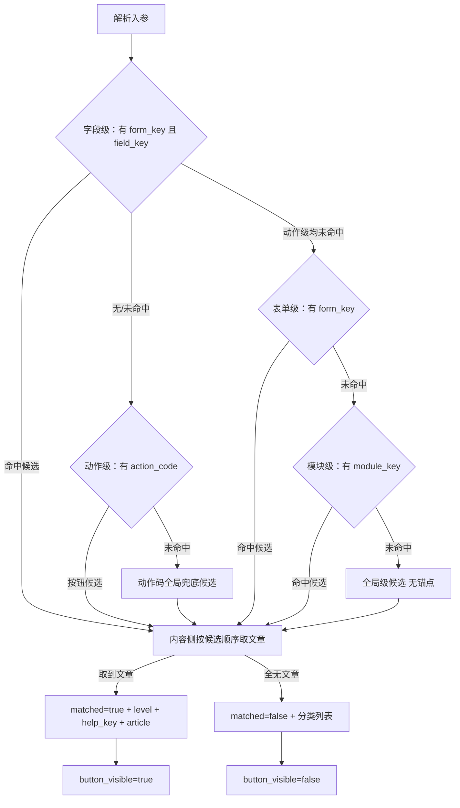

# 帮助锚点解析详细设计（五级链 + 未命中降级 + 按钮显隐）

> 通用能力 · 08 帮助机制 · 02 帮助锚点解析 · 详细设计

[文档首页](../../../../../../文档首页.md) › [08 通用能力](../../../../README.md) › [帮助机制](../../08_帮助机制.md) › [帮助锚点解析](../08_帮助机制_02_帮助锚点解析.md) › 详细设计　|　[需求 09-1](../../../../需求/09_需求_帮助中心.md#r09-1) · [阶段计划](../../../../计划/01_计划_通用能力.md)

## 1. 概述 <a id="overview"></a>

- **目标**：把 08_01 落地的五表 `help_key` 变成**运行时可用的解析链**：
  1. **五级解析**：字段 → 动作 → 表单 → 模块 → 全局，逐级降级，命中返回文章与锚点定位（`level` + `help_key`）。
  2. **未命中降级**：全不命中返回 `matched=false` + 分类列表，前端提示「暂无帮助」并可打开分类，不出现空白弹窗。
  3. **按钮显隐**：`button_visible` 由解析结果派生——**锚点已登记且有可展示文章才算命中**，避免「点了没反应」。
  4. **锚点下发**：`my_menus` 的菜单 / 表单 / 按钮 / 字段四级随响应下发 `help_key`，前端不硬编码模块名。
  5. **内容侧解耦**：本任务只定义**内容侧端口**（`help_content` 能力域，缺省空实现）；分类 / 文章 / 多篇来源优先级归 12_01，本任务以端口契约与桩用例锁定接口形状。
- **依据**：需求 [09-1](../../../../需求/09_需求_帮助中心.md#r09-1)；《[架构设计 · 帮助中心](../../../../../../设计/架构设计/28_架构设计_子系统_帮助中心.md)》§3.4 / §4.2、《[概要设计 · 帮助中心](../../../../../../设计/概要设计/17_概要设计_帮助中心.md)》§5 / §7、《[帮助包规范](../../../../../../规范/帮助包规范.md)》§6 / §10、《[后端开发规范](../../../../../../规范/后端开发规范.md)》§7.1 / §7.2。
- **范围（本任务）**：
  - `bms_core`：内容侧端口与空实现（新 `help/content.py` / `help/null.py`）、五级候选链与解析编排（新 `help/context.py`）、锚点索引构建与缓存（`repositories/help_anchor.py` 扩展 + 新 `help/index.py`）、`help_content` 能力域装配登记（`core/config.py` / `core/assembly.py`）。
  - `platform` 服务：`menu_form` 域新增解析服务 / 契约 / 路由（`GET /api/v1/help/context`）；`my_menus` 四级下发 `help_key`。
  - 契约与前端类型重建；文档回写（架构 28 §4.2、概要 17 §5、帮助包规范 §10）。
- **不含（归口见 §11）**：分类 / 文章 / 反馈表的建表与维护、多篇来源优先级 `builtin > product > tenant` 的真实实现、`local_override`、产品帮助包装载与卸载（08_03）、覆盖率台账与 CI 门禁（08_04）、前端帮助按钮与弹窗（阶段十五 09_01）、内容侧缓存失效。

## 2. 现状与差距 <a id="gap"></a>

| # | 关注点 | 需求要求 | 代码现状 | 处置 |
| --- | --- | --- | --- | --- |
| 1 | 五级解析 | 字段→动作→表单→模块→全局逐级降级 | 08_01 只交付 `help_key` 字段与跨表唯一，无任何解析实现 | **本段建**：候选链构建 + 解析编排（`bms_core/help/context.py`） |
| 2 | 文章返回 | 命中返回文章与锚点 | `sys_help_category` / `sys_help_article` 等表**尚未建**（属 08_03 / 12_01），数据库设计无对应表文件 | **本段建**：内容侧端口 + 空实现；文章由 12_01 接入，不越界建表 |
| 3 | 未命中降级 | 返回空 + 分类列表 | 无分类来源 | **本段建**：`categories` 由内容侧端口返回（空实现为空清单），结构一次到位 |
| 4 | 按钮显隐 | 任一级命中才显示，无锚点不显示 | 无解析结果，前端无从判断 | **本段建**：`button_visible = matched`（判定含文章） |
| 5 | 锚点下发 | `help_key` 随菜单与表单元数据接口下发 | 维护清单已下发（08_01），`my_menus` 明确未下发 | **本段改**：快照与 `MyMenu*` 四级加 `help_key` |
| 6 | 解析缓存 | 连续请求不重复回源 | `my_menus` 快照已按元数据版本缓存；锚点无索引 | **本段建**：锚点索引按元数据版本号缓存（TTL 复用 `menu.tree_cache_ttl`） |
| 7 | 接口 | `GET /api/v1/help/context`，登录即可 | 无 | **本段建**：`menu_form` 域新增 `/help` 路由，仅 `require_auth` |
| 8 | 定位口径 | 入参 `field / action / form / module` | `sys_menu` 无 `module_key` 列；`sys_form` 无 `form_key` 列（表单自然键是业务码） | **本段定**：字段 / 动作 / 表单按元数据自然键定位、模块按锚点第 2 段匹配（§5.1） |
| 9 | 多篇优先级 | `builtin > product > tenant` 取一篇，其余列相关内容 | 文章表未建 | **本段定**：优先级归内容侧实现；本任务用桩锁定「首篇 + 相关内容」的响应形状 |

## 3. 决策记录 <a id="align"></a>

| # | 事项 | 结论 | 理由 / 长期收益 |
| --- | --- | --- | --- |
| 1 | 内容侧接法 | 新增 `help_content` 能力域插件端口 + `null` 缺省实现 | 与 `permission` / `preference` / `icon_registry` 同口径；12_01 只注册实现并切 `[help_content].provider`，08_02 代码零改动 |
| 2 | 命中判据 | 锚点已登记**且**内容侧返回可展示文章才算命中；`button_visible = matched` | 「点了没反应比没有按钮更糟」；代价是 12_01 之前无按钮（确实无内容），语义正确 |
| 3 | 定位口径 | 字段 / 动作 / 表单按元数据自然键定位行取 `help_key`；模块级按菜单锚点第 2 段匹配 | 锚点挂在元数据行上，行为事实源，作者段值写法偏差不影响解析；模块级无登记列，按段匹配是唯一可行口径 |
| 4 | 表单自然键 | `form_key` = 业务码 `sys_business.code`（与 08_01 锚点示例、种子声明一致） | 当前模型无 `form_key` 语义列（`sys_business.form_key` 是「多表联合判别列」，非表单键），业务码是表单的唯一自然键 |
| 5 | 动作入参 | `action_code` 支持动作码（`create`）或完整权限码（`user:create`） | 前端 `my_menus` 拿到的是权限码，二次开发者常拿动作码；两种都收，避免前端二次拆分 |
| 6 | 字段入参 | 字段级必须同时给 `form_key`，否则跳过该级 | `field_key` 仅在表单内唯一；缺上下文时宁可降级，也不猜表单 |
| 7 | 缓存层 | 只缓存**锚点索引**（元数据版本 + TTL）；解析结果不缓存 | 满足「连续请求不重复回源」的元数据面；内容侧缓存与失效归 12_01，避免跨域版本耦合 |
| 8 | 缓存键 / TTL | `bms:global:help:anchors:{version}`，TTL 复用 `menu.tree_cache_ttl`（缺省 300s） | 锚点属平台库、不随租户变化；与菜单树共用同一 TTL 参数，运维只调一处 |
| 9 | 全局级 | 内容侧按 `target_type=global` 提供；解析侧以「无锚点候选」传入 | 全局文章不挂元数据，与架构三层一致；避免往 `sys_action` 塞 `global` 伪动作 |
| 10 | 入参全空 | 允许，只走全局级 | 适配首页 / 无上下文页面取通用帮助，接口无特例分支 |
| 11 | 多产品同名段 | `product_key` 可选；未指定时模块级平台 `platform` 优先，其余按锚点主键升序 | 结果确定、可断言；其余层级按业务码（全局唯一）不参与产品过滤 |
| 12 | `my_menus` 下发 | 菜单 / 表单 / 按钮 / 字段四级加可空 `help_key`，不补 `module_key` | 契约只加不删；平台菜单无模块映射，补字段只会给空值 |
| 13 | 代码落点 | platform 服务 `menu_form` 域内新增 | 五表读面与缓存版本已在域内，零域登记成本；新建域要改域布局 / 边界基线 |
| 14 | 鉴权 | 仅 `require_auth`（登录即可） | 需求 09-1「登录即可调用」、概要 17 §5「前台：—」；登记为《后端开发规范》§7.2 的显式例外 |
| 15 | 响应形态 | `matched / level / help_key / article / related / categories / button_visible` | 一次到位满足未命中分类与相关内容；12_01 不需改响应结构 |
| 16 | 文章粒度 | `article` 含正文 HTML（`id / title / content / source`）；`related` / `categories` 用摘要 | 页面内帮助一次请求即可弹窗；详情接口与阅读计数归 12_01 |
| 17 | `level` 值域 | 普通字符串 + 描述，不注册选项集 | 诊断性字段、非列表展示值域；加第六级必然改解析代码（闭集无增长收益），与菜单域 `status` 同口径 |
| 18 | 错误码 | 不新增；入参非法走 `10001`，未命中不是错误 | 码位留给 12_01（`40003` 文章不存在等）；未命中是正常业务结果 |
| 19 | 帮助包规范 | 本任务同步修正 §10 旧示例（`sys_user` / `user:create`）为五段式 | 避免 08_03 装载器照旧示例实现后返工 |
| 20 | Kiwi / 提交 | 1 条策展用例；`feat` + `docs` 两次提交 | 一任务一条用例；代码与文档分开 |

## 4. 交付物清单 <a id="tree"></a>

```text
backend/libs/bms_core/src/bms_core/
├── help/
│   ├── __init__.py                     # 改：出口（端口 / 五级链 / 索引缓存）
│   ├── content.py                      # 新：内容侧端口 + 值对象 + 依赖注入提供者
│   ├── null.py                         # 新：NullHelpContentResolver（缺省空实现）
│   ├── context.py                      # 新：HelpLevel / 候选链构建 / 解析编排
│   └── index.py                        # 新：锚点索引缓存键 / 读写 / 失效容错
├── repositories/
│   └── help_anchor.py                  # 改：HelpAnchorIndex + load_help_anchor_index（自然键归集）
├── core/
│   ├── config.py                       # 改：help_content 能力域配置选择
│   └── assembly.py                     # 改：缺省实现模块 + 插件装配登记
└── tests/
    ├── help/test_content.py            # 新：端口值对象 / 空实现 / 依赖解析
    ├── help/test_context.py            # 新：五级候选链 / 降级 / 多产品消歧 / 解析编排
    ├── help/test_index.py              # 新：索引缓存命中 / 脏载荷重建 / TTL
    └── repositories/test_help_anchor.py# 改：索引构建口径（启用态 / 软删 / 缺挂接）

backend/services/platform/src/bms_platform/
├── api/router.py                       # 改：挂载 /help 路由
├── wiring.py                           # 改：解析服务构造
└── domains/menu_form/
    ├── api/help.py                     # 新：GET /api/v1/help/context（登录即可）
    ├── schemas/help.py                 # 新：解析响应契约
    ├── schemas/menu.py                 # 改：MyMenu* 四级加 help_key
    └── services/
        ├── help_context.py             # 新：索引装载 → 候选链 → 内容侧 → 响应映射
        ├── menu.py                     # 改：快照四级加 help_key（缺省 None，兼容旧缓存）
        └── my_menu.py                  # 改：四级透出 help_key

backend/services/platform/tests/api/
└── test_help_context_api.py            # 新：五级命中 / 降级 / 未命中分类 / 显隐 / 多产品 / 我的菜单下发

backend/config.toml                     # 改：新增 [help_content] 配置段说明（provider 缺省空 = 空实现）
deploy/contracts/platform.json          # 重生成（OpenAPI 快照）
frontend/packages/api_types/src/platform.ts  # 重生成（前端类型）

bms文档/
├── 设计/架构设计/28_架构设计_子系统_帮助中心.md   # 改：§4.2 命中判据与内容侧边界（语义层）
├── 设计/概要设计/17_概要设计_帮助中心.md          # 改：§5 解析接口说明（入参 / 响应 / 鉴权）
├── 规范/帮助包规范.md                            # 改：§10 最小示例改五段式；§6 补 global 说明
└── 项目/08_通用能力/任务/08_帮助机制/08_帮助机制_02_帮助锚点解析/
    ├── 设计/01_详细设计_08_02_帮助锚点解析.md   # 本文
    ├── 实施/01_实施记录_08_02_帮助锚点解析.md
    └── 测试/01_测试记录_08_02_帮助锚点解析.md
```

## 5. 领域设计 <a id="design"></a>

### 5.1 五级解析链 <a id="chain"></a>



**定位口径**（三类自然键 + 一类段匹配）：

| 级别 | 入参 | 定位方式 | 取锚点 | 备注 |
| --- | --- | --- | --- | --- |
| 字段 | `form_key` + `field_key` | `sys_business.code = form_key` → `sys_form.business_id` → `sys_field.field_key` | `sys_field.help_key` | 缺 `form_key` 跳过本级 |
| 动作（按钮） | `action_code`（+ `form_key`） | 由 `form_key` 定位表单，按钮挂权限码 `业务码:动作码` | `sys_button.help_key` | `action_code` 可含业务前缀；含前缀时可省略 `form_key` |
| 动作（兜底） | `action_code` | `sys_action.code` | `sys_action.help_key` | 全局动词兜底，恒在按钮候选之后 |
| 表单 | `form_key` | `sys_business.code = form_key` → `sys_form` | `sys_form.help_key` | 与 08_01「表单自然键 = 业务码」一致 |
| 模块 | `module_key` | 菜单锚点第 2 段（`help_key` 拆段） | `sys_menu.help_key` | 可选 `product_key` 消歧，平台优先 |
| 全局 | —（恒有） | 无锚点候选（`help_key = None`） | 内容侧 `target_type=global` | 入参全空时唯一候选 |

**候选顺序与降级**：

1. 按「字段 → 动作（按钮 → 动作码兜底）→ 表单 → 模块 → 全局」排列，**同一 `help_key` 只保留首次出现**。
2. 某级锚点为空（`NULL`）或元数据行停用 / 软删 → 该级不产生候选，天然降级到下一级（无需额外分支）。
3. 候选按 `(级别序, 子序, 产品优先, 主键)` 稳定排序；模块级平台 `platform` 优先，其余按锚点主键升序。
4. 内容侧按候选顺序取**首个有文章**的候选；全无文章 → 未命中。

**命中判据**：`matched = 存在候选且内容侧返回文章`；`level` / `help_key` 取该命中候选；`button_visible = matched`。内容侧返回的相关文章与分类随响应透出（未命中时分类仍返回，供「打开分类列表」）。

### 5.2 锚点索引 <a id="index"></a>

索引在**装载时一次归集**，请求期只做内存查表（这是「连续请求不重复回源」的实现基础）。

| 索引位 | 键 | 值 | 数据源 |
| --- | --- | --- | --- |
| `menus` | 顺序清单 | 锚点条目（产品段 / 模块段 / `help_key` / 主键） | `sys_menu.help_key` |
| `forms` | 业务码 | `help_key` | `sys_form` ⋈ `sys_business` |
| `fields` | （业务码, 字段键） | `help_key` | `sys_field` ⋈ `sys_form` ⋈ `sys_business` |
| `buttons` | （业务码, 动作码） | `help_key` | `sys_button` ⋈ `sys_permission` ⋈ `sys_business` / `sys_action` |
| `actions` | 动作码 | `help_key` | `sys_action.help_key` |

**构建口径**：五类行与关联字典均只取**未软删且状态为启用**的行；`help_key` 为 `NULL` 的行不进索引（未登记即缺级）。孤儿表单 / 字段 / 按钮仍可进索引（页面可能直达）；菜单锚点按 `help_key` 段拆出产品段与模块段。

**缓存**：键 `bms:global:help:anchors:{version}`（`version` 取元数据版本号，与 `my_menus` 同源）；TTL 复用 `menu.tree_cache_ttl`。元数据任一写路径已递增版本号（08_01 现状），旧键自然过期；脏载荷（结构不符 / 反序列化失败）按未命中重建，与菜单快照同口径。锚点属平台库，键不带租户维度。

**启用态 / 停用语义**：停用即索引不可见（与「停用元数据不参与渲染、权限链路」一致）；重新启用后下一次版本变更或 TTL 到期恢复。

### 5.3 内容侧端口契约 <a id="port"></a>

**能力域**：`help_content`（插件键 `help_content`，契约版本 `0.1.0`，缺省实现 `null`）；配置段 `[help_content]` 的 `provider` 缺省空串 → 空实现。装配登记进基座插件表（缺省实现模块清单 + 装配接线），装配期预热到应用状态；依赖注入提供者从配置解析实例，测试以依赖覆盖替换。

**值对象**：

| 名称 | 字段 | 说明 |
| --- | --- | --- |
| 文章 | `article_id` / `title` / `content` / `source` | `content` 为已清洗 HTML；`source` ∈ `builtin` / `product` / `tenant`（内容侧口径，本任务不校验取值） |
| 分类摘要 | `category_id` / `name` / `path` | 未命中兜底列表用 |
| 解析查询 | `locale` / `candidates` / `module_key` / `form_key` / `action_code` | `candidates` 为已排序候选（含全局级无锚点项） |
| 解析结果 | `level` / `help_key` / `article` / `related` / `categories` | 全部为空 + 空清单 = 未命中 |

**方法**：`async resolve(query) -> 解析结果`。实现要求：

1. 严格按 `candidates` 顺序取首个有**已发布**文章的候选；
2. 同一锚点多篇按 `builtin > product > tenant` 取一篇，其余放 `related`；
3. `categories` 返回「该功能所属分类」（无上下文时为顶层分类）；
4. 不得读取或改写元数据（只读边界同《帮助包规范》§9）。

**空实现**：恒定返回「未命中 + 空清单」，不查库、无副作用。**来源优先级与文章查询本身归 12_01 / 08_03**，本任务不做第二套实现。

### 5.4 接口契约 <a id="api"></a>

`GET /api/v1/help/context`（挂 `/api/v1` 前缀；路由模块 `sys_help`，标签 `help`；请求语言经既有 locale 依赖解析）。

| 入参（Query） | 类型 | 必填 | 约束 | 说明 |
| --- | --- | --- | --- | --- |
| `module_key` | str | 否 | 1~64 | 模块键（菜单锚点第 2 段） |
| `form_key` | str | 否 | 1~64 | 表单键（业务码） |
| `field_key` | str | 否 | 1~64 | 字段键（需同时给 `form_key`） |
| `action_code` | str | 否 | 1~129 | 动作码或完整权限码 |
| `product_key` | str | 否 | 1~64 | 产品段（仅模块级消歧） |

- **全空合法**：只走全局级。
- **参数非法**（超长 / 空串 / 字符不符）→ `RequestValidationError` 统一转 `10001`，不新增错误码。
- **鉴权**：仅 `require_auth`（登录即可），不挂权限码——需求 09-1 与概要 17 §5 的显式例外。

**响应**（`ApiResponse` 的 `data`）：

| 字段 | 类型 | 说明 |
| --- | --- | --- |
| `matched` | bool | 是否命中可展示文章 |
| `anchor_found` | bool | 是否登记了锚点（全局级不算；09_02 回补，页内帮助按钮显隐判据） |
| `level` | str \| null | 命中层级（`field` / `action` / `form` / `module` / `global`） |
| `help_key` | str \| null | 命中锚点（全局级为 null） |
| `article` | 对象 \| null | `id` / `title` / `content` / `source` |
| `related` | 列表 | 同一锚点其余文章摘要（`id` / `title` / `source`） |
| `categories` | 列表 | 分类摘要（`id` / `name` / `path`），未命中时用于打开分类列表 |
| `button_visible` | bool | 帮助按钮显隐（旧语义：恒等于 `matched`；页内帮助按钮改用 `anchor_found` / 元数据 `help_key`） |

### 5.5 `my_menus` 下发 <a id="my-menus"></a>

- 快照与动态菜单响应**四级**（菜单节点 / 表单 / 按钮 / 字段）各加可空 `help_key`；动作码不在此接口（`sys_action` 是全局动词，经解析接口的兜底候选体现）。
- 快照字段一律带缺省 `None`：升级后旧缓存载荷缺该字段时仍可反序列化（版本号 + TTL 到期自然刷新）。
- 既有 `permissions` / `visible` / `editable` / 树结构语义不动；`help_key` 不参与任何过滤与鉴权。

### 5.6 与相邻任务的边界 <a id="boundary"></a>

| 任务 | 本任务交付 | 本任务不做 |
| --- | --- | --- |
| 08_01 锚点登记面 | 消费五表 `help_key` 与跨表唯一 | 改字段、改写入口、改装载面 |
| 08_03 产品帮助包装载 | 锚点解析契约（`targets[].key` 可解析依据） | 包解析 / 装载 / 升级 / 卸载 / `40008` |
| 08_04 覆盖率门禁 | — | 对账口径、台账输出、阻断开关 |
| 12_01 帮助内容维护 | 内容侧端口契约 + 空实现 + 响应结构 | 分类 / 文章 / 反馈表、状态机、多语言、来源优先级实现、内容缓存失效 |
| 09_01 组件回补 | 契约字段与解析接口 | 前端帮助按钮、弹窗、锚点编辑框 |

## 6. 接口契约变化 <a id="contract"></a>

**新增端点**：`GET /api/v1/help/context`。

```json
// GET /api/v1/help/context?module_key=platform&form_key=user&field_key=username
{
  "code": 0,
  "message": "ok",
  "data": {
    "matched": true,
    "level": "field",
    "help_key": "platform:platform:user:username:",
    "article": {
      "id": "900000000000000001",
      "title": "用户名",
      "content": "<h2>用户名</h2><p>登录账号，创建后不可修改。</p>",
      "source": "builtin"
    },
    "related": [{"id": "900000000000000002", "title": "账号安全", "source": "product"}],
    "categories": [{"id": "900000000000000100", "name": "系统管理", "path": "系统管理"}],
    "button_visible": true
  }
}
```

```json
// 全不命中（无上下文入参且无全局文章）
{
  "code": 0,
  "message": "ok",
  "data": {
    "matched": false,
    "level": null,
    "help_key": null,
    "article": null,
    "related": [],
    "categories": [{"id": "900000000000000100", "name": "快速上手", "path": "快速上手"}],
    "button_visible": false
  }
}
```

**`GET /api/v1/menus/my` 响应**：菜单节点 / 表单 / 按钮 / 字段各增 `help_key`（可空），其余字段不变。

## 7. 失败分支与边界 <a id="failures"></a>

| 场景 | 处置 | 结果 |
| --- | --- | --- |
| 五级全部未登记锚点 | 只剩全局候选 | `matched=false` + 分类列表 |
| 有锚点但内容侧无文章 | 该级不算命中，继续降级 | 逐级降到全局；全无 → 未命中 |
| 某级锚点被清空（`NULL`） | 索引中不存在该级 | 自动降级到下一级 |
| 元数据行停用 / 软删 | 不进索引 | 该级不参与解析 |
| `field_key` 无 `form_key` | 跳过字段级 | 从动作级开始 |
| `action_code` 含业务前缀 | 前缀作业务码；给了 `form_key` 时须一致，不一致则该按钮候选不生成 | 仍可落到动作码兜底 |
| 多产品同名模块段 | `product_key` 指定优先；未指定时平台 `platform` 优先，其余按主键升序 | 结果确定 |
| 同一锚点多篇 | 内容侧按来源优先级取一篇，其余进 `related` | 一篇主文章 + 相关内容 |
| 入参全空 | 只走全局级 | 有全局文章则命中，否则未命中 |
| 入参超长 / 空串 / 字符非法 | 框架参数校验 → `10001` | 不执行解析 |
| 内容侧实现未装配 / 返回异常 | 空实现兜底（缺省 `provider` 为空） | `matched=false`，不阻断页面 |
| 缓存载荷结构不符 | 按未命中重建索引 | 结果正确，仅多一次回源 |
| 未登录 | `require_auth` 拒绝 | 认证错误（1xxxx） |

## 8. 测试设计与验收映射 <a id="tests"></a>

**Kiwi**：登记 1 条策展用例（分类「平台骨架」、`P2`、`CONFIRMED`、标签「自动化」），用例名与 text 覆盖下表断言；代码 `@pytest.mark.kiwi_id(<登记编号>)` 标注（编号以平台回读为准，先登记后编码）。

| # | 验收项（任务 §3 / 需求 09-1） | 用例 | 断言 |
| --- | --- | --- | --- |
| 1 | 字段级命中 | `test_help_context_five_levels` | 字段锚点有文章 → `level=field`、`help_key`、`article.content` 正确 |
| 2 | 动作级命中 | 同上 | 字段无文章 → 落到按钮锚点（`level=action`）；按钮无锚点时落到 `sys_action` 兜底 |
| 3 | 表单级命中 | 同上 | 动作级均未命中 → `level=form` |
| 4 | 模块级命中 | 同上 | 表单未命中 → `level=module`（含 `product_key` 消歧） |
| 5 | 全局级命中 | 同上 | 模块未命中 → `level=global`、`help_key=null` |
| 6 | 逐级降级 | `test_help_context_degrades_after_anchor_cleared` | 清空字段锚点后同请求降到动作级；清空全部 → 未命中 |
| 7 | 未命中可打开分类 | `test_help_context_miss_returns_categories` | `matched=false`、`article=null`、`categories` 非空、`button_visible=false` |
| 8 | 无锚点不显示按钮 | 同上 | 全不命中 `button_visible=false`；命中 `true` |
| 9 | 多篇取一篇 + 相关内容 | `test_help_context_keeps_related_articles` | 主文章为首篇、`related` 含其余（顺序与来源由内容侧桩给定） |
| 10 | 入参全空只走全局 | `test_help_context_empty_input_uses_global` | 只向内容侧传 1 个全局候选 |
| 11 | 缺 `form_key` 跳过字段级 | `test_help_context_field_requires_form_key` | 只给 `field_key` 时不产生字段候选 |
| 12 | `my_menus` 四级下发 | `test_my_menus_delivers_help_keys` | 菜单 / 表单 / 按钮 / 字段四级 `help_key` 与写入值一致；未登记为 `null` |
| 13 | 锚点索引缓存 | `test_help_anchor_index_cached`、`test_help_anchor_index_rebuilds_on_dirty_payload` | 二次读取不再回源（计数桩）；脏载荷重建 |
| 14 | 索引构建口径 | `test_help_anchor_index_skips_disabled_and_deleted` | 停用 / 软删行不进索引；空 `help_key` 不进索引 |
| 15 | 鉴权 | `test_help_context_requires_auth` | 无令牌被拒；登录后可用 |
| 16 | 参数非法 | `test_help_context_rejects_invalid_query` | 超长 / 空串 → `10001` |
| 17 | 锚点存在性（09_02 回补） | `test_help_context_anchor_found` | 有锚点无文章 `anchor_found=true` / `matched=false`；无锚点 `false`；命中 `true` |

**覆盖率**：新增 / 改动的 `bms_core.help.content` / `bms_core.help.context` / `bms_core.help.index` / `bms_core.repositories.help_anchor` 与 `menu_form` 域按模块级 100%（行 + 分支）本地跑满；`menu_form/help_context.py`、`schemas/help.py`、`api/help.py` 纳入同口径；无 `pragma: no cover`（确不可达分支须带理由）。

**原型对照**：不适用（纯后端接口与契约下发，无界面源码变更；界面归阶段十五 `09_01`），在测试记录写明理由。

## 9. 登记落点 <a id="registry-writeback"></a>

| 落点 | 内容 |
| --- | --- |
| 《架构设计 · 帮助中心》§4.2 | 命中判据（有可展示文章才算命中）与内容侧边界（语义层，不写实现细节） |
| 《概要设计 · 帮助中心》§5 | `GET /help/context` 入参 / 响应 / 鉴权说明 |
| 《[帮助包规范](../../../../../../规范/帮助包规范.md)》§10 | 最小示例改五段式；§6 补 `global` 目标说明 |
| 阶段计划 §2 / §3 | 08_02 交付摘要、状态、完成日期（唯一进度落点） |
| 需求 09-1 | 交付注块（不承载进度） |
| 任务 08_02 | 交付注块（不承载进度） |
| 《后端基类清单》/《后端开发规范》 | 新增 `help_content` 能力域：在基类清单「能力域」登记（端口 + 缺省实现 + 契约版本） |
| 《数据库设计总览》 | 不涉及（本任务无建表 / 改表） |

## 10. 实施步骤 <a id="steps"></a>

1. **基座端口**：`help/content.py`（值对象 + 端口 + 依赖提供者）、`help/null.py`；`core/config.py` 加 `help_content`；`core/assembly.py` 登记缺省实现与装配接线；`config.toml` 加 `[help_content]` 说明。
2. **索引与链**：`repositories/help_anchor.py` 加 `HelpAnchorIndex` 与 `load_help_anchor_index`；`help/index.py` 缓存读写；`help/context.py` 候选链与解析编排；`help/__init__.py` 出口。
3. **平台服务**：`schemas/help.py`、`services/help_context.py`、`api/help.py`、`api/router.py`、`wiring.py`；`my_menus` 四级下发（`services/menu.py` / `my_menu.py` / `schemas/menu.py`）。
4. **Kiwi**：先登记取得编号 → 写用例（基座单测 + 平台 API 用例）。
5. **验证**：单文件 `ruff check` / `pyright` / `pytest`；相关模块 `coverage_report.py --module`；契约与前端类型重建后 `gen:check` / `contract_snapshot check`；`engkit links` / `docs-scope` / `eol`。
6. **登记回写 + 实施 / 测试记录**。
7. **提交**：`feat(help)`（代码 + 契约 + 前端类型）→ `docs(help)`（设计 / 记录 / 登记 / 计划）。

## 11. 边界与开放项 <a id="open"></a>

| # | 事项 | 处置 |
| --- | --- | --- |
| 1 | 文章 / 分类 / 反馈表与来源优先级实现 | 12_01；本任务只定端口契约，空实现下所有页面 `matched=false` |
| 2 | 内容侧缓存与失效 | 12_01 自持；本任务只缓存锚点索引 |
| 3 | 全局文章归属 | 内容侧 `target_type=global`；本任务不建任何全局元数据锚点 |
| 4 | 锚点段与自然键不一致 | 解析按元数据行取锚点，不受段值写法影响；覆盖率台账（08_04）按行对账，同样不依赖段值 |
| 5 | 前端帮助按钮 / 弹窗 | 阶段十五 `09_01`，消费本任务契约与 `my_menus` 下发字段 |
| 6 | 帮助包规范 §10 旧示例 | 本任务同步修正 |
| 7 | 多租户 | 锚点在平台库（全局）；文章在租户库，由内容侧按租户上下文取数 |

## 12. 参考文档 <a id="ref"></a>

- 需求 [09-1 帮助锚点声明与上下文解析](../../../../需求/09_需求_帮助中心.md#r09-1)
- 《[架构设计 · 帮助中心](../../../../../../设计/架构设计/28_架构设计_子系统_帮助中心.md)》§3.4 / §4.2 / §8
- 《[概要设计 · 帮助中心](../../../../../../设计/概要设计/17_概要设计_帮助中心.md)》§2.1 / §5 / §7
- 《[帮助包规范](../../../../../../规范/帮助包规范.md)》§5 / §6 / §9 / §10
- 《[后端开发规范](../../../../../../规范/后端开发规范.md)》§7.1 / §7.2 / §7.4
- 《[测试规范](../../../../../../规范/测试规范.md)》§6
- 《[AI开发规范](../../../../../../规范/AI开发规范.md)》§5「一条龙」、§7「覆盖率要求」

> 详细设计 · 依《[文档生成规范](../../../../../../规范/文档生成规范.md)》编写 · 进度以[阶段计划](../../../../计划/01_计划_通用能力.md)为唯一落点
