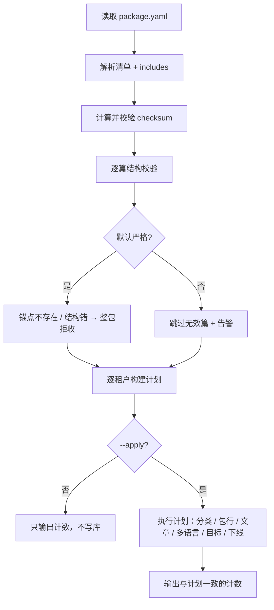

# 产品帮助包装载注册详细设计（包解析 + 幂等装载 + 升级 / 卸载 + 内容读实现）

> 通用能力 · 08 帮助机制 · 03 产品帮助包装载注册 · 详细设计

[文档首页](../../../../../../文档首页.md) › [08 通用能力](../../../../README.md) › [帮助机制](../../08_帮助机制.md) › [产品帮助包装载注册](../08_帮助机制_03_产品帮助包装载注册.md) › 详细设计　|　[需求 09-2](../../../../需求/09_需求_帮助中心.md#r09-2) · [阶段计划](../../../../计划/01_计划_通用能力.md)

## 1. 概述 <a id="overview"></a>

- **目标**：把「产品随包提供帮助」从人工逐篇录入变成**可解析、可预演、可升级、可卸载、可追溯**的机制面，并在装载后让 08_02 的五级解析真正返回内容。
  1. **包解析**：只认 `help/package.yaml`，按清单 `includes` 显式引用分类与文章文件；结构、必填字段、`includes` 存在性、`checksum` 全部校验后才进入装载。
  2. **装载计划器**：同一份计划器同时服务 `--dry-run` 与实跑——先算「新增 / 更新 / 下线 / 跳过 / 不变」，实跑只执行该计划，**dry-run 计数与实跑计数必然一致**。
  3. **幂等与升级**：幂等键 `(product_key, source_key, package_version)`；同版本同校验和零变更；升级按 `source_key` 更新、保留租户本地覆盖层（`local_override`）、包内移除标 `offline`、再次出现恢复 `published`。
  4. **卸载**：按 `product_key` 下线该产品来源的全部文章，租户自建（`source=tenant`）不受影响。
  5. **来源优先级**：`builtin > product > tenant`；产品包不得覆盖平台内建同目标文章，命中即跳过并告警。
  6. **内容读实现**：新增 `help_content` 能力域的 `db` 只读实现，装载后 `GET /api/v1/help/context` 直接返回文章、相关内容与分类；12_01 只补内容维护、状态机与缓存。
- **依据**：需求 [09-2](../../../../需求/09_需求_帮助中心.md#r09-2)；《[帮助包规范](../../../../../../规范/帮助包规范.md)》§3~§8；《[架构设计 · 帮助中心](../../../../../../设计/架构设计/28_架构设计_子系统_帮助中心.md)》§3.3 / §4.2；《[概要设计 · 帮助中心](../../../../../../设计/概要设计/17_概要设计_帮助中心.md)》§2.1 / §4 / §5 / §7；《[数据库开发规范](../../../../../../规范/数据库开发规范.md)》§3 / §4 / §5 / §9；《[后端开发规范](../../../../../../规范/后端开发规范.md)》§3 / §7 / §8；《[测试规范](../../../../../../规范/测试规范.md)》§5 / §6。
- **范围（本任务）**：
  - 新建 **`help` 业务域**（承载服务 `platform`）：包规格与校验、装载计划器与执行、卸载、命令行入口、`help_content` 的 `db` 只读实现、域公共出口。
  - 五张表：`sys_help_category` / `sys_help_article` / `sys_help_article_i18n` / `sys_help_article_target` / `sys_help_package`；模型落 `bms_core/models/platform/help.py`。
  - 错误码 `40008`~`40013`；`pyyaml` 提升为基座运行期依赖；表归属登记、i18n 附表台账、域布局重生成。
  - 文档回写：概要 17 §4、架构 28 §3.3、帮助包规范 §3 / §5 / §7 / §8、数据库设计 17 节点与五张表文件、国际化 30 节点附表状态。
- **不含（归口见 §11）**：帮助内容维护接口 / 状态机 / 反馈 / 阅读统计 / 内容缓存（12_01）；覆盖率台账与 CI 门禁（08_04）；前端帮助按钮与弹窗（阶段十五 09_01）；三个帮助包管理 HTTP 端点（12_01）。

## 2. 现状与差距 <a id="gap"></a>

| # | 关注点 | 需求要求 | 代码现状 | 处置 |
| --- | --- | --- | --- | --- |
| 1 | 包解析 | `help/package.yaml` + `includes` + `checksum` | 无任何包格式实现；基座未依赖 YAML 运行库 | **本段建**：`help` 域包规格与校验；`pyyaml` 入基座运行期依赖 |
| 2 | 内容落点 | 分类 / 文章 / 多语言 / 多锚点 / 包登记 | 五张表均未建，数据库设计 17 节点文件缺失 | **本段建**：五表 + 表文件 + 总览登记 + 模型 + 归属登记 |
| 3 | 装载器 | `ops.help_package`，默认 `--dry-run` | 无 | **本段建**：`help` 域计划器 / 执行器 + `ops.help_package` 入口 |
| 4 | 幂等与升级 | 同版本零变更；升级保留覆盖层；移除下线 | 无 | **本段建**：版本策略 + `local_override` 保护 + 移除标 `offline` + 再出现恢复 |
| 5 | 卸载 | 按产品下线来源文章，租户自建保留 | 无 | **本段建**：卸载计划器与执行器 |
| 6 | 冲突策略 | `builtin > product > tenant`；产品包不覆盖内建 | 08_02 只在端口契约里约定，无数据侧实现 | **本段建**：装载期目标占用检测 + 解析期来源优先级排序 |
| 7 | 装载后可见 | 装载即可被五级解析命中 | 08_02 的 `help_content` 只有 `null` 实现，恒未命中 | **本段建**：`db` 只读实现并在平台服务缺省启用 |
| 8 | 错误可定位 | 校验和 / 锚点错误被拒 | 仅 40211（锚点格式） | **本段建**：40008~40013 + 中英文案 |
| 9 | 业务域归属 | 一域一目录 | 帮助解析在 `menu_form` 域，内容面无域载体 | **本段建**：新 `help` 业务域（用户拍板），改清单并重生成域布局 |
| 10 | 多语言台账 | i18n 附表逐项登记 | `sys_help_article_i18n` 仍标「待落地」 | **本段改**：台账状态改「已落库」，同步国际化 30 节点 |

## 3. 决策记录 <a id="align"></a>

| # | 事项 | 结论 | 理由 / 长期收益 |
| --- | --- | --- | --- |
| 1 | 建表范围 | 五表：分类 / 文章 / 文章多语言 / 文章锚点 / 包登记；反馈表归 12_01 | 与 08_02 端口（多锚点、多语言、来源优先级）和帮助包规范一致；12_01 只加反馈与维护面，不再拆表 |
| 2 | 表归属业务域 | **新建 `help` 业务域**（承载 `platform`） | 语义清晰、内容面可独立演进；代价是改 `deploy/registry/platform.toml`、重生成域布局、新增域公共出口 |
| 3 | 内容读实现 | 本任务交付 `db` 只读实现，平台服务未显式配置时默认 `db` | 装载后即可端到端验收；12_01 只做维护与缓存，解析链零改动 |
| 4 | 校验和口径 | 清单去 `checksum` 后规范化 JSON + `includes` 按声明顺序（路径 + 长度 + LF 归一内容）算 SHA-256；提供 `checksum` 子命令 | 作者不手算；清单重排 / 改缩进不误报；覆盖清单语义与全部被引文件 |
| 5 | 严格模式 | 默认严格整包拒收；`--lenient` 才跳过无效文章并逐条告警 | 不会装载半套帮助；问题在装载期暴露；满足完成标准「锚点错误被拒」 |
| 6 | dry-run 计数 | 四类主计数 + 不变 + 跳过细分（本地覆盖 / 目标冲突）+ 分类与包状态；同一计划器 | dry-run 与实跑计数必然一致；排障能直接定位「为什么没生效」 |
| 7 | 命令行默认 | 装载与卸载都默认 dry-run，`--apply` 才写；目标必须显式 `--tenant`（可重复）或 `--all-tenants` | 误伤面最小；符合规范「装载前必须 dry-run」 |
| 8 | 版本策略 | 同版本同校验和零变更；同版本不同校验和拒收；低于当前最高版本拒收 | 版本不可变、升级单调、审计可解释 |
| 9 | 目标冲突 | 包内同 target 多篇整包拒收；跨产品同优先级跳过告警；产品包遇平台内建同 target 跳过告警 | 解析结果确定；严格符合 `builtin > product > tenant` |
| 10 | 来源取值 | `builtin` / `product` / `tenant`（租户自建 = tenant） | 与 08_02 端口一致；概要 17 §4 的 `manual/package/builtin` 回写为本口径 |
| 11 | YAML 依赖 | `pyyaml` 提升为 `bms_core` 运行期依赖 | 生产镜像可装载；符合「产品升级 = 重新装载」 |
| 12 | 管理接口 | 只做命令行 + 可复用服务函数；三端点 / `help:package` / 契约 / 前端类型归 12_01 | 本任务不膨胀，后续接 API 零重写 |
| 13 | 样本包 | 不入库真实帮助包；测试用临时包 | 不提交占位正文，真实内容由产品运营定稿 |
| 14 | 审计留痕 | 命令行只记日志与包登记；操作日志 / 字段级审计归 12_01 | 命令行无请求上下文，字段级审计无法入链；不造第二套写入路径 |
| 15 | 分类路径 | 包内声明按父级先出现 upsert；文章路径须在「包内声明或租户既有」中可解析，否则拒收 | 包可移植，又不强迫重复声明既有分类；拼写错误不静默生成垃圾分类 |
| 16 | 默认语言 | 以租户语言清单默认语言为准；主表写默认语言快照，其余进附表 | 租户切换默认语言后口径仍正确 |
| 17 | 错误码 | 新增 40009~40013；锚点沿用 40008 | 40001~40003 已被通用配置占用；帮助锚点格式继续用既有 40211 |
| 18 | 代码落点 | 新域 `domains/help/`；模型落 `bms_core/models/platform/help.py` 并登记到该域 | 与「一域一目录」一致；装载器与解析实现同域，12_01 直接续写 |
| 19 | 命令行落点 | `ops/help_package.py` 薄壳（`RUN_IMAGE = "platform"`），逻辑在 `domains/help/cli.py` | 运维入口稳定；服务层可复用；不把业务逻辑写进 `ops` |
| 20 | Kiwi / 提交 | 1 条策展用例；`feat` + `docs` 两次提交 | 一任务一条用例；代码与文档分开 |

## 4. 交付物清单 <a id="tree"></a>

```text
backend/services/platform/src/bms_platform/domains/help/
├── __init__.py                         # 新：层包标记
├── constants.py                        # 新：状态 / 来源 / 目标类型 / 包状态 / 优先级
├── package_spec.py                     # 新：清单解析、includes、checksum、结构校验
├── cli.py                              # 新：load / unload / checksum 命令行实现
├── public.py                           # 新：域公共出口（本期无跨域导出）
├── repositories/
│   ├── __init__.py                     # 新：层包标记
│   └── content.py                      # 新：分类 / 文章 / 多语言 / 锚点 / 包读写与解析查询
└── services/
    ├── __init__.py                     # 新：层包标记
    ├── package.py                      # 新：计划器 + 装载 + 卸载
    └── resolver.py                     # 新：help_content 的 db 实现与插件工厂

backend/libs/bms_core/src/bms_core/
├── models/platform/help.py             # 新：五张表模型
├── models/platform/__init__.py         # 改：MODEL_MODULES 加 help
├── repositories/help_locale.py         # 新：租户默认语言只读助手（避免帮助域跨域 import 国际化模型）
├── core/error_codes.py                 # 改：40008~40013
├── core/exceptions.py                  # 改：六个帮助包异常
├── i18n/error_seed.py                  # 改：40008~40013 中英文案
├── i18n/attachments.py                 # 改：文章多语言附表状态改「已落库」
├── services/table_registry.py          # 改：五表 enabled + 反馈表 planned
└── pyproject.toml                      # 改：pyyaml 运行期依赖

backend/services/platform/src/bms_platform/
├── main.py                             # 改：configure_plugins 登记 help_content:db 与缺省 provider
└── domains/__init__.py                 # 改：DOMAINS 加 help

backend/config.toml                     # 改：[help_content] 说明（缺省由平台服务置 db）
backend/ops/help_package.py             # 新：命令行薄壳（RUN_IMAGE = platform）
backend/pyproject.toml                  # 改：dev 依赖移除 pyyaml（已入基座）
backend/uv.lock                         # 改：依赖归属变化
deploy/registry/platform.toml           # 改：新增 [[domains]] help
deploy/boundaries/domain_layout.json    # 重生成（生成物，不手改）
tests_support/shared_db.py              # 改：库版本戳 bump（新模型入共享测试库）

backend/services/platform/tests/help/
├── __init__.py                         # 新：测试包标记
├── _support.py                         # 新：临时包构造 / 租户库数据助手
├── test_help_package_spec.py           # 新：清单 / includes / checksum / 结构校验
├── test_help_package_loader.py         # 新：计划与实跑计数 / 升级 / 覆盖 / 下线 / 卸载 / 冲突
├── test_help_content_resolver.py       # 新：来源优先级 / 相关内容 / 分类 / 语言回退 / 未命中
└── test_help_package_cli.py            # 新：参数默认值 / dry-run / 退出码 / checksum 子命令
backend/libs/bms_core/tests/ops/test_help_package.py  # 新：薄壳转发与 RUN_IMAGE
backend/libs/bms_core/tests/i18n/test_i18n_attachments.py  # 改：已落库 / 待落地计数与模型导入

bms文档/
├── 设计/数据库设计/17_数据库设计_帮助中心.md          # 新：模块节点
├── 设计/数据库设计/数据表设计/{sys_help_category,sys_help_article,sys_help_article_i18n,sys_help_article_target,sys_help_package}.md  # 新：五张表文件
├── 设计/数据库设计/01_数据库设计_总览.md              # 改：表清单 / 节点 / 登记
├── 设计/数据库设计/30_数据库设计_国际化管理.md        # 改：文章多语言附表改「已落地」
├── 设计/概要设计/17_概要设计_帮助中心.md              # 改：§4 表清单与来源取值
├── 设计/架构设计/28_架构设计_子系统_帮助中心.md       # 改：§3.3 多锚点关联与来源取值
├── 规范/帮助包规范.md                                # 改：§3 / §5 / §7 / §8 校验和 / 严格模式 / 来源 / 版本
├── 后端基类清单.md                                   # 改：help_content 的 db 实现登记
└── 项目/08_通用能力/任务/08_帮助机制/08_帮助机制_03_产品帮助包装载注册/
    ├── 设计/01_详细设计_08_03_产品帮助包装载注册.md   # 本文
    ├── 实施/01_实施记录_08_03_产品帮助包装载注册.md
    └── 测试/01_测试记录_08_03_产品帮助包装载注册.md
```

## 5. 领域设计 <a id="design"></a>

### 5.1 包规格与解析 <a id="spec"></a>

**文件组织**（与《帮助包规范》§2 一致，装载器只认清单）：

```text
help/
├── package.yaml
├── categories.yaml          # 可选；也可内联在 package.yaml
└── articles/
    ├── user-create.yaml
    └── …
```

**清单字段**（`package.yaml`）：

| 字段 | 类型 | 必填 | 约束 |
| --- | --- | --- | --- |
| `schema_version` | 整数 | 是 | 当前只接受 `1`；未知版本拒收 |
| `product_key` | 字符串 | 是 | `[a-z][a-z0-9_]*`，≤64；决定卸载粒度与来源（`platform` = builtin，其余 = product） |
| `package_version` | 字符串 | 是 | `X.Y.Z` 三段数字；决定升级顺序 |
| `generated_at` | 字符串 | 否 | ISO 8601；仅登记，不参与业务判断 |
| `checksum` | 字符串 | 是 | `sha256:` + 64 位小写十六进制 |
| `includes` | 对象 | 是 | 只允许 `categories`（字符串）与 `articles`（非空字符串数组）；不扫描目录 |
| `categories` | 数组 | 否 | 内联分类（与 `includes.categories` 可并存，内联在前） |

**文章字段**（一篇一文件）：

| 字段 | 必填 | 约束 |
| --- | --- | --- |
| `source_key` | 是 | ≥2 段点分、每段 `[a-z][a-z0-9_]*`、首段等于 `product_key`、≤128；发布后不可改（改键 = 删旧增新） |
| `category_path` | 是 | `/` 分隔、无空段、单段 ≤64、总长 ≤255 |
| `status` | 是 | 仅 `published` / `offline`（`draft` 属本地编辑，不随包发布） |
| `is_top` | 否 | 布尔，缺省 `false` |
| `targets` | 是 | 至少 1 个；`{type, key}`；`type` ∈ `global/module/form/field/action`；`global` 无 `key`，其余必须有 |
| `locales` | 是 | 1~50 个；语言标识按 `normalize_locale` 归一；每个含 `title`（≤256）与 `content`（清洗后非空，≤60000 字节） |
| `provenance` | 是 | `author` ∈ `manual/ai`；`author=ai` 时 `model` 与 `reviewed_by` 必填 |
| `title` | 否 | 仅人读提示，不落库；正文与标题以 `locales` 为准 |

- **未知键一律拒收**（清单 / `includes` / 文章 / 分类 / 语言文案 / 来源留痕 / 目标），防止拼写错误被静默忽略；未来不兼容变更以 `schema_version` 升级。
- **文件安全**：`includes` 路径必须是包根内相对路径（POSIX 分隔），不得含 `..`、不得为绝对路径、不得重复；文件不存在即拒收。单文件 ≤2 MiB，文章 ≤2000 篇，分类 ≤500 条。
- **YAML**：`yaml.safe_load`；只接受映射 / 序列 / 标量，不接受自定义标签。
- **分类**：`{path, sort}`；`sort` 缺省按出现序（从 1 起）；`path` 父级必须先出现；同一路径不得重复。合并顺序为「内联分类 → `includes.categories` 文件」。

### 5.2 校验和 <a id="checksum"></a>

**算法**（`sha256:<hex>`）：

```text
payload = b"bms-help-package-v1\0"
        + canonical_json(清单去掉 checksum 字段)          # sort_keys / UTF-8 / 紧凑分隔符
        + Σ 对每个 includes 文件（分类在前，文章按声明顺序）：
              b"\0" + 相对路径(POSIX) + b"\0" + 长度(8 字节大端) + 内容(换行统一 LF)
checksum = "sha256:" + sha256(payload).hexdigest()
```

- **清单语义入哈希**：清单去 `checksum` 后按键排序成规范化 JSON，因此重排字段 / 改缩进不会误报，但 `product_key` / `package_version` / `includes` / 内联分类被改一定会被发现。
- **被引文件全文入哈希**：分类与文章文件按声明顺序、带路径与长度入哈希；换行 CRLF / LF 归一，避免 Windows / Linux 协作误报。
- **生成入口**：`ops.help_package checksum --package <目录或 package.yaml>` 打印值；`--write` 只替换 / 追加 `package.yaml` 的 `checksum:` 行，保留原文件其余内容与换行风格。
- **校验时机**：装载前先算实际值再与清单值比较，不符即 `40010`，整包不进入装载。

### 5.3 数据模型 <a id="tables"></a>

字段唯一事实源为表文件，本设计不复制完整字段清单：

- [sys_help_category](../../../../../../设计/数据库设计/数据表设计/sys_help_category.md)
- [sys_help_article](../../../../../../设计/数据库设计/数据表设计/sys_help_article.md)
- [sys_help_article_i18n](../../../../../../设计/数据库设计/数据表设计/sys_help_article_i18n.md)
- [sys_help_article_target](../../../../../../设计/数据库设计/数据表设计/sys_help_article_target.md)
- [sys_help_package](../../../../../../设计/数据库设计/数据表设计/sys_help_package.md)

**归属**：五表均落 **platform 服务租户库** `bms_platform_{code}`（`datasource=tenant`、`owner=platform`、`domain=help`），随平台服务租户链幂等建表。`sys_help_feedback` 归 12_01，本任务只登记为 `planned`，不建模、不建表。

**关键口径**：

- **分类**：`parent_id = 0` 表示根（不用 `NULL`，避免达梦复合唯一中 NULL 相等的已知差异）；`(parent_id, name, deleted_at)` 复合唯一；分类不设多语言附表（路径名即展示名）。
- **文章**：主表 `title` / `content` 是**默认语言派生快照**，由装载器按租户默认语言写入；逐语言文案存 `sys_help_article_i18n`。`source` ∈ `builtin/product/tenant`；`package_id` / `source_key` 仅包来源文章有值；`local_override` 标记租户本地编辑。
- **多锚点**：文章与目标一对多，落 `sys_help_article_target`；`target_type` ∈ `global/module/form/field/action`，`target_key` 为 `help_key` 原值（全局级为空串）。同一文章同一 `(type, key)` 唯一。
- **包登记**：一行一个「产品 × 版本」装载记录；`status` ∈ `loaded/outdated/unloaded`；`(product_key, package_version, deleted_at)` 唯一；`article_count` 为该版本清单内的文章总数（含 `offline` 与宽松模式跳过的篇）。
- **不做 DB 唯一约束的列**：`sys_help_article.source_key` 因自建文章为 `NULL`，达梦会把复合唯一中的 NULL 视同相等，故唯一性由装载器与 12_01 维护入口的代码校验承担。

### 5.4 装载计划与执行 <a id="load"></a>

**总体流程**：



**计划器输入**：已校验的包规格、当前租户库会话。**计划器输出**：

| 计数 | 含义 |
| --- | --- |
| `articles_new` | 该产品下不存在该 `source_key` 的文章 |
| `articles_updated` | 文章存在但内容 / 状态 / 置顶 / 分类 / 目标 / 多语言 / 来源留痕有差异 |
| `articles_offline` | 产品已有包来源文章不在新包内，且当前不是 `offline` |
| `articles_skipped` | 跳过总数 = 本地覆盖保护 + 目标冲突 |
| `articles_skipped_override` | `local_override=true` 且内容有变化（整篇跳过，不改标题 / 正文 / 目标 / 状态） |
| `articles_skipped_conflict` | 目标被更高或同等优先级的其他来源占用 |
| `articles_unchanged` | 文章存在且完全一致 |
| `categories_created` / `categories_updated` / `categories_unchanged` | 分类按路径 upsert 的计划 |
| `package_action` | `created` / `upgraded` / `restored` / `unchanged` |

- **同一计划器**：`load(spec, apply=False)` 只返回计划计数；`load(spec, apply=True)` 先在同一会话内构建同一计划再执行，返回同一组计数——这是「升级计数与 dry-run 一致」的实现方式。
- **版本判定**：
  1. 取该产品全部包行，`max_version` = 最高 `package_version`；同版本行存在则取该行。
  2. 同版本 + 同校验和 + `status=loaded` → `package_action=unchanged`，全部计数为 0（不做任何写入，也不修正被租户手工下线的文章）。
  3. 同版本 + 校验和不同 → `40011`。
  4. 版本低于 `max_version` → `40011`（不降级）。
  5. 同版本行存在但状态为 `unloaded` / `outdated` → 复用该行并置 `loaded`（`restored`）；否则新建包行（`created` / `upgraded`），并把该产品其他 `loaded` 行置 `outdated`。
- **分类**：先读租户既有分类并建「路径 → 行」索引；包内声明路径不存在则按父级顺序创建，已存在只更新 `sort`（`sort` 相同则不变）。**不改分类下已有文章**。
- **文章身份**：`(product_key, source_key)`；升级只按该键更新，`source_key` 本身不可改。
- **更新范围**：标题 / 正文（默认语言快照）、状态、置顶、分类、目标集合、多语言文案、来源留痕（`generated_by` / `ai_model` / `reviewed_by`）；`publish_at` 仅在首次变为 `published` 时写入；阅读 / 反馈计数与 `author_id` 不动。
- **包内移除**：产品已有包来源文章中不在新包的键，若当前非 `offline` 则置 `offline`；**不物理删**，保留审计与恢复能力。再次出现时按新包状态恢复（`published` 或 `offline`），若 `local_override=true` 则内容仍跳过、只恢复状态。
- **本地覆盖保护**：`local_override=true` 的文章在任何升级中都整篇跳过（计 `articles_skipped_override`）；但包内移除仍置 `offline`（产品已不再提供该篇，不能被本地覆盖层“留活”）。
- **目标冲突**（装载期）：
  - 先计算本次将下线的文章集合，冲突检测排除这些文章（它们即将失效）。
  - 对每篇新文章逐个目标查当前已发布文章占用：若占用者来源优先级 **低于或等于** 新文章，且不是同一产品同一 `source_key`，则**整篇跳过**并计 `articles_skipped_conflict`：
    - 产品包遇 `builtin` → 跳过（产品不得覆盖平台内建）；
    - 跨产品同为 `product` → 跳过（同优先级无确定赢家）；
    - `builtin` 遇 `product` / `tenant` → 允许（内建优先级更高）。
  - 同一包内两篇文章指向同一目标 → `40009` 整包拒收（作者必须修正，避免同版本内顺序不确定）。
- **`local_override` 与来源**：本地覆盖只改内容，不改 `source`，因此解析优先级仍按原包来源（产品编辑过的文章仍属 product，不会被降级成 tenant）。

### 5.5 卸载 <a id="unload"></a>

- 入参 `product_key`；计划器统计该产品包来源文章中当前非 `offline` 的条数（`articles_offline`）与已下线条数（`articles_unchanged`）。
- 执行：该产品所有包行 `status` 置 `unloaded`；该产品包来源文章（含 `local_override`）全部置 `offline`；`source=tenant` 的文章不动。
- 产品没有任何包行 → `40012`（包未装载）；有包行但文章已全下线 → 计数为 0 的成功结果。
- 卸载同样默认 dry-run，`--apply` 才写。

### 5.6 内容读实现（`help_content` 的 `db`） <a id="resolver"></a>

**能力域**：`help_content`（端口 `bms_core.help.content.BaseHelpContentResolver`，契约版本 `0.1.0`）。本任务在 `help` 域新增 `DatabaseHelpContentResolver`（`plugin_name = "db"`），**导入即经 `BasePluggable.__init_subclass__` 自动登记**；平台服务 `configure_plugins` 只负责在 `[help_content].provider` 为空时置 `db`（显式配置含 `null` 一律尊重）。实现按配置懒建 `EngineRegistry`，请求期按当前租户上下文开只读会话。

**解析算法**：

1. 用**当前租户上下文**开租户库只读会话（`session_scope`），取租户默认语言（`sys_i18n_locale.is_default`，缺失回退出厂默认语言）。
2. 按 `query.candidates` 顺序逐个探询：
   - 候选有 `help_key`：按候选层级映射目标类型（字段 / 动作 / 表单 / 模块），查 `sys_help_article_target` 命中的**已发布**文章；
   - 候选为全局级：查 `target_type=global` 的已发布文章。
3. 同一目标多篇按 `builtin > product > tenant`、同来源按包版本降序、再按文章主键升序取**首篇**为主文章，其余为「相关内容」；取到即返回该候选的 `level` / `help_key`。
4. 全部候选无文章 → `matched=false`，`categories` 返回**顶层分类**（`parent_id=0`、启用、未软删，按 `sort` / 主键升序，最多 50 条）。
5. 命中时 `categories` 返回该文章分类的**根 → 叶链路**（供前端定位分类导航）。

**多语言**：文章标题 / 正文按 `[请求语言, 租户默认语言]` 两级回退读 `sys_help_article_i18n`，两级皆缺回退主表快照；语言比较大小写不敏感。

**边界**：只读、不缓存（内容缓存归 12_01）、不改元数据；无租户上下文或库不可用时返回空结果并告警，不阻断页面。

### 5.7 命令行契约 <a id="cli"></a>

入口：`backend/ops/help_package.py`（`RUN_IMAGE = "platform"`），实现在 `bms_platform.domains.help.cli`。**不新增 HTTP 端点**；三个管理端点与 `help:package` 权限码归 12_01。

```bash
# 计算 / 回写校验和（不连库）
python -m ops.help_package checksum --package help/package.yaml
python -m ops.help_package checksum --package help/package.yaml --write

# 装载（默认 dry-run；--apply 才写）
python -m ops.help_package load --package help/package.yaml --tenant demo
python -m ops.help_package load --package help/package.yaml --tenant demo --apply
python -m ops.help_package load --package help/package.yaml --all-tenants --apply

# 卸载（默认 dry-run）
python -m ops.help_package unload --product bms --tenant demo
python -m ops.help_package unload --product bms --tenant demo --apply
```

| 参数 | 适用 | 说明 |
| --- | --- | --- |
| `--package` | `load` / `checksum` | 目录或 `package.yaml` 路径 |
| `--product` | `unload` | 产品键 |
| `--tenant` | `load` / `unload` | 可重复；装载目标租户编码 |
| `--all-tenants` | `load` / `unload` | 与 `--tenant` 互斥；枚举未软删租户 |
| `--apply` | `load` / `unload` | 缺省不写库；给出即实跑 |
| `--lenient` | `load` | 跳过无效文章并告警；缺省严格 |
| `--json` | 全部 | 机器可读输出（逐租户结果 + 计数） |

- **目标必填**：`--tenant` 与 `--all-tenants` 都不给 → 参数错误（退出码 64）。
- **退出码**：`0` 成功（含 dry-run 有待变更）；`1` 校验 / 业务拒收；`2` 执行错误；`64` 参数错误。
- **输出**：逐租户打印「新增 / 更新 / 下线 / 跳过（覆盖 / 冲突）/ 不变」、分类计数与包状态迁移；dry-run 明确标注「预演：未写入」。
- **多租户失败**：校验类错误在进入租户循环前失败；单租户执行错误记日志并继续其余租户，末尾汇总，存在失败即退出码 1/2。
- **审计**：命令行无请求上下文，只记结构化日志与包登记行；操作日志与字段级审计归 12_01 管理接口（已在 §11 登记）。

### 5.8 错误码与异常 <a id="errors"></a>

| 错误码 | 名称 | HTTP | 场景 |
| --- | --- | --- | --- |
| 40008 | `HELP_ANCHOR_UNRESOLVED` | 400 | `targets[].key` 在元数据中不可解析，或 `type` 与锚点节点类型不匹配 |
| 40009 | `HELP_PACKAGE_INVALID` | 400 | 清单 / 文章 / 分类结构非法、未知键、必填缺失、来源留痕不完整、正文清洗后为空、语言不含默认语言、包内目标重复 |
| 40010 | `HELP_PACKAGE_CHECKSUM_MISMATCH` | 400 | `checksum` 格式非法或与实际内容不符 |
| 40011 | `HELP_PACKAGE_VERSION_CONFLICT` | 400 | 同版本不同校验和；版本低于当前最高版本 |
| 40012 | `HELP_PACKAGE_NOT_LOADED` | 400 | 卸载时该产品没有任何包登记行 |
| 40013 | `HELP_CATEGORY_PATH_UNRESOLVED` | 400 | 文章 `category_path` 既不在包内声明、也不在租户既有分类中 |

- 全部继承 `MenuError`（系统配置段），HTTP 400；`data` 携带违规文件、`source_key`、目标键或分类路径，便于命令行逐条打印。
- 帮助锚点格式错误继续使用 08_01 的 `40211`；本任务的目标存在性 / 类型匹配错误统一转 `40008`。
- 中英文案登记 `error_seed.py`；`error.*` 完整性护栏用例覆盖。

### 5.9 与相邻任务的边界 <a id="boundary"></a>

| 任务 | 本任务交付 | 本任务不做 |
| --- | --- | --- |
| 08_01 锚点登记面 | 消费五表 `help_key` 做目标校验 | 改字段、改格式、改装载面 |
| 08_02 锚点解析 | `help_content` 的真实 `db` 实现与内容表 | 改五级链、改解析接口、改按钮显隐 |
| 08_04 覆盖率门禁 | 分类 / 文章 / 包数据可供对账 | 对账口径、台账输出、阻断开关 |
| 12_01 帮助内容维护 | 五表 + 装载器 + 只读解析 | 维护接口、状态机、反馈、阅读统计、内容缓存、AI 草稿位接口 |
| 09_01 组件回补 | 装载后可解析 | 前端帮助按钮 / 弹窗 / 锚点编辑 |

## 6. 接口契约变化 <a id="contract"></a>

- **HTTP**：无新增 / 变更端点；`GET /api/v1/help/context` 契约不变，仅因 `help_content` 缺省实现从 `null` 变为 `db` 而开始返回文章。
- **契约快照 / 前端类型**：不需要重建（OpenAPI 无变化）。
- **命令行**：新增 `ops.help_package` 的 `load` / `unload` / `checksum` 三个子命令（见 §5.7）。
- **配置**：`[help_content].provider` 缺省仍为空串，平台服务启动时置 `db`；显式配置优先。

## 7. 失败分支与边界 <a id="failures"></a>

| 场景 | 处置 | 结果 |
| --- | --- | --- |
| `package.yaml` 缺失 / 不是映射 | 40009 | 不装载 |
| `schema_version` 未知 | 40009 | 不装载 |
| `includes` 路径越界 / 不存在 / 重复 | 40009 | 不装载 |
| `checksum` 格式非法 / 不符 | 40010 | 不装载 |
| 文章缺 `source_key` / `category_path` / `targets` / `locales` / `provenance` | 严格：40009；宽松：跳过该篇 | 其余篇照常 |
| `source_key` 首段与 `product_key` 不符 | 40009 / 跳过该篇 | 同上 |
| `locales` 不含租户默认语言 | 严格：40009；宽松：跳过该篇 | 同上 |
| 正文清洗后为空 / 超 60000 字节 | 严格：40009；宽松：跳过该篇 | 同上 |
| `provenance.author=ai` 缺 `model` / `reviewed_by` | 40009 / 跳过该篇 | 同上 |
| `targets[].key` 不存在 / 类型不符 | 严格：40008；宽松：跳过该篇 | 同上 |
| 包内两篇同目标 | 40009 | 整包拒收（宽松也不跳过，属作者结构性错误） |
| `category_path` 解析不到 | 严格：40013；宽松：跳过该篇 | 同上 |
| `category_path` 父级未先出现 | 40009 | 整包拒收 |
| 同版本同校验和 | 零变更 | 不写库 |
| 同版本不同校验和 / 低版本 | 40011 | 不写库 |
| 目标被 `builtin` 占用（加载产品包） | 跳过该篇 + 告警 | `skipped_conflict` |
| 目标被其他产品占用 | 跳过该篇 + 告警 | `skipped_conflict` |
| `local_override=true` 且内容有变 | 跳过该篇 | `skipped_override` |
| 包内移除且文章已 `offline` | 不变 | `unchanged` |
| 卸载产品未装载 | 40012 | 不写库 |
| 卸载时存在租户自建文章 | 不受影响 | 仍为原状态 |
| 命令行无租户目标 | 参数错误 | 退出码 64 |
| 单租户库不可用 | 记日志并继续其他租户 | 退出码 2（汇总） |

## 8. 测试设计与验收映射 <a id="tests"></a>

**Kiwi**：开工后先登记 1 条策展用例（分类「平台骨架」、`P2`、`CONFIRMED`、标签「自动化」），用例文本写覆盖范围与自动化文件路径；代码 `@pytest.mark.kiwi_id(<回读编号>)` 标注，编号以平台回读为准，**不复用 2521**。

| # | 验收项（任务 §3 / 需求 09-2） | 用例 | 断言 |
| --- | --- | --- | --- |
| 1 | 同版本零变更 | `test_help_package_loader::test_same_version_reload_is_noop` | 二次装载 `package_action=unchanged`，五类计数全 0，文章行数与内容不变 |
| 2 | 升级计数与 dry-run 一致 | `test_help_package_loader::test_upgrade_counts_match_dry_run` | 同一包 `apply=False` 与 `apply=True` 的新增 / 更新 / 下线 / 跳过 / 不变完全一致 |
| 3 | 新增 / 更新 / 下线 | 同上 | 新键新增、同键改内容更新、包内移除标 `offline`、再次出现恢复 `published` |
| 4 | 覆盖层不被覆盖 | `test_help_package_loader::test_local_override_is_kept` | 置 `local_override=true` 后升级，标题 / 正文 / 目标不变，`skipped_override=1` |
| 5 | 卸载保留租户自建 | `test_help_package_loader::test_unload_keeps_tenant_articles` | 产品文章全 `offline`，`source=tenant` 文章仍 `published`；包行 `unloaded` |
| 6 | 校验和错误被拒 | `test_help_package_spec::test_checksum_mismatch_is_rejected` | 篡改内容 → 40010，零写入 |
| 7 | 锚点错误被拒 | `test_help_package_loader::test_unknown_target_is_rejected` | 未知 `help_key` → 40008；`--lenient` 跳过该篇并告警 |
| 8 | 结构 / 版本 / 分类错误 | `test_help_package_spec::test_manifest_validation`、`test_help_package_loader::test_version_and_category_errors` | 40009 / 40011 / 40012 / 40013 各自命中 |
| 9 | 目标冲突策略 | `test_help_package_loader::test_target_conflicts` | 产品包遇内置同目标跳过；跨产品跳过；包内重复整包拒收 |
| 10 | 分类 upsert | `test_help_package_loader::test_categories_upsert_by_path` | 父级先创建、已存在只更新 `sort`、不改其下文章 |
| 11 | 多语言快照与回退 | `test_help_content_resolver::test_locale_fallback` | 请求语言命中 → 默认语言回退 → 主表快照回退三级正确 |
| 12 | 解析来源优先级 | `test_help_content_resolver::test_source_priority_and_related` | 同目标多篇取 `builtin` 优先，其余进 `related` |
| 13 | 装载后可解析 | `test_help_content_resolver::test_loaded_article_is_resolved` | 五级锚点分别命中装载后的文章，未命中返回顶层分类 |
| 14 | 校验和生成 | `test_help_package_cli::test_checksum_command` | 打印值可复现；`--write` 回写后再次校验通过 |
| 15 | 命令行默认 dry-run | `test_help_package_cli::test_load_defaults_to_dry_run` | 不给 `--apply` 不写库；缺租户目标退出码 64；`--json` 结构稳定 |
| 16 | i18n 台账一致 | `test_i18n_attachments` | 已落库 9 / 待落地 2；`sys_help_article_i18n` 文案列与模型一致 |
| 17 | 装配冒烟 | `test_service_boot` / `ops.check_plugins` | `help_content:db` 可解析；平台服务可启动 |

**覆盖率**：新增 / 改动的 `bms_platform.domains.help.*`、`bms_core.models.platform.help`、`bms_core.core.error_codes` / `exceptions`、`bms_core.i18n.attachments` 按模块级 100%（行 + 分支）本地跑满；无 `pragma: no cover`（确不可达分支须带理由）。提交环只判改动行，推送环再判模块级（本任务不推送）。

**原型对照**：不适用（纯后端装载器 / 解析实现，无界面源码变更；前端帮助按钮归阶段十五 `09_01`），在测试记录写明理由。

## 9. 登记落点 <a id="registry-writeback"></a>

| 落点 | 内容 |
| --- | --- |
| 《数据库设计总览》§6.2 / §7.2 / §7.3 | 帮助表清单与节点登记；五表状态「已设计」 |
| `设计/数据库设计/17_数据库设计_帮助中心.md` | 新建模块节点：归属、表清单、关键设计、与 12_01 边界 |
| 五张表文件 | 归属 / 字段 / 索引 / 建表 / 变更记录 |
| `设计/数据库设计/30_数据库设计_国际化管理.md` | `sys_help_article_i18n` 由「待落地」改「已落地」 |
| 《概要设计 · 帮助中心》§4 | 表清单补文章锚点表与包登记表；`source` 改 `builtin/product/tenant` |
| 《架构设计 · 帮助中心》§3.3 | 多锚点关联表与来源取值的语义说明 |
| 《帮助包规范》§3 / §5 / §7 / §8 | 校验和算法、来源取值、严格模式、版本策略、`--lenient` |
| 《后端基类清单》 | `help_content` 的 `db` 实现登记（平台服务 `domains/help/services/resolver.py`） |
| `bms_core/i18n/attachments.py` | 文章多语言附表状态改「已落库」 |
| 《数据库设计总览》表归属 | 五表 `owner=platform`、`domain=help`、`datasource=tenant`；反馈表 `planned` |
| 阶段计划 §2 / §3 | 08_03 交付摘要、状态与遗留（唯一进度落点） |
| 需求 09-2 / 任务 08_03 | 交付注块（不承载进度） |
| 帮助机制父任务 | 依赖与子任务状态由计划表体现 |

## 10. 实施步骤 <a id="steps"></a>

1. **表文件与节点**：先写 `17_数据库设计_帮助中心.md` 与五张表文件，更新总览登记与国际化 30 节点。
2. **模型与登记**：`bms_core/models/platform/help.py`；`models/platform/__init__.py`；`table_registry` 五表 enabled + 反馈 planned；`i18n/attachments.py` 状态。
3. **新域与依赖**：`deploy/registry/platform.toml` 加 `[[domains]] help`；`domains/__init__.py` 加 `help`；`ops.check_modules --render-domain-layout` 重生成布局；`pyyaml` 入基座依赖并更新锁文件。
4. **包规格**：`constants.py`、`package_spec.py`（清单 / includes / checksum / 结构校验 / 值对象 / 校验和命令实现）。
5. **数据访问**：`repositories/content.py`（分类 / 文章 / 多语言 / 目标 / 包 / 占用查询 / 解析查询）。
6. **装载与卸载**：`services/package.py`（计划器 + 执行器 + 冲突检测 + 版本策略）。
7. **解析实现**：`services/resolver.py`（`db` 实现，导入即自动登记）；`main.py` 的 `configure_plugins` 只置缺省 provider。
8. **命令行**：`domains/help/cli.py` + `ops/help_package.py` 薄壳（`worker_id_lease_sync`）。
9. **错误码与文案**：`error_codes.py` / `exceptions.py` / `error_seed.py`。
10. **Kiwi**：先登记取得编号 → 写用例（规格 / 装载 / 解析 / 命令行 / 台账 / 装配）。
11. **验证**：单文件 `ruff check` / `pyright` / `pytest`；`ops.check_tables --offline`、`ops.check_modules --check-domain-layout`、`ops.check_plugins`、`ops.check_contracts`；`engkit links` / `docs-scope` / `eol`。
12. **登记回写 + 实施 / 测试记录**。
13. **提交**：`feat(帮助)`（代码 + 模型 + 域布局 + 依赖 + 测试）→ `docs(帮助)`（设计 / 表文件 / 记录 / 登记 / 计划）。

## 11. 边界与开放项 <a id="open"></a>

| # | 事项 | 处置 |
| --- | --- | --- |
| 1 | 帮助内容维护接口 / 状态机 / 反馈 / 阅读统计 | 12_01；本任务只交付装载与只读解析 |
| 2 | 内容侧缓存与失效 | 12_01 自持；本任务每次解析直读租户库 |
| 3 | 三个帮助包管理 HTTP 端点与 `help:package` 权限码 | 12_01；本任务服务层函数可直接复用 |
| 4 | 命令行装载 / 卸载的操作日志与字段级审计 | 12_01 管理接口；命令行无请求上下文，只记日志与包登记（与 08_01 装载期结论一致） |
| 5 | 前端帮助按钮 / 弹窗 / 锚点编辑 | 阶段十五 `09_01` |
| 6 | 真实产品帮助包内容 | 各产品接入任务；本任务不提交占位正文 |
| 7 | 多租户批量装载的并发 | 运维窗口串行执行；计划器与执行器在同一会话内完成，不做跨实例锁 |
| 8 | 包内移除后的物理清理 | 不物理删；回收站 / 归档归 13_01 / 14_01 |
| 9 | `sys_help_feedback` | 12_01 建模；本任务只登记 planned |

## 12. 参考文档 <a id="ref"></a>

- 需求 [09-2 产品帮助包装载注册](../../../../需求/09_需求_帮助中心.md#r09-2)
- 《[帮助包规范](../../../../../../规范/帮助包规范.md)》§3 / §4 / §5 / §6 / §7 / §8 / §9
- 《[架构设计 · 帮助中心](../../../../../../设计/架构设计/28_架构设计_子系统_帮助中心.md)》§3.3 / §4.2 / §8
- 《[概要设计 · 帮助中心](../../../../../../设计/概要设计/17_概要设计_帮助中心.md)》§2.1 / §4 / §5 / §7
- 《[数据库开发规范](../../../../../../规范/数据库开发规范.md)》§3 / §4 / §5 / §9
- 《[后端开发规范](../../../../../../规范/后端开发规范.md)》§3 / §7.1 / §7.2 / §8
- 《[测试规范](../../../../../../规范/测试规范.md)》§5 / §6
- 《[AI开发规范](../../../../../../规范/AI开发规范.md)》§5「一条龙」、§7「覆盖率要求」

> 详细设计 · 依《[文档生成规范](../../../../../../规范/文档生成规范.md)》编写 · 进度以[阶段计划](../../../../计划/01_计划_通用能力.md)为唯一落点
