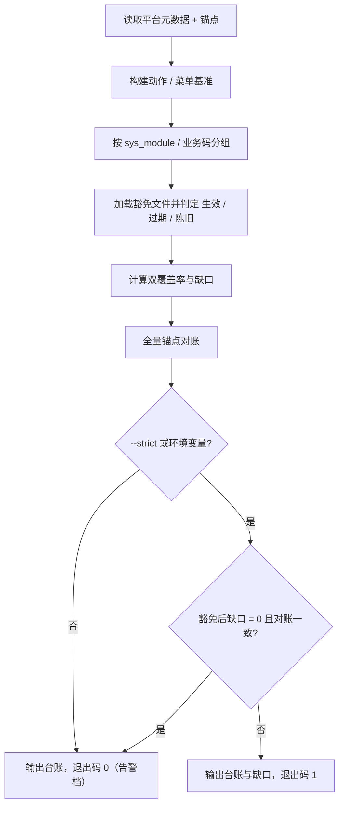

# 帮助覆盖率门禁与台账详细设计（按钮 / 菜单对账 + 分产品模块台账 + 豁免与阻断）

> 通用能力 · 08 帮助机制 · 04 帮助覆盖率门禁与台账 · 详细设计

[文档首页](../../../../../../文档首页.md) › [08 通用能力](../../../../README.md) › [帮助机制](../../08_帮助机制.md) › [帮助覆盖率门禁与台账](../08_帮助机制_04_帮助覆盖率门禁与台账.md) › 详细设计　|　[需求 09-3](../../../../需求/09_需求_帮助中心.md#r09-3) · [阶段计划](../../../../计划/01_计划_通用能力.md)

## 1. 概述 <a id="overview"></a>

- **目标**：把「哪些功能还没接帮助」从口头任务变成**可计数、可下钻到动作码、可配置阻断**的台账，作为阶段验收与后续 AI 缺口驱动的稳定输入面。
  1. **对账基准**：动作以 `sys_button`（1:1 权限码）为覆盖单元、菜单以「有组件且挂表单、其业务码有权限码」的功能菜单为单元；「已覆盖」只判 `help_key` 是否登记，与 08_01 的锚点数量可直接对账。
  2. **分组台账**：按 `sys_module` 的 `product_key + module_key` 分组；平台自身业务码不在 `sys_module` 时以业务码兼作模块名（产品段 `platform`），保证每个缺口都能归到可整改的分组。
  3. **确定性输出**：同一输入（元数据 + 豁免 + `as_of`）两次生成的 text / json / markdown **逐字节一致**——排序键、浮点格式、无隐式时间戳全部固定。
  4. **豁免与双覆盖率**：缺口可登记限期豁免；报告同时给「原始覆盖率」与「豁免后有效率」，过期豁免自动失效并计缺口，不再命中的豁免报「陈旧豁免」。
  5. **门禁行为**：命令行默认告警不阻断（退出码 0），`--strict` 或环境变量才在存在缺口时退出码 1；CI 加**告警档**作业留证，强档留给阶段验收 / 发布窗口。
  6. **查询出口**：`GET /api/v1/help/coverage`（`help:manage`）与命令行共用同一引擎，12_01 后台页与阶段十九 AI 缺口清单无需二次开发。
- **依据**：需求 [09-3](../../../../需求/09_需求_帮助中心.md#r09-3)；《[架构设计 · 帮助中心](../../../../../../设计/架构设计/28_架构设计_子系统_帮助中心.md)》§3.4 / §7.2 / §7.5、《[概要设计 · 帮助中心](../../../../../../设计/概要设计/17_概要设计_帮助中心.md)》§2.1 / §5 / §6、《[测试规范](../../../../../../规范/测试规范.md)》§5 / §6、《[后端开发规范](../../../../../../规范/后端开发规范.md)》§3 / §7 / §8。
- **范围（本任务）**：
  - `bms_core`：确定性台账引擎（新 `help/coverage.py`）、平台元数据只读快照助手（新 `repositories/help_coverage.py`，复用 `list_help_anchors`）、豁免文件加载与校验、覆盖率配置段、权限码 `help:manage`。
  - `platform` 服务：`menu_form` 域新增 `GET /api/v1/help/coverage`（表归属域，避免跨域读表）；契约与前端类型重建。
  - `ops.help_coverage`：text / json / markdown 三种输出、`--strict`、`--baseline` 对比、`--as-of` 固定日期；CI 告警档作业。
  - 文档回写：架构 28 §3.4 覆盖率口径、概要 17 §5 / §6、计划、需求交付注块、16_01 引用备注。
- **不含（归口见 §11）**：文章内容覆盖率与「有已发布文章才算覆盖」（需租户库，归 12_01 / 阶段十九）；台账历史表与趋势报表（后续按需）；豁免的后台维护界面（12_01）；前端覆盖率页面（阶段十五）；产品帮助包内容（各产品接入任务）。

## 2. 现状与差距 <a id="gap"></a>

| # | 关注点 | 需求要求 | 代码现状 | 处置 |
| --- | --- | --- | --- | --- |
| 1 | 对账基准 | 有权限码的动作 / 菜单 | 五表 `help_key` 已落地（08_01）；无任何覆盖率统计 | **本段建**：按钮 / 菜单基准与声明判定 |
| 2 | 台账输出 | 按产品 / 模块分组、缺口到动作码 | 无 | **本段建**：确定性引擎 + text/json/markdown |
| 3 | 分组维度 | 按产品与模块 | `sys_module` 只登记服务行与产品模块行；平台业务码不在其中 | **本段定**：登记表优先、平台业务码兼作模块名 |
| 4 | 数字一致 | 同一输入两次一致 | 无实现 | **本段建**：固定排序 / 无时间戳 / `as_of` 显式 |
| 5 | 锚点对账 | 数字与 08_01 登记数量对得上 | `list_help_anchors` 可列全量锚点 | **本段建**：覆盖数 + 孤儿锚点 = 锚点总数（按菜单 / 按钮） |
| 6 | 豁免 | 发布前清零或登记豁免 | 无 | **本段建**：限期豁免文件 + 过期 / 陈旧判定 |
| 7 | 门禁行为 | 默认不阻断、强档阻断 | 无 | **本段建**：`--strict` / 环境变量；CI 告警档作业 |
| 8 | 查询出口 | 稳定接口（架构 28 §7.2） | 概要 17 §5 已规划端点，未实现 | **本段建**：`menu_form` 域只读端点 + `help:manage` |
| 9 | 权限码 | 端点权限 | 种子只有 `help:query` | **本段改**：补 `help:manage`（12_01 维护面共用） |
| 10 | 配置来源 | 豁免路径可部署配置 | 无 `[help_coverage]` 段 | **本段建**：配置段 + 缺省仓内路径 |

## 3. 决策记录 <a id="align"></a>

| # | 事项 | 结论 | 理由 / 长期收益 |
| --- | --- | --- | --- |
| 1 | 交付出口 | 命令行（text / json / markdown）+ `GET /api/v1/help/coverage` | 满足架构 28 §7.2「覆盖率做成可查询稳定接口」；12_01 与 AI 缺口驱动直接复用 |
| 2 | 台账落点 | 不设独立台账文件；测试记录内嵌基线快照，markdown 供 16_01 引用，CI 产物留档 | 避免「文档旧台账」与库中元数据漂移；阶段报告是唯一归档位置 |
| 3 | 动作单元 | 每个启用、未软删、权限码有效的 `sys_button` 为一个动作点 | 与 08_01「动作级真实锚点在按钮」、08_02 按钮优先解析同源 |
| 4 | 动作覆盖判据 | 仅按钮行 `help_key` 非空算覆盖；动作码全局兜底单列参考列 | 通用兜底不能替代具体动作帮助，避免覆盖率虚高 |
| 5 | 菜单基准 | 启用 + 未软删 + 有组件 + 至少挂一个表单 + 其业务码至少有一个权限码 | 排除目录节点与无权限页面，缺口都是真正需要补帮助的页面 |
| 6 | 表单 / 字段 | 不计入分母，只输出参考统计（总数 / 已声明 / 缺口） | 需求只要求动作 / 菜单；字段级编辑界面尚未落地，不宜提前抬门禁 |
| 7 | 分组维度 | `sys_module`（`product_key + module_key`）优先；未登记业务以业务码兼作模块名、产品段 `platform` | 平台业务码不在 `sys_module`，不回退就会全挤进一个「未登记」桶；回退后 `platform/user`、`platform/role` 均可直接整改 |
| 8 | 多产品消歧 | 分组键与每行都带 `product_key`；同名 `module_key` 按产品段分列 | 与 08_02 `product_key` 消歧、清单 `product_key` 同口径 |
| 9 | 多表单菜单 | 菜单挂多个表单时按「业务码字典序最小」归组，并标 `multi_business=true` | 结果确定可断言；不因挂接顺序变化而漂移 |
| 10 | 覆盖率口径 | 声明覆盖率（`help_key` 非空）；内容覆盖率单列说明、不在本任务 | 平台库即可算出统一数字，不依赖各租户文章状态；与 08_01 锚点数量可对账 |
| 11 | 豁免载体 | 各仓 `deploy/help/coverage_exemptions.json`，`--exemptions` 可多次传 | 可评审、可版本化、产品自持；不新增表与维护界面 |
| 12 | 豁免失效 | 必填 `kind` / `key` / `owner` / `reason` / `expires_at`；过期失效计缺口，不再命中报陈旧 | 豁免不永久沉淀；阶段末自然复评 |
| 13 | 双覆盖率 | 原始覆盖率 + 豁免后有效率；阻断只看豁免后缺口 | 既保留真实欠账，又给发布放行依据 |
| 14 | 阻断开关 | `--strict` > 环境变量 `BMS_HELP_COVERAGE_STRICT` > 默认告警 | 本地与 CI 同一套判定；不进 `engkit.toml`，不混业务参数与工具包配置 |
| 15 | CI 接线 | 新增 `help-coverage` 告警档作业（临时 SQLite + 种子），产物留档 | 每次相关变更都能证明脚本可运行并留证；强档交 16_01 / 发布窗口 |
| 16 | 代码落点 | `bms_core/help/coverage.py` 引擎 + `repositories/help_coverage.py` 快照；接口落 `menu_form` 域 | 菜单 / 按钮表归 `menu_form`，放 `help` 域会触发跨域读表；引擎在基座可被命令行与接口共用 |
| 17 | 锚点复用 | 复用 `list_help_anchors`，不另写锚点查询 | 唯一读助手，08_01 / 08_02 / 08_04 口径一致 |
| 18 | 历史对比 | `--baseline <json>` 对比覆盖增减与缺口新增 / 消除；不建历史表 | 轻量、可版本化；趋势归 16_01 / 后续 |
| 19 | 输出确定性 | 固定排序 + 固定浮点格式 + 无隐式时间戳；`as_of` 显式入参 | 满足「同一输入两次一致」的验收，测试可逐字节断言 |
| 20 | 阶段报告 | 计划 §7 登记 + 16_01 任务文档引用备注；本任务测试记录附快照 | 不越界起草未开工任务的报告 |
| 21 | 接口权限码 | 新增 `help:manage`（概要 17 §5） | 与设计一致；12_01 内容维护本来就需要该码，一次到位 |
| 22 | Kiwi / 提交 | 1 条策展用例；`feat` + `docs` 两次提交，不推送 | 一任务一条用例；提交纪律 |

## 4. 交付物清单 <a id="tree"></a>

```text
backend/libs/bms_core/src/bms_core/
├── help/
│   ├── __init__.py                     # 改：出口补覆盖率引擎
│   ├── coverage.py                     # 新：基准 / 分组 / 豁免 / 对账 / 双覆盖率 / 三渲染器 / 基线对比
│   └── coverage_cli.py                 # 新：命令行参数 / 平台库连接 / 输出与退出码（ops 薄壳转发）
├── repositories/
│   └── help_coverage.py                # 新：平台元数据只读快照（菜单 / 按钮 / 权限 / 业务 / 模块 / 表单 + 锚点）
├── core/config.py                      # 改：HelpCoverageSettings（[help_coverage] 豁免路径）
├── tenant/seed/menu.py                 # 改：补 help:manage 权限码种子
└── tests/
    ├── help/test_coverage.py           # 新：确定性 / 基准 / 分组 / 豁免 / 对账 / 渲染 / 基线对比
    ├── repositories/test_help_coverage.py # 新：快照过滤与关联口径
    └── ops/test_help_coverage.py       # 新：薄壳 RUN_IMAGE / 转发

backend/services/platform/src/bms_platform/
├── wiring.py                           # 改：覆盖率服务构造
└── domains/menu_form/
    ├── api/help.py                     # 改：新增 GET /help/coverage（help:manage）
    ├── schemas/coverage.py             # 新：台账响应契约
    └── services/help_coverage.py       # 新：快照 → 引擎 → 响应映射

backend/ops/help_coverage.py            # 新：命令行薄壳（RUN_IMAGE = "*"）
backend/config.toml                     # 改：新增 [help_coverage] 段（豁免路径）

backend/services/platform/tests/api/test_help_coverage_api.py  # 新：接口 / 权限 / 过滤 / 确定性
backend/libs/bms_core/tests/help/test_coverage_cli.py          # 新：参数 / 退出码 / 输出与写文件

deploy/help/coverage_exemptions.json    # 新：豁免文件骨架（schema_version + 空清单）
deploy/contracts/platform.json          # 重生成（OpenAPI 快照）
frontend/packages/api_types/src/platform.ts  # 重生成（前端类型）
.gitlab-ci.yml                          # 改：help-coverage 告警档作业

bms文档/
├── 设计/架构设计/28_架构设计_子系统_帮助中心.md   # 改：§3.4 覆盖率基准 / 分组 / 豁免 / 门禁语义
├── 设计/概要设计/17_概要设计_帮助中心.md          # 改：§5 / §6 覆盖率台账与门禁口径
└── 项目/08_通用能力/
    ├── 计划/01_计划_通用能力.md                  # 改：08_04 完成回写 + §7 待办
    ├── 需求/09_需求_帮助中心.md                  # 改：09-3 交付注块
    └── 任务/
        ├── 08_帮助机制/08_帮助机制_04_帮助覆盖率门禁与台账/
        │   ├── 设计/01_详细设计_08_04_帮助覆盖率门禁与台账.md   # 本文
        │   ├── 实施/01_实施记录_08_04_帮助覆盖率门禁与台账.md
        │   └── 测试/01_测试记录_08_04_帮助覆盖率门禁与台账.md
        └── 16_阶段验收/16_阶段验收_01_阶段验收与测试报告/16_阶段验收_01_阶段验收与测试报告.md  # 改：引用备注
```

## 5. 领域设计 <a id="design"></a>

### 5.1 对账基准与覆盖判据 <a id="baseline"></a>

**动作点**（`kind="action"`）：`sys_button` 满足以下全部条件时计入分母——

1. `status="enabled"` 且 `deleted_at IS NULL`；
2. 挂接的 `sys_permission` 启用且未软删；
3. 权限码两端 `sys_business` / `sys_action` 均启用且未软删。

每行的 `key` = `{business_code}:{action_code}`（按钮 1:1 权限码且同表单唯一，天然唯一）；`menu_paths` 列出该按钮所属表单挂接的全部菜单路径（升序），供台账定位到页面。

**菜单点**（`kind="menu"`）：`sys_menu` 满足以下全部条件时计入分母——

1. `status="enabled"` 且 `deleted_at IS NULL`；
2. `component` 非空（排除目录节点）；
3. 经 `sys_menu_form` 至少挂一个启用、未软删的表单；
4. 这些表单的业务码中至少一个在 `sys_permission` 里有启用权限码。

每行 `key` = 菜单 `path`（未软删菜单路径唯一）。

**已覆盖判据**：该行 `help_key` 非空。表单 / 字段 / 动作码锚点**不参与**动作 / 菜单分母：

| 统计项 | 是否进分母 | 是否影响阻断 | 说明 |
| --- | --- | --- | --- |
| 动作（按钮 `help_key`） | 是 | 是 | 需求主口径 |
| 菜单（菜单 `help_key`） | 是 | 是 | 需求主口径 |
| 表单（表单 `help_key`） | 否 | 否 | 参考列（总数 / 已声明 / 缺口） |
| 字段（字段 `help_key`） | 否 | 否 | 参考列 |
| 动作码兜底（`sys_action.help_key`） | 否 | 否 | 参考列，不计覆盖 |

**双覆盖率**（动作与菜单分别计算，不合并）：

```text
原始覆盖率   = 已声明 / 总数
豁免后有效率 = (已声明 + 有效豁免) / 总数
阻断判据     = 豁免后缺口（未声明且无有效豁免）> 0
总数 = 0 时覆盖率记 1.0（无缺口），报告中注明「无基准项」。
```

**多表单菜单**：按业务码字典序取第一个可归属业务作为分组依据，并在行上标 `multi_business=true` 与完整 `business_codes`；同一菜单只计一次。

### 5.2 分组与消歧 <a id="grouping"></a>

1. 先由 `sys_module`（未软删、`business_code` 与 `product_key` 均非空）建「业务码 →（产品，模块）」映射；同一业务码命中多行时取 `(product_key, module_key)` 字典序最小者并告警 `help_coverage_module_conflict`。
2. 命中映射：`product_key` / `module_key` 取登记值。
3. 未命中（平台自身业务码）：`product_key="platform"`、`module_key=业务码`；不视为异常，报告中注明「业务码直连分组」。
4. 动作点经权限码 → 业务码定位；菜单点经「主业务码」（§5.1 多表单规则）定位。
5. 分组键 = `{product_key}/{module_key}`；同一模块下的动作与菜单分列计数，不混算。

> 为什么不用 `help_key` 第 1 / 2 段分组：缺口行没有 `help_key`，只能落进「未声明」黑洞；登记表 + 业务码回退能让每个缺口都有归属。

### 5.3 台账数据结构 <a id="ledger"></a>

```text
HelpCoverageLedger
├── schema_version / kind / as_of / scope
├── summary
│   ├── action: {total, covered, exempt, gap, coverage, effective_coverage}
│   ├── menu:   同上
│   └── reference: {form, field, action_fallback}
├── groups[]: {product_key, module_key, action, menu, reference}
├── units[]:  {kind, key, product_key, module_key, business_code, action_code?,
│              menu_paths[], model_id, help_key, covered, exempt, status,
│              fallback_help_key?, multi_business?}
├── exemptions: {applied[], expired[], stale[]}
├── reconciliation: {anchors, covered, orphans[], reference_anchor_counts, consistent}
├── verdict: {blocked, action_gap, menu_gap, consistent}
└── baseline_diff?: {coverage_delta, new_gaps[], cleared_gaps[], still_gaps[]}
```

- `units` 默认只含**缺口与豁免**行（缺口可据此直接建任务）；`--include-covered` / `include_covered=true` 才含已覆盖行。
- `status` ∈ `covered` / `gap` / `exempt`；`exempt` 行同时是「已登记豁免的缺口」。
- `as_of` 为 `YYYY-MM-DD`，由命令行 `--as-of` 或接口取服务器日期；豁免过期判定以它为准，测试可固定。
- **排序**：分组按 `(product_key, module_key)`；单元按 `(kind: action 先于 menu, product_key, module_key, key)`；所有列表同序。JSON 用 `ensure_ascii=False, sort_keys=True, indent=2`；浮点统一 `round(x, 4)` 并以 `0.0 / 1.0` 形态输出。

### 5.4 豁免文件 <a id="exemption"></a>

**位置**：平台仓 `deploy/help/coverage_exemptions.json`；产品仓各自同名文件。命令行 `--exemptions` 可重复传入（显式给出时只读这些）；未给出时读配置 `[help_coverage].exemption_paths`（缺省 `["../deploy/help/coverage_exemptions.json"]`，相对 `backend/`，文件不存在视为空）。

**格式**：

```json
{
  "schema_version": 1,
  "exemptions": [
    {
      "kind": "action",
      "key": "user:unlock",
      "owner": "12_01",
      "reason": "账号锁定页仅运维使用，帮助随内容维护任务补齐",
      "expires_at": "2027-03-31"
    },
    {
      "kind": "menu",
      "key": "/platform/tenants",
      "owner": "08_04",
      "reason": "平台运营页不对租户开放，帮助随产品接入任务评估",
      "expires_at": "2027-06-30"
    }
  ]
}
```

**校验**（任一不满足即整文件拒收，退出码 2）：

- 顶层只允许 `schema_version`（必须为 `1`）与 `exemptions`；
- 条目只允许 `kind` / `key` / `owner` / `reason` / `expires_at` / `product_key`（可选）；
- `kind` ∈ `action` / `menu`；`key` 非空；`owner` / `reason` 非空且 `reason` ≥10 字；
- `expires_at` 必须为 `YYYY-MM-DD` 日期；`(kind, key)` 不得重复；
- 可选 `product_key` 与台账推导值不一致即拒收。

**判定**：

| 状态 | 条件 | 结果 |
| --- | --- | --- |
| 生效（applied） | 命中基准行且 `expires_at >= as_of` | 该行 `status=exempt`，计入豁免后有效率 |
| 过期（expired） | 命中基准行但 `expires_at < as_of` | 仍计缺口，报告列「过期豁免」 |
| 陈旧（stale） | `key` 在基准中不存在 | 告警并列出，不影响覆盖率与阻断 |
| 文件缺失 | 缺省路径不存在 | 视为空清单 |
| 文件非法 | 上述校验失败 | 整次运行失败（退出码 2），不产出半套台账 |

### 5.5 命令行契约 <a id="cli"></a>

入口：`backend/ops/help_coverage.py`（`RUN_IMAGE = "*"`，只依赖 `bms_core` 与 `ops`），参数与执行落 `bms_core.help.coverage_cli`，判定落 `bms_core.help.coverage`，快照落 `bms_core.repositories.help_coverage`。

```bash
# 默认：告警档，读配置库与缺省豁免文件
python -m ops.help_coverage

# 指定库 / 输出 Markdown / 固定日期（可复现）
python -m ops.help_coverage --url "sqlite+aiosqlite:///../../tmp/help.db" \
    --format markdown --output ../../tmp/help-coverage.md --as-of 2026-11-17

# 强档：有缺口即失败（发布验收 / 阶段收口）
python -m ops.help_coverage --strict

# 只判某产品 / 模块；附上次快照对比
python -m ops.help_coverage --product-key platform --module-key user
python -m ops.help_coverage --baseline ../../tmp/help-coverage-上次.json
```

| 参数 | 说明 |
| --- | --- |
| `--url` | 平台库连接串；缺省读既有配置解析（与其他 ops 一致） |
| `--format` | `text`（缺省）/ `json` / `markdown` |
| `--output` | 写入文件（内容与终端同格式）；缺省只打印到标准输出 |
| `--strict` | 存在豁免后缺口或对账不一致即退出码 1；缺省仅告警 |
| `--exemptions` | 豁免文件路径，可重复；给出即覆盖配置 |
| `--as-of` | 判定日期 `YYYY-MM-DD`，缺省当天 |
| `--baseline` | 上次 JSON 台账，输出覆盖增减与缺口新增 / 消除；与过滤参数互斥 |
| `--product-key` / `--module-key` / `--kind` | 可重复的过滤条件（`kind` ∈ `action` / `menu`）；产品 / 模块影响摘要、分组与明细，`kind` 只影响明细；对账始终全量 |
| `--include-covered` | 明细包含已覆盖行 |

**退出码**：`0` 成功（含告警）；`1` 强档且存在豁免后缺口 / 对账不一致；`2` 参数、配置、库或豁免文件错误。环境变量 `BMS_HELP_COVERAGE_STRICT=1` 等价 `--strict`（参数优先）。

**输出形态**：

- `text`：摘要（动作 / 菜单双覆盖率）→ 分产品模块表 → 缺口明细（`动作码 @ 菜单路径`）→ 豁免（生效 / 过期 / 陈旧）→ 对账 → （可选）基线对比。
- `markdown`：与 text 同结构，表格可直接粘入阶段测试报告。
- `json`：§5.3 完整结构，作为 `--baseline` 输入与 CI 产物。

### 5.6 查询接口 <a id="api"></a>

`GET /api/v1/help/coverage`，挂 `menu_form` 域 `help_router`，权限码 `help:manage`；取平台库只读会话（元数据在平台库），不读租户库。

| 参数 | 类型 | 说明 |
| --- | --- | --- |
| `product_key` | 可空字符串 | 只返回该产品分组 |
| `module_key` | 可空字符串 | 只返回该模块分组 |
| `kind` | 可空字符串 | `action` / `menu`；只返回该类明细 |
| `include_covered` | 布尔，缺省 `false` | 明细是否含已覆盖行 |
| `include_reference` | 布尔，缺省 `true` | 是否返回表单 / 字段参考统计 |

响应 `data` 与 §5.3 同构（不含 `baseline_diff`）；豁免路径取 `[help_coverage].exemption_paths`，`as_of` 取服务器当天。接口**不缓存**（元数据百级、读取成本低；避免豁免变更后读到旧台账）。

### 5.7 对账口径（数字与 08_01 锚点对齐） <a id="reconcile"></a>

以 `list_help_anchors` 的全量锚点为事实源，按节点类型分别断言：

```text
anchor_count(kind) = covered_count(kind) + orphan_count(kind)     # kind ∈ menu / button
```

- `covered_count`：基准内且 `help_key` 非空的行数；
- `orphan_count`：登记了 `help_key` 但不在基准内的行（停用 / 软删已由读助手排除，主要是目录菜单、未挂表单菜单、业务无权限码、权限码缺失的按钮），逐条列出表名、主键、锚点与原因；
- 表单 / 字段 / 动作码锚点计入 `reference_anchor_counts`，不参与上述等式，也不计孤儿；
- 另查 `help_key` 跨表重复（08_01 已由代码保证）：发现重复即 `consistent=false`。强档下 `consistent=false` 直接阻断（属数据缺陷，不是缺口）。

### 5.8 阻断与 CI 接线 <a id="gate"></a>



- **CI 作业** `help-coverage`（`test` 阶段，告警档）：临时 SQLite → `ops.seed_module --write` → `ops.seed_menu` → `ops.help_coverage --format markdown --output tmp/help-coverage.md`；产物 `tmp/help-coverage.md` 保留 30 天。Job 只在台账代码 / 元数据种子 / 豁免文件 / CI 文件变更时触发，另提供手工触发；脚本自身错误才失败，存在缺口不失败。
- **强档落点**：16_01 阶段收口、发布窗口或专项验收时以 `--strict`（或环境变量）运行；当前平台种子尚未声明锚点，强档会在缺口清零 / 登记豁免前失败，这是预期行为。
- **不放进** `engkit.toml`：工具包配置只承载预检步骤语义，业务门禁参数由命令行与环境变量表达。

## 6. 接口契约变化 <a id="contract"></a>

新增端点与权限码，属非破坏性变更：

```json
// GET /api/v1/help/coverage?product_key=platform&kind=action
// 示例值为当前平台种子基线（未声明锚点，覆盖率为 0）
{
  "code": 0,
  "data": {
    "schema_version": 1,
    "kind": "help-coverage",
    "as_of": "2026-11-17",
    "scope": {"product_keys": ["platform"], "module_keys": [], "kinds": ["action"], "include_covered": false},
    "summary": {
      "action": {"total": 40, "covered": 0, "exempt": 0, "gap": 40, "coverage": 0.0, "effective_coverage": 0.0},
      "menu": {"total": 17, "covered": 0, "exempt": 0, "gap": 17, "coverage": 0.0, "effective_coverage": 0.0},
      "reference": {
        "form": {"total": 12, "covered": 0, "exempt": 0, "gap": 12, "coverage": 0.0, "effective_coverage": 0.0},
        "field": {"total": 32, "covered": 0, "exempt": 0, "gap": 32, "coverage": 0.0, "effective_coverage": 0.0},
        "action_fallback": {"declared": 0, "total": 32, "gap": 32}
      }
    },
    "groups": [
      {
        "product_key": "platform",
        "module_key": "user",
        "action": {"total": 3, "covered": 0, "exempt": 0, "gap": 3, "coverage": 0.0, "effective_coverage": 0.0},
        "menu": {"total": 1, "covered": 0, "exempt": 0, "gap": 1, "coverage": 0.0, "effective_coverage": 0.0},
        "reference": {"form_total": 1, "form_declared": 0, "field_total": 10, "field_declared": 0}
      }
    ],
    "units": [
      {
        "kind": "action",
        "key": "user:unlock",
        "product_key": "platform",
        "module_key": "user",
        "business_code": "user",
        "action_code": "unlock",
        "menu_paths": ["/sys/account-locks"],
        "model_id": "123456789012345678",
        "help_key": null,
        "covered": false,
        "exempt": null,
        "status": "gap",
        "fallback_help_key": null
      }
    ],
    "exemptions": {"applied": [], "expired": [], "stale": []},
    "reconciliation": {
      "anchors": {"menu": 0, "form": 0, "field": 0, "button": 0, "action": 0},
      "covered": {"menu": 0, "action": 0},
      "orphans": {"menu": [], "action": []},
      "reference_anchor_counts": {"form": 0, "field": 0, "action": 0},
      "consistent": true
    },
    "verdict": {"blocked": true, "action_gap": 40, "menu_gap": 17, "consistent": true}
  }
}
```

- 契约快照与前端类型随 `feat` 重建；`contract_snapshot check` / `api_types:gen:check` 零漂移。
- 权限码种子新增 `help:manage`（业务 `help` × 动作 `manage`）；`help:query` 保持不变。

## 7. 失败分支与边界 <a id="failures"></a>

| 场景 | 处置 | 结果 |
| --- | --- | --- |
| 平台库不可用 / 表缺失 | 命令行退出码 2；接口 500 由统一异常处理 | 不产出台账 |
| 无任何按钮 / 菜单 | 总数为 0、覆盖率 1.0，摘要注明「无基准项」 | 正常输出 |
| 按钮权限码被停用 / 软删 | 不计入分母；若有锚点则列孤儿 | 对账仍平衡 |
| 菜单为目录节点 / 未挂表单 / 业务无权限码 | 不计入分母；有锚点列孤儿 | 对账仍平衡 |
| 业务码不在 `sys_module` | 产品段 `platform`、模块名 = 业务码 | 正常分组，报告注明 |
| 同一业务码命中多个模块 | 取字典序最小并告警 | 结果确定 |
| 菜单挂多个表单 | 取业务码字典序最小，标 `multi_business` | 只计一次 |
| 豁免文件缺省路径不存在 | 视为空清单 | 正常输出 |
| 显式 `--exemptions` 路径不存在 | 退出码 2 | 不产出 |
| 豁免字段缺失 / 日期非法 / 重复 / 未知键 | 退出码 2，消息指明条目序号与字段 | 不产出半套台账 |
| 豁免过期 | 仍计缺口，列入 `expired` | 强档失败 |
| 豁免指向不存在的行 | 列入 `stale` 并告警 | 不阻断 |
| `--baseline` 结构不兼容 | 退出码 2 | 不产出对比 |
| `--baseline` 与过滤参数同用 | 退出码 2（避免口径不明） | 不产出 |
| 锚点重复（跨表冲突） | `consistent=false`，列冲突项 | 强档失败 |
| 覆盖数 + 孤儿数 ≠ 锚点数 | `consistent=false`，列差额明细 | 强档失败 |
| 强档有缺口 | 退出码 1，打印缺口清单 | 阻断发布验收 |
| 告警档有缺口 | 退出码 0，打印缺口清单 | 不阻断 |
| 接口未授权 | `require_permission` 返回 403 | 不返回台账 |
| 接口带未知过滤值 | 空结果 + 摘要为 0 | 不报错 |

## 8. 测试设计与验收映射 <a id="tests"></a>

**Kiwi**：先登记 1 条策展用例（分类「平台骨架」、`P2`、`CONFIRMED`、标签「自动化」），用例文本写覆盖范围与自动化文件路径；代码统一 `@pytest.mark.kiwi_id(<回读编号>)` 标注，编号以平台回读为准，**不复用 2522**。

| # | 验收项（任务 §3 / 需求 09-3） | 用例 | 断言 |
| --- | --- | --- | --- |
| 1 | 同一输入两次台账一致 | `test_coverage::test_ledger_is_deterministic` | 同一快照 + 同一 `as_of` 构建两次，JSON 字符串逐字节相同 |
| 2 | 动作以按钮为单元、按钮锚点才算覆盖 | `test_coverage::test_action_baseline_and_covered_rule` | 按钮 help_key 空 → gap；动作码兜底非空不影响 covered；停用 / 软删 / 权限缺失不计 |
| 3 | 菜单基准 | `test_coverage::test_menu_baseline_rules` | 目录、无表单、业务无权限码不计；启用功能菜单计入 |
| 4 | 缺口精确到动作码 | `test_coverage::test_gap_pinpoints_action_code` | 缺口 key = `业务码:动作码`，带菜单路径与模块 |
| 5 | 分产品 / 模块分组 | `test_coverage::test_grouping_prefers_registry_then_business_code` | 产品模块按 `sys_module`；平台业务码按业务码分组；同名模块按产品分列 |
| 6 | 多表单菜单确定归组 | `test_coverage::test_multi_business_menu_is_deterministic` | 取字典序最小业务，标 `multi_business`，只计一次 |
| 7 | 表单 / 字段只作参考 | `test_coverage::test_reference_stats_do_not_affect_gates` | 参考列计数正确；分母与阻断不受影响 |
| 8 | 豁免生效 / 过期 / 陈旧 | `test_coverage::test_exemption_applied_expired_stale` | 生效降缺口；过期计缺口；陈旧告警；非法文件抛错 |
| 9 | 双覆盖率 | `test_coverage::test_dual_coverage_rates` | 原始覆盖率与豁免后有效率分别正确；总数为 0 记 1.0 |
| 10 | 锚点数量对账 | `test_coverage::test_reconciliation_matches_registered_anchors` | `covered + orphan == anchors`（菜单 / 按钮）；重复锚点置 `consistent=false` |
| 11 | 三种输出稳定 | `test_coverage::test_renderers_are_stable` | text / markdown 行序固定、无时间戳；markdown 表格列齐全 |
| 12 | 基线对比 | `test_coverage::test_baseline_diff` | 覆盖增减、缺口新增 / 消除 / 保留正确 |
| 13 | 过滤与明细开关 | `test_coverage::test_filters_and_include_covered` | 产品 / 模块 / 类别过滤生效；已覆盖行按开关出现 |
| 14 | 快照读取口径 | `test_help_coverage::test_snapshot_reads_enabled_rows_and_joins` | 停用 / 软删排除；权限码、业务、模块、菜单关联正确；顺序确定 |
| 15 | 快照容错 | `test_help_coverage::test_snapshot_handles_missing_module_and_orphans` | 无模块映射回退；孤儿锚点保留给对账 |
| 16 | 命令行默认与退出码 | `test_coverage_cli::test_defaults_and_exit_codes` | 缺省告警退出 0；`--strict` 有缺口退 1；参数 / 豁免错误退 2 |
| 17 | 命令行输出与写文件 | `test_coverage_cli::test_format_output_and_baseline` | `--format json/markdown`、`--output` 内容一致；`--baseline` 输出对比 |
| 18 | 薄壳运行镜像与转发 | `test_ops_help_coverage::test_shell_declares_any_image_and_forwards` | `RUN_IMAGE="*"`；基座参数解析与 `main` 可转发 |
| 19 | 接口与权限 | `test_help_coverage_api::test_requires_help_manage_and_returns_ledger` | 无权限 403；有权限 200 且结构与引擎一致 |
| 20 | 接口过滤与确定性 | `test_help_coverage_api::test_filters_and_repeatable_payload` | 同一库连续两次响应完全一致；过滤参数生效 |
| 21 | 种子权限码 | `test_menu_seeds_include_help_manage`（并入平台种子用例或本任务用例） | `help:manage` 进入权限码种子且幂等播种 |

**覆盖率**：新增 / 改动的 `bms_core.help.coverage`、`bms_core.repositories.help_coverage`、`bms_core.core.config`、`bms_core.tenant.seed.menu`、`bms_platform.domains.menu_form`（`api/help.py` / `schemas/coverage.py` / `services/help_coverage.py`）与 `ops.help_coverage` 按模块级 100%（行 + 分支）本地跑满；无 `pragma: no cover`（确不可达分支须带理由）。提交环只判改动行，推送环再判模块级（本任务不推送）。

**原型对照**：不适用（纯后端台账 / 接口 / CI，无界面源码变更；前端覆盖率页面归阶段十五），在测试记录写明理由。

## 9. 登记落点 <a id="registry-writeback"></a>

| 落点 | 内容 |
| --- | --- |
| `设计/架构设计/28_架构设计_子系统_帮助中心.md` §3.4 | 覆盖率基准（按钮 / 功能菜单）、声明口径、分组回退、限期豁免、双覆盖率、默认告警 / 强档阻断（语义层） |
| `设计/概要设计/17_概要设计_帮助中心.md` §5 / §6 | `GET /api/v1/help/coverage` 入参与响应口径；覆盖率门禁与豁免口径 |
| 阶段计划 §2 / §3 | 08_04 完成回写（状态 / 完成日期 / 偏差与遗留）；§7 后续阶段待办登记 16_01 引用 |
| 需求 09-3 | 交付注块（不承载进度） |
| 16_01 任务文档 | 增加「引用 08_04 台账命令与基线快照」备注 |
| 权限码种子 | 新增 `help:manage`（业务 `help` × 动作 `manage`） |
| 《后端基类清单》/《后端开发规范》 | 不新增基类与强制口径，无需登记 |
| 数据库设计 | 无表结构变更，无需登记 |

## 10. 实施步骤 <a id="steps"></a>

1. **引擎**：`bms_core/help/coverage.py`（基准选择 / 分组 / 豁免 / 双覆盖率 / 对账 / 渲染 / 基线对比 / 值对象）。
2. **快照**：`bms_core/repositories/help_coverage.py`（一个只读会话读元数据与锚点，复用 `list_help_anchors`）。
3. **配置与种子**：`HelpCoverageSettings` + `config.toml` `[help_coverage]`；`PERMISSION_SEEDS` 补 `help:manage`；新建 `deploy/help/coverage_exemptions.json` 骨架。
4. **命令行**：`ops/help_coverage.py` 薄壳 + 基座 `main`（参数 / 退出码 / 输出）。
5. **接口**：`menu_form` 域契约 / 服务 / 路由 / 装配；契约快照与前端类型重建。
6. **CI**：`.gitlab-ci.yml` 新增告警档作业与产物。
7. **Kiwi**：先登记取得编号 → 写用例（引擎 / 快照 / 命令行 / 接口 / 种子）。
8. **验证**：单文件 `ruff check` / `pyright` / `pytest`；相关模块 `coverage_report.py --module`；`ops.check_contracts` / `contract_snapshot check` / `api_types:gen:check`；`check_ci_config`；`engkit links` / `docs-scope` / `eol`。
9. **登记回写 + 实施 / 测试记录**。
10. **提交**：`feat(帮助)`（代码 + 契约 + 前端类型 + CI）→ `docs(帮助)`（设计 / 记录 / 登记 / 计划）；不推送。

## 11. 边界与开放项 <a id="open"></a>

| # | 事项 | 处置 |
| --- | --- | --- |
| 1 | 内容覆盖率（有已发布文章才算覆盖） | 12_01 / 阶段十九；本任务只判声明，架构 28 §7.5 的质量度量待内容侧稳定后扩展 |
| 2 | 台账历史表与趋势报表 | 后续按需；本任务只提供 `--baseline` 文件对比 |
| 3 | 豁免后台维护界面 | 12_01；当前文件式豁免由研发 / 发布验收维护 |
| 4 | 前端覆盖率页面（分组表 / 缺口下钻） | 阶段十五；接口已就绪 |
| 5 | 产品仓豁免文件合并 | 产品接入任务在部署配置中追加 `exemption_paths`；本任务只提供机制与平台文件 |
| 6 | 平台业务码的模块登记 | 当前以业务码兼作模块名；若后续需要正式模块维度，另立任务补 `sys_module` 平台业务码映射 |
| 7 | 多租户内容差异 | 元数据与锚点是平台级（全租户共享），台账不按租户拆分；内容侧差异归 12_01 |
| 8 | 强档启用时点 | 16_01 / 发布窗口；当前种子未声明锚点，强档会按预期失败 |

## 12. 参考文档 <a id="ref"></a>

- 需求 [09-3 帮助覆盖率门禁与台账](../../../../需求/09_需求_帮助中心.md#r09-3)
- 《[架构设计 · 帮助中心](../../../../../../设计/架构设计/28_架构设计_子系统_帮助中心.md)》§3.4 / §7.2 / §7.5 / §8
- 《[概要设计 · 帮助中心](../../../../../../设计/概要设计/17_概要设计_帮助中心.md)》§2.1 / §5 / §6
- 《[测试规范](../../../../../../规范/测试规范.md)》§5 / §6
- 《[后端开发规范](../../../../../../规范/后端开发规范.md)》§3 / §7 / §8
- 《[AI开发规范](../../../../../../规范/AI开发规范.md)》§5「一条龙」、§7「覆盖率要求」

> 详细设计 · 依《[文档生成规范](../../../../../../规范/文档生成规范.md)》编写 · 进度以[阶段计划](../../../../计划/01_计划_通用能力.md)为唯一落点
