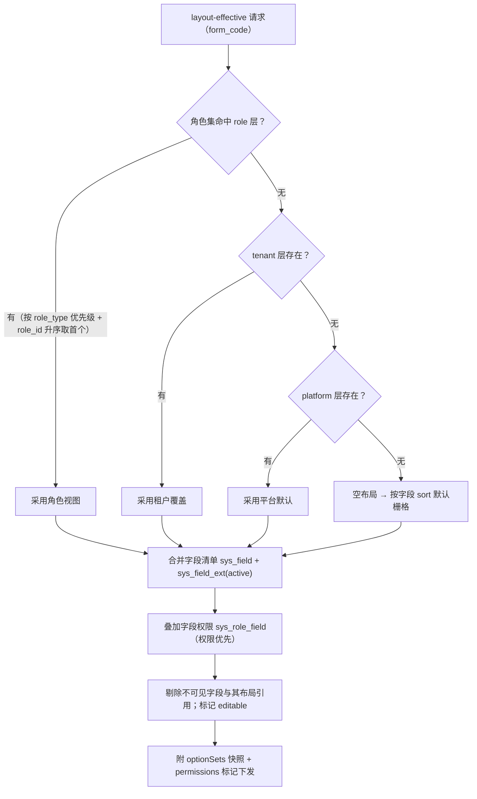

# 表单定制后端详细设计（布局 / 属性 / 动态 DDL / 动态校验）

> 通用能力 · 10 表单定制 · 01 表单定制后端 · 详细设计

[文档首页](../../../../../../文档首页.md) › [08 通用能力](../../../../README.md) › [表单定制](../../10_表单定制.md) › [表单定制后端](../10_表单定制_01_表单定制后端.md) › 详细设计　|　[需求 08-2](../../../../需求/08_需求_工作台与表单定制.md#r08-2) · [阶段计划](../../../../计划/01_计划_通用能力.md)

## 1. 概述 <a id="overview"></a>

- **目标**：把表单的**布局**与**字段属性**从代码下沉为在线配置；为**租户自建字段**提供受控的动态 DDL（`ext_` 前缀、类型白名单、跨四库映射、不走字符串拼接）；为业务新增 / 编辑接口提供**服务端动态校验**；并向导入模板供列。配置读写走同一套**三级解析**（角色视图 → 租户覆盖 → 平台默认 → 空布局回退），**字段权限优先**。
- **依据**：需求 [08-2](../../../../需求/08_需求_工作台与表单定制.md#r08-2)；《[概要设计 · 表单定制](../../../../../../设计/概要设计/36_概要设计_表单定制.md)》§1 / §2 / §4 / §5 / §6 / §7；《[架构设计 · 表单定制](../../../../../../设计/架构设计/30_架构设计_子系统_表单定制.md)》§3 / §4 / §5 / §7 / §9；《[架构设计 · 数据架构](../../../../../../设计/架构设计/07_架构设计_数据架构.md)》「数据分布」「建表策略」；《[数据库设计 · 数据规范](../../../../../../设计/数据库设计/02_数据库设计_数据规范.md)》§3 类型映射；《[数据库开发规范](../../../../../../规范/数据库开发规范.md)》§3 / §4 / §5 / §6；《[后端开发规范](../../../../../../规范/后端开发规范.md)》§3 / §4 / §5 / §7 / §8 / §9 / §10；《[AI 开发规范](../../../../../../规范/AI开发规范.md)》§5 / §7。
- **范围（本任务）**：
  - 新建 `form_design` 业务域：模型 / 仓储 / 服务 / 路由 / 契约；
  - 三张表：`sys_form_layout`（布局）、`sys_form_field_attr`（字段属性）、`sys_field_ext`（租户自建字段）+ i18n 附表 `sys_field_ext_i18n`；
  - 三级解析引擎、字段权限叠加、查询区 / 明细区配置；
  - 动态 DDL（白名单 + 四库映射 + 单租户串行锁 + 失败重试 + 停用不删列）；
  - 服务端动态校验器（必填 / 长度 / 范围 / 正则 / 选项集）+ `users` 试点；
  - 导入模板列派生 + `users` 导入定义接入；
  - 契约快照与前端类型重生成；表文件、总览登记、i18n 台账、域布局、表归属、权限码种子回写。
- **不含**：10_02 前端设计器与渲染器页面（本任务只保证后端契约与既有前端契约同形）；阶段十五页面迁移；12_01 帮助内容；09_01 / 09_02 组件回补与工具栏（已完成）；字典高级查询界面配置的实际消费（`dictAdvanced` 段随布局存取，消费归 02_01 / 组件侧）。

## 2. 现状与差距 <a id="gap"></a>

| # | 关注点 | 现状 | 处置 |
| --- | --- | --- | --- |
| 1 | 布局表 | 表归属登记有 `sys_form_layout`（`planned`，不进链），**无模型、无表文件、无服务** | 本段建：模型 + 表文件 + 服务，表归属转 `enabled` |
| 2 | 自建字段表 | 同上（`sys_field_ext` `planned`） | 本段建 |
| 3 | 字段属性落点 | **不存在**：需求与概要要求在线调整平台字段属性，但概要 §4 只有两张表 | 本段建：新增 `sys_form_field_attr`（见 §5.2 决策 16） |
| 4 | i18n 附表 | `sys_field_ext_i18n` 已在台账登记为待落地 | 本段落地并转「已落地」 |
| 5 | 动态 DDL | **不存在**：全仓无 `ALTER TABLE ADD COLUMN` 执行路径 | 本段建：DDL 服务 + 四库映射 + 串行锁 |
| 6 | 字段类型映射 | `fieldtype.local` 内建 `number=int` / `file=text`，与概要 §4 冲突 | 本段建**表单定制专用映射表**，不动内建（见 §5.3 决策 3） |
| 7 | 动态校验 | **不存在**统一校验器；用户 / 角色各自手写校验 | 本段建：`BaseFormValidator` 能力域 + 真实实现 + `users` 试点 |
| 8 | 导入列派生 | `BaseImportDefinition.columns` 为同步 property，无法查库 | 本段改：加异步钩子 `columns_for(session)`，默认回退（见 §5.7 决策 18） |
| 9 | 业务域 | 两表 `domain=menu_form` | 本段改：新建 `form_design` 域，两表 domain 迁移过去 |
| 10 | 权限码 | 只有 `formdesign:query` 种子 | 本段补 `formdesign:manage` |
| 11 | 错误码 | `404xx` 段全空 | 本段登记 40401~40408 |
| 12 | 前端契约 | `domain/form-layout.ts` 已有完整布局 / 字段属性 / `LayoutEffective` 契约 | 后端响应与之**同形**（字段名 snake_case ↔ camelCase 按契约生成口径） |

## 3. 决策记录 <a id="align"></a>

> 本表为**已逐项确认**的定案（question 工具共 18 项；第 4 项经查证后重问定案，第 16~18 项为设计期发现并确认）。

| # | 事项 | 结论 | 理由 / 长期收益 |
| --- | --- | --- | --- |
| 1 | 表单定位标识 | **业务码 `business.code`** | `sys_form` 1:1 挂 `business_id`，一次查询即得 `form_id` 与字段清单；不新增标识概念 |
| 2 | 自建字段物理表 | **业务码 → 表单清单 `form_key → table` 解析**，失败拒 `40401` | 产品接入零改代码；`sys_field_ext.table_name` 只作巡检冗余，不作判定 |
| 3 | 类型映射来源 | **新增表单定制专用映射表**，不动 `fieldtype` 内建 | 内建映射服务 `dict` 系与既有断言；自建字段按概要 §4 落点，两处互不牵连 |
| 4 | 长文本达梦落点 | **四库统一 `TEXT`** | 查证：达梦 `TEXT` 与 `CLOB` 同类大文本（官方社区「同一类、功能无明显区别」；`LONG` / `LONGVARCHAR` 为 `TEXT` 同义）；本项目 `方言特性/03_DM8.md` 已有 `TEXT → TEXT` 与 02_14 探针实测。业务层只出 `longtext`，方言差异收进映射层 |
| 5 | 角色视图命中 | **`role_type` 内置优先级 + `role_id` 升序** | `platform_admin > system > security > audit > custom`；`sys_role` 无 `sort` 列，不改表 |
| 6 | 权限优先形态 | **剔除字段 + 必填降级** | `visible=false` 从 `fields` 与分区 / 分组 / 查询区 / 明细列一并剔除；`editable=false` 保留并标 `permissions`、服务端不校验其必填 |
| 7 | 动态校验范围 | **通用校验能力 + `users` 试点** | 端到端证明「改了必填接口立刻要求」 |
| 8 | 导入联动范围 | **派生助手 + `users` 导入定义接入** | 完成标准有真实证据 |
| 9 | 接口路径 | **kebab-case `/form-design`** | 与《命名规范》API 资源命名及库内既有 paths 一致 |
| 10 | 布局保存作用域 | **body 带 `scope` + `role_id`** | 单端点覆盖三层级；`platform` 层级额外判平台超管 |
| 11 | 平台默认布局库 | **随开通种子复制到各租户库** | 与概要 §4 一致，读路径零跨库 |
| 12 | 业务域与表归属 | **新建 `form_design` 域，两表 domain 迁过去** | 与 11_01 工作台、09_01 组件同范式 |
| 13 | 数据库设计落点 | **新建 37 节点 + 四张表文件**（含 `sys_form_field_attr`） | 「未登记视为未定稿」 |
| 14 | 缓存与并发 | **缓存域两 key + 分布式锁单租户串行** | 对齐架构 30 §4 / §7，多副本正确 |
| 15 | 测试与覆盖 | **SQLite 真跑 + 四库编译断言 + 新域行分支 100%** | 「DDL 四库一致」有证据 |
| 16 | 字段属性落点 | **新增 `sys_form_field_attr` 表** | 与布局共用三级解析、一次接口返回；「只改属性不动布局」语义清晰；将来加属性项只改 `attrs` JSON 不改表 |
| 17 | 定位列口径 | **`form_code` 业务码字符串** | 与决策 1 一致；渲染路径零跨库；业务码稳定不变 |
| 18 | 导入列派生接入 | **`BaseImportDefinition` 加异步钩子 `columns_for(session)`** | 默认实现返回 `self.columns`，既有定义零改动；导入编排一处收口 |

### 3.1 文档回写清单（由决策派生，随本任务执行） <a id="writeback"></a>

| 落点 | 改写内容 |
| --- | --- |
| 概要 36 §4 | `sys_form_layout.form_id` → `form_code`；补 `sys_form_field_attr` 表行；`longtext` 达梦落点改「四库 TEXT」并附查证依据；`number` / `file` 映射口径补全 |
| 概要 36 §5 | 四组端点路径 `/form_design` → `/form-design`；补 `sys_form_field_attr` 相关端点 |
| 概要 36 §7 | 错误码段位描述按代码实际改写（`402xx` 已用于 MENU_*、`405xx` 已用于 CONFIG_*，本模块用 `404xx`） |
| 架构 30 §3 | 补「角色视图命中 = `role_type` 内置优先级 + `role_id` 升序」判定口径 |
| 架构 30 §4 | 补四库映射完整表；说明与 `fieldtype` 内建的分工 |
| 架构 30 §7 | 表清单补 `sys_form_field_attr`；缓存键补第三 key |
| 数据架构 07 §3.2 | 表清单行补 `sys_form_field_attr` |

## 4. 交付物清单 <a id="tree"></a>

```text
backend/libs/bms_core/src/bms_core/
├── core/
│   ├── error_codes.py                      # 改：40401~40408 + HTTP 状态映射
│   └── exceptions.py                       # 改：FormDesignError 段位基 + 8 个子类
├── models/platform/
│   ├── form_design.py                      # 新：SysFormLayout / SysFormFieldAttr / SysFieldExt / SysFieldExtI18n
│   └── __init__.py                         # 改：模型清单
├── fieldtype/
│   ├── mapping.py                          # 新：自建字段跨四库类型映射表（唯一来源）
│   └── __init__.py                         # 改：出口
├── formdesign/                             # 新：表单定制能力域（横切基座）
│   ├── __init__.py                         # 出口
│   ├── layout.py                           # 新：布局模型归一 / 三级解析 / 权限叠加 / 失效引用
│   ├── attrs.py                            # 新：字段属性归一 / 规则编译 / 默认值
│   ├── validator.py                        # 新：BaseFormValidator 契约 + get_form_validator 提供者
│   ├── local.py                            # 新：LocalFormValidator（真实实现）
│   ├── null.py                             # 新：NullFormValidator（占位）
│   ├── identifier.py                       # 新：标识符白名单（field_key / column_name / 保留字）
│   └── import_columns.py                   # 新：导入模板列派生助手
├── transfer/definition.py                  # 改：BaseImportDefinition.columns_for 异步钩子
├── repositories/i18n.py                    # （复用，不改）
└── tenant/seed/menu.py                     # 改：formdesign:manage 权限码

backend/libs/bms_core/tests/
├── formdesign/
│   ├── test_layout_resolve.py              # 新：三级解析 / 空回退 / 权限叠加 / 失效引用
│   ├── test_attrs_rules.py                 # 新：属性归一 / 规则编译
│   ├── test_identifier.py                  # 新：标识符白名单与注入拒收
│   ├── test_fieldtype_mapping.py           # 新：四库映射编译断言
│   ├── test_validator_local.py             # 新：五类规则 + 占位实现
│   └── test_import_columns.py              # 新：列派生
└── transfer/test_import_definition_columns.py  # 新：columns_for 默认回退

backend/services/platform/src/bms_platform/domains/form_design/   # 新域
├── __init__.py
├── public.py                               # 跨域出口（DTO + Protocol）
├── dto.py                                  # 布局 / 字段 / 属性只读 DTO
├── ports.py                                # 域服务接口（供装配面注入）
├── api/
│   ├── __init__.py
│   ├── layouts.py                          # /form-design/layouts
│   ├── fields.py                           # /form-design/fields
│   └── effective.py                        # /forms/{form_code}/layout-effective + /validate
├── repositories/
│   ├── __init__.py
│   ├── layout.py                           # SysFormLayout / SysFormFieldAttr 仓储
│   └── field_ext.py                        # SysFieldExt / SysFieldExtI18n 仓储
├── schemas/
│   ├── __init__.py
│   ├── layout.py                           # 请求 / 响应模型（layout_config 结构）
│   ├── field.py                            # 自建字段请求 / 响应
│   └── effective.py                        # 生效布局 / 校验请求响应
└── services/
    ├── __init__.py
    ├── layout.py                           # 布局与属性读写 + 三级解析 + 缓存失效 + 事件
    ├── field_ext.py                        # 自建字段生命周期 + DDL 编排 + 重试
    ├── ddl.py                              # DDL 执行器（锁 / 映射 / 参数化编译）
    └── effective.py                        # 渲染路径组装（含选项集快照 / 权限标记）

backend/services/platform/tests/form_design/
├── test_layout_api.py                      # 新：布局 CRUD 与校验（40403）
├── test_field_ext_api.py                   # 新：自建字段 CRUD / DDL / 重试（40401/40402/40404/40405/40406）
├── test_effective_api.py                   # 新：三级解析 / 权限叠加 / 选项集快照
├── test_validate_api.py                    # 新：五类规则端到端
├── test_user_form_validation.py            # 新：users 试点（改了必填接口立刻要求）
├── test_import_columns_derived.py          # 新：users 导入列随布局
└── test_cache_invalidation.py              # 新：布局 / 字段缓存失效

backend/services/platform/src/bms_platform/domains/user/services/users_admin.py  # 改：注入校验器
backend/services/platform/src/bms_platform/domains/user/imports.py              # 改：覆写 columns_for
backend/services/platform/src/bms_platform/wiring.py                            # 改：装配面
backend/services/platform/src/bms_platform/api/router.py                        # 改：挂载
backend/services/platform/src/bms_platform/domains/user/api/users.py            # 改：校验失败分支

deploy/boundaries/domain_layout.json         # 改：加 form_design 域
deploy/contracts/platform.json               # 重生成
frontend/packages/api_types/src/platform.ts  # 重生成
```

## 5. 领域设计 <a id="design"></a>

### 5.1 三张表的职责与定位 <a id="tables"></a>

| 表 | 库类别 | 承载 | 唯一键 |
| --- | --- | --- | --- |
| `sys_form_layout` | 租户库 | 三级布局的 `layout_config`（`main` + `query` + `detail` + `dictAdvanced`） | `(form_code, scope, role_id, deleted_at)` |
| `sys_form_field_attr` | 租户库 | 三级字段属性（`attrs` JSON：必填 / 默认值 / 提示 / 校验 / 组件形态 / 选项集来源 / 只读 / 隐藏） | `(form_code, scope, role_id, field_key, deleted_at)` |
| `sys_field_ext` | 租户库 | 租户自建字段元数据（`field_key` / `type` / `column_name` / `ddl_status` / `option_set_key`） | `(form_code, field_key, deleted_at)`、`(form_code, column_name, deleted_at)` |
| `sys_field_ext_i18n` | 租户库 | 自建字段名多语言附表 | `(field_id, locale, deleted_at)` |

**设计要点**：

- **定位列统一 `form_code`**（业务码），不存 `form_id`：渲染路径零跨库（决策 17）。
- **`role_id = 0` 表示非角色层级**（与 `sys_role_permission.source_menu_id = 0` 同范式，规避唯一约束在 `NULL` 上的跨库语义差异）。
- **`scope`** 取 `platform` / `tenant` / `role`，与前端 `DesignerLevel` 一致。
- `sys_field_ext` **不参与三级解析**：自建字段是「字段定义」层，一旦 `ddl_status = active` 即对所有层级可见；其显示属性走 `sys_form_field_attr`。

### 5.2 布局模型与归一 <a id="layout-model"></a>

`bms_core/formdesign/layout.py`（框架无关纯函数，与前端 `domain/form-layout.ts` 同语义）：

| 函数 / 类型 | 语义 |
| --- | --- |
| `FormLayout` / `LayoutMain` / `LayoutSection` / `LayoutGroup` / `LayoutFieldRef` / `LayoutQuery` / `LayoutDetailColumn` / `LayoutDictAdvanced` | 布局结构（值对象，集合字段落 `ConcurrentStableFrozen*`） |
| `SECTION_COLUMNS = (1, 2, 3)` | 分区列数白名单 |
| `DEFAULT_LAYOUT_COLUMNS = 3` / `DEFAULT_LABEL_WIDTH = 100` / `LABEL_WIDTH_RANGE = (0, 400)` / `DETAIL_WIDTH_RANGE = (40, 800)` | 缺省与夹取区间（与前端常量同值） |
| `DEFAULT_SECTION_KEY = "default"` / `SECTION_KEY_PREFIX = "section-"` | 空布局回退分区键 / 自动建分区前缀 |
| `normalize_layout(raw)` | 缺省项补确定值、非法列数回落 3、宽度夹取、字段引用去重保序、**失败引用不抛错** |
| `normalize_field_refs(refs)` | 剔空键、去重保序、并合 `colSpan` |
| `normalize_detail_columns(cols)` | 兼容裸字符串与 `{key, width}`，去重保序、宽度夹取 |
| `empty_layout()` / `default_layout(fields, columns=3)` | 空布局 / 按字段 `sort` 生成默认栅格（跳过停用与建列失败） |
| `is_layout_empty(layout)` | 无有效分区或全部分区无字段引用 |
| `collect_field_keys(layout)` | 主表 + 查询区 + 明细区 + 字典高级查询的引用键（去重保序） |
| `find_unknown_fields` / `find_disabled_fields` / `find_duplicate_fields` | 失效 / 停用 / 重复引用（保存期只告警、渲染期跳过） |
| `validate_layout(layout, fields)` | 汇总校验问题（`unknown-field` / `disabled-field` / `duplicate-field` / `empty-section`） |

**装载容错**（与前端一致，避免配置漂移导致页面白屏）：

- 裸字符串字段引用 → `{key}`；`colspan` 与 `colSpan` 两种写法都认；
- 分区缺 `key` → `section-{序号}`；分组缺 `key` → `section-{序号}-g{分组序号}`；
- `columns` 非法（0 / 4 / 字符串数字以外）→ 回落 3；
- 字段引用为空串 / `null` → 剔除，不报错。

### 5.3 字段属性模型与规则编译 <a id="attrs"></a>

`bms_core/formdesign/attrs.py`：

| 类型 | 字段 / 语义 |
| --- | --- |
| `FieldRule` | `kind`（`required` / `length` / `range` / `pattern` / `options`）/ `min` / `max` / `pattern` / `message` |
| `FieldAttrs` | `required` / `placeholder` / `default_value` / `rules` / `option_set_key` / `widget` / `readonly` / `hidden` / `upload_accept` / `upload_max_size` / `upload_limit` / `upload_multiple` |
| `normalize_attrs(raw)` | 缺省项补空、未知键丢弃、规则按 `kind` 白名单过滤 |
| `compile_rules(attrs, field_type)` | 属性 → 可执行规则集（`required` 合并显式规则；`option` / `option_multi` 必有 `options` 规则） |
| `resolve_default(attrs)` | 默认值（记录未提供该字段值时使用） |

**属性合法性校验**（保存期，失败 `40408`）：

| 检查 | 规则 |
| --- | --- |
| `prompt` / `placeholder` 长度 | ≤ 255 |
| `length.min` / `length.max` | 整数 ≥ 0，`min ≤ max` |
| `range.min` / `range.max` | 数值，`min ≤ max` |
| `pattern` | `re.compile` 可编译；长度 ≤ 512；**禁止回溯爆炸写法**（嵌套量词 `(a+)+` 等按简单扫描拒收） |
| `required` / `readonly` / `hidden` | 布尔 |
| `option_set_key` | `option` / `option_multi` 必填；须在选项集注册表**已登记**（`40408`）；非枚举类型不得带 |
| `default_value` | 落在值域内（枚举取选项集 `value`；数字在 `range` 内；文本长度在 `length` 内） |

### 5.4 三级解析引擎 <a id="resolve"></a>

`bms_core/formdesign/layout.py` + `service/effective.py`：



**逐项口径**：

1. **候选层级**：按 `scope` 取该 `form_code` 下三层的行；`role` 层按决策 5 的排序取**首个存在且非空的布局**（若该角色布局存在但为空布局，继续尝试下一个角色，避免「空配置锁死」）。
2. **空布局回退**：三层皆无（或皆空）→ `default_layout(fields)`，`source = "empty"`、`fallback = true`。
3. **字段合并**：平台字段（`sys_field`，平台库，按 `form_code → form_id` 取）合并自建字段（`sys_field_ext`，仅 `status=enabled ∧ ddl_status=active`），按 `sort` 升序、同序按 `field_key` 升序稳定排序。
4. **字段属性叠加**：三层属性与布局**同层同源**（选了哪个层的布局，就用哪个层的属性）；该层无属性配置的字段用平台字段类型默认属性。
5. **权限优先**（决策 6）：
   - `visible=false`：从 `fields` 移除；从 `main.sections[].fields`、`groups[].fields`、`query.fields`、`detail.columns`、`dictAdvanced.fields/columns` 一并剔除；
   - `editable=false`：字段保留，`permissions[key].editable = false`；**服务端动态校验不校验其必填**（写时拒绝该字段本就走权限校验）；
   - `required`（字段权限上的必填）：作为**上限**——字段权限要求必填而属性未标必填时，取必填；反之属性标必填而权限放开，仍按属性。
6. **选项集快照**：仅当表单存在 `option` / `option_multi` 字段时，按 `option_set_key` 去重解析并下发 `optionSets`（`{optionSetKey, items[]}`），**零额外请求**。
7. **只读判定**：`readonly = (level == "platform")`；渲染路径恒 `true`（渲染不编辑布局）。

### 5.5 动态 DDL <a id="ddl"></a>

#### 5.5.1 四库类型映射（唯一来源：`bms_core/fieldtype/mapping.py`） <a id="type-mapping"></a>

| 字段类型 | 逻辑类型 | SQLite | MySQL 8 | PostgreSQL 16 | 达梦 DM8 |
| --- | --- | --- | --- | --- | --- |
| `text` | `VARCHAR(255)` | VARCHAR(255) | VARCHAR(255) | VARCHAR(255) | VARCHAR2(255 CHAR) |
| `longtext` | `TEXT` | TEXT | TEXT | TEXT | TEXT |
| `number` | `DECIMAL(18,4)` | NUMERIC(18,4) | NUMERIC(18,4) | NUMERIC(18,4) | NUMERIC(18,4) |
| `datetime` | `TIMESTAMP`（naive UTC） | DATETIME | DATETIME | TIMESTAMP WITHOUT TIME ZONE | DATETIME |
| `option` | `VARCHAR(64)` | VARCHAR(64) | VARCHAR(64) | VARCHAR(64) | VARCHAR2(64 CHAR) |
| `option_multi` | `TEXT`（逗号分隔） | TEXT | TEXT | TEXT | TEXT |
| `switch` | `SMALLINT` | SMALLINT | SMALLINT | SMALLINT | SMALLINT |
| `file` | `VARCHAR(255)`（存文件 ID） | VARCHAR(255) | VARCHAR(255) | VARCHAR(255) | VARCHAR2(255 CHAR) |

- **实现方式**：映射表返回 **SQLAlchemy 类型对象**（`String(255)` / `Text` / `Numeric(18, 4)` / `DateTime` / `SmallInteger`），**不返回类型字符串**——DDL 由 SQLAlchemy 按方言编译，达梦的 `VARCHAR2(n CHAR)` 等差异自然落地。
- **与 `fieldtype` 内建的分工**：内建（`SimpleFieldType`）继续服务 `dict` / `dict_multi` 与既有契约；自建字段只用本映射表。两表差异（`number` / `file`）在设计文档登记，不改内建（决策 3）。
- **实测依据**：`tmp/ddl_probe2.py` 四库 `AddColumn.compile` 全部通过，输出见 §10 验证。

#### 5.5.2 DDL 执行器 <a id="ddl-exec"></a>

`service/ddl.py`：

| 步 | 动作 | 失败处置 |
| --- | --- | --- |
| 1 | **标识符白名单校验**（`formdesign/identifier.py`）：表名 `^[a-z][a-z0-9_]{0,63}$` 且在表单清单内；列名 `^ext_[a-z][a-z0-9_]{0,59}$`；`field_key` `^[a-z][a-z0-9_]{0,59}$`；拒绝 SQL 保留字 | `40404`（字段类型非法）/ `40402`（key 重复）/ 参数错 `10001` |
| 2 | **元数据先行**：写 `sys_field_ext`（`ddl_status=pending`），**提交后**才执行 DDL | — |
| 3 | **单租户串行**：`build_lock_key(tenant, f"formddl:{table_name}")` 经 `BaseDistributedLock.hold`，TTL 30s、等待 5s | 未取到锁 `10004`（409，可重试） |
| 4 | **列存在性探测**：`inspect(connection).get_columns(table)`，已存在且元数据无对应行 → `40406` | — |
| 5 | **参数化 DDL 编译**：`AddColumn(table_name, Column(column_name, type_obj, nullable=True, comment=...))` + `str(...compile(dialect=...))`，经 `session.execute(text(sql))` —— **全程不拼字符串** | 执行异常 `40405` |
| 6 | 成功：`ddl_status = active` + 清字段缓存 + 发 `sys.form.updated` | — |
| 7 | 失败：`ddl_status = failed` + 记日志（含异常类型）+ 告警，**不影响其它字段** | — |

**重试**（`POST /form-design/fields/{id}/retry`）：复用同一元数据与列名，重走 3~7 步。

**停用不删列**：`PUT /form-design/fields/{id}` 置 `status=disabled`；不生成 `DROP COLUMN`（合规销毁走归档链路）。

**重建复用列**：同 `form_code` 下 `field_key` 与被停用字段同名时，若 `column_name` 一致则复用其物理列（元数据恢复为 `active`），否则 `40406`。

### 5.6 服务端动态校验 <a id="validate"></a>

`bms_core/formdesign/validator.py`（能力域：端口 + 注册表 + 提供者，对齐《后端开发规范》§3.1「能力实现必须走基座」）：

| 层 | 名称 | 职责 |
| --- | --- | --- |
| 能力基类 | `BaseFormValidator`（`key = plugin_key = "form_validator"`） | 抽象 `validate(form_code, values, *, fields=None)` → `ValidationResult` |
| 真实实现 | `LocalFormValidator`（插件名 `local`） | 从缓存 / 库读生效布局与属性 → 编译规则 → 逐字段校验 |
| 占位实现 | `NullFormValidator`（插件名 `null`） | 恒定通过（无配置时保持原接口行为） |
| 提供者 | `get_form_validator(request)` | 按 `[form_validator].provider` 解析（缺省 `local`） |

**校验顺序与失败契约**：

1. **类型级**：值类型与字段类型匹配（复用 `fieldtype` 注册表的 `validate`）；
2. **规则级**：`required`（`editable=false` 的字段跳过）→ `length` → `range` → `pattern` → `options`；
3. **结果**：`ValidationResult{valid, errors: [{field_key, rule, message}]}`；接口层转 `ParamError`（`10001`）并**带字段级明细**在 `data` 里；文案走 i18n（后端只给 `rule` 与 `field_key`，不拼中文）。

**`users` 试点接入方式**（不改接口签名）：

- `users_admin.create_user` / `update_user` 增可选参数 `validator: BaseFormValidator | None`，在**事务内、写库前**调用 `await validator.validate("user", values)`（`form_code = "user"`，与表单清单的业务码一致）；
- 装配面 `wiring.py` 构造服务时注入（域实现只持 Protocol，依赖方向「装配 → 域」）；
- `None` 时跳过（既有用例零改动）。

### 5.7 导入模板列派生 <a id="import"></a>

`bms_core/formdesign/import_columns.py` + `BaseImportDefinition.columns_for`（决策 18）：

```python
class BaseImportDefinition(...):
    @property
    @abstractmethod
    def columns(self) -> ConcurrentStableFrozenList[ColumnSpec]: ...

    async def columns_for(self, session: DbSession) -> ConcurrentStableFrozenList[ColumnSpec]:
        """按布局派生的列集（缺省回退静态列集；覆写者按 form_code 派生）。"""
        del session
        return self.columns
```

- **编排侧**：`imports.py` 中 `build_template(definition.columns)` 与 `parse_rows(..., columns=definition.columns)` 改为 `await definition.columns_for(session)`（同步内联与异步作业同源）。
- **派生规则**（`derive_import_columns(session, form_code, base_columns)`）：
  1. 取生效布局的属性层与字段清单，按**布局主表字段顺序**排列（`main` 分区 → 分组内的字段引用序）；
  2. 平台字段沿用 `base_columns` 的列规格（标题 / 必填 / 类型）并叠加属性层 `required` / `placeholder`；
  3. 自建字段（`active`）追加：`key = field_key`、`title = 字段名（当前 locale）`、`required = 属性必填`、`type` 按映射；
  4. 布局未引用但 `base_columns` 存在的列：保留在末尾（不丢数据，向后兼容）；
  5. 布局引用但 `base_columns` 无的平台字段：追加（配置新增字段即为导入新增列）。
- **校验一致**：导入行校验复用同一 `BaseFormValidator`，规则与表单一致。
- **`users` 定义**：`UserImportDefinition.columns_for` 覆写为 `derive_import_columns(session, "user", self.columns)`；无布局配置时派生结果等于原列集（用例断言）。

### 5.8 缓存与失效 <a id="cache"></a>

| key | 内容 | TTL | 失效时机 |
| --- | --- | --- | --- |
| `bms:{tenant}:form:layout:{form_code}` | 该表单三层布局 + 三层属性（一次装载） | 300s + 随机偏移 | 布局保存 / 删除、属性保存、平台默认重播种 |
| `bms:{tenant}:form:fields:{form_code}` | 合并字段清单（平台 + 自建 `active`） | 300s + 随机偏移 | 自建字段建 / 改 / 停用、DDL 成功、平台字段变更 |
| `bms:{tenant}:form:version` | 表单域版本号（`INCR`） | 持久 | 任一写路径 |

- 口径：**先写库后删缓存**（《架构设计 · 数据架构》§5.2）；载荷带版本号，读路径版本不一致即视为未命中回源（多实例「改完即生效」由版本比对保证，TTL 只兜底）。
- 缓存不可用：降级直连库（只是慢，语义不变），记 warning，不阻断写。

### 5.9 事件与审计 <a id="events"></a>

- **事件**：布局 / 属性 / 自建字段变更在**写事务内**经事务性发件箱发 `sys.form.updated`（载荷 `form_id` / `menu_id` / `business_id` / `changed_type`，`changed_type` 取 `layout` / `attr` / `ext_field`）；聚合键 `form:{form_code}`。事件契约已登记，**不新增事件类型**。
- **审计**：三表写操作接 `AuditCapturer`（字段级审计，随 06_02 既有 ORM 捕获）；`sys_form_layout` / `sys_form_field_attr` / `sys_field_ext` 登记为关键表（与 06_02 的三层白名单口径一致，登记在实施记录 §偏差）。

### 5.10 与既有模块的协作面 <a id="coordination"></a>

| 消费方 / 提供方 | 关系 | 出口 |
| --- | --- | --- |
| `menu_form` 域（平台库 `sys_form` / `sys_field` / `sys_business`） | 本域**读**平台字段与业务码，**不写** | 经装配面注入的只读仓储（`FormRepository` / `FieldRepository` / `BusinessRepository`），域实现只持 Protocol |
| `sys_role_field` 字段权限 | 本域**读**收窄项做叠加 | 经装配面注入的 `BaseFieldPermissionProvider`（`47` 既有） |
| 选项集注册表 | 本域**读**解析快照与校验 `option_set_key` | `get_option_set_registry` |
| 字段类型注册表 | 本域**读**类型级校验 | `get_field_type_registry` |
| `user` 域（本服务内） | 本域**被**用户服务调用做动态校验；导入定义覆写列派生 | 装配面注入 `BaseFormValidator` + `derive_import_columns` |
| 导入导出基座（04_01） | 本域**改**其 `columns_for` 钩子 | `bms_core/transfer/definition.py` |
| 数据访问与分片 | DDL 按当前租户库会话执行 | 请求级会话（`get_uow` / `session_scope`） |

## 6. 接口契约 <a id="contract"></a>

前缀 `/api/v1`，统一响应 `{code, message, data}`。

### 6.1 管理面（`formdesign:manage`） <a id="api-manage"></a>

| 方法 | 路径 | 说明 | 主要字段 |
| --- | --- | --- | --- |
| GET | `/form-design/layouts?form_code=` | 三层布局 + 三层属性 + 合并字段清单 | `form_code`（必填） |
| PUT | `/form-design/layouts` | 保存某层级布局（整份覆盖） | `form_code` / `scope` / `role_id` / `layout_config` |
| DELETE | `/form-design/layouts/{id}` | 删除某层级布局（恢复默认回退下一级） | — |
| GET | `/form-design/attrs?form_code=` | 三层字段属性 | `form_code` |
| PUT | `/form-design/attrs` | 保存某层级字段属性（整份覆盖） | `form_code` / `scope` / `role_id` / `fields[]`（`field_key` + `attrs`） |
| DELETE | `/form-design/attrs/{id}` | 删除某字段属性行 | — |
| GET | `/form-design/fields?form_code=` | 自建字段列表（含 `ddl_status`） | `form_code` / `status` |
| POST | `/form-design/fields` | 新建自建字段（触发 DDL） | `form_code` / `field_key` / `name`（i18n 映射）/ `type` / `option_set_key` |
| PUT | `/form-design/fields/{id}` | 编辑 / 停用（不删列） | `name` / `status` / `option_set_key` / `sort` |
| POST | `/form-design/fields/{id}/retry` | DDL 失败重试 | — |

### 6.2 渲染路径（登录即可） <a id="api-render"></a>

| 方法 | 路径 | 说明 |
| --- | --- | --- |
| GET | `/forms/{form_code}/layout-effective` | 当前用户生效布局 + 合并字段清单 + 权限标记 + `optionSets` 快照 + `source` / `fallback` |
| POST | `/forms/{form_code}/validate` | 动态校验自测端点（入参字段值，返回字段级错误；供调用方与服务端同源验证） |

### 6.3 `layout-effective` 响应形态（与前端 `LayoutEffective` 同形） <a id="effective-shape"></a>

| 字段 | 类型 | 说明 |
| --- | --- | --- |
| `layout` | object | `{main: {labelPosition, labelWidth?, sections[]}, query?, detail?, dictAdvanced?}` |
| `fields` | array | `{key, label, type, group, required?, placeholder?, defaultValue?, rules?, optionSetKey?, widget?, readonly?, hidden?, disabled?, status?}` |
| `level` | string | 请求层级（渲染路径恒 `tenant`） |
| `source` | string | `role` / `tenant` / `platform` / `empty` |
| `readonly` | bool | 渲染路径恒 true |
| `fallback` | bool | 是否走空布局回退 |
| `optionSets` | array? | `[{optionSetKey, items[]}]`，仅枚举字段存在时下发 |
| `permissions` | object? | `{fieldKey: {visible, editable, required?}}`（仅收窄项） |

**键名口径**：契约 JSON 用 snake_case（`option_set_key` / `default_value` / `label_position` / `label_width`），前端类型生成器按既有约定转 camelCase（与 `domain/form-layout.ts` 的 `optionSetKey` / `defaultValue` / `labelPosition` / `labelWidth` 对齐）；`layout_config` 内部结构保持与设计器产出**逐字相同**（`labelPosition` / `colSpan` / `dictAdvanced` 为既有 camelCase 键，不转换）。

### 6.4 错误码（`404xx` 段） <a id="errors"></a>

| 码 | 名称 | HTTP | 场景 |
| --- | --- | --- | --- |
| 40401 | `FORM_NOT_CUSTOMIZABLE` | 404 | 表单不存在 / 不可定制 / 物理表不可解析 / 平台库表 / 分片表 |
| 40402 | `FORM_FIELD_KEY_CONFLICT` | 200 | 字段 key 与平台字段或既有自建字段冲突 |
| 40403 | `FORM_LAYOUT_INVALID` | 200 | 布局结构非法（列数、分区结构、字段引用格式） |
| 40404 | `FORM_FIELD_TYPE_INVALID` | 200 | 字段类型不在白名单（含富文本等未放开类型） |
| 40405 | `FORM_DDL_FAILED` | 200 | DDL 执行异常（锁冲突以外的连接 / 权限 / 语法），可重试 |
| 40406 | `FORM_COLUMN_CONFLICT` | 200 | 物理列已存在且元数据不一致 |
| 40407 | `FORM_FIELD_DISABLED_REFERENCED` | 200 | 布局引用已停用 / 建列失败的自建字段 |
| 40408 | `FORM_ATTR_INVALID` | 200 | 属性校验规则非法 / 选项集标识未注册 / 默认值不在值域 |

## 7. 失败分支与边界 <a id="failures"></a>

| 场景 | 处置 | 结果 |
| --- | --- | --- |
| 表单不存在 / 平台库表 / 分片表 | `40401` | 拒绝定制 |
| 业务码无法解析物理表（未登记 `form_key`） | `40401` | 拒绝建列 |
| `field_key` 含大写 / 空格 / 引号 / 分号 / 注释符 / 超长 / 保留字 | 参数错 `10001` | 登记期即拒（注入用例覆盖） |
| 类型不在白名单（含 `richtext`） | `40404` | 拒绝 |
| DDL 并发（同租户同表） | 锁等待超时 `10004`（409，可重试） | 不产生半套列 |
| DDL 执行失败 | `ddl_status=failed` + `40405` + 日志告警 | 其它字段不受影响；可重试 |
| 同名列已存在且无元数据 | `40406` | 拒绝，不动既有列 |
| 布局引用停用字段 | **保存期告警不阻断**（`validate_layout` 返回问题清单，接口以 `warnings` 附回）；**渲染期跳过** | 不阻断页面 |
| 布局引用失效字段 | 同上 | 渲染自动跳过并提示清理 |
| 属性 `pattern` 非法正则 | `40408` | 拒绝保存 |
| 属性 `option_set_key` 未注册 | `40408` | 拒绝保存 |
| 缓存不可用 | 降级直连库 + warning | 语义不变，仅变慢 |
| 分布式锁不可用（Redis 挂） | fail-closed `10012`（503） | 不执行 DDL（宁可不建，不建半套） |
| 校验失败 | `10001` + `data.errors[]`（`field_key` + `rule`） | 字段级错误，文案走 i18n |
| 无布局配置（全新表单） | 空布局回退默认栅格 | 与既有表单页行为一致，不报错 |
| 字段权限 `visible=false` | 剔字段 + 剔布局引用 | 「无权限字段不下发」成立 |
| 字段权限 `editable=false` | 保留字段 + 标 `permissions` + 跳过必填校验 | 写时由权限校验拒绝 |
| 导入无布局配置 | `columns_for` 回退静态列集 | 既有导入行为零变化 |
| 导入时自建字段为 `pending` / `failed` | 不进列集（只取 `active`） | 未生效字段不污染模板 |

## 8. 测试设计与验收映射 <a id="tests"></a>

**Kiwi**：登记 1 条用例（分类「平台骨架」、`P2`、`CONFIRMED`、标签「自动化」），覆盖下表；代码标注同一编号（`@pytest.mark.kiwi_id(<编号>)`）。

| # | 验收项（任务书 §3 / 需求 08-2） | 用例文件 | 断言要点 |
| --- | --- | --- | --- |
| 1 | 两角色视图下发不同布局 | `test_effective_api.py` | 两个角色各自布局；角色集命中按 `role_type` 优先级 + `role_id` 升序 |
| 2 | 三级回退（角色→租户→平台→空） | `test_layout_resolve.py` + `test_effective_api.py` | 逐级删除后回退正确；`source` / `fallback` 准确 |
| 3 | 空布局回退默认栅格 | `test_layout_resolve.py` | `default_layout` 按 `sort`、跳过停用与建列失败 |
| 4 | 无字段权限的字段不下发 | `test_effective_api.py` | `visible=false` 从 `fields` 与分区 / 分组 / 查询区 / 明细列一并消失 |
| 5 | `editable=false` 保留并标记 | 同上 | `permissions` 标记；必填校验跳过 |
| 6 | 布局要素全可配 | `test_layout_api.py` | 分区 / 分组 / 1-3 列 / 跨列 / 顺序 / 标签宽；查询区分列；明细列宽夹取 |
| 7 | 布局结构非法 | `test_layout_api.py` | `40403`（列数、分区结构） |
| 8 | 字段属性保存与生效 | `test_attrs_rules.py` + `test_validate_api.py` | 必填 / 长度 / 范围 / 正则 / 选项集 |
| 9 | 属性非法 | `test_attrs_rules.py` | `40408`（正则非法、选项集未注册、默认值越域） |
| 10 | 自建字段登记 | `test_field_ext_api.py` | `field_key` 冲突 `40402`；类型非法 `40404`；表单不可定制 `40401` |
| 11 | DDL 真建列（SQLite） | `test_field_ext_api.py` | 建列后 `inspect` 可查到 `ext_*`；`ddl_status=active` |
| 12 | DDL 四库一致 | `test_fieldtype_mapping.py` | 8 类型 × 4 方言 `AddColumn.compile` 逐字断言 |
| 13 | DDL 失败与重试 | `test_field_ext_api.py` | `failed` → retry → `active`；其它字段不受影响 |
| 14 | 停用不删列 / 重建复用 | 同上 | 停用后列仍在；同名重建复用列 |
| 15 | 列冲突 | 同上 | `40406` |
| 16 | 标识符注入拒收 | `test_identifier.py` | 引号 / 分号 / 注释符 / 空格 / 大写 / 超长 / 保留字 全部拒 |
| 17 | 改了必填接口立刻要求 | `test_user_form_validation.py` | 保存属性后 `POST /users` 缺该字段即 `10001` 且 `data.errors[]` 带 `field_key` |
| 18 | 校验五类规则端到端 | `test_validate_api.py` | 必填 / 长度 / 范围 / 正则 / 选项集各一正一反 |
| 19 | 导入模板列与布局一致 | `test_import_columns_derived.py` | 派生列序 = 布局字段序；自建 `active` 追加；无配置时等于原列集 |
| 20 | 缓存失效即时生效 | `test_cache_invalidation.py` | 保存后下一请求读到新值；版本键 `INCR` |
| 21 | 事件发布 | `test_layout_api.py` + `test_field_ext_api.py` | 写事务内 `sys.form.updated`，`changed_type` 正确 |
| 22 | `columns_for` 默认回退 | `transfer/test_import_definition_columns.py` | 默认实现返回 `self.columns`；既有定义零改动 |
| 23 | 占位实现 | `test_validator_local.py` | `NullFormValidator` 恒定通过；`local` 五类规则 |

**覆盖率**：新域模块（`bms_core.formdesign.*`、`bms_platform.domains.form_design.*`、`bms_core.fieldtype.mapping`）按包级 100%（行 + 分支）；改动模块（`transfer.definition`、`users_admin`、`user.imports`、`error_codes`）按推送环模块级 100% 复核。

**原型对照**：本任务**无界面改动**（前端页面归 10_02），按《AI 开发规范》§7「界面先原型」口径登记「不适用：本任务不含界面源码变更」；`check_prototype_review.py` 因变更集不含前端界面源码而不触发。

## 9. 登记落点 <a id="registry-writeback"></a>

| 落点 | 内容 |
| --- | --- |
| 《后端基类清单》 | 新增能力域 `form_validator`（`BaseFormValidator` / `LocalFormValidator` / `NullFormValidator` / `get_form_validator`）；`bms_core/formdesign` 领域纯函数清单；`fieldtype/mapping.py` 落点 |
| 《后端开发规范》§3.1 | 补「表单动态校验必须走 `BaseFormValidator`」强制条 |
| 数据库设计 37 节点 | 新建 `37_数据库设计_表单定制.md` |
| 数据表文件 | `sys_form_layout.md` / `sys_form_field_attr.md` / `sys_field_ext.md` / `sys_field_ext_i18n.md` |
| 数据库设计总览 | 三表登记（`sys_field_ext_i18n` 计入附表行）+ §7.2 节点 37 覆盖表补 `sys_form_field_attr` |
| i18n 台账（`bms_core/i18n/attachments.py`） | `sys_field_ext_i18n` 由 `ATTACHMENT_PENDING` → 已落地 |
| `bms_core/services/table_registry.py` | 两表 `TableStatus.PLANNED` → `ENABLED`；`domain` 由 `menu_form` → `form_design`；新增 `sys_form_field_attr` 行 |
| `deploy/boundaries/domain_layout.json` | 新增 `form_design` 域（`service_key=platform`，路径 `domains/form_design/**/*.py` + 模型文件，`public_api`） |
| `bms_core/tenant/seed/menu.py` | 补 `("formdesign", "manage", "管理（含查询与维护）", "Manage")` |
| `bms_core/core/error_codes.py` | 40401~40408 + `ERROR_CODE_HTTP_STATUS` |
| `deploy/contracts/platform.json` | 重生成 |
| `frontend/packages/api_types/src/platform.ts` | 重生成 |
| 概要 36 §4 / §5 / §7、架构 30 §3 / §4 / §7、数据架构 07 §3.2 | 见 §3.1 回写清单 |
| 阶段计划 §2 / §3 / §5 / §7 | 10_01 任务状态与门禁行结论；后续待办（进度以计划为准，本文不承载） |
| 任务书 10_01 | 交付注块（不承载进度） |
| 需求 08-2 | 交付注块（不承载进度） |
| 任务目录 | 实施记录 + 测试记录 |

## 10. 实施步骤 <a id="steps"></a>

1. **数据库设计先行**：37 节点 + 四张表文件 + 总览登记（含 i18n 附表行）。
2. **表归属与域**：`table_registry` 两表转 `enabled` 并改 `domain`、新增 `sys_form_field_attr`；`domain_layout.json` 加 `form_design` 域。
3. **错误码与异常**：`error_codes.py` + `exceptions.py` 段位基与 8 子类 + 双源护栏用例。
4. **模型**：`models/platform/form_design.py` 四模型 + 模型清单；`ensure_service_schema` 建表验证。
5. **纯函数层**：`formdesign/layout.py` / `attrs.py` / `identifier.py` / `fieldtype/mapping.py` + 单测。
6. **校验能力域**：`formdesign/validator.py` / `local.py` / `null.py` + 插件注册 + 配置段 `[form_validator]` + 单测。
7. **导入钩子**：`transfer/definition.py` 加 `columns_for` + 编排改调 + `formdesign/import_columns.py` + 单测。
8. **域骨架**：`domains/form_design/` 的 `dto` / `ports` / `public` / `repositories` / `services` / `schemas` / `api`。
9. **布局与属性服务**：三级解析 + 权限叠加 + 缓存 + 事件 + 路由。
10. **自建字段与 DDL**：生命周期 + 执行器 + 重试 + 路由。
11. **渲染路径**：`layout-effective` + `validate` + 选项集快照。
12. **`users` 试点**：`users_admin` 注入校验器 + `user/imports.py` 覆写 `columns_for` + 装配面。
13. **契约**：`contract_snapshot export` + `api_types` 重生成。
14. **Kiwi**：登记取号 → 回填代码标注。
15. **测试与覆盖率**：单文件用例 → `coverage_report.py --module`。
16. **文档回写**：§3.1 清单 + 计划 + 任务书注块 + 实施 / 测试记录。
17. **校验**：`engkit links` / `docs-scope` / `eol` + 提交前预检全文落盘阅读。
18. **提交**：`feat(通用能力)` → `docs(通用能力)`，不推送。

## 11. 边界与开放项 <a id="open"></a>

| # | 事项 | 处置 |
| --- | --- | --- |
| 1 | 真库（MySQL / PG / DM8）DDL 执行 | 本轮 SQLite 真跑 + 四库编译断言；真库执行登记部署窗口（计划 §7） |
| 2 | 平台默认布局重播种 | 随租户开通种子复制；已开通租户改平台默认不自动回填，登记为已知口径（避免越权改租户库） |
| 3 | 自建富文本字段 | 不放开（`sys_field_ext.type` 白名单不含 `richtext`），需单独评估 DDL 列类型与清洗口径 |
| 4 | 字典高级查询界面配置 | `dictAdvanced` 段随布局存取；实际消费归 02_01 / 组件侧 |
| 5 | 字段属性 `attrs` JSON 的键集合演进 | 只增不删；未知键读时丢弃、写时拒收（`40408`） |
| 6 | 自建字段数据回填 | 不提供（新列默认 `NULL`）；如需批量赋值走导入 |
| 7 | DDL 失败的自动重试任务 | 本轮只做手动 `retry`；定时重试登记计划 §7（依赖 01_02 任务调度） |
| 8 | 移动端 | 同契约另实现（10_02 / 阶段十五） |
| 9 | 前端设计器与渲染器页面 | 10_02；本轮只保证契约同形 |

## 12. 参考文档 <a id="ref"></a>

- 需求 [08-2](../../../../需求/08_需求_工作台与表单定制.md#r08-2)
- 《[概要设计 · 表单定制](../../../../../../设计/概要设计/36_概要设计_表单定制.md)》§1 / §2 / §4 / §5 / §6 / §7 / §8
- 《[架构设计 · 表单定制](../../../../../../设计/架构设计/30_架构设计_子系统_表单定制.md)》§3 / §4 / §5 / §7 / §9
- 《[架构设计 · 数据架构](../../../../../../设计/架构设计/07_架构设计_数据架构.md)》§2 / §3.2 / §5 / §6
- 《[数据库设计 · 数据规范](../../../../../../设计/数据库设计/02_数据库设计_数据规范.md)》§3 / §5 / §8
- 《[数据库设计 · 方言特性 · 达梦](../../../../../../设计/数据库设计/方言特性/03_DM8.md)》
- 《[数据库开发规范](../../../../../../规范/数据库开发规范.md)》§3 / §4 / §5 / §6；《[后端开发规范](../../../../../../规范/后端开发规范.md)》§3 / §4 / §7 / §8 / §9 / §10；《[AI 开发规范](../../../../../../规范/AI开发规范.md)》§5 / §7
- 《[测试规范](../../../../../../规范/测试规范.md)》§2 / §5 / §6 / §7
- 前端契约：`frontend/packages/core/src/domain/form-layout.ts`、`domain/form-render.ts`、`capabilities/form-designer.ts`

> 详细设计 · 依《[文档生成规范](../../../../../../规范/文档生成规范.md)》编写 · 进度以[阶段计划](../../../../计划/01_计划_通用能力.md)为唯一落点
