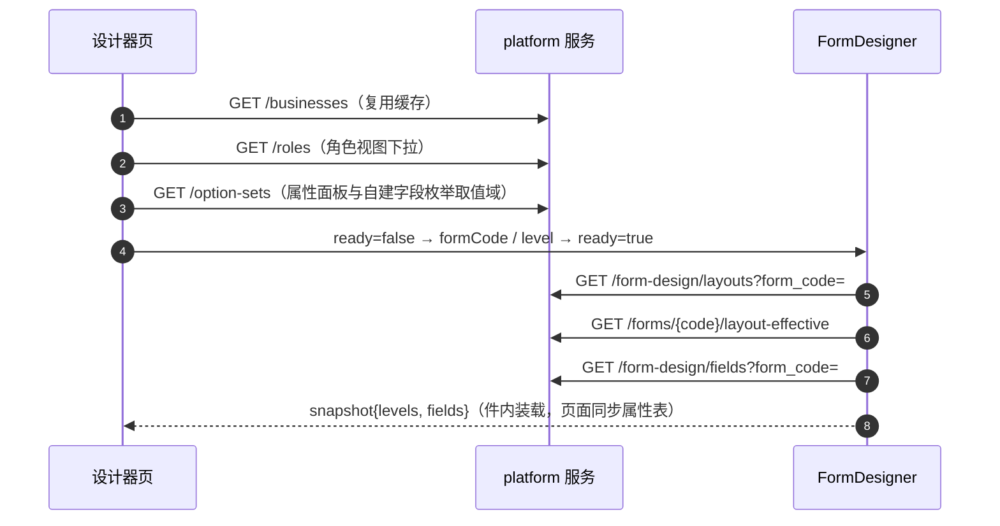

# 表单定制前端详细设计（设计器 / 渲染器 / 查询区与明细列消费）

> 通用能力 · 10 表单定制 · 02 表单定制前端 · 详细设计

[文档首页](../../../../../../文档首页.md) › [08 通用能力](../../../../README.md) › [表单定制](../../10_表单定制.md) › [表单定制前端](../10_表单定制_02_表单定制前端.md) ｜ [需求 08-2](../../../../需求/08_需求_工作台与表单定制.md#r08-2) · [阶段计划](../../../../计划/01_计划_通用能力.md)

## 1. 概述 <a id="overview"></a>

- **目标**：把 10_01 已交付的 `form_design` 后端能力接成**可用界面**——在线设计表单布局与字段属性、新建租户自建字段（动态建列）、按生效布局渲染表单，并让列表页查询区与明细列能按布局配置生成。设计器与渲染器**共用同一份布局模型**（`domain/form-layout`），做到「所见即所得」。
- **依据**：需求 [08-2](../../../../需求/08_需求_工作台与表单定制.md#r08-2)；《[概要设计 · 表单定制](../../../../../../设计/概要设计/36_概要设计_表单定制.md)》§2 / §5 / §7；《[布局设计 · 表单定制](../../../../../../设计/布局设计/14_布局设计_表单定制.html)》§3 ~ §8；《[组件设计 · 表单设计器](../../../../../../设计/组件设计/08_交互类/05_组件设计_表单设计器/05_组件设计_表单设计器.md)》§2 / §5 / §6；《[前端开发规范](../../../../../../规范/前端开发规范.md)》§3 / §4；《[AI 开发规范](../../../../../../规范/AI开发规范.md)》§5 / §7。
- **原型基准**：[表单设计器](../../../../../../设计/原型设计/07_表单定制/02_表单设计器.html)、[新建自定义字段](../../../../../../设计/原型设计/07_表单定制/03_新建自定义字段.html)。
- **范围（本任务）**：
  - 契约适配层：11 个端点封装 + 响应 → 前端模型转换；
  - 表单设计器页（`/sys/form-design`）、表单运行时页（`/sys/form-runtime`）两条静态路由；
  - 结构化字段属性面板（新增 `@bms/ui_ep` 具体件）；
  - 查询区派生纯函数（`@bms/core` 领域层）+ 运行时页消费；
  - 权限码 `formdesign:manage` 种子补齐（10_01 登记的落点未落地）。
- **不含**：真实业务列表页的查询区改造（用户管理等，归阶段十五页面迁移）；移动端页面；帮助中心内容（12_01）；布局发布独立端点（后端无此端点，见 §7）。

## 2. 现状与差距 <a id="gap"></a>

| # | 关注点 | 现状 | 处置 |
| --- | --- | --- | --- |
| 1 | 设计器 / 渲染器组件 | `FormDesigner` / `FormRenderer` / 画布 / 属性面板 / 自建字段对话框已交付（08_06 冻结形状），均支持 `jobs` 注入 | **不重写**：页面注入 `jobs` 驱动真实编排 |
| 2 | 前端 API 层 | 无 `formDesign` 端点封装；`platform.ts` 契约类型已生成 | 新建 `src/api/formDesign.ts` + 转换器 |
| 3 | 页面 | 无设计器页、无渲染器页、无查询区消费 | 本任务新建两页 |
| 4 | 字段属性保存 | `FieldPropertyPanel` 的「校验规则」是自由文本，且 `FormDesigner` 的属性补丁仅存件内、不上抛保存 | 新增结构化属性面板 `FieldAttrPanel`（经 `#properties` 槽接入），保存随设计器「保存」一并提交 |
| 5 | 字段键来源 | 后端 `ExtFieldCreateRequest.field_key` 必填；前端草稿只有名称（中 / 英） | 由英文名派生蛇形键；英文名缺失 / 非 ASCII 即拒收并提示 |
| 6 | 枚举自建字段 | 后端要求 `option_set_key` **已注册**；对话框「选项集」是自由文本 | 对话框向后兼容新增 `optionSets` 选项（提供时渲染为选项集下拉） |
| 7 | 查询区消费 | 查询筛选件（`QueryFilter`）与条件模型已就绪，但无「布局 → 查询字段声明」的派生 | 新增 `domain/form-query.ts` 纯函数 |
| 8 | 权限码种子 | `formdesign:manage` 被 8 个写端点使用，但 `PERMISSION_SEEDS` 无此组合（仅超管层级豁免） | 补种子 + 调整种子计数断言 |
| 9 | 契约与实现漂移 | 10_01 设计 §6.1 写了 `GET /form-design/attrs` 与 `GET /form-design/fields?status=`，实现无此二项 | 前端按**实现**对接（属性随 `GET /layouts` 返回；自建字段列表不分状态），漂移登记 §11 |

## 3. 决策记录 <a id="align"></a>

> 本表为**已逐项确认**的定案（question 工具共 12 项，含 2 项由用户改判）。

| # | 事项 | 结论 |
| --- | --- | --- |
| 1 | 页面落点 | **两条静态路由**（`/sys/form-design`、`/sys/form-runtime`），不新增菜单种子；侧边栏入口归阶段十五 |
| 2 | 查询区与明细列消费 | **`@bms/core` 纯函数 + 运行时页消费**；真实业务列表页接入归阶段十五 |
| 3 | 设计器字段来源 | **`GET /layouts`（三层布局 + 属性）+ `GET /forms/{code}/layout-effective`（平台字段）+ `GET /form-design/fields`（自建字段全状态）** |
| 4 | 属性面板 | **新增 `@bms/ui_ep` 结构化属性面板**（`FieldAttrPanel`），设计器页经 `#properties` 槽接入 |
| 5 | 属性提交时机 | **随设计器「保存」一并提交**（先 `PUT /layouts`，再 `PUT /attrs` 整份覆盖） |
| 6 | 发布语义 | **保存即发布**：`jobs.publish` 空实现 + 提示「`sys.form.updated` 随保存事务发出」 |
| 7 | 恢复默认范围 | **删当前层布局行 + 当前层属性行**（两个 DELETE），逐级回退 |
| 8 | 自建字段入口 | **复用 `ExtFieldDialog` 弹窗**（原型 03 的类型 / 列名预览 / DDL 状态与重试由弹窗承载） |
| 9 | 字段键 | **由英文名派生**蛇形 `field_key`；缺失 / 非 ASCII 拒收 |
| 10 | 角色清单 | **`GET /roles` 全量**（`role:query`）；无权限时角色视图下拉为空并提示 |
| 11 | 提交次数 | **最多三次**：`docs`（任务书 + 详细设计）→ `feat`（代码 + 用例）→ `docs`（记录 + 计划回写） |
| 12 | 权限码种子 | **本任务补齐** `formdesign:manage` 到 `PERMISSION_SEEDS`，并调整种子计数断言 |

## 4. 交付物清单 <a id="tree"></a>

```text
frontend/apps/desktop/src/
├── api/formDesign.ts                                    # 新：11 端点 + 3 转换器
├── router/index.ts                                      # 改：两条静态路由
└── views/system/formdesign/
    ├── FormDesignerView.vue                             # 新：设计器页（表单/层级/角色 + 工具栏 + 设计器）
    ├── FormRuntimeView.vue                              # 新：运行时页（渲染器 + 查询区 + 明细列）
    └── layoutMapping.ts                                 # 新：布局行 / 属性行 / 生效字段 → 前端模型（纯函数）

frontend/packages/core/src/
├── domain/form-query.ts                                 # 新：查询区派生纯函数
└── index.ts                                             # 改：出口

frontend/packages/ui_ep/src/
├── components/form_design/FieldAttrPanel.vue            # 新：结构化字段属性面板
├── components/form_design/ExtFieldDialog.vue            # 改：向后兼容新增 optionSets 选项
└── index.ts                                             # 改：出口

frontend/packages/ui_ep/tests/
├── form-field-attr-panel.spec.ts                         # 新
└── interaction-form-designer.spec.ts                     # 改：补 optionSets 分支
frontend/packages/core/tests/form-query.spec.ts          # 新
frontend/apps/desktop/tests/
├── api-form-design.spec.ts                              # 新：端点封装与转换器
├── form-designer-view.spec.ts                           # 新：设计器页（加载 / 保存 / 发布 / 恢复 / 自建字段）
├── form-runtime-view.spec.ts                            # 新：运行时页（三态 / 查询区 / 明细列 / 提交）
└── router-index.spec.ts                                 # 改：两条新路由断言

backend/libs/bms_core/src/bms_core/tenant/seed/menu.py    # 改：补 formdesign:manage 权限码
backend/libs/bms_core/tests/ops/test_seed_menu.py         # 改：种子计数断言

bms文档/项目/08_通用能力/任务/10_表单定制/
├── 10_表单定制.md                                        # 改：子任务清单 + 域说明
└── 10_表单定制_02_表单定制前端/
    ├── 10_表单定制_02_表单定制前端.md                     # 新：任务书
    ├── 设计/01_详细设计_10_02_表单定制前端.md             # 新：本文件
    ├── 实施/01_实施记录_10_02_表单定制前端.md             # 新
    └── 测试/01_测试记录_10_02_表单定制前端.md             # 新（含原型对照结论与截图）
```

## 5. 契约适配层 <a id="adapter"></a>

### 5.1 端点清单（以**实现**为准） <a id="endpoints"></a>

前缀 `/api/v1`，统一响应 `{code, message, data}`；请求层既有 `get` / `post` / `put` / `del`（服务键 `platform`）直用，不手拼服务前缀。

| # | 方法 | 路径 | 用途 | 权限 | 主要失败码 |
| --- | --- | --- | --- | --- | --- |
| 1 | GET | `/form-design/layouts?form_code=` | 三层布局行 + 三层属性行 + 已配置层级 | `formdesign:query` | 40401 |
| 2 | PUT | `/form-design/layouts` | 保存某层布局（整份覆盖） | `formdesign:manage` | 40401 / 40403 |
| 3 | DELETE | `/form-design/layouts/{id}` | 删除某层布局（回退下一级） | `formdesign:manage` | 10002 |
| 4 | PUT | `/form-design/attrs` | 保存某层字段属性（整份覆盖） | `formdesign:manage` | 40401 / 40408 |
| 5 | DELETE | `/form-design/attrs/{id}` | 删除某层全部属性（回退下一级） | `formdesign:manage` | 10002 |
| 6 | GET | `/form-design/fields?form_code=` | 自建字段清单（含 `ddl_status` / `status`） | `formdesign:query` | 40401 |
| 7 | POST | `/form-design/fields` | 新建自建字段（触发建列） | `formdesign:manage` | 10001 / 40401 / 40402 / 40404 / 40405 |
| 8 | PUT | `/form-design/fields/{id}` | 编辑 / 停用（不删列） | `formdesign:manage` | 10002 / 40404 |
| 9 | POST | `/form-design/fields/{id}/retry` | 建列失败重试 | `formdesign:manage` | 10002 |
| 10 | GET | `/forms/{form_code}/layout-effective` | 当前用户生效布局 + 合并字段 + 权限标记 + `optionSets` | 登录即可 | 40401 |
| 11 | POST | `/forms/{form_code}/validate` | 动态校验自测（`{values: {field_key: 值}}`） | 登录即可 | — |

### 5.2 三处转换（唯一入口 `api/formDesign.ts`） <a id="converters"></a>

| 转换 | 输入 | 输出 | 口径 |
| --- | --- | --- | --- |
| `toFormField` | `EffectiveField`（`attrs` 嵌套） | `FormField`（属性**展平**） | `attrs` 内既有 camelCase 键（`required` / `placeholder` / `defaultValue` / `rules` / `optionSetKey` / `widget` / `readonly` / `hidden`）原样上提；`attrs` 缺省即不设该属性；`status` / `disabled` 直传 |
| `toEffectiveLayout` | `LayoutEffectiveResponse` | `LayoutEffective` | `option_sets[].option_set_key` → `optionSetKey`；`items` 归一（`value` / `label` / `color` / `disabled` / `sort`）；`layout` 直传（`FormLayoutInput` 形态）；`permissions` 直传（键已是 camelCase） |
| `toLevels` | `LayoutLevelRow[]` | `FormLayoutLevels` | 取 `scope` 为 `platform` / `tenant` 的行各一份；`role` 层按所选 `role_id` 取一份（未选即不设）；`layout_config` 直传 |

**层内属性表**（`FieldAttrRow[]` → `Record<fieldKey, FieldAttrsPatch>`）：按同一 `scope` + `role_id` 过滤，`attrs` 原样保留；`rules` 归一为声明式数组（`kind` / `min` / `max` / `pattern` / `message`）。

**属性键口径**：与后端 `dump_attrs` 一致（`required` / `placeholder` / `defaultValue` / `rules` / `optionSetKey` / `widget` / `readonly` / `hidden`）；`rules[]` 的 `kind` 取 `required` / `length` / `range` / `pattern` / `options`。前后端键名一致，**不做二次转换**。

## 6. 设计器页 <a id="designer"></a>

### 6.1 页面结构与工具栏 <a id="designer-structure"></a>

```text
页面容器（标题：表单定制）
├── 列表工具栏（09_02 `ListToolbar`：刷新 / 关闭 + 帮助入口；新增与批量动作隐藏）
├── 选择行：表单（业务码下拉，取 `/businesses`）｜ 层级（平台默认 / 租户覆盖 / 角色视图）｜ 角色（角色视图时可选）
├── 只读提示条（平台默认层级或无维护权限时）
└── 设计器（`FormDesigner`，三区：字段面板 / 布局画布 / 属性面板）
    └── 属性面板插槽（`#properties`）→ `FieldAttrPanel`（结构化属性）
```

- **动作归属**：保存 / 发布 / 恢复默认 / 新建自定义字段保留在 `FormDesigner` 自带工具栏（原型同一动作集，位置分为页面工具栏与设计器工具栏两处，见 §9 对照点）。
- **帮助入口**：`usePageHelpContext()` 派生；无锚点时工具栏不显示帮助按钮（不请求）。
- **表单选择**：`useMenuMetaStore().ensureBusinesses()` 复用既有业务码缓存；选择变更前经设计器脏数据拦截（`dirty-block` → 页面确认 → 回退选择）。

### 6.2 取数与注入 <a id="designer-load"></a>



`jobs.load` 实现（页面侧）：

1. `GET /form-design/layouts` → `levels`（三层布局）+ 层内属性行（存页面态 `attrRows`）；
2. `GET /forms/{code}/layout-effective` → 平台字段（`group=platform`）：含停用标记与生效属性默认值；
3. `GET /form-design/fields` → 自建字段（`group=tenant`，含 `pending` / `failed` / `disabled`）；
4. 合并字段清单（平台在前、自建在后，各自按 `sort` 升序、同序按 `field_key` 升序），返回 `{levels, fields}`。

**为什么不用 `GET /fields?form_id=`**：需额外依赖 `menu:query` 且要多一次 `business → form_id` 映射；`layout-effective` 登录即可、一次拿到平台字段与生效属性（决策 3）。**已知代价**：当前用户 `visible=false` 的平台字段不进面板（登记 §11 开放项）。

### 6.3 保存（布局 + 属性） <a id="designer-save"></a>

`jobs.save({formCode, level, roleId, layout})`：

1. `PUT /form-design/layouts`：`{form_code, scope: level, role_id, layout_config: layout}`；
2. `PUT /form-design/attrs`：`{form_code, scope, role_id, fields: [{field_key, field_type, attrs}]}`——只带**非空属性**的字段（空属性的字段不落行 = 回默认），整份覆盖该层；
3. 返回 `{recordVersion: undefined}`（后端无乐观锁字段）；
4. 失败分支：布局成功、属性失败 → 提示「布局已保存，属性保存失败（错误码 X）」，保留属性脏标记供重试；布局失败 → 整体失败提示，属性不提交。

**脏标记**：布局脏由 `FormDesigner` 内部基线判定；属性脏由页面 `attrsDirty` 判定；页面工具栏与设计器工具栏共用「未保存」提示（页面追加属性脏提示文案）。

### 6.4 发布与恢复默认 <a id="designer-publish"></a>

- **发布**：`FormDesigner.publish()` 先保存（走 §6.3）再调 `jobs.publish`；`jobs.publish` 为空实现，页面提示「已保存并发布（`sys.form.updated` 随保存事务发出）」。
- **恢复默认**：`jobs.restore` 按当前层取布局行 id 与属性行（首个）id，依次 `DELETE /form-design/layouts/{id}`、`DELETE /form-design/attrs/{id}`（任一不存在即跳过，保持幂等）；页面随后 `GET /layouts` 重载，使工作副本回到下一级。

### 6.5 自建字段 <a id="designer-ext"></a>

| 步 | 动作 | 口径 |
| --- | --- | --- |
| 1 | 打开弹窗 | `ExtFieldDialog`（件内已有类型白名单 / 列名预览 / DDL 状态 / 重试） |
| 2 | 选项集 | 页面传 `optionSets`（`GET /option-sets` 的键清单）；枚举类型渲染为下拉，避免自由录入 |
| 3 | 字段键 | 页面由 `draft.nameEn` 派生：驼峰转蛇形 → 小写 → 仅留 `[a-z0-9_]` → 合并下划线 → 去首尾下划线；空串或非 ASCII 来源即抛「请填写英文名称（用于字段键与物理列名）」 |
| 4 | 新建 | `POST /form-design/fields`：`{form_code, field_key, name: draft.name, type, sort: 现有最大 sort + 1, option_set_key}` |
| 5 | 结果 | 返回 `{fieldKey, columnName, ddlStatus}`；`failed` 时件内标「建列失败」，弹窗给重试入口 |
| 6 | 重试 | `POST /form-design/fields/{id}/retry`——按 `field_key` 在页面字段清单中查 `id`；未找到即提示重新载入 |

> 枚举字段的选项集**只引用注册表标识**（概要 §2.1 口径）；`draft.options` 在 `optionSets` 模式下的首项 `value` 即 `option_set_key`。

## 7. 渲染路径与运行时页 <a id="runtime"></a>

### 7.1 运行时页结构 <a id="runtime-structure"></a>

```text
页面容器（标题：表单运行时）
├── 表单工具栏（09_02 `FormToolbar`：提交 / 重置 / 重新载入 / 关闭 + 帮助入口）
├── 选择行：表单（业务码）｜ 三态（新增 / 编辑 / 查看）｜ 记录主键（编辑 / 查看时）
├── 生效来源提示条：source（role / tenant / platform / empty）+ fallback 提示 + readonly 提示
├── 表单渲染区（`FormRenderer`，含明细页签与字段级错误）
└── 列表页查询区消费区
    ├── 查询筛选件（`QueryFilter`，字段来自 §7.3 派生）
    └── 查询参数预览（最近一次 `params`，供接入方核对序列化口径）
```

- **元数据**：`jobs.loadLayout` → `GET /forms/{code}/layout-effective` → `toEffectiveLayout`；
- **取详情**：编辑 / 查看态按记录主键取数——本页无通用记录读接口，`jobs.loadRecord` 未注入（占位：空数据 + 提示），真实业务页由宿主注入；
- **提交**：`jobs.submit` 未注入 → 走件内 `submit` 事件（页面提示「未接入提交端点」），避免伪造业务写接口。

> 本页是 **10_02 的验收载体与产品接入样板**：证明「布局 → 渲染 → 查询区 → 明细列」整条链路消费同一份元数据。真实业务页（用户管理等）按同一 `jobs` 形状接入，归阶段十五。

### 7.2 明细列消费 <a id="runtime-detail"></a>

明细列由渲染计划的 `detailColumns` 产出（`buildRenderPlan` 内已按 `layout.detail.columns` 归一、夹取列宽、剔除失效引用与不可见字段）；`FormRenderer` 的明细页签按该列集渲染。运行时页在「明细页签」无数据时给空态，不另造列。

### 7.3 查询区派生（新增纯函数） <a id="query-derive"></a>

`@bms/core` `domain/form-query.ts`：

| 导出 | 语义 |
| --- | --- |
| `FORM_QUERY_TYPES` | 可查类型白名单：`text` / `longtext` / `number` / `datetime` / `option` / `option_multi` / `switch` |
| `formQueryFields(input)` | 入参 `{layout, fields, optionSets}`；按 `layout.query.fields` 顺序派生 `FilterField[]` |

规则（逐条）：

1. **顺序**：以 `layout.query.fields` 为准（已归一去重保序），不按字段 `sort` 重排；
2. **失效引用**：清单中不存在的键 → 跳过（不阻断）；
3. **不可用字段**：`status` 非 `active`（停用 / 待建列 / 建列失败）或 `disabled=true` → 跳过；
4. **类型过滤**：类型不在 `FORM_QUERY_TYPES` → 跳过（`file` / 字典类 / 富文本 / 多语言名不进查询区）；
5. **控件映射**：`text→text`、`longtext→textarea`、`number→number`、`datetime→datetime`、`option→option`、`option_multi→option_multi`、`switch→switch`（与 `FILTER_WIDGET_BY_TYPE` 一致）；
6. **选项**：`option` / `option_multi` 从 `optionSets` 快照取条目映射为 `FilterOption[]`（`{label, value}`）；快照缺失 → 生成字段但选项为空（下拉空态）；
7. **默认值与占位**：带 `defaultValue` / `placeholder`（来自字段属性）；`span` 不设（由筛选件按 `maxPerRow` 排布）；
8. **折叠**：条件数 ≤ `QUERY_COLLAPSE_THRESHOLD`（3）不折叠，`> 3` 由筛选件折叠为「更多筛选」——阈值取既有常量，不在页面写死。

## 8. 属性面板（新增具体件） <a id="attr-panel"></a>

### 8.1 件契约 <a id="attr-contract"></a>

`@bms/ui_ep` `components/form_design/FieldAttrPanel.vue`（`form_design` 分包，`defineAsyncComponent` 可懒加载）：

| 面 | 内容 |
| --- | --- |
| Props | `field`（选中字段，含 `key` / `label` / `type`）、`attrs`（当前属性值，`FieldAttrsPatch`）、`optionSets`（可选选项集键清单）、`disabled`（只读 / 未就绪） |
| Emits | `change: [patch: FieldAttrsPatch]`（增量补丁）、`remove: [ruleIndex: number]`（删除某条规则） |
| 渲染 | 必填（开关）｜提示文案（文本）｜默认值（按类型：文本 / 数字 / 开关 / 枚举下拉）｜校验规则（长度 min/max、数值范围 min/max、正则、选项集）｜组件形态 `widget`（文本）｜只读 / 隐藏（开关） |
| 空态 | 未选中字段 → 空态提示（不渲染表单） |
| 只读 | `disabled` 为真 → 全部控件禁用 + 只读提示条 |

**为什么单独成件**：08_06 的 `FieldPropertyPanel` 是冻结形状（「校验规则」为自由文本，无法映射 `rules[]`），且属性面板需按类型分发默认值控件；结构化面板独立成件后，其它表单页可复用（决策 4）。

### 8.2 属性 → 请求映射 <a id="attr-map"></a>

| 面板项 | `attrs` 键 | 校验（保存前，页面侧兜底；后端 `40408` 为准） |
| --- | --- | --- |
| 必填 | `required` | 布尔 |
| 提示文案 | `placeholder` | ≤ 255 |
| 默认值 | `defaultValue` | 枚举取选项集 `value`；数字在 `range` 内；文本长度在 `length` 内 |
| 长度 | `rules[{kind: 'length', min, max}]` | 整数 ≥ 0，`min ≤ max` |
| 数值范围 | `rules[{kind: 'range', min, max}]` | 数值，`min ≤ max` |
| 正则 | `rules[{kind: 'pattern', pattern}]` | 可编译、≤ 512、拒绝嵌套量词 |
| 选项集 | `optionSetKey` | 枚举类型必填且须在注册表；非枚举不得带 |
| 组件形态 | `widget` | 空串视为不设 |
| 只读 / 隐藏 | `readonly` / `hidden` | 布尔 |

## 9. 失败分支与边界 <a id="failures"></a>

| 场景 | 处置 | 结果 |
| --- | --- | --- |
| 选中的业务码不可定制 | `40401` | 提示「该业务码未登记表单或不可定制」，面板保持空态 |
| 布局结构非法 | `40403` | 提示错误码 + 文案；保留本地布局与脏标记 |
| 属性非法（正则 / 选项集 / 默认值越域） | `40408` | 同上；属性脏标记保留 |
| 布局已存、属性失败 | 见 §6.3 | 部分成功提示，属性可重试 |
| 字段键冲突 | `40402` | 提示「字段键已存在」并回显派生键 |
| 字段类型 / 选项集非法 | `40404` | 提示选项集未注册或类型不允许 |
| 建列失败 | `40405` + `ddl_status=failed` | 字段标「建列失败」，弹窗给重试；不影响其它字段 |
| 建列锁等待超时 | `10004`（409） | 提示可重试 |
| 恢复默认时该层无配置 | 两个 DELETE 均 404 → 跳过 | 幂等，直接重载 |
| 无维护权限（非超管且未授权） | 工具栏与设计器只读 | 提示「无维护权限，当前只读」 |
| 平台默认层级 | 恒只读 | 画布禁用、保存 / 发布 / 恢复禁用 |
| 角色视图未选角色 | 不请求 | 提示先选角色 |
| 当前用户字段权限 `visible=false` | 面板不出现该字段 | 已知代价（§11） |
| 查询区引用停用字段 | 派生时跳过 | 查询区不出现不可用条件 |
| 查询区无配置 | `formQueryFields` 返回空 | 页面显示「未配置查询区」，不报错 |
| 选项集快照缺失 | 条件生成但无选项 | 下拉空态，可继续查询 |
| 未接入提交端点 | `jobs.submit` 未注入 | 提交事件上抛 + 提示，不伪造写接口 |

## 10. 测试设计与验收映射 <a id="tests"></a>

**Kiwi**：登记 1 条用例（分类「平台骨架」、`P2`、`CONFIRMED`、标签「自动化」），覆盖下表；用例文件路径写进平台 `text` 字段（前端用例无注解位）。

| # | 验收项（任务书 §3） | 用例文件 | 断言要点 |
| --- | --- | --- | --- |
| 1 | 端点封装与路径 | `api-form-design.spec.ts` | 11 个端点方法路径 / 方法 / 请求体；`del` 用于删除 |
| 2 | 生效字段展平 | `api-form-design.spec.ts` | `attrs` 上提、`option_sets` 转 camelCase、`permissions` 直传 |
| 3 | 三层布局与层内属性归并 | `layoutMapping`（经页面用例） | `platform` / `tenant` / 指定 `role` 各取一份；属性按层过滤 |
| 4 | 查询区派生 | `form-query.spec.ts` | 顺序、失效 / 停用 / 非法类型跳过、选项映射、默认值、空配置 |
| 5 | 查询区折叠 | `form-runtime-view.spec.ts` | ≤3 全展开；>3 折叠且可展开 |
| 6 | 设计器装载 | `form-designer-view.spec.ts` | 三请求齐发；字段分平台 / 租户两组；层级切换不重复取数 |
| 7 | 设计器保存 | `form-designer-view.spec.ts` | 先 `PUT /layouts` 再 `PUT /attrs`；只带非空属性的字段；属性失败的部分成功提示 |
| 8 | 发布 / 恢复默认 | `form-designer-view.spec.ts` | 发布先保存后提示；恢复默认两个 DELETE + 重载 |
| 9 | 平台默认只读 | `form-designer-view.spec.ts` | 层级切到 `platform` 后保存 / 发布 / 恢复禁用 |
| 10 | 自建字段 | `form-designer-view.spec.ts` | 字段键派生；英文名缺失拒收；`failed` 后重试走 retry 端点 |
| 11 | 属性面板 | `form-field-attr-panel.spec.ts` | 类型分发默认值控件；规则增删；只读禁用；空态 |
| 12 | 弹窗选项集下拉 | `interaction-form-designer.spec.ts` | 传 `optionSets` 时枚举类型渲染下拉并可提交；未传保持文本输入 |
| 13 | 渲染器三态与权限 | `form-runtime-view.spec.ts` | `view` 只读；`editable=false` 标记；`source` / `fallback` 提示 |
| 14 | 明细列消费 | `form-runtime-view.spec.ts` | 明细页签列序与列宽取 `detail.columns`；无数据空态 |
| 15 | 查询参数序列化 | `form-runtime-view.spec.ts` | 搜索回传 `params` 并显示预览 |
| 16 | 未接入提交 | `form-runtime-view.spec.ts` | 提交仅上抛事件 + 提示 |
| 17 | 路由可达 | `router-index.spec.ts` | 两条路径解析到对应组件 |
| 18 | 权限码种子 | `test_seed_menu.py` | `("formdesign", "manage", …)` 在 `PERMISSION_SEEDS`；计数断言同步 |

**覆盖率口径**：见《[AI开发规范](../../../../../../规范/AI开发规范.md)》「覆盖率要求」节。本任务的判据——`@bms/desktop` 工程级阈值（行 / 分支 / 函数 / 语句）达标；`@bms/ui_ep` 与 `@bms/core` 变更源文件用例全过；后端种子改动走定向用例。

**原型对照**：本任务含界面源码，测试记录须落「原型对照结论」节（逐页表 + 结论 + 截图，截图落 `测试/资源/`）。

## 11. 边界与开放项 <a id="open"></a>

| # | 事项 | 处置 |
| --- | --- | --- |
| 1 | 当前用户 `visible=false` 的平台字段不进设计器面板 | 决策 3 的代价；真需配置不可见字段时改走 `menu:query` + `/fields` 方案（登记计划 §7 待办） |
| 2 | 真实业务列表页查询区 / 明细列接入 | 归阶段十五页面迁移；本任务交付纯函数 + 样板页 |
| 3 | 独立发布端点 | 后端无；当前「保存即发布」，将来有端点只替换 `jobs.publish` |
| 4 | 属性面板的组件形态 `widget` 与多选数量上下限 | 面板只提供 `widget` 文本项；`minItems` / `maxItems` 未纳入（后端 `attrs` 白名单未收），归后续需求 |
| 5 | 字段键派生只认英文名 | 中文名派生不出合法键；弹窗已要求英文名（可后续改为显式键输入） |
| 6 | 记录读 / 写接口 | 本页不注入 `jobs.loadRecord` / `jobs.submit`（无通用端点），真实业务页注入 |
| 7 | 10_01 契约漂移 | `GET /form-design/attrs`、`GET /form-design/fields?status=` 未实现；前端按实现对接，漂移登记实施记录 |
| 8 | 菜单入口 | 两条静态路由暂无侧边栏入口，归阶段十五菜单登记 |

## 12. 实施步骤 <a id="steps"></a>

1. **后端小改**：`PERMISSION_SEEDS` 补 `("formdesign", "manage", "管理（含查询与维护）", "Manage")` + 种子计数断言同步。
2. **core 纯函数**：`domain/form-query.ts` + 出口 + 用例。
3. **ui_ep 件**：`FieldAttrPanel.vue` + `ExtFieldDialog` 的 `optionSets` 可选分支 + 出口 + 用例。
4. **API 层**：`api/formDesign.ts`（11 端点 + 转换器）+ 用例。
5. **设计器页**：`FormDesignerView.vue` + `layoutMapping.ts` + 路由 + 用例。
6. **运行时页**：`FormRuntimeView.vue` + 路由 + 用例。
7. **验证**：单文件 / 单工程用例、`vue-tsc`（desktop / ui_ep）、desktop 覆盖率、后端种子定向用例。
8. **记录与回写**：实施记录、测试记录（原型对照 + 截图）、计划表 10_02 行、任务书与需求注块。
9. **提交**：`docs`（任务书 + 详细设计）→ `feat`（代码 + 用例）→ `docs`（记录 + 计划）；推送需用户两级确认。

## 13. 参考文档 <a id="ref"></a>

- [10_01 详细设计](../../10_表单定制_01_表单定制后端/设计/01_详细设计_10_01_表单定制后端.md) §6
- 《[概要设计 · 表单定制](../../../../../../设计/概要设计/36_概要设计_表单定制.md)》§2 / §5 / §7
- 《[布局设计 · 表单定制](../../../../../../设计/布局设计/14_布局设计_表单定制.html)》§3 ~ §9
- 《[组件设计 · 表单设计器](../../../../../../设计/组件设计/08_交互类/05_组件设计_表单设计器/05_组件设计_表单设计器.md)》§2 / §5 / §6
- 《[组件设计 · 查询筛选区](../../../../../../设计/组件设计/07_展示类/02_组件设计_查询筛选区/02_组件设计_查询筛选区.md)》
- 《[前端开发规范](../../../../../../规范/前端开发规范.md)》§3 / §4；《[测试规范](../../../../../../规范/测试规范.md)》§2 / §5 / §6

> 详细设计 · 依《[文档生成规范](../../../../../../规范/文档生成规范.md)》编写 · 进度以[阶段计划](../../../../计划/01_计划_通用能力.md)为唯一落点
