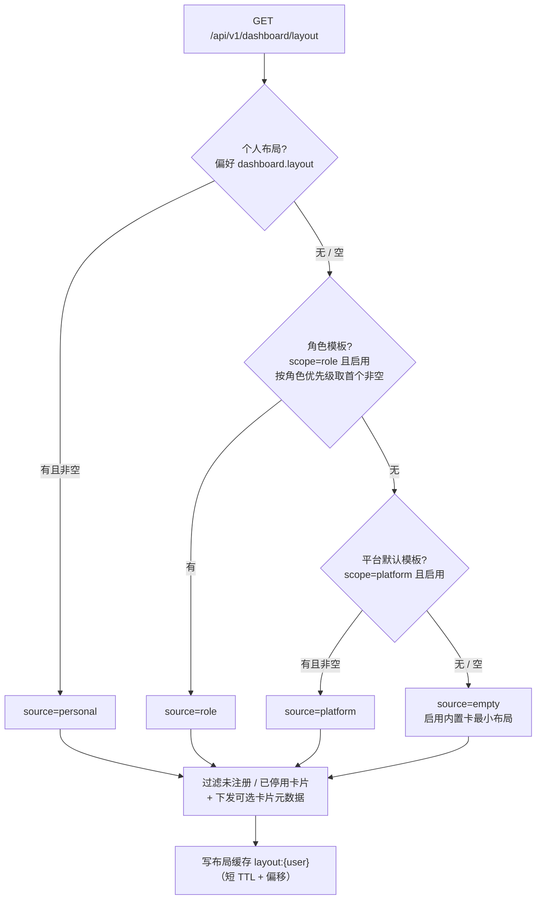

# 首页工作台后端详细设计（三级解析 / 卡片注册 / 模板 / 一键重置 / 角标）

> 通用能力 · 11 工作台 · 01 首页工作台后端 · 详细设计

[文档首页](../../../../../../文档首页.md) › [08 通用能力](../../../../README.md) › [工作台](../../11_工作台.md) › [首页工作台后端](../11_工作台_01_首页工作台后端.md) › 详细设计　|　[需求 08-1](../../../../需求/08_需求_工作台与表单定制.md#r08-1) · [阶段计划](../../../../计划/01_计划_通用能力.md)

## 1. 概述 <a id="overview"></a>

- **目标**：把「每个用户登录后看到什么」从写死页面下沉为在线配置——卡片注册表（内置卡平台种子、数据集卡租户自建）、平台默认模板与角色模板可维护、个人布局可定制与一键重置，解析走**个人 → 角色 → 平台 → 空回退**四级链路；同时给出顶栏 / 侧边栏**待办与未读角标的统一数据出口**。
- **依据**：需求 [08-1](../../../../需求/08_需求_工作台与表单定制.md#r08-1)；《[概要设计 · 首页工作台](../../../../../../设计/概要设计/35_概要设计_首页工作台.md)》§2 / §4 / §5 / §6 / §7；《[架构设计 · 首页工作台](../../../../../../设计/架构设计/29_架构设计_子系统_首页工作台.md)》§3 / §4 / §6 / §7；《[布局设计 · 首页工作台](../../../../../../设计/布局设计/13_布局设计_首页工作台.html)》§2 ~ §8；《[后端开发规范](../../../../../../规范/后端开发规范.md)》§3 / §4 / §7 / §8 / §9；《[AI 开发规范](../../../../../../规范/AI开发规范.md)》§5 / §7。
- **范围（本任务）**：
  - 新建 `dashboard` 业务域（承载服务 `platform`，库类别 `tenant`）：模型 / 仓储 / 服务 / 路由 / 契约；
  - 三张表：`sys_dashboard_card`（卡片注册表）、`sys_dashboard_card_i18n`（卡片名多语言附表）、`sys_dashboard_template`（模板）；
  - 三级解析引擎（个人偏好 → 角色模板 → 平台默认 → 内置最小布局回退）+ 失效引用过滤 + 卡片元数据下发；
  - 卡片注册管理（内置卡只可停用）、平台默认模板与角色模板维护、个人布局保存与一键重置；
  - 角标统一出口 `GET /dashboard/badges`（待办经领域端口、未读经通知服务内部端点）；
  - 内置卡与平台默认模板的租户库种子；缓存与租户级失效；
  - 契约快照与前端类型重生成；表文件 / 总览登记 / i18n 台账 / 域布局 / 表归属 / 权限码种子回写。
- **不含**：前端工作台页面与编辑态（归后续前端任务）、统计聚合接口 `/dashboard/stats`（本任务不落地，见 §11）、报表中心数据集校验的真实实现（端口占位，见 §5.6）、Socket.IO 实时推送（阶段十）、工作流待办数据源（工作流阶段）。

## 2. 现状与差距 <a id="gap"></a>

| # | 关注点 | 现状 | 处置 |
| --- | --- | --- | --- |
| 1 | 卡片能力域 | `bms_core/dashboard` 已有 `BaseDashboardCardProvider` / 注册表 / null 占位，但只有「取数」抽象 | 保留为卡片数据侧扩展点；本任务把**注册表落库**（`sys_dashboard_card`），元数据由库表唯一来源 |
| 2 | 卡片 / 模板表 | 无模型、无表文件、无表归属登记；数据库设计总览已列 36 节点但文件缺失 | 本任务建模型 + 36 节点 + 三张表文件 + 表归属转 `enabled` |
| 3 | 卡片名多语言 | i18n 台账已登记 `sys_dashboard_card_i18n`（待落地，owner 11_01） | 本任务落地并转「已落地」 |
| 4 | 业务域 | 无 `dashboard` 域（`deploy/boundaries/domain_layout.json` 无该域） | 新增域（模型文件 + `domains/dashboard/**/*.py`） |
| 5 | 权限码 | 只有 `dashboard:query` 种子 | 补 `dashboard:manage`（种子计数基线同步，125 → 126） |
| 6 | 错误码 | `403xx` 段全空（`402xx` 菜单 / `404xx` 表单定制 / `405xx` 参数已占用） | 登记 `40301` ~ `40308` |
| 7 | 个人布局存储 | 偏好基座已允许 `dashboard` 域名、`sql` 实现已就绪；但无 `dashboard.layout` 的结构校验 | 基座 `preference/rules.py` 追加布局结构校验（决策 5） |
| 8 | 角色层级命中规则 | 「角色类型优先级 + 角色主键升序取首个非空」实现在 `form_design/services/assemble.py`，未共享 | 上移基座 `permission/role_priority.py`，工作台与表单定制共用（决策 6） |
| 9 | 角标数据出口 | 通知服务已有登录态 `/notifications/unread-count`；无服务间取数出口；工作流服务未落地 | 新增通知服务内部端点 + 工作台聚合端点，待办走端口占位（决策 1） |
| 10 | 种子 | 无内置卡与模板种子 | 新增租户库种子 `bms_core.tenant.seed.dashboard`（决策 4） |
| 11 | 缓存 | 无工作台缓存 | 卡片清单与解析结果缓存 + 租户级版本键（§5.7） |

## 3. 决策记录 <a id="align"></a>

> 本表为**已逐项确认**的定案（question 工具共 10 项，全部取推荐项）。

| # | 事项 | 结论 | 理由 / 长期收益 |
| --- | --- | --- | --- |
| 1 | 待办 / 未读角标出口 | **单一聚合端点** `GET /dashboard/badges`：待办经领域端口（工作流未落地 → 占位返回可用性标记）、未读经通知服务**新增内部端点**（服务身份 + 显式用户）真实取数 | PC / 移动端 / 侧边栏共用一个出口；工作流落地只换端口实现，前端零改 |
| 2 | 统计聚合接口 `/dashboard/stats` | **不落地**，登记计划后续待办 | 业务指标口径（单据数 / 审批数）尚未就绪，不交付空壳接口 |
| 3 | 数据集卡校验 | **端口占位 + 结构校验**：`dataset_id` 形态 / `chart_type` 白名单 / 尺寸区间；存在性由端口判定，报表未接入时按「未校验」通过并告警，`40303` 预留 | 报表数据集落地只换端口实现，卡片契约不变 |
| 4 | 内置卡与默认模板种子 | **租户库种子**：6 张内置卡 + 平台默认模板 + 英文文案，`db_key = tenant_platform_{tenant}` | 与概要 35 §6、架构 29 §3 一致；新租户首屏即有布局；租户停用只影响本租户 |
| 5 | 个人布局存储与校验 | 偏好基座键 **`dashboard.layout`**；结构校验放基座 `preference/rules.py`（与 `notify.channels` 同待遇） | 任何写入路径（含偏好通用接口、移动端）都拦非法布局；无「绕过工作台写坏配置」 |
| 6 | 角色层级命中规则 | **上移基座** `bms_core/permission/role_priority.py`，工作台与表单定制共用 | 多角色命中规则只有一处定义，后续角色视图 / 数据范围均可复用 |
| 7 | 平台默认模板写权限 | `dashboard:manage` 之外**再判平台超管**（`platform_admin` 角色） | 平台级默认配置不被租户管理员改掉，多租户语义清晰（与 10_01 同口径） |
| 8 | 内置卡可改字段 | **仅状态**（`enabled` / `disabled`）；其余字段改动一律 `40308` | 「租户不能改内置卡定义」有硬边界，越权用例可精确断言 |
| 9 | 模板表 `is_default` 列 | **去掉**；平台默认以 `scope=platform` 唯一行判定 | 单一事实源，避免「`scope=role` 却 `is_default=true`」的矛盾态；回写概要 35 §4 |
| 10 | 平台默认模板删除语义 | **允许删**，删后回退「全部启用内置卡按 `sort` 栅格化」的最小布局 | 与架构 29 §4「均为空时返回内置卡片的最小默认布局」一致 |

**由设计 / 规范直接派生（无需另议）**：

| 项 | 取值 | 依据 |
| --- | --- | --- |
| 库类别与非角色占位 | 三表均租户库；模板 `role_id = 0` 表示平台层级 | 概要 35 §4、与 `sys_form_layout` 同范式（规避唯一约束 `NULL` 语义差异） |
| 卡片定位键 | `code`（业务键，`^[a-z][a-z0-9_]{1,63}$`），接口路径与布局引用一律用 `code` | 命名规范「资源命名」；`code` 稳定不变，避免雪花 ID 漂移 |
| 卡片类型 | `builtin` / `dataset` 双轨（`bms_core/dashboard/base.py::CARD_TYPES` 已定义） | 架构 29 §3 |
| 模板唯一性 | `(scope, role_id, deleted_at)` 复合唯一：平台唯一一份、一角色至多一份 | 概要 35 §4 |
| 卡片尺寸区间 | 宽 2~12、高 2~6；默认取 `default_width` / `default_height` | 布局设计 13 §3.2 |
| 网格列数 | 12 列（前端断点收窄由前端处理，后端只存 PC 口径） | 布局设计 13 §3.1 |
| 缓存与失效 | `cards` / `layout:{user}` 两 key + 租户级 `version` 版本键；写模板或卡片递增版本，保存个人布局只删本人键 | 架构 29 §6 |
| 事件 | 不发布业务事件 | 概要 35 §5 末「发布事件：无」 |
| 审计 | 不额外写操作日志；写端点由操作审计中间件统一记录 | 06_01 既有能力 |

### 3.1 文档回写清单（由决策派生，随本任务执行） <a id="writeback"></a>

| 落点 | 改写内容 |
| --- | --- |
| 概要 35 §2.2 | 个人布局键 `dashboard:layout` → `dashboard.layout`；补「角标聚合端点」一条 |
| 概要 35 §4 | `sys_dashboard_template` 去掉 `is_default` 列；补 `sys_dashboard_card` 的 `data_endpoint` / `mobile_supported` / `chart_config` 列口径 |
| 概要 35 §5 | `/dashboard/layout` 键改为实际契约；`/dashboard/stats` 标注「待建」；补 `/dashboard/badges`；模板端点补 `PUT /{id}` 与删除语义 |
| 概要 35 §6 | 平台默认模板写操作补「要求平台超管」 |
| 架构 29 §3 | 补 `data_endpoint` 列与「元数据由库表唯一来源」一句 |
| 架构 29 §4 | 补「角色命中 = 角色类型优先级 + 角色主键升序取首个非空」与「空回退 = 启用内置卡最小布局」 |
| 架构 29 §6 | 缓存键补版本键口径 |
| 数据库设计总览 | §6.2 / §7.2 节点 36 覆盖表补三表；§7.3 登记三张表文件 |
| 数据库设计 30 号（国际化管理）「i18n 附表登记」 | `sys_dashboard_card_i18n` 状态「待落地」→「已落地」 |

## 4. 交付物清单 <a id="tree"></a>

```text
backend/libs/bms_core/src/bms_core/
├── core/
│   ├── error_codes.py                       # 改：40301~40308 + HTTP 状态映射
│   └── exceptions.py                        # 改：DashboardError 段位基 + 8 个子类
├── models/platform/
│   ├── dashboard.py                         # 新：SysDashboardCard / SysDashboardCardI18n / SysDashboardTemplate
│   └── __init__.py                          # 改：模型模块清单
├── dashboard/
│   ├── base.py                              # 改：补卡片类型常量与图表类型白名单
│   └── layout.py                            # 新：布局归一 / 校验 / 最小布局（框架无关纯函数）
├── permission/
│   └── role_priority.py                     # 新：角色类型优先级 + 取首个非空候选（工作台与表单定制共用）
├── preference/
│   └── rules.py                             # 改：`dashboard.layout` 结构校验
├── services/table_registry.py               # 改：三表登记（domain=dashboard，tenant 链）
├── tenant/seed/
│   ├── dashboard.py                         # 新：内置卡 + 平台默认模板 + 英文文案种子（幂等、只增不改）
│   └── __init__.py                          # 改：出口
└── i18n/attachments.py                      # 改：附表转「已落地」

backend/libs/bms_core/tests/
├── dashboard/
│   ├── test_layout_normalize.py             # 新：归一 / 夹取 / 重叠 / 最小布局
│   └── test_role_priority.py                # 新：角色类型优先级与首个非空候选
├── preference/test_dashboard_layout_rules.py # 新：偏好键结构校验
├── core/test_exception_constructors_paths.py # 改：8 个异常入口
└── ops/test_seed_dashboard.py               # 新：种子幂等与「只增不改」

backend/services/platform/src/bms_platform/domains/dashboard/   # 新域
├── __init__.py
├── public.py                                # 跨域出口（DTO + 端口）
├── dto.py                                   # 卡片 / 模板 / 布局 / 角标只读 DTO
├── ports.py                                 # 待办计数、未读计数、数据集校验三个端口
├── api/
│   ├── __init__.py
│   ├── layout.py                            # /dashboard/layout（GET / PUT / DELETE）
│   ├── cards.py                             # /dashboard/cards（列表 / 新建 / 编辑 / 停用删除）
│   ├── templates.py                         # /dashboard/templates（列表 / 新建 / 编辑 / 删除）
│   └── badges.py                            # /dashboard/badges
├── repositories/
│   ├── __init__.py
│   ├── card.py                              # 卡片 + 多语言附表仓储
│   ├── template.py                          # 模板仓储
│   └── adapters.py                          # 端口适配器（待办占位 / 未读服务间 / 数据集占位）
├── schemas/
│   ├── __init__.py
│   ├── card.py                              # 卡片请求 / 响应
│   ├── template.py                          # 模板请求 / 响应
│   ├── layout.py                            # 布局解析 / 保存 / 重置响应
│   └── badge.py                             # 角标响应
└── services/
    ├── __init__.py
    ├── dashboard.py                         # 卡片 / 模板 / 布局 / 角标编排 + 缓存失效
    └── resolve.py                           # 三级解析（偏好 → 角色 → 平台 → 空回退）

backend/services/platform/tests/dashboard/
├── helpers.py                               # 新：造卡 / 造模板 / 造角色夹具
├── test_layout_resolve.py                   # 新：三级回退矩阵 / 失效引用过滤 / 缓存失效
├── test_layout_api.py                       # 新：保存 / 校验 / 重置
├── test_cards_api.py                        # 新：dataset 卡 CRUD / 内置卡越权 40308 / 码重复 40302
├── test_templates_api.py                    # 新：平台唯一 40306 / 角色唯一 40307 / 角色不存在 40305 / 平台超管
└── test_badges_api.py                       # 新：待办占位 / 未读真实 / 降级

backend/services/notification/src/bms_notification/domains/notification/
├── api/notification.py                      # 改：内部未读端点（能力或服务身份）
└── services/notification.py                 # 改：按用户取未读数（服务端显式用户）

backend/services/notification/tests/notification/test_internal_unread.py  # 新：内部端点鉴权与计数

backend/services/platform/src/bms_platform/
├── api/router.py                            # 改：挂载四个路由
├── wiring.py                                # 改：装配面构造服务与端口
└── main.py                                  # 改：不需要（无新插件实现）

deploy/registry/platform.toml                # 改：[[seeds]] seed-dashboard + [[domains]] dashboard
deploy/registry/notification.toml            # 改：[[collaborations]] notification.read
deploy/boundaries/domain_layout.json         # 重生成（ops.check_modules --render-domain-layout）
deploy/contracts/platform.json               # 重生成
deploy/contracts/notification.json           # 重生成
frontend/packages/api_types/src/platform.ts  # 重生成
frontend/packages/api_types/src/notification.ts # 重生成

bms文档/设计/数据库设计/
├── 36_数据库设计_首页工作台.md              # 新
├── 01_数据库设计_总览.md                    # 改：登记三表 + 节点覆盖表
├── 30_数据库设计_国际化管理.md              # 改：附表台账状态
└── 数据表设计/
    ├── sys_dashboard_card.md                # 新
    ├── sys_dashboard_card_i18n.md           # 新
    └── sys_dashboard_template.md            # 新
```

## 5. 领域设计 <a id="design"></a>

### 5.1 三张表的职责与定位 <a id="tables"></a>

| 表 | 库类别 | 承载 | 唯一键 |
| --- | --- | --- | --- |
| `sys_dashboard_card` | 租户库 | 卡片注册表（内置卡平台种子 + 租户自建数据集卡） | `(code, deleted_at)` |
| `sys_dashboard_card_i18n` | 租户库 | 卡片名多语言附表（`name`） | `(card_id, locale, deleted_at)` |
| `sys_dashboard_template` | 租户库 | 平台默认模板（`scope=platform`，唯一）与角色模板（`scope=role`） | `(scope, role_id, deleted_at)` |

**设计要点**：

- **定位键 `code`**：布局与模板只引用 `code`，不存雪花 ID——卡片重建（删后新建）不影响既有模板，跨端数据可读。
- **`role_id = 0` 表示平台层级**：`(scope, role_id, deleted_at)` 复合唯一在 `NULL` 上不生效（四库同语义），用 `0` 占位保证「平台仅一份、一角色至多一份」成立。
- **内置卡定义不可改**：`card_type=builtin` 的写操作只放开 `status`，其余字段一律 `40308`；种子**只增不改**，租户停用后重跑种子不会被重新启用。
- **数据集卡引用 `dataset_id`**：逻辑外键指向报表中心数据集（跨服务），只做形态校验与端口判定，不建物理外键。
- **模板 `layout_config` 是 JSON 文本**：结构见 §5.3，应用层归一与校验（与《数据规范》§3「多值字段例外」一致）。

### 5.2 卡片模型与注册 <a id="cards"></a>

`bms_core/dashboard/layout.py`（框架无关纯函数）与域侧常量：

| 元素 | 语义 |
| --- | --- |
| `CARD_CODE_PATTERN = ^[a-z][a-z0-9_]{1,63}$` | 卡片 `code` 形态（小写字母开头，仅小写字母 / 数字 / 下划线，2~64 位） |
| `CHART_TYPES` | 图表类型白名单（与前端 `CHART_KINDS` 同值：`line` / `area` / `bar` / `hbar` / `stacked_bar` / `pie` / `doughnut` / `scatter` / `funnel` / `radar` / `gauge` / `table` / `map`） |
| `MIN_CARD_WIDTH = 2` / `MAX_CARD_WIDTH = 12` / `MIN_CARD_HEIGHT = 2` / `MAX_CARD_HEIGHT = 6` | 尺寸区间（布局设计 13 §3.2） |
| `GRID_COLUMNS = 12` | 网格列数 |
| `MAX_LAYOUT_CARDS = 24` | 单份布局卡片数上限（防超长配置与 64KB 偏好值上限） |

**内置卡种子（6 张）**：

| code | 名称 | render_key | 数据接口 | 尺寸 | 移动端 |
| --- | --- | --- | --- | --- | --- |
| `todo` | 待办 / 已办 | `todo` | 空（工作流未落地，前端占位） | 4×2 | 是 |
| `notification` | 通知 | `notification` | `/api/v1/notifications` | 4×2 | 是 |
| `notice` | 公告 | `notice` | `/api/v1/notices/published` | 4×2 | 是 |
| `quick_links` | 快捷入口 | `quick_links` | `/api/v1/menus/my` | 2×2 | 是 |
| `help` | 帮助入口 | `help` | `/api/v1/help/context` | 2×2 | 否 |
| `stats` | 数据统计 | `stats` | 空（统计接口待建） | 6×2 | 否 |

- `sort` 取 10 / 20 / 30 / 40 / 50 / 60（留插入空间）；`data_endpoint` 为空表示「前端按渲染器自身逻辑取数或占位」。
- 新增内置卡 = 平台种子新增一行 + 前端新增渲染器（一次开发全租户可用），不改表结构、不改接口。

### 5.3 布局模型与归一 <a id="layout-model"></a>

`layout_config` 结构（模板与个人布局**同一形态**，重置即回退上一级同形态配置）：

```json
{
  "cards": [
    { "code": "todo", "x": 0, "y": 0, "w": 4, "h": 2, "visible": true },
    { "code": "notification", "x": 4, "y": 0, "w": 4, "h": 2, "visible": true }
  ]
}
```

| 函数 | 语义 |
| --- | --- |
| `normalize_layout(raw, defaults)` | 容错归一：缺 `cards` → 空；缺 `x`/`y` → 按当前行顺序追加；`w`/`h` 缺 → 取卡片默认尺寸；越界夹取；重复 `code` 保首个；未知键丢弃 |
| `validate_layout(layout)` | 汇总问题：`empty-code` / `duplicate-code` / `width-out-of-range` / `height-out-of-range` / `position-out-of-range` / `overlap` / `too-many-cards` |
| `minimal_layout(cards)` | 空回退：按 `sort` 顺序以行流式排布（每行 ≤ 12 列，行高取该行最大高度） |
| `is_layout_empty(layout)` | 无可见卡片即视为空（可见性过滤后为空 → 继续下一级） |
| `filter_placements(layout, known, disabled)` | 解析期过滤：剔除未知与已停用卡片，返回（保留项, 剔除项） |

- **保存期严格**：`overlap` / 越界 / 重复 `code` / 未注册 `code` → `40304`（未注册另给 `40301`，见 §6.5）；引用**已停用**卡片不拒（用户布局可能早于停用），仅返回告警并从结果剔除。
- **读取期容错**：解析不做二次校验，只做归一 + 过滤，绝不因坏配置白屏（与概要 35 §2.2 异常分支一致）。

### 5.4 三级解析引擎 <a id="resolve"></a>



- **角色命中规则**：取用户直接角色集（`RolePort`），按 `role_type` 优先级（`platform_admin` > `system` > `security` > `audit` > `custom`，未登记类型排末）再按 `role_id` 升序，取**首个非空且启用**的模板；规则由 `bms_core/permission/role_priority.py` 统一提供（与 10_01 共用）。
- **解析幂等**：结果只依赖「用户角色 → 模板 / 偏好」当前状态，不依赖会话与时间；模板停用 / 删除、卡片停用后任何刷新即得新结果。
- **响应附带可选卡片清单**（全部启用卡，按 `sort`）：前端不硬编码卡片列表。
- **别名口径**：个人布局键 `dashboard.layout`（点号，偏好键规范）；概要与架构里的 `dashboard:layout` 为旧写法，按 §3.1 回写。

### 5.5 个人布局与一键重置 <a id="personal"></a>

- **读**：`BasePreferenceStore.get("dashboard.layout")`（`sql` 实现，`sys_user_preference`）。
- **写**：先归一 + 校验 → `validate_pref_value`（基座规则含 `dashboard.layout` 结构校验，双保险）→ `set`。
- **一键重置**：`reset("dashboard.layout")` 删除个人偏好 → 下次解析自然回退角色 / 平台 / 内置最小布局；返回 `applied` 表示是否真删到既有键。
- **不设权限码**：个人布局是「用户对自己数据」的操作，登录即可（概要 35 §6）。
- **跨端同源**：PC 与移动端读同一份偏好，移动端按单列重排（前端职责）。

### 5.6 角标聚合 <a id="badges"></a>

`GET /api/v1/dashboard/badges`（登录即可）：

```json
{
  "todo": { "count": 0, "available": false, "reason": "workflow_unavailable" },
  "notification": { "count": 3, "available": true, "reason": null }
}
```

| 端口 | 契约 | 本任务实现 |
| --- | --- | --- |
| `TodoCountPort` | `async todo_count(user_id) -> BadgeCount` | `NullTodoCountProvider`：`available=false` + `reason=workflow_unavailable`（工作流落地后替换实现，前端零改） |
| `NotificationBadgePort` | `async unread_count(user_id) -> BadgeCount` | `NotificationBadgeAdapter`：`service_client` 调通知服务内部端点，不可达 / 非 2xx / 载荷非法 → `available=false`（单角标降级，不阻断整页） |
| `DatasetProbePort` | `async exists(dataset_id) -> bool \| None` | `NullDatasetProbe`：恒 `None`（未接入 → 按未校验通过并记告警） |

**通知服务内部端点**（`notification` 服务新增）：

| 方法 | 路径 | 鉴权 | 说明 |
| --- | --- | --- | --- |
| GET | `/api/v1/notifications/internal/unread-count?user_id=` | `require_capability_or_service("notification.read", "platform")` | 显式用户未读数（服务间专用，不走登录态上下文） |

- 能力声明：`deploy/registry/notification.toml` 增 `[[collaborations]] name="notification.read"`、`kind=read`、`path` 同上、`default_consumers=["platform"]`。
- 未读数**唯一口径**仍在通知服务（`sys_notification` 所有者），工作台只转发不重算。

### 5.7 缓存与失效 <a id="cache"></a>

| key | 内容 | TTL |
| --- | --- | --- |
| `bms:{tenant}:dashboard:version` | 租户级版本号（`aincrease`） | 不过期 |
| `bms:{tenant}:dashboard:cards:v{version}` | 启用卡片元数据清单（本地化名称按 locale 另取，不缓存文案） | 300s |
| `bms:{tenant}:dashboard:layout:v{version}:{user_id}` | 解析结果（布局 + 可选卡片 + source） | 60s + 随机偏移 |

- **写卡片 / 写模板 / 删模板**：先写库 → `aincrease(version)`（旧 key 自然过期）。
- **保存 / 重置个人布局**：只删本人 `layout` 键，**不递增版本**（不惊动其他用户）。
- **locale 变化**：卡片名按请求语言实时取附表，不落缓存键；缓存只存结构与非文案字段。
- **缓存不可用**：读时回落直连库 + warning，语义不变仅变慢（与 10_01 同口径）。

### 5.8 种子与开通 <a id="seed"></a>

- `bms_core/tenant/seed/dashboard.py`：
  - `seed_dashboard(session)`：按 `code` 查活行——**存在即跳过**（保留租户改过的 `status` / 名称），缺失才插入；`sys_dashboard_card_i18n` 补 `en-US` 名称（已有同 locale 活行则跳过）；平台默认模板（`scope=platform`）缺失才插入（初值 = 6 张内置卡按 `sort` 的行流式布局）。
  - 返回 `DashboardSeedOutcome`（新增卡片数 / 新增文案数 / 模板是否新建）。
- `ops/seed_dashboard.py`：CLI 薄壳（转发 + `__getattr__` 透传），与 `ops/seed_config.py` 同构。
- `deploy/registry/platform.toml`：`[[seeds]] name="seed-dashboard"`，`db_key="tenant_platform_{tenant}"`，`after=["seed-menu"]`，`tables={sys_dashboard_card="code", sys_dashboard_template="scope,role_id"}`。
- `bms_platform/services/seed_branch_handlers.py`：`SEED_OPS` 增 `seed-dashboard` 并登记处理器。

### 5.9 与既有模块的协作面 <a id="coordination"></a>

| 协作方 | 关系 | 接口 |
| --- | --- | --- |
| 偏好基座（`preference`） | 本域**读 / 写**个人布局 | `get_preference_store` + `preference/rules.py` |
| 角色域（`role`） | 本域**读**用户角色集与角色有效性 | 装配面注入 `RolePort`（`RoleQueryService` 适配器） |
| 权限码（`require_permission`） | 管理面鉴权 | `dashboard:query` / `dashboard:manage` |
| 缓存（`cache`） | 列表 / 解析缓存 | `get_cache_region` |
| 通知服务 | 本域**调**内部未读端点 | `service_client` + `notification.read` 能力 |
| 报表中心 | 本域**预留**数据集校验端口 | `DatasetProbePort`（占位） |
| 操作审计中间件（06_01） | 写端点自动落库 | 无需显式调用 |
| 数据库设计 / i18n 台账 | 表文件与附表登记 | 见 §9 |

## 6. 接口契约 <a id="contract"></a>

前缀 `/api/v1/dashboard`，统一响应 `{code, message, data}`；`Accept-Language` 决定卡片名语言。

### 6.1 个人布局（登录即可） <a id="api-layout"></a>

| 方法 | 路径 | 说明 | 主要字段 |
| --- | --- | --- | --- |
| GET | `/dashboard/layout` | 解析当前用户布局 + 可选卡片清单 | — |
| PUT | `/dashboard/layout` | 保存个人布局（整份覆盖） | `layout.cards[]` |
| DELETE | `/dashboard/layout` | 一键重置（删个人偏好，回退角色 / 平台 / 内置） | — |

**GET 响应形态**：

| 字段 | 类型 | 说明 |
| --- | --- | --- |
| `layout` | object | `{cards: [{code, x, y, w, h, visible}]}`（已过滤未注册 / 停用卡） |
| `source` | string | `personal` / `role` / `platform` / `empty` |
| `role_id` | number | 命中角色模板时的角色主键；否则 `0` |
| `template_id` | number | 命中模板主键；个人 / 内置回退为 `0` |
| `fallback` | bool | 是否走到内置最小布局（`source=empty`） |
| `available_cards` | array | 启用卡片元数据（见下） |
| `warnings` | array | 告警（`code` + `reason`），如 `{code:"notice", reason:"card_disabled"}` |

`available_cards` 项：`code` / `name` / `card_type` / `render_key` / `dataset_id` / `chart_type` / `chart_config` / `default_width` / `default_height` / `mobile_supported` / `data_endpoint` / `sort`。

### 6.2 卡片管理（`dashboard:query` / `dashboard:manage`） <a id="api-cards"></a>

| 方法 | 路径 | 权限 | 说明 |
| --- | --- | --- | --- |
| GET | `/dashboard/cards?card_type=` | `dashboard:query` | 卡片列表（含停用；`card_type` 可选 `builtin` / `dataset`） |
| POST | `/dashboard/cards` | `dashboard:manage` | 新建**数据集卡**（`card_type` 只允许 `dataset`；传 `builtin` → `40308`） |
| PUT | `/dashboard/cards/{code}` | `dashboard:manage` | 编辑：dataset 卡全字段；builtin 卡**只允许 `status`** |
| DELETE | `/dashboard/cards/{code}` | `dashboard:manage` | 删除：dataset 卡软删除；builtin 卡 → `40308` |

- 请求字段：`code`（新建必填）/ `name` / `dataset_id` / `chart_type` / `chart_config`（对象）/ `default_width` / `default_height` / `mobile_supported` / `sort` / `status` / `i18n`（`{locale: name}`）。
- 主表 `name` 由服务端按「系统默认语言 → 首个有值语言」派生写入（《数据规范》§5「派生快照」）。
- 停用卡片后：解析时该卡从所有用户布局剔除（不报错），管理面仍可见（`status=disabled`）。

### 6.3 模板管理（`dashboard:query` / `dashboard:manage`） <a id="api-templates"></a>

| 方法 | 路径 | 权限 | 说明 |
| --- | --- | --- | --- |
| GET | `/dashboard/templates?scope=` | `dashboard:query` | 模板列表（`scope` 可选） |
| POST | `/dashboard/templates` | `dashboard:manage` | 新建：`scope=platform` 仅一份（`40306`）且要求平台超管；`scope=role` 一角色一份（`40307`）且角色须启用（`40305`） |
| PUT | `/dashboard/templates/{id}` | `dashboard:manage` | 编辑 `name` / `layout_config` / `status`；`scope=platform` 要求平台超管 |
| DELETE | `/dashboard/templates/{id}` | `dashboard:manage` | 删除：平台模板删后回退内置最小布局；角色模板删后该角色回退平台 |

- 模板 `layout_config` 与个人布局同形态（§5.3），保存走同一校验（`40304`）。
- 模板不可改 `scope` / `role_id`（如需改绑定关系，删后重建），避免唯一约束与既有命中的歧义。

### 6.4 角标（登录即可） <a id="api-badges"></a>

| 方法 | 路径 | 说明 |
| --- | --- | --- |
| GET | `/dashboard/badges` | 返回 `{todo: {...}, notification: {...}}`，各含 `count` / `available` / `reason` |

### 6.5 错误码（`403xx` 段） <a id="errors"></a>

| 码 | 名称 | HTTP | 场景 |
| --- | --- | --- | --- |
| 40301 | `DASHBOARD_CARD_NOT_FOUND` | 404 | 布局 / 模板引用的卡片 `code` 不存在（含按码取卡的管理操作） |
| 40302 | `DASHBOARD_CARD_CODE_CONFLICT` | 200 | 卡片 `code` 重复 |
| 40303 | `DASHBOARD_DATASET_UNAVAILABLE` | 200 | 数据集不存在或不可用（端口接入后启用；占位期不触发） |
| 40304 | `DASHBOARD_LAYOUT_INVALID` | 200 | 布局校验失败（越界、重叠、重复码、超量、结构非法） |
| 40305 | `DASHBOARD_ROLE_NOT_FOUND` | 200 | 角色模板绑定的角色不存在 / 已停用 |
| 40306 | `DASHBOARD_PLATFORM_TEMPLATE_EXISTS` | 200 | 平台默认模板已存在（仅一份） |
| 40307 | `DASHBOARD_ROLE_TEMPLATE_EXISTS` | 200 | 该角色已存在模板 |
| 40308 | `DASHBOARD_BUILTIN_CARD_LOCKED` | 200 | 内置卡不可改定义 / 不可删 |

- 参数形态错误（`code` 非法、`card_type` 非枚举、`chart_type` 不在白名单、`user_id` 非法）走统一 `10001`。
- 文案由前端按 i18n 映射（`error.403xx`），后端不拼装文案。

## 7. 失败分支与边界 <a id="failures"></a>

| 场景 | 处置 | 结果 |
| --- | --- | --- |
| 个人布局 JSON 解析失败 / 结构非法 | 归一后为空 → 继续回退下一级 + 告警 | 不白屏 |
| 个人布局引用未注册卡片 | 解析期剔除 + `warnings` | 不报错 |
| 个人布局引用已停用卡片 | 解析期剔除 + `warnings` | 「停用后所有用户布局中该卡消失」成立 |
| 保存布局引用未注册卡片 | `40301` | 明确告知非法引用 |
| 保存布局网格重叠 / 越界 / 重复码 / 超量 | `40304` | 拒绝落库 |
| 保存布局卡片数为 0 | 允许（整页空态由前端给「恢复默认布局」） | 与布局设计 13 §7 一致 |
| 模板 / 卡片写入后缓存失效失败 | 记 warning，不阻断写 | 语义不变，仅可能读到旧值至 TTL |
| 缓存整体不可用 | 直连库 | 语义不变，仅变慢 |
| 平台默认模板不存在 | 回退内置最小布局（`source=empty`, `fallback=true`） | 新租户 / 被删后仍可用 |
| 角色模板绑定角色已停用 | 管理面无影响；解析期该角色不再命中（用户角色集不含） | 自然回退 |
| 内置卡 PUT 带非 `status` 字段 | `40308` | 内置卡定义锁定 |
| 内置卡 DELETE | `40308` | 内置卡不可删 |
| dataset 卡 `chart_type` 不在白名单 | `10001` | 登记期拒 |
| dataset 卡 `dataset_id` 形态非法 | `10001` | 登记期拒（防注入：只允许字母数字与 `-` `_`，≤64） |
| 数据集端口未接入 | 按「未校验」通过 + warning | 不阻断自建卡片 |
| 数据集端口判定不可用 | `40303` | 接入后生效 |
| 通知服务不可达 / 超时 / 非 2xx | `notification.available=false` + 日志 | 单角标降级，不阻断整页 |
| 通知内部端点入站非法（无服务凭证 / 无授权） | 通知服务 `20001` / `30001` | 内部面不对登录用户开放 |
| 个人偏好写入超 64KB | 基座 `30022` | 明确拒绝（布局卡片数上限已先行约束） |
| 保存个人布局时偏好基座不可用 | 基座异常原样上抛 | 不静默丢配置 |

## 8. 测试设计与验收映射 <a id="tests"></a>

**Kiwi**：登记 1 条用例（分类「平台骨架」、`P2`、`CONFIRMED`、标签「自动化」），覆盖下表；代码标注同一编号（`@pytest.mark.kiwi_id(<编号>)`）。

| # | 验收项（需求 08-1 / 任务书 §3） | 用例文件 | 断言要点 |
| --- | --- | --- | --- |
| 1 | 新用户首次登录得平台默认模板布局 | `test_layout_resolve.py` | 无偏好 + 无角色模板 → `source=platform`、`template_id` 命中平台模板 |
| 2 | 绑定角色模板后该角色用户看到角色布局 | `test_layout_resolve.py` | 角色模板非空 → `source=role`、`role_id` 正确 |
| 3 | 多角色命中按角色类型优先级 + 主键升序 | `test_role_priority.py` + `test_layout_resolve.py` | `platform_admin` 优先于 `custom`；同类型按 `role_id` 升序 |
| 4 | 个人改动只影响本人 | `test_layout_api.py` | 甲保存后甲 `source=personal`，乙仍 `platform` |
| 5 | 重置后回到角色 / 平台模板 | `test_layout_api.py` | DELETE 后 `applied=true`，再取回退到 `role` / `platform` |
| 6 | 平台模板与角色模板均无 → 内置最小布局 | `test_layout_resolve.py` | `source=empty`、`fallback=true`、卡片按 `sort` 行流式排布 |
| 7 | 停用卡片后所有布局中消失且不报错 | `test_layout_resolve.py` + `test_cards_api.py` | 停用后解析剔除 + `warnings` 含 `card_disabled`；接口 200 |
| 8 | 布局引用不存在卡片被剔除、保存被拒 | `test_layout_api.py` | 解析剔除告警；PUT 返回 `40301` |
| 9 | 布局校验（重叠 / 越界 / 重复 / 超量） | `test_layout_normalize.py` + `test_layout_api.py` | 四类各一正一反，全部 `40304` |
| 10 | 自建数据集卡保存后仍存在 | `test_cards_api.py` | POST 后 GET 可读；`chart_type` / 尺寸 / 多语言文案保留 |
| 11 | 内置卡不可改定义 / 不可删 | `test_cards_api.py` | PUT 带 `name` → `40308`；DELETE → `40308`；PUT 只带 `status` 成功 |
| 12 | 卡片 `code` 重复 | `test_cards_api.py` | `40302` |
| 13 | 平台默认模板仅一份 | `test_templates_api.py` | 二次创建 → `40306` |
| 14 | 角色模板一角色一份 + 角色校验 | `test_templates_api.py` | 重复 → `40307`；角色不存在 → `40305` |
| 15 | 平台默认模板写操作要求平台超管 | `test_templates_api.py` | 非 `platform_admin` → `30001`；超管通过 |
| 16 | 模板删除后回退下一级 | `test_templates_api.py` + `test_layout_resolve.py` | 删角色模板回平台；删平台模板回内置 |
| 17 | 待办角标占位 | `test_badges_api.py` | `todo.available=false`、`reason=workflow_unavailable` |
| 18 | 未读角标真实取数 | `test_badges_api.py` | 适配器收到 `user_id` 与路径；响应 `count` 透传 |
| 19 | 未读角标降级 | `test_badges_api.py` | 服务不可达 / 非 2xx → `available=false`，接口仍 200 |
| 20 | 偏好基座结构校验 | `test_dashboard_layout_rules.py` | 非法结构写 `dashboard.layout` → `30022`；合法通过 |
| 21 | 缓存失效即时生效 | `test_layout_resolve.py` | 改平台模板后另一用户刷新即见新布局（版本键递增） |
| 22 | 种子幂等且只增不改 | `test_seed_dashboard.py` | 首跑插入 6 卡 + 模板；改 `status=disabled` 后重跑保持停用；文案不重复 |
| 23 | 通知内部端点鉴权 | `test_internal_unread.py` | 无服务凭证 → 401；服务身份平台 → 计数正确 |
| 24 | 中文卡片名与缺省回退 | `test_layout_resolve.py` | `Accept-Language: en-US` 得英文名；无附表行回落主表 `name` |

**覆盖率**：新域模块（`bms_core.dashboard.*`、`bms_core.permission.role_priority`、`bms_platform.domains.dashboard.*`、`bms_core.tenant.seed.dashboard`）按模块级 100%（行 + 分支）；改动模块（`preference.rules`、`notification.api.notification`、`notification.services.notification`、`error_codes`、`exceptions`）按模块级 100% 复核。

**原型对照**：本任务**无界面源码改动**（前端工作台归后续前端任务）；测试记录写「不适用」并引用工作台原型（[工作台查看](../../../../../../设计/原型设计/06_首页工作台/02_工作台查看.html)）作为后端契约的对照基准。

## 9. 登记落点 <a id="registry-writeback"></a>

| 落点 | 内容 |
| --- | --- |
| `bms_core/services/table_registry.py` | 三表登记：`owner=platform`、`domain=dashboard`、`datasource=tenant` |
| `deploy/boundaries/domain_layout.json`（由清单渲染） | 新增 `dashboard` 域：`domains/dashboard/**/*.py` + `models/platform/dashboard.py`，`public_api` = `bms_platform.domains.dashboard.public` |
| `deploy/registry/platform.toml` | `[[domains]] dashboard` + `[[seeds]] seed-dashboard` |
| `deploy/registry/notification.toml` | `[[collaborations]] notification.read` |
| `bms_core/tenant/seed/menu.py` | 补 `("dashboard", "manage", "管理（含查询与维护）", "Manage")` |
| `bms_core/tests/ops/test_seed_menu.py` | `_PERMISSIONS_BEFORE` 125 → 126 |
| `bms_core/core/error_codes.py` | 40301~40308 + `ERROR_CODE_HTTP_STATUS`（40301 → 404） |
| `bms_core/core/exceptions.py` | `DashboardError` 段位基 + 8 子类 |
| `bms_core/tests/core/test_exception_constructors_paths.py` | 8 个子类入口 |
| `bms_core/i18n/attachments.py` | `sys_dashboard_card_i18n` → `ATTACHMENT_LANDED` |
| 数据库设计 36 节点 + 三张表文件 | 新建（表结构唯一事实源） |
| 数据库设计总览 | §6.2 / §7.2 / §7.3 登记与状态 |
| 数据库设计 30 号（国际化） | 附表台账状态改「已落地」 |
| `deploy/contracts/platform.json` / `notification.json` | 重生成 |
| `frontend/packages/api_types/src/platform.ts` / `notification.ts` | 重生成 |
| 概要 35 / 架构 29 | 见 §3.1 回写清单 |
| 阶段计划 §2 / §3 / §5 / §7 | 11_01 状态与完成后归口；统计接口与前端页面登记后续待办 |
| 任务书 / 需求 08-1 | 交付注块（不承载进度） |
| 任务目录 | 实施记录 + 测试记录 |

## 10. 实施步骤 <a id="steps"></a>

1. **数据库设计先行**：36 节点 + 三张表文件 + 总览登记。
2. **登记**：表归属三表；`[[domains]] dashboard` + 渲染 `domain_layout.json`；i18n 台账转已落地。
3. **错误码与异常**：`error_codes.py` + `exceptions.py` 段位基与 8 子类 + 双源护栏用例。
4. **模型**：`models/platform/dashboard.py` 三模型 + 模型清单；建表验证。
5. **纯函数层**：`bms_core/dashboard/layout.py`（归一 / 校验 / 最小布局）+ `dashboard/base.py` 常量 + 单测。
6. **角色优先级上移**：`bms_core/permission/role_priority.py` + `form_design` 改导入 + 回归其用例。
7. **偏好校验**：`preference/rules.py` 增 `dashboard.layout` 结构校验 + 单测。
8. **种子**：`bms_core/tenant/seed/dashboard.py` + `ops/seed_dashboard.py` + 清单声明 + `SEED_OPS` + 单测。
9. **域骨架**：`domains/dashboard/` 的 `dto` / `ports` / `public` / `repositories` / `services` / `schemas` / `api`。
10. **三级解析与布局接口**：解析引擎 + 缓存 + 三个端点。
11. **卡片与模板管理**：CRUD + 内置卡锁定 + 平台唯一 + 角色唯一 + 平台超管判定。
12. **角标**：端口 + 通知适配器 + 聚合端点；通知服务内部端点与能力声明。
13. **装配与路由**：`wiring.py`、`api/router.py`；装配冒烟用例。
14. **契约**：`contract_snapshot export` + `api_types` 重生成。
15. **Kiwi**：登记取号 → 回填代码标注。
16. **测试与覆盖率**：单文件用例 → `coverage_report.py --module` 至 100%。
17. **文档回写**：§3.1 清单 + 计划 + 任务书 / 需求注块 + 实施 / 测试记录。
18. **校验**：`engkit links` / `docs-scope` / `eol` + 提交前预检完整落盘阅读。
19. **提交**：`docs(通用能力)` 设计 → `feat(通用能力)` 代码 → `docs(通用能力)` 记录与计划，不推送。

## 11. 边界与开放项 <a id="open"></a>

| # | 事项 | 处置 |
| --- | --- | --- |
| 1 | 统计聚合接口 `/dashboard/stats` | 本任务不落地（决策 2）；登记计划后续待办，待业务指标口径就绪 |
| 2 | 工作流待办数据源 | `TodoCountPort` 占位；工作流落地后替换实现，前端零改 |
| 3 | 报表数据集存在性校验 | `DatasetProbePort` 占位；报表中心数据集落地后接入，`40303` 同步启用 |
| 4 | 数据集 `dataset_name` | 报表数据集未落地，元数据暂不下发名称（前端图表脚注留空） |
| 5 | Socket.IO 实时推送 | 阶段十；本任务只给角标取数出口，推送通道复用既有实时能力 |
| 6 | 前端工作台页面 / 编辑态 / 管理页 | 后续前端任务；本任务保证契约完整 |
| 7 | 工作台卡片管理 / 模板管理菜单与表单种子 | 阶段十五页面迁移时补（当前无页面不挂菜单） |
| 8 | 平台升级向存量租户同步新增内置卡 | 重跑 `seed-dashboard` 即幂等补齐（只增不改）；批量编排随部署窗口 |
| 9 | 布局 `chart_config` 结构校验 | 只校验为对象且不超过 4KB，具体键由前端图表组件容错（非法忽略回退默认） |
| 10 | 移动端单列重排 | 前端职责；接口下发同源布局 + `mobile_supported` 标记 |

## 12. 参考文档 <a id="ref"></a>

- 需求 [08-1](../../../../需求/08_需求_工作台与表单定制.md#r08-1)
- 《[概要设计 · 首页工作台](../../../../../../设计/概要设计/35_概要设计_首页工作台.md)》§1 / §2 / §4 / §5 / §6 / §7
- 《[架构设计 · 首页工作台](../../../../../../设计/架构设计/29_架构设计_子系统_首页工作台.md)》§2 / §3 / §4 / §6 / §7 / §8
- 《[布局设计 · 首页工作台](../../../../../../设计/布局设计/13_布局设计_首页工作台.html)》§2 ~ §8
- 《[数据库设计 · 数据规范](../../../../../../设计/数据库设计/02_数据库设计_数据规范.md)》§2 / §3 / §5 / §6
- 《[数据库开发规范](../../../../../../规范/数据库开发规范.md)》§3 / §4 / §5 / §6；《[后端开发规范](../../../../../../规范/后端开发规范.md)》§3 / §4 / §7 / §8 / §9 / §10；《[AI 开发规范](../../../../../../规范/AI开发规范.md)》§5 / §7
- 《[测试规范](../../../../../../规范/测试规范.md)》§2 / §5 / §6 / §7
- 原型：[工作台查看](../../../../../../设计/原型设计/06_首页工作台/02_工作台查看.html)、[工作台编辑](../../../../../../设计/原型设计/06_首页工作台/03_工作台编辑.html)、[卡片管理](../../../../../../设计/原型设计/06_首页工作台/04_卡片管理.html)、[模板管理](../../../../../../设计/原型设计/06_首页工作台/05_模板管理.html)
- 既有关联实现：`bms_platform/domains/form_design/services/assemble.py`（角色层级命中）、`bms_core/preference/rules.py`（偏好键规则）、`bms_core/config/http.py`（服务间取数降级范式）

> 详细设计 · 依《[文档生成规范](../../../../../../规范/文档生成规范.md)》编写 · 进度以[阶段计划](../../../../计划/01_计划_通用能力.md)为唯一落点
