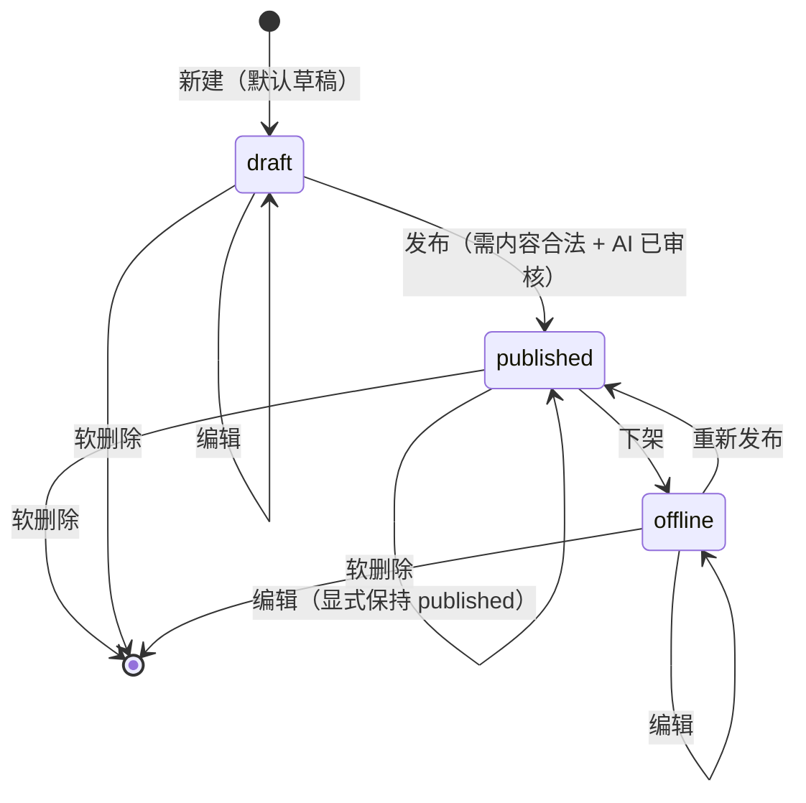

# 帮助内容维护与前台展示详细设计（分类 / 文章 / 反馈 / 包管理 / 内容缓存）

> 通用能力 · 12 帮助内容 · 01 帮助内容维护与前台展示 · 详细设计

[文档首页](../../../../../../文档首页.md) › [08 通用能力](../../../../README.md) › [帮助内容](../../12_帮助内容.md) › [帮助内容维护与前台展示](../12_帮助内容_01_帮助内容维护与前台展示.md) › 详细设计　|　[需求 09-4](../../../../需求/09_需求_帮助中心.md#r09-4) · [阶段计划](../../../../计划/01_计划_通用能力.md)

## 1. 概述 <a id="overview"></a>

- **目标**：把帮助中心从「机制与装载可用」补成「内容可运营、前台可阅读、反馈可回流」的完整内容面。
  1. **分类与文章维护**：分类树增删改（删除前处理子文章）、文章在线编辑（HTML 入库 + 后端权威 XSS 清洗）、
     草稿 / 发布 / 下架 / 置顶 / 软删除，变更落字段级审计。
  2. **多语言**：标题与正文逐语言写 `sys_help_article_i18n`，写入校验语言在租户启用清单内；读取沿用
     08_03 的「请求语言 → 租户默认语言 → 主表快照」三级回退。
  3. **读者面**：分类树 + 文章列表 + 详情（PC / 移动端共用同一接口），仅已发布可见；详情阅读计数。
  4. **反馈与统计**：有帮助 / 无帮助 + 评论（同用户同文章唯一、可改投）、计数冗余、后台统计视图。
  5. **帮助包管理面**：08_03 遗留的三个管理端点（列表 / 装载 / 卸载）+ `help:package` 权限码 +
     操作日志与字段级审计。
  6. **内容侧缓存**：收口 08_03 遗留，文章发布 / 下架即时生效。
  7. **AI 草稿位**：`generated_by` / `ai_model` / `reviewed_by` 可维护，`generated_by=ai` 未填审核人不得发布；
     生成能力本身归阶段十九。
- **依据**：需求 [09-4](../../../../需求/09_需求_帮助中心.md#r09-4)；《[概要设计 · 帮助中心](../../../../../../设计/概要设计/17_概要设计_帮助中心.md)》§2 / §4 / §5 / §6 / §7；《[架构设计 · 帮助中心](../../../../../../设计/架构设计/28_架构设计_子系统_帮助中心.md)》§3 / §4 / §5 / §7；《[数据库设计 · 帮助中心](../../../../../../设计/数据库设计/17_数据库设计_帮助中心.md)》；《[帮助包规范](../../../../../../规范/帮助包规范.md)》§7 / §9 / §10；《[数据库开发规范](../../../../../../规范/数据库开发规范.md)》§3 / §4 / §8 / §9；《[后端开发规范](../../../../../../规范/后端开发规范.md)》§3 / §4 / §7 / §8；《[测试规范](../../../../../../规范/测试规范.md)》§5 / §6；《[AI开发规范](../../../../../../规范/AI开发规范.md)》§5 / §7。
- **范围（本任务）**：
  - 读者面 4 个端点（分类树 / 文章列表 / 文章详情 / 提交反馈）+ 管理面 10 个端点（分类 4 / 文章 6）+ 统计 1 个
    + 帮助包 3 个（列表 / 装载 / 卸载）。
  - `sys_help_feedback` 模型、表文件、表归属转启用；`help` 域维护 / 读者 / 包管理服务与仓储。
  - 内容缓存（版本键 + 短 TTL）与写路径失效；初始分类与基础文章种子。
  - 错误码 40014~40023、异常子类、中英文案；`help:package` 权限种子。
  - 契约快照与前端类型重生成；概要 17 §5 路径与功能点回写；数据库总览与帮助中心节点登记。
- **不含（归口见 §11）**：帮助中心前端页面与富文本编辑器（阶段十五）、文章全文检索与事件消费（阶段十八）、
  AI 草稿生成与质量巡检（阶段十九）、回收站恢复与过期清理（13_01）、覆盖率台账内容维度与豁免界面（后续）。

## 2. 现状与差距 <a id="gap"></a>

| # | 关注点 | 需求要求 | 代码现状 | 处置 |
| --- | --- | --- | --- | --- |
| 1 | 分类维护 | 分类树增删改、排序、启停、删除前处理文章 | 只有装载器按路径 upsert，无维护接口 | **本段建**：管理面分类四端点 + 拒绝/级联两种删除语义 |
| 2 | 文章维护 | 在线编辑、HTML 入库、双向 XSS 清洗、草稿 / 发布 / 下架 / 置顶 / 软删 | 只有包装载写入，无人工维护路径 | **本段建**：管理面文章六端点 + 状态机 + `richtext.sanitize` 权威清洗 |
| 3 | 多语言 | 逐语言标题 / 正文，按 locale 展示与回退 | 读取已支持三级回退；无写入校验 | **本段建**：维护写入 + locale 启用校验 + 主表快照派生 |
| 4 | 读者面 | 分类树 + 列表 + 详情（PC + 移动端） | 只有页面内帮助 `/help/context` | **本段建**：4 个读者端点，PC / 移动端复用 |
| 5 | 反馈 | 有帮助 / 无帮助 + 评论、联合唯一、可改投 | `sys_help_feedback` 仅 `planned`，无模型 | **本段建**：反馈表 + upsert + 计数冗余 |
| 6 | 阅读计数 | 详情 +1、可查、防刷 | 文章表有 `view_count` 列，无写路径 | **本段建**：详情 +1 + 60 秒去重 + 单条 UPDATE 自增 |
| 7 | 统计视图 | 按文章 / 分类查看阅读与反馈，帮助率与明细一致 | 无 | **本段建**：`group_by` 统一端点 + 汇总头 + 分页明细 |
| 8 | 帮助包管理端点 | 列表 / 装载 / 卸载 + `help:package` | 08_03 只有命令行与服务函数 | **本段建**：三端点 + 受限目录 + 权限种子 |
| 9 | 内容缓存 | 发布 / 下架即时生效 | 08_03 每次解析直读库 | **本段建**：版本键 + 60 秒 TTL + 写路径递增 |
| 10 | 字段级审计 | 内容变更可追溯 | `sys_help_article` 已在审计白名单；分类未纳入 | **沿用**：文章经 ORM 写自动入链；分类由操作审计中间件记录（决策 9） |
| 11 | AI 草稿位 | `generated_by` / `ai_model` / `reviewed_by`，AI 未审核不得发布 | 三列已建，无发布校验 | **本段建**：维护字段 + 发布前置校验 |
| 12 | 初始内容 | 三分类 + 基础文章种子（概要 §6） | 无种子 | **本段建**：租户库种子，幂等只增不改 |
| 13 | 权限码 | `help:package` 独立授权 | 只有 `help:query` / `help:manage` | **本段改**：种子补 `help:package`（基线 126 → 127） |

## 3. 决策记录 <a id="align"></a>

> 本表为**已逐项确认**的定案（两轮 question 共 20 项，全部取推荐项）。

| # | 事项 | 结论 | 理由 / 长期收益 |
| --- | --- | --- | --- |
| 1 | 前端交付范围 | **仅后端接口与契约**；页面归阶段十五 | 计划 §7 第 6 项已登记为阶段十五；帮助中心无可交互原型，遵守「界面先原型」；接口先定稿、页面零返工 |
| 2 | 错误码段位 | **40014~40023 顺延**，异常继承 `MenuError` | 与 40008~40013 同块、零迁移；不新起段位基 |
| 3 | 分类删除 | **默认拒删 + `cascade=true` 级联下架** | 误删可恢复；与「包内移除只下架」同口径；迁移走文章编辑 |
| 4 | 反馈表口径 | **雪花 `id` 主键 + 联合唯一 + 计数冗余** | 符合关联表规范；可防重复、可改投；统计免聚合全表 |
| 5 | 阅读计数防刷 | **同用户同文章 60 秒去重** | 防刷新刷量，又保留真实复访；缓存不可用降级按次 |
| 6 | 内容缓存 | **租户内容版本键 + 60 秒短 TTL** | 写路径递增版本即时失效；收口 08_03 遗留 |
| 7 | 装载端点取包 | **受限目录 + 相对路径**（`[help_package].root`） | 复用 CLI 同一计划器与校验；安全边界明确；只装当前租户 |
| 8 | 初始内容种子 | **三分类 + 三篇基础文章** | 前台账面与页面内帮助开箱有内容（概要 §6） |
| 9 | 分类字段级审计 | **仅文章入白名单**；分类走操作审计 | 内容合规重点已覆盖；零清单变更，避免动合规基线 |
| 10 | 编辑状态语义 | **显式 `status`，缺省沿用** | 不打断运营；状态变更仍受迁移校验 |
| 11 | AI 审核人 | **请求体 `reviewed_by`** | 满足「无审核人不得发布」；不提前造审核表 |
| 12 | 删除恢复 | **只软删，恢复归 13_01** | 回收站口径统一，避免两套恢复入口 |
| 13 | 统计视图 | **统一端点 + `group_by`** | 加维度只加枚举值，前端复用一套表格 |
| 14 | 前台分类树 | **启用分类全展示 + 已发布文章数（含子孙）** | 导航稳定，空分类不“消失” |
| 15 | 多语言写入 | **校验 locale 在租户启用清单内** | 防脏语言键；与 05_01 语言清单一致 |
| 16 | 管理面路径 | **`/help/manage/*` 显式命名空间** | 同一路径不因权限变形状，契约与前端稳定；概要 17 §5 同步回写 |
| 17 | 包来源文章编辑 | **自动置 `local_override=true`** | 升级不覆盖运营修正；来源与优先级不变 |
| 18 | 文章 targets 校验 | **校验锚点存在与类型**（40008） | 与装载器、覆盖率台账同口径；杜绝静默无效配置 |
| 19 | 停用分类后的详情 | **详情仍可读** | 已分享链接不 404；「文章状态决定可见性」单一口径 |
| 20 | 帮助率分母 | **helpful / (helpful + unhelpful)**，另给反馈率 | 无反馈不等于不满意；指标可解释、与明细一致 |

**由设计 / 规范直接派生（无需另议）**：

| 项 | 取值 | 依据 |
| --- | --- | --- |
| 文章状态值域 | 沿用 `bms_core/help/values.py` 常量（`draft` / `published` / `offline`） | 与 07_02 公告状态同口径：状态机驱动动作，属内部闭集，不登记选项集 |
| 反馈类型值域 | 常量 `helpful` / `unhelpful` | 二值驱动计数增减，内部闭集 |
| 分类树上限 | 深度 ≤ 5、同父同名唯一 | 防病态树与无限增长；DB 复合唯一兜底 |
| 文章正文上限 | 清洗后 60000 UTF-8 字节；标题 ≤ 256 字符；反馈评论 ≤ 500 字符 | 与列宽 / MySQL `TEXT` 上限一致（08_03 同口径） |
| 列表分页 / 排序 | `BasePageQuery`（page / size）；固定序：置顶优先 → 发布时间倒序 → 主键倒序 | 统一分页契约；统计排行固定序，避免无索引排序字段 |
| 计数写入 | 阅读 / 有帮助 / 无帮助计数用单条 `UPDATE ... SET c = c + n` | 避免 ORM 行更新产生海量字段级审计噪声 |
| 事件 | `sys.help.article.published` / `updated` / `deleted` 经发件箱同事务发布 | 事件契约已登记（08_03 前）；检索与 AI 后续零改 |
| 缓存范围 | 只缓存 `/help/context` 解析结果；读者列表 / 详情 / 统计直读库 | 列表与详情要求强一致；解析链是高频路径 |
| 包来源文章删除 | **拒绝**（40017），引导用「下架」 | 产品包内容归装载器管理；软删会被下次装载重新创建，语义混乱 |
| 管理面菜单种子 | 不落（页面归阶段十五） | 无页面不挂菜单，避免死链 |

## 4. 交付物清单 <a id="tree"></a>

```text
backend/libs/bms_core/src/bms_core/
├── help/
│   ├── cache.py                          # 新：内容版本键 / 解析缓存键 / 结果编解码 / TTL
│   └── values.py                         # 改：补反馈类型常量与状态迁移表（供维护面复用）
├── repositories/
│   ├── help_locale.py                    # 改：补「租户启用语言清单」只读助手
│   └── help_anchor.py                    # 改：补锚点清单 → 映射助手（维护面校验用）
├── models/platform/help.py               # 改：SysHelpFeedback 模型
├── core/
│   ├── error_codes.py                    # 改：40014~40023 + HTTP 状态映射
│   ├── exceptions.py                     # 改：HelpContentError 子段基 + 10 个子类
│   └── config.py                         # 改：HelpPackageSettings（[help_package]）
├── services/table_registry.py            # 改：sys_help_feedback 转 enabled
├── tenant/seed/
│   ├── help.py                           # 新：三分类 + 三篇基础文章（幂等只增不改）
│   ├── menu.py                           # 改：补 help:package 权限种子
│   └── __init__.py                       # 改：出口
└── i18n/error_seed.py                    # 改：40014~40023 中英文案

backend/services/platform/src/bms_platform/domains/help/
├── constants.py                          # 改：维护面上限 / 分类深度 / 缓存 TTL
├── targets.py                            # 新：目标类型 ↔ 锚点类型映射与清单校验（装载器与维护面共用）
├── package_spec.py                       # 改：改用 targets.py（行为不变）
├── repositories/
│   ├── content.py                        # 改：只读解析补「分类启用过滤」与占用查询复用
│   └── maintenance.py                    # 新：分类 / 文章 / 多语言 / 目标 / 反馈 / 统计 / 包列表读写
├── services/
│   ├── maintenance.py                    # 新：分类与文章维护编排（校验 / 状态机 / 事件 / 失效）
│   ├── reader.py                         # 新：读者面分类树 / 列表 / 详情 / 反馈 / 阅读计数
│   ├── statistics.py                     # 新：统计视图编排
│   └── package_admin.py                  # 新：包列表 / 装载 / 卸载（复用 08_03 计划器）
├── schemas/
│   ├── category.py                       # 新：分类节点 / 新建 / 编辑 / 删除结果
│   ├── article.py                        # 新：管理面行 / 详情 / 新建 / 编辑 / 删除结果
│   ├── reader.py                         # 新：读者列表行 / 详情 / 分类树
│   ├── feedback.py                       # 新：反馈请求 / 反馈结果
│   ├── statistics.py                     # 新：统计汇总 / 文章行 / 分类行
│   └── package.py                        # 新：包行 / 装载请求与结果 / 卸载结果
├── api/
│   ├── __init__.py                       # 新：层包标记
│   ├── deps.py                           # 新：四个路由共用的服务构造
│   ├── reader.py                         # 新：/help 读者面四端点
│   ├── manage.py                         # 新：/help/manage 管理面（分类 / 文章 / 统计）
│   └── packages.py                       # 新：/help/packages 三端点
└── public.py                             # 改：补内容缓存失效助手出口（供工作台 / 后续域复用）

backend/services/platform/src/bms_platform/
├── api/router.py                         # 改：挂载读者 / 管理 / 包三个路由
├── wiring.py                             # 改：四个服务构造（维护 / 读者 / 统计 / 包管理）
└── domains/menu_form/services/help_context.py  # 改：解析结果缓存（版本键 + 短 TTL）

backend/ops/seed_help.py                  # 新：种子 CLI 薄壳
backend/services/platform/src/bms_platform/services/seed_branch_handlers.py  # 改：seed-help
backend/config.toml                       # 改：[help_package] 段
backend/tests_support/shared_db.py        # 改：版本戳说明（新模型入共享测试库）
deploy/registry/platform.toml             # 改：[[seeds]] seed-help
deploy/help/packages/.gitkeep             # 新：装载目录占位（实际包内容不入库）
deploy/contracts/platform.json            # 重生成
frontend/packages/api_types/src/platform.ts  # 重生成

backend/libs/bms_core/tests/
├── help/test_help_cache.py               # 新：版本键 / 缓存键 / 编解码 / 降级
├── repositories/test_help_locale.py      # 改：启用语言清单
├── core/test_exception_constructors_paths.py  # 改：10 个新异常入口
└── ops/
    ├── test_seed_help.py                 # 新：种子幂等 / 只增不改 / 双语
    └── test_seed_menu.py                 # 改：权限基线 126 → 127

backend/services/platform/tests/help/
├── _support.py                           # 改：造分类 / 造文章 / 造反馈助手
├── test_help_targets.py                  # 新：目标类型 ↔ 锚点类型校验
├── test_help_category_admin.py           # 新：分类 CRUD / 拒删 / 级联 / 环 / 深度
├── test_help_article_admin.py            # 新：文章 CRUD / 状态机 / 清洗 / 多语言 / 锚点 / AI 校验
├── test_help_reader_api.py               # 新：读者分类树 / 列表 / 详情 / 可见性 / 阅读计数去重
├── test_help_feedback_stats.py           # 新：反馈防重复与改投 / 统计口径
├── test_help_package_admin.py            # 新：包列表 / 装载 / 卸载 / 路径越界 / 权限码
└── test_help_content_cache.py            # 新：解析缓存命中 / 发布失效 / 缓存不可用降级

bms文档/
├── 设计/数据库设计/数据表设计/sys_help_feedback.md  # 新：反馈表文件
├── 设计/数据库设计/17_数据库设计_帮助中心.md       # 改：反馈表登记与关键设计
├── 设计/数据库设计/01_数据库设计_总览.md           # 改：表清单 / 节点覆盖 / 登记状态
├── 设计/概要设计/17_概要设计_帮助中心.md           # 改：§5 路径与 §2.1 功能点、§6 种子状态
├── 项目/08_通用能力/任务/12_帮助内容/12_帮助内容_01_帮助内容维护与前台展示/
│   ├── 12_帮助内容_01_帮助内容维护与前台展示.md    # 改：任务内容 / 完成标准 / 参考（补设计链接）
│   ├── 设计/01_详细设计_12_01_帮助内容维护与前台展示.md  # 本文
│   ├── 实施/01_实施记录_12_01_帮助内容维护与前台展示.md
│   └── 测试/01_测试记录_12_01_帮助内容维护与前台展示.md
└── 项目/08_通用能力/计划/01_计划_通用能力.md        # 改：进度与遗留（唯一进度落点）
```

## 5. 领域设计 <a id="design"></a>

### 5.1 数据模型 <a id="tables"></a>

表结构唯一事实源为表文件，本设计不复制字段清单：

- 既有五表：[分类](../../../../../../设计/数据库设计/数据表设计/sys_help_category.md) · [文章](../../../../../../设计/数据库设计/数据表设计/sys_help_article.md) · [多语言](../../../../../../设计/数据库设计/数据表设计/sys_help_article_i18n.md) · [锚点](../../../../../../设计/数据库设计/数据表设计/sys_help_article_target.md) · [包登记](../../../../../../设计/数据库设计/数据表设计/sys_help_package.md)
- 本任务新建：[反馈表](../../../../../../设计/数据库设计/数据表设计/sys_help_feedback.md)

**反馈表口径**：

| 项 | 取值 |
| --- | --- |
| 主键 | `id` 雪花 ID |
| 业务唯一 | `(article_id, user_id, deleted_at)` 复合唯一 |
| 值域 | `feedback` ∈ `helpful` / `unhelpful`（常量，非选项集） |
| 评论 | `comment` `VARCHAR(500)`，可空 |
| 索引 | 业务索引 1 个（`(article_id, feedback)`，统计按文章聚合）+ 公共 `deleted_at`；主键即用户维度定位 |
| 归属 | platform 服务租户库、`domain=help`、`datasource=tenant` |

- **计数冗余**：`sys_help_article.helpful_count` / `unhelpful_count` 是反馈行的**派生计数**，在同一事务内按差值增减；
  统计与文章列表直接读计数列，不再全表聚合反馈行。
- **可改投**：同一 `(article_id, user_id)` 再次提交即覆盖 `feedback` / `comment` 并调整两侧计数；不返回「重复」错误。
- **软删除**：反馈行保持可软删（复用 `deleted_at`）；当前无删除入口，为 13_01 回收站与合规清理预留。
- **计数写入不走 ORM 行更新**：`view_count` / `helpful_count` / `unhelpful_count` 一律单条 `UPDATE ... c = c + n`，
  避免高频阅读与反馈把字段级审计链刷满（审计只覆盖内容变更，计数属派生数据）。

### 5.2 分类树与删除语义 <a id="category"></a>

| 规则 | 口径 |
| --- | --- |
| 根节点 | `parent_id = 0`（沿用 08_03，规避达梦复合唯一 NULL 语义差异） |
| 同级唯一 | `(parent_id, name, deleted_at)` 复合唯一；维护入口先查重再落库，冲突返回 40023 |
| 深度上限 | ≤ 5（含根级）；超限 40023 |
| 环检测 | 编辑 `parent_id` 时沿新父级向上走，命中自身即 40023 |
| 状态 | `enabled` / `disabled`；停用只影响分类树与列表入口，**文章详情仍可读**（决策 19） |
| 删除（默认） | 存在未软删子分类或文章 → 40015，返回 `child_count` / `article_count` 供前端引导 |
| 删除（级联） | `cascade=true`：先取子树（含自身）全部未软删文章置 `offline`，再软删子树分类；返回受影响计数 |
| 迁移文章 | 走文章编辑接口改 `category_id`（本任务不提供批量迁移端点，避免一次引入两套写路径） |

**读者树与计数**：只返回 `enabled` 且未软删的分类；每个节点给 `published_count`（直接归属已发布文章数）与
`subtree_published_count`（含子孙聚合）；空分类保留，导航稳定。

**管理树**：返回全部未软删分类（含停用），节点给 `article_count`（直接未删文章数）、`subtree_article_count`、
`published_count`、`draft_count`、`offline_count`，供删除确认与运营判断。

### 5.3 文章状态机与编辑语义 <a id="article-state"></a>



| 动作 | 允许的前态 | 拒绝（40017） | 副作用 |
| --- | --- | --- | --- |
| 新建 | —（默认 `draft`） | `status=published` 且 AI 未审核 | `author_id` = 当前用户；置顶可选 |
| 编辑 | `draft` / `published` / `offline` | 已软删（40016） | 包来源文章自动置 `local_override=true` |
| 发布 | `draft` / `offline` | `published` | 首次发布写 `publish_at`；发 `published` 事件 |
| 下架 | `published` | `draft` / `offline` | 发 `updated` 事件（检索需删除） |
| 软删除 | 租户自建任意态 | **包来源文章**（40017，引导下架） | 连带软删多语言与锚点行；发 `deleted` 事件（曾发布时） |

- **编辑显式 `status`**：请求体可带 `status`；缺省沿用当前状态。带 `published` 时执行发布前置校验，
  带 `offline` 时按「下架」处理，带 `draft` 仅允许从 `draft` 自身的编辑（已发布文章不能靠编辑退回草稿，
  需先下架再改——避免「编辑一下全网消失」）。
- **AI 校验**：`generated_by=ai` 且 `reviewed_by` 为空 → 40018（发布 / 编辑为已发布时同样拦）；
  `generated_by=manual` 时 `ai_model` 必须为空（避免残留脏值）。
- **包来源文章**：编辑内容自动置 `local_override=true`（来源仍为 `builtin` / `product`，优先级不变）；
  下架 / 重新发布允许，但下次装载同版本零变更、升级时状态按包恢复（08_03 既定语义）。
- **删除包来源文章**：拒绝（40017）——产品包内容归装载器管理，删了下次装载会重新出现，语义混乱。
- **回收站**：只写 `deleted_at`，恢复走 13_01；本任务不提供恢复端点（决策 12）。

### 5.4 多语言写入与回退 <a id="i18n"></a>

- **写入**：请求体 `i18n: {locale: {title, content}}`；每个 `locale` 经 `normalize_locale` 归一，
  并校验在**租户启用语言清单**内（`sys_i18n_locale.status = enabled` 且未软删），否则 40022。
- **默认语言行必填**：`i18n` 未包含租户默认语言时，用请求体 `title` / `content` 补齐该语言行；
  若补齐后默认语言标题仍为空 → 40018。
- **主表快照**：`sys_help_article.title` / `content` 取**默认语言**文案（不是请求语言），与 08_03 装载器口径一致；
  保证任何请求语言缺行时都有稳定回退。
- **逐语言清洗**：每个 `content` 独立经 `richtext.sanitize.sanitize_html` 清洗，去标签后为空 → 40018；
  清洗后字节数 > 60000 → 40018。
- **读取**：沿用 08_03 的「请求语言 → 租户默认语言 → 主表快照」三级回退（大小写不敏感）；
  维护面详情返回**全部语言映射**（供编辑回显）。

### 5.5 锚点目标维护与校验 <a id="targets"></a>

- 新增 `domains/help/targets.py`：`TARGET_ANCHOR_KINDS`（目标类型 → 允许的锚点节点类型）+
  `validate_target_keys(targets, anchors)`；`package_spec.py` 改为复用，消除两套映射。
- 维护请求 `targets: [{type, key?}]`：
  - `type=global` 时 `key` 必须为空；其余类型 `key` 必填且符合五段式锚点格式（`validate_help_key`）。
  - 锚点须在平台元数据中存在且类型匹配（`list_help_anchors` 归集），否则 40008（与装载器同码）。
  - 同一文章内 `(type, key)` 去重；同类型同键重复 → 40019。
- **同目标占用**：租户自建文章发布时，若同 target 已有**另一篇同来源（`tenant`）已发布**文章 → 40019；
  与 `builtin` / `product` 同目标共存允许（按来源优先级取一篇，其余进「相关内容」）。
- **锚点清单读取成本**：维护写操作是低频路径，每次直接归集元数据锚点（平台库，量级千级）；
  不为写路径加缓存，避免「元数据刚改、校验用旧清单」的假通过。

### 5.6 读者面接口 <a id="reader"></a>

| 方法 | 路径 | 鉴权 | 说明 |
| --- | --- | --- | --- |
| GET | `/api/v1/help/categories` | 登录即可 | 启用分类树 + 已发布文章数（含子孙） |
| GET | `/api/v1/help/articles` | 登录即可 | 已发布文章列表（可按分类含子孙筛选、分页） |
| GET | `/api/v1/help/articles/{id}` | 登录即可 | 文章详情（当前语言）+ 阅读计数 +1 |
| POST | `/api/v1/help/articles/{id}/feedback` | 登录即可 | 提交 / 改投反馈 |

- **可见性**：只返回 `status=published` 且 `deleted_at IS NULL` 的文章；列表额外要求所属分类 `enabled`
  （分类停用即从入口消失），详情不检查分类状态（决策 19）。
- **列表摘要**：`summary` 为正文去标签后截取前 120 字符（不返回 HTML，避免列表载荷膨胀）。
- **排序**：`is_top DESC` → `publish_at DESC` → `id DESC`（固定序，不开放用户排序参数）。
- **阅读计数**：详情每次 +1，但同用户同文章 60 秒内只计一次（缓存键 `bms:{tenant}:help:view:{user}:{article}`，
  TTL 60）；缓存不可用 / 写入失败时按次计并告警，不阻断阅读。
- **反馈**：请求体 `{feedback, comment?}`；先校验文章已发布（否则 40016）；按 `(article_id, user_id)` upsert，
  计数按差值增减；响应返回最新反馈与自己投的票。`my_feedback` 在详情中回显（未投为 `null`）。
- **PC / 移动端**：同一组接口，移动端只改布局不改契约（阶段十五）。

### 5.7 管理面接口 <a id="manage"></a>

| 方法 | 路径 | 权限 | 说明 |
| --- | --- | --- | --- |
| GET | `/api/v1/help/manage/categories` | `help:manage` | 分类树（含停用与各状态计数） |
| POST | `/api/v1/help/manage/categories` | `help:manage` | 新建分类 |
| PUT | `/api/v1/help/manage/categories/{id}` | `help:manage` | 编辑（名称 / 父级 / 排序 / 状态） |
| DELETE | `/api/v1/help/manage/categories/{id}?cascade=` | `help:manage` | 删除（默认拒删 / 级联下架） |
| GET | `/api/v1/help/manage/articles` | `help:manage` | 文章列表（全状态，按分类 / 状态 / 来源 / 关键字筛选，分页） |
| GET | `/api/v1/help/manage/articles/{id}` | `help:manage` | 文章详情（全语言映射 + 目标 + 计数 + 来源留痕） |
| POST | `/api/v1/help/manage/articles` | `help:manage` | 新建文章（默认草稿） |
| PUT | `/api/v1/help/manage/articles/{id}` | `help:manage` | 编辑文章（显式状态，包来源自动本地覆盖） |
| DELETE | `/api/v1/help/manage/articles/{id}` | `help:manage` | 软删除（包来源拒绝） |
| POST | `/api/v1/help/manage/articles/{id}/publish` | `help:manage` | 发布（草稿 / 下架 → 已发布） |
| POST | `/api/v1/help/manage/articles/{id}/offline` | `help:manage` | 下架（已发布 → 已下架） |
| GET | `/api/v1/help/manage/statistics` | `help:manage` | 统计视图（按文章 / 分类分组） |

- **写路径统一事务**：`uow.begin()` 包住读校验 + 落库 + 事件入发件箱 + 缓存版本递增；
  任一步失败整体回滚。
- **操作日志**：写端点由 06_01 操作审计中间件自动记录（权限码即动作码）；
  文章字段级审计由 06_02 ORM 捕获自动入链（`sys_help_article` 在白名单）；分类变更只落操作日志（决策 9）。
- **列表筛选**：`category_id` 精确匹配；`status` ∈ 三态；`source` ∈ 三来源；`keyword` 匹配标题（大小写不敏感、
  转义通配符）；不做全表排序开放，固定序 `updated_at DESC, id DESC`。

### 5.8 帮助包管理接口 <a id="packages"></a>

| 方法 | 路径 | 权限 | 说明 |
| --- | --- | --- | --- |
| GET | `/api/v1/help/packages` | `help:package` | 已装载包列表（可按产品 / 状态筛选，分页） |
| POST | `/api/v1/help/packages/load` | `help:package` | 装载或升级（`dry_run` 默认 true） |
| POST | `/api/v1/help/packages/{product_key}/unload` | `help:package` | 卸载（`dry_run` 默认 true） |

- **包来源**：`[help_package].root`（缺省 `../deploy/help/packages`，相对进程工作目录）；
  入参 `package_path` 必须是**包内相对路径**（POSIX 分隔），解析后须位于根目录内且不是根目录本身，
  否则 40021；绝对路径、`..` 越界、目录不存在一并拒绝。
- **只装当前租户**：HTTP 端点按请求租户上下文装当前租户库；`--all-tenants` 仍归命令行。
- **同一计划器**：沿用 `HelpPackageService.load` / `unload`，`dry_run=true` 等价 `apply=False`，
  计数与实跑一致；锚点清单从平台库归集（`list_help_anchors`）。
- **装载后的审计与留痕**：HTTP 写路径经 ORM 装载文章 → 字段级审计自动入链（与命令行不同，命令行无监听）；
  操作日志由中间件记录 `help:package` 动作。
- **缓存**：`apply=True` 且 `package_action != unchanged` 时递增内容版本键。

### 5.9 内容缓存与失效 <a id="cache"></a>

| 键 / 动作 | 说明 |
| --- | --- |
| `bms:{tenant}:help:content_version` | 租户级内容版本号（`aincrease`，不过期） |
| `bms:{tenant}:help:resolve:v{version}:{locale}:{digest}` | `/help/context` 解析结果缓存（TTL 60s） |
| `digest` | 候选链（级别 + 锚点）+ 请求语言的 SHA-256 前 16 位；候选已由解析侧排好序 |
| 递增版本 | 分类增删改、文章增删改 / 发布 / 下架、包装载 / 卸载（有变更时） |
| 读取降级 | 缓存读 / 写失败（`RedisUnavailableError` / `BizError`）→ 直连库并告警，语义不变仅变慢 |
| 不缓存 | 读者列表 / 详情 / 统计 / 管理面列表（要求强一致） |

- 缓存值统一经 `bms_core/help/cache.py` 编解码为 JSON 结构（`level` / `help_key` / `article` / `related` /
  `categories`），脏载荷解码失败按未命中重建（与 08_02 锚点索引同口径）。
- 版本键**不设过期**，避免计数器到期回退导致旧版本键被复用。

### 5.10 权限、审计与事件 <a id="audit"></a>

- **权限码**：读者面不挂权限码（登录即可，需求 09-4「前台登录即可」）；管理面 `help:manage`；
  帮助包 `help:package`（新增种子，独立授权，避免维护人能装载产品包）。
- **操作日志**：全部写端点由审计中间件记录（权限码 = 动作码）；`dry_run` 也记录（属预演意图留痕）。
- **字段级审计**：`sys_help_article` 已在 `AUDITED_TABLES`；文章内容 / 状态 / 置顶 / 来源留痕变更自动入链。
  分类与反馈不在白名单（决策 9 + 计数噪声考虑），登记为已知边界。
- **事件**（同一事务经发件箱）：

| 事件 | 触发 | 载荷 |
| --- | --- | --- |
| `sys.help.article.published` | 新建即发布 / 发布 / 重新发布 | `article_id` / `category_id` / `target_key`（首个目标键，可空） |
| `sys.help.article.updated` | 已发布文章的编辑 / 下架 | 同上 |
| `sys.help.article.deleted` | 曾发布文章的软删除 | 同上 |

- 草稿的创建 / 编辑不发事件（不进入检索与 AI 知识源）。

### 5.11 种子与开通 <a id="seed"></a>

- `bms_core/tenant/seed/help.py::seed_help_content(session)`：
  - 三个根分类：`快速上手` / `系统管理` / `业务操作`（`sort` 10 / 20 / 30）；
  - 三篇文章：快速上手 → 全局锚点（`target_type=global`）；系统管理 / 业务操作 → 无锚点（仅分类阅读）；
  - 每篇 `zh-CN` + `en-US` 双语、`published`、`source=tenant`；
  - **幂等只增不改**：按「同级分类名」「分类内标题」查活行，存在即跳过（运营改名 / 改内容后重跑不被覆盖）；
  - 返回 `HelpSeedOutcome`（新增分类数 / 新增文章数 / 跳过数）。
- `ops/seed_help.py` 薄壳（`RUN_IMAGE="*"`，`__getattr__` 透传）；
  `deploy/registry/platform.toml` 增 `[[seeds]] name="seed-help"`（`after=["seed-menu"]`）；
  `SEED_OPS` 与分支处理器同步登记。
- 概要 §6「种子数据」条目随本任务落地；前端菜单种子仍归阶段十五（无页面不挂菜单）。

### 5.12 与相邻任务的边界 <a id="boundary"></a>

| 任务 | 本任务交付 | 本任务不做 |
| --- | --- | --- |
| 08_01 锚点登记面 | 维护文章 targets 时消费锚点清单 | 改锚点格式、改元数据写入口 |
| 08_02 锚点解析 | 解析结果缓存与失效 | 改五级候选链、改响应形状 |
| 08_03 产品帮助包 | 三个 HTTP 管理端点、操作日志 / 字段级审计、缓存失效 | 改装载 / 升级 / 卸载语义、改包格式 |
| 08_04 覆盖率门禁 | 内容侧数据（无锚点文章不影响覆盖判定） | 覆盖率口径、台账与豁免维护界面 |
| 11_01 工作台 | 内容侧数据可读取（工作台帮助卡片 `data_endpoint` 已指向 `/help/context`） | 改工作台布局 / 卡片 |
| 09_02 页面内帮助 | 文章内容与 `/help/context` 响应稳定 | 改前端工具栏 / 帮助弹窗 |
| 13_01 回收站 | 软删除数据形状 | 恢复入口、过期清理 |
| 阶段十五 前端 | 契约与类型 | 帮助中心页、管理页、富文本编辑器 |
| 阶段十八 检索 | 事件载荷 | ES 索引与搜索 |
| 阶段十九 AI | `generated_by` / `ai_model` / `reviewed_by` 字段与发布校验 | 生成能力、审核记录表、质量巡检 |

## 6. 接口契约 <a id="contract"></a>

前缀 `/api/v1`，统一响应 `{code, message, data}`；`Accept-Language` 决定文章 / 分类文案语言。

### 6.1 读者面 <a id="api-reader"></a>

**`GET /help/categories`**

```json
{
  "code": 0,
  "message": "ok",
  "data": {
    "items": [
      {
        "id": "900000000000000100",
        "name": "快速上手",
        "sort": 10,
        "published_count": 1,
        "subtree_published_count": 1,
        "children": []
      }
    ]
  }
}
```

**`GET /help/articles?category_id=&page=1&size=20`**

```json
{
  "code": 0,
  "message": "ok",
  "data": {
    "list": [
      {
        "id": "900000000000000001",
        "title": "快速上手：认识平台",
        "summary": "平台由工作台、菜单与表单构成……",
        "category_id": "900000000000000100",
        "category_path": "快速上手",
        "is_top": true,
        "publish_at": "2026-11-18T02:00:00",
        "view_count": 12,
        "helpful_count": 3,
        "unhelpful_count": 1
      }
    ],
    "total": 1,
    "page": 1,
    "size": 20
  }
}
```

**`GET /help/articles/{id}`**

```json
{
  "code": 0,
  "message": "ok",
  "data": {
    "id": "900000000000000001",
    "title": "快速上手：认识平台",
    "content": "<h2>认识平台</h2><p>……</p>",
    "category_id": "900000000000000100",
    "category_path": "快速上手",
    "publish_at": "2026-11-18T02:00:00",
    "view_count": 13,
    "helpful_count": 3,
    "unhelpful_count": 1,
    "my_feedback": "helpful"
  }
}
```

**`POST /help/articles/{id}/feedback`**

请求：`{"feedback": "helpful", "comment": "解决了我的问题"}`

```json
{
  "code": 0,
  "message": "ok",
  "data": {
    "feedback": "helpful",
    "comment": "解决了我的问题",
    "helpful_count": 4,
    "unhelpful_count": 1,
    "changed": true
  }
}
```

### 6.2 管理面分类 <a id="api-manage-category"></a>

| 方法 | 请求体 / 参数 | 响应 `data` |
| --- | --- | --- |
| GET | — | `{items: [节点]}`；节点含 `id / parent_id / name / sort / status / article_count / subtree_article_count / published_count / draft_count / offline_count / children` |
| POST | `{name, parent_id?, sort?, status?}` | 节点（单层，含计数） |
| PUT | `{name?, parent_id?, sort?, status?}` | 节点 |
| DELETE | `?cascade=false` | `{deleted_categories, offlined_articles}` |

**删除失败示例（默认拒删）**：

```json
{ "code": 40015, "message": "分类下存在子分类或文章，不能直接删除", "data": { "child_count": 2, "article_count": 5 } }
```

### 6.3 管理面文章 <a id="api-manage-article"></a>

| 方法 | 请求体 / 参数 | 响应 `data` |
| --- | --- | --- |
| GET | `?category_id=&status=&source=&keyword=&page=&size=` | `{list: [行], total, page, size}`；行含 `id / title / category_id / category_path / status / is_top / source / local_override / generated_by / reviewed_by / publish_at / view_count / helpful_count / unhelpful_count / updated_at` |
| GET | — | 详情：行字段 + `content` + `i18n`（全部语言）+ `targets`（`[{type,key}]`）+ `package_id` / `source_key` / `ai_model` / `author_id` / `created_at` / `version` |
| POST | `{category_id, title, content, status?, is_top?, targets?, i18n?, generated_by?, ai_model?, reviewed_by?}` | 详情 |
| PUT | 同上（字段均可选） | 详情 |
| DELETE | — | `{applied: true}` |
| POST `/publish` | — | 详情 |
| POST `/offline` | — | 详情 |

- `status` 缺省：新建 `draft`、编辑沿用当前值。
- `targets` 缺省：新建为空清单、编辑不传则不修改（传空数组表示清空）。
- `i18n` 缺省：新建只能用默认语言文字（`title` / `content` 补默认语言行）；编辑不传则不改多语言。
- 状态字段与动作失败码见 §7。

### 6.4 统计 <a id="api-statistics"></a>

**`GET /help/manage/statistics?group_by=article&category_id=&keyword=&page=&size=`**

```json
{
  "code": 0,
  "message": "ok",
  "data": {
    "group_by": "article",
    "summary": {
      "article_count": 12,
      "published_count": 9,
      "draft_count": 2,
      "offline_count": 1,
      "total_views": 320,
      "feedback_count": 40,
      "helpful_count": 32,
      "unhelpful_count": 8,
      "helpful_rate": 0.8,
      "feedback_rate": 0.125
    },
    "list": [
      {
        "article_id": "900000000000000001",
        "title": "快速上手：认识平台",
        "category_id": "900000000000000100",
        "category_path": "快速上手",
        "status": "published",
        "view_count": 120,
        "feedback_count": 15,
        "helpful_count": 12,
        "unhelpful_count": 3,
        "helpful_rate": 0.8,
        "feedback_rate": 0.125
      }
    ],
    "total": 12,
    "page": 1,
    "size": 20
  }
}
```

- `group_by=category` 时行字段改为 `category_id / name / path / article_count / published_count / view_count /
  feedback_count / helpful_count / unhelpful_count / helpful_rate`。
- `helpful_rate` / `feedback_rate` 分母为 0 时返回 `null`（不是 0），前端显示「—」。
- 汇总头恒为全量口径（不受分页与 `category_id` / `keyword` 影响，便于顶部指标稳定）；明细受筛选影响。

### 6.5 帮助包 <a id="api-packages"></a>

| 方法 | 请求体 / 参数 | 响应 `data` |
| --- | --- | --- |
| GET | `?product_key=&status=&page=&size=` | `{list: [包行], total, page, size}`；包行含 `id / product_key / package_version / schema_version / checksum / article_count / generated_at / loaded_at / status` |
| POST `/load` | `{package_path, dry_run?, lenient?}` | `{applied, package_action, product_key, package_version, counts{...}, warnings[]}` |
| POST `/{product_key}/unload` | `{dry_run?}` | `{applied, counts{articles_offline, articles_unchanged, packages_unloaded}}` |

`counts` 字段与 08_03 命令行一致（新增 / 更新 / 下线 / 跳过（覆盖 / 冲突）/ 不变 / 分类新增 / 更新 / 不变）。

### 6.6 错误码（40014~40023） <a id="errors"></a>

| 码 | 名称 | HTTP | 场景 |
| --- | --- | --- | --- |
| 40014 | `HELP_CATEGORY_NOT_FOUND` | 404 | 分类不存在 / 已软删 / 父级不存在 |
| 40015 | `HELP_CATEGORY_NOT_EMPTY` | 200 | 默认删除时存在子分类或文章 |
| 40016 | `HELP_ARTICLE_NOT_FOUND` | 404 | 文章不存在 / 已软删 / 读者面不可见 |
| 40017 | `HELP_ARTICLE_STATE_INVALID` | 200 | 状态迁移不允许（重复发布、下架草稿、删除包来源文章） |
| 40018 | `HELP_ARTICLE_CONTENT_INVALID` | 200 | 标题 / 正文超限、清洗后为空、AI 未审核、默认语言缺失 |
| 40019 | `HELP_ARTICLE_TARGET_CONFLICT` | 200 | 同文章内目标重复，或同来源已发布文章占用同目标 |
| 40020 | `HELP_FEEDBACK_INVALID` | 200 | 反馈类型非法 / 评论超长 |
| 40021 | `HELP_PACKAGE_PATH_INVALID` | 200 | 包装载路径越界 / 绝对路径 / 不存在 |
| 40022 | `HELP_LOCALE_UNSUPPORTED` | 200 | 语言不在租户启用清单内 |
| 40023 | `HELP_CATEGORY_INVALID` | 200 | 同级同名、成环、深度超限 |

- 参数形态错误（`status` / `source` / `feedback` 非枚举、`type` 非法、分页越界）走统一 `10001`。
- 锚点不可解析沿用既有 `40008`；包结构 / 校验和 / 版本 / 未装载沿用 `40009`~`40013`。
- 文案由前端按 `error.{code}` 映射，后端不拼装文案；中英文案进 `i18n/error_seed.py`。

## 7. 失败分支与边界 <a id="failures"></a>

| 场景 | 处置 | 结果 |
| --- | --- | --- |
| 分类不存在 / 已删 | 40014 | 不写库 |
| 分类同级同名 | 40023 | 拒绝（DB 唯一兜底） |
| 编辑分类父级指向自身 / 子孙 | 40023 | 拒绝 |
| 分类深度 > 5 | 40023 | 拒绝 |
| 删除有子分类 / 文章的分类（默认） | 40015 + 计数 | 不删 |
| 删除分类（`cascade=true`） | 子树文章置 `offline` + 软删分类 | 返回计数 |
| 文章不存在 / 已删 | 40016 | 不写库 |
| 重复发布 / 下架草稿 / 编辑退回草稿 | 40017 | 拒绝 |
| 删除包来源文章 | 40017 | 拒绝，引导下架 |
| 标题为空 / 超 256 | 40018 | 拒绝 |
| 正文清洗后为空 / 超 60000 字节 | 40018 | 拒绝 |
| `generated_by=ai` 未填 `reviewed_by` 且发布 | 40018 | 拒绝 |
| `generated_by=manual` 带 `ai_model` | 40018 | 拒绝（清理脏值） |
| `i18n` 语言不在启用清单 | 40022 | 拒绝 |
| `i18n` 缺默认语言 | 用请求体 `title` / `content` 补；仍空 → 40018 | 补齐或拒绝 |
| 目标锚点不存在 / 类型不匹配 | 40008 | 拒绝 |
| 同文章目标重复 | 40019 | 拒绝 |
| 同来源已发布文章占用同目标 | 40019 | 拒绝 |
| 读者面访问草稿 / 下架 | 40016（不暴露存在性） | 前端提示不存在 |
| 读者面按停用分类筛选 | 空列表 | 不报错 |
| 反馈类型非法 / 评论超 500 | 40020 | 拒绝 |
| 反馈重复 | **不报错**，覆盖并调整计数 | `changed=false`（同值重投） |
| 阅读计数缓存不可用 | 按次 +1 + 告警 | 阅读不阻断 |
| 统计无反馈文章 | `helpful_rate=null` | 前端显示「—」 |
| 包装载路径绝对 / 越界 / 不存在 | 40021 | 不读包 |
| 包装载 dry-run | 不写库 | 返回计划计数 |
| 包装载版本冲突 / 校验和不符 / 锚点不可解析 | 40011 / 40010 / 40008 | 不写库 |
| 卸载未装载产品 | 40012 | 不写库 |
| 管理面缺 `help:manage` | 30001 | 拒绝 |
| 包装载缺 `help:package` | 30001 | 拒绝 |
| 未登录访问读者面 | 20001 | 拒绝 |
| 缓存脏载荷 | 解码失败按未命中重建 | 多一次回源 |
| 事件入发件箱失败 | 事务回滚（`fail_closed`） | 不产生半套状态 |

## 8. 测试设计与验收映射 <a id="tests"></a>

**Kiwi**：登记 1 条策展用例（分类「平台骨架」、`P2`、`CONFIRMED`、标签「自动化」），用例名与 text 覆盖下表；
代码 `@pytest.mark.kiwi_id(<登记编号>)` 标注（编号以平台回读为准，先登记后编码，不复用 2523~2528）。

| # | 验收项（任务 §3 / 需求 09-4） | 用例 | 断言 |
| --- | --- | --- | --- |
| 1 | 草稿 / 发布 / 下架可见性 | `test_help_reader_api.py::test_reader_visibility_by_status` | 草稿与下架读者面 40016；发布可见 |
| 2 | 置顶排序 | `test_help_reader_api.py::test_reader_list_top_first` | 置顶在前，其余按发布时间倒序 |
| 3 | 分类停用 | `test_help_reader_api.py::test_disabled_category_hides_from_list_keeps_detail` | 列表不含、树不显示；详情仍可读 |
| 4 | 分类删除默认拒删 / 级联 | `test_help_category_admin.py::test_delete_category_requires_empty_or_cascade` | 40015 + 计数；级联后文章全 `offline` |
| 5 | 分类环 / 深度 / 同名 | `test_help_category_admin.py::test_category_validation` | 三类各一正一反，全部 40023 |
| 6 | 文章新建 / 编辑 / 删除 | `test_help_article_admin.py::test_article_crud` | 详情字段、软删后读者不可见 |
| 7 | 状态机 | `test_help_article_admin.py::test_article_state_machine` | 发布 / 下架 / 重复发布 / 下架草稿 |
| 8 | XSS 清洗 | `test_help_article_admin.py::test_article_sanitizes_html` | `<script>` 被剥离、白名单标签保留 |
| 9 | 多语言写入与回退 | `test_help_article_admin.py::test_article_i18n_write_and_fallback` | 缺语言回退默认 / 主表；非法 locale 40022 |
| 10 | AI 发布校验 | `test_help_article_admin.py::test_ai_article_requires_review` | 未填审核人 40018；填后可发布 |
| 11 | 包来源编辑自动覆盖 | `test_help_article_admin.py::test_package_article_sets_local_override` | `local_override=true`；来源不变；删除 40017 |
| 12 | 锚点校验与冲突 | `test_help_article_admin.py::test_article_targets_validation` | 不存在 / 类型不符 40008；重复 40019 |
| 13 | 反馈防重复与改投 | `test_help_feedback_stats.py::test_feedback_upsert_and_counts` | 两行不变、计数增减、`changed` 正确 |
| 14 | 阅读计数与去重 | `test_help_reader_api.py::test_view_count_dedup` | 首次 +1、60 秒内再读不增 |
| 15 | 统计口径 | `test_help_feedback_stats.py::test_statistics_rates` | 帮助率 = helpful/(helpful+unhelpful)；无反馈为 null |
| 16 | 内容缓存命中与失效 | `test_help_content_cache.py::test_context_cache_hit_and_invalidate` | 二次命中；发布后新版本键生效 |
| 17 | 缓存不可用降级 | `test_help_content_cache.py::test_context_cache_unavailable_degrades` | 直读库返回正确结果 |
| 18 | 包列表 / 装载 / 卸载 | `test_help_package_admin.py::test_package_admin_lifecycle` | dry-run 不写；实跑计数一致；卸载保留租户自建 |
| 19 | 包装载路径越界 | `test_help_package_admin.py::test_package_path_outside_root_rejected` | 40021，零写入 |
| 20 | 权限码 | `test_help_package_admin.py::test_package_requires_permission` | 缺 `help:package` → 30001 |
| 21 | 种子幂等 | `libs/bms_core/tests/ops/test_seed_help.py` | 首跑建 3 分类 3 文章；重跑零新增；改名后不覆盖 |
| 22 | 错误码完整性 | `test_exception_constructors_paths.py` + `error_seed` 用例 | 10 个新异常可构造、中英文案齐全 |

**覆盖率**：新增 / 改动的 `bms_core.help.cache`、`bms_core.repositories.help_locale`、`bms_core.repositories.help_anchor`、
`bms_core.models.platform.help`、`bms_core.core.error_codes` / `exceptions` / `config`、`bms_core.tenant.seed.help`、
`bms_platform.domains.help.*`、`bms_platform.domains.menu_form.services.help_context`、`bms_platform.api.router` 按模块级
100%（行 + 分支）本地跑满；无 `pragma: no cover`（确不可达分支须带理由）。

**原型对照**：不适用（本任务无界面源码变更：读者面与管理面仅后端接口与契约，页面归阶段十五；已按决策 1 确认）。

## 9. 登记落点 <a id="registry-writeback"></a>

| 落点 | 内容 |
| --- | --- |
| 《数据库设计 · 帮助中心》「表清单」/「关键设计要点」/「与相邻模块的边界」节 | 反馈表登记、计数与统计口径、与 12_01 边界更新 |
| 《数据库设计》总览 | 表清单 / 节点覆盖 / 「已设计数据表登记」补 `sys_help_feedback`（状态两处一致） |
| `sys_help_feedback` 表文件 | 新建（归属 / 字段 / 索引 / 建表 / 变更记录） |
| `bms_core/services/table_registry.py` | `sys_help_feedback` 由 `planned` 转 `enabled`（`owner=platform`、`domain=help`、`datasource=tenant`） |
| `bms_core/tenant/seed/menu.py` | 补 `help:package` 权限种子；`test_seed_menu.py` 基线 126 → 127 |
| `bms_core/i18n/error_seed.py` | 40014~40023 中英文案 |
| `deploy/registry/platform.toml` | `[[seeds]] seed-help` |
| 《概要设计 · 帮助中心》§2.1 / §5 / §6 | 功能点补包管理端点权限；§5 路径改读者 / 管理 / 包三段；种子状态改「已落地」 |
| 《架构设计 · 帮助中心》 | 不改（内容面语义未变；缓存与审计属实现侧，落本设计与实施记录） |
| 《后端基类清单》 | 不改（无新能力域；`help_content` 已在册） |
| `deploy/contracts/platform.json` | 重生成 |
| `frontend/packages/api_types/src/platform.ts` | 重生成 |
| 阶段计划 §2 / §3 / §7 | 进度与遗留回写（唯一进度落点） |
| 需求 09-4 / 任务 12_01 | 交付注块（不承载进度） |
| 任务目录 | 实施记录 + 测试记录 |

## 10. 实施步骤 <a id="steps"></a>

1. **数据库设计先行**：`sys_help_feedback` 表文件 + 帮助中心节点 + 总览登记（状态两处一致）。
2. **模型与登记**：`SysHelpFeedback` 模型；表归属转 `enabled`；`shared_db.py` 版本戳说明。
3. **基座助手**：`help/cache.py`、`help/values.py` 补常量、`repositories/help_locale.py` 启用语言清单、
   `repositories/help_anchor.py` 锚点映射。
4. **错误码与文案**：`error_codes.py`、`exceptions.py`、`error_seed.py`；补异常构造入口用例。
5. **目标校验**：`domains/help/targets.py` + `package_spec.py` 改为复用；装载器回归。
6. **仓储**：`repositories/maintenance.py`（分类 / 文章 / 多语言 / 目标 / 反馈 / 统计 / 包列表）。
7. **维护服务**：`services/maintenance.py`（校验 / 状态机 / 事件 / 缓存失效）。
8. **读者与统计**：`services/reader.py`、`services/statistics.py`。
9. **包管理服务**：`services/package_admin.py`（受限目录 + 计划器复用）。
10. **契约与路由**：`schemas/*`、`api/*`、`api/router.py`、`wiring.py`。
11. **内容缓存**：`menu_form/services/help_context.py` 缓存包装 + 失效联动。
12. **种子**：`bms_core/tenant/seed/help.py` + `ops/seed_help.py` + 清单 + `SEED_OPS`。
13. **Kiwi**：先登记取得编号 → 写用例（基座 / 维护 / 读者 / 反馈统计 / 包管理 / 缓存 / 种子）。
14. **验证**：单文件 `ruff check` / `pyright` / `pytest`；`coverage_report.py --module` 至 100%；
    契约快照 `export` + `check_contracts`；前端类型 `generate.mjs --check`；
    边界 / 裸集合 / 表归属 / 域布局 / i18n 台账 / 产品字面量 / 文档三护栏全绿。
15. **登记回写 + 实施 / 测试记录**。
16. **提交**：`feat(通用能力)`（代码 + 契约 + 前端类型）→ `docs(通用能力)`（设计 / 记录 / 计划 / 回写）。

## 11. 边界与开放项 <a id="open"></a>

| # | 事项 | 处置 |
| --- | --- | --- |
| 1 | 帮助中心前端页面 / 移动端 H5 / 富文本编辑器 | 阶段十五（需先补可交互原型） |
| 2 | 全文检索与 `sys.help.article.*` 事件消费 | 阶段十八（本任务只发布事件） |
| 3 | AI 草稿生成、审核记录表、质量巡检 | 阶段十九（本任务只留字段与发布校验） |
| 4 | 回收站恢复与过期清理 | 13_01 通用回收站 |
| 5 | 分类与反馈的字段级审计 | 已知边界（决策 9）：分类走操作日志、反馈为计数派生；如需入链按合规清单另立项 |
| 6 | 批量迁移文章分类 | 本任务不提供；单篇编辑即可满足删除前处理，量大时另立批量端点 |
| 7 | 阅读计数分布式精确去重 | 当前 60 秒窗口 + 缓存读改写，极端并发可能多计 1 次；计数非财务数据，不引入 SETNX 级精确锁 |
| 8 | 统计明细排序开放 | 固定序（阅读量倒序），避免为计算列造索引；确有需求再加物化列与索引 |
| 9 | 帮助包 HTTP 装载的大文件阻塞 | 包文件上限 2 MiB（08_03），同步读取可接受；后续可转异步作业 |
| 10 | 分类停用后旧链接 | 详情仍可读（决策 19）；列表与树不再暴露 |
| 11 | 管理面菜单与按钮种子 | 阶段十五（无页面不挂菜单） |
| 12 | `sys_help_feedback` 归档策略 | 随 14_01 既有机制按需配置（本任务不建策略） |

## 12. 实施对齐记录 <a id="align-impl"></a>

> 实施与定稿设计的差异已回写本节；详细过程与原因见[实施记录](../实施/01_实施记录_12_01_帮助内容维护与前台展示.md)「问题与处置」。

| # | 设计口径 | 实施落点 | 原因 |
| --- | --- | --- | --- |
| 1 | 内容缓存写在 `menu_form/services/help_context.py` | 下沉到 `DatabaseHelpContentResolver`（内容侧实现） | 解析服务被 08_02 桩实现复用，缓存会挡住桩数据变更；缓存归内容侧更符合分层 |
| 2 | 解析结果（含未命中）写缓存 | **只缓存命中结果** | 未命中缓存会在运维直写 / 种子写入后继续返回「暂无帮助」；内容版本键仍负责失效 |
| 3 | `domains/help/public.py` 补缓存失效助手出口 | 未改动 | 缓存助手在基座 `bms_core.help.cache`，无需跨域导出；避免无消费方的出口 |
| 4 | 标题 / 评论长度由服务层报 40018 / 40020 | 由请求模型 `max_length` 拦截（10001），服务层只判正文清洗与字节数 | 契约与实现同源；服务层重复校验会产生不可达分支 |
| 5 | 错误码从 40014 起顺延，40004~40007 兼容旧编号 | 40014~40023 启用，40004~40007 保持未用 | 按拍板「40014 起顺延」，不迁移旧编号 |
| 6 | 测试直接断言 `_summary_of` | 改名公开 `summary_of` | 跨模块测试不应访问私有函数（pyright 严格模式） |

## 13. 参考文档 <a id="ref"></a>

- 需求 [09-4 帮助内容维护与前台展示](../../../../需求/09_需求_帮助中心.md#r09-4)
- 《[概要设计 · 帮助中心](../../../../../../设计/概要设计/17_概要设计_帮助中心.md)》§2 / §4 / §5 / §6 / §7
- 《[架构设计 · 帮助中心](../../../../../../设计/架构设计/28_架构设计_子系统_帮助中心.md)》§3 / §4 / §5 / §7
- 《[数据库设计 · 帮助中心](../../../../../../设计/数据库设计/17_数据库设计_帮助中心.md)》《[数据规范](../../../../../../设计/数据库设计/02_数据库设计_数据规范.md)》§2 / §3 / §5
- 《[帮助包规范](../../../../../../规范/帮助包规范.md)》§7 / §9 / §10
- 《[后端开发规范](../../../../../../规范/后端开发规范.md)》§3 / §4 / §7 / §8 / §9
- 《[数据库开发规范](../../../../../../规范/数据库开发规范.md)》§3 / §4 / §8 / §9
- 《[测试规范](../../../../../../规范/测试规范.md)》§2 / §5 / §6
- 《[AI开发规范](../../../../../../规范/AI开发规范.md)》§5「一条龙」、§7「覆盖率要求」
- 前置设计：[08_02 帮助锚点解析](../../../08_帮助机制/08_帮助机制_02_帮助锚点解析/设计/01_详细设计_08_02_帮助锚点解析.md)、
  [08_03 产品帮助包装载注册](../../../08_帮助机制/08_帮助机制_03_产品帮助包装载注册/设计/01_详细设计_08_03_产品帮助包装载注册.md)

> 详细设计 · 依《[文档生成规范](../../../../../../规范/文档生成规范.md)》编写 · 进度以[阶段计划](../../../../计划/01_计划_通用能力.md)为唯一落点
