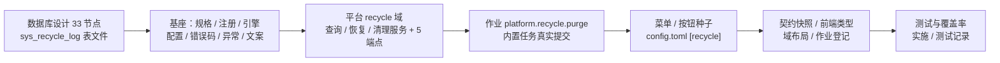

# 01 实施记录 · 13_01 回收站

> 通用能力 · 13 回收站 · 01 回收站 · 实施记录

[文档首页](../../../../../../文档首页.md) › [08 通用能力](../../../../README.md) › [回收站](../../13_回收站.md) › [回收站](../13_回收站_01_回收站.md) › 实施记录　|　[详细设计](../设计/01_详细设计_13_01_回收站.md) · [测试记录](../测试/01_测试记录_13_01_回收站.md)

## 1. 实施信息 <a id="meta"></a>

| 项 | 值 |
| --- | --- |
| 任务 | 13_01 回收站（软删除查看 / 恢复 / 超期清理） |
| 对应需求 | [07-2](../../../../需求/07_需求_数据生命周期.md#r07-2) |
| 详细设计 | [01_详细设计_13_01_回收站.md](../设计/01_详细设计_13_01_回收站.md) |
| 实施日期 | 2026-11-18 |
| 实施人 | minjian |
| 实施环境 | Windows 本地（Python 3.14 / `backend/.venv`；SQLite 测试库） |
| 提交 | 设计 `3de85e403`；实现 `0eed56420`（本次未推送） |
| 结论 | 完成（定向 291 项通过；10 个新模块行 + 分支 100%；改动行覆盖率通过；契约 / 前端类型零漂移） |

## 2. 实施概览 <a id="overview"></a>



结果小结：回收站按模块 / 表查看、单表分页与详情、单条恢复（唯一冲突 + 级联 + 审计 + 幂等）、超期逐表清理与批次记录全部落地；通用引擎下沉 `bms_core.recycle`，平台域只做 HTTP 面与作业；菜单 / 权限 / 配置 / 错误码 / 契约 / 前端类型齐备。

## 3. 实施过程 <a id="process"></a>

1. **数据库设计先行**：新建 `33_数据库设计_回收站.md` 与 `sys_recycle_log.md`，更新数据库设计总览（表清单 / 节点 33 / 已设计登记）与概要设计 32（§2.1 / §4 / §5 / §6）。
2. **基座数据层**：`SysRecycleLog` 模型、`MODEL_MODULES`、`TABLE_OWNERSHIP`（platform / recycle / tenant / enabled）、`RecycleSettings`（`[recycle]`）。
3. **错误与文案**：95001~95004、`RecycleError` 子段基与 4 个异常、`error_seed` 中英文案。
4. **通用引擎**：`bms_core/recycle/spec.py`（值对象）、`registry.py`（18 张表规格 + 追加注册 + 校验）、`engine.py`（模块计数 / 分页 / 详情 / 恢复 / 逐表清理）。
5. **平台域**：`domains/recycle` 查询 / 恢复 / 清理服务、契约、5 个端点；恢复按模块键递增帮助内容 / 元数据 / 工作台缓存版本。
6. **作业与任务**：`RecyclePurgeJob` + `job_handlers` / `job_specs` / `deploy/registry/platform.toml`；`purge_soft_deleted` 由占位改真实提交。
7. **种子与配置**：`/platform/recycle` 菜单 + 查询 / 恢复按钮；`config.toml [recycle]`（30 天 / 500 / 10000 / 60 分）。
8. **生成物**：`ops.check_modules --render-domain-layout`、`ops.contract_snapshot export`、`pnpm --filter @bms/api_types gen`。
9. **测试**：Kiwi 2530 登记后编写基座 / 接口 / 作业 / 恢复服务用例；任务内置测试改为提交作业断言。

关键命令：

```bash
backend/.venv/Scripts/ruff.exe check <改动文件>
backend/.venv/Scripts/ruff.exe format --check <改动文件>
backend/.venv/Scripts/pyright.exe --pythonpath .venv/Scripts/python.exe <改动文件>
backend/.venv/Scripts/pytest.exe libs/bms_core/tests/recycle services/platform/tests/recycle -q -n 0
python scripts/tools/preflight/coverage_report.py --module bms_core.recycle.engine ... 
git diff --cached --name-only | python scripts/tools/preflight/coverage_report.py --changed
python -m ops.contract_snapshot check
python -m ops.check_contracts
pnpm --filter @bms/api_types gen:check
```

## 4. 问题与处置 <a id="issues"></a>

| # | 问题 | 处置 |
| --- | --- | --- |
| 1 | `restore.py` 用表名常量判定缓存失效，被域边界门禁判为跨域表引用（`sys_icon*` / `sys_form_*` / `sys_field_ext*`） | 改为按 `recycle_spec_of(table).module_key` 判定（help / dashboard / permission_meta / form_design），不写死表名，行为不变 |
| 2 | 裸集合护栏拦下 `Mapping` / `tuple[str, ...]` / `list[...]` 声明 | 行映射改 `ConcurrentStableDict`；唯一键组合改 `ConcurrentStableSet[ConcurrentStableFrozenList[str]]`；`_spec` 入参改 `Iterable`；测试容器改稳定集合类 |
| 3 | 测试库隔离护栏拦下 4 个测试文件自建 SQLite | 按「表子集独立建表即被测」加 `pytest.mark.own_db("理由")`，不改为共享库（跨表批删会污染他人数据） |
| 4 | 合并跑用例时字段级审计（全局 ORM 捕获）向不存在的 `sys_outbox` 写事件，接口 / 作业用例失败 | 测试建表集补 `sys_outbox`（夹具仍保留真实审计链路口径） |
| 5 | `SysUser` 业务键列名是 `code`、属性名是 `username`，唯一冲突预检取不到值 | 新增 `_column_value()`：经 mapper 把物理列映射回属性名，`code` → `username` |
| 6 | 分类自引用级联恢复时，同表子行未被计入 `cascaded` | 计数改为「除主行外全部计入」，不再按表名是否等于主表过滤；深度上限用例补齐第 7 层 |
| 7 | 覆盖缺口：内部时钟 / 格式化 / 无重复级联 / 空唯一列 / 数据库兜底 / 状态非法 / 上界筛选等分支 | 补直接单测与夹具用例；`validate_recycle_specs` 补非法规格矩阵；最终 10 模块行 + 分支 100% |
| 8 | `coverage_report.py --changed` 不带标准输入时提示「无可判文件」 | 按规范以 `git diff --cached --name-only` 管道送入；26 个文件改动行全执行 |
| 9 | `pytest services/platform/tests -k "plugin_assembly ..."` 被全量测试守卫拒绝 | 改为直接运行 5 个装配 / 契约测试文件；其中 2 项既有红灯（见 §6） |
| 10 | 装配冒烟 `test_plugin_registration.py` 期望插件键集合缺 `help_content` / `notification_preference` | 范围外存量（07_01 / 12_01 新增端口未同步期望集），未改动，单列 §6 |

## 5. 验证结果 <a id="verify"></a>

| 完成标准 | 验证方法 | 实测结果 |
| --- | --- | --- |
| 按模块 / 表查看软删除数据 | 模块计数 / 单表分页 / 详情用例 | 通过（隐藏子表不出现；关键字 / 时间范围 / 排序正确） |
| 恢复后数据回到业务列表 | 恢复服务 / 接口用例 | 通过（`deleted_at` 清空；标题与旧删除时间返回） |
| 唯一冲突按预期拒绝 | 同码用户恢复、数据库兜底用例 | 通过（95002 + `conflicts`；整体回滚） |
| 级联恢复 | 文章多语言 + 锚点、分类子树、深度上限 | 通过（子行同事务恢复；超深停止） |
| 恢复可审计 | 显式留痕 / 白名单跳过用例 | 通过（非白名单表 `capture(deleted_at)`；`sys_user` 不重复） |
| 超期清理且留痕 | 清理服务 / 作业用例 | 通过（只删超期；逐表 `success` / `failed` 记录；running 超时回收） |
| 任务接线 | `test_task_builtin` | 通过（提交 `platform.recycle.purge`；下游不可用转 failed） |
| 静态门禁 | ruff / format / pyright | 全绿（源 + 测试） |
| 基座护栏 | check_base / check_tables / check_modules / check_service_boundaries / check_bare_collections / check_test_db_isolation / check_pragma_reason / check_product_literals / check_backend_base / check_snowflake_ids | 全部通过 |
| 契约与前端类型 | contract_snapshot check / check_contracts / api_types gen:check；api_types / vue / ui_ep typecheck；desktop build | 全部通过 |
| 覆盖率 | 10 个新模块模块级；26 个改动文件改动行 | 100%（行 + 分支）；改动行全执行 |

- 定向用例：`libs/bms_core/tests/recycle`、`services/platform/tests/recycle`、`test_task_builtin.py`、`test_exception_constructors_paths.py`、`test_error_seed_coverage.py` 共 **291 passed**。
- Kiwi：**2530**（平台回读确认，未复用 2523~2529）。
- 已知范围外红灯：`services/platform/tests/crosscut/test_plugin_registration.py` 2 项（期望插件键集缺 `help_content` / `notification_preference`）；`frontend/packages/core/tests/form-query.spec.ts` 的 `sort` 类型红灯（10_02 遗留）；11_01 测试记录缺原型对照结论。

## 6. 偏差与遗留 <a id="deviations"></a>

| # | 事项 | 归口 |
| --- | --- | --- |
| 1 | 缓存失效按模块键判定（而非表名前缀） | 设计 §12 对齐；行为不变，避免跨域表引用门禁 |
| 2 | 测试用 `own_db` 隔离建表 | 测试侧基础设施；理由见问题 3 |
| 3 | 回收站前端页面 / 按钮交互 / 移动端 | 阶段十五（需先补可交互原型） |
| 4 | 文件服务 `sys_file` 清理与配额释放（按 sha256+size 判活行） | 文件服务后续接入；计划 §7 登记 |
| 5 | 其他服务 / 产品表接入回收站 | 各服务 / 产品接入任务（复用 `bms_core.recycle`） |
| 6 | 存量菜单父级索引偏位（`/platform/tenants` 与归档三菜单落到 `/sys/icons`） | 单独修复任务 / 数据修复脚本；计划 §7 登记 |
| 7 | 跨表合并分页 / 批量恢复 | 按真实需求再评估；本期单表分页 + 单条恢复 |
| 8 | 模块级覆盖率与真库（MySQL / PG / DM8）行为 | 推送环 / 部署窗口复核 |
| 9 | 装配插件期望集过期、`@bms/core` 存量类型红灯、11_01 原型对照结论缺口 | 范围外存量，未改动 |

> 实施记录 · 进度以[阶段计划](../../../../计划/01_计划_通用能力.md)为唯一落点
