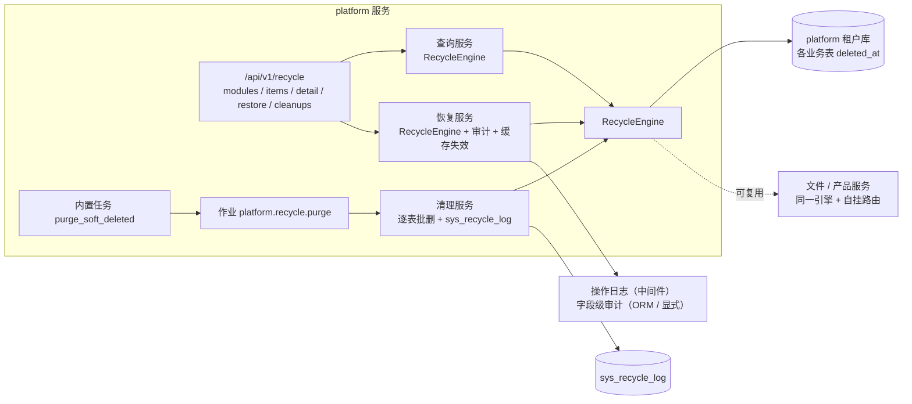
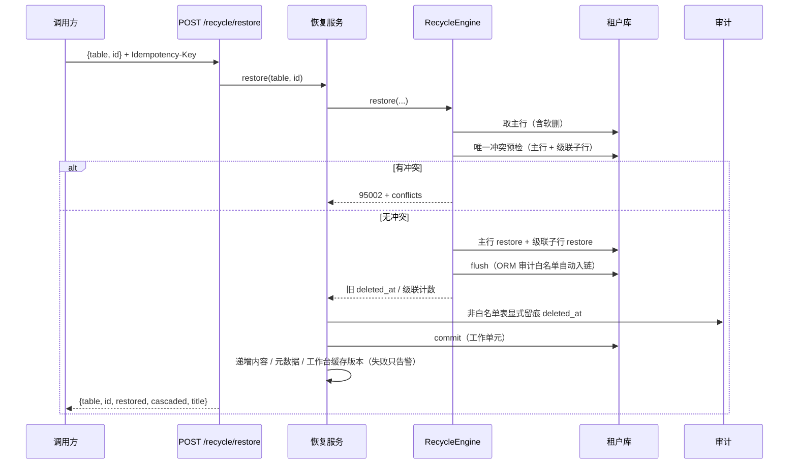
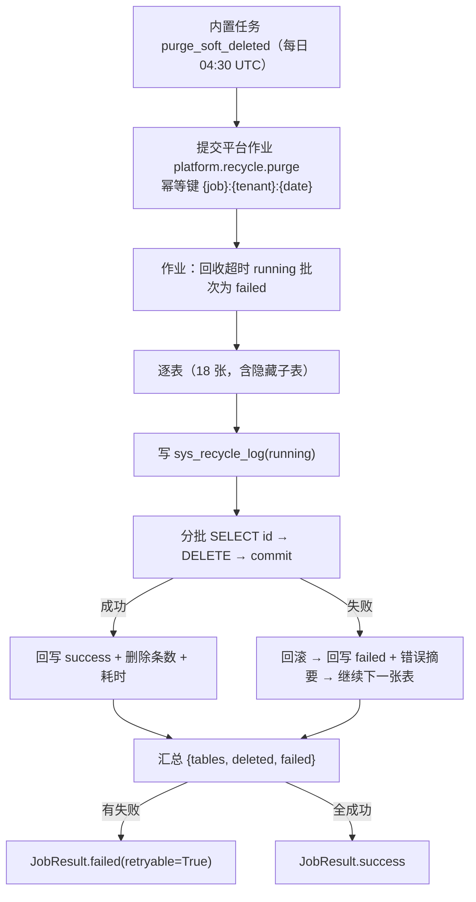

# 回收站详细设计（软删除查看 / 恢复 / 超期清理）

> 通用能力 · 13 回收站 · 01 回收站 · 详细设计

[文档首页](../../../../../../文档首页.md) › [08 通用能力](../../../../README.md) › [回收站](../../13_回收站.md) › [回收站](../13_回收站_01_回收站.md) › 详细设计　|　[需求 07-2](../../../../需求/07_需求_数据生命周期.md#r07-2) · [阶段计划](../../../../计划/01_计划_通用能力.md)

## 1. 概述 <a id="overview"></a>

- **目标**：把「软删除的数据能看见、能找回、到期能清掉」做成一条可运营的链路：
  1. **查看**：按业务模块 / 表列出 `deleted_at` 非空的数据，给删除条数、关键字与删除时间筛选、详情快照；
  2. **恢复**：清空 `deleted_at`，同事务恢复随主表一起被软删的子表行（多语言 / 锚点 / 子分类等），唯一键冲突按预期拒绝并提示冲突字段；恢复落操作日志与字段级审计；
  3. **超期清理**：内置任务按日向平台提交清理作业，逐表分批物理删除超过保留期的软删除数据，逐表写清理批次记录（条数 / 状态 / 耗时 / 保留期），可按表与状态查询；
  4. **可扩展**：通用查询 / 恢复 / 清理引擎落共享基座 `bms_core.recycle`，平台服务只做 HTTP 面与作业；后续文件服务、产品服务可用同一引擎挂自己的回收站路由，不跨库、不跨服务直写。
- **依据**：需求 [07-2](../../../../需求/07_需求_数据生命周期.md#r07-2)；《[概要设计 · 回收站](../../../../../../设计/概要设计/32_概要设计_回收站.md)》§2 / §4 / §5 / §6 / §7；《[架构设计 · 数据架构](../../../../../../设计/架构设计/07_架构设计_数据架构.md)》「回收站机制」；《[架构设计 · 扩展点与插件化](../../../../../../设计/架构设计/10_架构设计_子系统_扩展点与插件化.md)》「回收站」；《[数据库设计 · 数据规范](../../../../../../设计/数据库设计/02_数据库设计_数据规范.md)》「公共字段」「索引与唯一约束」；《[数据库设计 · 回收站](../../../../../../设计/数据库设计/33_数据库设计_回收站.md)》；《[后端开发规范](../../../../../../规范/后端开发规范.md)》§3 / §6 / §8 / §10；《[数据库开发规范](../../../../../../规范/数据库开发规范.md)》§3 / §4 / §7；《[测试规范](../../../../../../规范/测试规范.md)》§4 / §5 / §6；《[AI开发规范](../../../../../../规范/AI开发规范.md)》§5 / §7。
- **范围（本任务）**：
  - 基座 `bms_core.recycle`：表规格注册（12 张可见表 + 6 张级联子表）、模块 / 计数、单表分页、详情、恢复（唯一冲突 / 级联）、逐表清理；
  - 平台服务 `recycle` 域：5 个端点（模块 / 列表 / 详情 / 恢复 / 清理记录）、恢复后缓存失效、清理批次表 `sys_recycle_log`、清理作业 `platform.recycle.purge`；
  - 内置任务 `purge_soft_deleted` 由占位改真实提交；`[recycle]` 运行参数；错误码 95001~95004；
  - 回收站菜单 + 查询 / 恢复按钮种子；契约快照与前端类型重生成；
  - 数据库设计 33 节点、`sys_recycle_log` 表文件、总览登记；概要 32 §4 / §5 / §6 回写。
- **不含（归口见 §11）**：回收站前端页面与交互（阶段十五）、文件服务 `sys_file` 清理与配额释放（文件服务后续接入）、其他服务 / 产品表接入（各服务复用引擎自行挂路由）、跨表合并分页与批量恢复、手动清理端点、还原历史版本（只恢复删除行，不做字段级回滚）。

## 2. 现状与差距 <a id="gap"></a>

| # | 关注点 | 需求 / 设计 | 代码现状 | 处置 |
| --- | --- | --- | --- | --- |
| 1 | 软删除查看 | 按模块 / 表查 `deleted_at` 非空数据 | 无任何回收站查询入口；`BaseDbRepository` 默认过滤已删除 | **本段建**：表规格注册 + 模块计数 + 单表分页 + 详情 |
| 2 | 恢复 | 清空 `deleted_at`，落操作日志与字段级审计 | `BaseModel.restore()` 已存在；无通用恢复服务；`sys_config` 有专属恢复但只覆盖单表 | **本段建**：通用恢复引擎 + 平台恢复服务 + 审计留痕 |
| 3 | 唯一键冲突 | 同名记录存在时恢复被拒并提示 | 各表唯一约束已按 `(唯一字段, deleted_at)` 建；无冲突判定 | **本段建**：恢复前唯一冲突预检 + 数据库 `IntegrityError` 兜底（95002） |
| 4 | 级联恢复 | 主表删除时子表同事务软删，恢复要一并回来 | 12_01 文章删除连带软删多语言与锚点；无恢复入口 | **本段建**：表规格登记级联（文章 / 分类 / 图标 / 卡片 / 自建字段 / 用户扩展） |
| 5 | 字段级审计 | 恢复动作可在字段级审计查到 | 06_02 已按白名单经 ORM 捕获；非白名单表不会自动留痕 | **本段补**：白名单表走 ORM 自动捕获；其余表恢复后显式 `AuditCapturer.capture(deleted_at)` |
| 6 | 超期物理清理 | 定时清 `deleted_at` 超期数据，记录备查 | `purge_soft_deleted` 为占位（返回 `skipped`）；无清理表、无作业 | **本段建**：`sys_recycle_log` + `platform.recycle.purge` 作业 + 任务真实提交 |
| 7 | 运行参数 | 保留期 / 批次 / 单轮上限 | 无 `[recycle]` 段 | **本段建**：`[recycle]`（30 天 / 500 / 10000 / running 超时 60 分） |
| 8 | 权限与菜单 | `recycle:query` / `recycle:restore`；菜单挂接 | 业务码与两个权限码已落种子；无菜单 / 按钮 | **本段补**：`/platform/recycle` 菜单 + 查询 / 恢复按钮 |
| 9 | 错误码 | 95001~95004 | 9 段只有 90201 / 90203 / 90301 / 90401 / 93001~93008 | **本段补**：95001~95004 + 中英文案 |
| 10 | 多服务边界 | 「产品表复用平台回收站机制」 | 平台服务无法跨库访问文件 / 通知 / 产品表 | **本段定**：引擎下沉基座，各服务自持数据、自挂路由；平台本期只覆盖 platform 自有租户表 |
| 11 | 恢复副作用 | 恢复后列表 / 内容应即时可见 | 帮助内容缓存、元数据缓存、工作台缓存各有版本键 | **本段补**：恢复成功后按表族递增对应版本（失败只告警，不回滚恢复） |

## 3. 决策记录 <a id="align"></a>

> 本表为**已逐项确认**的定案（两轮 question 共 14 项，全部取推荐项）。

| # | 事项 | 结论 | 理由 / 长期收益 |
| --- | --- | --- | --- |
| 1 | 首批纳管范围 | **业务实体白名单**（12 张可见表 + 6 张级联子表） | 平台元数据、系统参数、语言文案、任务定义、归档策略已有专属入口或恢复副作用，不混入通用回收站；新增表按登记渐进接入 |
| 2 | 子表恢复 | **按登记级联恢复**，子表不在列表单独出现 | 避免「文章回来了、译文和锚点没回来」；级联关系显式可审 |
| 3 | 清理留痕 | **新增 `sys_recycle_log` 清理批次表** | 可按表 / 状态 / 时间查历史；与归档执行记录同构 |
| 4 | 清理表落库 | **platform 服务租户库**，与删除数据同库同事务 | 不出现「数据删了、记录没写」的跨库窗口 |
| 5 | 清理执行 | `purge_soft_deleted` **提交 `platform.recycle.purge` 作业** | 复用作业重试 / 进度 / 记录；基座不跨库写业务表 |
| 6 | 运行参数 | **`[recycle]` 配置段**（30 天 / 500 / 10000 / 60 分） | 平台治理参数跨租户一致；不引入 sys_config 双来源 |
| 7 | 列表分页 | **单表分页**（`table` 必填） | 走单表 `deleted_at` 索引，分页稳定；模块接口先给总览计数 |
| 8 | 恢复形态 | **单条恢复 + `Idempotency-Key`** | 事务与冲突处理清晰；与概要 §5 一致 |
| 9 | 手动清理 | **不提供**；只由定时任务执行 | 不扩大权限面；物理删除不可逆，避免误触 |
| 10 | 菜单种子 | **落回收站菜单 + 查询 / 恢复按钮** | 与 14_01 同口径，前端接入零改种子；页面归阶段十五 |
| 11 | 引擎落点 | **`bms_core/recycle` 通用引擎 + `platform.domains.recycle` HTTP 面** | 其他服务可复用同一引擎，产品表接入不搬代码、不跨服务直写 |
| 12 | 文件表清理 | **不纳入本期**，`sys_file` 归文件服务后续接入 | 守住数据所有权；配额释放需按 sha256+size 判活行，属文件域语义 |
| 13 | 详情字段 | **按表规格展示列**，敏感列脱敏 | 载荷小、字段稳定，不泄露口令等列 |
| 14 | 存量菜单父级偏位 | **只加回收站、不动存量** | 偏位属范围外缺陷，单列上报，避免本期扩大验证面 |

**由设计 / 规范直接派生（无需另议）**：

| 项 | 取值 | 依据 |
| --- | --- | --- |
| 恢复唯一冲突判定 | 排除含 `form_key` 的复合唯一约束；其余约束按非空列预检 | `form_key` 是页面标识而非行唯一键，其 `(form_key, deleted_at)` 在标准 SQL 下对活行不生效；真实业务键（`code` / `name` / `parent_id` 等）才是冲突来源 |
| 冲突兜底 | 预检 + `flush` 捕获 `IntegrityError` 双保险 | 预检覆盖常见场景并给出字段名；数据库约束兜底并发与方言差异 |
| 分页上限 | `page ≤ [pagination].max_page`（缺省 100） | 统一分页基座口径 |
| 列表排序 | `deleted_at DESC, id DESC` | 最近删除在前；主键兜底稳定序 |
| 搜索 | 表规格 `keyword_fields` 内 ILIKE，转义 `%` / `_` | 不做全列扫描；转义防通配符注入 |
| 时间范围 | `deleted_from` / `deleted_to`（UTC naive），起止颠倒按 10001 拒绝 | 与日志查询同口径 |
| 清理批次状态 | `running` / `success` / `failed` | 与归档执行记录同族；`running` 超时回收为 `failed` |
| 清理事件 | 不发新事件 | 作业记录 + 清理批次表已是可查留痕；无下游消费者 |
| 恢复事件 | 不发新事件 | 业务模块删除 / 恢复本身已有各自事件；回收站不重复发 |
| 幂等键作用域 | 「租户 + 接口 + 键」（`build_idempotency_key`） | 与图标 / 角色等写接口同口径 |
| 租户隔离 | 全部查询 / 恢复 / 清理只在当前请求或作业租户库内 | 一租户一库 + 仓储条件双保险 |
| Kiwi | 登记 1 条（分类「平台骨架」、`P2`、`CONFIRMED`、标签「自动化」） | 一任务一条策展用例 |

## 4. 交付物清单 <a id="tree"></a>

```text
backend/libs/bms_core/src/bms_core/
├── recycle/
│   ├── __init__.py                       # 新：出口（规格 / 注册 / 引擎）
│   ├── spec.py                           # 新：RecycleTableSpec / RecycleField / RecycleCascade
│   ├── registry.py                       # 新：首批 18 张表规格 + 注册口 + 规格校验
│   └── engine.py                         # 新：模块计数 / 分页 / 详情 / 恢复 / 逐表清理
├── models/platform/recycle.py            # 新：SysRecycleLog（清理批次）
├── models/platform/__init__.py           # 改：MODEL_MODULES 增 recycle
├── services/table_registry.py            # 改：sys_recycle_log（platform / recycle / tenant / enabled）
├── core/config.py                        # 改：RecycleSettings（[recycle]）+ Settings.recycle_options
├── core/error_codes.py                   # 改：95001~95004 + HTTP 映射
├── core/exceptions.py                    # 改：RecycleError 子段基 + 4 个子类
├── i18n/error_seed.py                    # 改：95001~95004 中英文案
└── tasks/builtin.py                      # 改：run_purge_soft_deleted 真实提交作业

backend/services/platform/src/bms_platform/
├── domains/recycle/
│   ├── __init__.py                       # 新：层包标记
│   ├── public.py                         # 新：域出口（本期无跨域 DTO / 接口）
│   ├── api/recycle.py                    # 新：5 个端点
│   ├── schemas/recycle.py                # 新：模块 / 分页 / 详情 / 恢复 / 清理记录契约
│   ├── services/query.py                 # 新：模块计数 / 列表 / 详情 / 清理记录
│   ├── services/restore.py               # 新：恢复编排（审计 / 缓存失效 / 幂等）
│   ├── services/purge.py                 # 新：逐表清理 + sys_recycle_log
│   └── jobs.py                           # 新：RecyclePurgeJob
├── jobs.py                               # 改：job_handlers / job_specs 增清理作业
└── api/router.py                         # 改：挂载 recycle 路由

backend/config.toml                       # 改：[recycle] 段
deploy/registry/platform.toml             # 改：[[domains]] recycle、[[jobs]] platform.recycle.purge
deploy/boundaries/domain_layout.json      # 重生成
deploy/contracts/platform.json            # 重生成
frontend/packages/api_types/src/platform.ts  # 重生成

backend/libs/bms_core/tests/
├── recycle/
│   ├── test_recycle_registry.py          # 新：规格完整性（模型 / 列 / 归属 / 级联 / 唯一键）
│   └── test_recycle_engine.py            # 新：计数 / 分页 / 详情 / 恢复 / 冲突 / 级联 / 清理
├── tasks/test_task_builtin.py            # 改：purge_soft_deleted 提交作业（替换占位断言）
└── core/test_exception_constructors_paths.py  # 改：4 个异常入口

backend/services/platform/tests/recycle/
├── helpers.py                            # 新：造删除数据 / 独立会话
├── test_recycle_api.py                   # 新：5 端点成功 / 失败 / 权限拒绝 / 幂等
└── test_recycle_job.py                   # 新：清理作业逐表记录 / 超时回收 / 失败继续

bms文档/
├── 设计/数据库设计/33_数据库设计_回收站.md              # 新：节点（复用软删 + 清理批次表）
├── 设计/数据库设计/数据表设计/sys_recycle_log.md        # 新：清理批次表文件
├── 设计/数据库设计/01_数据库设计_总览.md                # 改：表清单 / 节点 33 / 登记
├── 设计/概要设计/32_概要设计_回收站.md                  # 改：§4 表例外 / §5 清理记录端点 / §6 参数
├── 项目/08_通用能力/任务/13_回收站/13_回收站_01_回收站/
│   ├── 13_回收站_01_回收站.md            # 改：任务书补全
│   ├── 设计/01_详细设计_13_01_回收站.md   # 本文
│   ├── 实施/01_实施记录_13_01_回收站.md
│   └── 测试/01_测试记录_13_01_回收站.md
└── 项目/08_通用能力/计划/01_计划_通用能力.md  # 改：进度与遗留（唯一进度落点）
```

## 5. 领域设计 <a id="design"></a>

### 5.1 总体方案 <a id="architecture"></a>



口径：

- **数据归属不变**：回收站不新建「回收站表」，软删除数据仍在原业务表；`sys_recycle_log` 只记清理批次。
- **服务边界不变**：平台回收站只触达 platform 服务租户库；其他服务复用 `bms_core.recycle` 引擎，各自挂路由与作业，平台不跨库。
- **事务边界**：恢复在请求工作单元内一次提交（主行 + 级联子行 + 字段级审计发件箱同事务）；清理按「逐表单批」提交，单表失败不影响其他表。
- **幂等边界**：恢复接 `Idempotency-Key`；清理作业按「作业类型 + 租户 + 日期」幂等键去重；清理删除本身按批次可重入（已删行不再命中）。

### 5.2 纳管表规格 <a id="tables"></a>

表结构唯一事实源为表文件，本节只写「哪些表进回收站、怎么展示、怎么级联」。规格登记在
`bms_core/recycle/registry.py::RECYCLE_TABLES`，由 `RecycleTableSpec` 描述；`visible=False` 的子表只参与级联恢复与清理，不出现在列表。

| 模块（`module_key`） | 表 | 中文名 | 可见 | 标题列 | 关键字列 | 级联子表 |
| --- | --- | --- | --- | --- | --- | --- |
| `user` 用户与账号 | `sys_user` | 用户 | 是 | `name` | `code` / `name` | `sys_user_extension.user_id` |
| `user` 用户与账号 | `sys_user_extension` | 用户扩展信息 | 否 | `label` | — | — |
| `role` 角色与授权 | `sys_role` | 角色 | 是 | `name` | `code` / `name` | — |
| `permission_meta` 平台元数据 | `sys_icon` | 自定义图标 | 是 | `name` | `code` / `name` | `sys_icon_i18n.icon_id` |
| `permission_meta` 平台元数据 | `sys_icon_i18n` | 图标名多语言 | 否 | `name` | — | — |
| `help` 帮助内容 | `sys_help_category` | 帮助分类 | 是 | `name` | `name` | `sys_help_category.parent_id`（递归子树） |
| `help` 帮助内容 | `sys_help_article` | 帮助文章 | 是 | `title` | `title` | `sys_help_article_i18n.article_id`、`sys_help_article_target.article_id` |
| `help` 帮助内容 | `sys_help_article_i18n` | 文章多语言 | 否 | `title` | — | — |
| `help` 帮助内容 | `sys_help_article_target` | 文章锚点 | 否 | `target_key` | — | — |
| `help` 帮助内容 | `sys_help_feedback` | 帮助阅读反馈 | 是 | `feedback` | `comment` | — |
| `help` 帮助内容 | `sys_help_package` | 帮助包登记 | 是 | `product_key` | `product_key` | — |
| `dashboard` 工作台 | `sys_dashboard_card` | 工作台卡片 | 是 | `name` | `code` / `name` | `sys_dashboard_card_i18n.card_id` |
| `dashboard` 工作台 | `sys_dashboard_card_i18n` | 卡片名多语言 | 否 | `name` | — | — |
| `dashboard` 工作台 | `sys_dashboard_template` | 工作台模板 | 是 | `name` | `name` | — |
| `form_design` 表单定制 | `sys_form_layout` | 表单布局 | 是 | `form_code` | `form_code` | — |
| `form_design` 表单定制 | `sys_form_field_attr` | 表单字段属性 | 是 | `field_key` | `form_code` / `field_key` | — |
| `form_design` 表单定制 | `sys_field_ext` | 自建字段 | 是 | `name` | `form_code` / `field_key` / `name` | `sys_field_ext_i18n.field_id` |
| `form_design` 表单定制 | `sys_field_ext_i18n` | 自建字段名多语言 | 否 | `name` | — | — |

**展示列（`visible_fields`）** 按表登记，只返回白名单列，避免整行快照泄露口令等字段：

| 表 | 展示列（列名 → 中文标签） |
| --- | --- |
| `sys_user` | `code` 登录账号 / `name` 姓名 / `status` 状态 |
| `sys_role` | `code` 角色标识 / `name` 角色名 / `role_type` 角色类型 / `status` 状态 |
| `sys_icon` | `code` 图标键 / `name` 名称 / `category` 分组 / `status` 状态 |
| `sys_help_category` | `name` 分类名 / `status` 状态 / `sort` 排序 |
| `sys_help_article` | `title` 标题 / `status` 状态 / `source` 来源 / `is_top` 置顶 |
| `sys_help_feedback` | `feedback` 反馈 / `comment` 评论 |
| `sys_help_package` | `product_key` 产品 / `package_version` 版本 / `status` 状态 / `loaded_at` 装载时间 |
| `sys_dashboard_card` | `code` 卡片标识 / `name` 卡片名 / `card_type` 卡片类型 / `status` 状态 |
| `sys_dashboard_template` | `scope` 范围 / `name` 模板名 / `status` 状态 |
| `sys_form_layout` | `form_code` 表单标识 / `scope` 范围 / `status` 状态 |
| `sys_form_field_attr` | `form_code` 表单标识 / `field_key` 字段键 / `scope` 范围 |
| `sys_field_ext` | `form_code` 表单标识 / `field_key` 字段键 / `name` 字段名 / `type` 字段类型 / `status` 状态 |
| 隐藏子表 | `locale` 语言 / 名称或目标键（仅供级联恢复后不留孤儿，不单独出列表） |

- **模块标签**：用户与账号 / 角色与授权 / 平台元数据 / 帮助内容 / 工作台 / 表单定制。
- **规格校验**（护栏用例，不落运行期）：表名唯一；模型存在且带 `deleted_at`；表归属为 `enabled`；标题 / 关键字 / 展示列都存在；级联列存在；模块标签非空；可见表必须可恢复，隐藏表不可单独恢复。
- **注册口**：`register_recycle_tables(specs)` 供其他服务 / 产品装载期追加；同表重复登记同值幂等、异值即拒（与 `register_audited_tables` / `register_table_records` 同构）。

### 5.3 通用引擎 <a id="engine"></a>

`bms_core/recycle/engine.py::RecycleEngine`（`BaseFrameworkObject`，构造注入 `DbSession` + `RecycleSettings`）：

| 方法 | 输入 | 输出 / 行为 |
| --- | --- | --- |
| `modules()` | — | 按模块聚合可见表的删除条数；`SELECT COUNT(*)` 逐表（12 张，管理页低频） |
| `page(table, *, keyword, deleted_from, deleted_to, page, size)` | 表名 + 筛选 | 单表分页：`deleted_at IS NOT NULL`；关键字 ILIKE；时间范围；`deleted_at DESC, id DESC`；返回行（`id` / `title` / `deleted_at` / `deleted_by`）与总数 |
| `detail(table, id)` | 表名 + 主键 | 单行详情：展示列映射 + `deleted_at` / `deleted_by` / `created_at` / `updated_at`；不存在或未删除按 95001 |
| `restore(table, id)` | 表名 + 主键 | 同事务恢复主行 + 级联子行；返回主行旧 `deleted_at`、级联计数、标题；冲突抛 95002，已恢复抛 95003，未纳管抛 95004 |
| `purge_table(spec, *, cutoff, batch_size, max_rows)` | 表规格 + 截止时刻 | 分批 `SELECT id ... LIMIT` → `DELETE WHERE id IN (...)`；每批提交；返回删除条数 |

实现要点：

1. **模型定位**：按表名从 `Base.registry.mappers` 找 ORM 类（一次构造缓存），用 `session.get` 取软删行；避免另写一套表名 → 模型映射。
2. **恢复顺序**：主行恢复 → 级联子行恢复（按登记顺序；分类递归按 BFS 展开，层数上限 5）→ `flush`。任一步失败整体回滚。
3. **唯一冲突预检**（每行恢复前）：
   - 取表上的 `UniqueConstraint` 与 `unique=True` 索引；
   - **跳过含 `form_key` 的约束**（页面标识，不是行唯一键）；
   - 跳过含空值的约束（标准 SQL 下 NULL 不冲突）；
   - 对剩余约束拼 `WHERE 列 = 值 AND deleted_at IS NULL AND id <> 当前行`，命中即记 `{table, fields, conflict_id}`；
   - 汇总全部命中，抛 95002（`data.conflicts` 列出全部，`data.table` / `fields` 取第一条）。
4. **数据库兜底**：`flush` 捕获 `IntegrityError` → 95002（方言差异 / 并发窗口由数据库裁决）。
5. **值格式化**：时间 `YYYY-MM-DD HH:MM:SS`（UTC）；布尔 `是` / `否`；空值空串；其余 `str()`。展示列值再过 `mask_sensitive`（按 `[log]` 敏感名单），确保即使误加敏感列也不会明文输出。
6. **清理**：`deleted_at < cutoff`（严格小于，保留期 0 也只清「已过一刻」的行）；单表单轮最多 `max_batch_rows`，剩余交下一轮；`DELETE` 用 Core 语句、不走 ORM，避免触发字段级审计噪声。
7. **失败语义**：分页 / 详情 / 恢复的非法表名、越界主键不写库；清理单表异常向上抛给平台服务记 `failed`，不吞掉。

### 5.4 恢复流程与审计 <a id="restore"></a>



- **操作日志**：恢复端点由 06_01 操作审计中间件自动记录，动作码即 `recycle:restore`，请求体含表名与主键。
- **字段级审计**：
  - `sys_user` / `sys_role` 在 `AUDITED_TABLES` 内 → ORM 会话事件自动捕获 `deleted_at` 由时间戳变 `NULL`；
  - 其余表不在白名单 → 恢复成功后由平台恢复服务显式 `AuditCapturer.capture(table, model_id, [FieldChange("deleted_at", old, None)])`，经请求级暂存由中间件统一发射；
  - 白名单判定用 `is_audited_table()` 唯一入口，避免两套名单；显式留痕失败只告警，不回滚已提交的恢复（操作日志仍可查）。
- **级联**：只恢复当前仍为软删的子行；已恢复 / 从未删除的子行不动。分类子树按 `parent_id` 递归（访问集合防环，深度上限 5）；文章恢复多语言与锚点；图标 / 卡片 / 自建字段恢复多语言附表；用户恢复扩展信息。
- **不恢复的东西**：分类删除时被置 `offline` 的文章（未软删，不属回收站）；包卸载置 `unloaded` 的包状态（未软删）；角色授权 / 用户角色（删除前有引用校验，未连带软删）。
- **缓存失效（恢复成功后，失败只告警）**：

| 表族 | 失效动作 |
| --- | --- |
| `sys_help_*` | `bms_core.help.cache.bump_content_version(cache, tenant=当前租户)` |
| `sys_icon*` / `sys_form_layout` / `sys_form_field_attr` / `sys_field_ext*` | `bms_platform.services.metadata_cache.bump_metadata_version(cache)`（菜单 + 权限双版本） |
| `sys_dashboard_*` | `cache.aincrease(cache.build_key("version", tenant=当前租户))`（工作台解析版本） |
| `sys_user*` / `sys_role` | 不失效（删除前有引用校验，恢复不改变授权集合；权限快照按用户与版本取，无脏读） |

### 5.5 超期清理与批次记录 <a id="purge"></a>



- **保留期**：`cutoff = now - [recycle].retention_days`（缺省 30 天）；只删 `deleted_at < cutoff`，仍在保留期内的一律不动。
- **批次表 `sys_recycle_log`**（表结构见[表文件](../../../../../../设计/数据库设计/数据表设计/sys_recycle_log.md)）：逐表一行，`batch_key` 同一次作业共享；`status` / `retention_days` / `cutoff_at` / `deleted_count` / `cost_time` / `started_at` / `finished_at` / `error_msg` / `detail`。
- **超时回收**：作业开始时把 `status=running AND started_at < now - [recycle].running_timeout_minutes` 的行置 `failed`（错误摘要「执行超时未完成（进程可能中断）」），避免崩溃留下永久 running。
- **失败继续**：单表失败只影响该表，其他表继续；作业最终返回失败并允许重试（已删行不再命中，重试幂等）。
- **不做跨表事务**：逐表逐批提交，避免长事务锁表；单表内单批失败即停止该表并记失败。
- **不发事件**：作业记录 + 清理批次表即留痕；不新增事件契约，避免无消费方的空事件。

### 5.6 接口设计 <a id="api"></a>

前缀 `/api/v1`，统一响应 `{code, message, data}`；全部需登录。

| 方法 | 路径 | 权限码 | 说明 |
| --- | --- | --- | --- |
| GET | `/recycle/modules` | `recycle:query` | 可回收模块 / 表清单 + 各表删除条数 |
| GET | `/recycle/items` | `recycle:query` | 单表分页（`table` 必填；`keyword` / `deleted_from` / `deleted_to` / `page` / `size`） |
| GET | `/recycle/items/{table}/{id}` | `recycle:query` | 单行详情（展示列快照） |
| POST | `/recycle/restore` | `recycle:restore` | 单条恢复（`{table, id}`；可选 `Idempotency-Key`） |
| GET | `/recycle/cleanups` | `recycle:query` | 清理批次记录分页（`table_name` / `status` / `started_from` / `started_to` / `page` / `size`） |

- **模块清单**：只含可见表；隐藏子表不计入；模块按登记顺序返回。
- **列表**：`table` 不在纳管范围 → 95004；`keyword` 按表规格关键字列匹配；时间范围起止颠倒 → 10001。
- **详情**：行不存在 / 未删除 / 已物理清理 → 95001；隐藏子表 → 95004。
- **恢复**：隐藏子表 / 未纳管表 → 95004；行不存在 → 95001；已恢复 → 95003；唯一冲突 → 95002（返回冲突字段与冲突行主键）。
- **清理记录**：只读；`status` ∈ `running` / `success` / `failed`；按 `started_at DESC, id DESC`。
- **幂等**：恢复请求带 `Idempotency-Key` 时，同租户同键重复请求返回首次结果；键缺失即按普通写处理。
- **限流**：沿用网关与平台统一限流；不新增接口级限流实现。

### 5.7 权限、菜单与审计 <a id="permission"></a>

- **权限码**：沿用已落种子的 `recycle:query`（查询 / 详情 / 清理记录）与 `recycle:restore`（恢复）；不新增权限码、不提供手动清理端点。
- **菜单**：`/platform/recycle`「回收站」，挂在「平台管理」下，`sort=5`；按钮「查询」（`recycle:query`）与「恢复」（`recycle:restore`）；业务码 `recycle`（已存在）。
- **菜单父级**：`MENU_SEEDS` 按父级下标解析，`/platform` 在清单中的 1-based 位置为 11；回收站条目用 11。**存量 `/platform/tenants` 与归档三菜单的父级下标偏位不在本期修**（范围外缺陷，见 §11）。
- **操作日志**：5 个端点中只有恢复是写操作；由中间件按 `recycle:restore` 记录，查询类不记操作日志。
- **字段级审计**：见 §5.4；清理是物理删除，不产生字段级审计（清理批次表 + 作业记录承担留痕）。
- **审计类数据**：审计日志 / 登录日志 / 字段级审计 / 归档台账不纳入回收站（物理保留、不提供恢复）。

### 5.8 数据库与配置 <a id="database"></a>

- **不新建软删除数据表**：软删除数据仍在原业务表，回收站只读 / 只改 `deleted_at`。
- **新建 `sys_recycle_log`**：platform 服务租户库 `bms_platform_{code}`，`domain=recycle`、`datasource=tenant`、`status=enabled`，随租户链幂等建表；表结构唯一事实源为[表文件](../../../../../../设计/数据库设计/数据表设计/sys_recycle_log.md)。
- **`[recycle]` 配置**（`RecycleSettings`）：

| 键 | 缺省 | 含义 |
| --- | --- | --- |
| `retention_days` | 30 | 软删除数据保留天数（清理截止 = 当前时刻 − 保留天数） |
| `batch_size` | 500 | 单表单批删除条数 |
| `max_batch_rows` | 10000 | 单表单轮最多删除条数（剩余交下一轮） |
| `running_timeout_minutes` | 60 | `running` 清理批次超时回收阈值 |

- **概要 §6 的 sys_config 键**：按「运行参数统一落配置」口径改为 `[recycle]`，不回写 sys_config 同名键（回写概要节点）。

### 5.9 与相邻任务的边界 <a id="boundary"></a>

| 任务 | 本任务交付 | 本任务不做 |
| --- | --- | --- |
| 01_02 任务调度 / 01_03 作业中心 | `purge_soft_deleted` 真实提交 `platform.recycle.purge`；作业声明三处同步 | 改调度器 / 作业引擎 |
| 06_01 操作日志 | 恢复端点自动落操作日志 | 改中间件 / 日志查询 |
| 06_02 字段级审计 | 白名单表 ORM 自动留痕；非白名单表显式 `capture(deleted_at)` | 改白名单 / 链写入 / 查询 |
| 12_01 帮助内容 | 帮助分类 / 文章 / 反馈 / 包的查看、级联恢复、清理；内容缓存版本失效 | 改文章状态机 / 维护端点 |
| 14_01 归档管理 | 软删除残留清理（本任务）与归档文件清理分属两条任务，共用调度 | 改归档策略 / 冷化 / 销毁 |
| 03_01 文件管理 | 本期不触及 `sys_file` | 文件清理与配额释放（文件服务后续接入） |
| 10_01 / 11_01 表单与工作台 | 布局 / 字段属性 / 自建字段 / 卡片 / 模板的恢复与清理 | 改布局解析 / 卡片注册 |
| 阶段十五 前端 | 契约与类型 | 回收站页面、按钮交互、原型 |
| 产品仓 / 其他服务 | 基座引擎与注册口 | 各服务自己的回收站路由与表规格登记 |

## 6. 接口契约 <a id="contract"></a>

### 6.1 模块清单 <a id="api-modules"></a>

**`GET /api/v1/recycle/modules`**

```json
{
  "code": 0,
  "message": "ok",
  "data": {
    "items": [
      {
        "module_key": "help",
        "module_label": "帮助内容",
        "deleted_count": 3,
        "tables": [
          { "table": "sys_help_article", "label": "帮助文章", "deleted_count": 2 },
          { "table": "sys_help_category", "label": "帮助分类", "deleted_count": 1 },
          { "table": "sys_help_feedback", "label": "帮助阅读反馈", "deleted_count": 0 },
          { "table": "sys_help_package", "label": "帮助包登记", "deleted_count": 0 }
        ]
      }
    ]
  }
}
```

### 6.2 单表分页 <a id="api-items"></a>

**`GET /api/v1/recycle/items?table=sys_help_article&keyword=快速&deleted_from=2026-11-01T00:00:00&page=1&size=20`**

```json
{
  "code": 0,
  "message": "ok",
  "data": {
    "list": [
      {
        "table": "sys_help_article",
        "id": "900000000000000001",
        "title": "快速上手：认识平台",
        "deleted_at": "2026-11-17T08:00:00",
        "deleted_by": "900000000000000009"
      }
    ],
    "total": 1,
    "page": 1,
    "size": 20
  }
}
```

### 6.3 详情 <a id="api-detail"></a>

**`GET /api/v1/recycle/items/sys_help_article/900000000000000001`**

```json
{
  "code": 0,
  "message": "ok",
  "data": {
    "table": "sys_help_article",
    "id": "900000000000000001",
    "title": "快速上手：认识平台",
    "deleted_at": "2026-11-17T08:00:00",
    "deleted_by": "900000000000000009",
    "created_at": "2026-11-10T02:00:00",
    "updated_at": "2026-11-17T08:00:00",
    "fields": {
      "标题": "快速上手：认识平台",
      "状态": "published",
      "来源": "tenant",
      "置顶": "否"
    }
  }
}
```

### 6.4 恢复 <a id="api-restore"></a>

**`POST /api/v1/recycle/restore`**（可选请求头 `Idempotency-Key`）

请求：`{"table": "sys_help_article", "id": "900000000000000001"}`

```json
{
  "code": 0,
  "message": "ok",
  "data": {
    "table": "sys_help_article",
    "id": "900000000000000001",
    "title": "快速上手：认识平台",
    "restored": true,
    "cascaded": {
      "sys_help_article_i18n": 2,
      "sys_help_article_target": 1
    }
  }
}
```

**唯一冲突示例**：

```json
{
  "code": 95002,
  "message": "恢复失败：唯一键已被占用",
  "data": {
    "table": "sys_user",
    "fields": ["code"],
    "conflict_id": "900000000000000123",
    "conflicts": [
      { "table": "sys_user", "fields": ["code"], "conflict_id": "900000000000000123" }
    ]
  }
}
```

### 6.5 清理批次记录 <a id="api-cleanups"></a>

**`GET /api/v1/recycle/cleanups?table_name=sys_help_article&status=success&page=1&size=20`**

```json
{
  "code": 0,
  "message": "ok",
  "data": {
    "list": [
      {
        "id": "900000000000000201",
        "batch_key": "recycle:20261118043000:ab12cd34",
        "table_name": "sys_help_article",
        "status": "success",
        "retention_days": 30,
        "cutoff_at": "2026-10-19T04:30:00",
        "deleted_count": 2,
        "cost_time": 12,
        "started_at": "2026-11-18T04:30:00",
        "finished_at": "2026-11-18T04:30:00",
        "error_msg": null
      }
    ],
    "total": 1,
    "page": 1,
    "size": 20
  }
}
```

### 6.6 错误码（95001~95004） <a id="errors"></a>

| 码 | 名称 | HTTP | 场景 |
| --- | --- | --- | --- |
| 95001 | `RECYCLE_RECORD_NOT_FOUND` | 404 | 记录不存在 / 未删除 / 已物理清理 |
| 95002 | `RECYCLE_RESTORE_CONFLICT` | 409 | 恢复唯一冲突（唯一键被占用） |
| 95003 | `RECYCLE_ALREADY_RESTORED` | 409 | 数据已被其他操作恢复（并发保护） |
| 95004 | `RECYCLE_TABLE_NOT_SUPPORTED` | 400 | 表不在回收站纳管范围 / 审计类数据 / 子表不可单独恢复 |

- 参数形态错误（分页越界、时间范围颠倒、`status` 非枚举）走统一 `10001`；未登录 `20001`；缺权限 `30001`。
- 文案由前端按 `error.{code}` 映射，后端不拼装；中英文案进 `i18n/error_seed.py`。

## 7. 失败分支与边界 <a id="failures"></a>

| 场景 | 处置 | 结果 |
| --- | --- | --- |
| 表名未登记 / 子表单独恢复 | 95004 | 不查库 |
| 记录不存在 / 未删除 | 95001 | 不写库 |
| 记录已恢复（并发） | 95003 | 不写库 |
| 主行唯一冲突 | 95002 + `conflicts` | 整体回滚，主行与级联子行都不恢复 |
| 级联子行唯一冲突 | 95002 + `conflicts`（含子表） | 整体回滚 |
| 预检通过但 flush 仍冲突（并发 / 方言） | 95002（数据库兜底） | 整体回滚 |
| 恢复成功但显式审计留痕失败 | 只记 warn | 恢复保持成功；操作日志可查 |
| 恢复成功但缓存失效失败 | 只记 warn | 恢复保持成功；缓存按 TTL 自然过期 |
| 幂等键重复 | 返回首次结果 | 不重复恢复 |
| 清理单表失败 | 该表 `failed` + 错误摘要；继续下一表 | 作业最终失败可重试 |
| 清理进程中断留下 `running` | 下次作业按超时回收为 `failed` | 不永久 running |
| 保留期内数据 | 不删除 | 只清 `deleted_at < cutoff` |
| 单表超过 `max_batch_rows` | 本轮删到上限即停 | 剩余下一轮继续 |
| 关键字含 `%` / `_` | 转义后按字面匹配 | 不退化为通配符 |
| 分页超深 | 10001 | 不查库 |
| 跨租户访问 | 租户库隔离 + 中间件 | 查不到他租户数据 |
| 未登录 / 缺权限 | 20001 / 30001 | 拒绝 |
| 审计类表 / 归档表 | 未登记，95004 | 拒绝恢复 / 不出现在列表 |

## 8. 测试设计与验收映射 <a id="tests"></a>

**Kiwi**：登记 **1 条**策展用例（分类「平台骨架」、`P2`、`CONFIRMED`、标签「自动化」），先登记后编码；代码 `@pytest.mark.kiwi_id(<编号>)` 标注，编号以平台回读为准，不复用 2523~2529。

| # | 验收项（任务 §3 / 需求 07-2） | 用例 | 断言 |
| --- | --- | --- | --- |
| 1 | 模块 / 表计数 | `test_recycle_engine.py::test_modules_counts` | 只统计可见表；隐藏子表不出现；删除条数正确 |
| 2 | 单表分页与关键字 | `test_recycle_engine.py::test_page_filters` | 只出软删行；关键字 / 时间范围生效；排序稳定；分页正确 |
| 3 | 详情展示列 | `test_recycle_engine.py::test_detail_fields` | 只返回白名单列；布尔 / 时间格式化；敏感列不出现 |
| 4 | 恢复主行 | `test_recycle_engine.py::test_restore_clears_deleted_at` | `deleted_at` 清空；返回旧时间与标题 |
| 5 | 唯一冲突 | `test_recycle_engine.py::test_restore_conflict` | 同名 / 同码冲突 95002 + 字段；整体回滚 |
| 6 | 已恢复 / 不存在 | `test_recycle_engine.py::test_restore_not_found_and_restored` | 95001 / 95003 |
| 7 | 级联恢复 | `test_recycle_engine.py::test_restore_cascades` | 文章多语言 / 锚点、图标多语言、自建字段多语言一并恢复 |
| 8 | 分类子树递归 | `test_recycle_engine.py::test_restore_category_subtree` | 子树分类全部恢复；不越界 |
| 9 | 未纳管表 | `test_recycle_engine.py::test_restore_unsupported_table` | 95004；隐藏子表也不可单独恢复 |
| 10 | 逐表清理 | `test_recycle_engine.py::test_purge_batches` | 只删超期行；分批提交；单轮上限生效 |
| 11 | 规格完整性 | `test_recycle_registry.py::test_specs_valid` | 表 / 模型 / 列 / 归属 / 级联 / 唯一键全部合法 |
| 12 | 5 个端点 | `test_recycle_api.py::test_routes` | 模块 / 列表 / 详情 / 恢复 / 清理记录成功路径 |
| 13 | 权限拒绝 | `test_recycle_api.py::test_requires_permission` | 未登录 401；缺 `recycle:query` / `restore` 403 |
| 14 | 幂等 | `test_recycle_api.py::test_restore_idempotency` | 同键第二次返回首次结果，不重复恢复 |
| 15 | 清理作业 | `test_recycle_job.py::test_purge_job_writes_logs` | 逐表 `success` 记录；条数 / 耗时 / 保留期正确 |
| 16 | 单表失败继续 | `test_recycle_job.py::test_purge_job_continues_on_failure` | 一张表失败不影响其他表；作业失败可重试 |
| 17 | 超时回收 | `test_recycle_job.py::test_reclaim_stale_running` | 陈旧 `running` 置 `failed` |
| 18 | 任务提交 | `test_task_builtin.py::test_purge_task_submits_job` | 提交 `platform.recycle.purge`；下游不可用转 failed |
| 19 | 错误码完整性 | `test_exception_constructors_paths.py` + `error_seed` 用例 | 4 个异常可构造；中英文案齐全 |
| 20 | 菜单 / 按钮种子 | `test_seed_menu` 相关用例 | 回收站菜单与两个按钮可查、幂等重跑不重复 |

**覆盖率**：新增 / 改动模块按模块级 100%（行 + 分支）本地跑满：`bms_core.recycle.*`、
`bms_core.models.platform.recycle`、`bms_core.core.config` / `error_codes` / `exceptions`、
`bms_core.i18n.error_seed`、`bms_core.tasks.builtin`、`bms_core.tenant.seed.menu`、
`bms_platform.domains.recycle.*`、`bms_platform.jobs`、`bms_platform.api.router`。
提交环判改动行、推送环判模块级；无 `pragma: no cover`（确不可达分支须带理由）。

**原型对照**：不适用（本任务无界面源码变更：只交付后端接口、契约与菜单种子，页面归阶段十五；已按决策 10 确认）。

## 9. 登记落点 <a id="registry-writeback"></a>

| 落点 | 内容 |
| --- | --- |
| 《数据库设计 · 回收站》节点 33 | 新建：复用软删除 + `sys_recycle_log` 清理批次表；与 12_01 / 14_01 / 文件服务边界 |
| `sys_recycle_log` 表文件 | 新建（归属 / 字段 / 索引 / 建表 / 变更记录） |
| 《数据库设计》总览 | 表清单「审计与治理」补 `sys_recycle_log`；§7.2 节点 33 表清单；§7.3 登记（状态两处一致） |
| 《概要设计 · 回收站》 | §4 补「清理批次表」例外；§5 补 `GET /recycle/cleanups`；§6 运行参数改 `[recycle]` |
| `bms_core/services/table_registry.py` | `sys_recycle_log`（`owner=platform`、`domain=recycle`、`datasource=tenant`、`enabled`） |
| `bms_core/models/platform/__init__.py` | `MODEL_MODULES` 增 `recycle` |
| `deploy/registry/platform.toml` | `[[domains]] recycle`；`[[jobs]] platform.recycle.purge` |
| `deploy/boundaries/domain_layout.json` | 重生成（含 recycle 域） |
| `deploy/contracts/platform.json` | 重生成（5 个 `/api/v1/recycle/*`） |
| `frontend/packages/api_types/src/platform.ts` | 重生成 |
| `bms_core/tenant/seed/menu.py` | 回收站菜单 + 查询 / 恢复按钮 |
| `backend/config.toml` | `[recycle]` 段 |
| 阶段计划 §2 / §3 / §4 / §7 | 进度与遗留回写（唯一进度落点） |
| 需求 07-2 / 任务 13_01 | 交付注块（不承载进度） |
| 任务目录 | 实施记录 + 测试记录 |

## 10. 实施步骤 <a id="steps"></a>

1. **数据库设计先行**：新建 33 节点 + `sys_recycle_log` 表文件 + 总览登记（状态两处一致）。
2. **模型与登记**：`SysRecycleLog` 模型；`MODEL_MODULES`；表归属登记。
3. **基座**：`RecycleSettings`、95001~95004、4 个异常、中英文案；`bms_core.recycle`（spec / registry / engine）。
4. **平台域**：查询 / 恢复 / 清理服务、schemas、5 个端点、路由挂载。
5. **作业与任务**：`RecyclePurgeJob` + `job_handlers` / `job_specs` / `platform.toml`；`purge_soft_deleted` 真实提交。
6. **种子与配置**：回收站菜单 + 按钮；`config.toml [recycle]`。
7. **生成物**：`ops.check_modules --render-domain-layout`、`ops.contract_snapshot export`、`pnpm api_types:gen`。
8. **Kiwi**：先登记取得编号 → 写用例（基座 / 平台域 / 作业 / 任务）。
9. **验证**：单文件 `ruff check` / `pyright` / `pytest`；`coverage_report.py --module` 至 100%；契约 / 边界 / 裸集合 / 表归属 / 文档三护栏全绿。
10. **登记回写 + 实施 / 测试记录**。
11. **提交**：`feat(通用能力)`（代码 + 契约 + 前端类型）→ `docs(通用能力)`（设计 / 记录 / 计划 / 回写）。

## 11. 边界与开放项 <a id="open"></a>

| # | 事项 | 处置 |
| --- | --- | --- |
| 1 | 回收站前端页面 / 按钮交互 / 移动端 | 阶段十五（需先补可交互原型） |
| 2 | `sys_file` 清理与配额释放 | 文件服务后续接入（按 sha256+size 判活行后删对象）；计划 §7 登记 |
| 3 | 其他服务 / 产品表接入回收站 | 复用 `bms_core.recycle` 引擎，各自挂路由与作业；计划 §7 登记 |
| 4 | 跨表合并分页 | 本期单表分页；确有需求再做统一视图或检索侧聚合 |
| 5 | 批量恢复 | 本期单条；批量涉及部分成功语义，按真实需求再立项 |
| 6 | 手动清理端点 | 不提供；物理删除不可逆，只由定时任务执行 |
| 7 | 系统参数 / 语言 / 任务 / 归档策略 | 不进通用回收站（专属恢复入口或恢复副作用） |
| 8 | 分类删除时被下线的文章 | 恢复分类不自动重新发布文章（下线不是软删） |
| 9 | 迁移脚本 | 结构以模型为唯一事实源；存量库按「删库重建」口径，不补历史数据 |
| 10 | DM8 复合唯一 NULL 语义 | 既有开放项；恢复冲突以预检 + 数据库兜底，不按方言分叉 |
| 11 | 存量菜单父级下标偏位 | 范围外缺陷（`/platform/tenants` 与归档三菜单落到 `/sys/icons`）；本期只加回收站并用正确位置，计划 §7 登记修复 |
| 12 | 恢复后的权限快照 | 用户 / 角色恢复不失效权限缓存（删除前有引用校验，授权集合未变） |
| 13 | 清理批次历史保留 | 与平台库备份同生命周期；不做自动归档（量级小） |
| 14 | 恢复历史版本 | 只恢复删除行，不做字段级回滚；字段级审计供追溯 |

## 12. 实施对齐记录 <a id="align-impl"></a>

> 实施与定稿设计的差异回写本节；详细过程与原因见[实施记录](../实施/01_实施记录_13_01_回收站.md)「问题与处置」。

| # | 设计口径 | 实施落点 | 原因 |
| --- | --- | --- | --- |
| — | — | — | 实施后回写 |

## 13. 参考文档 <a id="ref"></a>

- 需求 [07-2 回收站](../../../../需求/07_需求_数据生命周期.md#r07-2)
- 《[概要设计 · 回收站](../../../../../../设计/概要设计/32_概要设计_回收站.md)》§2 / §4 / §5 / §6 / §7
- 《[架构设计 · 数据架构](../../../../../../设计/架构设计/07_架构设计_数据架构.md)》「回收站机制」
- 《[架构设计 · 扩展点与插件化](../../../../../../设计/架构设计/10_架构设计_子系统_扩展点与插件化.md)》「回收站」
- 《[数据库设计 · 回收站](../../../../../../设计/数据库设计/33_数据库设计_回收站.md)》《[数据规范](../../../../../../设计/数据库设计/02_数据库设计_数据规范.md)》§2 / §3 / §5
- 《[后端开发规范](../../../../../../规范/后端开发规范.md)》§3 / §6 / §8 / §10
- 《[数据库开发规范](../../../../../../规范/数据库开发规范.md)》§3 / §4 / §7
- 《[测试规范](../../../../../../规范/测试规范.md)》§4 / §5 / §6
- 《[AI开发规范](../../../../../../规范/AI开发规范.md)》§5「一条龙」、§7「覆盖率要求」
- 前置设计：[12_01 帮助内容维护与前台展示](../../../12_帮助内容/12_帮助内容_01_帮助内容维护与前台展示/设计/01_详细设计_12_01_帮助内容维护与前台展示.md)、
  [14_01 归档管理](../../../14_归档/14_归档_01_归档管理/设计/01_详细设计_14_01_归档管理.md)、
  [01_02 任务调度](../../../01_异步底座/01_异步底座_02_任务调度/设计/01_详细设计_02_任务调度.md)、
  [06_02 字段级变更审计与哈希链](../../../06_日志与审计/06_日志与审计_02_字段级变更审计与哈希链/设计/01_详细设计_06_02_字段级变更审计与哈希链.md)

> 详细设计 · 依《[文档生成规范](../../../../../../规范/文档生成规范.md)》编写 · 进度以[阶段计划](../../../../计划/01_计划_通用能力.md)为唯一落点
