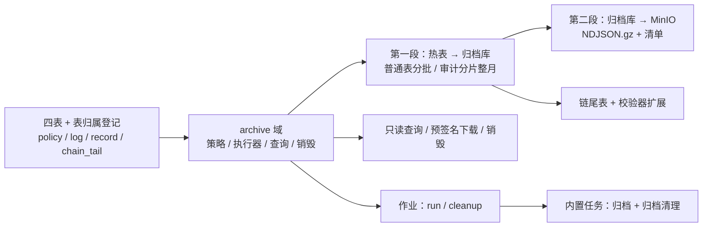

# 14_01 归档管理实施记录

> 通用能力 · 14 归档 · 01 归档管理 · 实施记录

[文档首页](../../../../../../文档首页.md) › [08 通用能力](../../../../README.md) › [归档](../../14_归档.md) › [归档管理](../14_归档_01_归档管理.md) › 实施　|　[← 详细设计](../设计/01_详细设计_14_01_归档管理.md)

## 1. 实施信息 <a id="meta"></a>

| 项 | 值 |
| --- | --- |
| 任务 | [01 归档管理](../14_归档_01_归档管理.md) |
| 对应需求 | [07-1](../../../../需求/07_需求_数据生命周期.md#r07-1) |
| 详细设计 | [01_详细设计_14_01_归档管理](../设计/01_详细设计_14_01_归档管理.md) |
| 实施日期 | 2026-11-16 |
| 实施人 | minjian |
| 实施环境 | 开发机（Windows，Python 3.14 / SQLite 测试库） |
| 提交 | `495965432`（设计）· `a8e7d660d`（实现）· `f88e84e4a`（生成物） |
| 结论 | 完成（本地提交环通过；推送环模块覆盖率待推送时复核） |

## 2. 实施概览 <a id="overview"></a>



结果小结：归档策略 CRUD、普通表两段式、审计分片整月归档（链校验 → 迁归档库 → 写链尾 → 删物理分片表 → 台账 `archived`）、直冷、只读查询、预签名下载、过期清理与合规销毁全部落地；`archive` 域三组路由挂载完成，两条件业与两条内置任务接线完成，三类审计日志 90 天策略种子与权限 / 菜单 / 文案齐备。

## 3. 实施过程 <a id="process"></a>

1. **数据层**：新增 `bms_core/models/platform/archive.py` 四模型（策略 / 执行记录 / 归档行 / 链尾）；`services/table_registry.py` 登记四表（三表平台库、`sys_archive_record` 归档库，`domain=archive`）；`models/platform/__init__.py` 纳入模型清单。
2. **配置与错误**：`[archive]` 段（批次 / 清理保留期 / 查询窗口 / running 超时 / 冷化块大小 / 文件前缀）；错误码 93001~93008、异常类与中英文案；归档库会话依赖 `get_archive_read_db` / `get_archive_write_db`。
3. **审计链扩展**：新增 `sys_archive_chain_tail`（按租户存链头 / 链尾 / 条数）；`LogShardRepository` 增 `active_months` / `archived_tails` / `mark_archived`；`AuditChainVerifier` 只校验活跃月份，向前取链尾时已归档月读链尾表；顺手修复 06_02 遗留（分片预创建覆盖 `data_audit`）。
4. **archive 域**：策略服务（校验 / CRUD / 执行中互斥）、执行器（普通表 / 分片表 / 直冷 / 冷化 / 清理）、查询服务（租户隔离 / 时间窗 / 下载）、销毁服务（批次文件 / 单条归档行）；API 三组共 11 个端点；`public.py` 作为域出口。
5. **作业与任务**：`platform.archive.run` / `platform.archive.cleanup` 两条作业（平台 worker 注册 + `[[jobs]]` 声明）；`archive_audit_logs` 由占位改为提交作业，新增 `cleanup_archive_files` 内置任务。
6. **种子与权限**：三类审计日志 90 天策略种子（`ops.seed_archive_policies` + `[[seeds]]`）；`archive:manage` / `archive:trigger` / `archive:destroy` 权限码、三菜单与按钮；审计管理员只读白名单补 `archive:query`。
7. **生成物**：`deploy/boundaries/domain_layout.json`、`deploy/contracts/platform.json`、`frontend/packages/api_types/src/platform.ts` 重生成；事件契约复用既有 `sys.archive.completed`（字段 `policy_id` / `archived_count` / `target`），未新增契约版本。

关键命令：

```bash
ruff check <改动文件>
ruff format <改动文件>
pyright --pythonpath .venv/Scripts/python.exe <改动文件>
pytest services/platform/tests/archive -q
pytest libs/bms_core/tests/audit/test_audit_shards.py -q
python -m ops.check_modules --render-domain-layout
python -m ops.contract_snapshot export
python -m ops.event_contracts export
pnpm run api_types:gen
```

## 4. 问题与处置 <a id="issues"></a>

| 问题 / 现象 | 原因 | 处置与落点 |
| --- | --- | --- |
| 归档执行失败后回写失败记录抛 `MissingGreenlet` | 回滚使 ORM 对象过期，日志里再访问 `policy.id` / `log.started_at` 触发懒加载 | 执行前捕获 `policy_id` / 表名；回滚后重新取策略与执行记录再回写（`executor.py`） |
| 冷化文件清单序列化报 `ConcurrentStableDict is not JSON serializable` | 稳定集合类不是标准 `dict` | `cold.py` 增加 `_json_default`，清单与 NDJSON 统一兜底序列化 |
| 保留期为 0 时首轮不冷化 | `archived_at < now` 严格小于，同一时刻不命中 | 冷化条件改 `<=`，保留期 0 表示立即冷化 |
| 事件契约重复登记 | 08 节点已登记 `sys.archive.completed` | 复用既有契约（`policy_id` / `archived_count` / `target`），去掉新增重复条目 |
| 分片预创建只两类日志 | 06_02 遗留 `_LOG_TYPES` 写死两类 | `shard_bootstrap` 改按 `LOGIC_TABLES` 全类型，属顺手闭环 |
| 提交环触发前端全仓步骤 | 契约快照 / 前端类型变更命中「前端类型 / 前端用例」全仓判定 | 手动跑 `提交前预检.py --allow-full-steps` 全绿；生成物提交按既有约定用 `--no-verify`，推送环复判 |
| 改动行覆盖率缺口 | 校验器「更早活跃月份扫描」分支无对应用例；异常类 / 归档会话依赖未覆盖 | 补 `test_verifier_reads_earlier_active_month`、归档错误类断言、`test_archive_deps` |

## 5. 验证结果 <a id="verify"></a>

| 完成标准 | 验证方法 | 实测结果 |
| --- | --- | --- |
| 到期自动归档且热表消失 | 普通表两段式用例 / 审计分片整月用例 | 通过（热表行删除 / 物理分片表删除） |
| 归档库可读 | 查询服务 + API 路由用例 | 通过（租户隔离 / 审计管理员跨租户 / 分页） |
| 链不完整中止 | 篡改分片记录后执行 | 通过（不删表、不归档、失败记录 + 告警日志） |
| 执行有记录 | 执行记录列表 / 详情 / 下载用例 | 通过（批次 / 数量 / 目标 / 状态 / 耗时 / 文件 key） |
| 重复执行不重复归档 | 同策略连跑两次 | 通过（第二次计数 0，唯一键兜底） |
| 冷化可取回 / 到期清理 / 合规销毁 | 冷化 / 清理 / 销毁用例 | 通过（对象与清单、预签名、二次确认、处置留痕） |
| 静态门禁 | ruff / ruff format / pyright | 全绿（pyright 0 错误） |
| 提交环 | `提交前预检.py` | 全部步骤通过（改动行覆盖率 100%） |

测试用例：`services/platform/tests/archive`（6 个文件）、`libs/bms_core/tests/audit/test_audit_shards.py`、`libs/bms_core/tests/tasks/test_task_builtin.py`；Kiwi **2516**。

## 6. 偏差与遗留 <a id="deviations"></a>

- **偏差**：
  - 概要设计 §4「策略 / 执行记录落租户库」→ 实际落平台库（一条策略覆盖全租户，归档行带 `tenant_id`）；已回写概要设计节点与数据库设计节点。
  - 归档库采用通用行表而非按源表镜像（避免跨四库动态 DDL）；已回写数据库设计节点。
  - 第四类审计日志（开放接口 `sys_open_log`）当前无表 / 模型，本期策略种子只落三类；随开放接口任务接入后补种子。
- **遗留归口**：
  - 租户库表 / 产品表归档 → 产品仓接入（同表结构、各自服务执行）；已在计划 §7「后续阶段待办」登记。
  - 前端三页（归档策略 / 执行记录 / 数据查询）与按钮交互 → 阶段十五；本期只落后端权限与菜单种子。
  - 软删除残留物理清理 → 13_01 回收站（共用调度，不重复实现）。
  - 模块级覆盖率 100% → 推送环复核（本地已按改动行 100% 通过）；真库（MySQL / PG / DM8）与压测 → 部署窗口。
  - 冷化「至少一次」重复执行会重写文件，以清单 `sha256` 核对；未做去重表（已知取舍）。

> 本文档依《[文档生成规范](../../../../../../规范/文档生成规范.md)》编写
