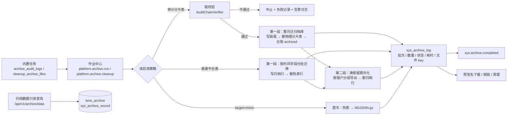
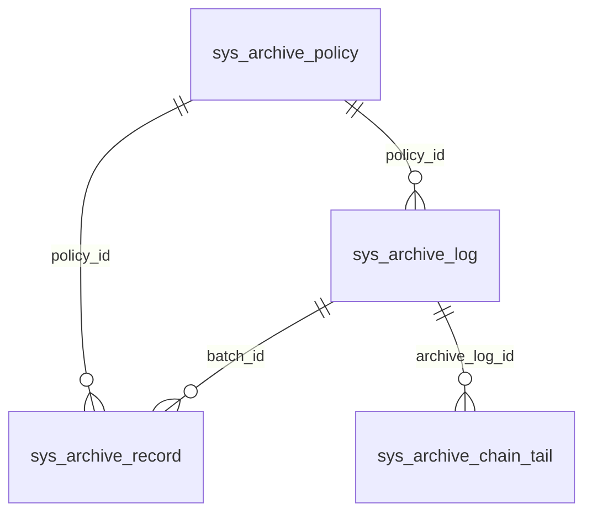
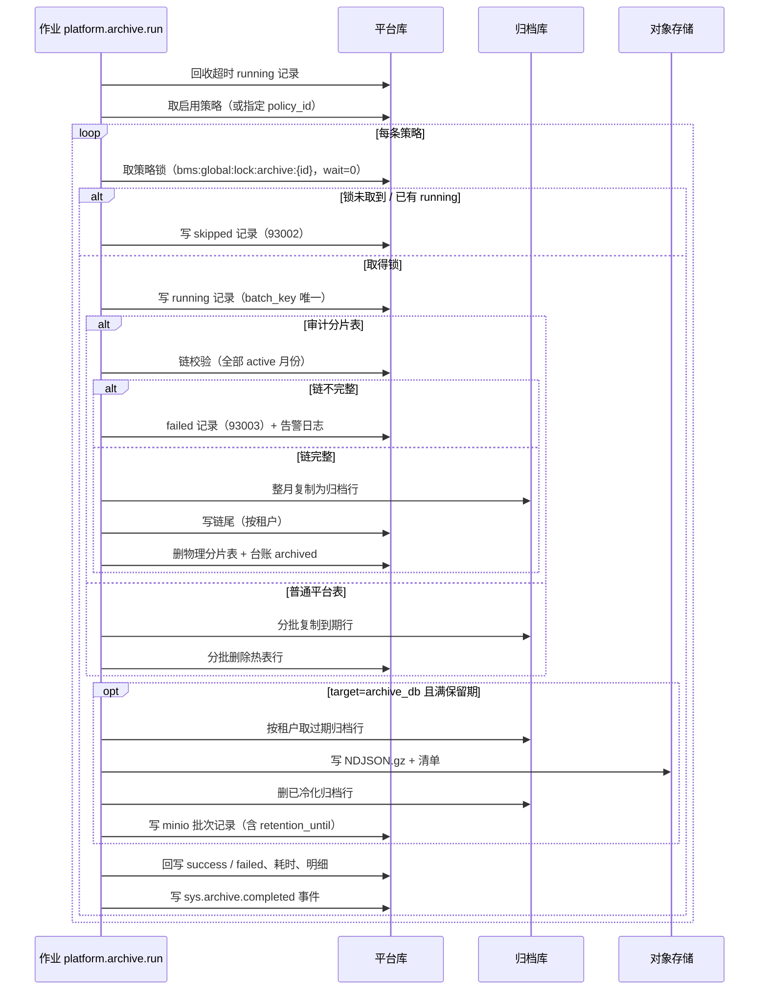

# 归档管理详细设计（策略 / 两段式 / 只读查询 / 清理与销毁）

> 通用能力 · 14 归档 · 01 归档管理 · 详细设计

[文档首页](../../../../../../文档首页.md) › [08 通用能力](../../../../README.md) › [归档](../../14_归档.md) › [归档管理](../14_归档_01_归档管理.md) › 详细设计　|　[需求 07-1](../../../../需求/07_需求_数据生命周期.md#r07-1) · [阶段计划](../../../../计划/01_计划_通用能力.md)

## 1. 概述 <a id="overview"></a>

- **目标**：把「到期数据自动离开热表、仍可在线翻查、满期冷化可回取、到期可清可销、全过程有记录」一次做通：
  1. **策略**：`sys_archive_policy` 全表可配（表名 / 时间字段 / 阈值 / 保留期 / 目标 / 批次 / 启停），平台库集中治理。
  2. **两段式**：热表超阈值 → 归档库 `bms_archive`（通用行表，在线只读查）→ 满保留期冷化为 NDJSON.gz 对象；`target=minio` 支持跳过归档库直冷。
  3. **审计类前置**：四类审计分片归档前强制链校验；整月迁移后写按租户链尾、删除物理分片表、台账置 `archived`；链不完整中止并告警。
  4. **执行记录**：`sys_archive_log` 逐批记录数量 / 目标 / 状态 / 耗时 / 文件 key / 链头尾；清理与销毁同样留痕。
  5. **只读查询**：只查归档库；普通用户强制本租户、审计管理员可跨租户；已冷化经执行记录预签名下载。
  6. **清理与销毁**：冷化文件按保留期清理；合规销毁按批次 / 单条归档行执行，二次确认 + 留痕。
- **依据**：需求 [07-1](../../../../需求/07_需求_数据生命周期.md#r07-1)；《[概要设计 · 归档管理](../../../../../../设计/概要设计/30_概要设计_归档管理.md)》§2 / §4 / §5 / §6 / §7；《[架构设计 · 数据架构](../../../../../../设计/架构设计/07_架构设计_数据架构.md)》「数据分布」「回收站机制」；《[架构设计 · 数据访问与分片](../../../../../../设计/架构设计/13_架构设计_子系统_数据访问与分片.md)》§4；《[架构设计 · 审计哈希链](../../../../../../设计/架构设计/19_架构设计_子系统_审计哈希链.md)》§5 / §6；《[架构设计 · 任务调度](../../../../../../设计/架构设计/17_架构设计_子系统_任务调度.md)》§5；基座契约见[归档策略基座详细设计](../../../../../01_项目骨架/任务/02_后端基座/02_后端基座_04_跨阶段基座/02_后端基座_04_跨阶段基座_12_归档策略基座/设计/12_详细设计_01_归档策略基座.md)。
- **范围**：
  - `bms_core`：四张表模型、表归属登记、归档运行参数、错误码与文案；审计链校验扩展（已归档月份读链尾）。
  - `platform` 服务：新增 `archive` 域（策略 CRUD / 手动触发 / 执行记录 / 归档数据查询 / 下载 / 销毁）；两条件业（归档执行、过期清理）；内置任务由占位改真实提交。
  - 数据库设计：新建 `31_数据库设计_归档管理` 与四张表文件、总览登记；回写 `sys_audit_shard` 的归档链路口径。
- **不含（归口见 §13）**：前端三页（阶段十五）、租户库 / 产品表归档（产品接入）、软删除残留物理清理（13_01）、真库与压测（部署窗口）、全文检索（阶段十八）。

## 2. 现状与差距 <a id="gap"></a>

| # | 关注点 | 需求 / 设计 | 代码现状 | 处置 |
| --- | --- | --- | --- | --- |
| 1 | 策略与执行记录 | 全表可配 + 逐批留痕 | 无表、无模型、无域 | **本段建**：四表 + `archive` 域 |
| 2 | 归档库 | 统一收存、只读查询 | 数据源 / 键 / 引擎 / 建表入口均就绪；**无任何归档表** | **本段建**：`sys_archive_record`（`datasource=archive`） |
| 3 | 归档能力契约 | `BaseArchivePolicy` / `BaseArchiveQueryRouter` | 仅 null 占位（02-4-12） | **本段接真实实现**：执行器走契约语义，查询路由固定归档库 |
| 4 | 审计分片归档 | 整月迁移 + 链校验 + 删表 | 台账 `status=archived` 常量已预留；校验器只认物理分片 | **本段改**：链尾表 + 校验器读链尾；删物理分片 |
| 5 | 数据变更审计分片预创建 | 三类日志都要预创建 | `shard_bootstrap._LOG_TYPES` 只两类（06_02 遗留） | **本段修**：改按 `LOGIC_TABLES` 全类型 |
| 6 | 调度与执行 | Celery / 内置任务 | `archive_audit_logs` 为 `skipped` 占位；无清理任务 | **本段改**：任务提交作业；新增归档清理任务 |
| 7 | 对象存储 | MinIO 冷化、按租户前缀 | 契约无 `list`；有 `put/get/delete/exists/presign` | **本段用**：按执行记录 `file_key` 回销，不列举桶 |
| 8 | 权限 / 菜单 / 参数 | archive 业务码 / 权限码 / 参数 | 业务码与 `archive:query` 已有；无 manage/trigger/destroy、无菜单 | **本段补**：四权限码、三菜单与按钮、审计管理员只读白名单 |
| 9 | 错误码 | 93001~93006 | 9 段仅 90201/90203/90301/90401 | **本段补**：93001~93007 + 中英文案 |

## 3. 总体方案 <a id="architecture"></a>



口径：

- **执行位置**：全部在 platform 服务作业内（同一事务边界可控），不跨服务库、不跨服务调用。
- **归档库访问**：经 `session_scope(registry, db_key=ARCHIVE_DB_KEY)`；请求态新增 `get_archive_read_db` / `get_archive_write_db` 依赖。
- **能力契约**：`BaseArchivePolicy` 的方法签名保持现状（`matches(record, *, now)` / `archive(records)`），真实执行器在内部按策略判定时间窗并搬迁；**不新增第二套归档契约**。
- **幂等边界**：提交层（Idempotency-Key / 作业幂等键）→ 执行层（策略锁 + running 记录）→ 数据层（`(source_table, source_id)` 唯一）三层兜底。

## 4. 数据模型 <a id="data"></a>

字段唯一事实源为表文件，本节只写结构与关系（不复制字段清单）：

- [sys_archive_policy](../../../../../../设计/数据库设计/数据表设计/sys_archive_policy.md)（平台库）
- [sys_archive_log](../../../../../../设计/数据库设计/数据表设计/sys_archive_log.md)（平台库）
- [sys_archive_record](../../../../../../设计/数据库设计/数据表设计/sys_archive_record.md)（归档库）
- [sys_archive_chain_tail](../../../../../../设计/数据库设计/数据表设计/sys_archive_chain_tail.md)（平台库）
- 模块节点：[31-归档管理](../../../../../../设计/数据库设计/31_数据库设计_归档管理.md)



设计要点：

1. **通用行表**：归档行 `payload` 为源行完整 JSON（时间 ISO8601、`Decimal` 字符串、空值 `null`），`source_id` 为源主键十进制字符串；唯一 `(source_table, source_id)` 是「重复执行不重复归档」的最后防线。
2. **策略校验**：`table_name` 必须是**平台库已登记表**（归属登记 `datasource=platform`、`status=enabled` 且有 ORM 模型）；四类审计分片表按逻辑名特批（登记为 `planned`、物理按月分片），其 `time_field` 固定 `occurred_at`、`require_chain` 强制 true、`target` 强制 `archive_db`。
3. **库归属**：策略 / 执行记录 / 链尾在平台库（跨租户治理视图），归档数据在归档库；归档行仍带 `tenant_id`，查询按租户隔离。
4. **审计链尾**：`sys_archive_chain_tail` 在删物理分片前写入（按 `tenant_key` 一行，存首条 `prev_hash`、末条 `record_hash`、条数），供后续月份校验与独立复核。
5. **只追加**：`sys_archive_record` 不继承公共基类、无软删除；数据到期只走冷化 / 销毁，不留删除态。

## 5. 运行参数与配置 <a id="config"></a>

新增 `config.toml` `[archive]` 段（`ArchiveSettings`，与 `[audit_log]` 同风格；不另落 sys_config 同名键）：

| 键 | 缺省 | 含义 |
| --- | --- | --- |
| `batch_size_default` | 1000 | 策略未配批次时的缺省批次 |
| `max_batch_rows` | 10000 | 单批上限（策略 `batch_size` 校验上界） |
| `cleanup_retention_days` | 180 | 冷化文件在对象存储的保留天数（到期清理依据） |
| `query_default_days` | 30 | 归档数据查询缺省时间窗 |
| `query_max_days` | 366 | 归档数据查询最大跨度（超出 93005 同族参数错误） |
| `running_timeout_seconds` | 7200 | `running` 执行记录超时回收阈值 |
| `cold_chunk_rows` | 1000 | 冷化单文件最多行数（按租户分文件） |
| `file_prefix` | archive | 冷化对象 key 前缀 |

## 6. 执行流程 <a id="execution"></a>

### 6.1 策略执行总流程 <a id="execution-run"></a>



### 6.2 普通平台表第一段 <a id="execution-normal"></a>

1. 由 `table_name` 取 ORM `Table`（`Base.metadata.tables`），校验 `time_field` 存在且为时间列。
2. 循环：`SELECT ... WHERE time_field < cutoff ORDER BY time_field, id LIMIT batch_size`。
3. 逐行序列化为 `payload`，批量插入 `sys_archive_record`（唯一键冲突即跳过，视为已归档）；记录新增条数。
4. 按主键批量 `DELETE` 热表对应行；提交本批事务。
5. 直到取不到行或达 `max_batch_rows`（达上限记 WARN，下一轮继续）。
6. `cutoff = now - threshold_days`（UTC naive）。

### 6.3 审计分片整月归档 <a id="execution-shard"></a>

1. 由 `LOGIC_TABLES` 反查 `log_type`；从 `sys_audit_shard` 取 `status=active` 且「分片月末 ≤ cutoff」的月份（升序）。
2. **链校验**：`AuditChainVerifier.verify(log_type, None)` 校验全部 active 月份；不通过 → 本条策略 failed（`93003`）、写告警日志 `archive_chain_broken`（含断裂月 / 序号 / 记录 ID）、不删任何数据。
3. 每个月份：
   - 读物理分片全部行（按 `id` 升序），批量写 `sys_archive_record`（`source_month` = 月份）。
   - 按 `tenant_key`（`tenant_id` 或 `global`）聚合：首条 `prev_hash`、末条 `record_hash`、条数 → 写 `sys_archive_chain_tail`（唯一键 upsert，幂等）。
   - `DROP TABLE {physical_table}`（SQLAlchemy `DropTable`，方言无关）。
   - 台账 `status=archived`。
4. 单月失败：停止该策略后续月份，已成功月份保留；写 failed 记录（`93004`），下一轮可重试（唯一键保证不重复归档）。
5. **删表前置条件**：链校验通过 + 全部行已写入归档库（按行数核对）；任一不满足即不删表。

### 6.4 第二段冷化 <a id="execution-cold"></a>

1. 取 `sys_archive_record` 中 `policy_id` 匹配且 `archived_at < now - retention_days` 的行，按 `tenant_id` 分组（`NULL` 记 `global`）。
2. 每组按 `cold_chunk_rows` 生成一个文件：
   - 数据对象 key：`{file_prefix}/{tenant_key}/{source_table}/{yyyyMM}/{log_id}.ndjson.gz`（按租户前缀隔离）。
   - 内容：逐行 `{"id": ..., "payload": {...}, "archived_at": ...}` 的 NDJSON + gzip。
   - 清单对象 key：同 key + `.manifest.json`，内容含 `source_table` / `tenant_key` / `row_count` / `sha256` / `chain`（该组涉及的审计月份链头尾）/ `archive_log_id` / `created_at`。
3. `put` 数据对象与清单对象；成功后按主键批量删除归档行。
4. 写一条 `target=minio` 执行记录：`tenant_id` / `archived_count` / `file_key` / `retention_until = now + cleanup_retention_days` / `status=success`。
5. 上传失败：不删归档行，写 failed 记录（可重试）；重复执行因归档行仍在而重新生成文件（幂等语义为「至少一次」，以清单 sha256 核对）。

### 6.5 直冷（`target=minio`） <a id="execution-direct"></a>

- 跳过归档库：按 §6.2 的读取口径从热表取到期行，按租户分组写 NDJSON.gz + 清单，成功后删除热表行并写 `target=minio` 记录。
- `retention_days` 不参与（阈值即冷化时点）；`require_chain` 对审计表仍强制生效（先校验再直冷）。

### 6.6 并发与幂等 <a id="execution-idem"></a>

| 层 | 机制 | 行为 |
| --- | --- | --- |
| 提交 | 手动触发接 `Idempotency-Key`（既有幂等基座） | 同键返回首次结果，不重复提交作业 |
| 调度 | 内置任务以 `archive:run:{YYYY-MM-DD}` 为作业幂等键 | 多租户任务行重复提交当日只落一条作业 |
| 策略 | 分布式锁 `bms:global:lock:archive:{policy_id}`（wait=0） | 未取到即写 skipped 记录（`93002`），不并发执行 |
| 批次 | `sys_archive_log.batch_key` 唯一 + `status=running` 检查 | 策略执行中修改 / 删除 / 再次触发一律 `93002` |
| 数据 | `sys_archive_record` 唯一 `(source_table, source_id)` | 重复迁移自动跳过，不产生重复归档 |
| 文件 | `disposed_at` 幂等 | 清理 / 销毁重复执行不重复删对象、不重复留痕 |

## 7. 接口设计 <a id="api"></a>

前缀 `/api/v1`，统一响应 `{code, message, data}`；错误码见 §8。

| 方法 | 路径 | 权限码 | 说明 |
| --- | --- | --- | --- |
| GET | `/archive/policies` | `archive:query` | 策略分页（`table_name` / `status` 筛选） |
| POST | `/archive/policies` | `archive:manage` | 新增策略（唯一性 / 表校验 / 字段校验） |
| PUT | `/archive/policies/{id}` | `archive:manage` | 修改策略（执行中 `93002`；审计表禁止关闭链校验 / 改目标） |
| DELETE | `/archive/policies/{id}` | `archive:manage` | 删除策略（仅停用且未执行中；软删） |
| POST | `/archive/policies/{id}/trigger` | `archive:trigger` | 手动触发一次（`Idempotency-Key`；返回作业 ID） |
| GET | `/archive/logs` | `archive:query` | 执行记录分页（策略 / 表 / 目标 / 状态 / 时间） |
| GET | `/archive/logs/{id}` | `archive:query` | 执行记录详情（含明细 JSON） |
| GET | `/archive/logs/{id}/download` | `archive:query` | 冷化文件预签名下载（已处置 `93005`） |
| POST | `/archive/logs/{id}/destroy` | `archive:destroy` | 销毁某批冷化文件（`confirm=true`，否则 `93006`） |
| GET | `/archive/data` | `archive:query` | 归档数据只读查询（租户 / 源表 / 源主键 / 月份 / 时间） |
| POST | `/archive/data/destroy` | `archive:destroy` | 销毁单条归档行（`confirm=true`，否则 `93006`） |

**查询口径**：

- `GET /archive/data`：普通用户（不持 `log:query`）强制当前租户；持 `log:query` 的审计管理员可不传 `tenant_id`（跨租户）或指定租户。
- 时间缺省取 `query_default_days`；跨度超 `query_max_days` 按 `93008` 拒绝。
- 响应行含归档元数据 + `payload`（反序列化为对象），已冷化的数据不在归档库，按 `93005` 同族提示「已冷化，可经执行记录下载」。
- 下载走对象存储 `presign`，后端不代理文件流；`file_key` 为空或已处置返回 `93005`。

**权限与种子**：

- 新增权限码：`archive:manage`（策略维护）、`archive:trigger`（手动触发）、`archive:destroy`（销毁）；`archive:query` 已有。
- 审计管理员只读白名单（`AUDIT_ADMIN_CODES`）追加 `archive:query`——审计管理员可跨租户查询归档数据，但仍不可写。
- 菜单挂「平台管理」：归档策略 / 归档执行记录 / 归档数据查询三页 + 对应按钮（本任务只落后端种子，前端阶段十五）。

## 8. 错误码与异常处理 <a id="errors"></a>

| 错误码 | 含义 | HTTP | 触发 / 处置 |
| --- | --- | --- | --- |
| 93001 | 归档策略已存在（同表重复配置） | 409 | 新增 / 修改唯一性校验；提示先停用或删除原策略 |
| 93002 | 策略执行中不可修改 / 删除 / 重复触发 | 409 | 锁未取到或存在 `running` 记录 |
| 93003 | 审计链校验不通过，归档中止 | 409 | 写 failed 记录 + 告警日志；数据不动 |
| 93004 | 归档批次失败（迁移 / 导出异常） | 500 | 记录失败状态与错误摘要，可重试 |
| 93005 | 归档数据不存在（含已冷化 / 已处置） | 404 | 查询 / 下载 / 销毁命中不到 |
| 93006 | 销毁确认缺失 | 400 | 合规销毁必须 `confirm=true` |
| 93007 | 归档策略已停用 | 409 | 停用策略不允许手动触发 |
| 93008 | 归档查询时间范围过大 | 400 | 查询跨度超 `[archive].query_max_days` | |
| 93006 | 销毁确认缺失 | 400 | 合规销毁必须 `confirm=true` |
| 93007 | 归档策略已停用 | 409 | 停用策略不允许手动触发 |
| 93008 | 归档查询时间范围过大 | 400 | 跨度超 `[archive].query_max_days`，提示缩小范围 |

- 文案由前端按 i18n 映射；错误码中英文案进 `error_seed`（护栏用例校验）。
- 批次异常不抛出作业失败（单策略失败不阻断其他策略），汇总后由作业结果体现；物理清理失败重试且销毁前校验保留期已满。

## 9. 作业与任务接线 <a id="jobs"></a>

| 类型 | 键 | 触发 | 说明 |
| --- | --- | --- | --- |
| 作业 | `platform.archive.run` | 手动触发 / 内置任务 | 负载 `{policy_id?}`；无 `policy_id` 时扫描全部启用策略 |
| 作业 | `platform.archive.cleanup` | 内置任务 | 按 `retention_until` 清理过期冷化文件（数据 + 清单） |
| 内置任务 | `archive_audit_logs`（已有，cron `0 4 * * *`） | 每日 | 由占位改为向 platform 提交 `platform.archive.run`（作业幂等键按日） |
| 内置任务 | `cleanup_archive_files`（新增，cron `0 5 * * *`） | 每日 | 提交 `platform.archive.cleanup` |

- 作业声明同步三处：`bms_platform/jobs.py::job_specs`、`deploy/registry/platform.toml` `[[jobs]]`、启动期 `sys_job_type` 对账。
- 内置任务清单 `BUILTIN_TASK_SPECS` 增一行；`sys_task` 种子按 code 幂等 upsert。
- 告警出口：结构化日志事件 `archive_chain_broken` / `archive_batch_failed`（监控采集），不新增指标器依赖。

## 10. 代码落点与登记回写 <a id="code"></a>

```text
backend/libs/bms_core/src/bms_core/
├── models/platform/archive.py        # 新增：SysArchivePolicy / SysArchiveLog / SysArchiveRecord / SysArchiveChainTail
├── models/platform/__init__.py       # 改：MODEL_MODULES 增 archive 模块
├── services/table_registry.py        # 改：四表登记（三表 platform、一表 archive；domain=archive）
├── core/config.py                    # 改：ArchiveSettings（[archive]）+ Settings.archive_options 别名
├── core/error_codes.py               # 改：93001~93008 与 HTTP 映射
├── core/exceptions.py                # 改：归档 8 类业务异常
├── i18n/error_seed.py                # 改：93001~93008 中英文案
├── db/session.py                     # 改：get_archive_read_db / get_archive_write_db
├── audit/shard_repository.py         # 改：active_months / archived_tails / mark_archived
├── audit/verifier.py                 # 改：targets 只取 active 月；_tails_before 已归档月改读链尾
├── events/platform_events.py         # 改：sys.archive.completed 契约
├── tenant/seed/menu.py               # 改：archive manage/trigger/destroy 权限码 + 三菜单 + 按钮
├── tenant/seed/rbac.py               # 改：AUDIT_ADMIN_CODES 增 archive:query
├── tasks/builtin.py                  # 改：archive_audit_logs 真实提交；新增 cleanup_archive_files
└── tenant/seed/archive.py            # 新增：四类审计 90 天策略种子（本期可落三类，开放接口日志待表）

backend/services/platform/src/bms_platform/
├── domains/archive/                  # 新增域
│   ├── __init__.py · public.py
│   ├── api/policies.py · logs.py · data.py
│   ├── schemas/archive.py
│   ├── repositories/policy.py · log.py · record.py · chain_tail.py
│   └── services/policy.py · executor.py · cold.py · query.py · dispose.py
├── domains/archive/jobs.py           # 新增：ArchiveRunJob / ArchiveCleanupJob
├── jobs.py                           # 改：job_handlers / job_specs 增两作业
├── api/router.py                     # 改：挂载 archive 域路由
└── main.py                           # 改：装配（如域路由声明方式需要）

backend/ops/seed_archive_policies.py  # 新增：策略种子入口（seed 编排引用）
backend/config.toml                   # 改：新增 [archive] 段（缺省值注释齐全）

deploy/
├── registry/platform.toml            # 改：[[domains]] archive、[[jobs]] 两条、[[seeds]] 策略种子
├── boundaries/domain_layout.json     # 重生成（ops.check_modules --render-domain-layout）
├── contracts/platform.json           # 重生成（ops.contract_snapshot export）
└── events/contracts.json             # 重生成（sys.archive.completed）

frontend/packages/api_types            # 重生成（pnpm run api_types:gen）

bms文档/
├── 设计/数据库设计/31_数据库设计_归档管理.md       # 新增（本次）
├── 设计/数据库设计/数据表设计/sys_archive_*.md     # 新增 4 张表文件（本次）
├── 设计/数据库设计/01_数据库设计_总览.md           # 改：§7.3 登记 4 表（本次）
├── 设计/数据库设计/数据表设计/sys_audit_shard.md   # 改：归档链尾 / 删表口径（实施期回写）
├── 设计/概要设计/30_概要设计_归档管理.md           # 改：§4 落库位置例外（实施期回写）
├── 设计/架构设计/09_架构设计_接口与集成.md         # 改：事件清单补 sys.archive.completed（实施期）
├── 规范/后端开发规范.md                            # 改：归档执行口径（如需要）
├── 项目/08_通用能力/计划/01_计划_通用能力.md        # 改：按《计划文档规范》回写（唯一落点，收尾）
├── 项目/08_通用能力/需求/07_需求_数据生命周期.md     # 改：需求 07-1 实现期注块（收尾）
└── 项目/08_通用能力/任务/14_归档/…                 # 改：任务书参考文档 / 父任务清单（收尾）
```

登记回写：

| 落点 | 内容 |
| --- | --- |
| `services/table_registry.py` | 四表登记（`domain=archive`；`sys_archive_record` 为 `datasource=archive`），并同步 `sys_table_ownership` 种子 |
| `deploy/registry/platform.toml` | `[[domains]] archive`（paths 含域子包 + 模型文件；`public_api=bms_platform.domains.archive.public`）、两条 `[[jobs]]`、策略种子 `[[seeds]]` |
| 数据库设计 | 31 节点 + 四表文件 + 总览登记（已设计）；实施落库后状态转 `已落库` |
| 《概要设计 · 归档管理》§4 | 回写「策略 / 执行记录落平台库」例外与 `sys_archive_record` 通用行表口径 |
| 架构 09 事件清单 | 补 `sys.archive.completed` |
| `bms_core/tasks/builtin.py` | 归档任务说明与归口更新；新增清理任务说明 |
| 阶段计划 | 按《计划文档规范》回写（唯一落点） |
| 需求 07-1 / 任务书 | 实现期要点注块；任务参考文档补设计 / 实施 / 测试链接 |

## 11. 测试设计与验收映射 <a id="test"></a>

Kiwi 用例**先登记后编码**：本任务登记 **1 条**，覆盖下表断言，代码以 `@pytest.mark.kiwi_id(<编号>)` 标注（编号登记后回填）。

| 验收点（需求 07-1 / 任务完成标准） | 用例 |
| --- | --- |
| 策略 CRUD：新增 / 修改 / 停用 / 删除；同表重复 `93001` | 策略服务与 API 用例：建—改—停—删；重复表名冲突 |
| 策略校验：非平台表 / 非时间字段 / 审计表关闭链校验 / 批次越界均拒绝 | 参数校验用例（逐条断言错误码 / 消息） |
| 普通表到期自动归档且热表消失 | 造 `sys_table_ownership` 旧行（`created_at` 早于阈值）→ 执行 → 归档行出现、热表行删除、日志计数正确 |
| 重复执行不重复归档 | 同策略连跑两次 → 第二次 `archived_count=0`、归档行不增加 |
| 归档库只读可查且带租户标识 | 查询 API 命中归档行；普通用户查不到他租户；审计管理员可跨租户 |
| 审计分片整月归档：链校验 + 归档 + 删表 + 台账 | 造旧月分片与合法链 → 执行 → 归档行、链尾行、物理表不存在、台账 `archived` |
| 链不完整中止并告警 | 篡改旧月一条 `record_hash` → 执行 → 无删除、无归档、failed 记录 `93003`、告警日志 |
| 跨归档链校验 | 归档一月后再校验后续月份 → 校验器读链尾通过；篡改链尾表 → 定位失败 |
| 冷化：满保留期导出 NDJSON.gz + 清单，归档行删除 | 假存储断言 key / gzip 可解 / 行数 / sha256 / 清单字段；归档行清零 |
| 冷化可取回 | 下载接口返回预签名 URL；已处置 / 无 key 返回 `93005` |
| 清理：到期文件（数据 + 清单）删除并留痕 | 清理作业删除两对象、`disposed_at` / `dispose_type=cleanup`、重复执行幂等 |
| 销毁：批次文件 / 单条归档行，二次确认 | 缺 `confirm` → `93006`；正常 → 对象 / 行删除 + destroy 记录；无 `archive:destroy` → 403 |
| 并发与幂等 | 锁未取到 / running 记录 → `93002`；同 `Idempotency-Key` 只提交一次作业 |
| 作业与任务 | 任务提交作业（幂等键按日）；作业扫描策略、单策略失败不影响其他；清理任务提交 |
| 事件与种子 | 批次完成写 `sys.archive.completed`（出箱）；三类审计策略种子幂等；权限 / 菜单种子可查 |
| 回归 | 审计链既有用例（操作 / 登录 / 数据变更）全绿；`shard_bootstrap` 覆盖三类日志 |

- 覆盖率：变更模块行 + 分支 100%（`bms_core.models.platform.archive`、`bms_core.audit.shard_repository` / `verifier`、`bms_core.db.session` 新依赖、`bms_core.tasks.builtin`、`bms_core.tenant.seed.archive` / `menu` / `rbac`、`bms_platform.domains.archive.*`）；提交环判改动行、推送环判模块级。
- 测试环境：平台库 / 归档库分别用独立 SQLite 文件；归档库准备集补 `prepare_archive`（建四表），请求态覆盖 `get_archive_*` 依赖。

## 12. 实施步骤 <a id="steps"></a>

1. 文档：本设计 + 数据库设计 31 节点 + 四表文件 + 总览登记（定稿提交 `docs(归档)`）。
2. 数据层：模型、表归属登记、`[archive]` 配置、错误码 / 异常 / 文案、`get_archive_*` 依赖。
3. 审计链：`sys_archive_chain_tail` 读写 + 校验器「已归档月份读链尾」+ 分片预创建补 `data_audit`。
4. 域与接口：策略服务 / 仓储 / API；归档数据查询；下载 / 清理 / 销毁。
5. 执行器：第一段（普通表 / 分片表）、第二段冷化、直冷、幂等与锁；两个作业。
6. 任务与种子：内置任务真实提交 + 新增清理任务；策略 / 权限 / 菜单 / 作业目录种子。
7. 测试：先登记 Kiwi 取号，再写用例；跑定向 pytest / ruff / pyright / 护栏。
8. 登记回写与记录：概要设计例外、架构事件清单、计划 / 需求 / 任务状态，实施与测试记录。
9. 提交：`feat(归档)` 代码一次、`docs(归档)` 文档一次；按模块收尾再推送。

## 13. 对齐记录与开放项 <a id="open"></a>

| # | 事项 | 结论 / 归口 |
| --- | --- | --- |
| 1 | 开工范围 | 全量一条龙（用户拍板 2026-11-16） |
| 2 | 归档库存储 | 通用行表 `sys_archive_record`（用户拍板） |
| 3 | 策略 / 记录归属库 | 平台库；概要设计 §4 按例外回写（用户拍板） |
| 4 | `target` 语义 | `archive_db` 两段式 / `minio` 直冷（用户拍板） |
| 5 | 审计分片归档 | 整月迁移后删物理分片表（用户拍板） |
| 6 | 冷化格式 | NDJSON + gzip + 独立清单（用户拍板） |
| 7 | 只读查询范围 | 只查归档库（用户拍板） |
| 8 | 清理与销毁 | 归档文件清理 + 归档数据销毁；软删除残留归 13_01（用户拍板） |
| 9 | 并发与幂等 | 锁 + running 记录 + Idempotency-Key（用户拍板） |
| 10 | 链校验 | 复用 `AuditChainVerifier`（用户拍板） |
| 11 | 事件与种子 | 发 `sys.archive.completed`；审计 90 天策略种子（用户拍板） |
| 12 | 销毁权限 | 新增 `archive:destroy`（用户拍板） |
| 13 | Kiwi | 登记 1 条（用户拍板） |
| 14 | 库范围 | 本期只归档平台库表；租户库 / 产品表归产品接入（用户拍板） |
| 15 | 运行参数 | `config.toml` `[archive]`，不落 sys_config 同名键（用户拍板） |
| 16 | 删表后链尾 | 新增 `sys_archive_chain_tail`（用户拍板） |
| 17 | 手动触发范围 | 全量执行该策略（用户拍板） |
| 18 | 查询租户口径 | 普通强制本租户；审计管理员跨租户（用户拍板） |
| 19 | 第四类审计日志（开放接口） | 当前无 `sys_open_log` 表 / 模型，策略种子本期只落操作 / 登录 / 数据变更三类；开放接口日志随开放接口任务接入，已登记计划「后续阶段待办」 |
| 20 | 06_02 分片预创建遗留 | `shard_bootstrap._LOG_TYPES` 只两类 → 本段改为按 `LOGIC_TABLES` 全类型，属顺手闭环、不扩大范围 |
| 21 | 告警出口 | 结构化日志事件（`archive_chain_broken` / `archive_batch_failed`）供监控采集；不新增指标器装配 |
| 22 | 归档库测试准备 | 补 `prepare_archive` + `archive_db` 夹具，归测试侧基础设施；`ops/test_db` 归档库 scope 随产品接入再补 |
| 23 | 冷化「至少一次」 | 上传成功后才删归档行；重复执行会重写文件，以清单 sha256 核对，不做去重表 |
| 24 | 前端页面 | 三页与按钮归阶段十五；本期只落后端种子 |

> 详细设计 · 依《[文档生成规范](../../../../../../规范/文档生成规范.md)》编写 · 进度以[阶段计划](../../../../计划/01_计划_通用能力.md)为唯一落点
