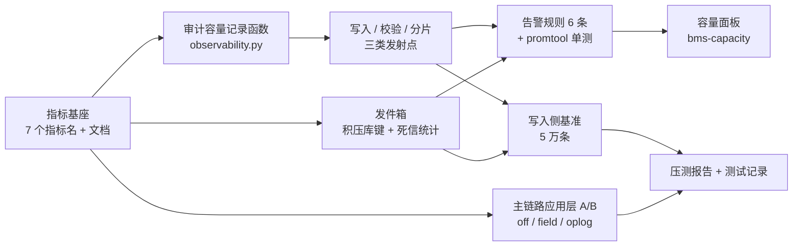

# 异步链路容量与延迟实施记录

> 通用能力 · 15 容量口径 · 01 异步链路容量与延迟 · 实施记录

[文档首页](../../../../../../文档首页.md) › [08 通用能力](../../../../README.md) › [容量口径](../../15_容量口径.md) › [异步链路容量与延迟](../15_容量口径_01_异步链路容量与延迟.md) › 实施　|　[详细设计](../设计/01_详细设计_15_01_异步链路容量与延迟.md) · [测试记录](../测试/01_测试记录_15_01_异步链路容量与延迟.md) · [压测报告](../测试/02_压测报告_15_01_异步链路容量与延迟.md)

## 1. 实施信息 

| 项 | 值 |
| --- | --- |
| 任务 | [01 异步链路容量与延迟](../15_容量口径_01_异步链路容量与延迟.md) |
| 对应需求 | [11-1](../../../../需求/11_需求_容量与延迟.md#r11-1) |
| 详细设计 | [01_详细设计_15_01_异步链路容量与延迟](../设计/01_详细设计_15_01_异步链路容量与延迟.md) |
| 实施日期 | 2026-11-18 |
| 实施人 | minjian |
| 实施环境 | mjpc（Windows 11 26300 / i7-13700K / 64GB / Python 3.14.4 / SQLite 3.50.4）；开发服务器 mjbk（promtool 3.16.0 临时容器） |
| 提交 | feat `d1dfab542`；docs `（本提交）` |
| 结论 | 指标 / 告警 / 面板 / 基准与压测方法全部落地；四项指标中「告警可触发」「分片提前量与跨月」达标，「主链路 P99 差异」限定达标（临界 + HTTP 未测），「消费 P95」「写入吞吐」未达标（限定环境），差距与归口见 §6 |

## 2. 实施概览 

结果小结：指标全部登记进基座并具备真实发射点（写入 / 校验 / 分片 / 发件箱）；6 条告警规则在 promtool 3.16.0 上 `SUCCESS`；容量面板随 provisioning 目录加载；写入侧 5 万条与主链路四轮 A/B 实测出数；本地开发库结构过期未动，改用独立 SQLite 目录。

## 3. 实施过程 

| 批次 | 内容 | 关键命令 / 结果 |
| --- | --- | --- |
| 1 | 指标基座：`METRIC_NAMES` + `METRIC_DOCS` 增 7 个审计 / 死信指标；新增 `bms_core/audit/observability.py`（常量 + 三个记录函数，空指标器放行） | `ruff check` / `format --check` / `pyright` 全绿；`pytest libs/bms_core/tests/audit/test_audit_observability.py` 5 项通过 |
| 2 | 发件箱：`DeadLetterStat` 值对象 + `BaseOutboxStore.dead_letter_stats`（真实 / 空实现）；投递器积压带 `db_key`、发布死信待处置数与最老时长 | `pytest libs/bms_core/tests/outbox` 11 + 3 项通过 |
| 3 | 审计写入与校验接线：`AuditLogWriter` 记写入计数与时延（新增 `metrics` 参数）；`jobs.py` 懒解析指标器；`ensure_audit_shards` 记次月就绪；内部端点与用户面链校验记 valid / broken | `pytest services/platform/tests/log services/platform/tests/audit` 60 项通过；装配冒烟 18 项通过 |
| 4 | 部署资产：`bms-slo.yml` 新增 `bms-capacity` 组 + 积压改按库键 1 万；规则单测 `tests/bms-capacity.test.yml`；Grafana `bms-capacity.json`（6 面板） | `promtool check rules` → `SUCCESS: 13 rules`；`promtool test rules` → `SUCCESS`（3.16.0） |
| 5 | 基准与压测：`benchmarks/bench_audit_chain.py`（5 万条稳态 / 排空 + 批提交成本分离）、`benchmarks/bench_main_link.py`（应用层 off / field / oplog A/B）、测试仓 `scripts/perf/scenario_异步链路.py`（HTTP 三档场景，本轮环境未闭环） | 实跑数据见[压测报告](../测试/02_压测报告_15_01_异步链路容量与延迟.md) §4 / §5 |
| 6 | 文档与回写：任务书 / 详细设计 / 实施记录 / 测试记录 / 压测报告；架构 27、部署发布规范、后端开发规范、阶段计划、需求注块 | `engkit links` / `docs-scope` / `eol` 见 §5 |

## 4. 问题与处置 

| # | 现象 | 根因 | 处置 |
| --- | --- | --- | --- |
| 1 | 消费时延实测固定偏大 28800 秒（8 小时） | `writer.parse_occurred_at` 对**无时区**的 `occurred_at` 调 `astimezone(UTC)`，按本地时区解释；库内是 UTC naive（UTC+8 开发机整体偏移） | 改用基座既有 `normalize_occurred_at`（naive 按 UTC），落库 `occurred_at` 与容量时延同时纠正；详细设计 §2-12 回写 |
| 2 | 规则单测的日期门控跑不到触发分支 | 开发服务器镜像 `prom/prometheus:v3.1.0` 的规则单测时钟固定 1970-01-01，`start_timestamp` 自 3.9.0 才有 | 用最新 3.16.0 的 `promtool` 临时容器（`docker run --rm`，只读挂载临时目录）；部署镜像升级登记 §6-6；曾短暂改用应用侧「已逾期」信号，按用户拍板回退 |
| 3 | 本地全套起不来：`no such column: sys_data_source.quota_dimensions` | 本地开发库结构过期（`create_all` 不补列） | **不动开发库**：改用独立目录 `database/bms-perf-15-01`（启动期自动建表 + 独立种子），用完即弃 |
| 4 | 独立库上 tenant / identity 启动失败：拓扑快照 / 服务目录「服务不可用：platform（transport）」 | 本机服务间回连在启动钩子里被拒（换回环别名、换 127.0.0.1 + 不同端口均复现；同调用从独立进程可通，端口 / 代理 / 端点映射已逐一排除） | 不在本任务深挖；HTTP 客户端口径标记「限定达标（环境阻塞）」，改用应用层 A/B 出数（§5 批次 5）；归口部署窗口 / 独立测试环境 |
| 5 | 应用层 A/B 第 2 轮 field P99 从 4.56 ms 跳到 9.05 ms | SQLite 每事务 fsync 的尾延迟尖峰（同轮 `oplog` 变体最长 298 ms） | 如实记录四轮与中位数（P99 中位差 +5.0%，P95 +4.0% / +7.9%），不取单轮最优值；生产库复测归口 |
| 6 | `bench_main_link` 的 `oplog` 变体解析 `outbox_store` 插件失败 | `sql` 实现由装配期 `register_plugin` 显式登记，不在类扫描里 | 基准直接用 `SqlOutboxStore().enqueue`（与发射器同事务语义），不依赖插件注册表 |
| 7 | 定向选测（`engkit run-selected`）出现 12 项失败 | 均为**前序任务遗留基线漂移**（`plugin_registration` 键集合、`job_handlers` 少 `archive.*`、域布局 26≠20、能力基线、`my_menu` 过滤、`base_inheritance` 命中 06_02 / 10_01 的无基类类、`null_migration`、任务迁移事件） | 范围外红灯，**未修**；逐条列入测试记录 §6 等用户拍板；本任务改动文件覆盖率 100% |
| 8 | 本地库写入侧基准把调试日志算进耗时 | dev 配置 `[log].level=DEBUG`，逐条 `audit_log_appended` 打到控制台 | 基准进程默认 `BMS_LOG__LEVEL=WARNING` 并 `configure_logging`，日志不参与计时 |

## 5. 验证结果 

| 项 | 方法与结果 |
| --- | --- |
| 定向用例 | `libs/bms_core/tests/{outbox,audit,metrics}` **124 passed**；`services/platform/tests/{log,audit}` **60 passed**；装配 / 校验 / 包形状 **18 passed** |
| 预置红线复核 | `test_plugin_registration.py` 仍红（`help_content` / `notification_preference` 键缺失，07_01 / 12_01 遗留），与本任务无关 |
| 覆盖率（改动行 / 文件） | `coverage_report.py --changed-files` → **12 文件全 100%**（缺行 0 / 分支 0）；`--module bms_core.audit.observability` → **100%** |
| 静态 | 变更文件 `ruff check` / `ruff format --check` / `pyright`（含测试侧）全绿 |
| 规则 | `promtool check rules` → SUCCESS（13 条）；`promtool test rules` → **SUCCESS**（6 条规则、触发 / 不触发 / 日期门控 / 死信边界） |
| 指标发射 | pytest 断言真实写入 `PrometheusMetrics`：写入计数 / lag、链 valid / broken、次月就绪、积压 `db_key`、死信 pending / age |
| 压测 | 写入侧 5 万条与主链路四轮见[压测报告](../测试/02_压测报告_15_01_异步链路容量与延迟.md) |
| 文档 | `engkit links` 0 断链；`engkit docs-scope` 0 违规；`engkit eol` 仅存量 CRLF 告警 |

## 6. 偏差与遗留 

| # | 事项 | 结论 / 归口 |
| --- | --- | --- |
| 1 | HTTP 客户端三档压测未闭环（服务间回连被拒） | 限定达标；归口部署窗口 / 独立测试环境复测（真服务 + 网关） |
| 2 | 审计链端到端消费延迟不可测（01_01 msg 消费组运行时缺失） | **阻塞项**：计划 §3.1 与 §7 登记；归口「01_01 补口」；补口后按压测报告 §9 复跑 |
| 3 | 单租户写入 62.7~87.6 条/秒（目标 500） | 未达标（SQLite 限定）；生产库复测；若仍不足按「链尾缓存 / 批量追加 / 查询合并」立项；`audit-chain` 多实例扩容依赖 01_01 补口 |
| 4 | 采集口径调整：设计原写「真实消费处理器 `AuditLogConsumer`」，实施改为直接驱动 `AuditLogWriter`（一条一事务，同口径）并新增 `--batch` 成本分离 | 属可测性调整，已回写详细设计 §7.3；官方口径恒为一条一事务 |
| 5 | 新增 `bench_main_link.py`（设计交付物清单原无） | 环境阻塞下的替代实测手段；已回写详细设计 §3 / §7.2 |
| 6 | 可观测性栈镜像仍 v3.1.0（规则单测用 3.16.0 临时容器） | 归口后续验证任务：v3.1.0 → v3.16.0 升级 + 监控栈回归（计划 §7） |
| 7 | 定向选测 12 项前序遗留红灯 | 未修、逐条登记（测试记录 §6），等用户拍板 |
| 8 | 面板现场加载未核对 | 部署窗口核对项 |

> 本文档依《[任务文档规范](../../../../../../规范/任务文档规范.md)》编写 · 进度以阶段计划为唯一落点
