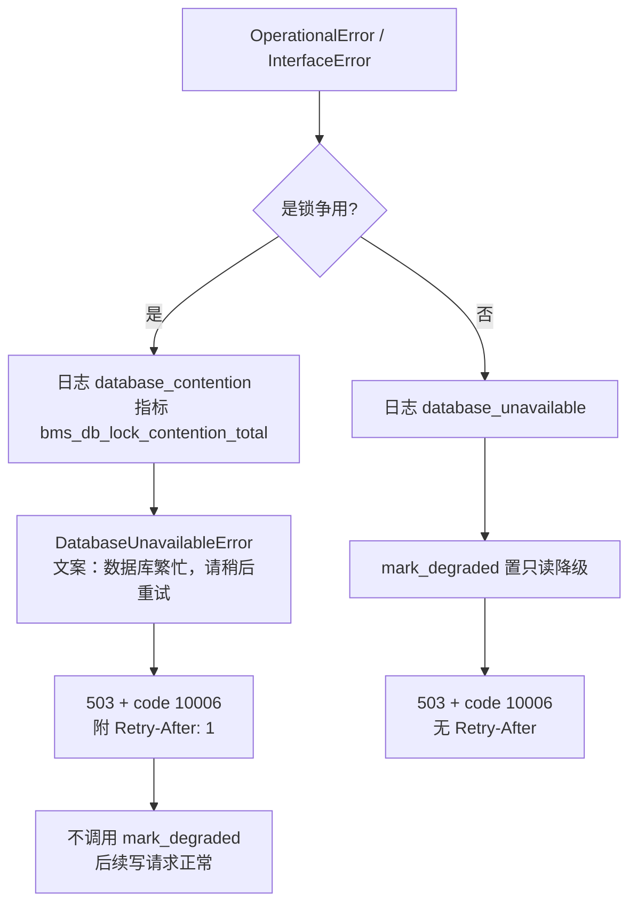

# 锁冲突不触发只读降级详细设计（争用与故障分流 + 标准可重试标记）

> 通用能力 · 17 运行期健壮性 · 01 锁冲突不触发只读降级 · 详细设计

[文档首页](../../../../../../文档首页.md) › [08 通用能力](../../../../README.md) › [运行期健壮性](../../17_运行期健壮性.md) › [锁冲突不触发只读降级](../17_运行期健壮性_01_锁冲突不触发只读降级.md) › 详细设计　|　[需求 13-1](../../../../需求/13_需求_运行期健壮性.md#r13-1) · [阶段计划](../../../../计划/01_计划_通用能力.md)

## 1. 概述 <a id="overview"></a>

- **目标**：把「锁争用」从「主库故障」里分出来，消除「一次瞬时锁冲突 → 整进程只读 → 后续写全 503」的放大效应。
  1. **判定分离**：新增锁争用识别，命中即**不**调用 `PrimaryHealth.mark_degraded`。
  2. **响应语义不变**：仍 `503` + `10006`，body 结构不变；另附 `Retry-After: 1` 作为标准可重试标记（客户端与网关原生识别，公共契约零改动）。
  3. **文案精确**：争用分支文案「数据库繁忙，请稍后重试」，不再复用「已降级为只读模式」。
  4. **观测分开**：日志事件 `database_contention`、指标 `bms_db_lock_contention_total`，与真故障 `database_unavailable` 分开。
  5. **真故障零回退**：未命中白名单一律走原逻辑（fail-safe）。
- **依据**：需求 [13-1](../../../../需求/13_需求_运行期健壮性.md#r13-1)；现有实现 `libs/bms_core/src/bms_core/api/errors.py::_db_unavailable_handler`；`libs/bms_core/src/bms_core/db/health.py::PrimaryHealth`；《[后端开发规范](../../../../../../规范/后端开发规范.md)》异常分层。
- **范围**：新增 `bms_core/db/contention.py`（识别 + 重试秒数常量）；改 `bms_core/api/errors.py`（handler 分支、`_render` 支持附加头、指标常量）；测试 `libs/bms_core/tests/db/test_degradation.py` 扩展。
- **不含（归口见 §8）**：降级态自动恢复与冷却（本轮只摘争用，不改状态机）；SQLite 的 `WAL` / `busy_timeout` / 写锁前置等运行期调优；客户端重试实现；达梦抛错形态登记。

## 2. 现状与差距（设计 vs 代码不符清单） <a id="gap"></a>

| # | 关注点 | 需求要求 | 代码现状 | 处置 |
| --- | --- | --- | --- | --- |
| 1 | 争用与故障区分 | 锁等待 / 死锁不算主库故障 | `_db_unavailable_handler` 对所有 `OperationalError` 一律 `mark_degraded` | **本段改**：先判争用，命中则跳过降级 |
| 2 | 可重试标记 | 返回可重试标记，body 不变 | 无任何可重试信号，调用方只能靠 503 猜 | **本段改**：加 `Retry-After` 头（body 零改动） |
| 3 | 文案准确性 | 争用分支不得说「已降级为只读」 | 统一文案「数据库暂不可用，系统已降级为只读模式…」 | **本段改**：争用分支给显式文案 |
| 4 | 观测区分 | 争用与故障事件分流 | 只有 `database_unavailable` 一种事件，无指标 | **本段改**：`database_contention` + `bms_db_lock_contention_total` |
| 5 | 识别覆盖面 | SQLite / MySQL / PG | 无识别逻辑 | **本段建**：白名单标记 + `orig` 解包 |
| 6 | 降级自愈 | —（不在本条范围） | `mark_degraded` 后只有 `probe()` 通过才清除 | **不改**，归后续韧性任务 |

## 3. 争用识别口径 <a id="detect"></a>

识别单元是**异常文本 + 驱动错误码**双重白名单：先解包 SQLAlchemy 的 `exc.orig`（DBAPI 原始异常），再取 `str()` 小写后匹配；`orig.args[0]` 为 MySQL 错误码时按码匹配。未命中一律视为真故障。

| 方言 | 判定依据 | 标记 |
| --- | --- | --- |
| SQLite | 文本 | `database is locked`、`database table is locked` |
| MySQL | 错误码 1205 / 1213 | `Lock wait timeout exceeded`、`Deadlock found` |
| PostgreSQL | 文本 | `deadlock detected`、`could not obtain lock` |
| 达梦 DM8 | 暂无 | 未登记（见 §8） |

处理分流：



## 4. 响应契约 <a id="contract"></a>

- **状态码**：`503`（不变）。**业务码**：`10006`（不变）。**body**：`{code, message, data:null}`（结构不变，不新增字段）。
- **新增响应头**：`Retry-After: 1`（秒；常量 `RETRY_AFTER_SECONDS = 1`，值取「一次瞬时冲突的典型恢复时间」，不按指数退避——退避由客户端负责）。
- **文案**：争用分支显式传入，`message` 覆盖错误码视图默认文案；其它分支文案不变。
- **契约快照**：body 未变，前端 `api_types` 无需重生成；`Retry-After` 属传输层头，登记到契约文档的公共响应头一节即可。

## 5. 观测 <a id="observe"></a>

| 类型 | 名称 | 触发 | 标签 |
| --- | --- | --- | --- |
| 日志事件 | `database_contention`（`warning`） | 每次争用命中 | `path` / `method` / `error`（异常类名） |
| 指标 | `bms_db_lock_contention_total`（counter） | 每次争用命中 | `driver`（`sqlite` / `mysql` / `postgresql`） |
| 日志事件 | `database_unavailable`（`warning`） | 真故障（不变） | 同现状 |

区分意义：`database_contention` 上升说明**负载争用**（扩容 / 缩短事务 / 调锁等待），`database_unavailable` 上升才是**主库故障**（切主 / 排查）。两者混在一起时，压测期间的正常争用会被误报成故障。

## 6. 代码落点 <a id="code"></a>

```
libs/bms_core/src/bms_core/
├── db/
│   └── contention.py                     # 新增：识别 + RETRY_AFTER_SECONDS
└── api/
    └── errors.py                         # 改：handler 分支 / _render 附加头 / 指标常量
libs/bms_core/tests/
└── db/test_degradation.py                # 改：新增争用与真故障对照用例
```

- `contention.py`：`is_lock_contention(exc) -> bool`、`contention_driver(exc) -> str | None`（给指标标签）、`RETRY_AFTER_SECONDS`。
- `errors.py`：`_db_unavailable_handler` 前置分支；`_render(..., *, retry_after: int | None = None)`；新增 `METRIC_DB_LOCK_CONTENTION`。
- 计指标复用现有 `_count(scope, name, value)` 通道，不新增指标后端。

## 7. 测试设计 <a id="test"></a>

| 用例 | 断言 |
| --- | --- |
| 争用命中（SQLite 文本） | 503 + `code=10006` + `Retry-After` 存在 + `health.is_degraded()` 为 False |
| 争用后同进程再写 | 后续写端点 200（不被只读态拒绝） |
| 各方言标记识别 | SQLite / MySQL 1205 / 1213 / PG 死锁 / PG 锁不可得 → True；Connection refused / 语法错误 → False；`orig` 包装可解包 |
| 真故障对照 | 连接类 `OperationalError` → 降级 True、无 `Retry-After`（保持既有用例语义） |
| 未装配主库状态 | 争用分支仍 503 + `Retry-After`，不抛错 |

Kiwi 用例：本任务登记一条，覆盖「争用不降级 + 可重试标记 + 真故障对照」。

## 8. 不含与归口 <a id="out"></a>

| 事项 | 归口 |
| --- | --- |
| 降级态自动恢复（冷却期 + 后台探测节奏） | 本域后续任务（韧性系列） |
| 客户端重试与退避策略 | 前端 / 网关任务 |
| SQLite 运行期调优（WAL / `busy_timeout` / 写锁前置适用范围） | 测试基座与部署口径，不属本需求 |
| 达梦抛错形态识别 | 部署窗口（与 07C 真库同窗口） |
| 争用指标接入告警阈值 | 观测栈（`15_01` 容量与延迟） |
