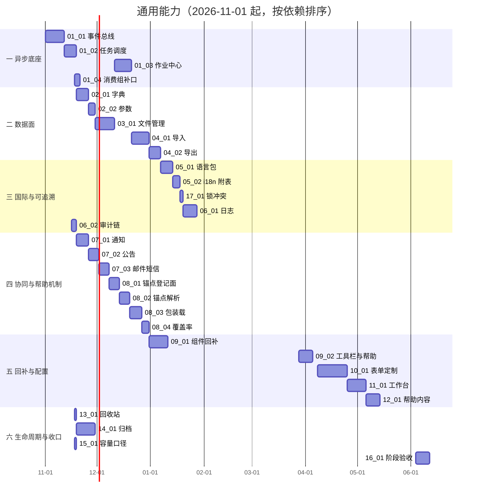

# 通用能力计划

[文档首页](../../../文档首页.md) › [08 通用能力](../README.md) › 计划　|　[任务基线 →](../README.md#batches)　[需求基线 →](../需求/00_需求_通用能力.md)

> 进度唯一落点（本文档）：**已完成 30 项，剩余 2 项**（2026-10-31 立项；2026-11-18 新增 01_04 msg 消费组运行时补口；2026-11-20 01_04 代码与本机用例交付完毕，真栈端到端已闭环（msg 升级 1120b 后 180 条落库、链校验通过），P95 未达 5 秒（§7 #58）；门禁见 §5，遗留台账见 §7）

## 1. 计划说明 

- **排期对象**：阶段八「通用能力」29 条需求（13 个需求域），拆为 **17 个任务域 / 32 个子任务**；任务按**前后依赖**排序，不按需求编号顺序。
- **排期口径**：自 2026-11-01 起串行推进（单人兼职，按约 20h/周折算）；批次划分见[阶段总览](../README.md#batches)。
- **工时**：已完成 580h；剩余 60h（含新增 01_04 的 24h）；阶段合计 640h。
- **里程碑锚点**：M8 = 通用能力可用（各模块 CRUD + 日志落库、审计链校验通过、归档流转可用、工作台与表单接口可用、帮助机制三层可用、组件回补可用、通用工具栏与页面内帮助入口可用）。
- **排序依据（依赖链）**：事件总线、任务调度与作业中心是审计、通知、归档、清理的共同前置；字典是表单定制与导入模板的前置；文件是导入产物与归档冷化的前置；帮助锚点机制必须先于组件回补与页面内帮助入口（页面内帮助按钮消费锚点）。

## 2. 已完成任务（2026-10-31 ~ ） 

> 已完成任务在此归档（6 列：编号 / 任务 / 工时 / 完成日期 / 任务书 / 偏差与遗留）；未完成任务保留在 §3 并随状态更新。

| 编号 | 任务 | 工时（重估） | 完成日期 | 任务文件 | 偏差与遗留 |
| --- | --- | --- | --- | --- | --- |
| 01_01 | 事件总线（Outbox + 投递器 + 消费组 + 幂等重试死信） | 32h | 2026-10-31 | [任务书](../任务/01_异步底座/01_异步底座_01_事件总线/01_异步底座_01_事件总线.md) | 12 提交已推（`f611f8346..d1fc60976`），真 broker 4 用例通过、覆盖率 100%、Kiwi 2370；业务消费组随 06_01 / 06_02 / 07_01 接入；Outbox 多实例无行锁仍为开放项 |
| 01_02 | 任务调度（`sys_task` + 数据库调度器 + 内置任务） | 16h | 2026-10-31 | [任务书](../任务/01_异步底座/01_异步底座_02_任务调度/01_异步底座_02_任务调度.md) | 真机双 beat × 真 Redis 实证通过（Kiwi 2371），已推（`50aecce35`）；内置任务中「孤儿分片清理」已随 03_01 落地（触发型），其余三条为占位（归口 06 / 13 / 14）；遗留：前端任务页面（阶段十三）、产品自持 handler 钩子 |
| 02_01 | 字典统一数据源与运行时查询 | 16h | 2026-10-31 | [任务书](../任务/02_字典与参数/02_字典与参数_01_字典统一数据源与运行时查询/02_字典与参数_01_字典统一数据源与运行时查询.md) | 15 提交已推（`50aecce35..b1052236d`，Kiwi 2372）：12 个内建 key 规格化取数、`DictInvalidator` 版本化失效（`role` 样板）、`[dict]` 三防参数化、启动期与 CI 护栏、真 Redis 双实例一致性用例（并修出「缓存载荷非 JSON 可往返 → 共享层只写不读」缺陷）；推送预检全绿（pyright 0 错误、覆盖率 100%）。遗留：其余 11 key 写路径失效归各所有者域（`config` 归 02_02）、`user` / `tenant` 裁剪归 04 系列、版本键按 key 细化 |
| 02_02 | 系统参数（平台默认 + 租户覆盖） | 8h | 2026-10-31 | [任务书](../任务/02_字典与参数/02_字典与参数_02_系统参数/02_字典与参数_02_系统参数.md) | 管理面 7 端点 + `config:query` / `config:manage` + `is_overridden` 两层语义（重置回落 / 默认项删除保护 / 回收站恢复）+ 缓存载荷版本化与负缓存 + 参数写路径接 `config` 字典失效（Kiwi 2373）；真 Redis 双实例用例通过。遗留：前端参数页与菜单种子（阶段十五）、通用回收站页面（阶段十五；接口已由 13_01 交付）、审计落库（06_01/06_02）、`test`/`prod` 的 `config_source` provider 拓扑（部署窗口） |
| 05_01 | 语言清单与语言包（运行时下发 + 缓存） | 16h | 2026-11-03 | [任务书](../任务/05_国际化/05_国际化_01_语言清单与语言包/05_国际化_01_语言清单与语言包.md) | 管理面 9 端点 + `i18n:query` / `i18n:manage` + 平台默认种子物化（`is_overridden`）+ L1/Redis 版本键缓存 + 错误码 44001~44008 + 中英种子清单与 `common.*` / `error.*` 文案；缓存失效连带清单与全部语言包（Kiwi 2404）。遗留：前端 vue-i18n 运行时接入与语言管理 / 语言包维护页（阶段十五）、国际化菜单与按钮种子（阶段十五）、Babel 源码提取（仅登记口径，未落脚本） |
| 03_01 | 文件管理（分片 / 断点续传 / 预签名 / 孤儿回收） | 32h | 2026-10-31 | [任务书](../任务/03_文件管理/03_文件管理_01_文件管理/03_文件管理_01_文件管理.md) | 两表落库 + 分片双 provider + 12 端点 + 秒传 + 触发器式孤儿回收（Kiwi 2374）；真机 4 用例通过（真 MinIO 组合 / 预签名过期 / 会话跨实例 / 并发分片）。遗留：前端文件页与菜单种子（阶段十五）、文件服务回收站接入（`sys_file` 清理与配额释放，按 sha256+size 判活行；13_01 已交付通用引擎，归文件服务后续接入）、网关体上限与参数联动、`test`/`prod` 的 `config_source` provider 拓扑（部署窗口） |
| 01_03 | 作业消费者基建（统一执行引擎 / 注册 / 监控） | 40h | 2026-11-01 | [任务书](../任务/01_异步底座/01_异步底座_03_作业消费者基建/01_异步底座_03_作业消费者基建.md) | 四表 + `bms_core/jobs` 统一基类 + 每服务 worker + `[[jobs]]` 声明 / 平台目录 / 对账 + 四条事件与投影 + 管理面 + 任务执行迁移 + 03_01 作业化 + compose `worker_id` 唯一（Kiwi 2375~2392）。遗留：监控消费组默认关闭（部署开启）、动态 `worker_id` 注册、worker 指标入口、取消不强制；详见[实施记录](../任务/01_异步底座/01_异步底座_03_作业消费者基建/实施/01_实施_03_作业消费者基建.md) |
| 04_01 | Excel 批量导入（模板 / 全量原子 / 幂等 / 异步作业 / 错误明细） | 24h | 2026-11-02 | [任务书](../任务/04_导入导出/04_导入导出_01_Excel批量导入/04_导入导出_01_Excel批量导入.md) | 首批 users + roles；全量原子 + 整批事务；同步 200 行 / 单次 50000 行；异步 `platform.import.execute` 不自动重试；`503xx` 错误码；Kiwi 2401。遗留：前端导入对话框与菜单按钮种子（阶段十五）、操作日志落库（06_01）、孤儿源文件定时回收、产品仓导入定义；详见[实施记录](../任务/04_导入导出/04_导入导出_01_Excel批量导入/实施/01_实施_01_Excel批量导入.md) |
| 04_02 | 列表导出与 PDF 产物（同口径导出 / 脱敏 / PDF 逐份合并 / 异步作业 / 产物清理） | 16h | 2026-11-02 | [任务书](../任务/04_导入导出/04_导入导出_02_列表导出与PDF产物/04_导入导出_02_列表导出与PDF产物.md) | users + roles 导出定义；三端点（Excel / 列表 PDF / 状态）+ 两作业 + report worker；`504xx`；Kiwi 2402。遗留：前端导出按钮与对话框（阶段十五）、超阈值完成站内信（07_01）、操作日志与字段级审计（06_01 / 06_02）、单据 PDF 产物清理（已由 04_03 闭环）、offset 分页性能；详见[实施记录](../任务/04_导入导出/04_导入导出_02_列表导出与PDF产物/实施/01_实施_02_列表导出与PDF产物.md) |
| 04_03 | 单据 PDF 产物清理（作业回收 / 覆盖防护 / 调度接线 / 打印参数归位） | 8h | 2026-11-03 | [任务书](../任务/04_导入导出/04_导入导出_03_单据PDF产物清理/04_导入导出_03_单据PDF产物清理.md) | `print.artifact.cleanup` 作业（按 `print.artifact_ttl` 回销作业记录的产物 key）+ 覆盖防护（反查更晚作业引用，重打不误删）+ 两条独立内置任务（补齐 `platform.export.cleanup` 从未被调度的缺口）+ 打印阈值归位 `print.pdf.sync_max_docs`（旧键回退）；`print.*` 三键种子；Kiwi 2403；覆盖率 100% 行 + 分支。遗留：同步打印产物无回收路径（详设 §10-1）、被跳过的作业长期留扫描面（§10-2）；详见[实施记录](../任务/04_导入导出/04_导入导出_03_单据PDF产物清理/实施/01_实施_03_单据PDF产物清理.md) |

| 05_02 | 业务文案 i18n 附表与用户时区偏好 | 8h | 2026-11-03 | [任务书](../任务/05_国际化/05_国际化_02_业务文案i18n附表与用户时区偏好/05_国际化_02_业务文案i18n附表与用户时区偏好.md) | 三级回退（请求语言 → 系统默认语言 → 主表列，大小写不敏感）+ 多文案列助手 + 主表删除连带清理（菜单 / 字段 / 业务码 / 动作码 / 图标）+ i18n 附表台账与护栏 `check_i18n_attachments.py` + 个人中心 `GET/PUT /api/v1/profile/preferences`（IANA 校验 / 生效值派生）+ 错误码 44009 / 44010 + `[i18n]` 时区映射配置（Kiwi 2405）。遗留：前端个人中心偏好页与 Intl 展示（阶段十五）、4 张待落地附表随 07_03 / 11_01 / 12_01 / 10_01（`sys_notice_i18n` 已随 07_02 落库）、孤儿附表巡检未立项（当前删除入口已全覆盖） |
| 17_01 | 锁冲突不触发只读降级（争用与故障分流 / `Retry-After` 可重试标记） | 8h | 2026-11-03 | [任务书](../任务/17_运行期健壮性/17_运行期健壮性_01_锁冲突不触发只读降级/17_运行期健壮性_01_锁冲突不触发只读降级.md) | 锁争用识别（SQLite 文本 / MySQL 1205、1213 / PG 死锁与锁不可得，含 `orig` 解包）+ 争用不置只读降级 + `Retry-After` 头（body 与 `10006` 不变）+ 独立日志事件与指标（Kiwi 2406）。遗留：降级态自动恢复、达梦抛错形态、告警阈值（详见测试记录 §5） |
| 06_01 | 操作日志与登录日志（捕获 / 脱敏 / 链式落库） | 24h | 2026-11-03 | [任务书](../任务/06_日志与审计/06_日志与审计_01_操作日志与登录日志/06_日志与审计_01_操作日志与登录日志.md) | 操作审计中间件（写方法全记 / 读方法声明 / 参数限长与脱敏 / 权限码动作）+ identity 登录成功失败捕获（七类失败原因）+ `audit-chain` 有序消费 + `SHA256(prev+record)` 链 + 按月分片（台账 / 启动预热 / 预创建任务）+ 查询四端点（`log:query`）+ 内部校验端点与 `verify_audit_chain` 巡检 + 审计管理员授权与菜单种子（Kiwi 2407；覆盖率 100%，53 文件）。遗留：归档迁移（14_01）、字段级审计与三权分立（06_02）、前端页面与导出（阶段十五）、`audit-chain` 多实例扩容（15_01） |
| 06_02 | 字段级变更审计与哈希链（ORM 捕获 / 链校验 / 三权分立） | 24h | 2026-11-16 | [任务书](../任务/06_日志与审计/06_日志与审计_02_字段级变更审计与哈希链/06_日志与审计_02_字段级变更审计与哈希链.md) | 基座 ORM 会话事件捕获（三层白名单 / 属性历史 / 脱敏截断）同事务写发件箱 + 真实捕获实现 `db`（显式留痕暂存 → 响应收尾排空）+ 链内核上移基座（分片结构 / 仓储 / 校验器 / 范围收敛，log 与 audit 两域共用）+ `data_audit` 分片类型接入写入与巡检 + 新增 `audit` 域三端点（`log:query` / `log:manage`）+ 三权分立拒绝留痕真实落库与「审计管理员只读」不变量 + 审计管理员补 `log:manage` 与菜单种子（Kiwi 2515；模块覆盖率 100%，34 文件）。**实施期按域边界门禁纠正域划分**：链内核上移基座、`log` 域留三处再导出薄壳。遗留：归档迁移与销毁（14_01）、前端页面（阶段十五）、产品仓表接入登记、全文检索（阶段十八）、真库与压测（部署窗口）；详见[实施记录](../任务/06_日志与审计/06_日志与审计_02_字段级变更审计与哈希链/实施/02_实施_01_字段级变更审计与哈希链.md) |
| 14_01 | 归档管理（策略 / 两段式 / 只读查询 / 销毁） | 32h | 2026-11-16 | [任务书](../任务/14_归档/14_归档_01_归档管理/14_归档_01_归档管理.md) | 四表（策略 / 执行记录 / 归档行 / 链尾）+ `archive` 域 11 端点 + 普通表两段式与直冷 + 审计分片整月归档（链校验 → 迁归档库 → 写链尾 → 删物理分片表 → 台账 archived）+ NDJSON.gz 冷化与清单 + 租户隔离查询 / 预签名下载 + 过期清理与合规销毁 + 两条件业 / 两条内置任务 + 三类审计 90 天策略种子与权限菜单（Kiwi 2516）。偏离：策略 / 记录落平台库（概要 §4 已回写例外）；归档库用通用行表；开放接口日志待表落地后补策略。遗留：租户库 / 产品表归档（产品接入）、前端三页（阶段十五）、软删除残留清理已由 13_01 闭环、模块覆盖率与真库压测（推送 / 部署窗口）；详见[实施记录](../任务/14_归档/14_归档_01_归档管理/实施/01_实施记录_14_01_归档管理.md) |
| 07_01 | 通知中心（站内信 / 角标 / 已读 / 渠道偏好） | 16h | 2026-11-16 | [任务书](../任务/07_通知与公告/07_通知与公告_01_通知中心/07_通知与公告_01_通知中心.md) | `sys_notification` 真实落库（三组组合索引）+ 通知中心 `db` 实现（列表 / 详情查看即已读 / 未读数 / 单条批量全部已读 / 软删除 / 跨用户拒绝）+ `notification.requested` 事件契约与通知组消费（渠道过滤 / 免打扰只跳过推送 / `notification.new` + `approval.todo` / `notification.sent`）+ `notification_preference` 能力域（null / http）+ `sys_user_preference` 真实读写与平台内部按用户读取端点 + 导出完成站内信 + 错误码 70101–70106 / 30021–30024 + 权限码 `notification:update` / `delete`（Kiwi 2517）。遗留：前端通知中心页 / 铃铛 / H5（阶段十五）、真实 Socket.IO（实时推送阶段）、邮件短信真实发送（07_03）、导入完成通知（04_01 后续接入）、未读数缓存（压测后评估）、跨用户错误码语义（安全审计时复核）；详见[实施记录](../任务/07_通知与公告/07_通知与公告_01_通知中心/实施/01_实施记录_07_01_通知中心.md) |
| 07_02 | 公告管理（置顶 / 过期下线 / 已读回执） | 24h | 2026-11-16 | [任务书](../任务/07_通知与公告/07_通知与公告_02_公告管理/07_通知与公告_02_公告管理.md) | 三表（`sys_notice` / `sys_notice_read` / `sys_notice_i18n`）+ 三态状态机 + 置顶排序 + 多语言三级回退 + nh3 后端白名单清洗 + 类型 / 优先级选项集 + 已读回执幂等与实时应读人数（复用平台用户只读出口，入站改能力或平台内部白名单）+ 过期下线内置任务 `expire_notices` 与通知服务内部端点 + `sys.notice.published` 载荷扩展（action / type / priority / 时间）+ 错误码 70201–70206 + 权限码 `notice:create/update/delete`（Kiwi 2518；提交环改动行覆盖通过）。遗留：前端公告页 / H5 / 富文本编辑器（阶段十五）、手动下线、统计人员明细、默认语言运行时切换（国际化阶段）、公告归档策略（14_01 机制）、07_03 邮件错误码段冲突、存量租户 `ops.seed_platform` 回填、真库方言实测；详见[实施记录](../任务/07_通知与公告/07_通知与公告_02_公告管理/实施/01_实施记录_07_02_公告管理.md) |
| 07_03 | 邮件与短信通知（模板多语言 / 沙箱校验 / 异步发送 / 记录） | 12h | 2026-11-16 | [任务书](../任务/07_通知与公告/07_通知与公告_03_邮件与短信通知/07_通知与公告_03_邮件与短信通知.md) | 五表（`sys_mail_template` / `sys_mail_template_i18n` / `sys_mail_log` / `sys_sms_template` / `sys_sms_log`）+ 平台默认模板代码内置与租户覆盖 + Jinja2 沙箱（语法 / 危险结构 / 输出上限 / 超时）+ 邮件多语言三级回退 + 短信场景 / 渠道 / 厂商模板 + 外发调度器统一渠道过滤与免打扰 + 作业中心异步发送（`notification.mail.send` / `notification.sms.send` + 通知服务 worker）+ SMTP / 阿里云 / 腾讯云真实适配 + `BaseNotifier` `http` 实现与 `notification.send` 能力 + 幂等键 + 脱敏日志 + 错误码 70301–70306 + 选项集 `bms.sms.scene`（Kiwi 2519）。遗留：前端模板 / 记录页（阶段十五）、真实凭证联调（部署窗口）、免打扰延迟补发、短信多语言、发送限流、跨渠道降级（08_02）、记录归档（14_01）；详见[实施记录](../任务/07_通知与公告/07_通知与公告_03_邮件与短信通知/实施/01_实施记录_07_03_邮件与短信通知.md) |

| 08_01 | 锚点登记面（四表 `help_key` + 按钮级锚点 + 种子装载） | 12h | 2026-11-17 | [任务书](../任务/08_帮助机制/08_帮助机制_01_锚点登记面/08_帮助机制_01_锚点登记面.md) | 五表加 `help_key`（含 `sys_button` 动作级锚点）+ 五段式格式 / 形状 / 跨表唯一 + 维护接口写读与清空 + 种子声明批量 upsert（整批原子）+ 锚点变更显式审计 + 契约 / 前端类型重建 + 帮助包规范与表文件回写（Kiwi 2520；提交环改动行覆盖通过）。遗留：装载期不落字段级审计、产品清单无菜单声明段、前端锚点编辑与帮助按钮（阶段十五 09_01）；详见[实施记录](../任务/08_帮助机制/08_帮助机制_01_锚点登记面/实施/01_实施记录_08_01_锚点登记面.md) |
| 08_02 | 帮助锚点解析（五级链 / 未命中降级 / 按钮显隐） | 12h | 2026-11-17 | [任务书](../任务/08_帮助机制/08_帮助机制_02_帮助锚点解析/08_帮助机制_02_帮助锚点解析.md) | 五级候选链（字段 / 动作（按钮 → 动作码兜底）/ 表单 / 模块 / 全局）+ 自然键定位与模块段匹配 + 内容侧 `help_content` 能力域端口（`null` 占位）+ 锚点索引版本化缓存 + `GET /api/v1/help/context`（登录即可）+ `my_menus` 四级下发 `help_key` + 契约 / 前端类型重建（Kiwi 2521；提交环改动行覆盖通过，4 个基座模块 100%）。遗留：文章 / 分类 / 反馈表与来源优先级（12_01）、内容侧缓存失效、前端帮助按钮（阶段十五 09_01）、多产品同名段由 `product_key` 消歧；详见[实施记录](../任务/08_帮助机制/08_帮助机制_02_帮助锚点解析/实施/01_实施记录_08_02_帮助锚点解析.md) |
| 08_03 | 产品帮助包装载注册（装载 / 升级 / 卸载 / 冲突） | 16h | 2026-11-17 | [任务书](../任务/08_帮助机制/08_帮助机制_03_产品帮助包装载注册/08_帮助机制_03_产品帮助包装载注册.md) | 新建 `help` 业务域（platform 承载）+ 五表（分类 / 文章 / 文章多语言 / 文章锚点 / 包登记）+ `help/package.yaml` 清单 / `includes` / 规范化校验和 + 装载器 `ops.help_package`（默认 dry-run，`--lenient` 跳过无效篇）+ 幂等键 `(product_key, source_key, package_version)` + 升级保留 `local_override` + 包内移除标 `offline` + 卸载按产品清理 + `builtin > product > tenant` 冲突策略 + `help_content` 的 `db` 只读实现（平台服务缺省启用）+ 错误码 40008~40013 + 域布局 / 表归属 / i18n 台账回写（Kiwi 2522；提交环 34 项预检全通过）。遗留：三个管理端点与 `help:package` 权限码、操作日志与字段级审计（12_01）、内容侧缓存失效（12_01）、前端帮助按钮（阶段十五 09_01）、真实产品帮助包（各产品接入任务）；详见[实施记录](../任务/08_帮助机制/08_帮助机制_03_产品帮助包装载注册/实施/01_实施记录_08_03_产品帮助包装载注册.md) |
| 08_04 | 帮助覆盖率门禁与台账 | 8h | 2026-11-17 | [任务书](../任务/08_帮助机制/08_帮助机制_04_帮助覆盖率门禁与台账/08_帮助机制_04_帮助覆盖率门禁与台账.md) | 基座确定性引擎（按钮 / 功能菜单基准、`sys_module` 优先 + 业务码回退分组、限期豁免、双覆盖率、锚点对账、三渲染器、基线对比）+ 只读快照助手（复用 `list_help_anchors`）+ `ops.help_coverage`（默认告警 / `--strict` / `BMS_HELP_COVERAGE_STRICT`）+ `GET /api/v1/help/coverage`（`help:manage`）+ `[help_coverage]` 豁免路径 + `deploy/help/coverage_exemptions.json` + CI 告警档作业（Kiwi 2523；新模块行 + 分支 100%）。遗留：内容覆盖率与历史趋势、豁免维护界面（12_01）、前端覆盖率页面（阶段十五）、产品仓豁免接入、平台业务码正式模块登记、推送与模块级复核；详见[实施记录](../任务/08_帮助机制/08_帮助机制_04_帮助覆盖率门禁与台账/实施/01_实施记录_08_04_帮助覆盖率门禁与台账.md) |
| 09_01 | 组件回补（字典 / 上传 / 预览 / 通知 / 审计差异） | 24h | 2026-11-17 | [任务书](../任务/09_组件回补/09_组件回补_01_组件回补/09_组件回补_01_组件回补.md) | 七组组件接真实出口、零重写实现：字典带版本重取（`revalidateType`）、上传契约对齐 03_01（`/files/multipart` + 每片 `X-Part-Sha256` + 续传 `uploaded`）、`GET /files?ids=` 批量回显、预览过期透传 + 失败降级下载、通知 / 审计 HTTP 适配器、宿主能力装配（六类默认源）+ 顶栏铃铛（Kiwi 2524）。遗留：真实 mdm / 短信渠道联调归部署窗口、通知 Socket.IO 归阶段十、审计 total 按字段行计、产品页面接入归阶段十五；详见[实施记录](../任务/09_组件回补/09_组件回补_01_组件回补/实施/01_实施记录_09_01_组件回补.md) |
| 10_01 | 表单定制后端（布局 / 属性 / 动态 DDL / 校验） | 56h | 2026-11-17 | [任务书](../任务/10_表单定制/10_表单定制_01_表单定制后端/10_表单定制_01_表单定制后端.md) |四表（布局 / 字段属性 / 自建字段 / 附表）+ `form_design` 域 8 端点 + 三级解析与权限优先 + 动态 DDL（白名单 + 四库映射 + 串行锁 + 失败重试 + 停用不删列）+ 动态校验五类规则 + 导入列派生（`columns_for` 钩子，users 试点）+ `users` 创建路径接校验（Kiwi 2526）；基座 95 + 服务侧 73 项通过（`-n0` / `-n4` 均全绿），类型检查零报错、模块级覆盖率 100%（35 文件，行 + 分支）。遗留：更新路径校验、真库 DDL 执行（部署窗口）、DDL 失败定时重试（01_02）、前端页面（10_02）；详见[实施记录](../任务/10_表单定制/10_表单定制_01_表单定制后端/实施/01_实施记录_10_01_表单定制后端.md) |
| 09_02 | 页面内帮助与工具栏基类（列表 / 表单派生 + 帮助动作 + 长文对话框） | 32h | 2026-11-17 | [任务书](../任务/09_组件回补/09_组件回补_02_页面内帮助与工具栏基类/09_组件回补_02_页面内帮助与工具栏基类.md) | 通用工具栏基类（`BaseToolbar` → `BaseListToolbar` / `BaseFormToolbar`）+ 列表 / 表单具体件、帮助上下文能力（`BaseHelpContext`）+ `HelpEntry` 五态、640px 长文阅读对话框、宿主菜单 `help_key` 保留与 `usePageHelpContext`、顶栏帮助入口、用户管理列表 / 表单工具栏试点、后端 `/help/context` 补 `anchor_found`（Kiwi 2525）。遗留：其余平台页面工具栏迁移归阶段十五（§7 待办 27）、帮助中心页面与真实文章内容归 12_01、移动端工具栏另实现；详见[实施记录](../任务/09_组件回补/09_组件回补_02_页面内帮助与工具栏基类/实施/01_实施记录_09_02_页面内帮助与工具栏基类.md) |
| 10_02 | 表单定制前端（设计器 / 渲染器 / 查询区与明细列消费） | 24h | 2026-11-18 | [任务书](../任务/10_表单定制/10_表单定制_02_表单定制前端/10_表单定制_02_表单定制前端.md) | 契约适配层（11 端点 + 三处转换）、设计器页（`/sys/form-design`）与运行时页（`/sys/form-runtime`）、结构化属性面板（`FieldAttrPanel`）、查询区派生纯函数（`formQueryFields`）、自建字段键派生与选项集下拉、权限码 `formdesign:manage` 种子补齐（Kiwi 2527）；desktop 工程覆盖率 100%（语句 / 分支 / 函数 / 行），core / ui_ep / desktop 全量用例与类型检查零报错。遗留：设计器面板不含当前用户不可见字段（改走 `menu:query` + `/fields` 方案归阶段十五）、真实业务列表页查询区与明细列接入归阶段十五、发布无独立端点（保存即发布）、10_01 契约漂移（`GET /form-design/attrs`、`fields?status=` 未实现）见 §7 待办 35；详见[实施记录](../任务/10_表单定制/10_表单定制_02_表单定制前端/实施/01_实施记录_10_02_表单定制前端.md) |
| 11_01 | 首页工作台后端（三级解析 / 卡片注册 / 模板 / 重置） | 32h | 2026-11-18 | [任务书](../任务/11_工作台/11_工作台_01_首页工作台后端/11_工作台_01_首页工作台后端.md) | 三表（卡片 / 卡片名附表 / 模板）+ `dashboard` 域 12 端点（布局解析 / 保存 / 重置 / 卡片 / 模板 / 角标）+ 三级回退与告警剔除 + 角色类型优先级上移基座（表单定制复用）+ 个人布局结构校验入偏好基座 + 租户库种子（6 内置卡 / 平台默认模板，幂等只增不改）+ 错误码 40301~40308 + 权限码 `dashboard:manage` + 通知服务内部未读端点（能力 `notification.read`）（Kiwi 2528）；新增 86 + 回归 345 项通过，类型检查零报错，模块级覆盖率 100%（31 文件，行 + 分支）。遗留：统计接口 `/dashboard/stats` 不落地、数据集探测与待办数据源占位（报表中心 / 工作流）、前端工作台页面归 11_02；详见[实施记录](../任务/11_工作台/11_工作台_01_首页工作台后端/实施/01_实施记录_11_01_首页工作台后端.md) |
| 12_01 | 帮助内容维护与前台展示（分类 / 文章 / 反馈） | 24h | 2026-11-18 | [任务书](../任务/12_帮助内容/12_帮助内容_01_帮助内容维护与前台展示/12_帮助内容_01_帮助内容维护与前台展示.md) | `sys_help_feedback` 表 + `help` 域维护 / 读者 / 统计 / 包管理四组能力（管理面分类 4 + 文章 6 + 统计 1；读者面分类 / 列表 / 详情 / 反馈 4；包列表 / 装载 / 卸载 3）+ 状态机与 HTML 权威清洗 + 多语言写入与三级回退 + 反馈联合唯一可改投 + 阅读计数 60 秒去重 + 帮助率统计 + 内容版本键缓存（只缓存命中）+ 三分类三篇双语种子 + `help:package` 权限码 + 错误码 40014~40023（Kiwi 2529）；后端定向 179 项通过，新模块 19 个行 + 分支 100%。遗留：帮助中心前后台页面 / 富文本编辑器归阶段十五、全文检索阶段十八、AI 生成阶段十九、分类 / 反馈字段级审计为已知边界；回收站恢复已由 13_01 闭环；存量 `@bms/core` 类型红灯与 11_01 原型对照结论缺口属范围外；详见[实施记录](../任务/12_帮助内容/12_帮助内容_01_帮助内容维护与前台展示/实施/01_实施记录_12_01_帮助内容维护与前台展示.md) |
| 13_01 | 回收站（软删除查看 / 恢复 / 超期清理） | 16h | 2026-11-18 | [任务书](../任务/13_回收站/13_回收站_01_回收站/13_回收站_01_回收站.md) | 通用引擎 `bms_core.recycle`（18 张表规格 / 模块计数 / 单表分页 / 详情 / 恢复 / 逐表清理）+ `recycle` 域 5 端点（模块 / 列表 / 详情 / 恢复 / 清理记录）+ 单条恢复（唯一冲突 95002 / 级联 / 幂等键 / 操作日志 + 字段级审计）+ `sys_recycle_log` 清理批次表 + `platform.recycle.purge` 作业与 `purge_soft_deleted` 真实提交 + `[recycle]` 参数 + 错误码 95001~95004 + 回收站菜单 / 按钮种子（Kiwi 2530）；定向 291 项通过，10 个新模块行 + 分支 100%。遗留：前端页面归阶段十五、`sys_file` 清理归文件服务后续接入、其他服务 / 产品表接入、跨表分页 / 批量恢复、存量菜单父级偏位；详见[实施记录](../任务/13_回收站/13_回收站_01_回收站/实施/01_实施记录_13_01_回收站.md) |
| 15_01 | 异步链路容量与延迟（压测与指标） | 16h | 2026-11-18 | [任务书](../任务/15_容量口径/15_容量口径_01_异步链路容量与延迟/15_容量口径_01_异步链路容量与延迟.md) | 指标基座增 7 个审计 / 死信指标 + `bms_core.audit.observability` 单一发射落点 + 发件箱积压带库键与死信待处置统计 + 6 条告警规则（1 万 / 租户、P95 5s、链断裂、次月分片 25 日、死信 24h）+ promtool 3.16.0 规则单测 + 容量面板 + 写入侧 5 万条基准与应用层三档 A/B（Kiwi 2531；改动文件覆盖率 100%）。**限定达标**：主链路 P99 中位差 +5.0%（临界）、HTTP 客户端口径因本机服务间回连被拒未测；**未达标（限定）**：消费 P95 546s、写入 62.7~87.6 条/秒（SQLite + 无 broker）。遗留：01_01 msg 消费组运行时缺失（阻塞端到端）、链吞吐优化、可观测性栈镜像升级、真库 / HTTP 复测；详见[压测报告](../任务/15_容量口径/15_容量口径_01_异步链路容量与延迟/测试/02_压测报告_15_01_异步链路容量与延迟.md) |

## 3. 剩余任务排期（自 2026-11-01） 

| 编号 | 任务 | 状态 | 工时 | 依赖 | 排期窗口 | 备注 | 偏差与遗留 |
| --- | --- | --- | --- | --- | --- | --- | --- |
| 01_04 | 事件消费组运行时（msg 补口） | 已交付（真栈端到端闭环；P95 未达 5 秒） | 24h | 01_01、msg、Redis、租户注册契约 | 2026-11-18 ~ 2026-11-20 | 需求 03-1（兼 11-1、06_01 / 06_02 审计链验收）；运行时 + 租户覆盖 + 主题供给 + 真栈主题 / 消费组 / 两进程 / 端到端落库与链校验 | 详见[详细设计](../任务/01_异步底座/01_异步底座_04_事件消费组运行时/设计/01_详细设计_04_事件消费组运行时.md)与[实施记录](../任务/01_异步底座/01_异步底座_04_事件消费组运行时/实施/01_实施记录_04_事件消费组运行时.md)；端到端 P95 15.8~16.1 秒未达 5 秒，优化归 §7 #58 |
| 16_01 | 阶段验收与测试报告 | 未开始 | 24h | 全部 | 2027-06-04 ~ 2027-06-11 | 需求 12-1；门禁逐条结论 | 无 |

## 4. 排期甘特图 

## 5. 阶段八验收门禁 

| 验收点 | 对应任务 | 核对方式（结论在阶段测试报告） |
| --- | --- | --- |
| 通用能力齐备（12 域功能可用） | 01_01 ~ 14_01 | 逐模块 CRUD + 日志落库用例；接口契约用例 |
| 写路径唯一（无二次写入口） | 02_01 / 05_02 / 08_03 | 表归属检查：字典无平台表；i18n 附表随主表写；帮助内容只经装载或后台维护 |
| 异步底座可用（事件必达、任务可管、作业可消费） | 01_01 / 01_02 / 01_03 / 01_04 | 投递器中断恢复补投用例；双 beat 不重复执行用例；多 worker 租约竞争 / 回收用例；作业重试与死信用例；03_01 迁移回归；真实 msg 消费组端到端（审计链 / 作业投影 / 通知）与两进程分区验证 |
| 审计链可校验（篡改可定位） | 06_01 / 06_02 | 链校验用例；篡改定位用例；归档前校验拦截用例 |
| 多语言可运行期扩展（加语言免发版） | 05_01 / 05_02 | 新增语言（含 RTL）用例；缺省回退用例 |
| 数据生命周期可执行 | 13_01 / 14_01 | 归档流转用例；回收站恢复与过期清理用例 |
| 帮助机制三层可用 | 08_01 ~ 08_04 / 12_01 | 五级解析用例；装载升级卸载用例；覆盖率台账；内容状态机 |
| 页面内帮助与通用工具栏可用 | 09_02 | 列表 / 表单工具栏继承基类；帮助按钮按锚点显隐与五级解析；未命中分类；长文对话框 640 档；用户管理页试点 |
| 可配置性后端可用 | 09_01 / 10_01 / 11_01 | 三级布局解析用例（角色 → 租户 → 平台 → 空回退 + 权限剔除）；动态 DDL 四库类型映射（8 类型 × 4 方言编译断言）与真建列 / 失败重试 / 停用不删列；动态校验五类规则；导入列派生 |
| 遗留有归口（无「无归口」条目） | 16_01 | 台账逐条「来源 + 归口」；收口断言用例 |

**门禁对照**：门禁行数与本表一致；结论与证据索引见阶段测试报告（收口时产出）。

## 6. 风险与对策 

| 风险 | 影响 | 对策 |
| --- | --- | --- |
| 阶段体量大（27 子任务 / 568h），易「全部半成品」 | 无法验收 | 按 16 段串行，每段自成闭环、可独立验收；每段完成才进下一段 |
| 底座延期会拖住后面 6 个模块 | 连锁延期 | 01_01 / 01_02 / 01_03 为首批且标「紧急」；未就绪前其余模块不做异步化改造 |
| 01_02 执行器迁移影响既有任务 API | 任务查询 / 历史回归 | 作业终态回写 `sys_task_log`，任务 API 口径不变；迁移前后任务 API 与执行记录用例全量回归 |
| 动态 DDL 安全（租户自建字段） | 注入 / 破坏表结构 | 类型白名单 + 跨四库类型映射 + 标识符校验（不走字符串拼接） |
| 帮助包与产品版本耦合 | 升级覆盖租户编辑 | `local_override` 保护 + 包内移除只下线不删 + 装载前 `dry-run` |
| AI 误用（生产读代码） | 源码外泄 | 生产默认关闭生成（架构 28 §7.6）；AI 只写草稿，包只收 published/offline |
| 压测环境与生产差异 | 容量结论失真 | 15_01 报告须写明环境规格；不达标记「限定达标」并归口 |

## 7. 后续阶段待办 

| # | 事项 | 来源 | 归口 |
| --- | --- | --- | --- |
| 1 | AI 帮助文档生成能力（四类触发 / 质量评估） | 架构 28 §7 | 阶段十九 AI 能力 |
| 2 | 帮助与审计日志进入全文检索（ES 同步） | 架构 28 §6 | 阶段十八全文检索 |
| 3 | 帮助文章 AI 质量巡检任务 | 架构 28 §7.3 | 阶段十九（依赖 01_02 任务调度） |
| 4 | 产品仓（biz / mdm / cw）帮助包接入与首版内容 | 《帮助包规范》 | 各产品接入任务 |
| 5 | 开放接口 / Webhook 对事件的订阅 | 架构 16 §7 | 阶段十 |
| 6 | 前端全页面（工作台 / 表单设计器 / 帮助中心页 / 个人中心语言与时区偏好页） | 阶段八完成标准 | 阶段十五 |
| 7 | 真库（MySQL / PG / DM8）与真部署压测 | 需求 11-1 | 部署窗口（与 07C 遗留同窗口） |
| 8 | Kiwi 用例编号登记 | 各任务测试记录 | 平台窗口 |
| 9 | 作业中心前端页面（统一作业列表 / 死信重放） | 01_03 | 阶段十五（09_01） |
| 10 | 作业依赖 / DAG 编排与批量死信重放 | 架构 40 §11 | 按真实需求立项 |
| 11 | 自研消息平台（事件总线 + RPC + 管理台，8B）与 06_02 迁移 | 06_02 / 01_04 讨论 | msg 仓 08B 阶段 |
| 12 | 租户库表 / 产品表归档接入（同策略表结构、各自服务执行） | 14_01 | 各产品接入任务 |
| 13 | 开放接口日志（`sys_open_log`）归档策略与种子 | 14_01 | 开放接口任务（表落地后补） |
| 14 | 导入完成站内信（04_01 遗留） | 07_01 | 04_01 后续接入（发 `notification.requested`） |
| 15 | 用户偏好全量接口 / 批量写入 / 键白名单补全 | 07_01 | 用户喜好任务（前端个人中心偏好页同窗口） |
| 16 | 公告管理页 / 移动端 H5 / 富文本编辑器 | 07_02 | 阶段十五 |
| 17 | 公告手动下线、读统计人员明细、默认语言运行时切换 | 07_02 | 后续需求确认 / 国际化阶段 |
| 18 | 07_03 邮件错误码段重分配（原规划 71001–71006 已被作业中心占用） | 07_02 / 概要 24 | 已完成：07_03 改用 70301–70306 |
| 19 | 邮件 / 短信前端模板页与发送记录页 | 07_03 | 阶段十五 |
| 20 | 真实 SMTP / 阿里云 / 腾讯云凭证与厂商模板联调 | 07_03 | 部署窗口 |
| 21 | 免打扰期间外发延迟补发、短信多语言、发送限流 | 07_03 | 后续需求确认 |
| 22 | 短信渠道故障降级企业微信 / 钉钉 | 07_03 | 08_02 webhook |
| 23 | 发送记录归档策略 | 07_03 | 14_01 既有机制（部署窗口配置） |
| 24 | 帮助包管理端点（列表 / 装载 / 卸载）+ `help:package` 权限码 + 操作日志 / 字段级审计 | 08_03 | 已完成（12_01） |
| 25 | 帮助内容侧缓存与失效（文章发布 / 下架即时生效） | 08_03 | 已完成（12_01） |
| 26 | 阶段测试报告引用帮助覆盖率台账（命令 + 基线快照；强档 `--strict` 用于发布验收） | 08_04 | 16_01 阶段验收 |
| 27 | 其余平台列表 / 表单页工具栏迁移到通用工具栏基类（列表 / 表单派生、帮助入口统一） | 09_02 | 阶段十五（页面全量迁移） |
| 28 | 表单定制前端（设计器 / 渲染器 / 列表页查询区与明细列消费） | 10_01 | 已完成（10_02）；真实业务页接入归阶段十五 |
| 29 | 动态校验接入用户**更新**路径与其它业务模块（新建 / 编辑接口按同一能力域注入） | 10_01 | 各模块接入任务（能力域已就绪，按模块语义定制规则集） |
| 30 | 自建字段 DDL 的真库执行验证（MySQL 8 / PostgreSQL 16 / 达梦 DM8 在线加列与锁窗口） | 10_01 | 部署窗口；本轮以四库编译断言覆盖类型映射 |
| 31 | DDL 失败自动重试与元数据一致性巡检任务 | 10_01 | 01_02 任务调度（当前只提供手动 retry） |
| 32 | 10_01 新增模块 pyright 类型精度清零（动态模型 / 会话改协议化类型，168 处） | 10_01 | 提交环阻塞项，专项修复 |
| 33 | 10_01 新增模块覆盖率补齐到行 + 分支 100%（按 `coverage_report.py --module`） | 10_01 | 推送环阻塞项，专项补齐 |
| 34 | 表单定制前端消费真实业务列表页（查询区 / 明细列接入用户管理等页面）与移动端单列重排 | 10_02 | 阶段十五页面迁移 |
| 35 | 10_01 契约漂移收口：`GET /form-design/attrs`、`GET /form-design/fields?status=` 与实现对齐（补端点或改设计） | 10_02 实施记录 §3 | 10_01 后续修订（本轮前端按实现对接） |
| 36 | 设计器面板纳入当前用户不可见字段（改走 `menu:query` + `GET /fields?form_id`） | 10_02 | 阶段十五页面迁移 |
| 37 | 帮助内容缓存与阅读计数在真库 / 压测下的表现（窗口精确去重、缓存命中率） | 12_01 | 部署窗口（15_01 已交付压测口径与工具，真库复测同窗口） |
| 38 | 帮助统计明细开放排序 / 大数据量物化（当前固定序 + 实时聚合） | 12_01 | 按真实数据量再评估 |
| 39 | 文件服务回收站接入：`sys_file` 清理与配额释放（按 sha256+size 判活行，复用 `bms_core.recycle` 引擎） | 03_01 / 13_01 | 文件服务后续接入 |
| 40 | **01_04 msg 消费组运行时补口**（拉取 / 分发 / 重试 / 死信 / 停机 + 租户覆盖 + 主题供给 + 用例）：当前 `event_consumer` 仅 null 实现，审计链无人消费——阻塞审计链端到端验收、消费 P95 实测与 `audit-chain` 扩容 | 15_01 压测报告 §8-2 | 已交付（[01_04](../任务/01_异步底座/01_异步底座_04_事件消费组运行时/01_异步底座_04_事件消费组运行时.md)，2026-11-20；运行时 + 租户覆盖 + 主题供给 + 本地用例 + 真栈主题 / 消费组 / 两进程 / 端到端落库与链校验），端到端 P95 未达 5 秒，优化归 #58 |
| 41 | 审计链写入吞吐优化（链尾缓存 / 批量追加 / 幂等与链尾查询合并）：SQLite 实测 62.7~87.6 条/秒、批提交仍 <200，目标 500 | 15_01 压测报告 §5 / §8-3 | 01_04 补口后单独立项；生产库复测先于优化 |
| 42 | 主链路 HTTP 客户端压测复测（本机服务间回连被拒，HTTP 三档未闭环） | 15_01 实施记录 §4-4 | 部署窗口 / 独立测试环境（真服务 + 网关） |
| 43 | 可观测性栈镜像升级 `prom/prometheus` v3.1.0 → v3.16.0（规则单测已用 3.16.0 临时容器），含抓取 / 规则 / 告警路由 / 面板回归 | 15_01 详细设计 §12-9 | 16_01 阶段验收（与部署窗口一并做） |
| 44 | 前序遗留红灯收口：插件键集合（`help_content` / `notification_preference`）、`job_handlers` 清单、域布局断言 26≠20、能力来源基线、`my_menu` 过滤、`base_inheritance`（06_02 / 10_01）、`null_migration`、任务迁移事件、前端 `form-query.spec.ts` 类型、11_01 原型对照结论 | 15_01 测试记录 §6 | 各来源任务修订 / 专项修复（等确认后执行） |
| 45 | 存量菜单父级索引偏位修正（`/platform/tenants` 与归档三菜单落到 `/sys/icons`） | 13_01 核对发现 | 单独修复任务 / 数据修复脚本（新建租户种子 + 存量数据） |
| 46 | 回收站前端页面、菜单按钮交互与移动端适配 | 13_01 | 阶段十五（需先补可交互原型） |
| 47 | 其他服务 / 产品表接入回收站（登记表规格 + 自挂路由与作业） | 13_01 | 各服务 / 产品接入任务 |
| 48 | 回收站跨表合并分页与批量恢复 | 13_01 | 按真实需求再评估（本期单表分页 + 单条恢复） |
| 49 | `audit-chain` 生产扩容方案（分区数规划 / 滚动重启 / 容量对比） | 01_04 §8-4 | 04 两进程验证通过后单独立项 |
| 50 | `event-worker` 正式服务化（服务目录 / 独立镜像 / 网关登记） | 01_04 §8-3 | 需要独立扩缩容时 |
| 51 | **msg 记录头编码溢出**：`bms_msg/broker/record.py::_pack_header` 用 msgpack 打包 `topic_id`（雪花 id ≈ 5.9e34）超 uint64，`POST /api/v1/msg/publish` 恒 500——任何消息写不进 broker，阻塞审计链端到端与消费 P95 | 01_04 真栈（2026-11-20） | **已闭环**：msg `92092fd` 增 `_pack_id()`（超限编十进制字符串，读侧 `int()` 兼容），镜像 `1120b` 生效；端到端 180 条落库、链校验通过（15_01 §5.3） |
| 52 | **msg 限流器同键冲突**：`NullRateLimiter.check()` 不接 `tenant` 关键字，而 msg 的 `app.state.rate_limiter` 被基座插件（`provider=''`）覆写，发布必报错 | 01_04 真栈（2026-11-20） | **已闭环**：msg `92092fd` 改用独立 state 键 `msg_rate_limiter`；开发服务器应急补丁退役 |
| 53 | **msg 成员端点只有 JSON 形态**：`/msg/join` / `/msg/leave` / `/msg/heartbeat` 帧端点已下线，仅 `/msg/subscribe` 保留帧；msg 主题列表接口 `GET /api/v1/msg/admin/topics` 500（`MissingGreenlet`） | 01_04 真栈（2026-11-20） | **已闭环**：bms 侧改 `/api/v1/msg/*` + JSON 通道；msg `b8cf97f` 修列表接口（200），bms 本轮修 `--check` 一致性误报（`3cc4ff947`）；未启用命名空间上报归 #59 |
| 54 | **拆分部署下种子编排不可用**：`release.py seed` 一次性容器内调 `127.0.0.1:8000` 不可达且不带服务凭证（401）；`service=tenant` 的种子在 platform 进程被单元守卫拒（10008）；`--skip seed-tenant` 触发依赖缺失（退 3）；`--only` 平台种子与启动期登记冲突（模块行 name / table_prefix 不一致） | 01_04 真栈（2026-11-20） | 单独立项：种子按 `service` 分发 + 注入服务 JWT + 启动期登记与种子口径对齐 |
| 55 | **部署态注册表含产品行、仓库基座生成件只含基座**：产品清单改环境变量注入后，`release.py deploy` 对账必失败 | 01_04 真栈（2026-11-20） | 网关 / 产品登记口径任务；本次以 `--skip-gateway-check` 留痕跳过 |
| 56 | **msg 消费组成员时刻 naive / aware 相减**：`last_seen` 从 `DateTime` 列读回为 naive，协调器与 `datetime.now(UTC)` 相减抛 `TypeError`，重启后首次 `ensure_member` 即 10000 `server_bug` | 01_04 真栈（2026-11-20） | **已闭环**：msg `638d4f3` 仓储读回统一补 UTC + 回归用例；镜像 `1120b` 生效 |
| 57 | **msg 长轮询挂起期间持有数据库连接**：12 个空闲消费单元按 20s 挂起即占满缺省池（5+10），心跳 / join / 发布排队超时、`/readyz` 库探针 30s 超时 | 01_04 真栈（2026-11-20） | 部署态池 20+40 + 消费端长轮询 5s（已落仓）；治本归 msg 仓（挂起前结束事务 / 唤醒后重开），按真实消费单元规模立项 |
| 58 | **审计链端到端 P95 未达 5 秒**：真栈 180 条突发下 P95 15.8~16.1 秒（约 9.5 条/秒），有序列全组串行 + 一条一事务 | 15_01 §5.3（2026-11-20） | 链写入优化立项（批量提交 / 组内并行度 / 去重与指标开销），生产环境复测 |
| 59 | **`ops.event_topics --check` 把未启用命名空间报成缺失**：`wf` 在 demo / acme 未开通，创建路径按 350010 跳过、校验路径未做同一判定 | 15_01 §8-8（2026-11-20） | 01_04 后续小修（校验侧按命名空间可用性跳过） |

> 本文档依《[计划文档规范](../../../规范/计划文档规范.md)》编写 · 进度以本表为唯一落点
