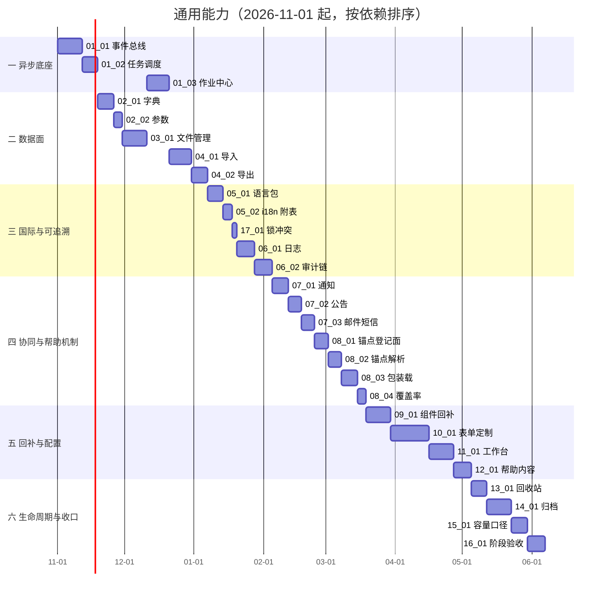

# 通用能力计划

[文档首页](../../../文档首页.md) › [08 通用能力](../README.md) › 计划　|　[任务基线 →](../README.md#batches)　[需求基线 →](../需求/00_需求_通用能力.md)

> 进度唯一落点（本文档）：**已完成 12 项，剩余 17 项**（2026-10-31 立项；门禁见 §5，遗留台账见 §7）

## 1. 计划说明 

- **排期对象**：阶段八「通用能力」28 条需求（13 个需求域），拆为 **17 个任务域 / 29 个子任务**；任务按**前后依赖**排序，不按需求编号顺序。
- **排期口径**：自 2026-11-01 起串行推进（单人兼职，按约 20h/周折算）；批次划分见[阶段总览](../README.md#batches)。
- **工时**：已完成 224h；剩余 368h；阶段合计 592h。
- **里程碑锚点**：M8 = 通用能力可用（各模块 CRUD + 日志落库、审计链校验通过、归档流转可用、工作台与表单接口可用、帮助机制三层可用、组件回补可用）。
- **排序依据（依赖链）**：事件总线、任务调度与作业中心是审计、通知、归档、清理的共同前置；字典是表单定制与导入模板的前置；文件是导入产物与归档冷化的前置；帮助锚点机制必须先于组件回补（页面内帮助按钮消费锚点）。

## 2. 已完成任务（2026-10-31 ~ ） 

> 已完成任务在此归档（6 列：编号 / 任务 / 工时 / 完成日期 / 任务书 / 偏差与遗留）；未完成任务保留在 §3 并随状态更新。

| 编号 | 任务 | 工时（重估） | 完成日期 | 任务文件 | 偏差与遗留 |
| --- | --- | --- | --- | --- | --- |
| 01_01 | 事件总线（Outbox + 投递器 + 消费组 + 幂等重试死信） | 32h | 2026-10-31 | [任务书](../任务/01_异步底座/01_异步底座_01_事件总线/01_异步底座_01_事件总线.md) | 12 提交已推（`f611f8346..d1fc60976`），真 broker 4 用例通过、覆盖率 100%、Kiwi 2370；业务消费组随 06_01 / 06_02 / 07_01 接入；Outbox 多实例无行锁仍为开放项 |
| 01_02 | 任务调度（`sys_task` + 数据库调度器 + 内置任务） | 16h | 2026-10-31 | [任务书](../任务/01_异步底座/01_异步底座_02_任务调度/01_异步底座_02_任务调度.md) | 真机双 beat × 真 Redis 实证通过（Kiwi 2371），已推（`50aecce35`）；内置任务中「孤儿分片清理」已随 03_01 落地（触发型），其余三条为占位（归口 06 / 13 / 14）；遗留：前端任务页面（阶段十三）、产品自持 handler 钩子 |
| 02_01 | 字典统一数据源与运行时查询 | 16h | 2026-10-31 | [任务书](../任务/02_字典与参数/02_字典与参数_01_字典统一数据源与运行时查询/02_字典与参数_01_字典统一数据源与运行时查询.md) | 15 提交已推（`50aecce35..b1052236d`，Kiwi 2372）：12 个内建 key 规格化取数、`DictInvalidator` 版本化失效（`role` 样板）、`[dict]` 三防参数化、启动期与 CI 护栏、真 Redis 双实例一致性用例（并修出「缓存载荷非 JSON 可往返 → 共享层只写不读」缺陷）；推送预检全绿（pyright 0 错误、覆盖率 100%）。遗留：其余 11 key 写路径失效归各所有者域（`config` 归 02_02）、`user` / `tenant` 裁剪归 04 系列、版本键按 key 细化 |
| 02_02 | 系统参数（平台默认 + 租户覆盖） | 8h | 2026-10-31 | [任务书](../任务/02_字典与参数/02_字典与参数_02_系统参数/02_字典与参数_02_系统参数.md) | 管理面 7 端点 + `config:query` / `config:manage` + `is_overridden` 两层语义（重置回落 / 默认项删除保护 / 回收站恢复）+ 缓存载荷版本化与负缓存 + 参数写路径接 `config` 字典失效（Kiwi 2373）；真 Redis 双实例用例通过。遗留：前端参数页与菜单种子（阶段十五）、通用回收站页（13_01）、审计落库（06_01/06_02）、`test`/`prod` 的 `config_source` provider 拓扑（部署窗口） |
| 05_01 | 语言清单与语言包（运行时下发 + 缓存） | 16h | 2026-11-03 | [任务书](../任务/05_国际化/05_国际化_01_语言清单与语言包/05_国际化_01_语言清单与语言包.md) | 管理面 9 端点 + `i18n:query` / `i18n:manage` + 平台默认种子物化（`is_overridden`）+ L1/Redis 版本键缓存 + 错误码 44001~44008 + 中英种子清单与 `common.*` / `error.*` 文案；缓存失效连带清单与全部语言包（Kiwi 2404）。遗留：前端 vue-i18n 运行时接入与语言管理 / 语言包维护页（阶段十五）、国际化菜单与按钮种子（阶段十五）、Babel 源码提取（仅登记口径，未落脚本） |
| 03_01 | 文件管理（分片 / 断点续传 / 预签名 / 孤儿回收） | 32h | 2026-10-31 | [任务书](../任务/03_文件管理/03_文件管理_01_文件管理/03_文件管理_01_文件管理.md) | 两表落库 + 分片双 provider + 12 端点 + 秒传 + 触发器式孤儿回收（Kiwi 2374）；真机 4 用例通过（真 MinIO 组合 / 预签名过期 / 会话跨实例 / 并发分片）。遗留：前端文件页与菜单种子（阶段十五）、回收站物理清理与配额释放（13_01，须按 sha256+size 判活行）、网关体上限与参数联动、`test`/`prod` 的 `config_source` provider 拓扑（部署窗口） |
| 01_03 | 作业消费者基建（统一执行引擎 / 注册 / 监控） | 40h | 2026-11-01 | [任务书](../任务/01_异步底座/01_异步底座_03_作业消费者基建/01_异步底座_03_作业消费者基建.md) | 四表 + `bms_core/jobs` 统一基类 + 每服务 worker + `[[jobs]]` 声明 / 平台目录 / 对账 + 四条事件与投影 + 管理面 + 任务执行迁移 + 03_01 作业化 + compose `worker_id` 唯一（Kiwi 2375~2392）。遗留：监控消费组默认关闭（部署开启）、动态 `worker_id` 注册、worker 指标入口、取消不强制；详见[实施记录](../任务/01_异步底座/01_异步底座_03_作业消费者基建/实施/01_实施_03_作业消费者基建.md) |
| 04_01 | Excel 批量导入（模板 / 全量原子 / 幂等 / 异步作业 / 错误明细） | 24h | 2026-11-02 | [任务书](../任务/04_导入导出/04_导入导出_01_Excel批量导入/04_导入导出_01_Excel批量导入.md) | 首批 users + roles；全量原子 + 整批事务；同步 200 行 / 单次 50000 行；异步 `platform.import.execute` 不自动重试；`503xx` 错误码；Kiwi 2401。遗留：前端导入对话框与菜单按钮种子（阶段十五）、操作日志落库（06_01）、孤儿源文件定时回收、产品仓导入定义；详见[实施记录](../任务/04_导入导出/04_导入导出_01_Excel批量导入/实施/01_实施_01_Excel批量导入.md) |
| 04_02 | 列表导出与 PDF 产物（同口径导出 / 脱敏 / PDF 逐份合并 / 异步作业 / 产物清理） | 16h | 2026-11-02 | [任务书](../任务/04_导入导出/04_导入导出_02_列表导出与PDF产物/04_导入导出_02_列表导出与PDF产物.md) | users + roles 导出定义；三端点（Excel / 列表 PDF / 状态）+ 两作业 + report worker；`504xx`；Kiwi 2402。遗留：前端导出按钮与对话框（阶段十五）、超阈值完成站内信（07_01）、操作日志与字段级审计（06_01 / 06_02）、单据 PDF 产物清理（已由 04_03 闭环）、offset 分页性能；详见[实施记录](../任务/04_导入导出/04_导入导出_02_列表导出与PDF产物/实施/01_实施_02_列表导出与PDF产物.md) |
| 04_03 | 单据 PDF 产物清理（作业回收 / 覆盖防护 / 调度接线 / 打印参数归位） | 8h | 2026-11-03 | [任务书](../任务/04_导入导出/04_导入导出_03_单据PDF产物清理/04_导入导出_03_单据PDF产物清理.md) | `print.artifact.cleanup` 作业（按 `print.artifact_ttl` 回销作业记录的产物 key）+ 覆盖防护（反查更晚作业引用，重打不误删）+ 两条独立内置任务（补齐 `platform.export.cleanup` 从未被调度的缺口）+ 打印阈值归位 `print.pdf.sync_max_docs`（旧键回退）；`print.*` 三键种子；Kiwi 2403；覆盖率 100% 行 + 分支。遗留：同步打印产物无回收路径（详设 §10-1）、被跳过的作业长期留扫描面（§10-2）；详见[实施记录](../任务/04_导入导出/04_导入导出_03_单据PDF产物清理/实施/01_实施_03_单据PDF产物清理.md) |

| 05_02 | 业务文案 i18n 附表与用户时区偏好 | 8h | 2026-11-03 | [任务书](../任务/05_国际化/05_国际化_02_业务文案i18n附表与用户时区偏好/05_国际化_02_业务文案i18n附表与用户时区偏好.md) | 三级回退（请求语言 → 系统默认语言 → 主表列，大小写不敏感）+ 多文案列助手 + 主表删除连带清理（菜单 / 字段 / 业务码 / 动作码 / 图标）+ i18n 附表台账与护栏 `check_i18n_attachments.py` + 个人中心 `GET/PUT /api/v1/profile/preferences`（IANA 校验 / 生效值派生）+ 错误码 44009 / 44010 + `[i18n]` 时区映射配置（Kiwi 2405）。遗留：前端个人中心偏好页与 Intl 展示（阶段十五）、5 张待落地附表随 07_02 / 07_03 / 11_01 / 12_01 / 10_01、孤儿附表巡检未立项（当前删除入口已全覆盖） |
| 17_01 | 锁冲突不触发只读降级（争用与故障分流 / `Retry-After` 可重试标记） | 8h | 2026-11-03 | [任务书](../任务/17_运行期健壮性/17_运行期健壮性_01_锁冲突不触发只读降级/17_运行期健壮性_01_锁冲突不触发只读降级.md) | 锁争用识别（SQLite 文本 / MySQL 1205、1213 / PG 死锁与锁不可得，含 `orig` 解包）+ 争用不置只读降级 + `Retry-After` 头（body 与 `10006` 不变）+ 独立日志事件与指标（Kiwi 2406）。遗留：降级态自动恢复、达梦抛错形态、告警阈值（详见测试记录 §5） |

## 3. 剩余任务排期（自 2026-11-01） 

| 编号 | 任务 | 状态 | 工时 | 依赖 | 排期窗口 | 备注 | 偏差与遗留 |
| --- | --- | --- | --- | --- | --- | --- | --- |
| 06_01 | 操作日志与登录日志（捕获 / 脱敏 / 链式落库） | 未开始 | 24h | 01_01 | 2027-01-18 ~ 2027-01-25 | 需求 05-1 | 无 |
| 06_02 | 字段级变更审计与哈希链（巡检 / 三权分立） | 未开始 | 24h | 06_01 | 2027-01-26 ~ 2027-02-02 | 需求 05-2 | 无 |
| 07_01 | 通知中心（站内信 / 角标 / 已读 / 渠道偏好） | 未开始 | 16h | 01_01/05_01 | 2027-02-03 ~ 2027-02-09 | 需求 04-1 | 无 |
| 07_02 | 公告管理（置顶 / 过期下线 / 已读回执） | 未开始 | 12h | 07_01 | 2027-02-10 ~ 2027-02-15 | 需求 04-2 | 无 |
| 07_03 | 邮件与短信通知（模板多语言 / 沙箱校验 / 记录） | 未开始 | 12h | 05_02/07_01 | 2027-02-16 ~ 2027-02-21 | 需求 04-3 | 无 |
| 08_01 | 锚点登记面（四表 `help_key` + 产品清单格式） | 未开始 | 12h | 阶段七元数据 | 2027-02-22 ~ 2027-02-27 | 需求 10-1；跨阶段改表 | 无 |
| 08_02 | 帮助锚点解析（五级链 / 未命中降级 / 按钮显隐） | 未开始 | 12h | 08_01 | 2027-02-28 ~ 2027-03-05 | 需求 09-1 | 无 |
| 08_03 | 产品帮助包装载注册（装载 / 升级 / 卸载 / 冲突） | 未开始 | 16h | 08_02 | 2027-03-06 ~ 2027-03-12 | 需求 09-2；依《帮助包规范》 | 无 |
| 08_04 | 帮助覆盖率门禁与台账 | 未开始 | 8h | 08_03 | 2027-03-13 ~ 2027-03-16 | 需求 09-3；CI 脚本 | 无 |
| 09_01 | 组件回补（字典 / 上传 / 预览 / 通知 / 审计差异） | 未开始 | 32h | 02_01/03_01/06_02/07_01/08_02 | 2027-03-17 ~ 2027-03-27 | 需求 08-3；含帮助按钮消费锚点 | 无 |
| 10_01 | 表单定制后端（布局 / 属性 / 动态 DDL / 校验） | 未开始 | 56h | 02_01/04_01/09_01 | 2027-03-28 ~ 2027-04-13 | 需求 08-2；跨四库类型映射 | 无 |
| 11_01 | 首页工作台后端（三级解析 / 卡片注册 / 模板 / 重置） | 未开始 | 32h | 07_01/07_02/10_01 | 2027-04-14 ~ 2027-04-24 | 需求 08-1 | 无 |
| 12_01 | 帮助内容维护与前台展示（分类 / 文章 / 反馈） | 未开始 | 24h | 08_02/11_01 | 2027-04-25 ~ 2027-05-02 | 需求 09-4 | 无 |
| 13_01 | 回收站（软删除查看 / 恢复 / 过期清理） | 未开始 | 16h | 01_02/06_02 | 2027-05-03 ~ 2027-05-09 | 需求 07-2 | 无 |
| 14_01 | 归档管理（策略 / 两段式 / 只读查询 / 销毁） | 未开始 | 32h | 01_02/03_01/06_02 | 2027-05-10 ~ 2027-05-20 | 需求 07-1；归档前链校验 | 无 |
| 15_01 | 异步链路容量与延迟（压测与指标） | 未开始 | 16h | 01_01/06_02/14_01 | 2027-05-21 ~ 2027-05-27 | 需求 11-1 | 无 |
| 16_01 | 阶段验收与测试报告 | 未开始 | 24h | 全部 | 2027-05-28 ~ 2027-06-04 | 需求 12-1；门禁逐条结论 | 无 |

## 4. 排期甘特图 

## 5. 阶段八验收门禁 

| 验收点 | 对应任务 | 核对方式（结论在阶段测试报告） |
| --- | --- | --- |
| 通用能力齐备（12 域功能可用） | 01_01 ~ 14_01 | 逐模块 CRUD + 日志落库用例；接口契约用例 |
| 写路径唯一（无二次写入口） | 02_01 / 05_02 / 08_03 | 表归属检查：字典无平台表；i18n 附表随主表写；帮助内容只经装载或后台维护 |
| 异步底座可用（事件必达、任务可管、作业可消费） | 01_01 / 01_02 / 01_03 | 投递器中断恢复补投用例；双 beat 不重复执行用例；多 worker 租约竞争 / 回收用例；作业重试与死信用例；03_01 迁移回归 |
| 审计链可校验（篡改可定位） | 06_01 / 06_02 | 链校验用例；篡改定位用例；归档前校验拦截用例 |
| 多语言可运行期扩展（加语言免发版） | 05_01 / 05_02 | 新增语言（含 RTL）用例；缺省回退用例 |
| 数据生命周期可执行 | 13_01 / 14_01 | 归档流转用例；回收站恢复与过期清理用例 |
| 帮助机制三层可用 | 08_01 ~ 08_04 / 12_01 | 五级解析用例；装载升级卸载用例；覆盖率台账；内容状态机 |
| 可配置性后端可用 | 09_01 / 10_01 / 11_01 | 三级布局解析用例；动态 DDL 跨四库用例；动态校验用例 |
| 遗留有归口（无「无归口」条目） | 16_01 | 台账逐条「来源 + 归口」；收口断言用例 |

**门禁对照**：门禁行数与本表一致；结论与证据索引见阶段测试报告（收口时产出）。

## 6. 风险与对策 

| 风险 | 影响 | 对策 |
| --- | --- | --- |
| 阶段体量大（27 子任务 / 568h），易「全部半成品」 | 无法验收 | 按 16 段串行，每段自成闭环、可独立验收；每段完成才进下一段 |
| 底座延期会拖住后面 6 个模块 | 连锁延期 | 01_01 / 01_02 / 01_03 为首批且标「紧急」；未就绪前其余模块不做异步化改造 |
| 01_02 执行器迁移影响既有任务 API | 任务查询 / 历史回归 | 作业终态回写 `sys_task_log`，任务 API 口径不变；迁移前后任务 API 与执行记录用例全量回归 |
| 动态 DDL 安全（租户自建字段） | 注入 / 破坏表结构 | 类型白名单 + 跨四库类型映射 + 标识符校验（不走字符串拼接） |
| 帮助包与产品版本耦合 | 升级覆盖租户编辑 | `local_override` 保护 + 包内移除只下线不删 + 装载前 `dry-run` |
| AI 误用（生产读代码） | 源码外泄 | 生产默认关闭生成（架构 28 §7.6）；AI 只写草稿，包只收 published/offline |
| 压测环境与生产差异 | 容量结论失真 | 15_01 报告须写明环境规格；不达标记「限定达标」并归口 |

## 7. 后续阶段待办 

| # | 事项 | 来源 | 归口 |
| --- | --- | --- | --- |
| 1 | AI 帮助文档生成能力（四类触发 / 质量评估） | 架构 28 §7 | 阶段十九 AI 能力 |
| 2 | 帮助与审计日志进入全文检索（ES 同步） | 架构 28 §6 | 阶段十八全文检索 |
| 3 | 帮助文章 AI 质量巡检任务 | 架构 28 §7.3 | 阶段十九（依赖 01_02 任务调度） |
| 4 | 产品仓（biz / mdm / cw）帮助包接入与首版内容 | 《帮助包规范》 | 各产品接入任务 |
| 5 | 开放接口 / Webhook 对事件的订阅 | 架构 16 §7 | 阶段十 |
| 6 | 前端全页面（工作台 / 表单设计器 / 帮助中心页 / 个人中心语言与时区偏好页） | 阶段八完成标准 | 阶段十五 |
| 7 | 真库（MySQL / PG / DM8）与真部署压测 | 需求 11-1 | 部署窗口（与 07C 遗留同窗口） |
| 8 | Kiwi 用例编号登记 | 各任务测试记录 | 平台窗口 |
| 9 | 作业中心前端页面（统一作业列表 / 死信重放） | 01_03 | 阶段十五（09_01） |
| 10 | 作业依赖 / DAG 编排与批量死信重放 | 架构 40 §11 | 按真实需求立项 |

> 本文档依《[计划文档规范](../../../规范/计划文档规范.md)》编写 · 进度以本表为唯一落点
