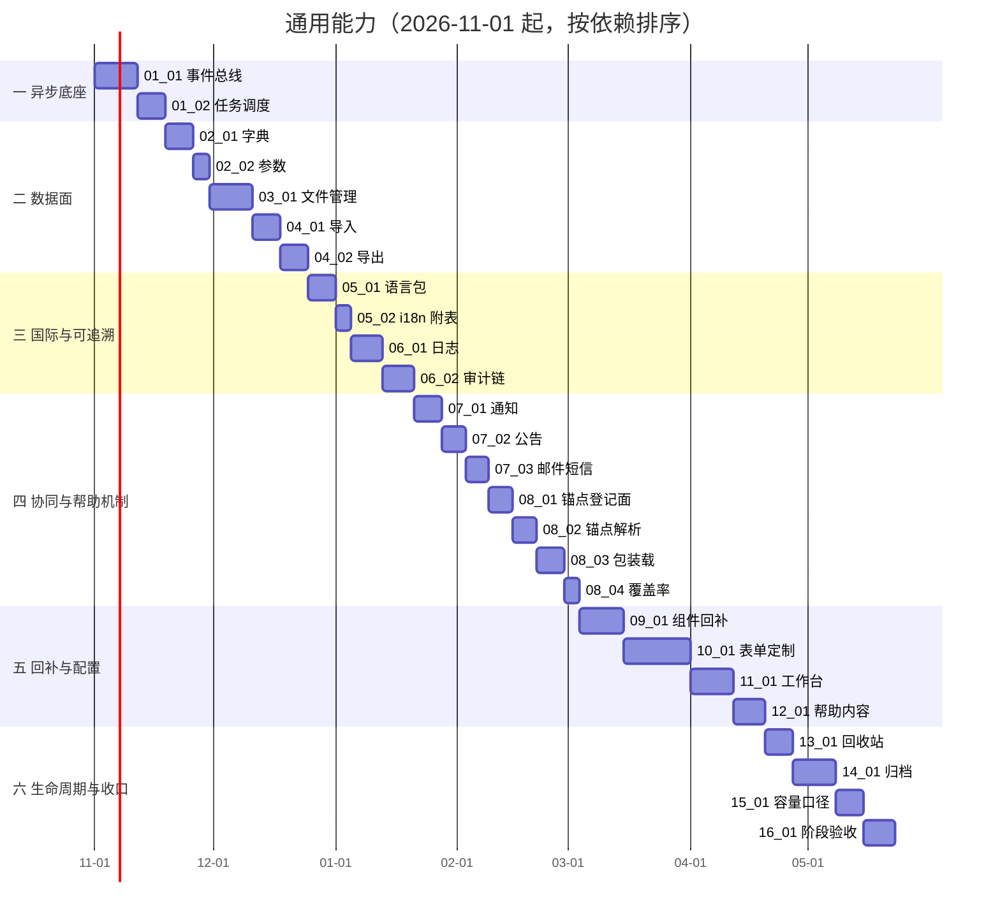

# 通用能力计划

[文档首页](../../../文档首页.md) › [08 通用能力](../README.md) › 计划　|　[任务基线 →](../README.md#batches)　[需求基线 →](../需求/00_需求_通用能力.md)

> 进度唯一落点（本文档）：**已完成 4 项，剩余 22 项**（2026-10-31 立项；门禁见 §5，遗留台账见 §7）

## 1. 计划说明 

- **排期对象**：阶段八「通用能力」26 条需求（12 个需求域），拆为 **16 个任务域 / 26 个子任务**；任务按**前后依赖**排序，不按需求编号顺序。
- **排期口径**：自 2026-11-01 起串行推进（单人兼职，按约 20h/周折算）；批次划分见[阶段总览](../README.md#batches)。
- **工时**：已完成 72h；剩余 456h；阶段合计 528h。
- **里程碑锚点**：M8 = 通用能力可用（各模块 CRUD + 日志落库、审计链校验通过、归档流转可用、工作台与表单接口可用、帮助机制三层可用、组件回补可用）。
- **排序依据（依赖链）**：事件总线与任务调度是审计、通知、归档、清理的共同前置；字典是表单定制与导入模板的前置；文件是导入产物与归档冷化的前置；帮助锚点机制必须先于组件回补（页面内帮助按钮消费锚点）。

## 2. 已完成任务（2026-10-31 ~ ） 

> 已完成任务在此归档（6 列：编号 / 任务 / 工时 / 完成日期 / 任务书 / 偏差与遗留）；未完成任务保留在 §3 并随状态更新。

| 编号 | 任务 | 工时（重估） | 完成日期 | 任务文件 | 偏差与遗留 |
| --- | --- | --- | --- | --- | --- |
| 01_01 | 事件总线（Outbox + 投递器 + 消费组 + 幂等重试死信） | 32h | 2026-10-31 | [任务书](../任务/01_异步底座/01_异步底座_01_事件总线/01_异步底座_01_事件总线.md) | 12 提交已推（`f611f8346..d1fc60976`），真 broker 4 用例通过、覆盖率 100%、Kiwi 2370；业务消费组随 06_01 / 06_02 / 07_01 接入；Outbox 多实例无行锁仍为开放项 |
| 01_02 | 任务调度（`sys_task` + 数据库调度器 + 内置任务） | 16h | 2026-10-31 | [任务书](../任务/01_异步底座/01_异步底座_02_任务调度/01_异步底座_02_任务调度.md) | 真机双 beat × 真 Redis 实证通过（Kiwi 2371），已推（`50aecce35`）；内置任务为占位执行体（归口 03_01 / 06 / 13 / 14）；遗留：前端任务页面（阶段十三）、产品自持 handler 钩子 |
| 02_01 | 字典统一数据源与运行时查询 | 16h | 2026-10-31 | [任务书](../任务/02_字典与参数/02_字典与参数_01_字典统一数据源与运行时查询/02_字典与参数_01_字典统一数据源与运行时查询.md) | 15 提交已推（`50aecce35..b1052236d`，Kiwi 2372）：12 个内建 key 规格化取数、`DictInvalidator` 版本化失效（`role` 样板）、`[dict]` 三防参数化、启动期与 CI 护栏、真 Redis 双实例一致性用例（并修出「缓存载荷非 JSON 可往返 → 共享层只写不读」缺陷）；推送预检全绿（pyright 0 错误、覆盖率 100%）。遗留：其余 11 key 写路径失效归各所有者域（`config` 归 02_02）、`user` / `tenant` 裁剪归 04 系列、版本键按 key 细化 |
| 02_02 | 系统参数（平台默认 + 租户覆盖） | 8h | 2026-10-31 | [任务书](../任务/02_字典与参数/02_字典与参数_02_系统参数/02_字典与参数_02_系统参数.md) | 管理面 7 端点 + `config:query` / `config:manage` + `is_overridden` 两层语义（重置回落 / 默认项删除保护 / 回收站恢复）+ 缓存载荷版本化与负缓存 + 参数写路径接 `config` 字典失效（Kiwi 2373）；真 Redis 双实例用例通过。遗留：前端参数页与菜单种子（阶段十五）、通用回收站页（13_01）、审计落库（06_01/06_02）、`test`/`prod` 的 `config_source` provider 拓扑（部署窗口） |

## 3. 剩余任务排期（自 2026-11-01） 

| 编号 | 任务 | 状态 | 工时 | 依赖 | 排期窗口 | 备注 | 偏差与遗留 |
| --- | --- | --- | --- | --- | --- | --- | --- |
| 03_01 | 文件管理（分片 / 断点续传 / 预签名 / 孤儿回收） | 未开始 | 32h | 01_02 | 2026-11-30 ~ 2026-12-10 | 需求 02-1；MinIO 私有桶 | 无 |
| 04_01 | Excel 批量导入（模板 / 校验 / 幂等 / 错误行） | 未开始 | 16h | 02_01/03_01 | 2026-12-11 ~ 2026-12-17 | 需求 02-2 | 无 |
| 04_02 | 列表导出与 PDF 产物 | 未开始 | 16h | 03_01/04_01 | 2026-12-18 ~ 2026-12-24 | 需求 02-3；脱敏按 data:plain | 无 |
| 05_01 | 语言清单与语言包（运行时下发 + 缓存） | 未开始 | 16h | 02_01 | 2026-12-25 ~ 2026-12-31 | 需求 06-1 | 无 |
| 05_02 | 业务文案 i18n 附表与用户时区偏好 | 未开始 | 8h | 05_01 | 2027-01-01 ~ 2027-01-04 | 需求 06-2 | 无 |
| 06_01 | 操作日志与登录日志（捕获 / 脱敏 / 链式落库） | 未开始 | 24h | 01_01 | 2027-01-05 ~ 2027-01-12 | 需求 05-1 | 无 |
| 06_02 | 字段级变更审计与哈希链（巡检 / 三权分立） | 未开始 | 24h | 06_01 | 2027-01-13 ~ 2027-01-20 | 需求 05-2 | 无 |
| 07_01 | 通知中心（站内信 / 角标 / 已读 / 渠道偏好） | 未开始 | 16h | 01_01/05_01 | 2027-01-21 ~ 2027-01-27 | 需求 04-1 | 无 |
| 07_02 | 公告管理（置顶 / 过期下线 / 已读回执） | 未开始 | 12h | 07_01 | 2027-01-28 ~ 2027-02-02 | 需求 04-2 | 无 |
| 07_03 | 邮件与短信通知（模板多语言 / 沙箱校验 / 记录） | 未开始 | 12h | 05_02/07_01 | 2027-02-03 ~ 2027-02-08 | 需求 04-3 | 无 |
| 08_01 | 锚点登记面（四表 `help_key` + 产品清单格式） | 未开始 | 12h | 阶段七元数据 | 2027-02-09 ~ 2027-02-14 | 需求 10-1；跨阶段改表 | 无 |
| 08_02 | 帮助锚点解析（五级链 / 未命中降级 / 按钮显隐） | 未开始 | 12h | 08_01 | 2027-02-15 ~ 2027-02-20 | 需求 09-1 | 无 |
| 08_03 | 产品帮助包装载注册（装载 / 升级 / 卸载 / 冲突） | 未开始 | 16h | 08_02 | 2027-02-21 ~ 2027-02-27 | 需求 09-2；依《帮助包规范》 | 无 |
| 08_04 | 帮助覆盖率门禁与台账 | 未开始 | 8h | 08_03 | 2027-02-28 ~ 2027-03-03 | 需求 09-3；CI 脚本 | 无 |
| 09_01 | 组件回补（字典 / 上传 / 预览 / 通知 / 审计差异） | 未开始 | 32h | 02_01/03_01/06_02/07_01/08_02 | 2027-03-04 ~ 2027-03-14 | 需求 08-3；含帮助按钮消费锚点 | 无 |
| 10_01 | 表单定制后端（布局 / 属性 / 动态 DDL / 校验） | 未开始 | 56h | 02_01/04_01/09_01 | 2027-03-15 ~ 2027-03-31 | 需求 08-2；跨四库类型映射 | 无 |
| 11_01 | 首页工作台后端（三级解析 / 卡片注册 / 模板 / 重置） | 未开始 | 32h | 07_01/07_02/10_01 | 2027-04-01 ~ 2027-04-11 | 需求 08-1 | 无 |
| 12_01 | 帮助内容维护与前台展示（分类 / 文章 / 反馈） | 未开始 | 24h | 08_02/11_01 | 2027-04-12 ~ 2027-04-19 | 需求 09-4 | 无 |
| 13_01 | 回收站（软删除查看 / 恢复 / 过期清理） | 未开始 | 16h | 01_02/06_02 | 2027-04-20 ~ 2027-04-26 | 需求 07-2 | 无 |
| 14_01 | 归档管理（策略 / 两段式 / 只读查询 / 销毁） | 未开始 | 32h | 01_02/03_01/06_02 | 2027-04-27 ~ 2027-05-07 | 需求 07-1；归档前链校验 | 无 |
| 15_01 | 异步链路容量与延迟（压测与指标） | 未开始 | 16h | 01_01/06_02/14_01 | 2027-05-08 ~ 2027-05-14 | 需求 11-1 | 无 |
| 16_01 | 阶段验收与测试报告 | 未开始 | 24h | 全部 | 2027-05-15 ~ 2027-05-22 | 需求 12-1；门禁逐条结论 | 无 |

## 4. 排期甘特图 

## 5. 阶段八验收门禁 

| 验收点 | 对应任务 | 核对方式（结论在阶段测试报告） |
| --- | --- | --- |
| 通用能力齐备（12 域功能可用） | 01_01 ~ 14_01 | 逐模块 CRUD + 日志落库用例；接口契约用例 |
| 写路径唯一（无二次写入口） | 02_01 / 05_02 / 08_03 | 表归属检查：字典无平台表；i18n 附表随主表写；帮助内容只经装载或后台维护 |
| 异步底座可用（事件必达、任务可管） | 01_01 / 01_02 | 投递器中断恢复补投用例；双 beat 不重复执行用例；死信告警 |
| 审计链可校验（篡改可定位） | 06_01 / 06_02 | 链校验用例；篡改定位用例；归档前校验拦截用例 |
| 多语言可运行期扩展（加语言免发版） | 05_01 / 05_02 | 新增语言（含 RTL）用例；缺省回退用例 |
| 数据生命周期可执行 | 13_01 / 14_01 | 归档流转用例；回收站恢复与过期清理用例 |
| 帮助机制三层可用 | 08_01 ~ 08_04 / 12_01 | 五级解析用例；装载升级卸载用例；覆盖率台账；内容状态机 |
| 可配置性后端可用 | 09_01 / 10_01 / 11_01 | 三级布局解析用例；动态 DDL 跨四库用例；动态校验用例 |
| 遗留有归口（无「无归口」条目） | 16_01 | 台账逐条「来源 + 归口」；收口断言用例 |

**门禁对照**：门禁行数与本表一致；结论与证据索引见阶段测试报告（收口时产出）。

## 6. 风险与对策 

| 风险 | 影响 | 对策 |
| --- | --- | --- |
| 阶段体量大（26 子任务 / 528h），易「全部半成品」 | 无法验收 | 按 16 段串行，每段自成闭环、可独立验收；每段完成才进下一段 |
| 底座延期会拖住后面 6 个模块 | 连锁延期 | 01_01 / 01_02 为首批且标「紧急」；未就绪前其余模块不做异步化改造 |
| 动态 DDL 安全（租户自建字段） | 注入 / 破坏表结构 | 类型白名单 + 跨四库类型映射 + 标识符校验（不走字符串拼接） |
| 帮助包与产品版本耦合 | 升级覆盖租户编辑 | `local_override` 保护 + 包内移除只下线不删 + 装载前 `dry-run` |
| AI 误用（生产读代码） | 源码外泄 | 生产默认关闭生成（架构 28 §7.6）；AI 只写草稿，包只收 published/offline |
| 压测环境与生产差异 | 容量结论失真 | 15_01 报告须写明环境规格；不达标记「限定达标」并归口 |

## 7. 后续阶段待办 

| # | 事项 | 来源 | 归口 |
| --- | --- | --- | --- |
| 1 | AI 帮助文档生成能力（四类触发 / 质量评估） | 架构 28 §7 | 阶段十九 AI 能力 |
| 2 | 帮助与审计日志进入全文检索（ES 同步） | 架构 28 §6 | 阶段十八全文检索 |
| 3 | 帮助文章 AI 质量巡检任务 | 架构 28 §7.3 | 阶段十九（依赖 01_02 任务调度） |
| 4 | 产品仓（biz / mdm / cw）帮助包接入与首版内容 | 《帮助包规范》 | 各产品接入任务 |
| 5 | 开放接口 / Webhook 对事件的订阅 | 架构 16 §7 | 阶段十 |
| 6 | 前端全页面（工作台 / 表单设计器 / 帮助中心页） | 阶段八完成标准 | 阶段十五 |
| 7 | 真库（MySQL / PG / DM8）与真部署压测 | 需求 11-1 | 部署窗口（与 07C 遗留同窗口） |
| 8 | Kiwi 用例编号登记 | 各任务测试记录 | 平台窗口 |

> 本文档依《[计划文档规范](../../../规范/计划文档规范.md)》编写 · 进度以本表为唯一落点
